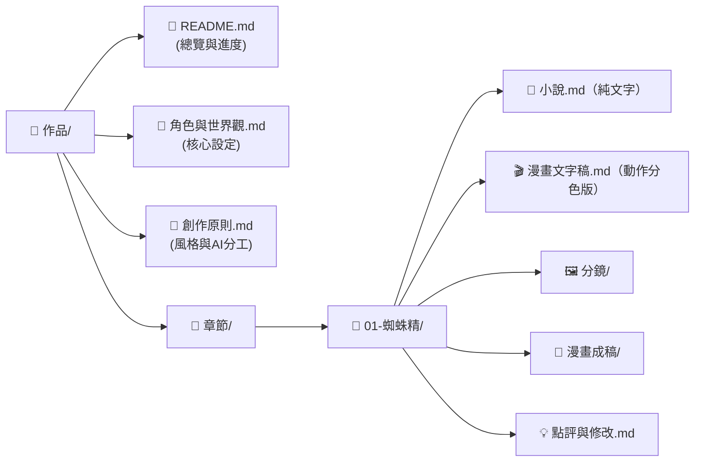

# 🏢 雙面日常：保險業務 × 深夜除妖（暫定）

> **核心概念**：白天是業績墊底的社畜保險業務，夜晚走進廢棄大樓除妖貼補家用；在現實生存壓力與超自然危機夾擊下的都市奇幻故事。

---

## 🗺️ 專案架構圖

---

## 📊 章節進度看板

| 章節 | 標題 | ① 小說 | ② 小說點評 | ③ 粗分鏡 | ④ 分鏡點評 | ⑤ 漫畫測試 | ⑥ 定稿 |
| :--- | :--- | :---: | :---: | :---: | :---: | :---: | :---: |
| **Ch.01** | [01-蜘蛛精](./章節/01-蜘蛛精/小說.md) | 🟨 撰寫中 | ⬜ | ⬜ | ⬜ | ⬜ | ⬜ |
| **Ch.02** | 待定 | ⬜ | ⬜ | ⬜ | ⬜ | ⬜ | ⬜ |

> 圖例：`⬜ 未開始` ｜ `🟨 進行中` ｜ `🟩 已完成`
