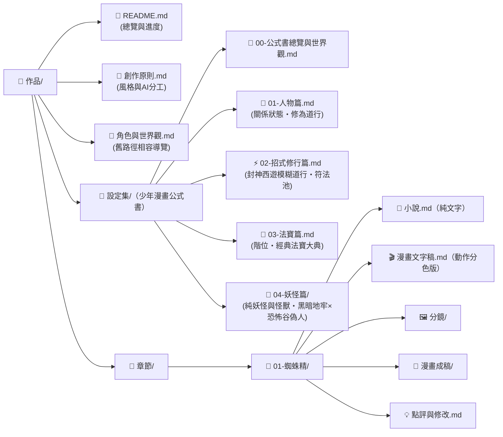

# 🏢 雙面日常：保險業務 × 深夜除妖（暫定）

> **核心概念**：白天是業績墊底的社畜保險業務，夜晚走進廢棄大樓除妖貼補家用；在現實生存壓力與超自然危機夾擊下的都市奇幻故事。

---

## 🗺️ 專案架構圖（官方公式書重構版）

---

## 📘 官方設定集（公式書）快速入口

| 篇章 | 檔案連結 | 收錄重點 |
| :--- | :--- | :--- |
| **總覽與世界觀** | [設定集/00-公式書總覽與世界觀.md](./設定集/00-公式書總覽與世界觀.md) | 日夜循環、劇情壓力與終章定案、現代職場規則、雙軌經濟體系 |
| **人物篇** | [設定集/01-人物篇.md](./設定集/01-人物篇.md) | 全角色關係網圖、人物關係狀態、修為與道行（含無修為凡人標註）與後續伏筆 |
| **招式修行篇** | [設定集/02-招式修行篇.md](./設定集/02-招式修行篇.md) | 以《封神》《西遊》模糊道行制為核心之修行體系、四階五維術法候選池、符咒二段式耗能與成本表 |
| **法寶篇** | [設定集/03-法寶篇.md](./設定集/03-法寶篇.md) | 凡器至先天至寶階位、本作已登場耗材、《西遊記》《封神演義》《山海經》核心法寶大典 |
| **妖怪與怪獸篇（全圖鑑）** | [設定集/04-妖怪篇/00-妖怪篇總綱與圖鑑分級.md](./設定集/04-妖怪篇/00-妖怪篇總綱與圖鑑分級.md) | 剔除神明，純收錄本作妖物（`01-蜘蛛精`）＋《西遊記》《封神演義》《山海經》全書妖怪與怪獸（黑暗地牢昆蟲／寄生 × 恐怖谷偽人改寫與黑白插圖） |

---

## 📊 章節進度看板

| 章節 | 標題 | ① 小說 | ② 小說點評 | ③ 粗分鏡 | ④ 分鏡點評 | ⑤ 漫畫測試 | ⑥ 定稿 |
| :--- | :--- | :---: | :---: | :---: | :---: | :---: | :---: |
| **Ch.01** | [01-蜘蛛精](./章節/01-蜘蛛精/小說.md) | 🟨 撰寫中 | ⬜ | ⬜ | ⬜ | ⬜ | ⬜ |
| **Ch.02** | 待定 | ⬜ | ⬜ | ⬜ | ⬜ | ⬜ | ⬜ |

> 圖例：`⬜ 未開始` ｜ `🟨 進行中` ｜ `🟩 已完成`
