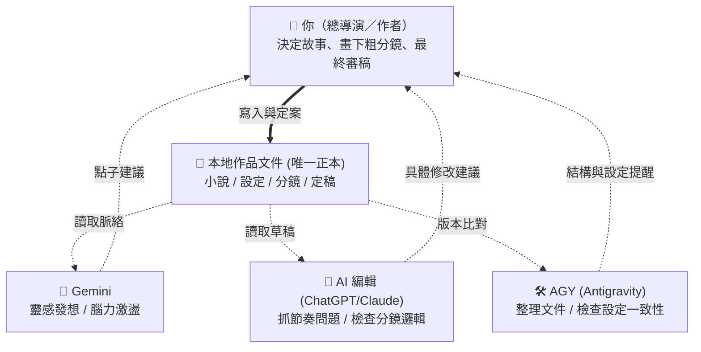
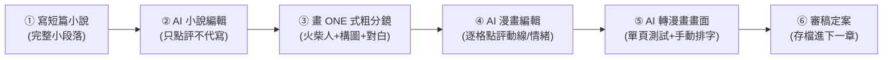
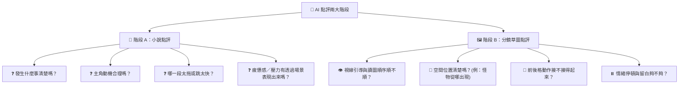

# 🧭 創作原則與工作流

---

## 🎛️ 創作者與 AI 協作分工圖

> [!IMPORTANT]
> **核心鐵律**：所有 AI 給的都只是「顧問建議」，**本地資料夾的文件才是唯一正本**。

---

## 🔁 每章節 6 步工作流

---

## 🔍 AI 點評檢核表（不空談、只講具體問題）

---

## 🎨 分鏡與成稿原則對照

| 階段 | ✅ 要做的事 | ❌ 不要做的事 |
| :--- | :--- | :--- |
| **③ 粗分鏡** | 用火柴人畫清楚：**位置、動作、表情、視角、對白** | 不必把草圖畫到精細美觀 |
| **④ AI 點評** | 要求指出**「第幾格 → 什麼問題 → 怎麼改」** | 拒絕「畫面可以更有張力」這類空泛評語 |
| **⑤ AI 成稿** | **一頁或幾格分批測試**；對白氣泡最後自己排 | 不要一次生成整章；不直接依賴 AI 圖片裡的文字 |
