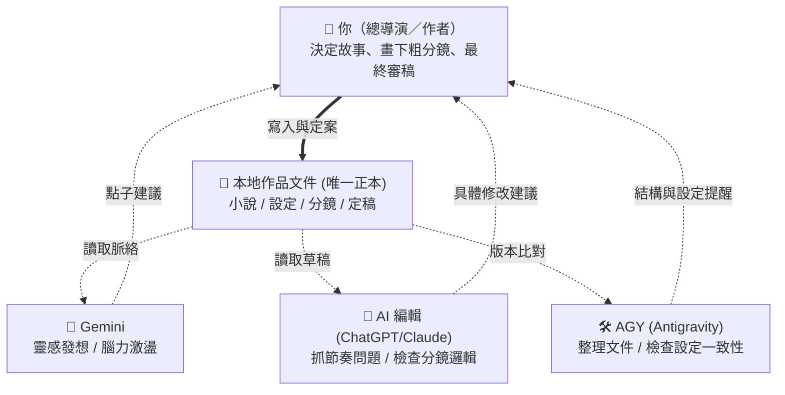
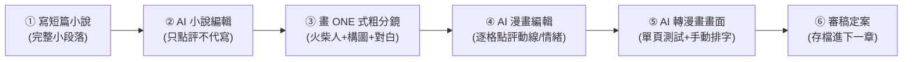
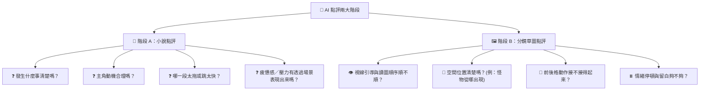

# 🧭 創作原則與工作流

---

## 🎛️ 創作者與 AI 協作分工圖

> [!IMPORTANT]
> **核心鐵律**：所有 AI 給的都只是「顧問建議」，**本地資料夾的文件才是唯一正本**。

---

## 🔁 每章節 6 步工作流

---

## 🔍 AI 點評檢核表（不空談、只講具體問題）

---

## 🎨 分鏡與成稿原則對照

| 階段 | ✅ 要做的事 | ❌ 不要做的事 |
| :--- | :--- | :--- |
| **③ 粗分鏡** | 用火柴人畫清楚：**位置、動作、表情、視角、對白** | 不必把草圖畫到精細美觀 |
| **④ AI 點評** | 要求指出**「第幾格 → 什麼問題 → 怎麼改」** | 拒絕「畫面可以更有張力」這類空泛評語 |
| **⑤ AI 成稿** | **一頁或幾格分批測試**；對白氣泡最後自己排 | 不要一次生成整章；不直接依賴 AI 圖片裡的文字 |

---

## 🧪 小說點評 Harness：診斷與回饋規則

> 2026-11-18：依作者此次與 Gemini、ChatGPT 討論補充。這是跨章節的點評方法，不是把 AI 的示範句、推測或建議直接升格為世界觀定案。

### 1. 作者主導，先診斷再建議

- 預設只點評、不代寫，不自行覆寫正文。作者另有明確要求時，才提供局部改寫或修改檔案；示例須標為可選方案。
- 先讀最新正文、角色與世界觀及本規則，再比較前稿；分清「作者已決定」「草稿目前呈現」「AI 建議」「尚待確認」。其他 AI 的意見也須經文本檢驗，不因語氣肯定就照收。
- 不為迎合作者而稱所有句子合理。指出優點時給出文本證據；保留意見時說明具體閱讀障礙和原因。主觀風格偏好不得偽裝成文學或生理定律。
- 每次先列最影響閱讀的 2–3 個問題，採「原句或位置 → 讀者可能如何理解 → 問題原因 → 可行修改方向」格式；文字錯誤另列。不要用大量改寫掩蓋診斷。

### 2. 情緒、個性與反應幅度

- 先判斷人物當下是疼痛、疲憊、震驚、警戒、恐懼還是憤怒，再檢查表情、動作與用詞是否相符；避免為追求戲劇性疊加誇張神情。
- 作者本次不想用「齜牙咧嘴」描述普通起身，也不喜歡在情緒尚未到憤怒時硬加髒話或「畜生」等貶詞。此場景主要是震驚，不應擅改成辱罵。這是語氣與情境的匹配原則，不是任何情況都禁止這些詞。
- 診斷「僵住、瞳孔收縮、捂口鼻、喉結滾動」等動作時，要看是否各有不同作用、是否重複同一情緒，以及是否符合角色經驗；不是要求全部刪掉。

### 3. 調查過程、能力與線索因果

- 作者本次說明家銘目前是「三流接近二流的法師」。據此檢查他需要的調查時間、能察覺的線索及推論速度；此定位不代表已確定完整等級制度或所有能力。
- 避免人物剛到現場就無依據地得出答案，也不要為了交代時間而機械塞入「調查十分鐘」。依調查範圍、移動、實際行為和能力，判斷是否需要一句時間概述或一個具體調查動作。
- 檢查「看見／聞到什麼 → 如何判斷 → 為何採取下一步」是否連得起來。推論可以是暫時假設，不必一開始全懂；角色確信的程度應與證據相稱。
- 能力效果須一致：例如開天眼是否也解開嗅覺遮蔽、障眼法遮蔽哪些痕跡。未定案時標出問題及選項，不替作者新增能力規則。

### 4. 場景與動作：服務閱讀，不套字數公式

- 場景描寫以空間定位、氛圍、人物感受、行動障礙或線索為目的；按當段功能調整詳略。可以用少量突出細節練習，但不得硬性限定三句，也不得禁止後續補環境描寫。
- 檢查人物從哪裡到哪裡、關鍵動作為何發生；只補會影響讀者理解的環節，不要求每一步都寫成操作說明。
- 小說省略同一主詞、換用姓名或代詞，以清楚自然為準。漫畫分鏡另行標明角色與位置，不要求小說每句重複姓名。

### 5. 防止錯誤規則與設定膨脹

- 不因「小妖」就斷言不能出現陰風；先區分自然風、氛圍用語及超自然現象，依作品設定判斷，不能把刪除陰風當固定規則。
- 不把「屏息不能喝水」當作普遍生理定論。若句子動作順序讓讀者困惑，指出語意問題，不以不可靠常識強制修改。
- 符水的味道、刺痛、價格、代價及使用限制，只有正文或作者確定的部分才有依據。可以詢問為何不一開始使用，但不能規定一定昂貴、一定痛或一定有副作用。
- 警方是否能發現血跡、是否知道妖怪、妖怪如何避開調查，都依文本及世界觀判斷；不能斷言「沒血跡就只能當失蹤案」「警方一定會／不會發現」，也不為補洞立即新增萬能隱身術。
- 不把尚未採納的建議填入「點評與修改」的作者決定欄；不擅自把草稿變動標為定稿或驗收完成。

### 6. 回覆前自查

- 我是否引用了實際讀到的最新文字，而不是只評論舊稿？
- 我是否指出具體改善，也保留真正未解決的問題？
- 建議是否維持人物個性與作者想要的情緒，而非改成 AI 習慣的浮誇語氣？
- 我是否把可選手法講成禁令，或把未確認設定講成事實？
- 作者能否在不照抄 AI 成品的情況下，明白下一步如何自己修改？
