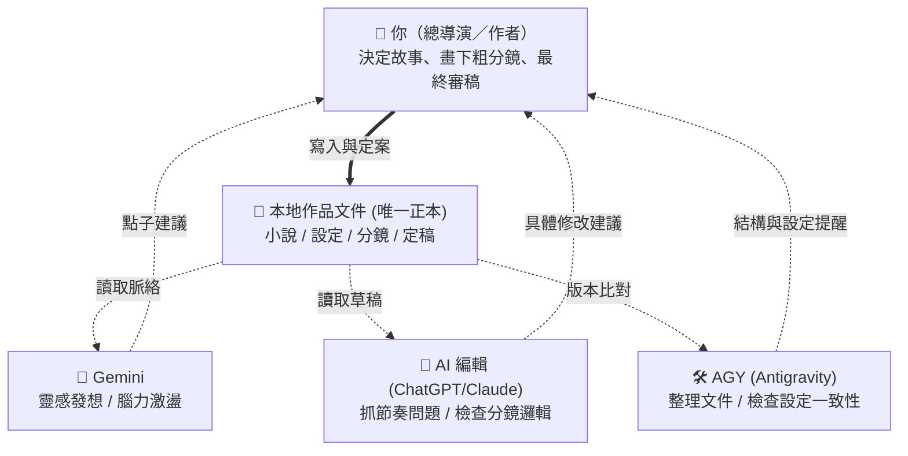
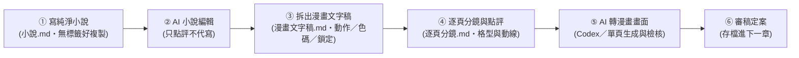
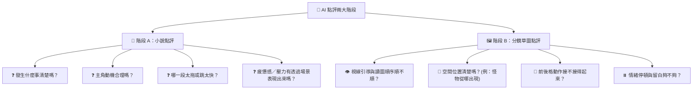

# 🧭 創作原則與工作流

---

## 🎛️ 創作者與 AI 協作分工圖

> [!IMPORTANT]
> **核心鐵律**：所有 AI 給的都只是「顧問建議」，**本地資料夾的文件才是唯一正本**。

### 🧩 敘事與世界觀鐵律（2026-11-20 補充）
- **表裏雙線嚴格平行原則（前期鐵律）**：故事前期，**白天保險職場與夜晚地下除妖屬於兩條互不干擾的平行線**（像白天當工程師、晚上兼差外送／畫稿一樣）。**嚴禁為了串聯劇情而硬湊「保險客戶剛好撞鬼」等做作巧合**；雙重壓力必須來自搶奪同一個身體、時間、金錢與門面（熬夜除妖拖垮白天精神與西裝 ➔ 白天 0 收入逼得晚上非接單不可）。直到中後期大事件炸穿表裏界線，兩條線才真正交會。
- **前期聚焦主角原則**：前期篇幅專注於刻畫許家銘本人的生存壓力、性格與處境；除蔡經理、明叔等固定配角外，未來會因搬家或換場退場的過場街坊與路人**一律不具名、不硬開無關支線**，避免分散讀者注意力。
- **角色台灣在地命名原則**：除主角「許家銘」外，全作所有配角（職場同事、主管、客戶、房東、地下中介、符材行老闆與基層同行）一律採用**符合台灣各年齡世代的真實常見姓名與日常稱呼**，避開仙俠浮誇名或日式姓名。

---

## 🔁 每章節 6 步工作流（雙軌文字稿流程）

- **`小說.md`（純小說版）**：保持**完全純淨的繁體中文散文**——不加任何 HTML 色碼、不加場景鎖定標籤、不外掛片假名音效字，方便作者自由閱讀、複製、轉貼或發表。
- **`漫畫文字稿.md`（漫畫動作文字版）**：從該章定案小說衍生而出，改編方向偏重**具體肢體動作（左／右手腳）、投擲與閃避象限、鏡頭角度、JoJo 擬聲字、色彩語意防誤判與場景鎖定錨點**，專供 `逐頁分鏡.md` 與 Codex 生圖讀取。

---

## 🔍 AI 點評檢核表（不空談、只講具體問題）

---

## 🎨 分鏡與成稿原則對照

作者偏好：粗分鏡參考 ONE 的簡筆敘事，打鬥分鏡參考《咒術迴戰》。成稿可往《獵人》或《咒術迴戰》的黑白漫畫質感發展，畫風有彈性。日常與動作格線條要有粗細取捨，避免用無意義的細線鋪滿畫面造成 AI 感；**但妖怪邪祟初登場第一幕例外（見下方視覺生成 Harness）**。

| 階段 | ✅ 要做的事 | ❌ 不要做的事 |
| :--- | :--- | :--- |
| **③ 粗分鏡** | 用火柴人畫清楚：**位置、動作、表情、視角、對白** | 不必把草圖畫到精細美觀 |
| **④ AI 點評** | 要求指出**「第幾格 → 什麼問題 → 怎麼改」** | 拒絕「畫面可以更有張力」這類空泛評語 |
| **⑤ AI 成稿** | **一頁或幾格分批測試**；對白氣泡最後自己排 | 不要一次生成整章；不直接依賴 AI 圖片裡的文字 |

> **章節標題排序規則（2026-11-19）**：**僅「序章」採用 Cold Open 壓尾形式，標題置於正文結尾「早安，今天也請全力衝刺！」之後；其餘正式章節（第 01 話起）恢復開篇置頂正常排序。**

---

## 👁️ 視覺與 AI 生圖 Harness：怪物／分鏡成稿規範

> 2026-11-19：依作者視覺測試方向補充。凡產出 AI 繪圖 Prompt（生成文字）或執行單頁成稿測試時，須優先遵守以下規則：

### 1. 先讀文本、動作文字稿與參考圖，不脫離文本自創造型
- 撰寫任何怪物、角色或場景的**生圖文字（Prompt）**前，必須先對照最新 `小說.md`（純文字正本）與 `漫畫文字稿.md`（動作、色碼與空間鎖定版）的現場光影、距離、姿勢與五官文字描寫，以及 [`設定集/`](./設定集/00-公式書總覽與世界觀.md)（[人物篇](./設定集/01-人物篇.md)、[妖怪篇](./設定集/04-妖怪篇/00-妖怪篇總綱與圖鑑分級.md)）中對應角色的視覺基準與 `參考圖/` 檔案。
- **風格總基調（2026-11-21 定案：黑暗地牢昆蟲／寄生生物恐怖 × 克蘇魯不可名狀 × 恐怖谷偽人）**：
  - 本作僅收錄並刻畫**妖怪與怪獸（不將神明、佛菩薩、仙官納入怪物設計）**，嚴格拒絕傳統仙俠美型妖、威風神話動物（單純狼／熊／虎／蝙蝠）或卡通反派造型。
  - **核心降維原則（「黑暗地牢」式生物恐怖）**：把傳統神話生物原型往**更原始、更令人本能生理厭惡**的方向推——如同吸血鬼改取蚊子而非蝙蝠、獸妖改取寄生蟲／腐食昆蟲質感而非單純猛獸。設計時大量取材以下四大生物庫，並疊加**克蘇魯的「不可名狀」**與**黑暗地牢的潮濕腐朽感**：
    1. **昆蟲**：蚊子（吸血口針）、螳螂（捕食鐮肢）、蜈蚣、甲蟲（腐食／重甲）、蠅、蜂（蜂巢／毒針）
    2. **節肢動物**：蜘蛛、蠍、馬陸（多足蠕動與硬質甲殼接縫）
    3. **寄生生物**：吸盤、裂開式口器、產卵管／產卵器、幼蟲鑽入皮下
    4. **軟體與環節動物**：水蛭、水螅、變形蟲般的半透明／無固定形態蠕動質感
  - **兩大造型鐵律**：
    - **【類人妖怪／凡有臉者】→ 恐怖谷 ＋ 偽人感 ＋ 細微節肢／寄生結構**：表面偽裝成人類，但在眼神（複眼反光／無焦距凝視）、表皮（皮下隱約浮現節肢紋路與產卵管隆起）、口部（嘴部縱裂化為昆蟲口器）暴露非人本質。
    - **【非人妖怪／怪獸】→ 黑暗地牢式生物恐怖**：捨棄傳統威風神獸輪廓，完全以昆蟲、寄生生物、節肢與環節動物為主體，強調潮濕反光、無固定形態集群、寄生吸盤與殘留人骨。
  - **五大核心標竿對照**：
    - `白骨精`（避：白骨美人）➔ 表面蒼白女人（偽人），皮下隱約有節肢紋路，眼睛帶複眼反光，嘴部可裂開成口器。
    - `蜈蚣精／百眼魔君`（避：人首蜈蚣）➔ 完全以巨型蜈蚣為主體，身體具寄生吸盤與產卵管，置於潮濕黑暗地牢環境。
    - `蜘蛛精族群`（避：美女蜘蛛）➔ 巨大寄生蜘蛛形態，腹部具產卵器，腿部關節帶人骨殘留、濕潤反光。（*註：序章已完稿之 `01-蜘蛛精` 維持原恐怖谷捕鳥蛛定案不倒改，屬該族群之近人臉變異株。*）
    - `窮奇／混沌`（避：傳統神獸／無面萌神）➔ 無固定形態的昆蟲集群體，或巨大多足寄生生物，持續蠕動。
    - `九尾狐（妲己）`（避：毛絨狐狸美人）➔ 表面美人（偽人），背後或皮膚下露出節肢尾巴與產卵管結構，帶強烈恐怖谷。

### 2. 分層精細度原則（日常俐落 vs. 怪物初登場必求「滲人」）
- **日常社畜與高速打鬥格**：保持偏《獵人》《咒術迴戰》的俐落 G 筆墨線、高對比黑白實塗與大片留白，壓低繁瑣排線與平滑灰階網點，防止畫面產生 AI 精緻插畫感。
- **【強制例外】妖怪／邪祟初登場第一幕與恐怖谷特寫**：凡怪物剛現身的定場格或臉部揭露特寫，**線條與細節精細度必須明顯拉高**——需細緻刻畫濕黏髮絲、非人皮膚毛孔與接縫質感、純黑無眼白眼球的濕冷反光、異形口器肉質摺皺，以及黑暗環境的深層陰影對比，務必做出**「滲人（令人背脊發涼、生理不適、掉 SAN 值）」**的視覺衝擊，不得為了簡化線條而畫成草率怪物。

### 3. 漫畫文字稿色彩標記與對話框防誤判規範（Codex 分鏡與生圖強制規則）
為了避免 AI／Codex 將旁白、內心戲、手機訊息與音效錯畫成「角色說話的對話氣泡」，`小說.md` 維持純淨繁體中文不加任何色碼，改由各章專屬的 `漫畫文字稿.md` 採用以下 **6 層視覺語意色彩規範**（Obsidian 與 Markdown 皆可直接判讀）：

| 文本色碼／格式 | 語意類型 | 漫畫畫面對應呈現方式 | 嚴格禁止事項 |
| :--- | :--- | :--- | :--- |
| **預設原色（無引號）** | **純視覺動作／鏡頭描寫** | 直接畫成角色動作、表情與場景光影 | 不得變成任何旁白框或對話氣泡 |
| **預設原色＋`「……」`** | **角色實際開口說出的台詞** | **唯一可進入「對話氣泡（Speech Bubble）」的文字**。低聲自語用小字細框；怪物扭曲人話用抖動／破損鋸齒框 | 未加 `「」` 或已上色為藍／橘／紫者，不可搶用說話氣泡 |
| <b>鋼晴藍</b>（<code>#3A8AD9</code>） | **旁白說明／規則／帳目／客觀現況** | 使用**無尾巴的「矩形旁白方框（Narration Box）」**置於分格角落，或純粹作為畫師構圖資訊不入字；內部專有名詞改用 `『』` | **嚴禁畫成指向角色的圓形／尖刺對話氣泡**（特別禁止讓角色邊潛行邊大喊「掌心雷！」等旁白招式名） |
| <b>琥珀金橘</b>（<code>#D97706</code>） | **內心戲／心理 OS／感官驚駭／算帳心聲** | 使用**「無外框浮動手寫小字／虛線或斷續思考文字（Floating Thought Text）」**呈現心理反應 | **嚴禁畫成實線開口說話氣泡** |
| <b>科技靛紫</b>（<code>#8B5CF6</code>） | **手機新聞推播／中介簡訊（Screen UI）** | **只許存在於「手機螢幕 UI 畫面內」或貼近手機的矩形訊息氣泡窗** | **嚴禁憑空在街邊畫出大型電視機，或從角色頭頂拉出說話氣泡** |
| **緋紅粗體『……』**（<code>#E11D48</code>） | **繁體中文漫畫擬聲字（SFX）** | 轉換為**「無框立體手寫繁體中文漫畫美術字」**：以傾斜透視、震動／龜裂／電弧／黏滴筆刷質感，直接壓印在聲源旁或空間留白處。全冊統一使用「沙沙」「喀噠」「轟——！」「劈啪」「鈴鈴鈴」「嗡」等中文狀聲詞；依聲音輕重調整字重與大小。**不使用日文片假名，不把括號註解或動作解釋印在圖上。** | **禁止將擬聲詞放進有尾巴的圓形或雲朵對話氣泡；禁止中日雙語並列** |

- **【防過度簡化原則】**：轉成漫畫文字時，**關鍵術式條件、完整戰術內心反思（例如「如果用了閉氣訣為何仍會死」）、手機簡訊前因後果（例如中介扣款原因）與算帳成本明細，必須完整保留足夠語境**，不得為了排版省事硬砍成一兩個破碎短詞；唯有純動作驚險瞬間（如主角急衝格）才依分鏡指定「刻意留白不放字」。

### 4. 少年漫畫版面構圖與動作表現鐵律（嚴禁全篇四格條漫化！）
- **【絕對禁令】嚴禁連續使用「4 個等寬橫條由上往下堆疊」的四格漫畫（4-Koma）版面！**
- **正統少年漫畫不對稱錯落分頁（3～6 格錯落配置）**：
  - 每頁必須具備清楚的**視覺主次節奏**：至少 1 個佔頁面高度 **35%～60%** 或跨雙欄的主力大格（用於定場、恐怖初見或重擊定格），搭配數個大小反差明確的小格（窄長眼睛／指尖格、縱向分欄格、留白靜止格）。
  - **戰鬥與武技動作分鏡參考**：
    - 貼身近戰重擊（如「掌心雷」下砸）：參考《咒術迴戰》虎杖、東堂、秤、五條、宿儺的**極端廣角透視、體重傾瀉壓迫、暴力速度線與黑閃式強對比黑白震盪波**。
    - 踢技與氣勁爆發（如收尾高前踢）：可使用特寫腿部搭配**港漫風格（氣焰流光、破風氣浪與白熱渦流特效）**強化踢擊爽度。
    - 戰術範圍甩符或多人多向位移：可切入**「天花板垂直俯瞰鏡頭＋人物線條極簡化」**，一眼交代各方向攻擊路線。
    - 遭遇高速撲殺、甩符爆燃或墜落，**必須使用斜線切割（Diagonal Cut）、L 型包圍格或破格出血（Break-out / Bleed）**。
  - **日常與恐怖轉折保留留白呼吸**：日常受苦（如公寓戰車冷氣、早會聞焦味）可方正與直格穿插，但仍須維持景別大小落差，嚴禁機械式四等分切割。

### 5. 單一場域空間鎖定與防亂飄鐵律（Scene Lock & 180° 軸線規範）
凡閱讀 `漫畫文字稿.md` 時，兩個 **`【🔒 場景鎖定 ...】`** 之間屬於**同一連續空間與時間流（尚未換景）**，跨格與換頁時必須死守建築與站位錨點，嚴禁畫面元素在中途亂飄、瞬移或憑空生成雜物：
1. **建築與牆面材質全程鎖死**：地下室期間全程維持「無窗泥灰裸露水泥長廊＋頭頂黑管線＋潮濕積水反光地面」，不得突然變成磚牆地牢、白瓷磚醫院或憑空生出窗戶；1F–2F 樓梯間全程維持「水泥階梯＋矮牆護欄＋金屬扶手＋下方梯井入口」，不得打到一半變平地。
2. **生活空間與家具物理合理性（反人類設計禁令）**：室內場景必須符合真實建築邏輯——**房門開關半徑內嚴禁緊貼擺放書桌或櫃子把門堵死**；浴室水龍頭下方**必須配備真實洗臉盆／洗手台**，不得在光禿磁磚牆上孤零零插一根戶外龍頭接空氣。
3. **相對站位、180° 軸線與「投擲／閃避／爆炸左右同側」鎖死**：
   - 地下室交戰中，**許家銘永遠靠後方安全梯入口側，蜘蛛精永遠在走廊深處（屍堆牆角側）**，絕不可讓樓梯跑到怪物身後；往前衝刺兩步急停時，背景樓梯必須隨之退遠，不可複製原地站位。
   - **攻擊象限一致性**：以場景中的同一面牆為基準，不把紙面左右當成世界座標。第一符飛向家銘面朝遠牆時的右側牆面，蜘蛛向另一側閃避，火仍在該面牆旁爆開。正面拍家銘時，這面牆在紙面左；換成家銘肩後看怪物時，在紙面右。以同一個 L 形管接頭辨認，換鏡不能讓符、爆點或受火側腹瞬移。
4. **左右手、武器與道具庫存鎖死**：作者已確認掌心雷沒有固定施法手限制。**第一次左手結印蓄雷，因慣用右手正在掏符；六符用完後，第二次改由慣用右手重新結印、落掌，左手負責撐牆與平衡；右腿高前踢。早會右手藏袋、舉左手，承接實際落掌的手。** 烈火符共 6 張：**1 張引爆＋5 張封廊＝歸零**，每次拿取、投出和空手狀態都要連得起來。
5. **跨頁建築回收與防分身幻覺（Zero Hallucinated Props）**：開場「1F–2F 樓梯轉角」必須與後段伏擊一致；同格內**嚴禁畫出兩個許家銘**，也不得在走廊中央無故生出完整趴屍、街邊大電視或多餘牆壁符紙。

---

## 🧪 小說點評 Harness：診斷與回饋規則

> 2026-11-18：依作者此次與 Gemini、ChatGPT 討論補充。這是跨章節的點評方法，不是把 AI 的示範句、推測或建議直接升格為世界觀定案。

### 1. 作者主導，先診斷再建議

- 預設只點評、不代寫，不自行覆寫正文。作者另有明確要求時，才提供局部改寫或修改檔案；示例須標為可選方案。
- 先讀最新正文、[`設定集/`](./設定集/00-公式書總覽與世界觀.md)（原 `角色與世界觀.md` 已重構為公式書）及本規則，再比較前稿；分清「作者已決定」「草稿目前呈現」「AI 建議」「尚待確認」。其他 AI 的意見也須經文本檢驗，不因語氣肯定就照收。
- 不為迎合作者而稱所有句子合理。指出優點時給出文本證據；保留意見時說明具體閱讀障礙和原因。主觀風格偏好不得偽裝成文學或生理定律。
- 每次先列最影響閱讀的 2–3 個問題，採「原句或位置 → 讀者可能如何理解 → 問題原因 → 可行修改方向」格式；文字錯誤另列。不要用大量改寫掩蓋診斷。

### 2. 情緒、個性與反應幅度

- 先判斷人物當下是疼痛、疲憊、震驚、警戒、恐懼還是憤怒，再檢查表情、動作與用詞是否相符；避免為追求戲劇性疊加誇張神情。
- 作者本次不想用「齜牙咧嘴」描述普通起身，也不喜歡在情緒尚未到憤怒時硬加髒話或「畜生」等貶詞。此場景主要是震驚，不應擅改成辱罵。這是語氣與情境的匹配原則，不是任何情況都禁止這些詞。
- 診斷「僵住、瞳孔收縮、捂口鼻、喉結滾動」等動作時，要看是否各有不同作用、是否重複同一情緒，以及是否符合角色經驗；不是要求全部刪掉。

### 3. 調查過程、能力與線索因果

- 作者本次說明家銘目前是「三流接近二流的法師」。據此檢查他需要的調查時間、能察覺的線索及推論速度；此定位不代表已確定完整等級制度或所有能力。
- 避免人物剛到現場就無依據地得出答案，也不要為了交代時間而機械塞入「調查十分鐘」。依調查範圍、移動、實際行為和能力，判斷是否需要一句時間概述或一個具體調查動作。
- 檢查「看見／聞到什麼 → 如何判斷 → 為何採取下一步」是否連得起來。推論可以是暫時假設，不必一開始全懂；角色確信的程度應與證據相稱。
- 能力效果須一致：例如開天眼是否也解開嗅覺遮蔽、障眼法遮蔽哪些痕跡。未定案時標出問題及選項，不替作者新增能力規則。

### 4. 場景與動作：服務閱讀，不套字數公式

- 場景描寫以空間定位、氛圍、人物感受、行動障礙或線索為目的；按當段功能調整詳略。可以用少量突出細節練習，但不得硬性限定三句，也不得禁止後續補環境描寫。
- 檢查人物從哪裡到哪裡、關鍵動作為何發生；只補會影響讀者理解的環節，不要求每一步都寫成操作說明。
- 小說省略同一主詞、換用姓名或代詞，以清楚自然為準。漫畫分鏡另行標明角色與位置，不要求小說每句重複姓名。

### 5. 防止錯誤規則與設定膨脹

- 不因「小妖」就斷言不能出現陰風；先區分自然風、氛圍用語及超自然現象，依作品設定判斷，不能把刪除陰風當固定規則。
- 不把「屏息不能喝水」當作普遍生理定論。若句子動作順序讓讀者困惑，指出語意問題，不以不可靠常識強制修改。
- 符水的味道、刺痛、價格、代價及使用限制，只有正文或作者確定的部分才有依據。可以詢問為何不一開始使用，但不能規定一定昂貴、一定痛或一定有副作用。
- 警方是否能發現血跡、是否知道妖怪、妖怪如何避開調查，都依文本及世界觀判斷；不能斷言「沒血跡就只能當失蹤案」「警方一定會／不會發現」，也不為補洞立即新增萬能隱身術。
- 不把尚未採納的建議填入「點評與修改」的作者決定欄；不擅自把草稿變動標為定稿或驗收完成。

### 6. 回覆前自查

- 我是否引用了實際讀到的最新文字，而不是只評論舊稿？
- 我是否指出具體改善，也保留真正未解決的問題？
- 建議是否維持人物個性與作者想要的情緒，而非改成 AI 習慣的浮誇語氣？
- 我是否把可選手法講成禁令，或把未確認設定講成事實？
- 作者能否在不照抄 AI 成品的情況下，明白下一步如何自己修改？

### 7. 戰後結算檢核（等級、三維與資源盤點）

- **每次戰鬥結束之後，必須主動詢問作者**：
  1. 主角等級（目前基準為 `Lv.8`）是否升級？
  2. 三維屬性（`體魄`／`法力`／`神識`）或「目前角色池（已習得技能／法術）」是否有變動或新增？
  3. 本戰實際消耗掉的符咒庫存、符水與委託收支（含扣款／損耗）要如何記帳？
- 未經作者確認前，不得擅自幫主角升級、加三維數值或自動填入新技能。

### 8. 漫畫試畫檢核｜第 01 章蜘蛛精首度現形

以[正文「遇到危機」](章節/01-蜘蛛精/小說.md#②-遇到危機)決定場景、視角和揭露順序。下列編號對應[本章參考圖資料夾](章節/01-蜘蛛精/參考圖/)的檔名。圖內字幕不進畫格。

| 部位 | 畫稿檢核 |
| --- | --- |
| 頭型與髮型（03–05） | 髮束間露出一張瘦長的成人人臉。顴骨略顯，眼下到上唇稍長，頰側輕收，嘴角兩旁仍看得見臉頰。黑灰半短髮正中分線，濕髮沿雙頰垂下，額心露白。可對照[瘦長人臉試畫](章節/01-蜘蛛精/分鏡/首幕試畫-瘦長人臉.png)。 |
| 眼睛（01 作者草圖） | 正面兩大黑眼，額上四顆小眼成弧，兩側近髮際各一顆，共八眼。實體質感可參照[捕鳥蛛眼區微距照片](https://www.flickr.com/photos/mygale/33502270774/)；手電筒在凸起的黑色眼面留下細小反光。 |
| 嘴部（02） | 人類上唇稍稍掀起，唇中央微裂。唇下才是縱向張開、有濕潤肉褶的口器，兩側各伸出一枚粗大黑亮的彎螯牙，垂過臉緣。無人類下顎。縮圖看也應能區分中央肉口與兩側硬牙。 |
| 鼻部（骷髏塌陷鼻腔版） | 兩顆主眼之間向下陷入梨形黑腔，上窄下寬，中央露出一道薄骨隔。鼻腔下緣與微裂上唇之間留一小段蒼白皮膚。[鼻腔試畫](章節/01-蜘蛛精/分鏡/首幕試畫-骷髏塌陷鼻腔.png) |
| 首幕筆觸 | 首次照見時可比動作格精緻。保留臉頰與牆面的大塊明暗，將細線集中在唇裂、眼周、人皮接上蛛毛的邊緣。以貼牆軀體反折抬頭、八眼回望營造克蘇魯式恐怖谷與邪祟感。 |
| 首幕全景的頭身比例 | 頭臉連髮束明顯窄於蛛軀，兩側留出頭胸部與步足根部。縮小整格時，第一眼看出攀牆的捕鳥蛛，再循手電光看見人臉。可對照[小頭比例試畫](章節/01-蜘蛛精/分鏡/首幕試畫-小頭比例.png)。 |
| 地下室與樓梯連戲 | 初遇到五符封路都在無窗水泥長廊。遠景保留頂板與牆的接縫、裸管或手機光照到的濕地，反打仍看得出身在室內。家銘撤退後才轉到安全梯：蜘蛛由地下室爬向一樓，家銘在一樓往二樓的半層平台等牠。 |
| 醫院入口 | 入口在樓棟側邊，低窗通往一樓至二樓的樓梯間。外景同時交代巷道地面、鞋底與窗台的高度；翻進去後，家銘坐在階梯上親手拿手機看委託。 |
| 巡樓光源與動線 | 廢棄醫院停電，手機照到哪裡，讀者才看清哪裡。巡查頁依序走過長廊、從門外看病房、進另一間處置室、抵達護理站櫃檯。用床欄、隔簾、洗手槽與病歷櫃辨認空間。 |

**本章文字與留白**　先看這句有沒有人需要聽見。早會裡女同事低聲問焦味，用有尾氣泡指向她。家銘搶近的動作格依作者要求完全留白，移除「趁現在！」；掌心雷的貼身條件以完整無尾旁白說明。毒瘴誤判與閉氣訣無法擋住實體刺毛的完整心聲須保留，採無框文字或黑底白字。五符封路保留後怕與改變戰術的理由；符數、投擲方向和唯一出口由畫面交代，不讓他喊出口。時間、金額與委託訊息優先放在角色會看的物件上。

**跨頁造型**　〈兩步〉到〈救命〉的蜘蛛與〈八眼回望〉用同一份[正面造型稿](章節/01-蜘蛛精/分鏡/首幕試畫-骷髏塌陷鼻腔.png)。遠景保住小頭與大蛛腹的比例、沿頰的兩束濕髮、下垂的兩枚螯牙，以及有厚度的分節腿。光掠過關節處的毛簇就足以表現剛毛。鏡頭靠近，才看清兩大六小的眼位、塌陷鼻腔和嘴裡的肉褶。縮小動作格，人臉仍應認得出來。

**背景用墨**　樓層、器材和人物採用一致的黑白手繪墨線。以[家銘人設](章節/01-蜘蛛精/參考圖/主角-許家銘人設圖.jpg)的線條與實黑為基準。手機掃過病房時，光內勾出一截床欄、點滴架與破簾，光外併入整片黑；積水只留斷續白痕。作者貼的灰階寫實走廊為反例，尤其是霧狀泛光、鏡面反射和全幅等量牆皮紋理。

**首幕生成文字（單格試畫）**

> 廢棄醫院無窗的地下長廊。從家銘的位置仰看，手機手電筒的一束冷光掠過濕地上的碎手機、補光燈和牆腳殘骸，落在上方的水泥牆。約一公尺半長的捕鳥蛛以八條人臂粗的剛毛步足摳住牆面；軀幹仍貼著牆，頭胸卻向上反折，正對光源。濕黏的黑灰中分髮之間，露出一張縱長橢圓的慘白人臉。兩潭沒有眼白的大黑眼先映出光，額上四顆、額角兩顆小眼也各自亮起一點。人類上唇微掀，中央微微裂開，底下的肉口縱向張開，濕褶間牽著透明黏絲；兩根粗大的黑色彎螯牙從兩旁垂過臉緣。髮後的人皮沒入粗黑蛛毛。強明暗黑白墨線，細節集中在冷光照見的部分，陰影沉黑。無字、無對話框。

