# 〈入夜與天明〉重製版逐頁分鏡／修訂稿

全冊 **16 頁、71 格**，由右至左、由上往下讀。家銘凌晨一點半翻進醫院，早上八點站在同事中間喊口號。昨夜施力的右掌藏在褲袋裡，大家看見的是他舉起來的左拳。

[整冊 PDF](入夜與天明-重製版.pdf) · [小說正文](../../小說.md) · [漫畫文字稿](../../漫畫文字稿.md) · [創作原則](../../../../創作原則.md) · [本輪內建生圖指令](生圖指令.json) · [首版粗稿與替案](../入夜與天明-16頁粗稿/逐頁閱讀.md)

## 跨頁連戲總檢表

| 核對項目 | 畫面與排字依據 |
| --- | --- |
| 格數與閱讀方向 | P01–P04 各 4 格。P05–P08 依序 5、5、5、4 格。P09–P12 依序 4、5、5、4 格。P13–P16 依序 4、5、4、5 格。相鄰小格先讀右格，通欄大格讀完再換行。 |
| 文字形式 | 角色實際出聲才用有尾巴的對話泡。規則旁白用無尾方框，心聲採無框字或黑底反白。新聞、簡訊、鬧鐘和帳單印在道具內。狀聲詞用繁體中文，直接貼近聲源，P05 的踏衝只讓動作佔畫面。 |
| 家銘 | 30 歲，中分黑短髮，雙眼皮和明顯的眼袋、黑眼圈。微皺黑西裝、鬆灰領帶、三顆袖扣貫穿兩天。騎車戴半罩安全帽。 |
| 蜘蛛精 | 小而瘦長的人臉、中分濕髮。兩顆大黑眼、額上四小眼、額角各一眼。下陷鼻腔、微裂上唇、無下巴的肉質口器、兩枚垂下的黑螯牙。遠鏡保留飽滿蛛腹、粗毛分節腿；近鏡才看見唾液拉絲和液滴。 |
| 結印與用符 | P01–P04 右手持手機打光、喝符水，入梯時左手扶欄、右手摀鼻。P05 第一次要用掌心雷，右手正扣著第一張烈火符，改由左手結印。P06–P07 左前臂掩口鼻、右手水平甩出這一張。P08 右手把餘下五張打向五處，用盡六張。掌心雷可以換手。 |
| 樓梯伏擊與早會 | P09 左手撐矮牆，空出的慣用右手重新結印。P10 右掌先壓到蛛頭，電弧才傳過去；足爪鬆，家銘把餘力送進右腿。P11 左腳承重、右腳高前踢。P16 對應實際落掌的右手發麻入右褲袋，左手舉拳。 |
| 第一符的落點 | 家銘面向走廊遠牆時，右側水泥牆的 L 形管接頭是固定標記。P07-1 正面拍他，符飛往紙面左；P07-2 轉肩後，同一牆面位於紙面右。蜘蛛往另一側讓，符在管接頭旁炸開，火捲過牠的左側腹。 |
| 醫院 | 地下室是無窗水泥走廊，積水、鐵管和盡頭牆根的遺骸可辨位置。P01 與 P09 共用一樓往二樓的轉角半層平台、水泥矮牆與金屬管扶手。家銘從上方伏擊；蜘蛛沿一段樓梯倒翻回地下室，腹尾朝高處，頭朝低處火門。 |
| 住處與通勤 | P12 上格是唯一一格凌晨返家騎車，P14 才是早晨車流。P13 房門與浴室在左，過道可通行；床頭靠後牆，床尾朝前景，窗及冷氣在右，桌椅靠前景右側。P14 醒來仍睡同一方向。 |
| 手機與款項 | 家銘自用手機螢幕完整；地下室摔裂的是網紅的手機。P15 新聞與中介訊息都在家銘的手機裡。9,000 元委託扣 2,500 元善後費，6,500 元是中介答應晚上轉的款項。收支心聲接回 P13 門背的電費單。 |

---

## P01　窗框（4 格）

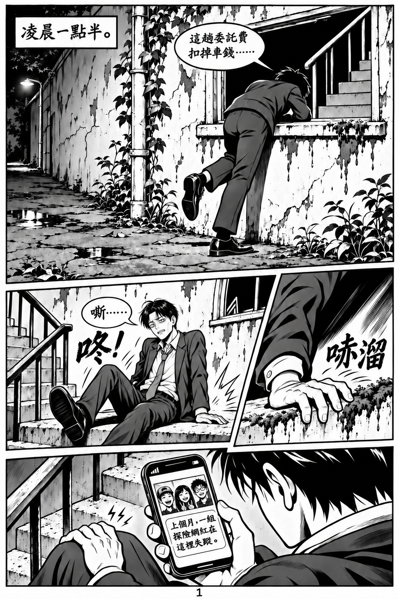

**版面**　上半頁側巷全景定高。中間兩個斜接小格從右手滑動讀到左側重摔，下方肩後近景收在委託畫面。

從樓棟側巷平視；地面、低窗與窗後的 1F–2F 樓梯平台在同一空間，作為 P09 伏擊伏筆。

| 格 | 景別與畫面 | 動作、視線與作用 | 畫內文字與聲音 |
| --- | --- | --- | --- |
| 1 | 外景 | 帶到鞋底與低窗、窗後可見樓梯與欄杆轉角。家銘雙手撐窗沿探入，低語泡靠頭部。 | 無尾旁白框「凌晨一點半。」與低語泡「這趟委託費扣掉車錢……」 |
| 2 | 手掌特寫 | 右掌在積滿青苔灰塵的窗台打滑，純動作特寫不放說話泡。 | 滑動音「哧溜」貼手排。 |
| 3 | 平台中景 | 重摔跌進 1F 通往 2F 的水泥樓梯轉角平台，明確維持 30 歲中分黑眼圈成人臉型。 | 出聲「嘶……」，落地音「咚！」在身旁。 |
| 4 | 過肩 | 坐階梯上手持手機看委託（上月失蹤探險網紅合照）；另一手揉磨疼掌心。 | 手機螢幕：「上個月，一組探險網紅在這裡失蹤。」 |

---

## P02　空走廊（4 格）

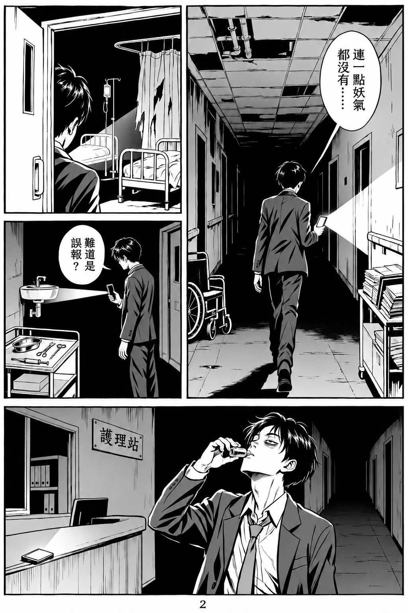

**版面**　右側縱向走廊主格；左側上下兩格窺病房、照處置室，下方跨欄落在護理站。

| 格 | 景別與畫面 | 動作、視線與作用 | 畫內文字與聲音 |
| --- | --- | --- | --- |
| 1 | 走廊遠景 | 跟在家銘身後，右手手機光束切出破損白灰牆、缺失輕鋼架天花板管線與遠端黑暗。 | 低聲自語「連一點妖氣都沒有……」 |
| 2 | 門外過肩 | 鞋尖停在門檻外，手機光束照向空病床與點滴架。 | 門牌道具字。 |
| 3 | 室內中景 | 處置室內右手舉起手機，光束筆直打向牆邊空水槽。 | 低聲自語「難道是誤報？」 |
| 4 | 櫃檯近景 | 手機平放護理站櫃面，他右手開瓶仰頭灌下開天眼符水；櫃檯後方延伸進純黑走廊（不可畫出多餘樓梯）。 | 護理站標示。 |

---

## P03　開眼（4 格）

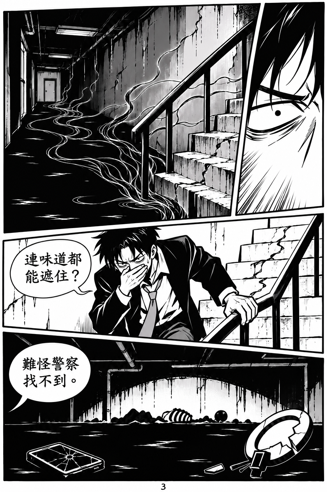

**版面**　右上極窄睜眼條格切入左方走廊大格；下接樓梯捂鼻近景，最底讓讀者沿貼地光圈見碎手機與補光燈。

| 格 | 景別與畫面 | 動作、視線與作用 | 畫內文字與聲音 |
| --- | --- | --- | --- |
| 1 | 極近景 | 忍過針扎刺痛後猛地睜眼，呈現 30 歲雙眼皮與黑眼圈。 | 無字。 |
| 2 | 主觀遠景 | 原本空蕩黑暗的地面浮現數十條蜿蜒紫紅／亮線妖氣，一路爬向安全梯口。 | 無字。 |
| 3 | 中近景 | 左手扶安全梯欄杆、右手緊摀口鼻往下走進濃烈腐臭中。 | 壓低嗓音「連味道都能遮住？」 |
| 4 | 貼地近景 | 地下無窗水泥長廊盡頭牆根堆著零星白骨遺骸，前景地面留有摔裂手機與破損環形補光燈。 | 壓低嗓音「難怪警察找不到。」 |

---

## P04　八眼回望（4 格）

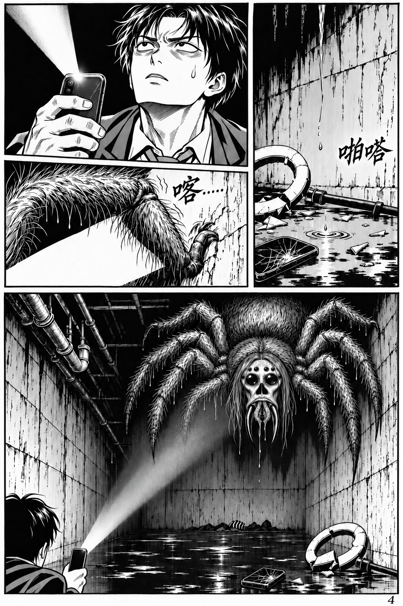

**版面**　右側窄直格從滴落黏液帶到地面。左上抬眼打光、左中掃到牆面蛛足，下半頁跨欄大格八眼回望。

| 格 | 景別與畫面 | 動作、視線與作用 | 畫內文字與聲音 |
| --- | --- | --- | --- |
| 1 | 落點特寫 | 一滴黏稠液體自上方墜落於破碎補光燈旁積水。 | 「啪嗒」小字貼水面。 |
| 2 | 側面近景 | 家銘微仰頭抬眼看向高處，右手抬起手機將光束斜向上打。 | 保留未照亮的暗角留白。 |
| 3 | 爪足近景 | 光束掃到粗大褐色硬毛節肢摳緊水泥牆面反折轉向。 | 「喀……」貼著甲殼關節。 |
| 4 | 揭露大格 | 前景家銘與遠牆之間保留真實走廊縱深（無走廊中央趴屍，僅遠牆根陰影有零星白骨）。八足腹部貼牆、僅頭胸以不自然角度轉正迎光；中分濕髮讓出八眼（兩大＋額四小＋兩側微眼）、骷髏鼻孔、無下巴口器牽垂細絲與斷開液滴。 | 無字。 |

---

## P05　兩步（5 格）

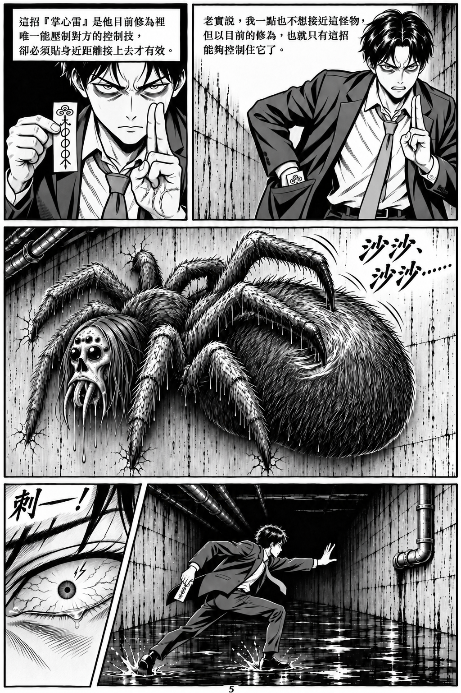

**版面**　上排先讀家銘的顧慮，再看他的手。中段大格留給蜘蛛的整個身體；下排把無字踏衝和眼睛刺痛緊接在一起。

| 格 | 景別與畫面 | 動作、視線與作用 | 畫內文字與聲音 |
| --- | --- | --- | --- |
| 1 | 上右／半身 | 家銘盯著怪物，右手伸進自己右側口袋扣符，左手已經結印。冷汗掛在臉側。 | 無框心聲「老實說，我一點也不想接近這怪物，但以目前的修為，也就只有這招能夠控制住它了。」 |
| 2 | 上左／手與臉 | 右手亮出同一張烈火符。左手兩指豎起，掌紋間剛滲出電光。 | 無尾方框「這招『掌心雷』是他目前修為裡唯一能壓制對方的控制技，卻必須貼身近距離按上去才有效。」 |
| 3 | 中段／全身側景 | 粗毛蛛身仍貼住牆，步足撐住重量；兩條後足抬起，來回刮擦鼓起的腹部。家銘此時只看見牠動。 | 後足貼腹處「沙沙、沙沙……」。 |
| 4 | 下右／側面全身 | 家銘從梯口一側向走廊深處暴衝兩步，左掌探前，右手仍扣符。鞋底濺水，眼前留出他想搶近的距離。 | 無字。 |
| 5 | 下左／眼部極近 | 眼白血絲、瞳孔收縮和下眼瞼的淚珠同時入畫。刺痛切斷前一格的動勢。 | 「刺——！」。 |

---

## P06　誤判（5 格）

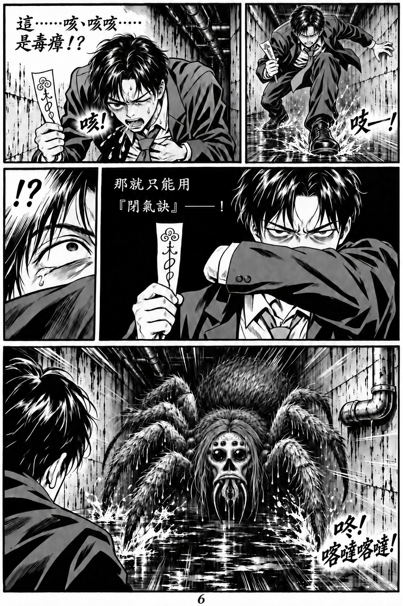

**版面**　上排從雙腳急停切到臉部劇咳。中段給閉氣訣的念頭與單眼反應，末格才從家銘肩後看見撲來的蜘蛛。

| 格 | 景別與畫面 | 動作、視線與作用 | 畫內文字與聲音 |
| --- | --- | --- | --- |
| 1 | 上右／低機位中景 | 家銘在濕地上急煞，前腳濺起水花，雙眼緊閉。右手仍抓著第一張符。 | 鞋底「吱——！」。 |
| 2 | 上左／咳嗽近景 | 他彎腰劇咳，一眼緊閉，另一眼在淚裡勉力睜開；拽住的符紙仍在右手。 | 咳聲「咳！」。無框心聲「這……咳、咳咳……是毒瘴！？」 |
| 3 | 中右／正面黑底 | 家銘抬起左前臂，橫著掩緊口鼻；右手和紙符在臉旁清楚可見。 | 黑底白字心聲「那就只能用『閉氣訣』——！」 |
| 4 | 中左／單眼窄格 | 橫在口鼻前的衣袖留在前景；他從袖沿上方看見有東西迫近。 | 「！？」獨立排在眼旁。 |
| 5 | 下方／肩後大格 | 蜘蛛鬆開牆面，粗腿踩爆積水，蒼白人臉直逼家銘。遠處水泥牆的 L 形管接頭在紙面右側。 | 步足撞地與逼近聲「咚！」「喀噠喀噠！」。 |

---

## P07　火星（5 格）

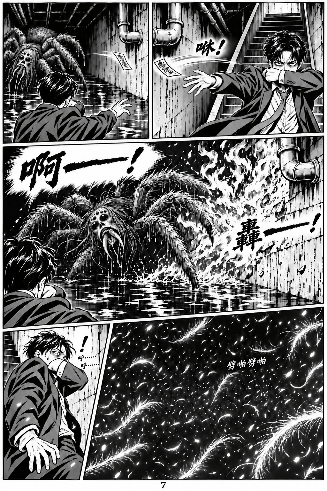

**版面**　上排以正面、肩後拍同一張飛符；中段大格讓讀者看清火從哪面牆竄起。下排先看空中的毛，才看家銘的反應。

| 格 | 景別與畫面 | 動作、視線與作用 | 畫內文字與聲音 |
| --- | --- | --- | --- |
| 1 | 上右／正面半身 | 左前臂仍掩口鼻，右手向身體右側水平甩出第一張符。白色破風弧指向紙面左側的 L 形管旁。 | 沿揮臂白弧「咻！」。 |
| 2 | 上左／肩後遠景 | 同一張符掠過蜘蛛，飛向帶 L 形管的牆；反打使這面牆轉到紙面右側。蜘蛛讓向另一邊，家銘右手已空。 | 無字。 |
| 3 | 中段／走廊大格 | 符在管旁炸開，火舌沿牆上竄，捲住蜘蛛左側腹。牠猛縮前足、仰頭張開口器，攻勢在火前停住。 | 爆燃「轟——！」。近似人聲的尖叫「啊——！」。兩組各貼聲源。 |
| 4 | 下右／空氣特寫 | 千萬點細毛在整片黑暗裡先後著火，像雪或花瓣散落。前景幾根帶倒刺細毛勾出形狀，遠處只留火點。 | 火星「劈啪劈啪」。 |
| 5 | 下左／側面反應 | 他摀著口鼻退半步，眼睛從半側火牆轉向四周懸浮的亮點。 | 無框「！」與喘息「呼……呼……」。 |

---

## P08　唯一出口（4 格）

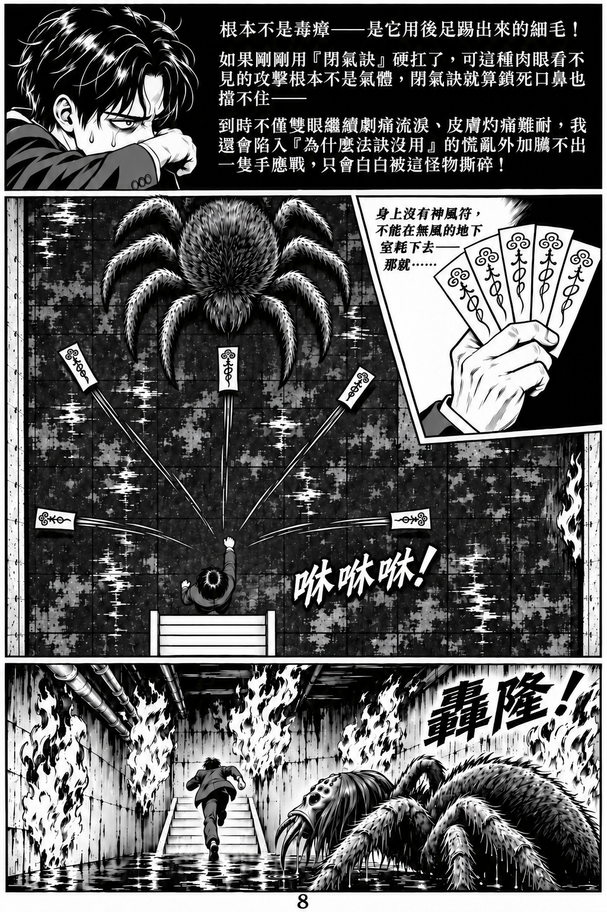

**版面**　上跨欄黑底收住家銘的反思。中段右上嵌入手部小格，再從天花板直看五張符的飛向；頁底回到人眼高度。

| 格 | 景別與畫面 | 動作、視線與作用 | 畫內文字與聲音 |
| --- | --- | --- | --- |
| 1 | 上方／側臉黑底 | 家銘眼角流淚，前臂還壓在口鼻前。火點讓他認出蜘蛛用後足踢出的細毛，也知道自己若照剛才的誤判行動會怎樣。 | 反白無框心聲「根本不是毒瘴——是它用後足踢出來的細毛！如果剛剛用『閉氣訣』硬扛了，可這種肉眼看不見的攻擊根本不是氣體，閉氣訣就算鎖死口鼻也擋不住——到時不僅雙眼繼續劇痛流淚、皮膚灼痛難耐，我還會陷入『為什麼法訣沒用』的慌亂外加騰不出一隻手應戰，只會白白被這怪物撕碎！」 |
| 2 | 中右／手部嵌格 | 右手扇開剩下的五張烈火符。露出的五個符面各有縱寫雲頭捲紋。 | 無框心聲「身上沒有神風符，不能在無風的地下室耗下去——那就……」 |
| 3 | 中段／垂直俯瞰 | 簡化的家銘背靠梯口，蜘蛛在遠端。五條軌跡各有一張符，分往正前、左前、右前與兩側牆面，身後梯口留空。庫存用盡。 | 甩符「咻咻咻！」。 |
| 4 | 下方／火場全景 | 五處著火，家銘轉身跑上安全梯；近處蜘蛛循著他的背影，看向唯一還能通過的出口。 | 牆邊爆燃「轟隆！」。 |

---

## P09　多跑半層（4 格）

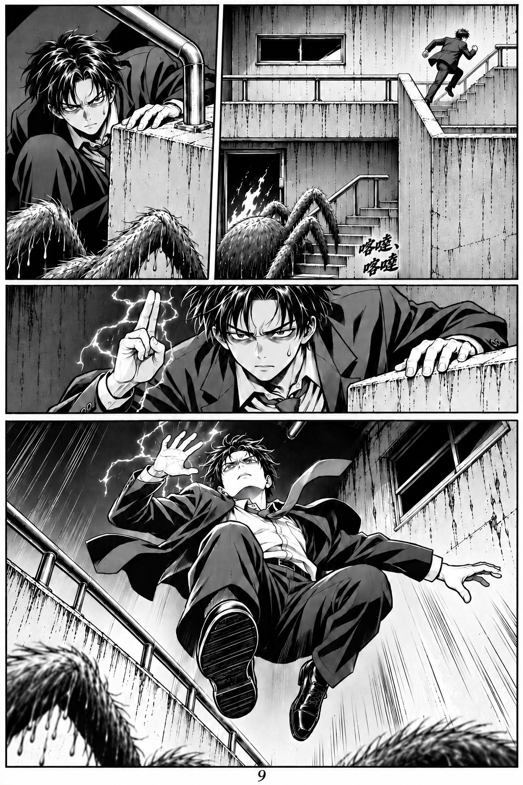

**版面**　上排將家銘和蜘蛛放在不同高度，以水泥矮牆隔開視線。中段交代哪隻手蓄雷，末格改從蜘蛛旁往上看。

| 格 | 景別與畫面 | 動作、視線與作用 | 畫內文字與聲音 |
| --- | --- | --- | --- |
| 1 | 上右／雙梯段遠景 | 火從地下室門裡冒出，蜘蛛被逼上較低的一段樓梯。家銘已越過一樓，沿上段再跑半層；中間的水泥牆擋住牠的視線。轉角低窗和金屬扶手接回 P01。 | 蛛足旁「喀噠、喀噠」。 |
| 2 | 上左／平台中景 | 家銘低身蹲在轉角矮牆後，左手撐牆沿。他越過矮牆看向下方，幾根毛足剛竄進前景。 | 無字。 |
| 3 | 中段／胸前近景 | 六張符已經用完。他改以慣用右手重新結印，兩指間浮出雷芒；左手仍壓住牆沿。 | 無字。 |
| 4 | 下方／低角度大格 | 從蛛足旁向上仰視，家銘自高處平台躍下，兩腳都離開踏面，衣襬、領帶往上翻。右手由指訣張為雷掌，與蛛頭之間還隔著一段空氣。 | 無字。 |

---

## P10　掌心雷（5 格）

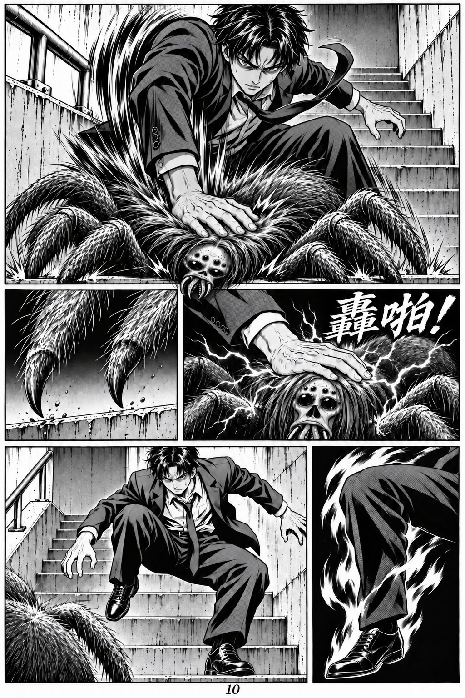

**版面**　上格壓低蛛頭，下一格才放電。中排看電過足根到爪尖鬆脫，下排看力量從右腿轉成下一擊的架勢。

| 格 | 景別與畫面 | 動作、視線與作用 | 畫內文字與聲音 |
| --- | --- | --- | --- |
| 1 | 上方／掌擊大格 | 家銘借下墜的體重從肩、肘送力，右掌根重重拍在頭頂正中。厚蛛毛向兩側分開；頭胸沉低、足節彎下，領帶因落勢向上甩。 | 無字。 |
| 2 | 中右／接觸近景 | 右手仍壓實，電弧這時才從指掌與頭頂的接觸處沿甲殼、足根竄開。 | 無框電擊聲「轟啪！」。 |
| 3 | 中左／爪尖特寫 | 原先扣緊階沿的蛛爪抽直，爪尖與水泥邊緣之間露出一條空隙。碎屑從剛才的抓痕鬆落。 | 無字。 |
| 4 | 下右／右腿特寫 | 他將殘餘法力灌進收起的右腿。貼著西裝褲管流動的港漫白筆氣焰，讓人一眼認出新的發力點。 | 無字。 |
| 5 | 下左／落地中景 | 左鞋踩實水泥踏面，左膝彎曲承重，右膝抬高收在身前。蜘蛛還在腳下的近距離，下頁才踢。 | 無字。 |

---

## P11　救命（5 格）

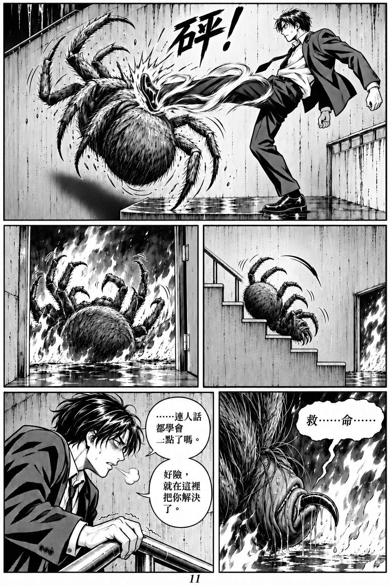

**版面**　上格的支撐腳與命中鞋底同時入鏡。中排側看蜘蛛跌下整段階梯，接牠落入火裡；下排把求救與家銘的回答分開。

| 格 | 景別與畫面 | 動作、視線與作用 | 畫內文字與聲音 |
| --- | --- | --- | --- |
| 1 | 上方／側面全身大格 | 家銘左腳踩穩一樓平台。右腿向前踢上胸腹，白筆氣焰從小腿纏到鞋底的接觸點。蜘蛛重心越過平台邊沿，開始倒翻。 | 擊中處「砰！」。 |
| 2 | 中右／梯段側景 | 側看一段由高向低的水泥階梯與扶手，蜘蛛翻覆滾落，離上方家銘最近的是腹部尾端，頭和螯牙朝低處著火的地下室門。 | 無字。 |
| 3 | 中左／門口低機位 | 同一隻蜘蛛仰翻跌入門內，火沿腹毛竄起。步足朝空中亂抓，軀幹扭動掙扎。 | 無字。 |
| 4 | 下右／翻覆口器近景 | 從側面貼近低處的肉口、濕髮與彎牙。牠還倒在火裡，這次從喉頭擠出的竟是兩個人聽得懂的字。 | 破邊、帶尾對話泡「救……命……」。 |
| 5 | 下左／梯口近景 | 家銘留在一樓扶著欄杆往下看，手指微顫。他吐出一口氣，才說出剛才有多險。 | 相連對話泡「……連人話都學會一點了嗎。」接「好險，就在這裡把你解決了。」 |

---

## P12　鐵門（4 格）

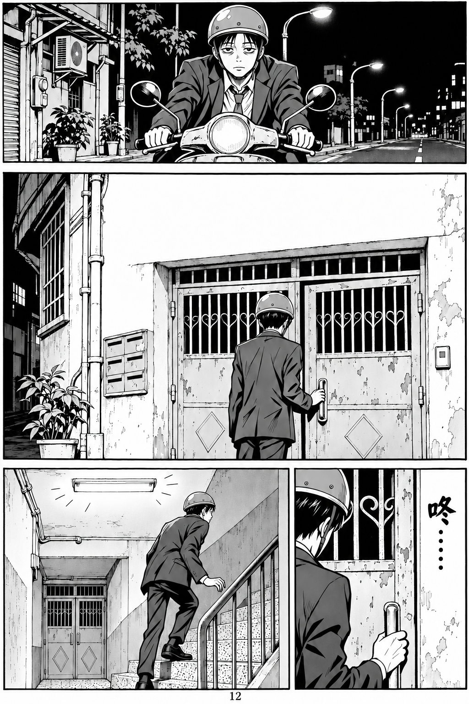

**版面**　上格以空街正面結束返程；中段停在老公寓雙開門前。下排右格先聽到門合上，左格才進梯間。

| 格 | 景別與畫面 | 動作、視線與作用 | 畫內文字與聲音 |
| --- | --- | --- | --- |
| 1 | 上方／騎車正面 | 家銘戴半罩安全帽，穿同一套皺西裝。側巷店面和成列路燈往後退，街上看不到其他車。這是本段唯一的夜騎鏡頭。 | 無字。 |
| 2 | 中段／公寓門前全景 | 從背後拍他抵達老公寓。門上雕花、牆上信箱、他按住的門把讓人認出老式雙開鐵門。 | 無字。 |
| 3 | 下右／門把近景 | 右手控制著把手，盡量放輕力道；門扇合上仍傳出悶響。 | 門旁「咚……」。 |
| 4 | 下左／室內遠景 | 感應燈亮起，他縮著肩沿磨石子樓梯輕聲上樓，身後還看得見剛合上的門。 | 無字。 |

---

## P13　兩個鬧鐘（4 格）

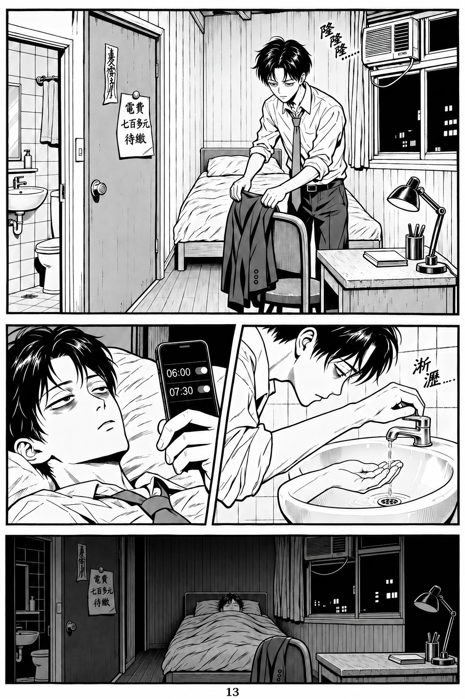

**版面**　上、下兩格從同一方向看房間，分別是掛衣與關燈。中排在浴室的細水和床頭手機上停一下，全頁無對話。

| 格 | 景別與畫面 | 動作、視線與作用 | 畫內文字與聲音 |
| --- | --- | --- | --- |
| 1 | 上方／套房全景 | 左側房門與走道暢通，門背貼鎮宅符和電費單。床頭靠後方素牆，床尾朝前；窗與冷氣在右，桌椅在右前景。家銘將皺西裝掛上椅背。 | 門背帳單「電費／七百多元／待繳」。冷氣低鳴「隆隆隆……」。 |
| 2 | 中右／浴室近景 | 他彎向白色陶瓷小洗手台，一手把冷水龍頭擰開一小縫，一手掬起細流洗臉。 | 水聲「淅瀝……」。 |
| 3 | 中左／床上近景 | 他躺著設定手機，先為起床沖澡設六點，再開七點半的備用鬧鐘。 | 手機介面「06:00」「07:30」，兩個開關都已打開。 |
| 4 | 下方／熄燈遠景 | 同一角度看床頭和窗，全室暗下來。人睡在靠後牆的一端，外套仍搭在床尾右側的椅背。 | 無新增文字，門上的帳單仍在原位。 |

---

## P14　七點半（5 格）

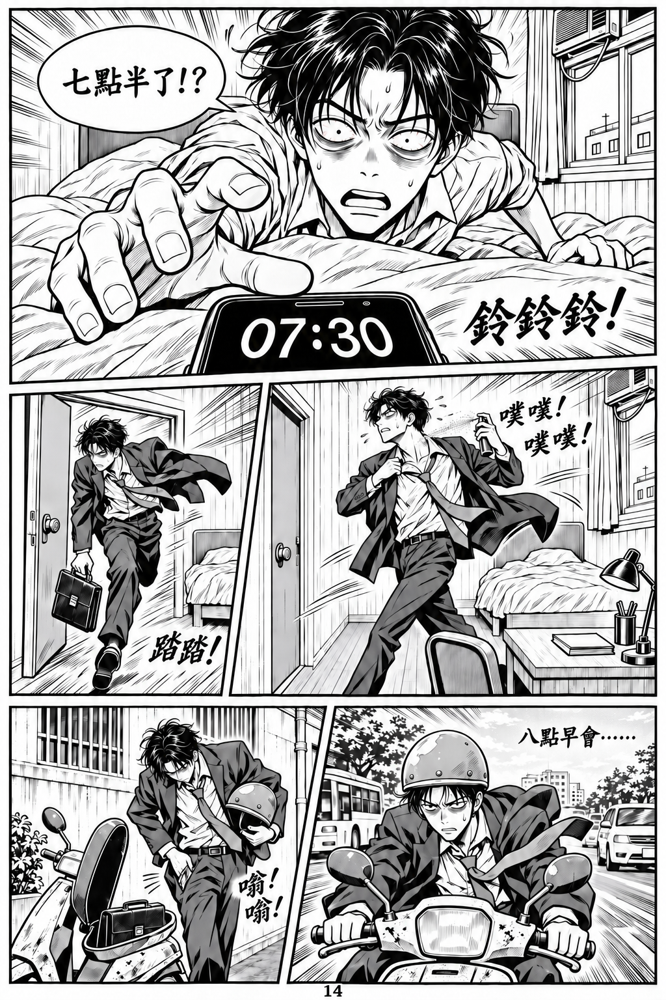

**版面**　上方大格把手機時間和家銘驚醒的臉放在一起。中排由右至左跟他跨過房間、提包衝出門；下排才從車潮切到公司巷口。

| 格 | 景別與畫面 | 動作、視線與作用 | 畫內文字與聲音 |
| --- | --- | --- | --- |
| 1 | 上方／手機低角近景 | 前景是響起的同一支手機，家銘從被窩撐起身，伸手去按，猛然看清時間。床頭後方是素牆，窗和窗型冷氣仍在右側。 | 手機「07:30」，鈴聲「鈴鈴鈴！」，驚呼「七點半了！？」 |
| 2 | 中右／跨步噴霧 | 皺西裝已上身。他一邊大步往門口走，一邊拉開領口，朝脖子連噴兩下體香噴霧。 | 噴霧聲「噗嗤！」「噗嗤！」。 |
| 3 | 中左／門口全身 | 家銘右手提著黑色公事包，跨過門檻衝出套房，外套下襬和領帶被步伐帶起。 | 腳步聲「踏踏！」。 |
| 4 | 下右／車陣正面 | 戴著半罩安全帽的家銘身體前傾、雙手握緊把手，騎著舊機車在早晨車流中趕路。 | 無框心聲「八點早會……」。 |
| 5 | 下左／巷口停車 | 他匆忙停妥機車。黑色公事包暫放在掀開坐墊的置物箱裡，左臂抱著安全帽，右手伸向震動的右側褲袋。 | 口袋旁「嗡！」「嗡！」。 |

---

## P15　六千五（4 格）

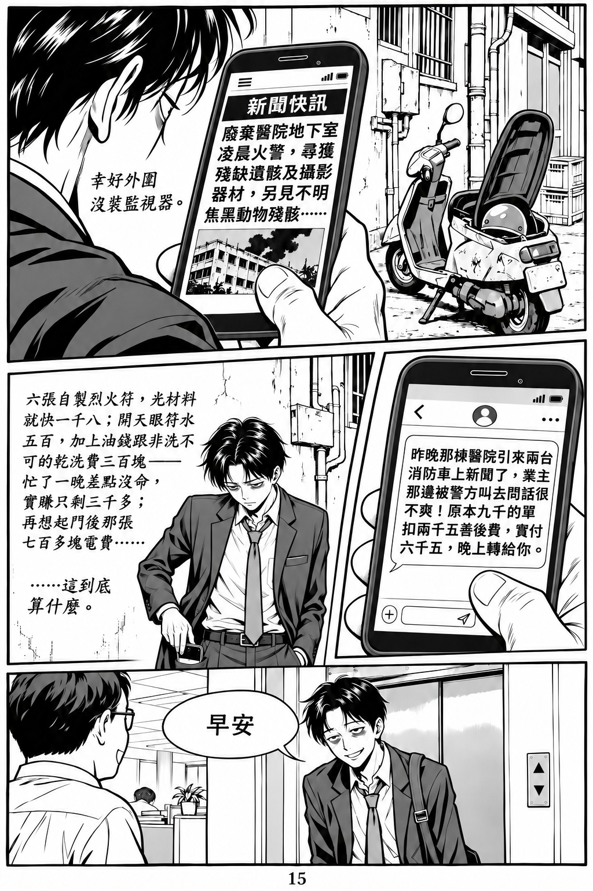

**版面**　上格的手機和開著的機車車廂交代位置。中右看完扣款訊息，再讀中左的算帳心聲；到電梯口才聽到他開口。

| 格 | 景別與畫面 | 動作、視線與作用 | 畫內文字與聲音 |
| --- | --- | --- | --- |
| 1 | 上方／肩後手機大格 | 安全帽已放進車廂。完整的手機螢幕顯示醫院照片與火警快訊，家銘盯著畫面。 | 手機標題「新聞快訊」，內文「廢棄醫院地下室凌晨火警，尋獲殘缺遺骸及攝影器材，另見不明焦黑動物殘骸……」。無框心聲「幸好外圍沒裝監視器。」 |
| 2 | 中右／訊息特寫 | 中介的通訊畫面填滿畫格，消防車上新聞、業主受訊到扣款的因果是一則連續訊息。 | 手機訊息「昨晚那棟醫院引來兩台消防車上新聞了，業主那邊被警方叫去問話很不爽！原本九千的單扣兩千五善後費，實付六千五，晚上轉給你。」 |
| 3 | 中左／算帳半身 | 家銘低頭，用右手把手機塞回自己右側褲袋。提到的電費接回 P13 門背帳單。 | 無框心聲「六張自製烈火符，光材料就快一千八；開天眼符水五百，加上油錢跟非洗不可的乾洗費三百塊——忙了一晚差點沒命，實賺只剩三千多；再想起門後那張七百多塊電費……」「……這到底算什麼。」 |
| 4 | 下方／電梯口中景 | 進公司後，他向迎面而來的同事點頭，換上業務用的笑容。 | 對話泡「早安」。 |

---

## P16　全力衝刺（5 格）

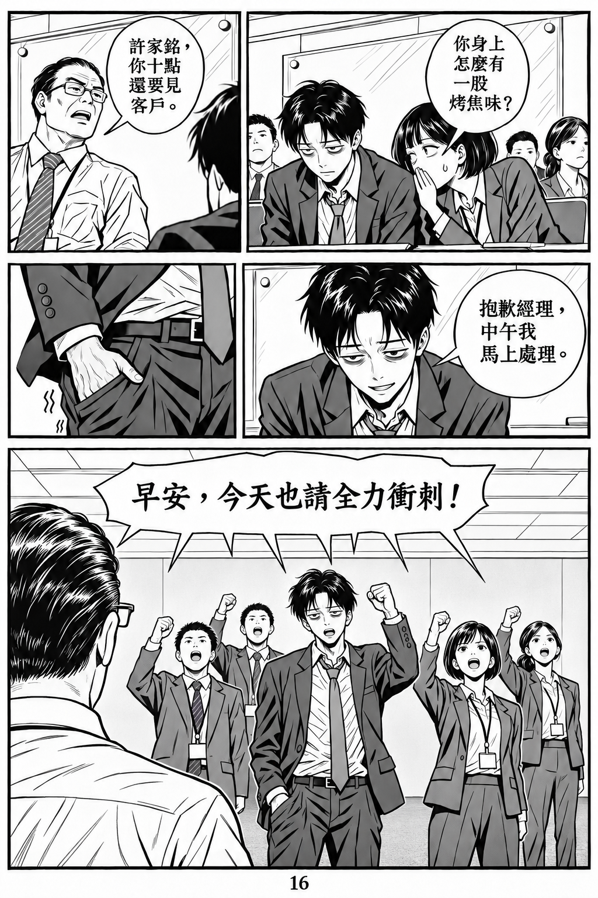

**版面**　上排先讓女同事貼近問煙味，再切主管點名；中排從賠笑移到藏起的右手。末格站到主管身後，看整排員工的正面。

| 格 | 景別與畫面 | 動作、視線與作用 | 畫內文字與聲音 |
| --- | --- | --- | --- |
| 1 | 上右／同事雙人中景 | 短髮女同事掩嘴，側過身在家銘耳邊低聲問。他眼下仍黑，目光僵在前方。 | 女同事低聲「你身上怎麼有一股烤焦味？」 |
| 2 | 上左／主管反打 | 戴眼鏡的經理轉向家銘，在白板前點名，提醒他今天還有客戶。 | 「許家銘，你十點還要見客戶。」 |
| 3 | 中右／臉部近景 | 家銘低頭彎腰，撐起笑容解圍。 | 「抱歉經理，中午我馬上處理。」 |
| 4 | 中左／腰際特寫 | 昨夜按上蛛頭的右手仍麻痛，家銘把它藏入右側西裝褲袋；袋邊的顫線讓讀者看見這個動作。 | 無字。 |
| 5 | 下方／主管肩後群像 | 主管背對讀者佔近景，前方員工面朝鏡頭。家銘站在中央，右手留在右褲袋，舉起左拳，加入同事的齊喊。 | 合聲大氣泡「早安，今天也請全力衝刺！」 |
