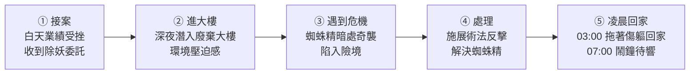

# 第 01 章：蜘蛛精

## 🎬 章節節奏結構圖

---

## ✍️ 正文草稿

### ① 進大樓

深夜一點半，廢棄醫院外牆的窗框早沒了玻璃。
家銘雙手撐住窗框，費力地把上半身擠進來。
嘴裡低聲抱怨著「這趟委託費扣掉車錢根本不划算」，一邊咬牙把身體往裡撐。

不料窗台積滿了青苔與灰塵，他掌心一滑，整個人重心失控，狼狽地撲摔進一樓通往二樓的樓梯間裡。
「嘶……」他撐在階梯上停頓了兩秒，倒抽一口冷氣，低頭揉了揉磨得生疼的掌心，這才無奈地爬起身拍掉西裝褲上的灰塵。
他按亮手機確認委託內容——上個月一組探險網紅在這裡失蹤，警方搜遍整棟大樓都沒發現血跡或打鬥痕跡，只能暫時當成失蹤案處理。

他打開手機手電筒走上二樓走廊。沿著二樓走廊一間間巡查過去。光束切開黑暗，照亮兩側長滿壁癌、大片剝落的白灰牆壁；頭頂的輕鋼架天花板缺了好幾塊板子，露出黑漆漆的管線，腳下則散落著發黃的舊病歷與破碎的藥水瓶。

就這樣在二、三樓之間仔細繞了十幾分鐘，推開了七八間空蕩蕩的病房與護理站，空氣裡卻始終只有濃重的潮濕霉味，安靜得連風聲都聽得一清二楚。

他停在二樓樓梯口，皺起眉關掉手電筒：「奇怪，這棟樓陰氣是有點重，但巡了一圈連半點妖氣的影子都沒有……難道真是誤報？」

猶豫了兩秒，他嘆了口氣，還是從西裝內袋摸出一只拇指大的玻璃瓶，拔開木塞仰頭灌了一口。冰冷辛辣的符水剛滑過喉嚨，雙眼頓時傳來一陣針扎般的刺痛，逼得他本能地閉緊眼睛，眉頭死死擰在一起。

數秒後，刺痛退去，家銘猛地睜開雙眼。

原本空無一物的昏暗走廊裡，此刻竟飄浮著數十條細長、宛如血管般的紫紅色妖氣，正順著地板一路蜿蜒爬向地下室的樓梯口。與此同時，一股濃烈到令人作嘔的血腥與腐臭味毫無預警地衝進鼻腔，差點讓他當場吐出來。

家銘死死捂住口鼻，整個人僵在原地，瞳孔驟然收縮。

「……居然連氣味和痕跡都能一併遮蔽？」他壓低聲音，喉結微微滾動了一下，眼神瞬間凝重起來，「難怪警察什麼都找不到——這東西，居然會用障眼法。」

### ② 遇到危機

家銘順著地板上蜿蜒的紫紅妖氣走進安全梯，越往下，空氣裡的血腥與腐臭就越重，重得像一塊濕透的爛布糊在口鼻前。

地下室是一條沒有窗戶的水泥長廊，潮濕得幾乎沒有空氣流動。他重新打開手電筒，光束切開黑暗，照向幾十步外的走廊盡頭——牆根底下堆著幾具被撕咬得殘破不堪的屍體與肉塊，地上還散落著摔裂的手機和補光燈。

胃裡一陣翻湧。不等他看清，一滴黏稠的液體突然從上方「啪」地落在屍堆旁。

家銘手一抖，把光束往上抬——幾乎佔滿半面牆的，是一團粗大、覆滿黑褐色硬毛的節肢與軀體，八條如人臂粗細的步足死死摳在水泥牆面上。

就在光線落上去的瞬間，那團怪物的前端竟發出一陣甲殼摩擦的輕響，硬生生朝家銘的方向抬起、轉正——以它貼牆的姿勢，那根本是一個不該能向上彎折的角度。

光束落在那張臉上——黑灰色的半短髮從頭頂中央分開，濕黏地垂在臉頰兩側，把慘白額頭的正中央讓了出來；底下的雙眼大得異常，眼眶裡全無眼白，只剩兩潭深不見底的黑。直到光線微晃，他才驚覺那片露出的眉骨上方與額角皮膚裡，竟還嵌著幾顆大小不一的黑亮眼球，正隨著視線一起朝他轉動；而兩側垂落的髮絲背後，人皮邊緣早已長滿粗黑硬毛，死死連回背後的蜘蛛軀幹。

更令人反胃的是嘴部——它明明長著人類的上嘴唇，唇瓣卻微微向上扯開，底下沒有下巴，而是探出兩根黑亮粗長、遠遠垂過臉緣的蜘蛛螯牙。

家銘全身的寒毛瞬間倒豎，脊背像被澆了一桶冰水。

但他退無可退。這東西已經盯上自己了。家銘咬緊牙根壓下胃裡的噁心感，右手立刻探進口袋扣住一張符咒，同時壓低嗓音急急唸咒、左手飛快結印——指印未散，左手掌心皮下已透出一陣微弱卻刺眼的紫光。這招「掌心雷」是他目前修為裡唯一能壓制對方的控制技，卻必須貼身近距離按上去才有效。

他死死盯著那張多眼的臉，心裡發沉——老實說，他一點也不想接近這怪物，但以目前的修為，也就只有這招能夠控制住它了。

### ③ 處理

蜘蛛精似乎也察覺到家銘的動作，貼在牆上的身軀猛地一沉，兩條粗壯的後足竟突然抬起，快速摩擦起那顆鼓脹的腹部。

家銘心頭一緊——這傢伙想做什麼？得先發制人！

他一個箭步往前暴衝，想趁對方蓄勢前直接把掌心雷按上去。才剛邁出兩步，雙眼卻像突然被撒了一把細碎玻璃末，一陣尖銳刺痛猛地扎進眼眶，逼得他硬生生剎住腳步。

緊接著，喉頭一陣劇癢翻湧，他不受控制地彎腰狂咳起來，裸露在外的頸側與臉頰皮膚也跟著泛起密密麻麻的針扎灼痛。

「這……咳、咳咳……是毒瘴！？」

眼見他停下腳步，牆上的怪物立刻停止動作。八條人臂粗的剛毛步足同時鬆開牆面、砸向地面，在狹窄的水泥長廊裡爆出一連串沉重又急促的叩擊聲——「喀噠、喀噠、喀噠！」它踩碎積水、交替蹬踏兩側牆壁與天花板管線，整團龐大毛軀貼著通道疾衝而來；那顆中分短髮的蒼白人臉卻死死壓在同一條水平線上直勾勾鎖定他，額上數顆黑眼同時瞪大，唇瓣上扯露出沾滿黏液的巨型螯牙。

來不及細想，家銘強忍著眼淚直冒的刺痛，雙指夾緊右手扣住的那張烈火符，像彈射撲克牌般朝前平甩而出。黃符在半空打著旋，以紙飛機般的平穩速度滑飛過去，被高速撲近的蜘蛛精猛地側身閃開。

然而就在怪物以為躲過一擊、準備撲咬的瞬間，擦身而過的烈火符在它身側轟然炸開！

刺眼的烈焰瞬間吞沒了走廊半側，火舌捲過蜘蛛精的側腹，硬生生逼停了它的攻勢。怪物在火光中痛得仰身狂吼，詭異的是，從它喉嚨深處炸出的並不是蟲類的嘶鳴，而是尖銳得像人類瀕死慘叫般的淒厲嚎聲。

更讓家銘背脊發涼的是眼前的另一幕——烈焰炸開的同時，原本看似空無一物的空氣裡竟跟著劈啪燃起成千上萬點細碎火星，像整片懸浮的隱形塵埃在火光中現形、燒盡。

家銘喘著氣往後退了半步，瞬間明白過來。

根本不是毒瘴——是它剛剛用後足從腹部踢出來的細毛，還用障眼法藏在了空氣裡！

一股後怕猛地竄上背脊。自己畢竟修為還淺、實戰經驗遠不夠老道，剛才完全誤判了它摩擦腹部的動作；換成經驗老道的高手早該看穿，而他差半秒就要直接掐「閉氣訣」硬扛了。可這種肉眼看不見的實體甲殼細針根本不是氣體，閉氣訣就算鎖死口鼻，也擋不住微針直接刺進眼睛和皮膚——到時不僅雙眼繼續劇痛流淚、皮膚灼痛難耐，他還會陷入「為什麼法訣沒用」的慌亂，外加騰不出一隻手應戰，只會白白被這怪物撕碎。

剛才要不是被逼急了順手甩出烈火符，誤打誤撞燒破了這層把戲，這一回合他恐怕已經交代在這裡了。

雖然幸運撿回一命，但家銘眼神卻更加凝重——這怪物既然能靠這招封鎖空間，就不能再留在無風的地下室裡跟它耗下去。可惜自己身上沒有「神風符」，也不會借風的術法；既然如此，那就……

家銘將口袋裡剩下的符咒一口氣全掏了出來——共五張烈火符。他手腕一揚，把符咒甩向除了身後樓梯以外的四面八方。黃符觸牆的瞬間轟然爆燃，橘紅火舌夾著濃煙在狹窄地下室裡猛烈竄開；家銘趁勢轉身，頭也不回地沿著安全梯往上狂奔。

突如其來的火海與濃煙瞬間封死了地下室，蜘蛛精受驚之下發出連串急促嘶叫，在火光裡慌亂竄逃，最後循著唯一沒有火焰的出口，一路順著樓梯朝一樓狂爬上去。

正要衝出一樓樓梯口的那一剎那，它壓根沒發現家銘根本不在一樓——他早趁著剛才一口氣多跑了半層，此刻正蹲伏在一樓往二樓之間的樓梯轉角平台旁，單手撐著水泥矮牆邊緣，死死盯著下方梯井。

等那團龐大黑影竄進視線正下方的瞬間，家銘縱身躍下，左手早已重新凝聚好的紫光迎頭轟落——「掌心雷」結結實實拍在蜘蛛精的頭頂正中！

伴隨刺耳的電流爆鳴與墜落衝力，藍紫色電弧猛地竄遍它全身；原本緊扣階梯的八條步足瞬間痙攣僵直、失去了抓地力，頭顱更在重擊下裂開一道血口，鮮血順著慘白人臉噴濺而出。

不等它從麻痺裡掙脫，家銘順勢把殘餘法力全部灌進右腿，落地借力就是一記凌厲高前踢，正中怪物胸腹！龐大的蜘蛛軀幹頓時失衡倒飛，沿著階梯一路滾摔回底下熊熊燃燒的地下室。

烈焰捲上它沾滿油脂與絨毛的身軀，火海裡傳出一聲變調、彷彿卡在喉嚨裡硬擠出來的淒厲哀嚎——

「救……命……」

家銘站在樓梯口往下望著那片火光，胸口劇烈起伏，吐出一口長氣：「……連人話都學會一點了嗎。好險，就在這裡把你解決了。」

### ④凌晨回家

（在此開始撰寫正文...）
