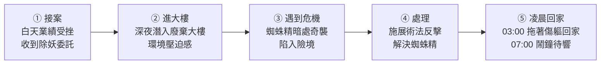

# 第 01 章：蜘蛛精

## 🎬 章節節奏結構圖

---

## ✍️ 正文草稿

### ① 進大樓

深夜一點半，廢棄醫院外牆的窗框早沒了玻璃。
家銘雙手撐住窗框，費力地把上半身擠進來。
嘴裡低聲抱怨著「這趟委託費扣掉車錢根本不划算」，一邊咬牙把身體往裡撐。

不料窗台積滿了青苔與灰塵，他掌心一滑，整個人重心失控，狼狽地撲摔進一樓通往二樓的樓梯間裡。
「嘶……」他撐在階梯上停頓了兩秒，倒抽一口冷氣，低頭揉了揉磨得生疼的掌心，這才無奈地爬起身拍掉西裝褲上的灰塵。
他按亮手機確認委託內容——上個月一組探險網紅在這裡失蹤，警方搜遍整棟大樓都沒發現血跡或打鬥痕跡，只能暫時當成失蹤案處理。

他打開手機手電筒走上二樓走廊。沿著二樓走廊一間間巡查過去。光束切開黑暗，照亮兩側長滿壁癌、大片剝落的白灰牆壁；頭頂的輕鋼架天花板缺了好幾塊板子，露出黑漆漆的管線，腳下則散落著發黃的舊病歷與破碎的藥水瓶。

就這樣在二、三樓之間仔細繞了十幾分鐘，推開了七八間空蕩蕩的病房與護理站，空氣裡卻始終只有濃重的潮濕霉味，安靜得連風聲都聽得一清二楚。

他停在二樓樓梯口，皺起眉關掉手電筒：「奇怪，這棟樓陰氣是有點重，但巡了一圈連半點妖氣的影子都沒有……難道真是誤報？」

猶豫了兩秒，他嘆了口氣，還是從西裝內袋摸出一只拇指大的玻璃瓶，拔開木塞仰頭灌了一口。冰冷辛辣的符水剛滑過喉嚨，雙眼頓時傳來一陣針扎般的刺痛，逼得他本能地閉緊眼睛，眉頭死死擰在一起。

數秒後，刺痛退去，家銘猛地睜開雙眼。

原本空無一物的昏暗走廊裡，此刻竟飄浮著數十條細長、宛如血管般的紫紅色妖氣，正順著地板一路蜿蜒爬向地下室的樓梯口。與此同時，一股濃烈到令人作嘔的血腥與腐臭味毫無預警地衝進鼻腔，差點讓他當場吐出來。

家銘死死捂住口鼻，整個人僵在原地，瞳孔驟然收縮。

「……居然連氣味和痕跡都能一併遮蔽？」他壓低聲音，喉結微微滾動了一下，眼神瞬間凝重起來，「難怪警察什麼都找不到——這東西，居然會用障眼法。」

### ② 遇到危機

家銘順著地板上蜿蜒的紫紅妖氣走進安全梯，越往下，空氣裡的血腥與腐臭就越重，重得像一塊濕透的爛布糊在口鼻前。

地下室是一條沒有窗戶的水泥長廊，潮濕得幾乎沒有空氣流動。他重新打開手電筒，光束切開黑暗，照向幾十步外的走廊盡頭——牆根底下堆著幾具被撕咬得殘破不堪的屍體與肉塊，地上還散落著摔裂的手機和補光燈。

胃裡一陣翻湧。不等他看清，一滴黏稠的液體突然從上方「啪」地落在屍堆旁。

家銘手一抖，把光束往上抬——幾乎佔滿半面牆的，是一團粗大、覆滿黑褐色硬毛的節肢與軀體，八條如人臂粗細的步足死死摳在水泥牆面上。

就在光線落上去的瞬間，那團怪物的前端竟發出一陣甲殼摩擦的輕響，硬生生朝家銘的方向抬起、轉正——以它貼牆的姿勢，那根本是一個不該能向上彎折的角度。

光束落在那張臉上——黑灰色的半短髮從頭頂中央分開，濕黏地垂在臉頰兩側，把慘白額頭的正中央讓了出來；底下的雙眼大得異常，眼眶裡全無眼白，只剩兩潭深不見底的黑。直到光線微晃，他才驚覺那片露出的眉骨上方與額角皮膚裡，竟還嵌著幾顆大小不一的黑亮眼球，正隨著視線一起朝他轉動；而兩側垂落的髮絲背後，人皮邊緣早已長滿粗黑硬毛，死死連回背後的蜘蛛軀幹。

更令人反胃的是嘴部——它明明長著人類的上嘴唇，唇瓣卻微微向上扯開，底下沒有下巴，而是探出兩根黑亮粗長、遠遠垂過臉緣的蜘蛛螯牙。

家銘全身的寒毛瞬間倒豎，脊背像被澆了一桶冰水。

但他退無可退。這東西已經盯上自己了。家銘咬緊牙根壓下胃裡的噁心感，右手立刻探進口袋扣住一張符咒，同時壓低嗓音急急唸咒、左手飛快結印——指印未散，左手掌心皮下已透出一陣微弱卻刺眼的紫光。這招「掌心雷」是他目前修為裡唯一能壓制對方的控制技，卻必須貼身近距離按上去才有效。

他死死盯著那張多眼的臉，心裡發沉——老實說，他一點也不想接近這怪物，但以目前的修為，也就只有這招能夠控制住它了。

### ③ 處理

蜘蛛精似乎也察覺到家銘的動作,此刻突然用後足摩擦腹部
家明心想：這傢伙似乎想做什麼,先發制人
他一個箭步向前衝刺,欲用掌心雷制服對方,然而突如其來的眼睛的刺痛止住了他的腳步
接著開始咳嗽,皮膚也感到刺痛 
這...咳、咳咳……是毒瘴？！
蜘蛛精看到家銘的樣子後知道自己的策略奏效了 於是開始向前衝刺(超大蜘蛛衝過來應該會有聲音跟很恐的感覺但是我沒看過不會描寫)
靠!!他將右手的烈火符 向前投擲,符咒如同石子一般(紙通常沒辦法垂至向前除非紙飛機或是像丟poker,我要的效果是符咒像是poker向前飛速度如同紙飛機,因為沒辦法像暗器一樣的速度)
蜘蛛精一個側身閃過了,但是烈火符卻在此刻爆開，燦爛的火光
火焰波及到蜘蛛精的身側對方停止了攻勢痛苦的大叫,詭異的是他不是像一般的蜘蛛唧唧的叫聲,而是一種尖銳的人的淒慘的叫聲,
同時火光也燃燒了散佈在空氣中的異物,那正是那隻蜘蛛剛剛的招式 將自身的刺毛藉由踢腿散步到空中,並且使用障眼法,讓其隱形，若不是剛剛家銘使用烈火符 歪打正著 恐怕他無法發現對方的把戲

此時家銘也注意到了戰場上的異樣

:這是??毛嗎,原來剛剛他是用這個攻擊我的而不是毒氣,如果我剛剛使用閉氣訣的話,恐怕會白費力氣，不僅浪費精力也可能在接下來的戰鬥中因為這個攻擊露出破綻(這邊內心戲我描寫得不好
主要是主角要意識到對方的把戲,加上'**物理微針不屬於氣態或液態**：毒毛本質上是成千上萬根「肉眼難見的實體甲殼細針」。避水訣只能滑開液體；而閉氣訣雖然能鎖死口鼻呼吸與毛孔，卻**擋不住實體細針直接刺入表皮角質層**以及自己衝過去」放大了傷害哪怕他咳了一聲後立刻補掐「閉氣訣」，眼睛的刺痛流淚與皮膚的灼痛感也完全不會停，這會讓他瞬間陷入「為什麼閉氣訣沒用？！」的恐慌。'主角要意識到這件事情,他是三流二流對於戰場觀察沒那麼細膩會誤判因為他的經驗還不老到'後足摩擦腹部'動作其實不是放毒瘴,如果是一流的會很快理解並用其他招式破解 但是家銘此刻誤會了對方的把戲本來他是想立刻轉閉氣訣,只是對方剛好衝過來他也用烈火符咒反擊,很幸運的識破對方的把戲,沒有讓自己陷入使用閉氣訣的陷阱[心態跟肉體的雙重打擊],算是幸運撿回一條命跟板回一城),
它既然會這招那就不適合待在地下室這種封閉的空間跟他耗,可惜目前我身上沒有**神風符**也不會風系法術,既然如此,那就．．．．．

家明將口袋裡面的符咒全部掏出,共五張烈火符咒,並且手一揮將它丟向四方除了身後的樓梯,烈火符咒碰到牆壁的同時開始劇烈燃燒，並產生煙塵, 家明一個向後撤並且往上跑,此時蜘蛛精也被突如其來的攻擊嚇到並且開始四處逃竄,然後逃向唯一的出口,往一樓的樓梯,然後在往樓梯桃的時候 並沒注意到家銘並沒有在一樓,而是他一直掛在一樓往二樓的側邊的那個牆壁(有些牆壁上面不是有短台階,在樓梯之間我不知道那個設計是幹嘛的)
然後縱身一躍用掌心雷直接轟在蜘蛛精的頭頂,此刻蜘蛛精的頭噴出血液,然後用它凝聚法術力一踢一個高前踢將蜘蛛精踢回地下室,蜘蛛精在烈火中發出哀嚎, 救.......命
,家明: 連人話都學會了一點了嗎......好險在此刻將你誅殺

### ④凌晨回家

（在此開始撰寫正文...）
