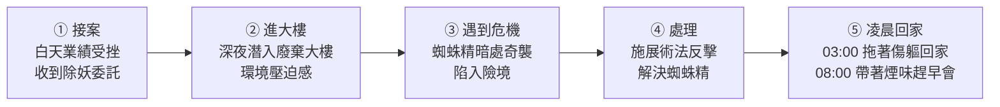

# 序章（01-蜘蛛精）

## 🎬 章節節奏結構圖

---

## ✍️ 正文草稿

深夜一點半，廢棄醫院外牆的窗框早沒了玻璃。
家銘雙手撐住窗框，費力地把上半身擠進來。
嘴裡低聲抱怨著「這趟委託費扣掉車錢根本不划算」，一邊咬牙把身體往裡撐。

不料窗台積滿了青苔與灰塵，他掌心一滑，整個人重心失控，狼狽地撲摔進一樓通往二樓的樓梯間裡。
「嘶……」他撐在階梯上停頓了兩秒，倒抽一口冷氣，低頭揉了揉磨得生疼的掌心，這才無奈地爬起身拍掉西裝褲上的灰塵。
他按亮手機確認委託內容——上個月一組探險網紅在這裡失蹤，警方搜遍整棟大樓都沒發現血跡或打鬥痕跡，只能暫時當成失蹤案處理。

他打開手機手電筒走上二樓走廊，沿著走廊一間間巡查過去。光束切開黑暗，照亮兩側長滿壁癌、大片剝落的白灰牆壁；頭頂的輕鋼架天花板缺了好幾塊板子，露出黑漆漆的管線，腳下則散落著發黃的舊病歷與破碎的藥水瓶。

就這樣在二、三樓之間仔細繞了十幾分鐘，推開了七八間空蕩蕩的病房與護理站，空氣裡卻始終只有濃重的潮濕霉味，安靜得連風聲都聽得一清二楚。

他停在二樓樓梯口，皺起眉關掉手電筒：「奇怪，這棟樓陰氣是有點重，但巡了一圈連半點妖氣的影子都沒有……難道真是誤報？」

猶豫了兩秒，他嘆了口氣，還是從西裝內袋摸出一只拇指大的玻璃瓶，拔開木塞仰頭灌了一口。冰冷辛辣的符水剛滑過喉嚨，雙眼頓時傳來一陣針扎般的刺痛，逼得他本能地閉緊眼睛，眉頭死死擰在一起。

數秒後，刺痛退去，家銘猛地睜開雙眼。

原本空無一物的昏暗走廊裡，此刻竟飄浮著數十條細長、宛如血管般的紫紅色妖氣，正順著地板一路蜿蜒爬向地下室的樓梯口。與此同時，一股濃烈到令人作嘔的血腥與腐臭味毫無預警地衝進鼻腔，差點讓他當場吐出來。

家銘死死捂住口鼻，整個人僵在原地，瞳孔驟然收縮。

「……居然連氣味和痕跡都能一併遮蔽？」他壓低聲音，喉結微微滾動了一下，眼神瞬間凝重起來，「難怪警察什麼都找不到——這東西，居然會用障眼法。」

家銘順著地板上蜿蜒的紫紅妖氣走進安全梯，越往下，空氣裡的血腥與腐臭就越重，重得像一塊濕透的爛布糊在口鼻前。

地下室是一條沒有窗戶的水泥長廊，潮濕得幾乎沒有空氣流動。他重新打開手電筒，光束切開黑暗，照向幾十步外的走廊盡頭——牆根底下堆著幾具被撕咬得殘破不堪的屍體與肉塊，地上還散落著摔裂的手機和補光燈。

胃裡一陣翻湧。不等他看清，一滴黏稠的液體突然從上方「啪」地落在屍堆旁。

家銘手一抖，把光束往上抬——幾乎佔滿半面牆的，是一團粗大、覆滿黑褐色硬毛的節肢與軀體，八條如人臂粗細的步足死死摳在水泥牆面上。

就在光線落上去的瞬間，那團怪物的前端竟發出一陣甲殼摩擦的輕響，硬生生朝家銘的方向抬起、轉正——以它貼牆的姿勢，那根本是一個不該能向上彎折的角度。

光束落在那張臉上——黑灰色的半短髮從頭頂中央分開，濕黏地垂在臉頰兩側，把慘白額頭的正中央讓了出來；底下的雙眼大得異常，眼眶裡全無眼白，只剩兩潭深不見底的黑。直到光線微晃，他才驚覺那片露出的眉骨上方與額角皮膚裡，竟還嵌著幾顆大小不一的黑亮眼球，正隨著視線一起朝他轉動；而兩側垂落的髮絲背後，人皮邊緣早已長滿粗黑硬毛，死死連回背後的蜘蛛軀幹。

更令人反胃的是嘴部——它明明長著人類的上嘴唇，唇瓣卻微微向上扯開，底下沒有下巴，而是探出兩根黑亮粗長、遠遠垂過臉緣的蜘蛛螯牙。

家銘全身的寒毛瞬間倒豎，脊背像被澆了一桶冰水。

但他退無可退。這東西已經盯上自己了。家銘咬緊牙根壓下胃裡的噁心感，右手立刻探進口袋扣住一張符咒，同時壓低嗓音急急唸咒、左手飛快結印——指印未散，左手掌心皮下已透出一陣微弱卻刺眼的紫光。這招「掌心雷」是他目前修為裡唯一能壓制對方的控制技，卻必須貼身近距離按上去才有效。

他死死盯著那張多眼的臉，心裡發沉——老實說，我一點也不想接近這怪物，但以目前的修為，也就只有這招能夠控制住它了。

蜘蛛精似乎也察覺到家銘的動作，貼在牆上的身軀猛地一沉，兩條粗壯的後足竟突然抬起，快速摩擦起那顆鼓脹的腹部。

家銘心頭一緊——這傢伙想做什麼？得先發制人！

他一個箭步往前暴衝，想趁對方蓄勢前直接把掌心雷按上去。才剛邁出兩步，雙眼卻像突然被撒了一把細碎玻璃末，一陣尖銳刺痛猛地扎進眼眶，逼得他硬生生剎住腳步。

緊接著，喉頭一陣劇癢翻湧，他不受控制地彎腰狂咳起來，裸露在外的頸側與臉頰皮膚也跟著泛起密密麻麻的針扎灼痛。

家銘痛得一隻眼睛死死閉起，另一隻眼在淚光裡勉力睜開一條縫，心底驚駭湧起：這……咳、咳咳……是毒瘴！？他立刻抬起左前臂死死摀住口鼻，那就只能用「閉氣訣」——念頭才剛轉過，眼前陰影驟然壓近——

眼見他停下腳步，牆上的怪物立刻停止動作。八條人臂粗的剛毛步足同時鬆開牆面、砸向地面，在狹窄的水泥長廊裡爆出一連串沉重又急促的叩擊聲——「喀噠、喀噠、喀噠！」它踩碎積水、交替蹬踏兩側牆壁與天花板管線，整團龐大毛軀貼著通道疾衝而來；那顆中分短髮的蒼白人臉卻死死壓在同一條水平線上直勾勾鎖定他，額上數顆黑眼同時瞪大，唇瓣上扯露出沾滿黏液的巨型螯牙。

來不及細想，家銘強忍著眼淚直冒的刺痛，左臂依舊死死橫摀口鼻，右手夾緊扣住的那張烈火符，朝右側水平橫揮而出。黃符高速朝右側牆邊飛去，被撲近的蜘蛛精猛地朝左側閃身躲開。

然而就在怪物以為躲過一擊、準備撲咬的瞬間，擦身而過的烈火符就在它剛才讓開的右側牆面轟然炸開！

刺眼的烈焰瞬間吞沒了右側走廊半側，火舌捲過蜘蛛精的左側腹，硬生生逼停了它的攻勢。怪物在火光中痛得仰身狂吼，詭異的是，從它喉嚨深處炸出的並不是蟲類的嘶鳴，而是尖銳得像人類瀕死慘叫般的淒厲嚎聲。

更讓家銘背脊發涼的是眼前的另一幕——烈焰炸開的同時，原本看似空無一物的整片走廊空氣裡竟跟著劈啪燃起成千上萬點細碎火星，像漫天飄落的雪花與櫻花瓣般充滿整片黑暗空間，一一燃盡。

家銘喘著氣往後退了半步，瞬間明白過來。

根本不是毒瘴——是它剛剛用後足從腹部踢出來的細毛，還用障眼法藏在了空氣裡！

一股後怕猛地竄上背脊。自己畢竟修為還淺、實戰經驗遠不夠老道，剛才完全誤判了它摩擦腹部的動作；換成經驗老道的高手早該看穿，而他差半秒就要直接掐「閉氣訣」硬扛了——可這種肉眼看不見的攻擊根本不是氣體，閉氣訣就算鎖死口鼻也擋不住——到時不僅雙眼繼續劇痛流淚、皮膚灼痛難耐，他還會陷入「為什麼法訣沒用」的慌亂外加騰不出一隻手應戰，只會白白被這怪物撕碎。

剛才要不是被逼急了順手甩出烈火符，誤打誤撞燒破了這層把戲，這一回合他恐怕已經交代在這裡了。

雖然幸運撿回一命，但家銘眼神卻更加凝重——這怪物既然能靠這招封鎖空間，就不能再留在無風的地下室裡跟它耗下去。可惜自己身上沒有「神風符」，也不會借風的術法；既然如此，那就……

家銘將口袋裡剩下的符咒一口氣全掏了出來——共五張烈火符。他手腕一揚，把符咒甩向除了身後樓梯以外的前方五個方向。黃符觸牆的瞬間轟然爆燃，橘紅火舌夾著濃煙在狹窄地下室裡猛烈竄開；家銘趁勢轉身，頭也不回地沿著安全梯往上狂奔。

突如其來的火海與濃煙瞬間封死了地下室，蜘蛛精受驚之下發出連串急促嘶叫，在火光裡慌亂竄逃，最後循著唯一沒有火焰的出口，一路順著樓梯朝一樓狂爬上去。

正要衝出一樓樓梯口的那一剎那，它壓根沒發現家銘根本不在一樓——他早趁著剛才一口氣多跑了半層，此刻正蹲伏在一樓往二樓之間的樓梯轉角平台旁，左手撐著水泥矮牆邊緣，死死盯著下方梯井。

等那團龐大黑影竄進視線正下方的瞬間，家銘縱身躍下，右手早已重新凝聚好的紫光迎頭轟落——「掌心雷」結結實實拍在蜘蛛精的頭頂正中！

伴隨刺耳的電流爆鳴與墜落衝力，藍紫色電弧猛地竄遍它全身；原本緊扣階梯的八條步足瞬間痙攣僵直、失去了抓地力，頭顱更在重擊下裂開一道血口，鮮血順著慘白人臉噴濺而出。

不等它從麻痺裡掙脫，家銘順勢把殘餘法力全部灌進右腿，落地借力就是一記凌厲高前踢，正中怪物胸腹！龐大的蜘蛛軀幹頓時失衡倒飛，沿著階梯四腳朝天一路滾摔回底下熊熊燃燒的地下室。

烈焰捲上它沾滿油脂與絨毛的身軀，怪物翻覆在火海裡痛苦掙扎，喉嚨深處硬擠出一聲變調的淒厲哀嚎——

「救……命……」

家銘站在樓梯口往下望著那片火光，胸口劇烈起伏，吐出一口長氣：「……連人話都學會一點了嗎。好險，就在這裡把你解決了。」

***

家銘跨上停在巷口暗處的舊機車，發動引擎滑出馬路時，夜色裡傳來由遠而近的消防車鳴笛聲；紅藍警燈在後照鏡裡一閃而過，與他擦身駛向那棟廢棄醫院的方向。

穿過幾條凌晨空無一人的街道，夜風灌進領口時，他才後知後覺感到頸側被細毛刺過的地方火辣辣地發癢，剛使過力的小腿也開始隱隱發痠。二十多分鐘後，他把機車騎進另一條暗巷停好，拖著沉重的步子走進巷弄深處。眼前是一棟屋齡五、六十年的老公寓，一樓那扇老舊的雙開鐵門只要關得稍重，就會震出整棟樓都聽得見的「哐噹」巨響。即便累得眼皮直打架，家銘還是拉緊門把放輕力道，可鐵門合上時仍悶悶地「咚」響了一聲。他下意識縮了縮脖子，快步進門。

感應燈慢了半拍才在頭頂亮起微弱黃光，照出狹窄的綠色磨石子樓梯。他躡手躡腳地上樓，穿過走廊輕聲進房。

這是間房東用廉價木板隔出來的窄小套房，牆紙邊緣因為常年悶濕微微翹起，角落立著一台啟動起來像戰車般低鳴的舊款窗型冷氣。木板隔音極差，平時深夜連隔壁沖馬桶、手機震動的聲音都聽得到——更別說現在已經凌晨兩點多，這時間進浴室開水洗澡肯定會吵醒鄰居。

他看著浴室門嘆了口氣，心想只能忍著這身黏膩，明天早上再早點起床沖澡了。

家銘脫下身上那件唯一、皺巴巴又帶著濃重焦煙味的西裝外套，掛上書桌椅背——房間窄得只容一條貼門側身的過道，單人床靠窗擺放，書桌就硬擠在床尾與牆角之間。視線一偏，門背上貼著一張自己畫來安神的黃紙鎮宅符，旁邊還用磁鐵吸著一張七百多塊、還沒繳的電費帳單。

他連多看一眼的力氣都沒了，只進浴室把小洗手台的冷水龍頭小心擰開一小縫，掬水胡亂抹了把臉、拍了拍頸側紅腫發癢的刺痛處，隨即倒上床墊。臨睡前，他特地設了六點的鬧鐘想早起沖澡除掉煙味，又怕睡死補了一個七點半的備用鬧鐘，接著便被疲憊狠狠拽進黑沉沉的睡眠裡。

***

叮鈴鈴鈴——

七點半的鬧鐘才剛響了兩聲，家銘就反射性伸手把螢幕按滅。「嗯……」他迷迷糊糊地從床上撐起半邊身子，瞥見螢幕上的時間後整個人猛地清醒：「七點半了！？糟糕，怎麼睡到這個時候……」

六點的鬧鐘完全沒聽見，八點就要進公司早會，現在根本沒時間沖澡了。

昨晚沒洗澡的代價瞬間現形——頭髮油膩地貼在額前，眼眶還殘留著被細毛扎過後的微紅血絲，襯在深重黑眼圈上，活像連熬了好幾個大夜班。他趕緊彈下床套上那件皺巴巴的西裝外套，抓起百元超商買的體香噴霧往領口亂噴了兩下，這才拎起公事包衝出門。

清晨的馬路已經湧起車潮。許家銘穿著一套廉價西裝、頭上扣著頂半罩式西瓜皮安全帽，騎著舊機車在車陣間趕路。好不容易趕在八點前滑進公司巷口的機車格停好車、掀開車廂準備收起安全帽時，口袋裡的手機接連震動了兩下。

第一條是新聞快訊推播——「廢棄醫院地下室凌晨火警，警消撲滅後於現場尋獲數具殘缺遺骸及攝影器材，疑與上月失蹤之探險網紅有關，現場另發現不明大型焦黑動物殘骸，警方目前朝意外或縱火方向偵辦中……」

家銘指尖一頓，心口略微鬆了半拍，又背脊一涼地迅速按黑螢幕。幸好那棟老醫院外圍沒裝監視器。

緊接著跳出的第二條，則是地下接案中介傳來的冷淡訊息：「昨晚那棟醫院引來兩台消防車上新聞了，業主那邊被警方叫去問話很不爽，原本九千的單扣兩千五善後費，實付六千五，晚上轉給你。」

他盯著手機螢幕在心裡默默算了筆帳：這趟燒光六張自製烈火符（光材料成本就快一千八）、喝掉一瓶五百塊的開天眼符水，再加上油錢跟下班後非洗不可的西裝乾洗費三百塊——差點把命折在地下室的一晚，扣完開銷居然只實賺三千多塊；再想起門後那張七百塊的電費帳單，真正能留下來的只剩兩千多，連補貼下個月房租都不太夠。

「……這到底算什麼。」他無聲嘆了口氣，把手機塞回口袋，鎖好車廂快步走進公司大樓。

乘電梯上樓、刷卡踏進辦公區時，家銘深吸一口氣，強行擠出僵硬微笑沿路點頭：「早……早安，早。」

八點整，冷氣開到刺骨的會議室準時開會。

「……所以這個月業績還掛蛋的幾位，拜託你們把活動量表拿出來好好檢討一下！」

早會才剛開始五分鐘，站在白板前的蔡經理正敲著表格訓話，站在家銘身旁的同組女同事卻突然皺起眉頭、不動聲色往旁邊挪了半步，壓低聲音小聲問：「家銘……你身上怎麼有一股很重的烤焦味？像是燒掉什麼塑膠跟毛的味道。」

前頭講話的蔡經理話音一頓，視線順勢掃了過來，眉頭皺得更深：「許家銘，你這套西裝也太皺了吧？身上還一股煙味，你剛剛是跑去樓下抽煙嗎？等一下十點還要跟我去拜訪客戶，穿這樣能看嗎？當業務的門面先顧好吧。」

全會議室十幾道目光齊刷刷看過來。

家銘頂著微紅發癢的雙眼，立刻低頭彎腰賠笑：「抱歉經理，昨晚住處樓下好像有人燒東西飄到陽台，中午我馬上送去處理。」

蔡經理揮了揮手沒再深究，轉身繼續拍著白板催進度。家銘默默直起身，視線低垂——垂在身側的右手掌心，此刻還殘留著昨夜強催「掌心雷」後一陣陣隱隱發麻的鈍痛感。

他緩緩把那隻右手插進廉價西裝褲口袋裡，抬起頭，跟著滿屋子的業務同事一起抬起左手喊出早會口號：

「早安，今天也請全力衝刺！」

---

## 《序章：入夜與天明》

---

## 《EP2：跑單與補貨》

上午十點前，蔡經理順路開著他的休旅車載家銘去跟訪。家銘坐在副駕，膝蓋上壓著資料夾，車裡冷氣開得很涼。

路上蔡經理握著方向盤，時而提醒待會進門的應對重點，時而順口抱怨兩句路口塞車。家銘睡眠不足的頭還隱隱發脹，視線落在窗外閃過的招牌上，只在該回應時簡短點頭應兩聲「嗯」「好，我知道了」。話頭一斷，車廂裡便只剩冷氣風切聲與方向燈「噠、噠、噠」的聲響。

到了客戶家，開門的是一位四十多歲的中年女子。蔡經理熟練地寒暄問好、順口介紹身旁的家銘，沒幾句便自然切進正題。家銘坐在一旁負責遞資料，其實一眼就看出對方起初頗為猶豫，顯然原本沒打算再多買一張保單。

可蔡經理完全沒被那點客套退縮，笑著從健檢新聞聊到自費醫材與家人負擔，硬是不急不躁地把那道需求缺口給撬開，讓對方從「我再想想」慢慢鬆口變成「那你幫我算看看好了」。

離開後，蔡經理心情頗佳，回頭問家銘剛剛有沒有學到這招。家銘嘴上頻頻點頭說有，心底卻暗自佩服——那種明知對方在猶豫、仍能面不改色把話往前推的業務魄力，換成自己坐在那裡，恐怕怎麼樣都厚不下這張臉皮。

回公司牽回舊機車，他先繞去附近的乾洗店把身上還帶著焦煙味的西裝外套送洗，接著走進超商。他在冷藏便當架前停了兩秒，看著八九十塊的價格，手又默默收回來，轉去熱食區夾了兩顆茶葉蛋配一瓶無糖豆漿。

已經是月中了，系統裡這個月的成交數還掛著零；剝蛋殼時，右手掌心又隱隱抽麻了一下，昨晚在地下室搏那一場，其實也沒比白天輕鬆多少。

咬著微溫的茶葉蛋，剛才蔡經理游刃有餘撬開缺口的畫面卻一直在腦子裡轉。家銘猶豫了兩秒，終究還是點開通訊軟體，往下滑停在一個大學時期還算聊得來、畢業後只剩偶爾按讚的同學名字上——敲出一行字，試著照蔡經理說的那樣先約對方出來喝杯咖啡。

***

趁著下午沒約訪的空檔，家銘騎著舊機車穿過幾條街，停在一處熱鬧的黃昏菜市場外圍。

才下午四點多，市場裡已經擠滿採買的婆媽與下班人潮。此起彼伏的叫賣聲在鐵皮屋頂下嗡嗡迴盪，上頭垂吊著一盞盞泛黃的燈泡，把整條走道烘得暖黃發亮。家銘本來就不習慣這種水洩不通的擁擠感，加上空氣裡混雜著生鮮攤的潮濕魚腥、熟食油鍋的燥熱油煙，以及濕漉漉的菜葉泥水與汗氣，薰得他太陽穴又隱隱發脹。

市場大走道兩側其實全是緊挨著的老舊住家，攤販就沿著各戶門前一路擺開。家銘側著身子，堪堪從滿手塑膠袋的人群裡擠出一條縫，穿過一處肉攤與青菜攤之間的空隙，走到攤架後頭的門前。被前面兩個攤子擋去大半視線的，是一戶不起眼的老透天——像極了尋常人家一樓改成的私人神壇兼香鋪，平常買菜的客人經過多半只當是間暗沉沉的舊住家，只有行內人才曉得裡頭賣的是正經法材。

兩扇深褐色的老木門白日裡往左右敞開著。家銘一腳跨過門檻，外頭炙熱吵雜的人聲與油煙彷彿瞬間被隔掉了一半，撲面而來的是陳年線香混著淡淡藥草與硃砂的沉靜氣味。屋裡沒開日光燈，偏暗的深處神龕上，只靜靜亮著兩盞泛紅的光明燈。

家銘往裡張望了一眼，抬手屈指輕輕敲了敲左側敞開的木門扉，放低聲音喊道：「明叔，你在嗎？」

「啊……來了，誰啊？」

略帶沙啞的應門聲從二樓傳了下來，緊接著便是藍白拖踩過木梯「啪嗒、啪嗒」的腳步聲。沒一會兒，一名穿著洗得泛白汗衫、兩鬢微白的中年男子掀開神壇側邊的布簾走了出來，看清來人後眉眼微鬆：「喔，是家銘啊。」

「明叔，打擾了。」家銘微微欠身，語氣客氣裡透著幾分疲憊，「我來補點貨，想要一瓶開天眼符水，再拿點硃砂跟黃紙。」

「怎麼，又用完了？」明叔一邊唸叨，一邊走到靠牆的老木櫃前坐下，「家銘啊，你還不會開天眼的術法嗎？也該抽空好好學一下了吧，老靠買符水哪吃得消。有什麼不會的都可以問我，不用客氣的。」

說話間，明叔熟門熟路地拉開桌下老舊的木抽屜，木榫摩擦發出低沉的「喀啦」一聲。他先拈出一疊裁得整齊的粗糙黃紙，指腹俐落點數時響起乾燥微脆的「沙沙」紙聲；接著揭開一只巴掌大的素面小瓷罐，用小竹匙舀起暗紅細膩的硃砂粉，輕敲匙柄抖落進對摺好的油紙裡，指尖翻飛幾下便包成一只方正緊實的小紙包。最後，他又從裡格摸出一小瓶拇指粗細、貼著手寫小紅紙的深褐色玻璃瓶，輕輕「叩」的一聲擺在老木桌面上。

在滿室沉靜的線香氣味裡，那一連串細碎安穩的聲響，反倒讓家銘緊繃了一整天的神經稍微鬆了半拍。

「抱歉明叔，總是給你添麻煩。」家銘有些不好意思地笑了笑，「最近工作上不太順利，事情又雜，實在沒什麼時間靜下來練。」

說著，他從西裝褲口袋摸出薄薄的皮夾，趁明叔扯過一只菜市場常見的紅白條紋塑膠袋裝東西時，抽了兩張千元鈔遞過去。昨晚的酬勞得等到晚上才會入帳，這兩千塊幾乎掏空了他身上僅剩的現金，指尖鬆開紙鈔時，胸口還是免不了暗暗抽痛了一下。

「明叔，這樣一共兩千對吧？」

「嗯，剛剛好。」明叔接過鈔票收進抽屜，手上的塑膠袋卻先沒急著遞過去，抬眼看了家銘一下，語氣頓了頓，「你剛說工作不順……是除妖這邊的單子不順嗎？」

家銘愣了半拍，剛想回說其實白天業績也一樣慘，明叔已經微微壓低了聲音。

「還記得以前偶爾會來我這拿低階符材的林靖宇嗎？就常在城北那一帶跑單的那個年輕人。」

家銘點了點頭，對這張臉還有點印象——年紀跟自己差不多，也是個沒什麼家底、靠接基層單過活的同行。

「他前兩天出事了。」明叔搖搖頭，把提袋口俐落打結遞到家銘手裡，神色難得收起了平日的隨和，「聽說是接了個市區裡的案子，中介當初報的是普通低階髒東西，結果人一進去才發現撞上硬茬。好不容易拚著半條命爬出來叫救護車，對外只報成意外摔傷，人到現在還躺在醫院加護病房，一條手臂聽說廢了一半——這行以後大概是幹不了了。」

屋裡的光線本就偏暗，這幾句話落下來，周遭的空氣頓時更涼了幾分。

「最近市區不曉得怎麼回事，冒出來的東西一個比一個陰、一個比一個難纏，連情報都老是對不上。」明叔看著他眼底濃得化不開的黑眼圈，輕輕拍了拍他的肩，「家銘，我曉得你缺錢，但這種基層單能挑就挑，真不對勁就趕緊退，別為了幾千塊把命搭進去。」

家銘低頭看著手裡那個看起來跟剛買完菜沒兩樣的紅白塑膠袋，垂在身側的右手掌心似乎又隱隱抽麻了一下。昨晚醫院地下室裡那雙從暗處緩緩轉過來的八顆純黑圓眼、還有那聲沙啞的「救……命……」，毫無預警地在腦海裡閃過一瞬。

「……好，我知道了，謝謝明叔提醒。」

他深吸了一口氣，點頭道別，轉身跨出門檻，重新走進外頭喧鬧而暖黃的黃昏人潮裡。

***

傍晚六點五十，家銘已經回到租屋處。他把那袋紅白塑膠袋裝的符材擱上書桌，順手從門背磁鐵下抽走那張七百多塊的電費帳單，換了雙拖鞋下樓走進巷口超商。

才剛推開自動門，口袋裡的手機便「叮」地輕響了一聲。他掏出來一看，是網銀跳出的入帳通知——六千五百元整，昨晚的酬勞總算進來了。

家銘暗暗鬆了口氣，先去店裡提款機領了點現金、到櫃檯把電費繳掉，再轉身晃到冷藏鮮食架前。最下層還剩兩個貼著黃色即期貼紙的排骨便當，打了折只要五十幾塊，比中午那八九十塊的原價親民得多。他抬眼瞄了一下櫃檯上方的電子鐘：六點五十三分，七點整折扣才會生效。

不遠處還有個穿著深色工作服的大哥也在飲料櫃前磨蹭，眼神三不五時往便當區飄。家銘不動聲色地退回窗邊座位區坐下，低頭假裝滑手機，餘光卻死死鎖著那兩盒排骨。順手切開通訊軟體一看，中午傳給大學同學約喝咖啡的那行字，過了一整個下午仍孤零零停在對話框裡，連「已讀」都還沒跳出來。

他默默按掉螢幕。牆上電子鐘一跳到七點整，他立刻起身快步過去，搶在別人動手前抓起一盒排骨便當結帳微波。

提著微微發燙的便當袋拐進住處那條老巷子，兩旁一樓鐵窗裡透出電視聲與炒菜油煙香。在巷口和正準備倒垃圾的街坊點了點頭、隨口應了一聲「回來啦」，他便繼續往巷底走去。

推開一樓老舊的雙開鐵門，沿著狹窄的綠色磨石子樓梯爬上樓，隔間走廊裡安靜無人。他掏出鑰匙推開房門，把外頭那點人聲與菜香輕輕關在身後——窄小的套房裡靜悄悄的，床尾書桌上，剛放好的那袋黃紙、油紙硃砂包與符水還靜靜擱著，等著他吃完這盒打折便當開工。

***

吃完微溫的排骨便當，又趁著還沒太晚、趕緊進浴室把身上悶了一整天的汗味與殘留焦煙沖掉，時間已近晚上九點。

家銘把床尾那張窄書桌清出一小塊空位，把手機平放桌角，點開一段舒緩的純鋼琴音樂，音量壓到只剩自己貼近才聽得見的程度——木板隔間太薄，這個時間點再大聲一點，隔牆恐怕就該傳來抗議的敲牆聲了。

他拆開明叔包好的油紙包，將暗紅細膩的硃砂粉撥進舊瓷碟裡，兌了點清水用毛筆慢慢研勻。調好墨，他深吸一口氣壓下眼皮泛起的倦意，先抽出一張粗糙的黃紙在桌面上壓平。

微弱的鋼琴聲在窄小房間裡靜靜流淌。家銘屏住呼吸，提筆沾墨落紙，筆鋒拖過粗纖維黃紙，發出極細、極勻的「沙、沙」摩擦聲。像他這樣初涉門徑的散修畫符，沒有什麼光彩奪目的異象，全憑一股死死攥住的心神，將丹田裡本就淺薄的法力順著筆尖一絲一絲逼進硃砂紋路裡。

最後一筆頓鋒收尾的剎那，紙面暗紅的符紋幾不可察地泛過一縷微弱紅光，像餘燼暗閃了一下便歸於沉寂，只留下指尖能感到的淡淡微溫。家銘緩緩吐出一口氣，將這張剛畫成的「烈火符」輕輕挪到桌角晾乾。

緊接著他攤開第二張黃紙。可昨夜只睡四小時的沉重倦意排山倒海湧了上來，筆鋒才剛轉到中段折角，強催過「掌心雷」的右手虎口便猛地一抽發麻。指尖微不可察地一滑，紅墨在黃紙上歪出一道多餘的毛邊，好不容易凝進紋路裡的那絲微弱氣機瞬間散得一乾二淨。

筆停在半空。

家銘盯著那張報廢的黃紙看了兩秒，無聲地嘆了口氣，揉成一團丟進腳邊垃圾桶——手一抖，兩三百塊的材料費跟半小時精神就這麼飛了。平時狀態好時，他一天極限頂多也就畫得動兩三張，今天累成這樣硬撐下去只會繼續燒錢。他沒再冒險，只把毛筆洗淨擱回碟邊，打算早點睡覺。

才剛靠回椅背，桌角播著鋼琴聲的手機便「嗡——嗡——」連震兩下，樂聲跟著一頓。

家銘眉頭微皺，伸手點亮螢幕。是地下中介傳來的訊息：

「急單，實拿一萬五。舊港區一間營業中的老商旅地下室蓄水機房出異常，近三個月積水反覆變黑發濁、找水電抽乾又滲，半夜還會飄出反常的濃郁草藥甜香。這禮拜味道開始順管線往樓上客房竄，已有住客反應頭暈不適；昨晚大夜班清潔工下去巡檢更差點神智恍惚自己走進深水坑，拉起來時腳踝上多了一圈吸盤紅印，老闆壓不住才急著找人清。業主約後天深夜十一點後清場給你進去處理。標準靜默單規矩：樓上全在住客，嚴禁鬧出大動靜、禁毀損公設，更絕不准觸發消防偵煙或驚動警消，違者零酬勞並自負賠償。原本排的人臨時出狀況接不了，昨晚醫院那套給我收起來。接不接半小時內回，不回我直接轉給名單上下一個。」

屋裡一時靜了下來，只剩窗外遠處偶爾駛過的機車引擎聲，與手機裡極輕的鋼琴尾音。

家銘盯著螢幕上那個足以補貼整個月房租與生活費的「一萬五」，沉默了足足十幾秒，才緩緩移開視線，落在書桌角落——

那張硃砂尚未乾透、一旦引動就跟汽油彈沒兩樣的「烈火符」，正靜靜晾在那裡；旁邊則是下午才買回來的深褐色符水，以及那疊幾乎還沒動過的空白黃紙與剩下大半的硃砂。

……還剩兩天。把精神養回來，剩下的黃紙全改畫「破煞符」，應該還來得及。

