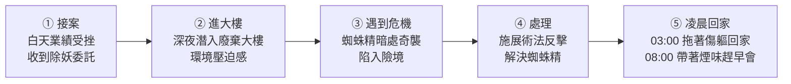

# 序章（01-蜘蛛精）｜漫畫動作文字稿

> **用途說明**：本檔為從 [小說.md](./小說.md) 拆出的**「漫畫改編動作文字稿」**，偏重鏡頭、左右手／站位空間鎖定、對話氣泡防誤判色碼與 JoJo 風擬聲字，專供 [逐頁分鏡.md](./分鏡/入夜與天明-16頁重製/逐頁分鏡.md) 與 Codex 分鏡／生圖使用。純文字小說正本請見 [小說.md](./小說.md)。

## 🎬 章節節奏結構圖

---

## 🎬 漫畫動作文字稿（含分色與音效標記）

> **🎨 漫畫／Codex 解析圖例（詳見 [創作原則](../../創作原則.md)）**：預設原色 `「……」`＝**角色開口對話氣泡** ｜ 藍色＝**旁白／規則／說明（僅可放無尾矩形框或轉構圖，禁進對話泡）** ｜ 橘色＝**內心戲／心理 OS（無框浮字，禁進對話泡）** ｜ 紫色＝**手機畫面 UI（僅存在螢幕內）** ｜ **紅字『狀聲詞』＝繁體中文無框立體手寫音效（嚴禁塞進對話氣泡）** ｜ <b>【🔒 場景鎖定】</b>＝同景禁止地形亂飄

<b>【🔒 場景鎖定 01｜廢棄醫院外牆低窗 ➔ 1F 通往 2F 樓梯間｜深夜・無燈光・重點結構：水泥階梯＋矮牆欄杆轉角】</b>

深夜一點半，廢棄醫院外牆的窗框早沒了玻璃。
家銘雙手撐住窗框，費力地把上半身擠進來。
嘴裡低聲抱怨著「這趟委託費扣掉車錢根本不划算」，一邊咬牙把身體往裡撐。

不料窗台積滿了青苔與灰塵，他掌心一滑**『哧溜』**，整個人重心失控，狼狽地**『咚！』**撲摔進一樓通往二樓的樓梯間裡。
「嘶……」他撐在階梯上停頓了兩秒，倒抽一口冷氣，低頭揉了揉磨得生疼的掌心，這才無奈地爬起身拍掉西裝褲上的灰塵。
他按亮手機確認委託內容——上個月一組探險網紅在這裡失蹤，警方搜遍整棟大樓都沒發現血跡或打鬥痕跡，只能暫時當成失蹤案處理。

<b>【🔒 場景鎖定 02｜廢棄醫院 2F～3F 病房長廊｜漆黑・僅手電筒單點照明｜剝落白灰壁癌牆＋破損輕鋼架天花板黑管線＋地上舊病歷與碎瓶】</b>

他打開手機手電筒**『喀嗒』**走上二樓走廊，沿著二樓走廊一間間巡查過去。光束切開黑暗，照亮兩側長滿壁癌、大片剝落的白灰牆壁；頭頂的輕鋼架天花板缺了好幾塊板子，露出黑漆漆的管線，腳下則散落著發黃的舊病歷與破碎的藥水瓶**『喀啦……』**。

就這樣在二、三樓之間仔細繞了十幾分鐘，推開了七八間空蕩蕩的病房與護理站，空氣裡卻始終只有濃重的潮濕霉味，安靜得連風聲都聽得一清二楚**『……』**。

他停在二樓樓梯口，皺起眉關掉手電筒**『喀嗒』**：「奇怪，這棟樓陰氣是有點重，但巡了一圈連半點妖氣的影子都沒有……難道真是誤報？」

猶豫了兩秒，他嘆了口氣，還是從西裝內袋摸出一只拇指大的玻璃瓶，拔開木塞**『啵！』**仰頭灌了一口。冰冷辛辣的符水剛滑過喉嚨，雙眼頓時傳來一陣針扎般的刺痛，逼得他本能地閉緊眼睛，眉頭死死擰在一起。

數秒後，刺痛退去，家銘猛地睜開雙眼。

原本空無一物的昏暗走廊裡，此刻竟飄浮著數十條細長、宛如血管般的紫紅色妖氣，正順著地板一路蜿蜒爬向地下室的樓梯口。與此同時，一股濃烈到令人作嘔的血腥與腐臭味毫無預警地衝進鼻腔，差點讓他當場吐出來。

家銘死死捂住口鼻，整個人僵在原地，瞳孔驟然收縮。

「……居然連氣味和痕跡都能一併遮蔽？」他壓低聲音，喉結微微滾動了一下，眼神瞬間凝重起來，「難怪警察什麼都找不到——這東西，居然會用障眼法。」

家銘順著地板上蜿蜒的紫紅妖氣走進安全梯，越往下，空氣裡的血腥與腐臭就越重，重得像一塊濕透的爛布糊在口鼻前。

<b>【🔒 場景鎖定 03｜地下室無窗水泥長廊｜全黑潮濕・裸露泥灰水泥牆＋頭頂黑管線＋積水反光地面｜180° 軸線鎖死：家銘背後＝唯一出口（上行安全梯）；走廊盡頭牆角＝遺骸＋摔裂手機＋補光燈＋蜘蛛精】</b>

地下室是一條沒有窗戶的水泥長廊，潮濕得幾乎沒有空氣流動。他重新打開手電筒**『喀嗒』**，光束切開黑暗，照向幾十步外的走廊盡頭——牆根底下堆著幾具被撕咬得殘破不堪的屍體與肉塊，地上還散落著摔裂的手機和補光燈。

胃裡一陣翻湧。不等他看清，一滴黏稠的液體突然從上方**『啪嗒』**落在屍堆旁。

家銘手一抖，把光束往上抬——幾乎佔滿半面牆的，是一團粗大、覆滿黑褐色硬毛的節肢與軀體，八條如人臂粗細的步足死死摳在水泥牆面上**『喀！』**。

就在光線落上去的瞬間，那團怪物的前端竟發出一陣甲殼摩擦的輕響**『喀……喀……』**，硬生生朝家銘的方向抬起、轉正——以它貼牆的姿勢，那根本是一個不該能向上彎折的角度。

光束落在那張臉上——黑灰色的半短髮從頭頂中央分開，濕黏地垂在臉頰兩側，把慘白額頭的正中央讓了出來；底下的雙眼大得異常，眼眶裡全無眼白，只剩兩潭深不見底的黑。直到光線微晃，他才驚覺那片露出的眉骨上方與額角皮膚裡，竟還嵌著幾顆大小不一的黑亮眼球，正隨著視線一起朝他轉動**『……』**；而兩側垂落的髮絲背後，人皮邊緣早已長滿粗黑硬毛，死死連回背後的蜘蛛軀幹。

更令人反胃的是嘴部——它明明長著人類的上嘴唇，唇瓣卻微微向上扯開，底下沒有下巴，而是探出兩根黑亮粗長、遠遠垂過臉緣的蜘蛛螯牙**『滴……』**。

家銘全身的寒毛瞬間倒豎，脊背像被澆了一桶冰水。

但他退無可退。這東西已經盯上自己了。家銘咬緊牙根壓下胃裡的噁心感，右手立刻探進口袋扣住一張符咒，同時壓低嗓音急急唸咒、左手飛快結印——指印未散，左手掌心皮下已透出一陣微弱卻刺眼的紫光**『滋滋……』**。這招『掌心雷』是他目前修為裡唯一能壓制對方的控制技，卻必須貼身近距離按上去才有效。

他死死盯著那張多眼的臉，心裡發沉——『老實說，我一點也不想接近這怪物，但以目前的修為，也就只有這招能夠控制住它了。』

蜘蛛精似乎也察覺到家銘的動作，貼在牆上的身軀猛地一沉，兩條粗壯的後足竟突然抬起，快速摩擦起那顆鼓脹的腹部**『沙沙、沙沙……』**。

家銘心頭一緊——這傢伙想做什麼？得先發制人！

他一個箭步往前暴衝，想趁對方蓄勢前直接把掌心雷按上去。才剛邁出兩步，雙眼卻像突然被撒了一把細碎玻璃末，一陣尖銳刺痛猛地扎進眼眶**『刺——！』**，逼得他硬生生剎住腳步**『吱——！』**。

緊接著，喉頭一陣劇癢翻湧，他不受控制地彎腰狂咳起來**『咳！咳！』**，裸露在外的頸側與臉頰皮膚也跟著泛起密密麻麻的針扎灼痛。

家銘痛得一隻眼睛死死閉起，另一隻眼在淚光裡勉力睜開一條縫，心底驚駭湧起：『這……咳、咳咳……是毒瘴！？』他立刻抬起左前臂死死摀住口鼻，『那就只能用閉氣訣——！』念頭才剛轉過，眼前陰影驟然壓近——

眼見他停下腳步，牆上的怪物立刻停止動作。八條人臂粗的剛毛步足同時鬆開牆面、砸向地面**『咚！』**，在狹窄的水泥長廊裡爆出一連串沉重又急促的叩擊聲——**『喀噠、喀噠！』**它踩碎積水、交替蹬踏兩側牆壁與天花板管線，整團龐大毛軀貼著通道疾衝而來**『咚咚咚！』**；那顆中分短髮的蒼白人臉卻死死壓在同一條水平線上直勾勾鎖定他，額上數顆黑眼同時瞪大，唇瓣上扯露出沾滿黏液的巨型螯牙。

來不及細想，家銘強忍著眼淚直冒的刺痛，左臂依舊死死橫摀口鼻，右手夾緊扣住的那張烈火符，朝他面朝遠牆時的右側牆面水平橫揮而出（帶 L 形管接頭的那一面牆；正面拍家銘時向畫面左方揮出，肩後拍怪物時於畫面右側牆旁爆開）——一道如揮劍橫斬般的白弧破風甩出**『咻！』**。黃符高速朝右側牆邊（帶 L 形管接頭側）飛去，被撲近的蜘蛛精猛地朝另一側閃身躲開**『咻！』**。

然而就在怪物以為躲過一擊、準備撲咬的瞬間，擦身而過的烈火符就在它剛才讓開的那面帶 L 形管接頭的右側牆面（怪物左側腹旁）轟然炸開**『轟——！』**！

刺眼的烈焰瞬間吞沒了右側走廊半側，火舌捲過蜘蛛精的左側腹，硬生生逼停了它的攻勢。怪物在火光中痛得仰身狂吼**『啊——！』**——詭異的是，從它喉嚨深處炸出的並不是蟲類的嘶鳴，而是尖銳得像人類瀕死慘叫般的淒厲嚎聲。

更讓家銘背脊發涼的是眼前的另一幕——烈焰炸開的同時，原本看似空無一物的整片走廊空氣裡竟跟著燃起成千上萬點細碎火星**『劈啪劈啪！』**，像漫天飄落的雪花與櫻花瓣般充滿整片黑暗空間、一一燃盡。

家銘喘著氣往後退了半步**『呼……呼……』**，瞬間明白過來。

根本不是毒瘴——是它剛剛用後足從腹部踢出來的細毛，還用障眼法藏在了空氣裡！

一股後怕猛地竄上背脊。自己畢竟修為還淺、實戰經驗遠不夠老道，剛才完全誤判了它摩擦腹部的動作；換成經驗老道的高手早該看穿，而他差半秒就要直接掐『閉氣訣』硬扛了——可這種肉眼看不見的攻擊根本不是氣體，閉氣訣就算鎖死口鼻，也擋不住——到時不僅雙眼繼續劇痛流淚、皮膚灼痛難耐，他還會陷入『為什麼法訣沒用』的慌亂外加騰不出一隻手應戰，只會白白被這怪物撕碎。

剛才要不是被逼急了順手甩出烈火符，誤打誤撞燒破了這層把戲，這一回合他恐怕已經交代在這裡了。

雖然幸運撿回一命，但家銘眼神卻更加凝重——這怪物既然能靠這招封鎖空間，就不能再留在無風的地下室裡跟它耗下去。可惜自己身上沒有『神風符』，也不會借風的術法；既然如此，那就……

家銘將口袋裡剩下的符咒一口氣全掏了出來——共五張烈火符。他手腕一揚，把符咒甩向除了身後樓梯以外的前方五個方向（正前、左前、右前與左右牆面）**『咻咻咻！』**。黃符觸牆的瞬間轟然爆燃**『轟隆！』**，橘紅火舌夾著濃煙在狹窄地下室裡猛烈竄開；家銘趁勢轉身，頭也不回地沿著安全梯往上狂奔**『踏踏踏！』**。

突如其來的火海與濃煙瞬間封死了地下室**『呼轟——』**，蜘蛛精受驚之下發出連串急促嘶叫**『嘰——！嘰——！』**，在火光裡慌亂竄逃，最後循著唯一沒有火焰的出口，一路順著樓梯朝一樓狂爬上去**『喀噠、喀噠！』**。

<b>【🔒 場景鎖定 04｜1F 通往 2F 樓梯轉角平台｜重用場景 01 同一座樓梯（水泥階梯＋矮牆欄杆轉角）｜下方地下室梯井火海紅光上湧、濃煙瀰漫（嚴禁變成平地）】</b>

正要衝出一樓樓梯口的那一剎那，它壓根沒發現家銘根本不在一樓——他早趁著剛才一口氣多跑了半層，此刻正蹲伏在一樓往二樓之間的樓梯轉角平台旁，左手撐著水泥矮牆邊緣，死死盯著下方梯井。

等那團龐大黑影竄進視線正下方的瞬間，家銘縱身躍下，右手早已重新凝聚好的紫光迎頭轟落——『掌心雷』結結實實拍在蜘蛛精的頭頂正中！**『轟啪！』**

伴隨刺耳的電流爆鳴**『滋啦滋啦！』**與墜落衝力，藍紫色電弧猛地竄遍它全身；原本緊扣階梯的八條步足瞬間痙攣僵直、失去了抓地力**『喀！』**，頭顱更在重擊下裂開一道血口**『喀裂！』**，鮮血順著慘白人臉噴濺而出。

不等它從麻痺裡掙脫，家銘順勢把殘餘法力全部灌進右腿，落地借力就是一記凌厲高前踢，勁風破空正中怪物胸腹**『砰！』**！龐大的蜘蛛軀幹頓時失衡倒飛，沿著階梯四腳朝天一路滾摔回底下熊熊燃燒的地下室**『咚、咚、咚！』**。

烈焰捲上它沾滿油脂與絨毛的身軀**『轟！』**，怪物翻覆在火海裡痛苦掙扎，喉嚨深處硬擠出一聲變調的淒厲哀嚎——

「救……命……」

家銘站在樓梯口往下望著那片火光，胸口劇烈起伏**『呼……呼……』**，吐出一口長氣：「……連人話都學會一點了嗎。好險，就在這裡把你解決了。」

***

<b>【🔒 場景鎖定 05｜凌晨街巷騎乘返程 ➔ 五六十年老公寓一樓雙開老舊鐵門｜凌晨兩點・暗巷路燈】</b>

家銘跨上停在巷口暗處的舊機車，發動引擎**『突突突……』**滑出馬路時，夜色裡傳來由遠而近的消防車鳴笛聲**『嗚——咿——』**；紅藍警燈在後照鏡裡一閃而過，與他擦身駛向那棟廢棄醫院的方向。

穿過幾條凌晨空無一人的街道，夜風灌進領口時，他才後知後覺感到頸側被細毛刺過的地方火辣辣地發癢，剛使過力的小腿也開始隱隱發痠。二十多分鐘後，他把機車騎進另一條暗巷停好，拖著沉重的步子走進巷弄深處。眼前是一棟屋齡五、六十年的老公寓，一樓那扇老舊的雙開鐵門只要關得稍重，就會震出整棟樓都聽得見的**『哐噹！』**。即便累得眼皮直打架，家銘還是拉緊門把放輕力道，可鐵門合上時仍悶悶地**『咚……』**響了一聲。他下意識縮了縮脖子，快步進門。

<b>【🔒 場景鎖定 06｜出租老公寓木板隔間窄套房｜凌晨兩點～早上七點半｜綠色磨石子梯間 ➔ 左側無遮擋房門＋門背鎮宅符與電費單 ➔ 右側靠窗單人床旁緊擠小書桌＋窗型舊冷氣＋附陶瓷洗手台小浴室】</b>

感應燈慢了半拍才在頭頂亮起微弱黃光**『啪』**，照出狹窄的綠色磨石子樓梯。他躡手躡腳地上樓，穿過走廊輕聲進房。

這是間房東用廉價木板隔出來的窄小套房，牆紙邊緣因為常年悶濕微微翹起，角落立著一台啟動起來**『隆隆隆……』**的舊款窗型冷氣。木板隔音極差，平時深夜連隔壁沖馬桶**『嘩啦……』**、手機震動**『嗡……』**的聲音都聽得到——更別說現在已經凌晨兩點多，這時間進浴室開水洗澡肯定會吵醒鄰居。

他看著浴室門嘆了口氣，心想只能忍著這身黏膩，明天早上再早點起床沖澡了。

家銘脫下身上那件唯一、皺巴巴又帶著濃重焦煙味的西裝外套，掛上書桌椅背——房間窄得只容一條貼門側身的過道，單人床靠窗擺放，書桌就硬擠在床尾與牆角之間（不擋房門開合）。視線一偏，門背上貼著一張自己畫來安神的黃紙鎮宅符，旁邊還用磁鐵吸著一張七百多塊、還沒繳的電費帳單。

他連多看一眼的力氣都沒了，只進浴室把小洗手台的冷水龍頭小心擰開一小縫**『淅瀝……』**，掬水胡亂抹了把臉、拍了拍頸側紅腫發癢的刺痛處，隨即倒上床墊**『咚……』**。臨睡前，他特地設了六點的鬧鐘想早起沖澡除掉煙味，又怕睡死補了一個七點半的備用鬧鐘，接著便被疲憊狠狠拽進黑沉沉的睡眠裡。

***

**『鈴鈴鈴！』**

七點半的鬧鐘才剛響了兩聲，家銘就反射性伸手把螢幕按滅**『嗶』**。「嗯……」他迷迷糊糊地從床上撐起半邊身子，瞥見螢幕上的時間後整個人猛地清醒：「七點半了！？糟糕，怎麼睡到這個時候……」

八點就要進公司早會，現在根本沒時間沖澡了。

昨晚沒洗澡的代價瞬間現形——頭髮油膩地貼在額前，眼眶還殘留著被細毛扎過後的微紅血絲，襯在深重黑眼圈上，活像連熬了好幾個大夜班。他趕緊彈下床套上那件皺巴巴的西裝外套，抓起百元超商買的體香噴霧往領口亂噴了兩下**『噗嗤！噗嗤！』**，這才拎起公事包衝出門。

<b>【🔒 場景鎖定 07｜清晨上班馬路車陣 ➔ 公司巷口機車格旁｜早上八點前｜戴西瓜皮安全帽、穿皺西裝＋掀車廂準備收安全帽（嚴禁畫雙分身或街邊大電視；推播與簡訊僅存在手機螢幕內）】</b>

清晨的馬路已經湧起車潮。許家銘穿著一套廉價西裝、頭上扣著頂半罩式西瓜皮安全帽，騎著舊機車在車陣間趕路**『轟隆……』**。好不容易趕在八點前滑進公司巷口的機車格停好車、掀開車廂準備收起安全帽時，口袋裡的手機接連震動了兩下**『嗡！嗡！』**。

第一條是新聞快訊推播——【📱手機畫面推播】『廢棄醫院地下室凌晨火警，警消撲滅後於現場尋獲數具殘缺遺骸及攝影器材，疑與上月失蹤之探險網紅有關，現場另發現不明大型焦黑動物殘骸，警方目前朝意外或縱火方向偵辦中……』

家銘指尖一頓，心口略微鬆了半拍，又背脊一涼地迅速按黑螢幕**『喀嗒』**。幸好那棟老醫院外圍沒裝監視器。

緊接著跳出的第二條，則是地下接案中介傳來的冷淡訊息：【📱手機通訊訊息】『昨晚那棟醫院引來兩台消防車上新聞了，業主那邊被警方叫去問話很不爽，原本九千的單扣兩千五善後費，實付六千五，晚上轉給你。』

他盯著手機螢幕在心裡默默算了筆帳：這趟燒光六張自製烈火符（光材料成本就快一千八）、喝掉一瓶五百塊的開天眼符水，再加上油錢跟下班後非洗不可的西裝乾洗費三百塊——差點把命折在地下室的一晚，扣完開銷居然只實賺三千多塊；再想起門後那張七百塊的電費帳單，真正能留下來的只剩兩千多，連補貼下個月房租都不太夠。

『……這到底算什麼。』他無聲嘆了口氣**『呼……』**，把手機塞回口袋，鎖好車廂**『喀嗒』**快步走進公司大樓。

<b>【🔒 場景鎖定 08｜保險公司辦公區電梯口 ➔ 冷氣極強的早會會議室｜早上八點｜玻璃白板＋訓話主管＋圍立同事｜右手藏進褲袋、只舉左手喊口號】</b>

乘電梯上樓**『叮！』**、刷卡**『嗶』**踏進辦公區時，家銘深吸一口氣，強行擠出僵硬微笑沿路點頭：「早……早安，早。」

八點整，冷氣開到刺骨的會議室準時開會。

「……所以這個月業績還掛蛋的幾位，拜託你們把活動量表拿出來好好檢討一下！」**『叩！叩！』**

早會才剛開始五分鐘，站在白板前的主管正敲著表格訓話，站在家銘身旁的同組女同事卻突然皺起眉頭、不動聲色往旁邊挪了半步，壓低聲音小聲問：「家銘……你身上怎麼有一股很重的烤焦味？像是燒掉什麼塑膠跟毛的味道。」

前頭講話的主管話音一頓，視線順勢掃了過來，眉頭皺得更深：「許家銘，你這套西裝也太皺了吧？身上還一股煙味，你剛剛是跑去樓下抽煙嗎？等一下十點約了客戶要怎麼談保單？當業務的門面先顧好吧。」

全會議室十幾道目光齊刷刷看過來。**『窸窣……』**

家銘頂著微紅發癢的雙眼，立刻低頭彎腰賠笑：「抱歉經理，昨晚住處樓下好像有人燒東西飄到陽台，中午我馬上送去處理。」

主管揮了揮手沒再深究，轉身繼續拍著白板催進度。家銘默默直起身，視線低垂——垂在身側的右手掌心，此刻還殘留著昨夜強催『掌心雷』後一陣陣隱隱發麻的鈍痛感。

他緩緩把那隻右手插進廉價西裝褲口袋裡，抬起頭，跟著滿屋子的業務同事一起抬起左手喊出早會口號：

「早安，今天也請全力衝刺！」**『轟——！』**

---

## 《序章：入夜與天明》
