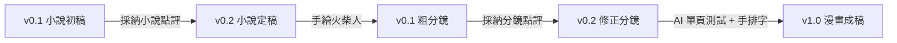

# 💡 01-蜘蛛精：點評與修改紀錄

> 只記錄**你覺得有用、決定採納**的意見與修改決定。

---

## 🔄 版本演進追蹤

---

## 📖 小說階段決定

| 段落 | AI 點出的問題 | 我的決定（採納 / 略過） | 修改方向 |
| :--- | :--- | :---: | :--- |
| ① 接案 | （待填） | ⬜ | |
| ② 進大樓 | （待填） | ⬜ | |
| ③ 遇到危機 | （待填） | ⬜ | |
| ④ 處理 | （待填） | ⬜ | |
| ⑤ 凌晨回家 | （待填） | ⬜ | |

---

## 🖼️ 分鏡階段決定

| 頁 / 格號 | 問題類型（動線 / 位置 / 動作 / 停頓） | 具體問題 | 修正方式 |
| :---: | :---: | :--- | :--- |
| P1 - 第 1 格 | （待填） | | |

---

## 📌 序章標題定案（話末壓標題）

> 規則：僅「序章」將標題置於結尾「早安，今天也請全力衝刺！」之後，第 01 話起恢復開篇正常排序。

- **已選定標題**：**《序章：入夜與天明》**（與結局路線 設計 B **《終章：天明與入夜》** 首尾鏡像對稱）

*(以下保留先前評分候選作為備查)*

1. **《序章：入夜與天明》**（9.3 / 10）✅ **已採用**
2. **《序章：除妖與早會》**（8.9 / 10）
3. **《序章：早會》**（8.5 / 10）
4. **《序章：當然的一天》**（8.0 / 10）
5. **《序章：法師/業務員》**（7.3 / 10）

---

## 📌 EP2 標題定案（開篇置頂）

- **已選定標題**：**《EP2：跑單與補貨》** ✅ **已採用**（「跑單」雙關白天跟蔡經理跑保單、拓客與夜晚基層同行跑除妖單、接靜默單；「補貨」對應黃昏市場採購符材與深夜畫符改繪破煞符）

*(以下保留先前評分候選作為備查)*

1. **《EP2：跑單與補貨》**（★★★★★）✅ **已採用**
2. **《EP2：掛零與補貨》**（★★★★☆）
3. **《EP2：即期與補貨》**（★★★★）
4. **《EP2：靜默單》**（★★★★☆）
5. **《EP2：零元與一萬五》**（★★★★☆）
6. **《EP2：業績與硃砂》**（★★★★）
7. **《EP2：茶葉蛋與破煞符》**（★★★★）
8. **《EP2：空檔》**（★★★☆）

