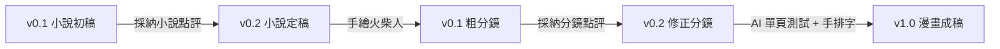

# 💡 01-蜘蛛精：點評與修改紀錄

> 只記錄**你覺得有用、決定採納**的意見與修改決定。

---

## 🔄 版本演進追蹤

---

## 📖 小說階段決定

| 段落 | AI 點出的問題 | 我的決定（採納 / 略過） | 修改方向 |
| :--- | :--- | :---: | :--- |
| ① 接案 | （待填） | ⬜ | |
| ② 進大樓 | （待填） | ⬜ | |
| ③ 遇到危機 | （待填） | ⬜ | |
| ④ 處理 | （待填） | ⬜ | |
| ⑤ 凌晨回家 | （待填） | ⬜ | |

---

## 🖼️ 分鏡階段決定

| 頁 / 格號 | 問題類型（動線 / 位置 / 動作 / 停頓） | 具體問題 | 修正方式 |
| :---: | :---: | :--- | :--- |
| P1 - 第 1 格 | （待填） | | |
