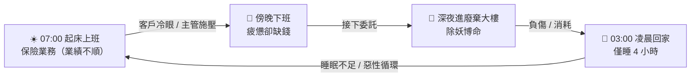
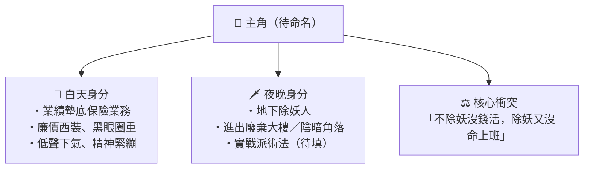
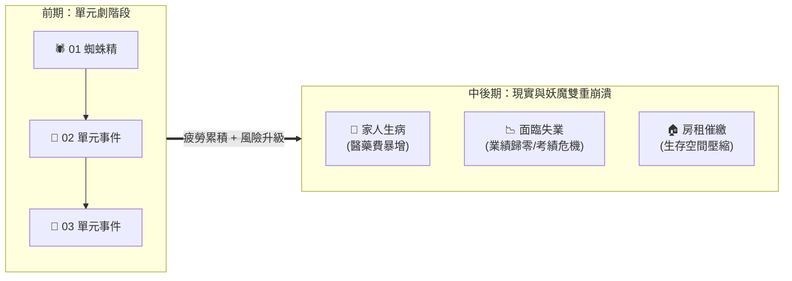

# 🌐 角色與世界觀設定

---

## 🔄 主角日夜雙重循環

---

## 👤 主角視覺化檔案

| 項目 | ☀️ 白天（表） | 🌙 夜晚（裏） |
| :--- | :--- | :--- |
| **身分** | 保險業務員 | 除妖接案者 |
| **外貌特徵** | 皺西裝、公事包、黑眼圈、強顏歡笑 | 便於行動的服裝、傷痕、眼神銳利但疲憊 |
| **主要場景** | 辦公室、客戶家門口、便利商店、捷運 | 廢棄大樓、陰暗巷弄、老舊公寓 |
| **關鍵數字** | **07:00** 準時出門上班 | **03:00** 凌晨收工回家 |

---

## 📈 劇情壓力演進圖

---

## 👹 妖怪與除妖設定（隨章節擴充）

| 編號 | 妖怪名稱 | 出沒地點 | 特徵／能力 | 對應章節 |
| :---: | :--- | :--- | :--- | :--- |
| **01** | **蜘蛛精** | 廢棄大樓 | 暗處結網、奇襲（待補充細節） | `01-蜘蛛精` |
