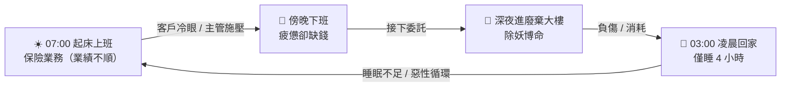
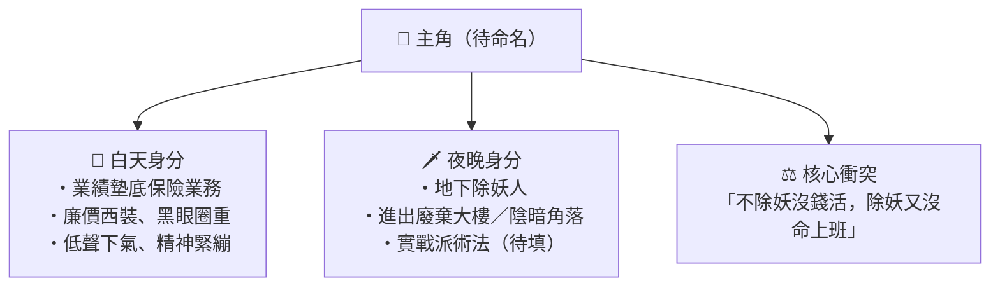
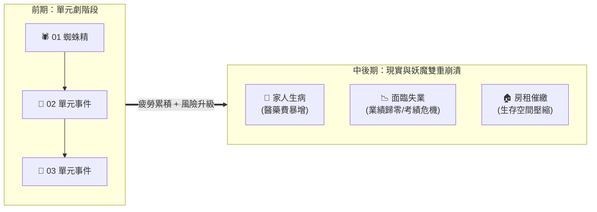

# 🌐 角色與世界觀設定

---

## 🔄 主角日夜雙重循環

---

## 👤 主角視覺化檔案

| 項目       | ☀️ 白天（表）          | 🌙 夜晚（裏）           |
| :------- | :---------------- | :----------------- |
| **身分**   | 保險業務員（約 30 歲） | 除妖接案者              |
| **外貌特徵** | 中分微亂短黑髮、明顯雙眼皮帶深重黑眼圈、廉價微皺西裝、公事包、西瓜皮半罩安全帽、強顏歡笑 | 同套便服／西裝（沾塵煙味）、傷痕、眼神銳利但疲憊 |
| **主要場景** | 辦公室、客戶家門口、便利商店、捷運 | 廢棄大樓、陰暗巷弄、老舊公寓     |
| **關鍵數字** | **08:00** 進公司早會（常設六點起床，本次睡過頭至七點半） | **03:00** 凌晨收工回家 |

- **主角姓名**：許家銘
- **外型參考**：[許家銘人設圖](章節/01-蜘蛛精/參考圖/主角-許家銘人設圖.jpg)。黑短髮，眼下有黑眼圈，襯衫領口和領帶略鬆。圖左是提公事包、垮肩陪笑的業務姿態；中央是右手持符、左手結印時專注的神情；右側是戴安全帽通勤時的疲態。

### 💼 白天職場真實規則（台灣保險業務基準｜依學弟實務口述整理）

- **早會與工時**：固定開早會，主要內容是**灌心靈雞湯**與點名檢討進度；散會後**彈性上下班、午餐自理**（此設定讓家銘白天有合理空檔去乾洗西裝、補眠或買符材，不會出現翹班破綻，代價是完全沒有保護傘）。
- **薪資與淘汰機制**：**薪水從 0 開始計算，沒成交就完全沒錢（無底薪）**；約 **3～6 個月沒報一件 case** 會面臨取消證照登錄資格，但實務上多半都是還沒撐到考核線就因斷糧自己做不下去離職。
- **拓客與簽單實況**：新人與基層多半**從身邊親戚朋友開始推銷**，簽約流程本身不複雜（講完建議書簽名送件），真正的難點是人情消耗與開不了張；外勤是否騎機車看個人（家銘為省錢騎舊機車跑單）。
- **待補核細節**：主管是否會分配／轉介客戶，以及實務上「帶新人陪訪」怎麼運作，待另一位業務朋友分享後再定案。

---

## 📊 主角成長路線、三維屬性與目前角色池（許家銘）

> 2026-11-19：依作者設定補充主角等級與三維成長框架。**目前角色狀態為第 01 章戰後「Lv.8（進度約 78%，接近升上 Lv.9）」；三維數值為開局暫定基準，具體升級與配點均須於每場戰鬥後由作者確認。**

### 1. 等級與四階戰力對照路線

| 等級區間 | 對應階級 | 定位與戰力特徵 |
| :--- | :--- | :--- |
| **Lv.1 ～ Lv.9** | **三流（學徒／入門社畜）** | 掌握單一或少數基礎術法，瞬發力弱；仰賴自製低階符與腦力、地形搏命周旋。 |
| **Lv.10 ～ Lv.24** | **二流（熟練外勤／菁英）** | 跨越門檻後可逐步習得局部物質轉化、五行小遁與二流保命符；能正面抗衡低中階妖魔。*(註：第 01 章蜘蛛精為初級二流，約 Lv.10～12 強度)* |
| **Lv.25 ～ Lv.49** | **一流（一方名宿／宗師）** | 具備高階元素轟炸（如三昧真火、五雷）或長距離遁法，開始脫離純靠低階符苦撐的階段，並接觸地下高階資源圈。 |
| **Lv.50+** | **巔峰道人（陸地神仙／戰略級）** | 八九玄功、法天象地、袖裡乾坤等規格外神通，足以撼動都市與區域格局。 |

### 2. 三維屬性定義與開局暫定面板（Lv.8）

- **三維尺度說明**：以未修行之普通成年上班族單項約 `5` 分為基準（暫定尺標，後續升級再由作者微調）。

| 三維維度 | 對應意義與實戰影響 | 家銘 Lv.8（暫定） | 實戰表現對照（第 01 章） |
| :--- | :--- | :---: | :--- |
| **體魄** | 肉身素質、近戰耐打度、跑動與格鬥爆發力，以及抗毒／負傷撐場能力 | **12** | 體能略優於常人，聚氣高前踢可踹飛受創大妖；但仍怕物理微針刺傷，戰後腿痠疲憊 |
| **法力** | 靈氣總量、術法輸出上限、一日畫符張數與失敗承受度 | **10** | 無法瞬發大招；下班熬夜壓縮畫符一天約 2～3 張；連催掌心雷加丟 6 張符點火後接近見底 |
| **神識** | 戰場觀察力、施法精度、抗恐懼／幻術／心魔定力 | **11** | 撐得住恐怖谷與克蘇魯怪物壓迫不至失神；但經驗尚淺，第一時間會誤把踢毛錯認成毒瘴 |

### 3. 許家銘「目前角色池」（已實戰登場 vs 待定空位）

- **目前等級進度**：`Lv.8`（第 01 章戰後結算：**約 78%，接近 Lv.9**）
- **已於正文實戰使用之術法**：
  - `掌心雷`（三流近戰控制技）：需貼身近距離按壓敵體，電弧可造成神經麻痺（電擊器級）；第 01 章配合高處墜落衝力造成破防效果。
  - `基礎法力聚氣體術`：將殘餘法力灌注於肢體（如第 01 章的高前踢），屬於基礎運氣而非二流肉身硬化。
- **已於正文使用／持有之消耗品**：
  - `烈火符`（自製低階三流符）：第 01 章已消耗 **6 張**（目前庫存歸零，待補繪）。
  - `開天眼符水`（外購藥劑類）：第 01 章已消耗 **1 瓶**。
- **待作者後續拍板的開局空位**：
  - 目前已登場項目集中於「控場（掌心雷）＋ 感知（符水）＋ 自製攻擊符（烈火符）」，**「護身」與「身法」維度尚未有明確已習得招式**，建議第 02 章開打前確認是否已會基礎五訣（如閉氣訣）或低階身法。
  - 名稱待統一項：正文使用「**烈火符**」，下方符咒候選池原表列「**陽火符**」，待作者確認是否合併統一或區分階級。

---

## 📈 劇情壓力演進圖

### 🎯 終章結局定案方向：《終章：天明與入夜》（設計 B・表裏公開與日常翻轉）

> 2026-11-19：作者已選定 **設計 B（表裏公開 × 終於能見光的日常）** 作為全作大結局方向，與 **《序章：入夜與天明》** 形成首尾對稱。核心鐵律不變：**許家銘沒有血統或絕世天賦，實力雖較開局判若雲泥，但始終不是天下第一，仍保有普通人的人生與煙火氣。**

- **世界觀巨變轉折**：中後期大事件徹底炸穿「普通人不知妖魔存在」的表裏界線，但現代都市並未毀於末日廢土，而是進入「**高風險半公開共存時代**」（出現合法委託機制、官方規範與異常災害保險等制度）。
- **晝夜翻轉對稱（對照序章）**：
  - **序章《入夜與天明》**：入夜＝像賊一樣偷偷翻窗搏命、還要被扣錢；天明＝戴著虛偽面具穿焦味西裝在早會受辱。
  - **終章《天明與入夜》**：
    - **天明**：家銘依舊是按件計酬的無名基層法師（或結合過去跑業務的人情歷練經營小工作室），但**終於能在大白天光明正大穿戴裝備出門除妖、靠本事體面吃飯**，甚至能與善良小妖協作，再也不必躲藏或撒謊。
    - **入夜**：夜幕降臨後，不再需要凌晨去廢棄大樓拚命，**把夜晚真正還給自己的人生**——安心洗個熱水澡、與在意的家人或夥伴吃頓熱飯、偶爾跑幾單夜間外送吹吹風，踏實睡覺迎接明天。
- **後續伏筆備忘**：中篇可提前埋下「善良小妖線人」「保險／理賠與異常災損掛鉤」「基層法師執照與民間互助網」等日常伏線，讓中後期公開化轉折水到渠成。

---

## 👹 妖怪與除妖設定（隨章節擴充）

| 編號 | 妖怪名稱 | 出沒地點 | 特徵／能力 | 對應章節 |
| :---: | :--- | :--- | :--- | :--- |
| **01** | **蜘蛛精** | 廢棄醫院（地下室） | 捕鳥蛛厚實毛軀（約 1.5m×1.2m）＋偏小狹長慘白頭顱與中分黑灰濕髮、八眼純黑蜘蛛圓眼配置、骷髏塌陷鼻腔、人類上唇無下巴＋肉質裂口垂出雙螯牙；會障眼法（連氣味一併遮蔽）、摩擦腹部彈射隱形毒刺細毛；強度為初級二流（約 Lv.10～12） | `01-蜘蛛精` |

### 01 蜘蛛精：視覺設定與參考圖基準（初登場恐怖谷規格）

> 參考圖已歸檔於 `章節/01-蜘蛛精/參考圖/`（**唯一正本定稿概念圖：`06-蜘蛛精初登場概念圖.jpg`**），繪製或生成圖片文字時須同步對照 `小說.md` 第 48–58 行。

- **頭型、頭身比例與髮型**（參考 `03-頭型髮型參考1.jpg`、`04-頭型髮型參考2.jpg`、`05-頭型髮型參考3.jpg`）：
  - **頭身比例**：這顆人頭相對於背後 1.5m×1.2m 的龐大捕鳥蛛軀幹來說，**比例比一般捕鳥蛛的前端頭胸部還要稍微小一點**（類似參考圖 3「巨大軀體配偏小狹長頭顱」的畸形反差，避免大頭娃娃感，放大巨型蛛體的壓迫感）。
  - **頭顱輪廓**：縱向拉長、略呈詭異橢圓／畸形骨感輪廓的慘白人頭，貼在牆上卻以違反脊椎與蜘蛛生理的角度硬生生抬起轉向鏡頭，自帶從暗處窺視的壓迫感。
  - **髮型**：黑灰色厚重半短髮從頭頂中央死板分開（頭頂帶微暗分線縫隙感），濕黏垂落在臉頰兩側形成陰影簾幕，**正中央刻意露出一片慘白額頭**；兩側髮絲背後與人皮邊緣逐漸長出粗黑捕鳥蛛硬毛，與龐大毛軀無縫相連。
- **眼部構造**（參考 `01-眼睛草圖.png` ＋ 現實捕鳥蛛眼群分布 ＋ `小說.md`）：
  - **八眼恐怖谷融合（偏蜘蛛圓眼而非人眼）**：臉部正中為兩顆**更大、更圓、略微外凸如黑曜石圓球的深邃純黑主眼**——**偏向蜘蛛單眼的渾圓球體構造（無眼白、無人類雙眼皮摺或杏仁眼眶線）**，而不是普通人類的杏仁狀眼型。
  - 上方露出的慘白額頭排列著 **4 顆渾圓的純黑小單眼**（呈略微拱起的蜘蛛眼列，對應草圖）；主眼外側靠近太陽穴與兩側髮際邊緣處，左右**各再嵌 1 顆渾圓小型純黑側眼**。八顆黑眼皆呈蜘蛛眼般的圓潤球面並泛著濕冷反光，同時朝獵物聚焦。
- **鼻部構造（已定案）**：**無人類凸起鼻樑與鼻頭**，臉部正中為如**骷髏頭般塌陷、帶細骨鼻中隔的暗黑梨狀鼻腔孔洞**，強化非人屍骸與恐怖谷感。
- **嘴部與口器**（參考 `02-口器參考.jpg` ＋ `小說.md`）：
  - **上半截像人**：保留一道慘白的人類上嘴唇輪廓，唇瓣微向上扯開。
  - **下半截徹底異化**：**完全沒有人類下顎與下巴**，嘴部下方縱向裂開成濕潤暗紅、佈滿肉質摺皺與拉絲黏液的異形／昆蟲軟組織口腔（對應參考圖 2 裂口結構），左右兩側探出兩根黑亮粗長、遠遠垂過臉緣的巨型蜘蛛螯牙，牙尖滴落黏稠液體。
- **軀幹與初登場第一幕氛圍**（對照 `小說.md` 第 48–58 行）：
  - 體長約 1.5 公尺、寬約 1.2 公尺的厚實捕鳥蛛軀幹，八條如成人手臂粗的剛毛步足死死摳進潮濕水泥牆；正下方牆根堆滿被啃食殘破的遺骸肉塊與摔裂的手機、補光燈。
  - **第一幕出圖要求**：遵循 `創作原則.md` 視覺 Harness，初登場特寫須採用**較精緻的寫實黑白漫畫線條與極高對比陰影**（手電筒單一冷白光束自斜下方打亮半張臉與額眼反光），務必呈現出滲人、掉 SAN 值的生理不適感。

---

## 📚 術法技能候選池：四階 × 五維

> 2026-11-18：依作者提供的技能池整理。**這是供作者選擇的候選池，不是主角已習得清單，也不是所有效果與強度均已完成一致性審核的定稿。**
>
> 階序：**三流 → 二流 → 一流 → 巔峰**。五維：護身、身法、變化分身、攻擊控場、感知情報。
>
> 保留原技能名稱、效果與限制；同列以「／」並列者仍是原文並列技能，不擅自合併成單一法術。原文未逐項對應的效果或未寫出的限制，暫不自行補定。個別名稱所涉及的傳統典故與本作具體規則，也以作者後續選擇為準。
>
> 原文提出可從三流、二流技能池挑 **3～4 個**作為主角開局本領；**目前尚未選定**。不得據此自動配裝，亦不改動既有正文。若候選規則與正文表現有差異，先列為待決問題，不自動回改正文或宣稱已定案。

### 第一階：三流

| 維度 | 候選技能 | 原效果與限制 |
| :--- | :--- | :--- |
| 護身 | 基礎五訣（避火、避水、避風、辟穀、閉氣） | 單手持續捏訣不可中斷，僅防凡火與普通濃煙。 |
| 身法 | 草上飛／障眼借法 | 貼神行符減輕體重，或揚塵、利用視覺死角閃現數公尺；非真瞬移。 |
| 變化分身 | 全身障眼法／單根毫毛誘餌 | 變身為光影偽裝，一摸就破；拔髮假人無攻擊力。 |
| 攻擊控場 | 低配定身咒／掌心雷（電擊器級） | 定身對妖怪僅 0.5 秒僵直；掌心雷需貼身按住麻痺。 |
| 感知情報 | 開天眼（牛眼淚／符水短暫開啟）／喚土地 | 只能看清微弱妖氣軌跡；向當地地脈借訊號查探地形。 |

### 第二階：二流

| 維度 | 候選技能 | 原效果與限制 |
| :--- | :--- | :--- |
| 護身 | 金光護體咒／畫地為牢 | 地面畫圈展開絕對安全屋，或硬抗一發手槍／妖怪重擊。 |
| 身法 | 五行小遁（土、木、水、火、金） | 須現場有對應元素，如踩泥土土遁十幾公尺。 |
| 變化分身 | 局部物質轉化（初階 72 變） | 單手變精鋼刀刃或盾牌；維持超過 3 分鐘經脈撕裂。 |
| 攻擊控場 | 指地成鋼／撒豆成兵（低配）／呼名落馬 | 改變數公尺地面材質設陷阱、撒豆出幾個力士扛重物或架妖。 |
| 感知情報 | 火眼金睛（破妄瞳術）／順風耳 | 看穿低階妖怪偽裝與隱身；看久雙眼充血劇痛，且極怕強光、濃煙。 |

### 第三階：一流

| 維度 | 候選技能 | 原效果與限制 |
| :--- | :--- | :--- |
| 護身 | 局部金剛身／移花接木 | 致命傷轉移替身草人，或局部硬化硬吃大招。 |
| 身法 | 縱地金光／深度地行術／縮地成寸 | 無視地形高速化光飛行，或地下長距離無聲暗殺。 |
| 變化分身 | 三頭六臂／奇美拉混變／毫毛小隊 | 同時維持多種神獸部位特性，並分出十幾個具獨立戰力分身。 |
| 攻擊控場 | 三昧真火／三昧神風／掌握五雷 | 大範圍高階元素轟炸、凡水無法撲滅、一擊可毀整棟建築。 |
| 感知情報 | 天眼通（眉心縱目）／神目之術 | 360 度無死角鎖定敵人弱點與經脈流動，看穿一切幻陣。 |

### 第四階：巔峰

| 維度 | 候選技能 | 原效果與限制 |
| :--- | :--- | :--- |
| 護身 | 八九玄功（不壞金身） | 被動常駐刀槍不入、水火不侵，斷肢／斷頭瞬間再生。 |
| 身法 | 筋斗雲／移星換斗 | 跨城市超遠距空間跳躍，或瞬間交換與敵人位置。 |
| 變化分身 | 法天象地／一氣化三清 | 化百米巨人碾壓地形，或分裂三個全盛戰力的獨立分身。 |
| 攻擊控場 | 袖裡乾坤／掌中佛國／釘頭七箭 | 展開獨立空間關押敵人，或隔空絕對因果律咒殺。 |
| 感知情報 | 諦聽因果／洞悉天機 | 一眼看穿過去、未來、罪業、真名與法寶規則漏洞。 |

### 後續選用時再確認

- 主角開局選哪些技能、熟練度及可用條件，仍由作者決定。
- 「絕對安全屋」「看穿一切幻陣」「絕對因果律咒殺」等絕對措辭目前保留原意，不自行削弱或補上剋制規則；正式採用前再確認適用範圍。
- 「基礎五訣」的各訣效果、同列技能與效果如何逐一對應（例如呼名落馬、順風耳等）、消耗及反制，原文尚未完整細分。保留未定狀態，不由整理者補完。

---

## 🧧 符咒候選池：三流與二流

> 2026-11-18：依作者提供的符咒設計資料整理，與前述術法技能候選池分區保存。**這是供選擇的符咒池，不代表家銘本場已攜帶、已使用或必須選取全部符咒。** 不據此替作者選擇下樓裝備，也不代寫或改動正文。

### 核心差異與製作負擔

- 三流與二流符咒的核心差異，是**製造成本（硃砂、符紙等級）與封存法力上限**。
- 家銘目前為**三流接近二流**：三流符可批量自製常備；二流符畫一張便元氣大傷，捨不得亂丟。
- 二流符需用**上等硃砂、熬夜繪製，一戰最多帶兩三張**。這是符咒使用設計的限制，不是替此次醫院事件指定攜帶清單。
- 保留各符效果與限制；未提供的製作數量、法力數值、材料價格及與其他術法的詳細交互，暫不自行補定。

### 三流符咒

| 候選符咒 | 使用方式 | 效果、用途與限制 |
| :--- | :--- | :--- |
| 陽火符 | 甩出後在半空化為至陽凡火。 | 燒不穿大妖皮肉；可照明、燒大片蜘蛛網，或逼退怕火蟲妖。 |
| 破障符 | 撕開或燃燒。 | 震散周遭十幾公尺的低階視覺幻術，破解低階障眼法與鬼打牆，顯出蛛絲陷阱及血跡。 |
| 淨氣符／避穢符 | 貼在衣領或胸口。 | 在口鼻周圍形成微弱氣罩，過濾屍臭與輕微瘴氣，騰出原本捏閉氣訣的左手。 |
| 輕身符／低配神行符 | 拍在小腿。 | 短暫減重，增加爆發步速與閃避；約五分鐘後化灰。 |
| 尋蹤紙鶴／引路符 | 黃符摺成紙鶴，吹氣點燃。 | 灰燼與微光順最濃妖氣或血腥味飄行，鎖定巢穴。 |

### 二流符咒

> 共通製作與攜帶限制：上等硃砂、熬夜繪製；家銘畫一張元氣大傷，一戰最多帶兩三張。

| 候選符咒 | 使用方式或觸發條件 | 效果與限制 |
| :--- | :--- | :--- |
| 金光護身符 | 藏在襯衫內袋，遭致命物理劈砍時自動激發。 | 薄金光抵銷一擊後自燃；衝擊仍會震傷內腑。 |
| 五雷鎮煞符 | 近身破甲；貼在妖物身上，或塞進傷口引爆。 | 引爆雷火，重創內丹與臟器；隔空丟擲威力大減。 |
| 指地成鋼符／陷地符 | 源自封神土行術；預先貼在地面，由踩踏觸發。 | 令數公尺水泥軟化成泥沼，卡住妖足；或使腐朽地面硬化如鐵。 |
| 鎮妖定身符 | 親手貼在眉心或關節；亦可貼於斷肢。 | 強於口唸定身的 0.5 秒僵直，封鎖該部位妖氣數秒；貼斷肢則防止再生。 |
| 替身紙人符 | 黃紙剪成小人，滴上自身指尖血；必死偷襲時替承受傷害。 | 替承受一次肢體撕裂傷；本尊氣血翻湧、耳鳴目眩數秒。 |

### 與正文及其他設定的關係

- 先保存這批設計資料；哪些符咒進入本場、攜帶幾張、何時用，由作者另外決定。
- 同列「／」保留原文的並列名稱，不擅自增設兩種不同配方或合併其與前述術法的施法規則。
- 若符咒效果與開天眼、障眼法、閉氣訣或其他既有描述有待釐清，先指出具體差異供作者確認；不反向改寫小說來符合候選池。

---

## 💰 經濟體系、幣制與符咒運作新規則

> 2026-11-19：依作者確認之世界觀運作方式整理。**具體單次罰款、房租與收支金額屬劇情結算參考值，實際數字以正文為準。**

### 1. 幣制與交易雙軌制
- **日常與基層結算**：正文統一只寫「**塊／元**」，底層物價完全對齊**台幣生活體感**（不直接出現「新台幣」字樣或現實地名，維持華語通用閱讀感與生活壓力寫實度）。
- **高階圈雙軌制（中後期伏筆）**：凡人與三流／二流外勤用現金「塊／元」交易；踏入一流法師與道人圈層後，高階法寶與稀世材料不收現金，改採**「功德／靈物／人情因果」**等以物易物機制。

### 2. 符咒「二段式耗能規則」
- **繪製時（約 90% 儲能）**：符咒本質是「法力蓄電池」。家銘需於下班後靜心花費約三、四十分鐘將法力壓縮進硃砂紋路，一天最多繪製 2～3 張；且三流～準二流存在**畫符失敗率**（失敗品消耗掉的硃砂與黃紙皆為沉沒成本）。
- **使用時（約 10% 點火引信）**：實戰僅需灌注一絲微弱法力啟動符文。由此建立三條實戰鐵律：
  1. **防誤觸**：凡人或警察撿到未引動的符紙，只當作普通鬼畫符，不會自燃爆炸。
  2. **投擲與控爆**：注入一絲法力可使黃紙保持硬挺平甩滑行（如撲克牌／紙飛機手感），並可做短距延遲引爆。
  3. **絕境限制**：當法師法力徹底見底或受麻痺無法提氣時，身上就算還有符也點不燃。

### 3. 自製低階符 vs. 外購高階符分級

| 比較維度 | 家銘自製符（三流～準二流・例：烈火符） | 同業一般現貨 | 高人繪製高階符（二流頂～一流） |
| :--- | :--- | :--- | :--- |
| **威力／性質** | **瞬間凡火**（小型汽油彈級爆燃），需靠連發＋環境助燃物＋近戰補刀才能殺二流妖 | 穩定但仍屬常規水準 | **靈火／真火**，持續灼燒妖氣與神魂、凡水難滅，單張即具重創殺傷力 |
| **成本與市價** | 材料費約 **200～300 元／張**（不含失敗損耗與熬夜精神成本） | 市價約 **1,000～1,500 元／張** | 市價動輒 **3,000～10,000+ 元／張** |
| **家銘持有策略** | 常規輸出與耗材類**自己熬夜畫**，省錢貼補房租 | 急用才偶爾買，極度肉痛 | **高門檻製劑或保命底牌**（如開天眼符水、金光護身符、替身紙人）才向地下鋪／高人購買 |

- **第 01 章實際收支結算**：
  - 委託原定報酬 **9,000 元**（廢棄醫院失蹤異常案）；因引發火警驚動警消遭中介扣除 **2,500 元**善後費，實領 **6,500 元**。
  - 本場消耗：自製烈火符 6 張（約 **1,800 元**，300 元／張）＋ 外購開天眼符水 1 瓶（約 **500 元**）＋ 油錢與西裝乾洗費（約 **300+ 元**），扣除後實賺僅 **三千多元**。
  - 若再扣掉門後 **700 多元**電費帳單，實際能留下的只剩 **兩千多元**（貼補房租仍遠遠不夠，逼得他不得不繼續接下一單）。

