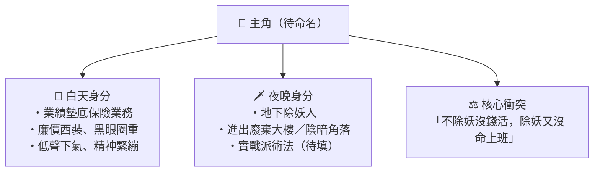
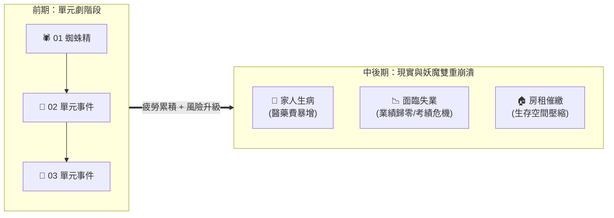

# 🌐 角色與世界觀設定

---

## 🔄 主角日夜雙重循環

---

## 👤 主角視覺化檔案

| 項目       | ☀️ 白天（表）          | 🌙 夜晚（裏）           |
| :------- | :---------------- | :----------------- |
| **身分**   | 保險業務員             | 除妖接案者              |
| **外貌特徵** | 皺西裝、公事包、黑眼圈、強顏歡笑  | 便於行動的服裝、傷痕、眼神銳利但疲憊 |
| **主要場景** | 辦公室、客戶家門口、便利商店、捷運 | 廢棄大樓、陰暗巷弄、老舊公寓     |
| **關鍵數字** | **07:00** 準時出門上班  | **03:00** 凌晨收工回家   |
這人就叫許家銘了

---

## 📈 劇情壓力演進圖

---

## 👹 妖怪與除妖設定（隨章節擴充）

| 編號 | 妖怪名稱 | 出沒地點 | 特徵／能力 | 對應章節 |
| :---: | :--- | :--- | :--- | :--- |
| **01** | **蜘蛛精** | 廢棄大樓 | 暗處結網、奇襲（待補充細節） | `01-蜘蛛精` |

---

## 📚 術法技能候選池：四階 × 五維

> 2026-11-18：依作者提供的技能池整理。**這是供作者選擇的候選池，不是主角已習得清單，也不是所有效果與強度均已完成一致性審核的定稿。**
>
> 階序：**三流 → 二流 → 一流 → 巔峰**。五維：護身、身法、變化分身、攻擊控場、感知情報。
>
> 保留原技能名稱、效果與限制；同列以「／」並列者仍是原文並列技能，不擅自合併成單一法術。原文未逐項對應的效果或未寫出的限制，暫不自行補定。個別名稱所涉及的傳統典故與本作具體規則，也以作者後續選擇為準。
>
> 原文提出可從三流、二流技能池挑 **3～4 個**作為主角開局本領；**目前尚未選定**。不得據此自動配裝，亦不改動既有正文。若候選規則與正文表現有差異，先列為待決問題，不自動回改正文或宣稱已定案。

### 第一階：三流

| 維度 | 候選技能 | 原效果與限制 |
| :--- | :--- | :--- |
| 護身 | 基礎五訣（避火、避水、避風、辟穀、閉氣） | 單手持續捏訣不可中斷，僅防凡火與普通濃煙。 |
| 身法 | 草上飛／障眼借法 | 貼神行符減輕體重，或揚塵、利用視覺死角閃現數公尺；非真瞬移。 |
| 變化分身 | 全身障眼法／單根毫毛誘餌 | 變身為光影偽裝，一摸就破；拔髮假人無攻擊力。 |
| 攻擊控場 | 低配定身咒／掌心雷（電擊器級） | 定身對妖怪僅 0.5 秒僵直；掌心雷需貼身按住麻痺。 |
| 感知情報 | 開天眼（牛眼淚／符水短暫開啟）／喚土地 | 只能看清微弱妖氣軌跡；向當地地脈借訊號查探地形。 |

### 第二階：二流

| 維度 | 候選技能 | 原效果與限制 |
| :--- | :--- | :--- |
| 護身 | 金光護體咒／畫地為牢 | 地面畫圈展開絕對安全屋，或硬抗一發手槍／妖怪重擊。 |
| 身法 | 五行小遁（土、木、水、火、金） | 須現場有對應元素，如踩泥土土遁十幾公尺。 |
| 變化分身 | 局部物質轉化（初階 72 變） | 單手變精鋼刀刃或盾牌；維持超過 3 分鐘經脈撕裂。 |
| 攻擊控場 | 指地成鋼／撒豆成兵（低配）／呼名落馬 | 改變數公尺地面材質設陷阱、撒豆出幾個力士扛重物或架妖。 |
| 感知情報 | 火眼金睛（破妄瞳術）／順風耳 | 看穿低階妖怪偽裝與隱身；看久雙眼充血劇痛，且極怕強光、濃煙。 |

### 第三階：一流

| 維度 | 候選技能 | 原效果與限制 |
| :--- | :--- | :--- |
| 護身 | 局部金剛身／移花接木 | 致命傷轉移替身草人，或局部硬化硬吃大招。 |
| 身法 | 縱地金光／深度地行術／縮地成寸 | 無視地形高速化光飛行，或地下長距離無聲暗殺。 |
| 變化分身 | 三頭六臂／奇美拉混變／毫毛小隊 | 同時維持多種神獸部位特性，並分出十幾個具獨立戰力分身。 |
| 攻擊控場 | 三昧真火／三昧神風／掌握五雷 | 大範圍高階元素轟炸、凡水無法撲滅、一擊可毀整棟建築。 |
| 感知情報 | 天眼通（眉心縱目）／神目之術 | 360 度無死角鎖定敵人弱點與經脈流動，看穿一切幻陣。 |

### 第四階：巔峰

| 維度 | 候選技能 | 原效果與限制 |
| :--- | :--- | :--- |
| 護身 | 八九玄功（不壞金身） | 被動常駐刀槍不入、水火不侵，斷肢／斷頭瞬間再生。 |
| 身法 | 筋斗雲／移星換斗 | 跨城市超遠距空間跳躍，或瞬間交換與敵人位置。 |
| 變化分身 | 法天象地／一氣化三清 | 化百米巨人碾壓地形，或分裂三個全盛戰力的獨立分身。 |
| 攻擊控場 | 袖裡乾坤／掌中佛國／釘頭七箭 | 展開獨立空間關押敵人，或隔空絕對因果律咒殺。 |
| 感知情報 | 諦聽因果／洞悉天機 | 一眼看穿過去、未來、罪業、真名與法寶規則漏洞。 |

### 後續選用時再確認

- 主角開局選哪些技能、熟練度及可用條件，仍由作者決定。
- 「絕對安全屋」「看穿一切幻陣」「絕對因果律咒殺」等絕對措辭目前保留原意，不自行削弱或補上剋制規則；正式採用前再確認適用範圍。
- 「基礎五訣」的各訣效果、同列技能與效果如何逐一對應（例如呼名落馬、順風耳等）、消耗及反制，原文尚未完整細分。保留未定狀態，不由整理者補完。

---

## 🧧 符咒候選池：三流與二流

> 2026-11-18：依作者提供的符咒設計資料整理，與前述術法技能候選池分區保存。**這是供選擇的符咒池，不代表家銘本場已攜帶、已使用或必須選取全部符咒。** 不據此替作者選擇下樓裝備，也不代寫或改動正文。

### 核心差異與製作負擔

- 三流與二流符咒的核心差異，是**製造成本（硃砂、符紙等級）與封存法力上限**。
- 家銘目前為**三流接近二流**：三流符可批量自製常備；二流符畫一張便元氣大傷，捨不得亂丟。
- 二流符需用**上等硃砂、熬夜繪製，一戰最多帶兩三張**。這是符咒使用設計的限制，不是替此次醫院事件指定攜帶清單。
- 保留各符效果與限制；未提供的製作數量、法力數值、材料價格及與其他術法的詳細交互，暫不自行補定。

### 三流符咒

| 候選符咒 | 使用方式 | 效果、用途與限制 |
| :--- | :--- | :--- |
| 陽火符 | 甩出後在半空化為至陽凡火。 | 燒不穿大妖皮肉；可照明、燒大片蜘蛛網，或逼退怕火蟲妖。 |
| 破障符 | 撕開或燃燒。 | 震散周遭十幾公尺的低階視覺幻術，破解低階障眼法與鬼打牆，顯出蛛絲陷阱及血跡。 |
| 淨氣符／避穢符 | 貼在衣領或胸口。 | 在口鼻周圍形成微弱氣罩，過濾屍臭與輕微瘴氣，騰出原本捏閉氣訣的左手。 |
| 輕身符／低配神行符 | 拍在小腿。 | 短暫減重，增加爆發步速與閃避；約五分鐘後化灰。 |
| 尋蹤紙鶴／引路符 | 黃符摺成紙鶴，吹氣點燃。 | 灰燼與微光順最濃妖氣或血腥味飄行，鎖定巢穴。 |

### 二流符咒

> 共通製作與攜帶限制：上等硃砂、熬夜繪製；家銘畫一張元氣大傷，一戰最多帶兩三張。

| 候選符咒 | 使用方式或觸發條件 | 效果與限制 |
| :--- | :--- | :--- |
| 金光護身符 | 藏在襯衫內袋，遭致命物理劈砍時自動激發。 | 薄金光抵銷一擊後自燃；衝擊仍會震傷內腑。 |
| 五雷鎮煞符 | 近身破甲；貼在妖物身上，或塞進傷口引爆。 | 引爆雷火，重創內丹與臟器；隔空丟擲威力大減。 |
| 指地成鋼符／陷地符 | 源自封神土行術；預先貼在地面，由踩踏觸發。 | 令數公尺水泥軟化成泥沼，卡住妖足；或使腐朽地面硬化如鐵。 |
| 鎮妖定身符 | 親手貼在眉心或關節；亦可貼於斷肢。 | 強於口唸定身的 0.5 秒僵直，封鎖該部位妖氣數秒；貼斷肢則防止再生。 |
| 替身紙人符 | 黃紙剪成小人，滴上自身指尖血；必死偷襲時替承受傷害。 | 替承受一次肢體撕裂傷；本尊氣血翻湧、耳鳴目眩數秒。 |

### 與正文及其他設定的關係

- 先保存這批設計資料；哪些符咒進入本場、攜帶幾張、何時用，由作者另外決定。
- 同列「／」保留原文的並列名稱，不擅自增設兩種不同配方或合併其與前述術法的施法規則。
- 若符咒效果與開天眼、障眼法、閉氣訣或其他既有描述有待釐清，先指出具體差異供作者確認；不反向改寫小說來符合候選池。
