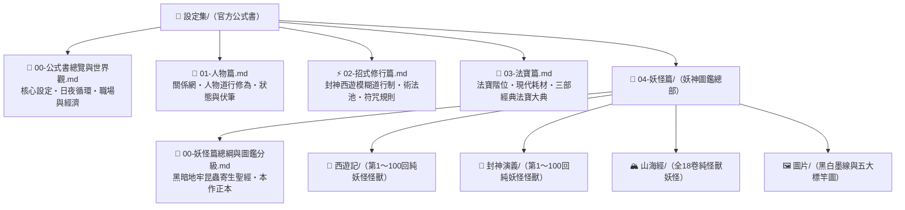
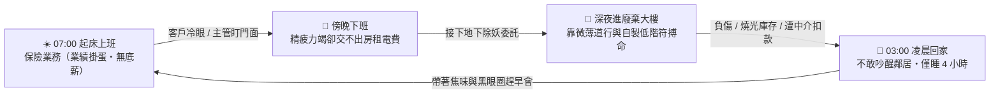
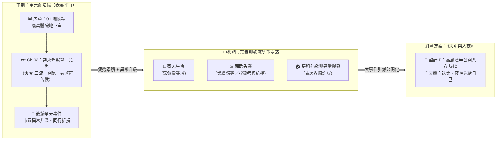

# 📘 官方公式書總覽與世界觀設定

> **作品暫名**：《雙面日常：保險業務 × 深夜除妖》  
> **公式書定位**：仿少年漫畫官方設定集（Official Databook）結構，將世界觀、人物關係與道行、古典模糊修行招式、法寶大典與三部神話經典（《西遊記》《封神演義》《山海經》）全收錄妖怪鬼神圖鑑分冊歸檔。  
> **核心鐵律**：所有 AI 整理之【本作衍生設定】與候選池均為顧問參考，**作者確認寫入正文或明確定案者方為唯一正本**（詳見 [創作原則](../創作原則.md)）。

---

## 🗺️ 公式書全篇目錄導覽

| 公式書篇章 | 檔案路徑 | 核心收錄內容 |
| :--- | :--- | :--- |
| **總覽與世界觀** | [00-公式書總覽與世界觀.md](./00-公式書總覽與世界觀.md) | 故事核心概念、日夜雙重循環、劇情壓力演進、終章定案、現代職場與經濟體系 |
| **第一篇：人物篇** | [01-人物篇.md](./01-人物篇.md) | 角色關係網、每位登場角色之關係狀態、修為與道行（如有）、目前持有術法與劇情伏筆 |
| **第二篇：招式修行篇** | [02-招式修行篇.md](./02-招式修行篇.md) | 以《封神》《西遊》為主的模糊修為道行體系、三流～巔峰四階對照、術法技能候選池、符咒二段式耗能與成本表 |
| **第三篇：法寶篇** | [03-法寶篇.md](./03-法寶篇.md) | 凡器至先天至寶之法寶階位、本作現有耗材道具、三部神話經典代表法寶特性與破解法 |
| **第四篇：妖怪與怪獸篇** | [04-妖怪篇/00-妖怪篇總綱與圖鑑分級.md](./04-妖怪篇/00-妖怪篇總綱與圖鑑分級.md) | **剔除神明**，純收錄本作已登場妖物（`01-蜘蛛精`）＋《西遊記》《封神演義》《山海經》全書妖怪與怪獸（黑暗地牢昆蟲／寄生 × 克蘇魯 × 恐怖谷偽人改寫與黑白插圖） |

---

## 🌐 核心世界觀與敘事鐵律

> **一句話核心**：白天是業績墊底、無底薪苦撐的社畜保險業務；夜晚翻窗走進廢棄大樓、以微薄道行與自製低階符咒除妖貼補家用——在現實生存壓力與克蘇魯恐怖谷妖魔夾擊下的現代都市奇幻故事。

### 🔄 主角日夜雙重循環

### 🧩 前期世界觀三條鐵律

1. **表裏雙線嚴格平行（前期鐵律）**：故事前期，白天保險職場與夜晚地下除妖屬於**互不干擾的兩條平行線**（如同白天當上班族、晚上跑外送貼補家用）。**嚴禁硬湊「保險客戶剛好撞鬼」之類的做作巧合**；雙重壓力必須來自兩邊搶奪同一個身體、時間、體力、金錢與門面。直至中後期大事件徹底炸穿表裏界線，兩條線才正面交會。
2. **黑暗地牢昆蟲寄生 × 克蘇魯不可名狀 × 恐怖谷偽人美學**：本作圖鑑**徹底剔除神明、仙佛與正神名單，只收錄妖怪與怪獸**。所有古典妖魔怪獸一律跳脫「神話哺乳動物／仙俠美人」套路，將原型降維推向**昆蟲（蚊、螳螂、蜈蚣、甲蟲、蠅、蜂）、節肢動物（蜘蛛、蠍、馬陸）、寄生生物（吸盤、裂開口器、產卵管、幼蟲鑽入）、軟體／環節動物（水蛭、水螅、變形蟲）**，再疊加克蘇魯不可名狀與黑暗地牢潮濕質感——**凡有臉的類人妖怪一律採「恐怖谷偽人皮囊＋皮下節肢寄生結構」改寫；非人怪獸則徹底以昆蟲寄生與環節生物恐怖為主體**。
3. **無血統、無外掛的煙火氣主角**：許家銘沒有隱世血統或絕世天賦，即便後期道行精進、實力與開局判若雲泥，也始終不是天下第一，仍保有普通台灣上班族的煙火氣與人情日常。

---

## 📈 劇情壓力演進與終章定案

### 🎯 終章結局定案方向：《終章：天明與入夜》（設計 B・表裏公開與日常翻轉）

> 2026-11-19 定案：與 **《序章：入夜與天明》** 形成首尾對稱。

- **世界觀巨變轉折**：中後期大事件徹底炸穿「普通人不知妖魔存在」的表裏界線，但現代都市並未淪為末日廢土，而是進入「**高風險半公開共存時代**」——出現合法委託機制、官方規範、基層法師執照與異常災害保險理賠制度。
- **晝夜翻轉對稱**：
  - **序章《入夜與天明》**：入夜＝像賊一樣偷偷翻窗搏命、事後還要被中介扣款；天明＝穿著焦味廉價西裝在早會受辱。
  - **終章《天明與入夜》**：
    - **天明**：家銘依舊是按件計酬的無名基層法師（或結合過去跑業務的人情歷練經營小工作室），但**終於能在大白天光明正大穿戴裝備出門除妖、靠真本事體面吃飯**，甚至能與善良小妖協作，再也不必躲藏或撒謊。
    - **入夜**：夜幕降臨後，不再需要凌晨鑽進廢棄大樓拚命，**把夜晚真正還給自己的人生**——安心洗個熱水澡、與在意的家人或夥伴吃頓熱飯、偶爾跑幾單夜間外送吹吹風，踏實睡覺迎接明天。
- **中篇伏筆備忘**：提前埋設「善良小妖線人」「異常災損與保險理賠掛鉤」「基層法師民間互助網」等日常伏線，讓後期公開化轉折水到渠成。

---

## 💼 現代社會職場規則（白天線：台灣保險業務基準）

> 依台灣保險業務實務口述整理，確保白天線的生存壓力真實不懸浮。

- **早會與彈性工時**：上午 `08:00` 固定召開早會（主要內容是灌心靈雞湯與點名檢討活動量表）；散會後採**彈性上下班、午餐自理**。此設計使家銘白天擁有合理空檔去送乾洗西裝、赴黃昏市場補符材或補眠，不構成翹班破綻，代價則是完全沒有底薪保護傘。
- **無底薪與淘汰機制**：**薪水從 0 開始計算，沒成交就完全零收入**；約 **3～6 個月未報一件 case** 將面臨取消證照登錄資格，實務上基層往往在考核前就因斷糧被迫離職。
- **拓客與人情消耗**：新人與基層多半從親友與舊同學推銷起（如 EP2 試著聯絡已少互動的大學同學卻慘遭未讀）；簽單流程本身不難，真正門檻在於臉皮、需求撬動與人情消耗。外勤交通自理（家銘為省錢騎舊機車）。
- **待補核實務細節**：主管是否會分配／轉介名單，以及「帶新人陪訪」之拆分制度，待後續訪談再補定。

---

## 💰 經濟體系、幣制與雙軌交易規則

> 具體罰款、房租與收支金額屬劇情結算參考值，實際數字一律以各章正文為準。

### 1. 幣制與高低階雙軌制

| 層級圈層 | 交易媒介 | 運作邏輯與體感 |
| :--- | :--- | :--- |
| **凡俗日常與基層除妖圈**（三流～二流） | **現金「塊／元」** | 正文統一只寫「塊／元」，物價完全對齊**台灣日常台幣生活體感**（即期便當 50 幾元、茶葉蛋配豆漿、單間木板隔間電費 700 多元、乾洗西裝 300 元、開天眼符水 500 元），不直寫「新台幣」或真實縣市名，保持華語通用寫實感。 |
| **高階道門與異界圈層**（一流以上・中後期伏筆） | **功德／靈物／人情因果** | 踏入一流名宿、古老門派與高階妖神圈後，高階靈寶、丹藥與稀世符材已不收世俗紙鈔，改採以物易物、因果債或功德折抵。 |

### 2. 既有實戰收支總帳（序章《01-蜘蛛精》）

| 項目 | 金額（元） | 備註 |
| :--- | :---: | :--- |
| 廢棄醫院異常案原定委託費 | `+9,000` | 地下中介發包 |
| 驚動消防車上新聞善後扣款 | `-2,500` | 業主遭警方約談不滿，中介強制扣除 |
| **實際入帳酬勞** | **`+6,500`** | 隔日晚間 18:50 網銀入帳 |
| 自製烈火符 6 張材料損耗 | `-1,800` | 單張材料成本約 200～300 元（不含熬夜與失敗報廢） |
| 外購開天眼符水 1 瓶 | `-500` | 黃昏市場明叔處購得 |
| 機車油錢＋西裝緊急乾洗費 | `-300+` | 焦煙味過重遭主管點名，非洗不可 |
| **單趟搏命實賺淨利** | **約 `+3,800～3,900`** | — |
| 門背催繳電費帳單（EP2 繳清） | `-700+` | 扣除後所剩僅約兩千多，尚須在明叔處補貨 `-2,000` |

> **註**：EP2 下午補貨現金支出 `2,000 元`（開天眼符水 1 瓶＋上等硃砂＋黃紙），幾乎掏空手頭現金，迫使家銘在 EP2 晚間只得接下「有人居住社區、嚴禁動明火」的高危急件。
