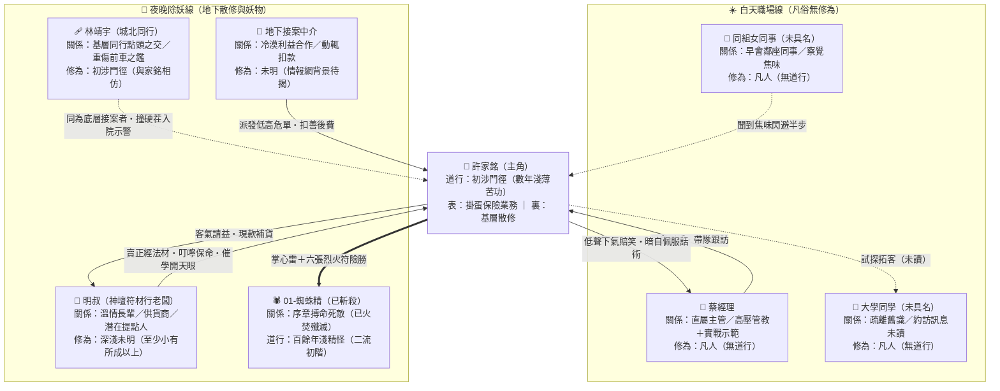
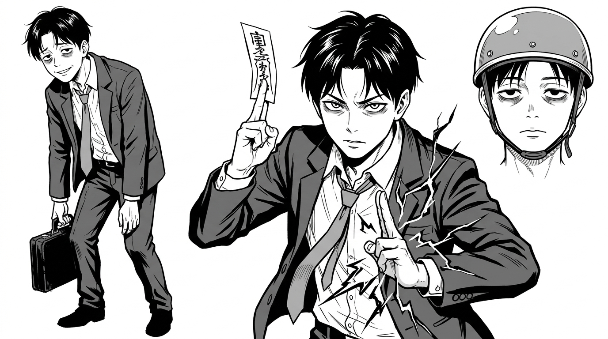

# 👤 第一篇：人物篇（角色關係、修為道行與狀態檔案）

> **本篇收錄**：全作已登場角色之完整公式書檔案，包含**人物關係網與即時狀態**、**修為與道行（依封神／西遊模糊道行制標註，無修為之凡人明確標示）**、**實戰配置**與**後續預定伏筆**。  
> **角色命名鐵律**：除主角許家銘外，全作配角皆採**符合台灣各世代的真實常見姓名與稱呼**；前期過場街坊路人一律不具名。

---

## 🕸️ 人物關係網總覽（截至 EP2）



---

## 📊 全登場人物狀態與道行速查表

| 角色名稱 | 所屬線別 | 與主角目前關係狀態 | 修為與道行（封神／西遊模糊制） | 備註／最新動態（截至 EP2） |
| :--- | :--- | :--- | :--- | :--- |
| **許家銘** | 表・裏雙線 | 主角本人 | **初涉門徑（數年淺薄苦功）**<br/>三流頂端、尚未破開二流門檻 *(既有數值備忘：Lv.8・78%)* | 剛解決 01-蜘蛛精、結清電費、於明叔處補貨，即將面對「社區禁明火」新急件 |
| **蔡經理** | 白天（職場） | **上下屬｜單向高壓督導＋實戰示範** | **凡人（無修為／無道行）** | 早會點名家銘西裝焦味；EP2 帶家銘跟訪並俐落撬開中年女客戶需求 |
| **明叔** | 夜晚（地下） | **溫情長輩｜信任互助／固定法材供貨商** | **深淺未明（具煉製符水與傳法底蘊，推估小有所成／二流以上）** | EP2 正常現款交易 2,000 元，主動勸家銘學開天眼，並透露林靖宇翻車與市區異常升溫 |
| **林靖宇** | 夜晚（同行） | **同業點頭之交｜殘酷前車之鑑** | **初涉門徑（與家銘相仿的三流基層散修）** | 據明叔轉述，中介低報市區委託的危險程度，靖宇重傷住進加護病房。明叔聽說他一條手臂傷得很重，擔心他以後無法再接單。 |
| **地下接案中介** | 夜晚（地下） | **冷漠商業合作｜隨時扣款之派單窗口** | **未明（尚未現身，疑似掌握地下情報管道）** | 序章扣 2,500 元善後費實匯 6,500 元；EP2 深夜拋出高價禁明火急件 |
| **01-蜘蛛精** | 夜晚（妖敵） | **已斬殺死敵（序章頭目）** | **成精初階（約數十年至百年妖氣，二流初級）** | 盤踞廢棄醫院地下室，吞食失蹤網紅；已被家銘掌心雷破防＋高前踢墜入火海焚滅 |

---

## 🧭 角色防同質化 4 軸矩陣與新角色建檔模板

> **設計原則（2026-11-22 補充）**：避免所有角色流於「同質化口吻／同一套冷靜務實反應」，不寫冗長抽象的「價值觀小作文」，改用**「價值排序 × 壓力下第一秒本能 × 觀察視角與說話習慣 × 主角對照鏡」**四軸拉開差異；並依角色戲份分層填寫（過場路人與一次性客戶一律不建檔，嚴守 [創作原則](../創作原則.md) 前期聚焦鐵律）。

設計或檢查人物的取捨時，先看他當時知道什麼、有哪些真正能走的路，以及各條路要付什麼代價。只有在這樣的場景才做選擇互換測試。兩人可以選同一條路，再看各自想保住什麼、願意承擔什麼。

### 1. 角色設定分層管理規則

| 層級 | 對象範圍 | 必填深度 |
| :--- | :--- | :--- |
| **S 級（核心常駐）** | 主角、固定職場／地下配角、中後期常駐搭檔與主要宿敵 | 依「防同質化 4 軸」建檔，每人 4～6 行 |
| **A 級（單元關鍵）** | 單章關鍵同行、重要委託人、中篇善良小妖線人 | 只寫 **1 個核心執念 ＋ 1 個鮮明反差習慣**（2 行） |
| **B 級（過場路人）** | 一般客戶、早會同事、鄰居街坊 | **不建設定檔**，於正文當場用 1 個台灣生活小動作帶過 |

S／A 級欄位依正文或作者定案填寫。尚未寫到、也未定案的部分可留白或標「待定」，等人物有相應的戲再補。

### 2. 現有登場角色防同質化 4 軸總表 *(依目前正文草稿提煉，可隨劇情隨時微調)*

| 角色（層級） | ① 價值排序（撞車時先保哪樣） | ② 壓力下第一秒本能反應 | ③ 進場域第一眼看哪／說話口吻 | ④ 作為主角的對照鏡定位 |
| :--- | :--- | :--- | :--- | :--- |
| **許家銘**（S） | `活命與基本體面 ＞ 不欠人情 ＞ 賺錢`（寧啃即期便當也不硬盧親友） | **內耗、算帳、吞氣硬撐**（藏焦味西裝、默算符紙成本與餘額） | 先看「**這趟划不划算、符會燒幾張、別驚動鄰居／警察**」；對外客氣賠笑、內心自嘲務實 | 基準圓心（沒血統也沒退路的普通台灣底層上班族） |
| **蔡經理**（S） | `成交結果與門面 ＞ 臉皮與客套`（覺得成交本就是幫客戶與自己雙贏） | **不尷尬、笑著往前頂、順勢撬缺口**（不被猶豫打退堂鼓） | 先看「**活動量表、儀容門面、對方需求痛點**」；早會直接點名施壓、談單不疾不徐 | 家銘若徹底豁出去、專精世俗職場的「另一種活法」 |
| **明叔**（S） | `保命與老規矩 ＞ 賺錢`（錢再賺就有、命沒了就真沒了） | **先碎唸潑冷水，手裡卻已經在幫你想退路**（未來絕境會直接賒帳） | 先看「**你黑眼圈多重、近期地氣與中介情報哪裡不對勁**」；台灣長輩沙啞碎唸、藏溫情 | 撐過地下這行數十年、退居二線仍守住人情味的前輩鏡像 |
| **林靖宇**（A） | 價值排序及這次接單的動機待定。 | 遇險當下的第一反應待定。據明叔轉述，他後來爬出現場叫救護車，對外報成意外摔傷。 | EP2 由明叔轉述；靖宇本人的觀察視角與口吻待定。 | 同樣靠基層單過活的同行。他因中介低報而重傷，讓家銘想到自己也可能碰上這種事。 |
| **地下接案中介**（A→S候補） | `業主不惹麻煩 ＞ 抽成 ＞＞ 接案者死活` | **直接用簡訊冷處理並扣款切割風險** | 只看「**有沒有上新聞、警消有沒有介入、業主滿不滿意**」；極短冷漠公事訊息腔 | 徹底剝離人情與道德的純利益系統縮影 |

### 3. 群像光譜空位與新角色快速防撞型模板

> 新增 S／A 級角色前，先對照上表檢查是否「撞型」（目前已有：內耗硬撐型、高壓務實主管型、碎唸暖心長輩型、冷血抽成利益型）。未來中後期若需補進新人物，建議優先從**尚未出現的反應光譜**挑選：
> - **出事先甩鍋／轉嫁風險的圓滑同行**（與家銘「自己硬吞」形成劇烈衝突）
> - **極度迷信章程與執照、照章辦事到近乎無情的官方／正統門派法師**（為後期半公開共存制度鋪路）
> - **把深夜除妖當賭博或發洩、越危險越亢奮的高風險瘋子散修**（與家銘「只求平安領錢回家睡覺」完全對立）
> - **精打細算、只用生活廢棄物或情報換一口飯吃的底層善良小妖線人**（呼應終章《天明與入夜》共存伏筆）

```markdown
### [編號]. 新角色姓名（台灣真實常見名｜S級／A級）
- **① 價值排序**：（例：面子 ＞ 錢 ＞ 規矩 ＞ 人情）
- **② 壓力第一秒本能**：（例：先找替死鬼／先翻法條／先笑著打圓場再背後捅刀）
- **③ 進場域視角與口吻**：（看什麼？講話短促、愛反問、滿口行話還是禮貌疏離？）
- **④ 與許家銘的摩擦／對照點**：（這件事對兩人各有什麼分量？若做了相同選擇，各自為了什麼？）
- **⑤ 修為道行與目前關係狀態**：（凡人／初涉門徑／小有所成／道行高深｜與主角關係）
```

---

## 🗂️ 人物詳細檔案

### 01. 許家銘（主角）



#### 基本資料與雙面外貌
| 項目 | ☀️ 白天（表：保險業務） | 🌙 夜晚（裏：地下除妖散修） |
| :--- | :--- | :--- |
| **年齡／身分** | 約 30 歲，無底薪基層保險業務員（本月業績掛蛋） | 無門無派的底層接案除妖人 |
| **外貌特徵** | 中分微亂短黑髮、明顯雙眼皮搭深重黑眼圈、廉價微皺西裝（襯衫領口與領帶略鬆）、提公事包、戴西瓜皮半罩安全帽騎舊機車、垮肩陪笑 | 同套廉價西裝／便服（沾灰與焦煙味）、傷痕與發紅微腫雙眼、右手持符／左手結印時神情銳利專注但掩不住極度疲態 |
| **日常活動圈** | 保險公司早會、客戶家、便利商店（搶晚間七點即期便當）、老舊五六十年公寓廉價木板隔間套房 | 廢棄醫院、暗巷、黃昏菜市場神壇香鋪、將涉入有人居住的現代社區 |
| **關鍵作息** | `08:00` 準時開早會（常設 `06:00` 起床，序章睡過頭至 `07:30`） | `01:30` 潛入接案、`02:00～03:00` 拖傷返家（隔音太差不敢洗澡） |

#### 修為與道行狀態
- **古典模糊道行定位**：**「初涉門徑的微末散修」**——僅具數年淺薄苦功，法力根基淺薄、無法瞬發大術，畫符需屏息熬夜以「二段式蓄能」一點一滴擠進硃砂紋路，且仍有畫廢報廢的失敗率；剛抵近三流散修極限，尚未跨入真正能馭五行小遁與二流靈符的「小有所成」門檻。
- **既有開發數值參考（保留作者原設供戰後檢核）**：
  - **目前等級**：`Lv.8`（第 01 章戰後約 `78%`，接近 `Lv.9`；*升級須待作者於戰後確認*）
  - **暫定三維（普通上班族基準為 5）**：
    - `體魄 12`：優於常人，聚氣高前踢能踹飛受創大妖；仍懼實體微針細毛刺傷，戰後腿痠疲憊。
    - `法力 10`：靈氣量少，下班熬夜壓縮畫符日產上限僅 `2～3 張`；連催掌心雷加甩 6 張符點火後即瀕臨見底。
    - `神識 11`：直面克蘇魯恐怖谷怪物時能強忍噁心保持戰術冷靜；但實戰閱歷仍淺，第一時間會誤將障眼細毛判成毒瘴。

#### 目前實戰技能與裝備庫存（截至 EP2 晚間）
- **已於正文實戰施展之術法**：
  - `掌心雷`（三流近戰控制技）：無固定施法手限制（序章先左手蓄雷、後慣用右手落掌）；需貼身近距按壓妖體，電弧具電擊器級神經麻痺效用，配合高處墜落衝力破防蜘蛛精。
  - `基礎法力聚氣體術`：將殘餘法力灌注下肢踢擊，屬基礎運氣而非二流金剛硬化。
  - `閉氣訣`（三流基礎五訣之一｜2026-11-23 定案）：單手持續捏訣鎖死口鼻隔絕毒霧與濁水，期間**不可開口說話或出聲唸咒**；須先蓄好掌心雷再閉氣。
  - *(註：尚未學會「開天眼」正法，目前仰賴外購符水；「身法」與其餘五訣空位仍留待後續拍板。)*
- **已掌握自繪基礎符（共三種｜2026-11-23 定案）**：`烈火符`（遠投凡火）、`鎮宅符`（居家安神）、`破煞符`（貼身震散一小塊妖氣；輕身符留待之後學習）。
- **持有耗材與資產現況**：
  - `自製烈火符`：序章消耗 6 張歸零 → EP2 下午補進黃紙硃砂，晚間正在窄書桌前熬夜補繪（下章靜默單對手已定案為 `SHJ04-028 茈魚`〔★★ 稀級／二流〕，將於禁火環境下被迫啟用 `破煞符`）。
  - `開天眼符水`：序章消耗 1 瓶 → EP2 下午向明叔重購 1 瓶（500 元）。
  - `門背鎮宅符`：自製黃紙安神符，貼於租屋處房門背面。
  - `經濟壓力`：手頭現金在補貨 2,000 元後所剩無幾，入帳 6,500 元扣除電費 700 多元與乾洗費後仍遠不足以寬裕度日。

#### 人物關係明細
- **對蔡經理**：表面敬畏賠笑、怕被檢討門面與活動量；內心真心佩服其跑客戶不急不躁的實戰業務力，也清楚自己臉皮太薄學不來。
- **對明叔**：視為地下圈少數可信賴的親切長輩，互動拘謹客氣、怕添麻煩，但在滿室線香與明叔碎唸中能短暫卸下防備。
- **對林靖宇**：點頭之交，同樣靠基層單過活。從明叔那裡聽說靖宇重傷住院，家銘立刻想起前一晚醫院裡那聲「救……命……」。
- **對地下中介**：純粹受制於經濟壓力的弱勢配合方，即使遭無理扣款也只能吞下。

---

### 02. 蔡經理

- **所屬陣營／線別**：白天（保險公司・家銘直屬主管）
- **與主角關係狀態**：**嚴格上下屬｜單向施壓 × 實務帶教**（公事公辦、不涉夜晚裏世界）
- **修為與道行**：**無（純粹凡人）**——不具備任何法力或靈感，完全不知道妖魔與除妖界存在。
- **外貌與性格特徵**：開休旅車跑訪、注重業務員儀容門面。早會上拿活動量表高聲訓話毫不留情（當眾點名家銘西裝皺又帶煙味），但並非無能酒囊飯袋——實戰談單極具火候，能從健檢新聞自然切入自費醫材與家人負擔，面不改色撬開猶豫客戶的需求缺口。
- **已登場與後續定位**：序章早會、EP2 帶家銘跟訪中年女客戶。代表真實台灣職場壓力與主角「性格不合業務生態」的結構性反差。

---

### 03. 明叔

- **所屬陣營／線別**：夜晚（黃昏菜市場老透天一樓・私人神壇兼地下符材行老闆）
- **與主角關係狀態**：**親切長輩｜固定交易對象 × 暗中關照的引路前輩**
- **修為與道行**：**深淺未明（非純粹凡商）**
  - 能穩定供應「正經法材」與自配／經手有效之「開天眼符水」，並熟知除妖界動態與術法門檻，主動告訴家銘「有什麼不會的都可以問我」。
  - 推估至少具備**小有所成（二流）以上之民間道壇傳承或退隱修士底蘊**；實際師承、真實道行深淺與過往經歷目前刻意留白，保留日後展開空間。
- **外貌與性格特徵**：兩鬢微白的中年男子，常穿洗得泛白的汗衫、踩藍白拖從二樓木梯「啪嗒啪嗒」下來應門，嗓音略帶沙啞。性格熱心愛碎唸，並非黑心奸商——會替家銘心疼符水錢，叮囑他儘早學會開天眼，並鄭重提醒他別為了幾千塊硬接不對勁的單子。
- **已登場與後續預定橋段**：
  - EP2 黃昏菜市場補貨（正常付現 2,000 元，並拋出「林靖宇翻車」與「市區妖祟異常升溫」兩條核心伏線）。
  - **【作者預定橋段備忘】**：未來家銘陷入更嚴重的經濟絕境、急需補貨卻掏不出錢時，安排明叔二話不說慷慨解囊（先拿走／賒帳相助）的溫情反差名場面。

---

### 04. 林靖宇

- **所屬陣營／線別**：夜晚（城北基層除妖散修同行）
- **與主角關係狀態**：**點頭之交的底層同行｜殘酷寫照與警訊**
- **修為與道行**：**初涉門徑（與家銘相仿的三流基層散修）**。
  - 目前不綁定浮誇仙俠大宗門，保留日後補民間宮壇／師承之彈性。
- **已登場與劇情功用**：EP2 由明叔轉述。林靖宇平日靠城北的基層單維生。這回中介把市區的案子報成普通低階髒東西，他進場才發現危險，重傷後爬出現場叫救護車，對外報成意外摔傷。明叔聽說他仍在加護病房，一條手臂「廢了一半」，擔心他往後幹不了這行。這段消息使家銘想起自己在醫院的遭遇。[EP2 明叔轉述](../章節/01-蜘蛛精/小說.md#三黃昏市場與明叔)

---

### 05. 地下接案中介（未具名）

- **所屬陣營／線別**：夜晚（地下除妖委託派單管道）
- **與主角關係狀態**：**純利益上下游｜冷血壓榨方**
- **修為與道行**：**未明**（僅透過手機簡訊聯絡，身分與背後勢力尚未揭露）。
- **行為特徵與伏筆**：只看業主滿意度與保密結果，序章因消防車驚動警消便直接扣掉 2,500 元善後費；同時在 EP2 暴露出「近期市區情報頻頻低估妖魔強度」的危險失準現象（究竟是單純業主隱瞞、市區異常突變，還是中介刻意隱匿風險，留作後續追查伏筆）。

---

### 06. 後續人物擴充登記區（待章節推進補填）

- **家銘的家人**：尚未正式登場；依世界觀壓力圖，中後期將因「家人生病／醫藥費暴增」成為關鍵現實壓力源，亦是終章《天明與入夜》溫情歸宿之一。
- **善良小妖線人（中篇預留）**：依終章定案伏筆，中篇可逐步引入不害人、融入現代底層都市的善良小妖作為情報線人，為表裏公開化後的共存日常鋪路。
- **高階法師／官方異常處理窗口（中後期預留）**：當主角道行跨入二流乃至一流後，將陸續接觸以「功德／靈物／人情因果」交易的高階道人與民間法師互助網。
