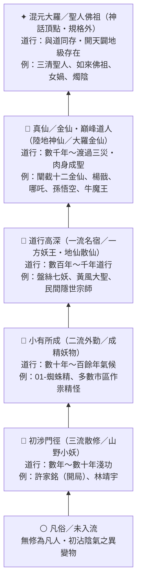

# ⚡ 第二篇：招式修行篇（封神西遊模糊道行制・術法池・符咒規則）

> **本篇定位**：本作修行體系核心公式書。依作者定案方向，**修行階位以《封神演義》《西遊記》那種「重道行、重根行、重劫數與神通火候，而不採網文硬性數值打怪升級」的模糊體系為主**；並同步保留開局既有之「三流～巔峰」都市除妖俗稱、術法技能候選池、符咒候選池與二段式耗能規則。

---

## ☁️ 一、修行與道行體系（以封神・西遊模糊體系為核心）

在《西遊記》與《封神演義》的世界觀裡，修行者的強弱從來不是一條單線數字，而是由**「道行年資」「根行氣運」「功法相剋」「法寶加成」與「天劫業力」**交織出的模糊境界——百年小妖若撿到一件先天靈寶，足以困住大羅金仙；千年老怪若犯了紅塵殺戒、遭逢剋星或失了地利，亦可能陰溝翻船。

### 1. 古典模糊修行的四大核心維度

| 模糊維度 | 古典原典意涵（西遊／封神） | 本作現代都市除妖表現 |
| :--- | :--- | :--- |
| **道行與火候** | 以「數年苦功、百年道行、五百年氣候、千年成仙、萬年大能」論深淺；草木鳥獸得日月精華亦能成精。 | 影響法力醇厚度、繪符成功率與術法破防力。許家銘僅有數年淺薄苦功，連開天眼都還靠買符水；序章蜘蛛精約數十年至百年妖氣，便足以逼得他九死一生。 |
| **根行與福緣** | 《封神演義》動輒言「此子根行深厚／根行淺薄、無緣仙道，只合封神或享人間富貴」；《西遊記》亦講「靈根」「佛緣」。 | 主角許家銘正是「根行平庸的凡人散修」，沒有絕世血脈，只能靠腦子、地形、自製低階符與死撐苦練一點一滴磨火候。 |
| **三災利害與殺劫** | 《西遊記》稱修成仙道後每五百年有**雷災、陰火災、鸏風災**「三災利害」，躲不過便化為齏粉；《封神演義》則有「紅塵殺戒」「千五百年神仙殺劫」。 | 高階妖神與一流道人絕非毫無顧忌——強行在現代鬧市造殺業易引天機反噬或正道圍剿，這也是妖魔前期多半潛伏廢墟、暗巷與鬼宅的重要制衡。 |
| **相生相剋與法寶破局** | 孫悟空神通廣大，卻拿紅孩兒三昧真火與水戰沒轍、被青牛精金剛琢收走金箍棒；燃燈道人亦怕趙公明二十四顆定海珠。 | 本作戰鬥拒絕「高一階就無腦輾壓」——低道行法師靠情報、針對性弱點、環境助燃與高階保命符，仍有機會險中反殺高於自己一檔的妖物。 |

### 2. 模糊修為境界譜系（對照都市除妖四階俗稱）

| 模糊境界（封神／西遊基準） | 都市除妖界俗稱 | 典型道行與神通火候特徵 | 既有開發數值對照 *(暫定備忘)* |
| :--- | :--- | :--- | :--- |
| **凡俗／未入流** | 普通人／微弱陰祟 | 無修行法力，肉眼不見妖氣；剛沾怨氣的雜祟僅能驚嚇凡人，一遇陽火或鎮宅符即散。 | 單項三維基準約 `5` |
| **初涉門徑／淺薄道行** | **三流**（學徒／底層散修／小妖） | 數年苦功，僅能掌握少數基礎法訣或單一控場技，無法瞬發大術；畫符需熬夜儲能且有失敗率，仰賴腦力、地形與自製低階符搏命。 | `Lv.1 ～ Lv.9` *(家銘現為 Lv.8・78%)* |
| **小有所成／成精成怪** | **二流**（熟練外勤／成精妖物） | 數十年至百餘年道行；妖怪多已具畸形半化形、障眼法與毒刺／妖風等天賦；法師開始能馭局部物質轉化、五行小遁與二流保命符。 | `Lv.10 ～ Lv.24` *(01-蜘蛛精約 Lv.10～12)* |
| **道行高深／一方妖王・地仙散仙** | **一流**（名宿／宗師／大妖） | 數百年至千年道行；能召三昧真火、五雷轟頂、縮地成寸或縱地金光，單人足以摧毀整棟建築；開始跨入以「功德／靈物／人情因果」交易的高階圈層。 | `Lv.25 ～ Lv.49` |
| **真仙／天仙／金仙／大羅金仙** | **巔峰道人**（陸地神仙／戰略級妖聖） | 數千年修為、歷經天劫與三災利害；掌握八九玄功（不壞金身）、法天象地、袖裡乾坤、釘頭七箭等改寫規則之大神通，足以撼動整座都市乃至區域格局。 | `Lv.50+` |
| **混元聖人／佛祖／太古大神** | **規格外（神話本源）** | 屬於天地法則本身，無法以人間戰力尺度衡量，絕非凡人除妖師能正面抗衡之維度。 | 不可量化（EX） |

> **【既有開發數值檔案保留說明】**：`角色與世界觀.md` 原先記錄之家銘開局暫定面板（`Lv.8・78%`、`體魄 12／法力 10／神識 11`）仍完整保留於 [01-人物篇.md](./01-人物篇.md) 作為作者戰後檢核之幕後刻度；正文與世界觀敘述則統一回歸封神／西遊式的模糊道行感受，避免出現生硬的系統升級播報。

---

## 📚 二、術法技能總錄：四階 × 五維候選池

> **重要保留聲明（2026-11-18 原規則）**：**以下為供作者選擇與檢索的術法候選池，並非主角許家銘已習得清單，亦不代表所有絕對措辭已完成戰力平衡審核。** 保留原技能並列名稱（「／」不擅自拆分或合併），僅於右側補列《西遊記》《封神演義》古典神通典故供創作參照；本作實際規則仍以作者後續寫入正文為準。

### 第一階：三流（初涉門徑・淺薄道行）

| 維度 | 候選技能 | 原效果與限制 | 西遊／封神典故參照 |
| :--- | :--- | :--- | :--- |
| **護身** | 基礎五訣（避火、避水、避風、辟穀、閉氣） | 單手持續捏訣不可中斷，僅防凡火與普通濃煙。**【2026-11-23 閉氣訣定案】** 單手捏訣鎖死口鼻呼吸，期間**不可開口說話或出聲唸咒**（開口即破功漏氣）；須於掐訣前先唸咒蓄好如「掌心雷」等需出聲之術法（二段式符咒僅需 10% 法力引動，無須出聲）。未來晉升二流後，可透過「熟練術法改默唸心咒」或改貼三流「淨氣符」騰出口鼻與左手。 | 《西遊記》避火訣、避水訣、辟穀等道門入門保命訣 |
| **身法** | 草上飛／障眼借法 | 貼神行符減輕體重，或揚塵、利用視覺死角閃現數公尺；非真瞬移。 | 民間道術與《封神》低階身法借土移影 |
| **變化分身** | 全身障眼法／單根毫毛誘餌 | 變身為光影偽裝，一摸就破；拔髮假人無攻擊力。 | 《西遊記》低階精怪障眼法、孫悟空毫毛變身之極低配版 |
| **攻擊控場** | 低配定身咒／掌心雷（電擊器級） | 定身對妖怪僅 0.5 秒僵直；掌心雷需貼身按住麻痺。*(註：掌心雷已於序章實戰登場)* | 《西遊記》定身法、《封神》雷部道門入門掌心雷 |
| **感知情報** | 開天眼（牛眼淚／符水短暫開啟）／喚土地 | 只能看清微弱妖氣軌跡；向當地地脈借訊號查探地形。*(註：開天眼符水已於序章實戰登場)* | 《西遊記》拘喚當地土地山神問路、道門天眼初階 |

### 第二階：二流（小有所成・數十年至百餘年道行）

| 維度 | 候選技能 | 原效果與限制 | 西遊／封神典故參照 |
| :--- | :--- | :--- | :--- |
| **護身** | 金光護體咒／畫地為牢 | 地面畫圈展開絕對安全屋，或硬抗一發手槍／妖怪重擊。 | 道家金光神咒、《西遊記》第50回孫悟空畫圈護唐僧 |
| **身法** | 五行小遁（土、木、水、火、金） | 須現場有對應元素，如踩泥土土遁十幾公尺。 | 《封神演義》土行孫地行術、木吒／金木水火土五行遁法之初階 |
| **變化分身** | 局部物質轉化（初階 72 變） | 單手變精鋼刀刃或盾牌；維持超過 3 分鐘經脈撕裂。 | 《西遊記》地煞七十二變／《封神》八九玄功之局部初修 |
| **攻擊控場** | 指地成鋼／撒豆成兵（低配）／呼名落馬 | 改變數公尺地面材質設陷阱、撒豆出幾個力士扛重物或架妖。 | 《封神演義》懼留孫指地成鋼符、張桂芳左道呼名落馬、道家撒豆成兵 |
| **感知情報** | 火眼金睛（破妄瞳術）／順風耳 | 看穿低階妖怪偽裝與隱身；看久雙眼充血劇痛，且極怕強光、濃煙。 | 《西遊記》八卦爐燻出火眼金睛（原典亦極怕煙！）、《封神》高覺順風耳 |

### 第三階：一流（道行高深・數百年至千年道行／地仙散仙）

| 維度 | 候選技能 | 原效果與限制 | 西遊／封神典故參照 |
| :--- | :--- | :--- | :--- |
| **護身** | 局部金剛身／移花接木 | 致命傷轉移替身草人，或局部硬化硬吃大招。 | 佛道金剛護體、左道替身移傷術 |
| **身法** | 縱地金光／深度地行術／縮地成寸 | 無視地形高速化光飛行，或地下長距離無聲暗殺。 | 《封神》闡教縱地金光法、土行孫與張奎日行千里地行術、縮地成寸 |
| **變化分身** | 三頭六臂／奇美拉混變／毫毛小隊 | 同時維持多種神獸部位特性，並分出十幾個具獨立戰力分身。 | 《封神》哪吒／殷郊／呂岳三頭六臂、《西遊記》吹毛變猴兵 |
| **攻擊控場** | 三昧真火／三昧神風／掌握五雷 | 大範圍高階元素轟炸、凡水無法撲滅、一擊可毀整棟建築。 | 《西遊記》紅孩兒三昧真火、黃風怪三昧神風、《封神》聞仲／雷部五雷正法 |
| **感知情報** | 天眼通（眉心縱目）／神目之術 | 360 度無死角鎖定敵人弱點與經脈流動，看穿一切幻陣。 | 《西遊》《封神》楊戩額間天眼、聞仲眉心白光神目 |

### 第四階：巔峰（真仙金仙／大羅金仙・陸地神仙）

| 維度 | 候選技能 | 原效果與限制 | 西遊／封神典故參照 |
| :--- | :--- | :--- | :--- |
| **護身** | 八九玄功（不壞金身） | 被動常駐刀槍不入、水火不侵，斷肢／斷頭瞬間再生。 | 《封神》楊戩與袁洪修煉之八九玄功、《西遊》大聖金剛不壞之軀 |
| **身法** | 筋斗雲／移星換斗 | 跨城市超遠距空間跳躍，或瞬間交換與敵人位置。 | 《西遊記》十萬八千里筋斗雲、天罡三十六變移星換斗 |
| **變化分身** | 法天象地／一氣化三清 | 化百米巨人碾壓地形，或分裂三個全盛戰力的獨立分身。 | 《西遊記》孫悟空與牛魔王法天象地、《封神》太上老君一氣化三清 |
| **攻擊控場** | 袖裡乾坤／掌中佛國／釘頭七箭 | 展開獨立空間關押敵人，或隔空絕對因果律咒殺。 | 《西遊記》鎮元大仙袖裡乾坤、如來掌中佛國、《封神》陸壓道人釘頭七箭書 |
| **感知情報** | 諦聽因果／洞悉天機 | 一眼看穿過去、未來、罪業、真名與法寶規則漏洞。 | 《西遊記》地藏王座下諦聽神獸、《封神》聖人掐指算盡天機 |

### ⚠️ 術法候選池待確認備忘（保留原文）
- **【2026-11-23 已拍板】** 主角開局確認已會**「閉氣訣」**（鎖死口鼻、期間不可出聲說話或唸咒）以及三種自繪基礎符（**烈火符、鎮宅符、破煞符**，輕身符留待後續學習）；其餘「基礎五訣」細項與「身法」空位仍待作者後續拍板。
- 「絕對安全屋」「看穿一切幻陣」「絕對因果律咒殺」等絕對措辭維持原意，正式寫入正文前再核定適用邊界與反制條件。
- 名稱待統一項：正文使用「**烈火符**」，下方符咒池原稱「**陽火符**」，待作者決定合併或分階。

---

## 🧧 三、符咒體系與「二段式耗能規則」

### 1. 符咒本質：二段式耗能機制

1. **繪製階段（約 90% 儲能）**：
   - 符咒本質是「**法力蓄電池**」。家銘必須在下班後強忍疲憊、屏息靜氣花三四十分鐘將法力一點點壓縮進硃砂紋路，一天極限僅能繪製 `2～3 張`。
   - 三流～準二流存在**畫符失敗率**——手一抖或神思渙散，整張上等硃砂與黃紙即刻報廢，成為最讓人肉痛的沉沒成本。
2. **實戰激發（約 10% 點火引信）**：
   - 實戰僅需灌注一絲微弱法力啟動引信。由此衍生三條鐵律：
     - **防誤觸**：凡人或警方撿到未點燃的黃符，只當作普通廟裡平安符或鬼畫符，不會自燃爆炸。
     - **投擲與控爆**：微弱法力可讓符紙保持硬挺平甩滑行（如撲克牌／紙飛機手感），並可做短距延遲引爆。
     - **絕境死穴**：當法師法力徹底榨乾、或受神經麻痺無法提氣時，身上就算塞滿符咒也一張都點不燃。

### 2. 三流符咒 vs. 二流符咒製作與市價分級

| 比較維度 | 自製低階符（三流～準二流・例：烈火符） | 同業一般現貨 | 高人繪製高階符（二流頂～一流） |
| :--- | :--- | :--- | :--- |
| **威力／性質** | **瞬間凡火**（小型汽油彈級爆燃），需靠連發＋環境助燃＋近戰補刀才傷得了二流妖 | 品質穩定但屬常規戰力 | **靈火／真火／規則殺傷**，持續灼燒妖氣神魂、凡水難滅，單張具重創殺傷力 |
| **成本與市價** | 材料費約 `200～300 元／張`（不含失敗報廢與熬夜精力） | 市價約 `1,000～1,500 元／張` | 市價動輒 `3,000～10,000+ 元／張`（更上階則不收現金） |
| **家銘策略** | 輸出與常規耗材一律**自己熬夜畫** | 急用才買，心在滴血 | **高門檻製劑或保命底牌**（符水、護身符、替身紙人）才向明叔或高人外購 |

### 3. 三流符咒候選池

| 候選符咒 | 使用方式 | 效果、用途與限制 |
| :--- | :--- | :--- |
| **陽火符** *(正文稱烈火符｜家銘已會)* | 甩出後在半空化為至陽凡火。 | 燒不穿大妖皮肉；可照明、燒大片蜘蛛網，或逼退怕火蟲妖。 |
| **破煞符** *(家銘已會｜2026-11-23 定案)* | 須直接貼到妖身要害處，注入 10% 法力催動（無須出聲唸咒）。 | 最基礎的貼身攻擊符，震散貼符處一小塊凝結妖氣／煞氣（對神經總樞等要害致命）；因無法遠投，序章面對多毛蜘蛛精優先選用烈火符。 |
| **破障符** | 撕開或燃燒。 | 震散周遭十幾公尺的低階視覺幻術，破解低階障眼法與鬼打牆，顯出蛛絲陷阱及血跡。 |
| **淨氣符／避穢符** | 貼在衣領或胸口。 | 在口鼻周圍形成微弱氣罩，過濾屍臭與輕微瘴氣，騰出原本捏閉氣訣的左手。 |
| **輕身符／低配神行符** | 拍在小腿。 | 短暫減重，增加爆發步速與閃避；約五分鐘後化灰。 |
| **尋蹤紙鶴／引路符** | 黃符摺成紙鶴，吹氣點燃。 | 灰燼與微光順最濃妖氣或血腥味飄行，鎖定巢穴。 |

### 4. 二流符咒候選池

> **共通限制**：需用上等硃砂熬夜繪製；家銘現行道行畫一張即元氣大傷，一戰最多帶兩三張。

| 候選符咒 | 使用方式或觸發條件 | 效果與限制 |
| :--- | :--- | :--- |
| **金光護身符** | 藏在襯衫內袋，遭致命物理劈砍時自動激發。 | 薄金光抵銷一擊後自燃；衝擊仍會震傷內腑。 |
| **五雷鎮煞符** | 近身破甲；貼在妖物身上，或塞進傷口引爆。 | 引爆雷火，重創內丹與臟器；隔空丟擲威力大減。 |
| **指地成鋼符／陷地符** | 源自《封神》懼留孫土行術；預先貼在地面，由踩踏觸發。 | 令數公尺水泥軟化成泥沼，卡住妖足；或使腐朽地面硬化如鐵。 |
| **鎮妖定身符** | 親手貼在眉心或關節；亦可貼於斷肢。 | 強於口唸定身的 0.5 秒僵直，封鎖該部位妖氣數秒；貼斷肢則防止再生。 |
| **替身紙人符** | 黃紙剪成小人，滴上自身指尖血；必死偷襲時替承受傷害。 | 替承受一次肢體撕裂傷；本尊氣血翻湧、耳鳴目眩數秒。 |
