# 👹 第四篇：妖怪與怪獸篇總綱與圖鑑分級（純妖魔怪獸｜黑暗地牢 × 恐怖谷偽人規格）

> **本篇定位（2026-11-21 定案改版）**：本作官方公式書之《純妖怪與怪獸圖鑑》總部。  
> **收錄邊界鐵律**：**徹底剔除神明、佛菩薩、道門正神、封神榜仙官與純人類部族，本篇只收錄《西遊記》《封神演義》《山海經》全書從第一頁到最後一頁之「妖怪」與「怪獸」（含精魅、魔怪、異獸、腐屍異變體與非人妖身）！**  
> 所有條目皆採 **【原典記載】×【本作黑暗地牢昆蟲／寄生／恐怖谷偽人改寫】** 雙軌標註，並沿用純黑白高對比日漫墨線插圖。

---

## 🪲 一、核心怪物設計聖經：「黑暗地牢」生物恐怖 × 克蘇魯 × 恐怖谷偽人

> **核心精神**：本作怪物的設計核心**不是「威風神話動物」或「美型妖精」**，而是將原典生物原型往**更原始、更潮濕、更令人本能生理厭惡**的方向推——就像吸血鬼改用**蚊子**而非蝙蝠、獸妖改用**寄生蟲／節肢動物／腐食昆蟲質感**而非單純的狼或熊，再疊加**克蘇魯的「不可名狀」**與**黑暗地牢（Darkest Dungeon）式的潮濕腐蝕壓迫感**。

### 1. 四大生物原型取材庫（取代傳統神話猛獸與仙氣）

| 取材庫 | 核心參考生物與器官意象 | 本作轉譯效果 |
| :--- | :--- | :--- |
| **昆蟲** | 蚊子（吸血長口針）、螳螂（捕食鋸齒鐮肢）、蜈蚣、腐食甲蟲（重甲殼縫）、蒼蠅（複眼與吐酸口器）、毒蜂（密集蜂巢與毒針） | 取代傳統狼、虎、熊、獅、鳥妖的毛絨動物感，改為硬殼摩擦聲、複眼冷光與嗜血口針 |
| **節肢動物** | 蜘蛛、蠍子、馬陸（密集多足蠕動、濕亮幾丁質甲殼、細毛微針） | 強化關節反折、攀爬無窗牆壁與管道、密集恐懼的壓迫感 |
| **寄生生物** | 環形齒狀吸盤、縱裂抓握口器、搏動產卵管／產卵器、皮下鑽動幼蟲與蟲囊 | 讓妖物具備「寄宿、產卵、奪舍、鑽入宿主體內」的深層生理恐懼 |
| **軟體／環節動物** | 吸血水蛭、水螅觸手、變形蟲般無固定輪廓的黏液肉團 | 表現高階怪獸與上古凶獸（如窮奇、混沌、相柳、巴蛇）的克蘇魯不可名狀感 |

### 2. 兩大造型分類鐵律（有臉 vs. 無臉）

| 妖怪／怪獸類型 | 核心設計方向 | 視覺與心理關鍵感覺 |
| :--- | :--- | :--- |
| **【類人妖怪（凡有臉者）】** | **偽人（Mimic / Alternate）皮囊**——第一眼看起來像普通人，但皮膚底下藏著昆蟲、節肢或寄生結構（皮下甲殼紋路、複眼微光、關節多一節、口部裂開成口器、背後裂出產卵管） | **極致恐怖谷 ＋ 偽人違和感 ＋ 細微節肢感** |
| **【非人妖怪／怪獸】** | **去哺乳動物／去神獸化**——完全以昆蟲、節肢動物、寄生生物、軟體或環節動物為主體，強調濕潤黏液反光、寄生吸盤、產卵器、人骨殘留與無固定形態蠕動 | **黑暗地牢式生物恐怖 ＋ 潮濕腐蝕克蘇魯** |

### 3. 五大標竿妖怪重構基準表（創作與生圖標準尺）

| 標竿妖怪 | ❌ 經典形象（嚴格避免） | ✅ 本作黑暗地牢昆蟲／偽人向（定案標準） | 造型路線 |
| :--- | :--- | :--- | :---: |
| **白骨精** | 白骨美人、狐狸精氣質、傳統骷髏美女 | **表面是蒼白女人（偽人），皮膚下隱約有節肢紋路，眼睛帶複眼反光，嘴部可裂開成昆蟲口器** | `類人偽人型` |
| **蜈蚣精（百眼魔君）** | 穿道袍的帥道士、或傳統人首蜈蚣 | **完全以巨型蜈蚣為主體，身體長滿寄生吸盤與產卵管，盤踞於黑暗地牢般的潮濕積水環境** | `非人生物恐怖型` |
| **蜘蛛精（盤絲族群）** | 美女蜘蛛、性感網美妖、單純人面蜘蛛 | **巨大的寄生蜘蛛形態，腹部具搏動產卵器，腿部關節嵌帶人骨殘留，通體濕潤反光** *(序章 `01-蜘蛛精` 為已定稿變異株)* | `非人生物恐怖型` |
| **窮奇／混沌** | 傳統插翅虎神獸、可愛無面圓球 | **無固定形態的昆蟲集群體，或巨大的多足寄生生物，在潮濕暗處不斷蠕動變形** | `非人生物恐怖型` |
| **九尾狐（妲己）** | 毛絨多尾狐狸美人、古裝妖豔寵妃 | **表面是神情僵冷的美人（偽人），背後或皮膚下裂開露出節肢尾巴與產卵管結構，帶強烈恐怖谷** | `類人偽人型` |

---

## 🖼️ 二、五大標竿黑暗地牢定稿圖鑑（2026-11-21 新製基準圖）

| 白骨精（偽人口器・複眼態） | 蜈蚣精（寄生吸盤・產卵管母體） | 蜘蛛精（寄生產卵器・人骨關節態） |
| :---: | :---: | :---: |
| 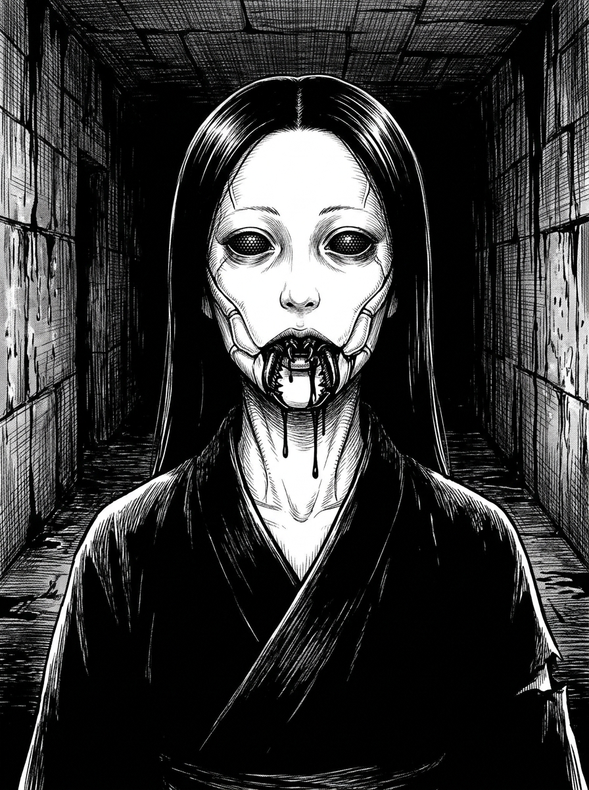 | 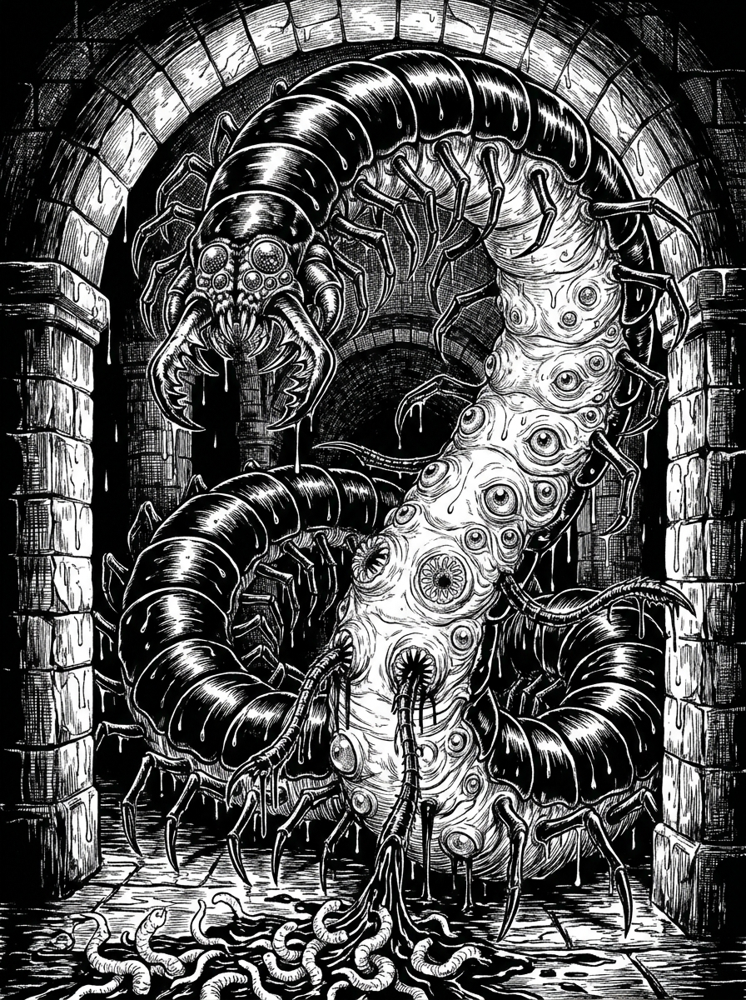 | 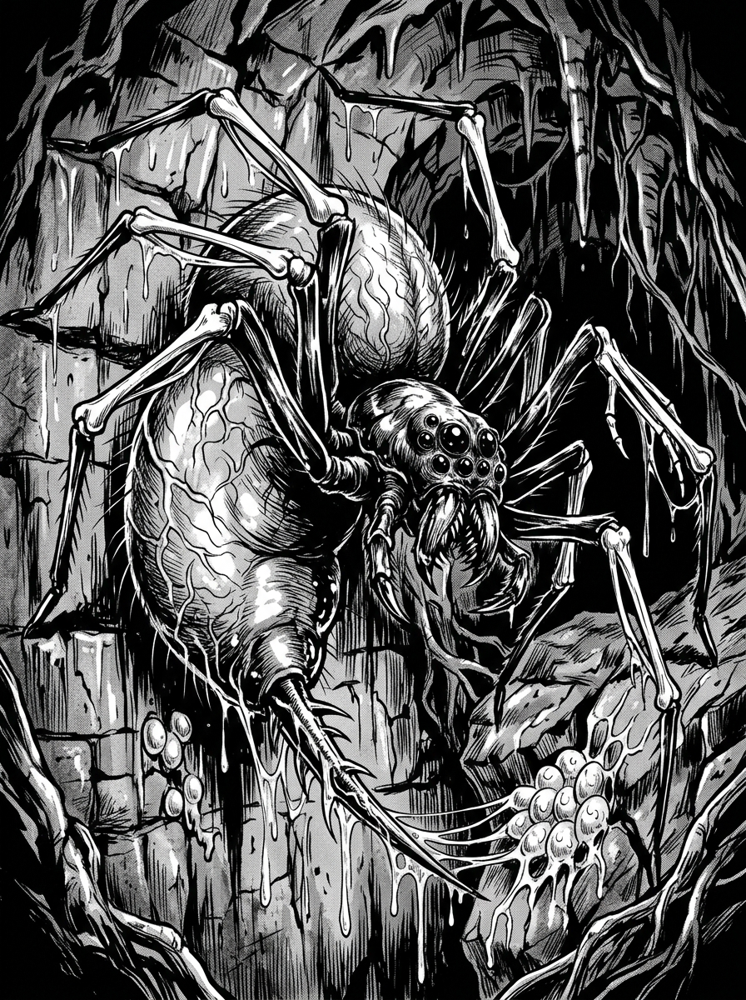 |
| [西遊卷二・第27回](./西遊記/02-卷二_第21至40回.md) | [西遊卷四・第73回](./西遊記/04-卷四_第61至80回.md) | [西遊卷四・第72回](./西遊記/04-卷四_第61至80回.md) |

| 窮奇／混沌（無定形昆蟲寄生集群） | 九尾狐・妲己（偽人皮下節肢尾・產卵管態） |
| :---: | :---: |
| 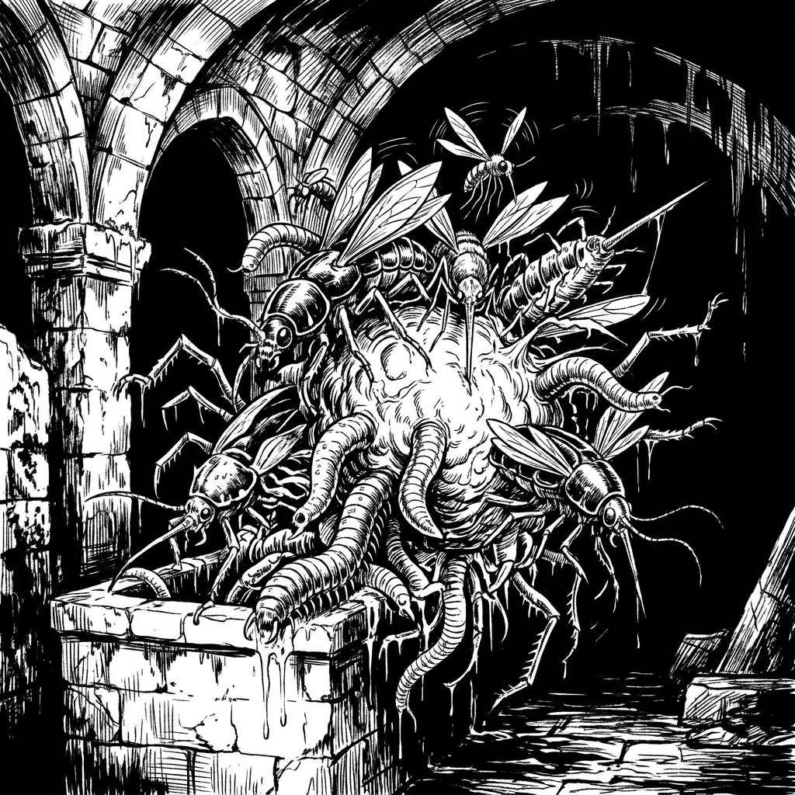 | 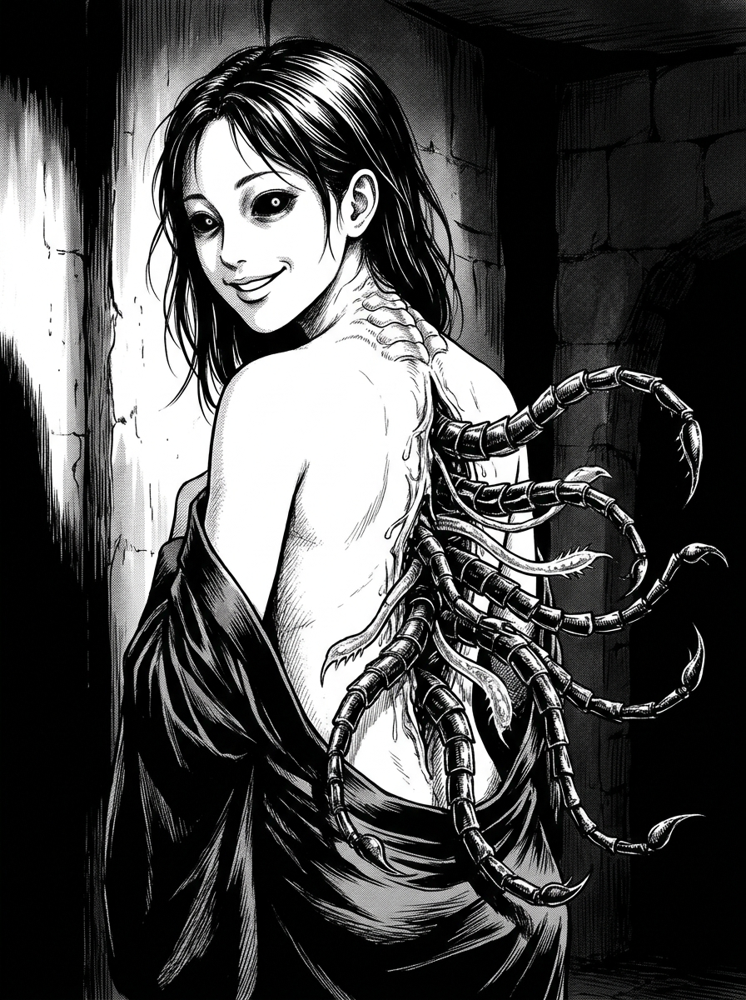 |
| [山海經卷02・西山經](./山海經/02-卷02_西山經.md) | [封神卷一・第01–04回](./封神演義/01-卷一_第01至35回.md) |

---

## 📖 三、圖鑑雙軌標註、唯一性與稀有度分級

所有條目嚴守 [創作原則](../../創作原則.md) 雙軌口徑：
- **【原典記載】**：忠實考據《西遊記》《封神演義》《山海經》原文；原典未寫之弱點或喜好誠實標明「原典未載」。
- **【本作衍生】**：依上述「黑暗地牢昆蟲／節肢／寄生／環節動物 × 恐怖谷偽人」規則重構其外貌、都市潛伏點、寄生習性、物理／符法破口與對策。

### 1. 「物種 vs. 獨一無二」判準

| 歸類標籤 | 定義說明 | 經典妖怪／怪獸範例 |
| :--- | :--- | :--- |
| **`物種（群體）`** | 可自然繁衍、集體產卵或同類皆能異變誕生的族群，本作可在不同都市重複遭遇 | 蜘蛛精一脈、青丘九尾狐族、狌狌、鹿蜀、犀牛精、蠆盆毒蟲群、瞌睡蟲 |
| **`物種特異個體`** | 出身於自然族群，但歷經數百年寄生吞噬或異變成為極罕見的母體／霸主 | 黃風大聖、牛魔王、百眼魔君、軒轅墳九尾狐（妲己）、梅山白猿袁洪 |
| **`獨一無二`** | 天地異象孕育或僅此一尊的不可複製怪獸／魔體 | 六耳獼猴、混世四猴、九頭蟲、蚊道人、鉤吾山饕餮、相柳、帝江（混沌） |

### 2. 稀有度分級系統（純妖怪與怪獸尺度｜對照封神西遊模糊道行 × 本作四階）

| 稀有度徽章 | 等級名稱 | 對應模糊道行與威脅尺度 | 本作四階對照 | 怪物層級特徵 |
| :---: | :--- | :--- | :--- | :--- |
| `★` | **凡級（N）** | 數年～數十年淺妖氣／底層寄生蟲怪、群居幼體 | **未入流～三流** | 常見於廢墟排水溝、暗巷、空屋的小妖與低階異獸，許家銘開局能靠腦力與低階符搏殺。 |
| `★★` | **稀級（R）** | 數十年～百餘年成精／具備偽人皮囊、障眼法或寄生毒素 | **二流** | 如序章 `01-蜘蛛精`、白衣秀士、花狐貂；三流散修只要誤判一次機制就會喪命。 |
| `★★★` | **珍級（SR）** | 數百年～千年道行／一方巢穴母體、成氣候妖王、著名凶獸 | **二流頂～一流** | 如白骨精、盤絲七蛛、梅山眾怪、蜚、蠱雕；能把整棟社區或山谷變成產卵獵場。 |
| `★★★★` | **絕級（SSR）** | 千年大妖霸主、多足集群災體、上古四凶與巨型寄生魔獸 | **一流頂～巔峰** | 如牛魔王、百眼魔君、蠍子精、九頭蟲、袁洪、窮奇、饕餮；單體足以引發封城級靈異災難。 |
| `★★★★★` | **神級災厄（UR）** | 數千年不可名狀太古怪獸／規格外妖聖（非神明，純毀滅級怪獸） | **巔峰～規格外** | 如金翅大鵬、九靈元聖、六耳獼猴、蚊道人、孔宣妖相、相柳、混沌（帝江）；凡人除妖師遇之唯有一死。 |

---

## 🕸️ 四、本作正本已登場妖物檔案（唯一正本定案）

### 本作 No.01：蜘蛛精（廢棄醫院地下室個體｜近人臉恐怖谷變異株）

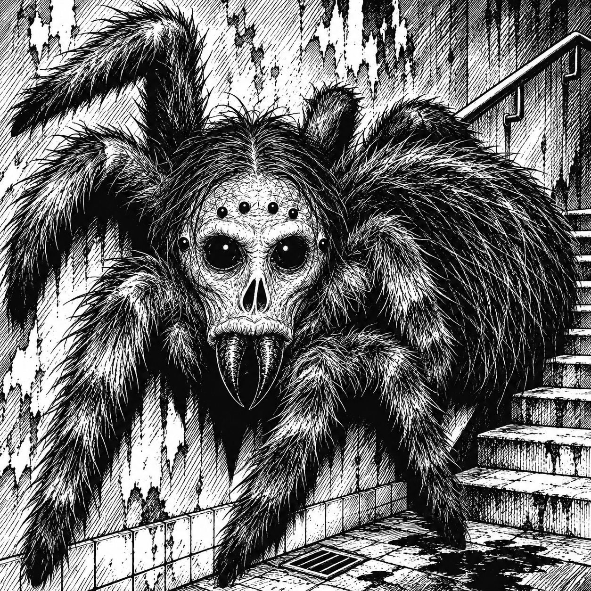

- **登場章節**：[序章《01-蜘蛛精》](../../章節/01-蜘蛛精/小說.md)（已斬殺）
- **類別／本體**：節肢蟲妖（巨型捕鳥蛛異變體・盤絲洞寄生蛛脈之都市變異株）
- **造型路線**：`非人生物恐怖型 × 局部恐怖谷偽人頭顱`（*註：本章已完稿定案，保留原定稿造型基準不倒改；同族其他高階個體則依標竿圖往「巨大寄生巨蛛＋腹部產卵器＋關節嵌人骨」發展*）
- **物種／唯一性**：`物種（群體）`
- **稀有度與道行對照**：`★★ 稀級（R）`｜模糊道行：數十年～百餘年成精初階｜本作階位：初級二流 *(原開發備忘約 Lv.10～12)*
- **外貌與視覺基準（[章節定稿概念圖](../../章節/01-蜘蛛精/參考圖/06-蜘蛛精初登場概念圖.jpg)，上圖為公式書墨線版）**：
  - 體長約 `1.5m`×`1.2m` 厚實剛毛捕鳥蛛軀幹，八條成人臂粗步足摳進水泥牆；前端慘白縱長人頭比頭胸部略小一號，黑灰濕黏中分半短髮露白額，額上 4 小眼＋正中 2 顆純黑無眼白球面主眼＋雙側眼共八眼；骷髏塌陷梨狀鼻腔；無下巴，微掀人類上唇下縱裂出暗紅濕潤肉褶口腔與兩根垂過臉緣的黑亮彎螯牙。
- **特性**：八足壁行高速立體機動；全感官障眼法（同步遮蔽妖氣、血臭與踢毛）；瀕死已開始學說「救……命……」。
- **弱點**：極懼烈火濃煙（油脂絨毛與空中細毛遇火即燃）；貼身「掌心雷」加墜落衝力可令八足痙攣破防。
- **習性與喜好**：盤踞停電潮濕無窗廢棄醫院地下室，吞食誤闖探險網紅，偏好陰濕密閉暗處。
- **擅長招式**：`全感官障眼法`、`捕鳥蛛隱形踢毛`（誘使法師誤判毒瘴錯捏閉氣訣）、`八足壁行突襲`。

### 本作原創器物妖構想（延伸參考）
| 無影燈器物妖 | 手術刀器物妖 |
| :---: | :---: |
| 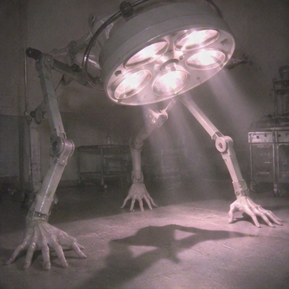 | 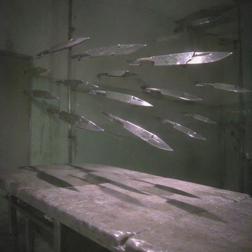 |

---

## 🖼️ 五、既有純妖怪與怪獸黑白墨線精選畫廊（已剔除神明）

| 白骨精（偽人送飯態） | 九尾狐妲己（偽人梳妝節肢態） | 百眼魔君（多眼巨蜈蚣態） | 九頭蟲 |
| :---: | :---: | :---: | :---: |
|  |  | 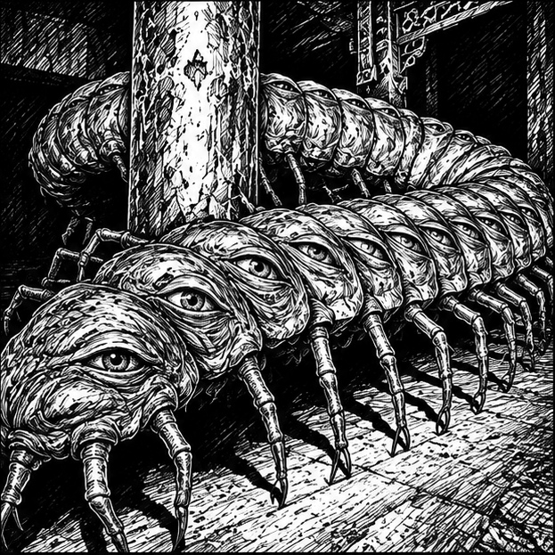 | 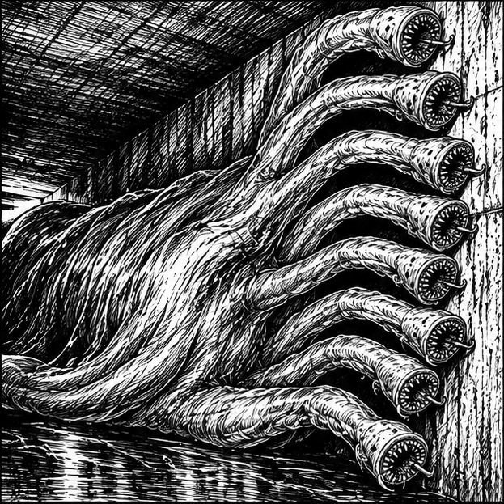 |

| 六耳獼猴 | 白猿精・袁洪 | 鉤吾山狍鴞／饕餮 | 盤絲洞七蜘蛛精（偽人誘殺態） |
| :---: | :---: | :---: | :---: |
| 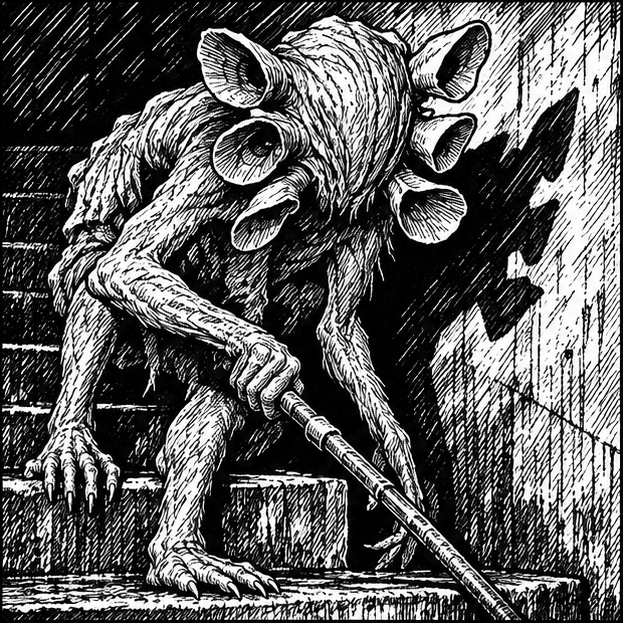 | 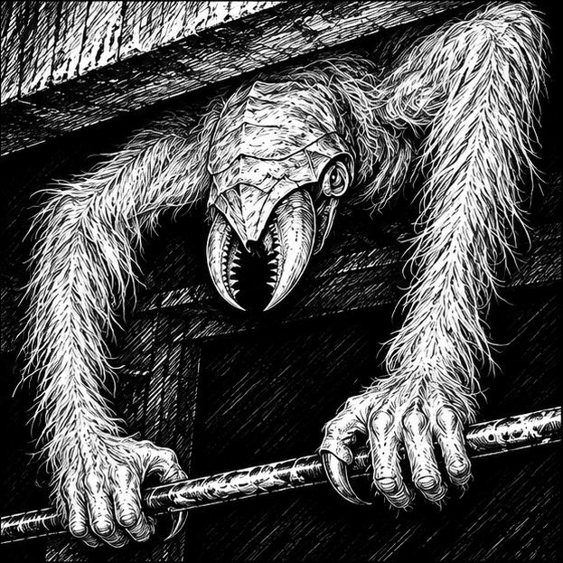 | 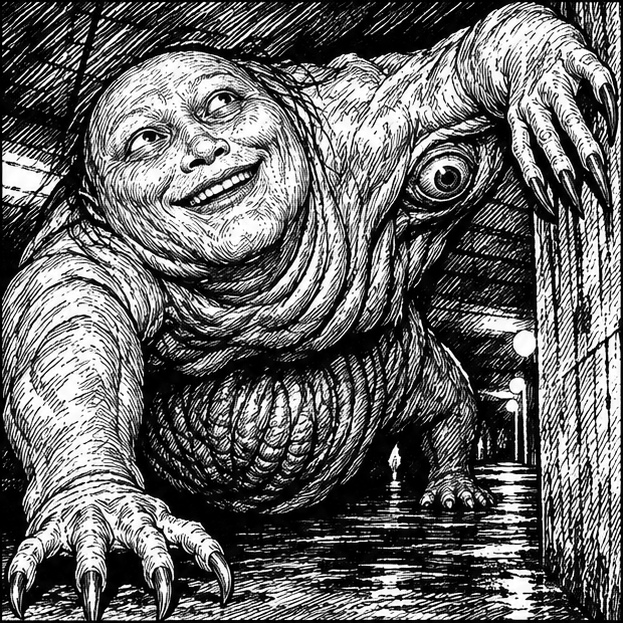 | 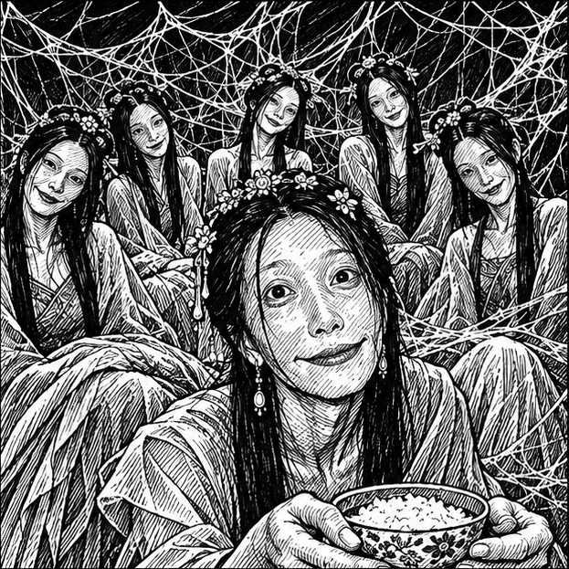 |

---

## 📚 六、三部經典純妖怪與怪獸圖鑑全入口（從首頁到末頁・零神明）

### 1. 🐒 《西遊記》純妖怪與怪獸圖鑑（第 01～100 回）
- **總錄入口**：[00-西遊記妖怪怪獸總錄.md](./西遊記/00-西遊記妖怪怪獸總錄.md)
- **分冊導覽**：
  - [卷一：第 01～20 回（混世魔王・七大聖妖獸・雙叉嶺三妖～黃風大聖）](./西遊記/01-卷一_第01至20回.md)
  - [卷二：第 21～40 回（流沙水怪・白骨精偽人・黃袍怪・金銀角妖相～紅孩兒）](./西遊記/02-卷二_第21至40回.md)
  - [卷三：第 41～60 回（鼉龍・車遲三妖・靈感大王・蠍子精・六耳獼猴～牛魔王）](./西遊記/03-卷三_第41至60回.md)
  - [卷四：第 61～80 回（九頭蟲・木仙庵七樹精・黃眉・盤絲七蛛・百眼蜈蚣・獅駝三魔～老鼠精）](./西遊記/04-卷四_第61至80回.md)
  - [卷五：第 81～100 回（瞌睡蟲・南山豹精・黃獅・九靈元聖七獅・三犀牛精～玉兔精）](./西遊記/05-卷五_第81至100回.md)

### 2. 🦊 《封神演義》純妖怪與怪獸圖鑑（第 01～100 回｜已剔除三清、金仙與 365 正神）
- **總錄入口**：[00-封神演義妖怪怪獸總錄.md](./封神演義/00-封神演義妖怪怪獸總錄.md)
- **分冊導覽**：
  - [卷一：第 01～35 回（軒轅墳三妖九尾狐妲己・石磯・蠆盆毒蟲・墨麒麟與五色神牛）](./封神演義/01-卷一_第01至35回.md)
  - [卷二：第 36～75 回（龍鬚虎・花狐貂・腦後鬼手馬元・馬善・羽翼仙・蜈蜂・孔宣・丘引蚯蚓精）](./封神演義/02-卷二_第36至75回.md)
  - [卷三：第 76～100 回（龜靈・吸血巨蚊道人・截教七妖・桃精柳鬼・梅山七怪袁洪等）](./封神演義/03-卷三_第76至100回.md)

### 3. 🏔️ 《山海經》純怪獸與妖怪圖鑑（全 18 卷｜已剔除純神明與純人類王統）
- **總錄入口**：[00-山海經怪獸妖怪總錄.md](./山海經/00-山海經怪獸妖怪總錄.md)
- **分冊導覽**：
  - [卷 01：南山經（狌狌・鹿蜀・青丘九尾狐・蠱雕・瞿如・顒等三經全怪獸）](./山海經/01-卷01_南山經.md)
  - [卷 02：西山經（肥遺・欽原毒蜂・帝江混沌・窮奇・猙・畢方・孰湖等四經全怪獸）](./山海經/02-卷02_西山經.md)
  - [卷 03～04：北山經與東山經（何羅魚・諸犍・精衛・饕餮・當康・合窳・瘟疫巨獸蜚全錄）](./山海經/03-卷03至04_北山經與東山經.md)
  - [卷 05：中山經（鳴蛇・化蛇・馬腹・夫諸・驕蟲・蠪姪・鴆鳥等十二山經全怪獸）](./山海經/04-卷05_中山經.md)
  - [卷 06～09：海外四經（鑿齒・視肉・女丑之尸・并封・相柳・奢比之尸・天吳等怪獸與活屍）](./山海經/05-卷06至09_海外四經.md)
  - [卷 10～13：海內四經（梟陽・窫窳・巴蛇・開明獸・千里大蟹・陵魚・大蜂朱蛾・王子夜之尸）](./山海經/06-卷10至13_海內四經.md)
  - [卷 14～18：大荒四經與海內經（夔・魚婦・蜚蛭・九鳳・旱魃・延維・幽都群怪至全書末頁）](./山海經/07-卷14至18_大荒四經與海內經.md)
