# 🦊 《封神演義》純妖怪與怪獸圖鑑・卷一（第 01～35 回）

> **返回導覽**：[👹 妖怪篇總綱](../00-妖怪篇總綱與圖鑑分級.md) ｜ [📖 封神演義總錄](./00-封神演義妖怪怪獸總錄.md) ｜ [➡️ 卷二](./02-卷二_第36至75回.md)
>
> **插圖統計**：本卷嚴格依原書第 01～35 回出場順序收錄 **16 條**純妖怪與怪獸公式書檔案（涵蓋 **2 處**雙圖核心條目與 **11 處**單圖條目），共計嵌入 **15 張**既有實存圖檔（含五大標竿核心條目 `[FS1-02] 軒轅墳千年九尾狐狸精（蘇妲己）` 雙圖並列，及 `[FS1-14] 軒轅墳眾狐子狐孫` 雙圖並列），其餘 **3 條**純怪獸／妖禽檔案已標記 `<!-- 圖位預留：待補繪 -->`。
>
> **純妖怪收錄邊界與神明剔除聲明（2026-11-21 定案鐵律）**：本卷嚴格執行「**零神明、零聖人、零仙道、零凡人武將**」篩選紅線！原典第 01～35 回登場之一切神明、上古聖人、闡教十二金仙、仙童、天庭水府龍神官吏、截教人族道將與人間帝王武將——包含**女媧娘娘、火雲宮三聖皇（伏羲・神農・軒轅）、女媧宮青鸞與碧霞／彩雲仙童、元始天尊、南極仙翁、白鶴童子、雲中子與金霞童兒、太乙真人、廣成子、赤精子、文殊廣法天尊、普賢真人、清虛道德真君、燃燈道人、黃巾力士、姜子牙、申公豹、哪吒、李靖、金吒、木吒、雷震子、四海龍王（敖光・敖明・敖順・敖吉）與東海龍子敖丙・水府官差巡海夜叉李艮、聞仲與吉立余慶、黃飛虎與黃天化、崇黑虎、方弼方相、陳桐、余化、商紂王、周文王姬昌、伯邑考、比干、蘇護、武吉**等——**一律徹底剔除不收**！僅收錄原典本區段內真正屬於**妖怪、精魅、怪獸、異獸、寄生幼體與腐屍毒蟲群**之非人存在（其中第 13 回骷髏山石磯嚴格剝離仙神與月遊星位格，純取「萬年頑石成精魔怪」本體建檔；第 3、12、27、30 回諸神將坐騎與妖禽亦嚴格剔除騎主，純取怪獸本體收錄）。
>
> **黑暗地牢 × 昆蟲寄生 × 恐怖谷偽人設計鐵律**：全卷徹底揚棄傳統毛絨神話走獸、祥瑞神獸與美艷古裝女妖框架，全面取材自**昆蟲、節肢動物、寄生生物、軟體與環節動物**四大生物原型庫，結合克蘇魯不可名狀感與潮濕腐蝕的黑暗地牢質感，分以 `【類人偽人型】` 與 `【非人生物恐怖型】` 雙路線重構，並恪守【原典記載】×【本作衍生】雙軌考據。

---

## 📋 本卷純妖怪與怪獸速查表（第 01～35 回・共 16 條，依原典回目順序排列）

| 編號 | 名稱（別稱） | 出處回目 | 造型路線 | 本作黑暗地牢／寄生／偽人重構原形 | 物種／唯一性 | 稀有度 | 本作階位 | 配圖 |
| :---: | :--- | :--- | :---: | :--- | :--- | :---: | :--- | :---: |
| `FS1-01` | **招妖幡所召天下萬妖群相**（九州四海萬妖總譜） | 第 01 回 | `【非人生物恐怖型】` | 腐潮荒塚昆蟲節肢與寄生幼體萬妖集群 | `物種（群體）` | `★`～`★★★★` | 未入流～一流頂 | 🖼️ |
| `FS1-02` | **軒轅墳千年九尾狐狸精（蘇妲己）** ⚠️ **五大標竿** | 第 01、04 回起 | `【類人偽人型】` | 偽人宮妃皮囊・幼蟲鑽顱寄生・脊裂九節肢尾與產卵管 | `物種特異個體` | `★★★★ 絕級（SSR）` | 一流（滲透禍國級） | 🖼️×2 |
| `FS1-03` | **九頭雉雞精（胡喜媚）**（軒轅墳三妖之二） | 第 01、25～26、96 回 | `【類人偽人型】` | 嬌媚宮妃偽人・皮下九條食腐禿鷲與毒蜂口器伸縮頸管 | `物種特異個體` | `★★★ 珍級（SR）` | 二流頂～一流初 | 🖼️ |
| `FS1-04` | **玉石琵琶精（王貴人）**（軒轅墳三妖之三） | 第 01、16～17、96 回 | `【類人偽人型】` | 裂瓷空心石響偽人・焚裂內藏巨蠍甲殼與振動節肢絲弦 | `物種特異個體` | `★★★ 珍級（SR）` | 二流頂（再生特化） | 🖼️ |
| `FS1-05` | **鐵嘴神鷹群**（紅葫蘆三千食目妖禽） | 第 03、28～29 回 | `【非人生物恐怖型】` | 彎鉤鋼喙食腐毒蠅與骨翼巨蚊集群 | `物種（群體）` | `★★★ 珍級（SR）` | 二流頂～一流（集群） | ⏳ |
| `FS1-06` | **火眼金睛獸**（烈焰複眼重甲戰獸） | 第 03、28、33 回 | `【非人生物恐怖型】` | 焦黑腐食甲蟲鞘翅・赤紅發光複眼肉瘤巨獸 | `物種（群體）` | `★★ 稀級（R）` | 二流～二流頂 | ⏳ |
| `FS1-07` | **逼水獸**（九灣河裂浪分水怪獸） | 第 12 回 | `【非人生物恐怖型】` | 深淵大王具足蟲重甲額盾・海蜈蚣槳足怪獸 | `物種特異個體` | `★★ 稀級（R）` | 二流 | ⏳ |
| `FS1-08` | **骷髏山白骨洞・石磯**（萬年頑石成精魔怪） | 第 13 回 | `【非人生物恐怖型】` | 裂岩偽人表相・布滿寄生藤壺地衣菌絲與岩殼節肢活石魔怪 | `獨一無二` | `★★★★ 絕級（SSR）` | 一流頂（高防岩甲） | 🖼️ |
| `FS1-09` | **宋異人後花園・五路怪**（龍岡五色地脈精魅） | 第 15～16 回 | `【類人偽人型】` | 五色黏液怪臉偽人・夜間潮濕黑影貼牆窺視精魅 | `物種（群體）` | `★★ 稀級（R）` | 三流頂～二流初 | 🖼️ |
| `FS1-10` | **摘星樓蠆盆・百毒蛇蠍腐屍蟲群**（血肉養蠱深坑） | 第 17 回 | `【非人生物恐怖型】` | 活人血肉養育之水蛭、巨蠍、馬陸與鑽肉幼蟲集合體 | `物種（群體）` | `★★ 稀級（R）` | 二流（毒坑地形） | 🖼️ |
| `FS1-11` | **白面猿猴**（西岐千年識妖怪猿） | 第 19 回 | `【非人生物恐怖型】` | 蒼白濕綹長臂拖地・針齒畸形顎吻識妖怪獸 | `物種特異個體` | `★★★ 珍級（SR）` | 二流（破妄一流） | 🖼️ |
| `FS1-12` | **西岐吐子三白兔**（怨肉催生寄生異獸幼體） | 第 19、22 回 | `【非人生物恐怖型】` | 死肉怨念催生・半透明脈動內臟與觸絲口裂寄生幼體 | `獨一無二` | `★★ 稀級（R）` | 未入流～三流（異象） | 🖼️ |
| `FS1-13` | **東南白額飛熊**（膜翼重甲異化飛熊怪獸） | 第 23 回 | `【非人生物恐怖型】` | 灰白幾丁質重甲節片・昆蟲膜翅・輻射鰓瓣感官口器巨獸 | `獨一無二` | `★★★★ 絕級（SSR）` | 一流～異象災級 | 🖼️ |
| `FS1-14` | **軒轅墳眾狐子狐孫**（鹿臺赴宴三十九席偽人狐群） | 第 25～26 回 | `【類人偽人型】` | 三十九席油汗僵笑偽人賓客・醉後裂口露幾丁質節肢尾與食腐顎器 | `物種（群體）` | `★`～`★★ 稀級（R）` | 未入流～二流初 | 🖼️×2 |
| `FS1-15` | **墨麒麟**（東海黑霧鱗甲寄生巨獸） | 第 27 回起 | `【非人生物恐怖型】` | 漆黑濕滑甲殼鱗片・口尾綻放輻射寄生觸絲吸盤巨獸 | `物種特異個體` | `★★★ 珍級（SR）` | 一流 | 🖼️ |
| `FS1-16` | **五色神牛**（角質重甲複眼肉瘤異種巨獸） | 第 30～33 回 | `【非人生物恐怖型】` | 五彩油斑重甲巨兜蟲穹背・複眼肉瘤與多對透明節肢步足巨獸 | `物種特異個體` | `★★ 稀級（R）` | 二流～二流頂 | 🖼️ |

> **逐回淨化與零遺漏備忘（第 01～35 回）**：第 02 回（蘇護反商）、第 05～11 回（雲中子進劍、炮烙廢后、殷郊殷洪逃難、雷震子降世、羑里囚西伯侯）、第 14 回（哪吒蓮花化身）、第 18 回（子牙隱磻溪）、第 20～21 回（賄賂費尤、文王逃五關）、第 24 回（渭水聘子牙）、第 31～32 回（聞仲追襲、黃天化會父）、第 34～35 回（飛虎歸周、晁田伐西岐）除前已建檔之軒轅墳三妖與怪獸坐騎重複登場外，其餘人物俱為神明、闡截仙道或凡人武將，依純妖鐵律全數剔除，無一妖怪遺漏。

---

## 🪳 第一單元：第 01～04 回｜腐潮招妖群相・軒轅墳三妖與首陣妖禽異獸

### [FS1-01] 招妖幡所召天下萬妖群相（九州四海萬妖總譜・腐潮荒塚萬蟲群像）
- **出處順序**：第 1 回《紂王女媧宮進香》（招妖幡於白光四五丈高處展動剎那，悲風颯颯、慘霧迷漫，天下九州四海一切未入仙籍之山精野怪、毒蟲異獸俱受強制號令蜂擁奔聚荒塚宮前，唯留軒轅墳三妖，其餘遣散潛伏）
- **類別與造型路線**：`【非人生物恐怖型】`（兼含高階 `【類人偽人型】` 領頭者）｜腐潮荒塚昆蟲節肢、寄生幼體與環節黏液萬妖總集合
- **物種／唯一性**：`物種（群體）`（涵蓋山澤濕地、古塚腐土、廢墟水脈與深海暗溝中所有自然滋生或吸收陰煞異變之萬千妖蟲與怪獸族群總譜）
- **稀有度與道行對照**：`★ 凡級（N）`～`★★★★ 絕級（SSR）`｜模糊道行：下至數年潛伏腐泥之寄生幼蟲，上至修煉千年、盤踞深山古墳的頂級母體妖王｜本作階位：未入流～一流頂（視單體物種與寄生世代而定）
- **外貌與黑暗地牢／恐怖谷視覺改寫**：
  - 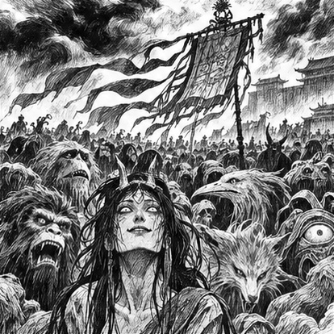
  - 【原典外貌】招妖幡展動瞬間，天昏地暗、悲風颯颯、慘霧迷漫、陰雲四合；狂風數陣掠過荒野，無數形態各異的山精野怪、飛禽走獸精魅、頑石老器紛紛駕黑風妖霧湧至荒野古宮外伏地聽令。
  - 【本作克蘇魯／昆蟲寄生／偽人重構】徹底揚棄熱鬧奇幻的傳統「百妖朝拜圖」，改以黑暗地牢式絕望焦墨描繪「**腐潮荒塚萬蟲朝幡的生理噩夢**」：陰雲低壓的古建築剪影前，一面殘破抽絲、布滿乾涸血跡與詭異蟲篆符紋的長條裂幡於狂風中瘋狂抽打；幡影之下，無邊無際的潮濕泥漿與腐骨荒塚間湧出令人頭皮炸裂的妖潮——最前排頂著斷裂骨角、雙眼翻白無瞳、臉頰爬滿黑紅裂痕與細密寄生菌絲的偽人妖女正僵直昂首獰笑；她左右兩側與後方層層疊疊擠滿了徹底去哺乳動物化的畸形生物：披著濕結腐毛卻裂開鋸齒蟲顎的類猿節肢巨怪、眼眶膨大成單顆巨型無眼瞼蒼白複眼的畸形甲蟲殼妖、喙口滴落強酸黏液的脫毛食腐怪禽、皮下鼓動著數百隻蠕動幼蟲的瘦長擬狐腐獸，以及密密麻麻爬滿後方地平線、如黑潮般湧動的馬陸步足、蚊式長口針與無定形水蛭肉團！高對比黑白墨線著重勾勒這片萬妖潮水散發出的潮濕黏液反光、幾丁質甲殼互相刮擦的密集噪點，以及那種面對更高位階強制召令時既癲狂又屈辱的原始蟲類本能。
- **特性**：
  - 【原典記載】凡屬妖籍、未成正果的天下精魅，一聞招妖幡氣息即無法抗拒其神魂鎖鏈，縱藏身於萬里之外的荒墳絕谷亦必駕陰風趕赴；被遣散後各自退回九州四海潛修等待劫數。
  - 【本作衍生】本作現代台灣隱秘妖魔生態的總源流！當年被遣散潛伏的龐大昆蟲寄生與節肢妖脈並未滅絕，反而隨著數千年地貌變遷與都市水泥化，徹底適應了人類建築底層的陰暗潮濕夾縫——從老舊醫院淹水地下室（如序章已斬殺之蜘蛛精）、都會大型雨水排水箱涵、停業屠宰場冷凍庫，到半廢棄山腰納骨塔與爛尾大樓地下機械停車位，全都是這群古老妖蟲潛伏產卵的新世代「軒轅墳」。
- **弱點**：
  - 【原典記載】受先天「妖籍」因果死死壓制，遇招妖幡、照妖鏡、純陽雷火或道門敕令即無法隱匿本相，低階妖物甚至毫無反抗能力。
  - 【本作衍生】萬妖雖眾卻極度排外、彼此吞噬競爭領地，且絕大多數底層至中階個體（未入流～二流）皆具節肢昆蟲與軟體寄生生物之共通死穴：**極懼高溫乾燥明火（烈火符）、強效除濕脫水、高壓雷電貫穿濕滑黏液膜（掌心雷／五雷鎮煞符）**，以及能剝除障眼法的**開天眼符水與破障符**。
- **習性**：
  - 【原典記載】平時散居深山古墓、陰潭枯樹、荒廢宅院吸納陰氣與日月精華，遇大劫氣運波動或高階召妖法器引動時便成群蠢動。
  - 【本作衍生】高度偏好台灣亞熱帶高濕度、無自然採光且長年滲水的都市盲區；梅雨季、颱風前夕低氣壓與農曆七月陰潮時段活動最為頻繁，習慣利用深夜十一點至凌晨四點的無人空窗外出捕獵或更換寄生宿主。
- **喜好**：
  - 【原典記載】普遍嗜血食肉、渴求吸食凡人陽氣精元以壯大道行，同時執迷於脫去蟲獸醜態、披上人類皮囊混入繁華塵世。
  - 【本作衍生】底層蟲妖嗜食腐肉、積水污血與恐懼汗味；中高階偽人型妖怪則病態迷戀高濕度密閉空間、昂貴香水（遮掩幾丁質腐臭）與模仿人類社交禮儀。
- **擅長的招式／異能**：
  - 【原典記載】駕陰風慘霧、隱身化形、惑亂凡人神智、夜吸精血。
  - 【本作衍生】全妖脈共通的生存三板斧：**「全感官障眼法」**（同步遮蔽外觀、腐臭與蟲殼摩擦音）、**「低階偽人聲線摹仿」**（模仿求救、問路或哭聲誘獵）、**「寄生幼體播種」**（瀕死前拼命將卵囊或幼蟲射入周遭陰暗排水孔延續族群）。

---

### [FS1-02] 軒轅墳千年九尾狐狸精（蘇妲己・軒轅墳三妖之首｜⚠️ 五大標竿核心基準體）
- **出處順序**：第 1 回《紂王女媧宮進香》（奉招妖密旨領命亂商）、第 4 回《恩州驛狐狸死妲己》（深夜陰風滅燈，以幼蟲鑽顱寄生徹底接管蘇護之女蘇妲己軀殼）、第 5～26 回及全書主線核心妖魁（至第 96～97 回法場斬首方徹底伏誅）
- **類別與造型路線**：`【類人偽人型】`｜頂級恐怖谷偽人皮囊・腦內幼蟲寄生中樞接管體・背裂九條幾丁質節肢蠍尾與搏動產卵管（**本作五大標竿基準體之一**）
- **物種／唯一性**：`物種特異個體`（軒轅墳寄生節肢妖脈本為群居族群，然於上古荒塚腐肉與帝王陰煞中歷經千年蛻殼演化、修出完美「偽人奪舍」與九條高階產卵節肢尾並覆滅六百年王朝者，舉世唯此母體獨尊）
- **稀有度與道行對照**：`★★★★ 絕級（SSR）`｜模糊道行：千年古塚母體大妖（單論正面法寶硬拚不及頂尖荒古怪獸，然其「顱內寄生奪舍、極致偽人魅惑、產卵增殖與操縱凡人權力機構屠戮眾生」之毀滅力堪比災厄）｜本作階位：一流（偽人滲透・精神惑控・寄生母體特化；正面近身肉搏約二流頂～一流初）
- **外貌與黑暗地牢／恐怖谷視覺改寫**：
  - 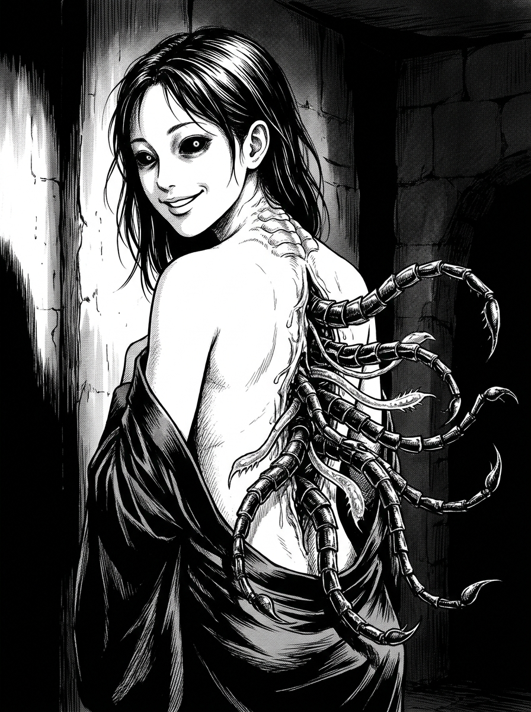
  - 
  - 【原典外貌】原形係盤踞朝歌南門外三十五里軒轅墳修煉千年之九尾狐狸精；第 4 回於恩州驛刮起一陣陰風吹熄燈火，吸盡真蘇妲己魂魄並佔據其肉身，自此以「烏雲疊鬢、杏臉桃腮、淺淡春山、嬌柔柳腰」的絕世美人姿態入主壽仙宮，迷得商紂王神魂顛倒；惟深夜獨處、遭鎮妖松木劍逼迫或遇千年靈獸時，仍藏不住滲人腥騷與非人妖相。
  - 【本作克蘇魯／昆蟲寄生／偽人重構】**嚴格恪守本作五大標竿核心定案（嚴禁畫成毛絨多尾狐娘或傳統古裝性感美女！）**：她是全書將「**極致美人偽人（Mimic）× 潮濕地牢節肢產卵恐怖**」推到生理極限的頂級夢魘！
    - **標竿一：偽人產卵態（如上圖一《標竿-九尾狐妲己_偽人產卵態》）**：佇立在陰暗滲水的石砌地牢長廊或無窗廢棄豪宅走廊裡，一名肩背赤裸、寬大深色衣袍滑落腰際、黑髮濕垂貼頰的絕美年輕女子緩緩回眸；初看輪廓柔美纖細，細瞧卻瞬間引爆毛骨悚然的**極致恐怖谷**——她臉上掛著一抹過分平順僵冷、肌肉牽動宛如提線人偶的微笑，雙眼眶裡沒有絲毫人類眼白，只剩一對漆黑無底的死瞳，正中央各自浮著一點冰冷刺目的針孔白光！順著她纖細潔白的後頸往下看，皮膚底下早已隆起層層重疊、如蜈蚣背甲般的蒼白幾丁質硬節；從肩胛骨中央一直延伸到尾椎的整條人類脊椎皮肉竟像濕軟果肉般**徹底縱向裂開**，滴淌著半透明拉絲黏液，自那道漆黑濕滑的脊背血肉裂縫深處，狂亂爆伸出**九條漆黑油亮、布滿反光環節與細刺的巨型蠍尾／蜈蚣節肢長尾**（尾端皆生著彎曲銳利的漆黑毒螯與穿刺骨針），九條硬殼節肢之間還夾雜著數條半透明慘白、邊緣生滿肉質鋸齒細鬚且不斷痙攣蠕動的**搏動產卵管**！所謂「九尾」，根本不是毛茸茸的狐狸尾巴，而是從人皮脊椎破肉而出的九具節肢獵殺與繁殖器官！
    - **標竿二：日常宮廷梳妝偽人態（如上圖二《封神-九尾狐狸精》）**：當她偽裝成貴婦、名媛或古代寵妃端坐於雕花古鏡前從容插簪梳妝時，衣飾華麗繁複、髮插垂珠牡丹步搖，乍看無懈可擊；但若在強烈黑白高對比光影下逼近觀察，她整張美人臉的表皮細看竟像張繃在蟲殼上的乾脆皺紙，笑紋僵硬空洞、斜睨鏡面的目光毫無人類情感；她捏著宛如尖銳昆蟲步足般細長髮簪的手指關節乾枯泛節，更駭人的是，在華美繡花錦袍微微滑落的蒼白左肩與後頸皮膚表面，數根粗壯光亮的**幾丁質節肢抓爪**早已直接穿透人皮露在衣領之外，像寄生巨蟹的步足般死死摳進她自己的鎖骨肉裡以穩固這具人皮外殼！
- **特性**：
  - 【原典記載】1. **奪舍換魂、至親難辨**：恩州驛一陣陰風便殺死真蘇妲己並完美接管其肉身，連生父蘇護、滿朝文武與商紂王皆毫無察覺；2. **極致煽動權力與嗜虐殘殺**：精準拿捏暴君的貪慾與猜忌，先後唆使建造炮烙、蠆盆、鹿臺、酒池肉林，害死姜皇后、梅伯、伯邑考、比干（挖七竅玲瓏心）與無數無辜宮女；3. **至死不墜的絕頂魅惑**：第 97 回法場斬首時，僅靠一雙含淚柔媚眼眸便讓連串劊子手軟手棄刀、不忍動刑，最終非得動用遠程斬首法寶才免去直視魅惑將其正法。
  - 【本作衍生】本作現代都市最致命的「**顱內寄生接管 × 權力頂層滲透母體**」！
    - **奪舍真相＝「幼蟲鑽顱寄生接管中樞神經」**：原典恩州驛「吹燈奪舍」在本作實為她從背後產卵管噴出微米級透明寄生幼蟲，順著陰風鑽入受害者耳道、鼻腔或眼角淚管，於數分鐘內啃空宿主大腦皮層與脊髓神經束，再用密密麻麻的幾丁質神經絲完全接管整具活人屍體的肌肉、記憶殘片與聲帶！被接管的「蘇妲己」體溫常年偏低、脈搏微弱遲滯，脊椎內藏著隨宿主壽命不斷長大的母體九節肢囊！
    - **生物費洛蒙＋微頻眼瞳催眠**：她之所以能讓劊子手拋刀、讓權貴百依百順，靠的不是仙術紅粉，而是從頸後節肢氣門持續散發的「**類寄生蜂神經麻痺費洛蒙**」疊加那雙無眼白漆黑瞳孔的微頻注視干擾，令近距離人類大腦多巴胺失控亢奮、徹底喪失攻擊意願並甘願替她毀滅周遭所有阻礙者！
- **弱點**：
  - 【原典記載】1. **極懼純陽鎮煞木器與正統陽氣**：第 5 回一道士僅以終南山老枯松削成的普通木劍懸於分宮樓，便鎮得她魂飛魄散、吐血病危、三日無法近身（最後全靠哭求紂王親手焚毀木劍才撿回一命）；2. **藏不住的非人腥騷氣息與原形破綻**：遇千年識妖怪猿（第 19 回白面猿猴）或照妖寶鏡便當場露餡；3. **本體正面抗擊與脫殼後防禦薄弱**：失去凡人權力護衛與視覺魅惑先手後，正面硬戰極為脆弱，一旦遭拘束型法器（如伏妖索）鎖死脊椎便毫無還手之力。
  - 【本作衍生】現代除妖師遭遇此等「偽人產卵母體」或其分靈，必須死守三條保命破口：1. **絕對切斷對視與鼻腔吸入費洛蒙**——交手前務必配戴深色偏光鏡、貼妥**淨氣避穢符**（防吸入神經麻痺費洛蒙）與**靜神符**，嚴禁直視其無眼白雙瞳超過兩秒或聽信其低聲哭求；2. **枯松／雷擊木純陽震盪剋制寄生神經絲**——以老枯松木劍、雷擊棗木錐或貼滿**鎮妖定身符**的桃木釘直刺其**後頸大椎穴至胸椎中段**（即九條節肢尾與產卵管的總神經根！），能瞬間令其人皮外殼痙攣僵死；3. **烈火連爆＋高壓五雷焚毀蟲卵**——擊破人皮後切忌放過任何一條從脊椎爬出的乳白幼蟲，必須立刻以**五雷鎮煞符**貫穿脊裂母核並用**自製烈火符**將整具寄生皮囊連同產卵管徹底焚成焦炭，否則只要逃掉一隻鑽顱幼蟲，半年後城裡就會出現下一個「蘇妲己」！
- **習性**：
  - 【原典記載】原居朝歌南門外三十五里荒僻軒轅墳，吸納荒塚陰煞修道；佔據蘇妲己軀殼後長居壽仙宮與鹿臺，晝間以嬌弱寵妃姿態蠱惑君王，深夜則在陰暗寢殿暗中啃食落單宮女侍衛精血，並時常潛回古塚與同族狐群會合。
  - 【本作衍生】絕不屈居臭水溝或破廟，而是專門潛伏在台灣頂級豪宅頂樓、政商私人招待所、老牌五星飯店長期包租套房或豪門獨棟古宅！她會先物色容貌出眾、握有金主與權貴人脈的網紅、特助或名媛，在深夜無人的飯店浴室或地下停車場以幼蟲鑽顱寄生接管其身分，隨後利用權貴金流替自己在地下室修建潮濕恆溫的「活人產卵密室」，並製造離奇墜樓、工安慘案與惡性鬥毆來大量收割血肉餵養脊背蟲卵。
- **喜好**：
  - 【原典記載】極度迷戀無上權勢、奢靡酒宴與聽聞酷刑慘叫（炮烙焦肉香與蠆盆宮女淒號）；對軒轅墳同族眷屬有極端病態的護短報復心（因同穴群狐遭火焚製裘，誓挖比干七竅玲瓏心洩憤）。
  - 【本作衍生】偏好極為濃郁昂貴的動物麝香與花香香水（用以壓過脊背產卵管滲出的幾丁質酸腐臭味）、高檔帶血生肉料理與恆溫高濕度蒸汽浴室；尤其沉迷於觀看身居高位的凡人為了自己親手殘害忠良親屬、一步步踏入自我毀滅深淵。
- **擅長的招式／異能**：
  - 【原典記載】「恩州驛陰風奪舍術」、「九尾惑心媚術」（連劊子手亦為之軟手拋刀）、「黑風遁逃」、「召喚軒轅墳萬千狐妖群」、「陣前雙刀搏殺」。
  - 【本作衍生】**「鑽顱幼蟲接管術」**（吹出帶微米級透明寄生蟲卵的陰冷瘴風，自眼耳鼻鑽入目標顱腔吞噬大腦，於三分鐘內製造出一具保留記憶與指紋的完美偽人宿主）、**「脊裂九尾毒刺絞殺」**（偽裝敗露瞬間後背衣衫撕裂，脊椎裂口爆射九條鋼索般堅硬的漆黑蠍蜈節肢尾封死整個走廊，尾針瞬間貫穿四肢與心肺）、**「搏動產卵管活體注卵」**（數條鋸齒半透明肉管強制撬開被制伏獵物的口腔或腹部創口，將數十顆帶神經麻痺黏液的寄生卵直接灌入內臟）、**「針瞳費洛蒙癱瘓」**（無眼白漆黑死瞳微頻閃爍並釋放甜膩氣霧，使目標大腦獎賞迴路短路、下意識放下武器並主動走向其懷抱）。

---

### [FS1-03] 九頭雉雞精（胡喜媚・軒轅墳三妖之二）
- **出處順序**：第 1 回《紂王女媧宮進香》（與九尾狐狸精、玉石琵琶精同赴招妖幡領旨）、第 25～26 回《蘇妲己請妖赴宴》／《妲己設計害比干》（軒轅墳遭焚後化名「胡喜媚」冒充妲己義妹入宮受封貴妃，獻計索挖比干七竅玲瓏心）、第 96～97 回《子牙發牌擒三妖》／《摘星樓紂王自焚》（夜劫周營敗逃伏誅）
- **類別與造型路線**：`【類人偽人型】`｜嬌媚宮妃偽人皮囊・皮下藏九條食腐禿鷲與毒蜂口器般伸縮頸管
- **物種／唯一性**：`物種特異個體`（荒塚腐禽寄生妖脈中極罕見之多頭畸變個體，能同時操縱九組獨立食道與毒刺口器並擬態為嬌媚宮妃者，唯此一隻）
- **稀有度與道行對照**：`★★★ 珍級（SR）`｜模糊道行：數百年～近千年荒塚畸變禽妖（智計與寄生深度略遜九尾狐母體一籌，然九頸齊突與多頻聲波干擾極具殺傷力）｜本作階位：二流頂～一流初
- **外貌與黑暗地牢／恐怖谷視覺改寫**：
  - 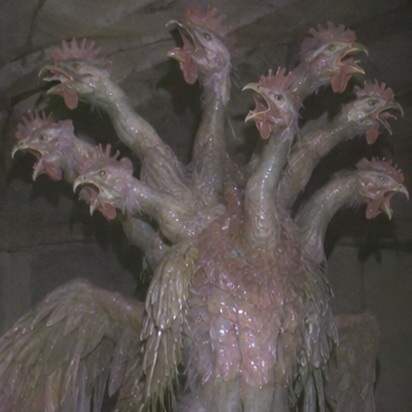
  - 【原典外貌】原形係盤踞軒轅墳修煉千年、脖頸生有九顆野雞頭之巨大山雉精怪；化形入宮後名為「胡喜媚」，生得花容月貌、身段妖嬈、善歌能舞，迅速獲商紂王寵幸封妃。
  - 【本作克蘇魯／昆蟲寄生／偽人重構】徹底剝除傳統華麗野雞羽冠或美艷妖妃氣質，打造出令人胃液翻湧的「**偽人宮妃皮囊 × 濕黏脫毛九頸腐禽蜂器恐怖體**」：日常狀態下，她是一名總愛圍著厚實絲巾或高領蕾絲遮住脖頸、身形過分纖瘦、眼神隨時在左右眼角詭異亂飄的濃妝妖媚女子；若靠得夠近，會聽見她高領布料底下不斷傳來細碎的「咯咯」磨骨與濕軟肉管互相擠壓的黏膩水聲。一旦卸下偽人皮囊現出地牢本相（如附圖所示），其胸口與肩頸人皮徹底剝落腐爛，只剩一具半拔毛、通體泛著病態粉灰油光與濕滑黏液的畸形腐鳥胸軀，雙翼掛滿沾黏膿血與半腐羽管的破敗殘翅；從那道腫脹潰爛的領口肉腔裡，竟如九條瘋狂掙扎的巨型食腐禿鷲肉頸般，同時暴伸出**九條濕亮發滑、青筋暴突且長滿雞皮疙瘩的伸縮肉頸管**！九顆頭顱頂著暗紅潰爛的鋸齒肉冠，眼珠混濁死白，大張的濕滑尖喙內部根本沒有普通鳥舌，而是密布著**如毒蜂螫針與寄生蠅吸管般的伸縮鋸齒口器與毒腺細刺**；九張嘴可自由拉長至兩公尺以上，於黑暗潮濕地牢中交錯發出刺耳尖鳴與支離破碎的女人嬌笑，令人瞬間理智崩潰！
- **特性**：
  - 【原典記載】與九尾狐狸精情同姊妹、狼狽為奸，極擅演雙簧陷阱（第 26 回假意博學進言「唯七竅玲瓏心可醫心病」，直接敲定比干挖心死局）；對九尾狐極具依附性，後期隨姊妹夜襲周營舞刀亂殺，但缺乏獨當一面的頂級護身神通。
  - 【本作衍生】極度危險的「**360 度無死角九頸聯動 × 毒蜂口器穿刺型**」側翼殺手！平時常化作高階偽人大妖（如九尾狐）身邊的「貼身女秘書、閨蜜或同居姊妹」掩人耳目；由於九顆頭顱各自擁有一組獨立神經節，牠可輪流保持四顆頭睡眠、五顆頭警戒，讓企圖暗殺的散修根本找不到任何視覺盲區，更能在一秒內從高領口爆射九條伸縮頸管封鎖整條逃生走廊！
- **弱點**：
  - 【原典記載】正面硬戰不敵正統高階法術與猛禽靈獸，且九顆頭顱雖多卻共繫於單一胸腔心臟，遭拘束法器鎖定後毫無還手之力，最終被一劍斬首斃命。
  - 【本作衍生】1. **多神經中樞過載破口**：九顆頭顱各自獨立卻彼此爭奪進食主導權——只要法師在高濕度狹窄空間內突然擊發強光爆鳴、或投擲**五雷鎮煞符**在其耳畔引爆高壓雷震，九條肉頸會瞬間陷入感官錯亂、彼此瘋狂互啄撕咬扯斷自己的氣管！2. **胸腔總根與脫毛濕膚懼火懼鹼**：九條伸縮頸管全數匯聚於偽人鎖骨下方一個拳頭大小的搏動肉腔，且體表黏液極懼高溫乾燥明火與生石灰；鎖死其頸根位置連續補上**烈火符**與**掌心雷**即可令九頸同步焦枯墜落。
- **習性**：
  - 【原典記載】原潛伏於軒轅墳深處古墓土洞中吸食陰煞，後隨妲己入宮居於壽仙宮側殿，終日伴隨暴君飲酒作樂、暗中吞食宮女屍骨與新鮮心肝。
  - 【本作衍生】在台灣現代都市多棲身於大型傳統電宰家禽市場頂樓加蓋、停業屠宰場冷凍庫、或高檔私人招待所後方堆滿雜物的陰暗更衣間；平日偽裝成愛圍高領圍巾的冷豔女公關或會計，專挑醉酒落單的客人在無監視器防火巷裡扯開衣領，以九條伸長口器同時刺入眼眶與胸腔吸食內臟漿液。
- **喜好**：
  - 【原典記載】酷愛宮廷奢華、美酒佳餚與新鮮活人心臟（尤嗜高靈性賢良之人的「七竅心」）。
  - 【本作衍生】病態嗜吃市場剛宰殺的溫熱生禽內臟、生血與高糖度烈酒，並異常偏愛收集各色高領絲巾、羽毛圍巾與尖嘴面具遮掩脖頸皮下隨時鼓動的九條頸管。
- **擅長的招式／異能**：
  - 【原典記載】「化形魅惑雙簧計」、「陰風遁逃」、「九首亂啼攝魂」、「陣前雙刀突襲」。
  - 【本作衍生】**「裂領九頸毒喙齊射」**（偽人高領驟然炸裂，九條兩公尺伸縮禿鷲頸管如彈簧般四面竄出，喙內毒蜂口器同步注入溶血麻痺毒液）、**「九頻錯音精神汙染」**（九張嘴以錯開零點三秒的頻率同時重複受害者親友的慘叫與嬌笑，強行打斷除妖師捏訣唸咒）、**「腐羽腥霧」**（拍打半腐黏液殘翅甩出混雜微細羽粉與寄生禽蟎的致盲毒塵）。

---

### [FS1-04] 玉石琵琶精（王貴人・軒轅墳三妖之三）
- **出處順序**：第 1 回《紂王女媧宮進香》（同赴招妖幡領命）、第 16 回《子牙火燒琵琶精》（化身青衣少婦赴朝歌南門算命館挑釁，遭按脈識破無血氣脈象，受硯台重擊與三昧真火燒出玉石琵琶原形）、第 17 回《蘇妲己置造蠆盆》（獲妲己暗藏於摘星樓頂吸納日月精華五年復生，後入宮封「王貴人」）、第 96～97 回伏誅
- **類別與造型路線**：`【類人偽人型】`｜空心石響裂瓷偽人皮囊・火焚崩裂內藏巨蠍甲殼與振動節肢絲弦
- **物種／唯一性**：`物種特異個體`（器物受千年古塚腐蟲寄生與陰煞浸染化精本屬精魅大類，然此體以古玉琵琶為外甲、內藏巨蠍寄生主核且遭真火焚燒猶能於高樓採精華五年重生者，舉世唯此一尊）
- **稀有度與道行對照**：`★★★ 珍級（SR）`｜模糊道行：數百年～近千年器物寄生精魅（正面法力居軒轅墳三妖之末，連剛出山之老道亦能按住其命門，然石殼防禦極高且具備「殘核休眠再生」異能）｜本作階位：二流頂（抗物理打擊・音刃切割・假死再生特化）
- **外貌與黑暗地牢／恐怖谷視覺改寫**：
  - 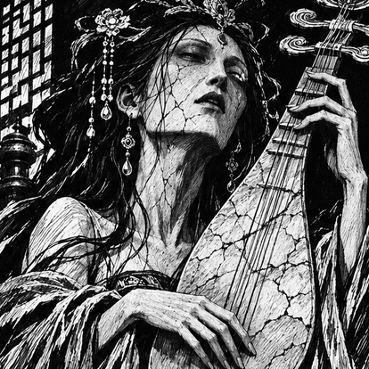
  - 【原典外貌】本體為一面冰冷堅硬的古老玉石琵琶；第 16 回化為身穿青衣、體態輕盈的妖嬈少婦上街挑釁算命，被三昧真火燒得黑煙直冒後現回玉石琵琶原形；五年後復生入宮化作美艷「王貴人」。
  - 【本作克蘇魯／昆蟲寄生／偽人重構】緊扣已存黑白墨線插圖並疊加黑暗地牢節肢寄生驚悚感：日常偽人形態下，她是一名膚色死白如陳年冷玉、眼瞼常時半闔反白、穿著古式繁複珠翠首飾的冰冷古典女子（如附圖所示）；仔細逼近便會發現極端恐怖谷異常——**她整張臉龐、眼角與修長脖頸的皮膚上布滿了如風乾龜裂瓷器與碎裂古玉般的漆黑網狀裂縫**，手指細長僵直毫無血色，懷裡死死抱著一把同樣爬滿深黑碎裂紋的古玉琵琶！更滲人的是，**只要用手指輕敲她的臉頰、鎖骨或手臂，竟會傳出「叩、叩」清脆回蕩的空心石殼共鳴聲**，手腕寸關尺處更全無人類血流脈動！一旦遭到烈火焚燒或重擊破防，那層偽人石皮與懷中玉琵琶外殼會伴隨刺耳崩響轟然炸裂，徹底暴露出藏在空心玉殼腹腔內的真正本體——一隻通體漆黑反光、八條尖刺步足緊緊扒住碎玉內壁的**寄居巨型地牢毒蠍甲殼**！原本的四根琵琶琴弦，實為從巨蠍腹側毒腺抽出的**四條高張力震動幾丁質節肢絲弦**，只要巨蠍螯肢高速撥刮絲弦，碎裂人臉縫隙與空心胸腔便會共振噴出撕裂鋼筋水泥的無形高頻音刃！
- **特性**：
  - 【原典記載】1. **手腕無脈之非人鐵證**：因本體是冰冷石器，化形後全無凡人氣血脈象，遭精通脈理之老道一把死扣寸關尺便瞬間鎖死妖氣動彈不得；2. **頑強不滅的假死再生**：即便在午門柴堆被三昧真火燒得焦黑現形，只要玉石核心未碎成粉末，放在高樓頂端曝曬五年日月精華仍能重塑偽人皮囊復出報復；3. **浮躁好勝、愛主動砸場**：三妖中最沉不住氣，見算命館聲名鵲起便忍不住上門踢館反遭活捉。
  - 【本作衍生】現代都市除妖案中最陰險的「**古董假死寄生 × 延遲復仇型**」器物精魅！哪怕除妖師好不容易把她打回一面滿是焦裂痕的古玉樂器、塞進證物袋或賣給不知情古董商，只要沒有用雷火把躲在碎玉夾層裡的「巨蠍母核卵片」徹底磨碎焚化，三五年間只要這塊殘玉接觸到高樓窗台的月光與夜間濕氣，巨蠍節肢就會再次分泌鈣質重築石殼人皮、循著當年傷她的法師氣味找上門抽筋剝皮！
- **弱點**：
  - 【原典記載】1. **把脈鎖腕即廢全功**：手腕寸關尺處缺乏活人血脈，正是其維繫石殼神經迴路的總開關，一旦遭精通道法的對手雙指死扣脈門即全身麻痺；2. **極懼高溫三昧真火與鈍器震腦**（先遭紫檀石硯台照腦門猛砸震暈，再被真火煉回原形）。
  - 【本作衍生】1. **空心石殼懼怕高熱驟冷與重頻震碎**：雖然玉質偽人外皮刀槍難入、能彈開普通子彈與微弱掌心雷，卻極度畏懼「**烈火符極致高溫炙烤＋冰水／滅火器驟冷**」造成的熱脹冷縮大面積爆裂！2. **鎖腕破弦再炸內蠍**：實戰切忌與她拉開距離硬吃音刃，應貼**輕身符**突進以**鎮妖定身符**或鐵絲鎖死其雙腕脈門（迫使節肢無法撥弦），待外殼龜裂露出內藏巨蠍甲殼後，以**五雷鎮煞符**直轟其空心音箱腹腔，事後務必將所有碎石殘片拌入生石灰封存於無光鉛盒深埋！
- **習性**：
  - 【原典記載】原居軒轅墳古塚洞穴，平素愛化為市井少婦遊蕩鬧市試探算命師與方士虛實；復生後長居深宮享樂害人。
  - 【本作衍生】極易潛伏在台灣老城區的骨董文物店、舊式劇院後台、廢棄音樂教室或豪門私人地下藏寶室；白天縮成一面落灰龜裂、無人敢碰的冰冷古玉樂器，入夜便從玻璃展示櫃裂縫爬出，化作舉止僵硬的復古少婦在夜市算命攤或地下樂團練團室周圍徘徊挑釁。
- **喜好**：
  - 【原典記載】好勝愛炫耀、容不得凡間術士名氣蓋過妖族，復生後亦貪圖奢華享樂與靡靡絲竹之音。
  - 【本作衍生】對音樂家、古董鑑定師與命理師懷有強烈扭曲勝負欲；酷愛將受害者的手掌肌腱完整抽出浸泡在蠍毒黏液裡，當作替換破損節肢琴弦的備用材料。
- **擅長的招式／異能**：
  - 【原典記載】「化形匿跡」、「日月精華五年復生術」、「陣前雙刀搏殺」。
  - 【本作衍生】**「節肢絲弦斷筋音刃」**（巨蠍步足高速摩擦空心玉殼內的幾丁質絲弦，射出肉眼不可見的扇形高頻震波，在狹窄騎樓瞬間削斷鋼筋與活人腳筋）、**「玉殼碎裂蠍螯突襲」**（故意讓敵人砍裂偽人表皮，趁對方兵器卡進裂玉瞬間自胸腔爆射毒蠍雙螯與倒鉤尾針反殺）、**「假死縮核休眠」**（瀕死時主動脫離九成石殼，將微小毒蠍母核封入一塊指節大小的殘玉中裝死逃生）。

---

### [FS1-05] 鐵嘴神鷹群（紅葫蘆三千食目妖禽・鋼喙食屍毒蠅巨蚊集群）
- **出處順序**：第 3 回《姬昌解圍進妲己》（冀州城外首陣自暗紅葫蘆放出一陣黑煙與三千鐵嘴妖禽，瞬間啄瞎蘇全忠戰馬雙眼大勝）、第 28～29 回《子牙兵伐崇侯虎》／《斬侯虎文王托孤》（曹州歸周復現；後於第 70 回金雞嶺盡數啄碎高繼能十萬蜈蜂）
- **類別與造型路線**：`【非人生物恐怖型】`｜彎鉤鋼喙食腐毒蠅・骨膜巨蚊集群（嚴格剔除原典持主崇黑虎之諸侯與南嶽神格，純取妖禽怪獸群本體）
- **物種／唯一性**：`物種（群體）`（共計三千隻以腐屍黑霧豢養煉化、封存於狹窄葫蘆腔體內共生的高度特化食目妖禽蟲群）
- **稀有度與道行對照**：`★★★ 珍級（SR）`｜模糊道行：單體僅數年～數十年淺妖力，然三千隻遮天蔽日集群撲殺之戰術破壞力足以威脅一流強者｜本作階位：二流頂～一流（集群致盲・專剋蟲妖）
- **外貌與黑暗地牢／恐怖谷視覺改寫**：
  - <!-- 圖位預留：待補繪 -->
  - 【原典外貌】藏於一只暗紅葫蘆之中，拔塞之際先湧出滾滾黑煙，隨即飛出三千隻鳴聲「噫啞」、嘴如精鐵利鉤之「鐵嘴神鷹」，專啄人馬雙眼，勢不可擋。
  - 【本作克蘇魯／昆蟲寄生／偽人重構】徹底剝除傳統威武老鷹形象，重塑為黑暗地牢級「**無眼鋼喙食腐巨蠅與金屬骨翼妖蟲群**」！每隻體型僅如畸形大烏鴉，通體毫無柔軟鳥羽，而是覆蓋著一層泛油光、佈滿寄生羽蟎與黑灰腐斑的**幾丁質硬甲鱗翅**，兩片寬大翅膀實為佈滿暗紅粗脈的半透明焦黑昆蟲膜翼，高速拍動時發出如同千百把生鏽美工刀刮擦玻璃的刺耳「噫啞」尖嘯！最令人作嘔的是牠們的頭部——整顆頭顱沒有任何眼睛，雙眼眶位置只剩兩團不斷開合抽動的黑亮**蒼蠅複眼感熱肉瘤**，前端則硬生生突出一根長達二十公分、表面凝結深暗氧化鐵質且內壁生滿倒鉤鋸齒的**巨型彎鉤鋼鐵口器（似鳥喙又似巨蚊吸血針與螳螂鐮的結合體）**！一旦自宛如腫脹胃囊般的暗紅葫蘆噴湧而出，三千隻無眼鐵喙怪禽便會裹挾著像廢機油般腥臭濃稠的黑煙，宛如一場活體金屬冰雹直撲視野內每一顆反光的活人眼球！
- **特性**：
  - 【原典記載】1. **精準鎖目致盲**：無論面對千軍萬馬還是驍勇名將，一衝出黑煙便本能死鎖戰馬與將領雙眼狂啄，瞬間瓦解敵軍戰力；2. **一切妖蟲蜂群的生態天敵**：原典後期甚至能將十萬隻劇毒蜈蜂盡數啄碎吞噬，對昆蟲妖物具備壓倒性捕食優勢。
  - 【本作衍生】現代都市裡最難防範的「**熱感鎖目 × 活體容器集群災體**」——只要在密閉地下停車場、捷運隧道或廢棄辦公樓打開封印容器，三千隻鋼喙怪禽會立刻循著人類瞳孔的微弱反光與體溫熱源發動自殺式鑽眼俯衝，十秒內就能把缺乏全方位護盾的除妖師啄成空洞血窟窿；同時也是蜘蛛精、蜈蚣精、毒蜂妖等節肢蟲妖最恐懼的天然清場掠食者。
- **弱點**：
  - 【原典記載】高度依賴暗紅葫蘆作為收放載體，若在開蓋釋放前先制伏持主或摧毀容器，妖群即無法出動；此外面對高階陣法、頂級防禦法寶或絕對物理速度碾壓時無法破防。
  - 【本作衍生】1. **金屬化口喙極易引雷導電**：其高度礦化含鐵的彎鉤口器與潮濕黑煙簡直是天然的避雷針集群——只要向黑煙正中央連續轟出**五雷鎮煞符**或高壓工業電弧，連鎖跳躍的電流可在瞬間將半數以上鐵喙怪禽電成焦炭墜落！2. **依賴黑煙保濕與熱源感應**：以強力工業風扇或風系破霧符吹散黑煙、同時施放高熱煙霧彈（或點燃大量**烈火符**製造假熱源）干擾其感熱肉瘤，即可令其盲目撞牆自毀。
- **習性**：
  - 【原典記載】平素全數壓縮休眠於暗紅葫蘆內部漆黑空間，唯有聽候開塞召令方才挾黑煙傾巢而出，戰畢復吸入葫蘆棲息。
  - 【本作衍生】若這類無主古妖葫蘆流落台灣地下黑市或藏於老舊貨櫃屋、郊區廢棄屠宰場，每逢深夜低氣壓或雷雨前夕，葫蘆塞口縫隙就會滲出油黑冷霧並傳出密集抓撓鐵壁的「噫啞」聲，自動誘捕靠近的野貓、流浪狗與好奇路人，從細縫鑽出數隻先鋒啄瞎獵物雙眼後拖進暗處分食。
- **喜好**：
  - 【原典記載】原典未載私人嗜好，惟本能嗜啄活人與牲畜雙眼，以及生吞毒蜂妖蟲。
  - 【本作衍生】對所有晶瑩圓潤的發光球體——活人眼球、隱形眼鏡、眼鏡鏡片、手電筒燈泡與手機鏡頭——有著近乎瘋狂的啄穿收集癖。
- **擅長的招式／異能**：
  - 【原典記載】「黑煙蔽日出葫蘆」、「三千鐵嘴鎖目啄擊」、「生吞十萬妖蟲」。
  - 【本作衍生】**「廢油黑煙感熱群獵」**（釋放濃稠焦臭黑霧遮蔽可見光，令自身在絕對黑暗中靠感熱複眼精準定位獵物眼窩）、**「鐵喙穿瞳吸腦」**（以倒鉤金屬口器直接釘穿眼眶後壁，將眼珠連同腦脊髓液一口抽乾）、**「破甲清蟲風暴」**（對所有甲殼節肢類妖怪造成雙倍貫穿與吞噬傷害）。

---

### [FS1-06] 火眼金睛獸（烈焰複眼重甲戰獸・焦甲噴酸腐蟲巨獸）
- **出處順序**：第 3 回《姬昌解圍進妲己》（崇黑虎陣前坐騎初現）、第 28 回《子牙兵伐崇侯虎》（再戰曹州）、第 33 回《黃飛虎泗水大戰》（汜水關余化坐騎復現；嚴格剔除原典騎主崇黑虎與余化之人神身分，純取異獸物種本體建檔）
- **類別與造型路線**：`【非人生物恐怖型】`｜焦黑腐食巨甲蟲鞘翅・炙熱赤紅複眼肉瘤多足異獸
- **物種／唯一性**：`物種（群體）`（原典中崇黑虎、余化乃至後期多名截教戰將皆曾跨乘此種「火眼金睛獸」，顯見其為荒野異種族群而非單一孤例）
- **稀有度與道行對照**：`★★ 稀級（R）`｜模糊道行：數十年～百餘年天生異種兇獸（足可震懾凡馬、奔馳如電、耐火抗毒，惟缺乏獨立變化人形或頂級法寶神通）｜本作階位：二流～二流頂
- **外貌與黑暗地牢／恐怖谷視覺改寫**：
  - <!-- 圖位預留：待補繪 -->
  - 【原典外貌】體格矯健兇悍、貌似猛獅怪麟，最顯著特徵為一雙灼灼如燒紅熔金般炯炯發光之「火眼金睛」，嘶吼一聲即令凡俗戰馬雙股戰慄、不敢近前，四蹄奔騰生火霧。
  - 【本作克蘇魯／昆蟲寄生／偽人重構】徹底捨棄傳統毛絨獅子或火麟坐騎造型，改以**「重甲腐食巨甲蟲 × 寄生發光複眼肉瘤」**打造壓迫感十足的黑暗地牢異獸！體長逾三公尺、肩高近兩公尺，渾身不見一絲哺乳動物毛皮，而是層層疊覆著宛如經歷過窯火淬燒、表面滿布焦黑裂紋與暗紅炙熱甲縫的**厚重幾丁質鞘翅裝甲**；四肢實為六條（兩對粗重承重主足＋一對收於胸側輔助抓握的鋸齒短肢）關節反折、覆滿硬質倒刺的巨型甲蟲步足，踏過潮濕水泥地時會從足端腺體滲出冒煙的高溫酸液，留下焦黑滋滋作響的腐蝕足印！其最駭人處在於那對「火眼金睛」——頭甲前端完全沒有哺乳類鼻吻，而是對稱爆腫出兩顆大如保齡球、表面鑲嵌數千枚金紅反光六角晶體的**炙熱發光複眼肉瘤**，在漆黑地下道裡如兩盞燒紅的工業警示燈般劇烈搏動，肉瘤正下方裂開一對不斷喀喀摩擦、滴淌強酸焦油的巨型鍬形蟲大顎！
- **特性**：
  - 【原典記載】天生具有壓制普通獸類的凶悍威壓，奔襲極快、無懼沙場火光硝煙，能忠實馱負主人穿梭刀光劍影與左道妖霧之中。
  - 【本作衍生】兼具**高溫強酸外殼防禦**與**熱輻射震懾場**的標準二流重裝地面突擊怪獸！牠胸甲縫隙散發的刺鼻硫磺焦酸氣味與赤紅複眼強光，會令方圓二十公尺內的犬隻、流浪貓與低階腐屍妖蟲本能癱軟逃竄；普通鋼刃砍在其焦黑鞘翅上只會迸出火星並被滲出的酸液迅速腐蝕刃口。
- **弱點**：
  - 【原典記載】雖壓制凡俗牲畜，但遭遇更高階太古坐騎（如四不相、墨麒麟或高階妖獸）便會反受血脈壓制而退縮；且血肉之軀無法抵擋高階神兵與法寶直擊。
  - 【本作衍生】1. **巨大外凸的赤紅複眼肉瘤是最大視覺與防禦破口**：由於複眼肉瘤幾乎無厚甲覆蓋且內部充滿高壓發光體液，以**破障符**或強光致盲彈干擾後，直接用銳器遠程貫穿或**掌心雷**直轟複眼，會引發肉瘤爆漿並讓高溫強酸倒流灼傷其自身腦神經！2. **甲殼沉重且腹底柔軟**：以**陷地符（指地成鋼反向泥化）**使其六條步足陷入深泥失去衝鋒慣性，再翻掀攻擊其毫無硬甲保護的灰白環節軟腹即可一擊致命。
- **習性**：
  - 【原典記載】多棲息於荒涼熾熱的深山巖洞或火山硫磺礦脈邊緣，性情暴烈難馴，唯有以秘術或強橫妖氣壓服方能作為坐騎驅策。
  - 【本作衍生】在台灣現代環境中，這類野生或失控異獸極可能藏匿於北投／陽明山廢棄硫磺採礦坑道、停機的老舊火力發電廠鍋爐底層或高溫地下蒸汽管溝之中；白天像一塊長滿焦垢的廢棄重型機具蜷伏在熱管旁休眠，深夜則爬出覓食流浪動物與深夜巡檢工人。
- **喜好**：
  - 【原典記載】原典未載特殊食性，惟喜高熱硝煙與沙場血腥衝殺。
  - 【本作衍生】酷愛高溫硫磺蒸氣、發燙的瀝青路面與富含脂肪的溫熱血肉，極度排斥零下低溫冷凍庫與大量冷水沖淋。
- **擅長的招式／異能**：
  - 【原典記載】「百獸震懾威壓」、「踏火疾奔衝陣」、「金睛破霧」。
  - 【本作衍生】**「複眼灼目閃光」**（兩顆巨型赤紅複眼驟然聚能釋放高熱強光，在密閉隧道內瞬間燒傷目標視網膜）、**「焦酸噴顎」**（鍬形大顎張裂噴出一道沸騰的黑黃腐蝕酸漿，溶穿鐵門與防具）、**「重甲碾壓衝鋒」**（壓低頭盾收起鞘翅，以時速六十公里以上撞碎磚牆與掩體）。

---

## 🪨 第二單元：第 12～18 回｜九灣分水異獸・骷髏山活石魔怪・後花園五路怪與蠆盆毒巢

### [FS1-07] 逼水獸（九灣河裂浪分水怪獸・深淵巨型大王具足蟲海蜈蚣異獸）
- **出處順序**：第 12 回《陳塘關哪吒出世》（九灣河口分開怒濤衝出水面之水域坐騎異獸；依純妖剔除原則，本條目徹底剔除原典騎主東海龍王三太子敖丙與四海龍王水府正神體系，僅純粹收錄此頭深海異獸本體）
- **類別與造型路線**：`【非人生物恐怖型】`｜深淵巨型大王具足蟲（重甲等足蟲）× 環節海蜈蚣裂浪異獸
- **物種／唯一性**：`物種特異個體`（深海甲殼異獸本屬海洋暗溝奇種，然體型龐大、額甲能硬生生劈開激流形成乾燥水牆並長年盤踞東海近岸九灣暗流者，乃罕見之巨型成體）
- **稀有度與道行對照**：`★★ 稀級（R）`｜模糊道行：數十年～百餘年深海水脈異獸靈氣（善於高速劈浪衝鋒，然缺乏獨立變化人形或高階術法，在陸地與頂級束縛法寶面前極為脆弱）｜本作階位：二流（水中高速突擊・水壓開道特化）
- **外貌與黑暗地牢／恐怖谷視覺改寫**：
  - <!-- 圖位預留：待補繪 -->
  - 【原典外貌】東海水中所產奇異坐騎，體形兇猛似犀似獸，奔行水中能左右分開江海怒濤、令騎者滴水不沾，迅捷如飛；然在九灣河口一戰遭紅綾裹絆，頓時失勢翻跌。
  - 【本作克蘇魯／昆蟲寄生／偽人重構】徹底剝除傳統「犀牛水獸」的哺乳動物外貌，重構為一頭從深海海溝爬入都市防洪暗渠的**巨型重甲大王具足蟲 × 環節海蜈蚣怪獸**！體長逾四公尺，背脊由十四片層疊交錯、佈滿鈣化灰白藤壺與墨綠腐藻的**厚重灰黑甲殼板**構成；最駭人的是牠的前端頭胸——全無哺乳類耳鼻，只有一面如破冰船犁頭般向外凸起、邊緣布滿細密鋸齒與水壓排水槽的**巨大骨質分水額盾**，額盾下方嵌著兩片毫無瞳仁、泛著死魚灰藍反光的**橫裂節肢複眼**，以及不斷喀喀開合、噴吐泡沫泥漿的八片層疊口顎！腹部兩側向下延伸出七對覆滿硬質防水剛毛的**扁平船槳狀節肢步足**，步足關節縫裡密密麻麻寄生著半透明水螅與圓形吸血魚蝨吸盤；只要牠在積水暗渠或濱海港灣高速竄行，分水額盾與槳足便會震盪出高壓氣穴，硬生生將污濁黑水劈成兩道腥臭撲鼻的水牆！
- **特性**：
  - 【原典記載】天生具有「逼水分浪」的異能，可在波濤洶湧的江海深處如履平地般高速奔馳，並憑蠻力馱負重裝戰將衝鋒陷陣。
  - 【本作衍生】典型的**「水域破浪重裝衝撞怪獸」**——在水深及膝以上的淹水地下停車場、大型防洪抽水站引水道或漁港消波塊暗穴中，牠能利用氣穴分水效應爆發出超過時速五十公里的無聲衝鋒，連混凝土柱都能被那面鋸齒分水額盾撞出深坑；更麻煩的是牠體表藤壺與寄生魚蝨會隨著濺起的腥水附著在敵人皮膚上快速吸血。
- **弱點**：
  - 【原典記載】雖能劈波斬浪，卻極怕高速纏繞束縛類法器與高階重擊——第 12 回一見紅綾翻捲便瞬間受驚失去平衡，無法護住背上騎者。
  - 【本作衍生】1. **極度畏懼乾燥脫水與翻覆軟腹**：一旦被誘導離開積水區衝上乾燥水泥地，牠的鰓葉與槳足便會因缺水發熱、行動驟降為笨重爬行；若以**陷地符**絆倒或用重物撬翻其身體，露出毫無硬甲保護的淡粉節肢軟腹與鰓片，一發貼身**掌心雷**即可讓牠劇烈痙攣斃命。2. **高導電水膜**：在水中衝鋒時周身緊貼導電海水與黑泥，提前在積水面佈置**五雷鎮煞符**即可沿著牠劈開的水牆直接電穿複眼與神經索。
- **習性**：
  - 【原典記載】棲息於東海深水岩洞與河海交界處，遇強大水府存在驅策便衝出水面巡弋衝鋒。
  - 【本作衍生】潛伏在台灣東北角廢棄海蝕洞、大型商港水下貨櫃碼頭暗樁或沿海抽水站進水箱涵；平時像一塊長滿藤壺的礁石緊貼在水底涵管內壁休眠，每逢滿潮或颱風海水倒灌時最為亢奮，會順著淹水街道撞碎鐵捲門獵食受困的貓狗與落單路人。
- **喜好**：
  - 【原典記載】原典未載特殊食性，唯嗜怒濤深水與高速馳騁。
  - 【本作衍生】嗜食海底腐爛鯨魚／大型魚類屍骸、富含鹽分的深海淤泥與被溺斃泡軟的溫熱血肉，極度討厭淡清自來水、漂白水消毒味與正午烈日。
- **擅長的招式／異能**：
  - 【原典記載】「分水逼浪疾奔」、「水下蠻力衝陣」。
  - 【本作衍生】**「鋸齒額盾分浪突刺」**（壓低重甲頭盾高速劈開淹水街道，掀起的兩側腥臭黑浪直接沖倒並撞碎目標膝蓋）、**「鰓裂高壓腐水噴射」**（受創時自腹側鰓板高壓噴出混雜破碎藤壺殼與寄生魚蝨的腥鹹泥柱致盲對手）。

---

### [FS1-08] 骷髏山白骨洞・石磯（萬年頑石成精魔怪・寄生藤壺與岩殼節肢活石妖）
- **出處順序**：第 13 回《太乙真人收石磯》（於骷髏山白骨洞歷經天地玄黃之外數萬載吸納靈氣成精之頑石魔怪；因洞前遭暗箭襲擊而暴怒出山追討血債，硬撼乾坤圈與混天綾絲毫不懼，終遭九條三昧真火龍於罩內活活燒熔煉回頑石原形；**嚴格剔除原典截教仙位與封神榜「月遊星」神格，本條目純取萬年頑石成精之黑暗地牢魔怪本體！**）
- **類別與造型路線**：`【非人生物恐怖型】`（外層可凝結 `【類人偽人型】` 裂岩女人面相作為表殼）｜萬年頑石成精活石魔怪・體表布滿寄生藤壺、潮濕地衣菌絲與岩殼節肢
- **物種／唯一性**：`獨一無二`（自荒古亂石枯骨山脈中歷經萬載地脈濕氣、骨粉鈣化與寄生菌絲共生成精，修至能空手繳械重寶卻唯懼極致真火煉石之唯一太古活石魔怪）
- **稀有度與道行對照**：`★★★★ 絕級（SSR）`｜模糊道行：數萬載太古頑石成精根基（物理防禦、重壓抗性與奪械壓制堪稱一流頂尖，唯獨在五行火剋與頂級熔煉法器前無從遁逃）｜本作階位：一流頂（超高防岩甲・菌絲吞械・高壓地脈控場）
- **外貌與黑暗地牢／恐怖谷視覺改寫**：
  - 
  - 【原典外貌】平時化作端嚴肅穆之中年道姑姿態居於骷髏山白骨洞，身披大紅八卦仙衣、手持太阿寶劍與八卦雲光帕；遭九龍神火罩烈焰焚盡數萬年道行後，褪盡一切人形，化回一塊冰冷沉重、寸草不生的青黑頑石原形。
  - 【本作克蘇魯／昆蟲寄生／偽人重構】徹底洗淨一切道姑仙氣與正神光環，還原其最原始、最令人反胃壓迫的**「萬年頑石成精魔怪 × 裂岩偽人表殼」**雙階段恐怖相！
    - **偽人表殼相（如附圖黑白高對比墨線像）**：在滲水昏暗的採石場洞窟深處，一名身披如風乾地衣與腐朽樹皮般粗糙重袍的瘦削婦人雙手合十靜立；然而只要手電光一掃，立刻暴露出非人的礦物恐怖谷——她滿臉布滿如風化石灰岩般縱橫交錯的乾硬細裂紋，雙眼泛著無生命的灰白石英渾濁反光，頭頂髮簪實為直接從顱骨長出的尖銳黑灰礦石結晶；最觸目驚心的是她的**左半邊臉頰竟然直接碎裂崩開，硬生生向外凸出一整塊棱角分明、冰冷死硬的幾何多面體原岩巨塊**！她合十的雙指皮膚乾皺如老岩層，指節一動便簌簌落下灰白骨粉與碎石屑。
    - **黑暗地牢活石魔怪本體**：一旦她徹底暴怒或表層偽人石殼遭重擊龜裂，那層單薄人皮便會如剝落水泥塊般成片砸地，顯露出高達五公尺、在潮濕白骨洞穴裡沉重蠕動的**巨型活石魔怪真身**！那根本不是人形，而是一座由數十塊互相摩擦喀響的漆黑玄武岩與人類鈣化骸骨融合而成的畸形岩石肉山——潮濕冰冷的岩體表面密密麻麻爬滿了不斷開合吮吸濕氣的**灰白巨型寄生藤壺群**、如腐爛綠色血管般糾纏蔓延的**潮濕發光地衣與寄生菌絲網**，以及從每一道岩石縫隙裡喀嚓探出的**數十條灰黑岩殼節肢步足與巨蟹般的礦化鉗爪**！岩縫深處流淌著混雜骨灰與地底酸水的黑色泥漿，每跨出一步，整條地下通道的水泥地板都會在萬年重壓與藤壺刮擦聲中寸寸碎裂！
- **特性**：
  - 【原典記載】1. **守土護巢、極度執拗報復**：本安靜盤踞在人跡罕至的骷髏山白骨洞深處不主動招惹凡間，但只要有人闖入領地殺害其洞前侍從，便會不死不休地循跡追上門索命清算；2. **徒手繳械、壓制重寶**：面對飛砸而來的乾坤圈與混天綾，僅伸手一抓便直接收繳入懷，物理抗打擊與重物壓制力極其恐怖；3. **石軀難損，唯懼極致真火煉化**。
  - 【本作衍生】本作現代世界觀裡最令人絕望的「**絕緣高防岩甲 × 菌絲黏附繳械型**」一流頂領地魔怪！
    - **物理絕緣＆法器吞噬**：因本體是絕緣緻密玄武頑石包裹著吸濕地衣菌絲，普通子彈、鋼刀、甚至三流散修引以為傲的**掌心雷與低階五雷鎮煞符**打在她身上幾乎被厚重岩殼完全導散絕緣！更恐怖的是，她表體的潮濕菌絲與寄生藤壺具備「礦物吸附同化」特性——凡朝她投擲的銅錢劍、桃木錐、符紙或低階金屬法器，一沾到岩壁黏液就會立刻被瘋狂滋長的菌絲與藤壺包死吞沒、直接繳械！
    - **守序巢穴律**：她絕不像狐妖那樣混跡都會夜生活主動獵殺路人，卻對任何破壞深山古石洞、開挖萬應公白骨塚或驚擾其洞口石生幼魅的建商、探險客與魯莽法師展現出毀滅性的死追清算執念。
- **弱點**：
  - 【原典記載】本體終究屬頑石精怪，五行受極致烈火剋制——一旦被困入封閉式頂級火陣（如九龍神火罩內九條三昧真火龍），便無法逃脫持續高溫焚煉，萬年道行頃刻瓦解退回死寂頑石。
  - 【本作衍生】1. **高溫灼燒＋驟冷爆裂（破岩甲唯一核心破口）**：頑石最怕的不是撞擊，而是劇烈溫差與極致高熱脫水！對策絕不能孤身硬拚或亂丟法器送她吞噬，必須設法將其引入封閉式舊工業窯爐、鍋爐間或以**高階烈火符陣＋工業助燃劑**進行長時間無死角高溫炙烤，先燒乾她體表的寄生藤壺與潮濕地衣菌絲（失去菌絲就失去空手繳械與修復裂縫能力！），緊接著傾倒大量冰水或液態氮造成**熱脹冷縮爆裂**，趁其玄武岩主核崩出深縫的一瞬間，把**高階五雷鎮煞符**直接塞進裂縫深處引爆，方有生機！2. **移動極度沉重遲緩**：極忌陷入狹窄無退路的洞穴，利用**輕身符**拉開開闊空間與其周旋消耗。
- **習性**：
  - 【原典記載】長年隱伏於荒僻陰冷、遍地枯骨的骷髏山白骨洞內靜止吸納地脈濕氣與枯骨精華，非遭侵犯絕不輕出洞府。
  - 【本作衍生】潛伏於台灣深山廢棄石灰岩礦坑、九二一大地震後封閉的崩塌亂石隧道、或偏遠鄉鎮百年萬應公白骨塚後方的潮濕巨岩裂隙中；白天完全縮回岩壁，體表寄生藤壺與地衣與周圍山壁融為一體、連開天眼符水都極難辨別，唯獨深夜濕度飆高時會發出低沉如磨盤轉動的岩層摩擦聲，伸出岩殼節肢緩慢吞食洞口附近的新鮮動物骸骨與誤闖探洞客。
- **喜好**：
  - 【原典記載】酷愛荒山白骨洞的絕對寂靜，護短洞中依附自己而生的小精魅，極痛恨蠻橫無禮、殺戮其眷屬卻拒不償命的狂妄之徒。
  - 【本作衍生】極度迷戀終年滴水的深暗岩穴、高鈣質枯骨粉塵與潮濕苔蘚氣息；最痛恨轟鳴的重型開山怪手、爆破炸藥味與乾燥灼熱的明火。
- **擅長的招式／異能**：
  - 【原典記載】「八卦雲光帕／八卦龍鬚帕」（原典收敵與召力士異寶，在本作去神仙化轉譯為「菌絲骨粉封鎖幕」）、「空手收奪法寶」、「玄石金剛軀」。
  - 【本作衍生】**「藤壺菌絲繳械吸吞」**（自岩縫暴射沾滿黏液的灰黑地衣菌絲網，瞬間黏死並吞噬敵人投擲的兵器與法器，使其化為自己岩殼的一部分）、**「萬年岩殼節肢碾壓」**（數十條覆滿藤壺與尖岩刺的巨蟹般節肢步足同時砸落，將整棟地下室地板震成碎石坑）、**「骨灰裂岩毒塵」**（全身裂縫劇烈震顫，噴吐高濃度鈣化枯骨細粉與寄生菌孢子，吸入者肺泡迅速石棉化僵硬窒息）。

---

### [FS1-09] 宋異人後花園・五路怪（龍岡五色偽人地脈精魅・貼牆潮濕黑影火怪）
- **出處順序**：第 15 回《崑崙山子牙下山》（尾聲伏筆「後花園先收五路神」）～第 16 回《子牙火燒琵琶精》（宋異人後花園吉地蓋樓七八次皆於子時離奇自燃；老道坐鎮牡丹亭，見五個臉分五色之龍岡精靈噴火作怪，召雷一喝便嚇得五怪磕頭求饒；**嚴格剔除原典「五路神」神號混淆，純依其「龍岡精靈」妖魅本質改稱「五路怪」收錄！**）
- **類別與造型路線**：`【類人偽人型】`｜五色油亮黏液怪臉偽人・夜間化作潮濕扁平黑影貼牆窺視之地脈縱火精魅
- **物種／唯一性**：`物種（群體）`（盤踞龍岡地脈、吸收地下沼氣與潮濕腐土煞氣成精之五隻結伴山澤精魅群體，常以五體一組形式聯動霸佔風水吉地）
- **稀有度與道行對照**：`★★ 稀級（R）`｜模糊道行：數年～數十年淺薄道行（原典五怪自供僅「數年功行」，只敢靠子時縱火嚇唬凡人，一撞見正統雷法便當場崩潰跪求饒命）｜本作階位：三流頂～二流初（群體縱火・暗牆潛伏・極佳開局除妖委託標靶）
- **外貌與黑暗地牢／恐怖谷視覺改寫**：
  - 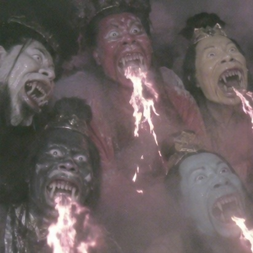
  - 【原典外貌】每逢子時狂風大作、黑霧濛濛、千團紅焰升騰之際顯身——五個猙獰精靈「臉分五色：赤、白、黑、青、黃」，個個生得巨口獠牙、口吐烈焰霞光，播土揚塵焚燒新起高樓。
  - 【本作克蘇魯／昆蟲寄生／偽人重構】緊扣已存插圖並賦予濃烈都市凶宅恐怖谷壓迫感！白天絕不露頭，一到深夜子時便從未乾的水泥牆角與潮濕地基滲水處浮現——牠們的軀幹完全沒有正常立體血肉，而是如**巨大潮濕發霉的黑色黏液扁蟲／濕壁黑影**般死死緊貼在牆面、天花板與鷹架背光處無聲滑動窺視！唯有當牠們將臉從黑影牆面「鼓脹凸出」時（如附圖所示），才會顯露出五張令人毛骨悚然的**油亮濕滑偽人怪臉**：五張面孔彷彿剛從發臭沼泥裡撈出的蠟質面具，分別泛著病態的**赤紅潰爛、死白泡脹、焦黑炭垢、屍青發綠與硫磺蠟黃**五種濕亮反光，頭頂歪斜黏著殘破古舊冠冕；五對眼睛死死圓睜、毫無眨動地從牆壁暗角盯住室內活人，緊接著五張大嘴同步脫臼般扯裂開來，露出尖長參差的犬齒與濕亮咽喉，伴隨濃烈沼氣與下水道腐臭味，直接從喉管噴出五道高溫慘白幽火！
- **特性**：
  - 【原典記載】1. **霸佔風水吉穴、逢建必燒**：貪圖龍岡延伸至後花園的「三十六條玉帶」吉穴地氣，只要凡人動土蓋樓，便必於上梁子時現形掀風吐火將樓燒成焦土，連燒七八次逼走屋主；2. **欺軟怕硬、極度貪生**：對無道行的凡人張牙舞爪極為猖獗，一旦遇上真正懂雷法的行家出手喝鎮，連過招都不敢便集體磕頭求饒，甘願當苦力保命。
  - 【本作衍生】極度契合台灣現代都市「**都更工地連環離奇自燃案**」的標準低中階地脈偽人妖群！牠們擅長利用**「貼牆扁平黑影潛伏」**避開工地監視器與保全巡邏——保全用手電筒照過去只以為牆角有一大塊漏水滲出來的潮濕黑黴斑，直到一轉身，那五張濕亮五色怪臉便從牆壁黴斑裡鼓出來、貼著後頸無聲窺視並點燃現場易燃建材與電線配電箱！
- **弱點**：
  - 【原典記載】**極度畏懼正統道門雷法與破煞法劍**——原典中老道根本沒動用任何稀世法寶，僅披髮仗劍、一指召雷，五隻小怪便當場魂飛魄散、跪地求饒。
  - 【本作衍生】1. **極懼雷擊貫牆與陽剛強光**：牠們緊貼潮濕滲水水泥牆與鋼筋潛伏，反而讓整面濕牆成為絕佳的導電體！三流～二流除妖師（如許家銘）只要喝下**開天眼符水**鎖定牆上不自然蠕動的五處潮濕黑影，直接一掌**掌心雷**或**五雷鎮煞符**按在濕牆面上，高壓雷氣便會順著水氣將五怪同時從牆裡電飛出來現出原形！2. **免疫普通凡火卻畏懼高壓雷電與切斷沼氣**：切忌用**烈火符**跟牠們硬拚（牠們專吃地下沼氣噴火，凡火反而助威），應以**破障符**驅散腐霧＋**鎮妖定身符**釘住帶頭紅臉怪，剩下四怪立刻膽寒崩潰逃散或跪地討饒。
- **習性**：
  - 【原典記載】潛伏於龍岡地下陰濕土脈與富宅後花園空地，每逢人類動土上梁之「子時（深夜 23:00–01:00）」現身縱火驅客。
  - 【本作衍生】專門盤踞在台灣精華區屢次停工起火的都更老宅工地、長期漏水發黑的地下室消防水箱隔間，或舊屋頂違建陰濕夾牆內；每到深夜子時便化作五灘濕漉漉的壁癌黑影沿牆爬行，專愛偷窺獨居夜班保全或趕工工人，故意製造電線短路與離奇火警把人類趕出牠們佔據的「旺氣地脈」。
- **喜好**：
  - 【原典記載】貪愛風水寶地旺盛地氣，同時極度惜命，渴望保住數十年淺薄功行不被打散。
  - 【本作衍生】嗜吸地下化糞池沼氣、未乾濕水泥的鹼性水氣與新鮮焦炭熱度；對乾淨乾燥的除濕空間、強光探照燈與雷雨天的閃電極度恐懼。
- **擅長的招式／異能**：
  - 【原典記載】「狂風飛沙」、「五色惡火縱燃焚樓」、「陰霧隱匿」。
  - 【本作衍生】**「壁癌黑影貼牆潛行」**（將肉身壓成厚度不到兩公分的潮濕黏液陰影，緊貼發霉牆面與排水管死角移動窺視，物理刀砍難以命中）、**「子時五方沼火噴吐」**（五張濕亮怪臉同時自工地五處死角牆壁鼓出，噴出夾雜有毒沼氣的五色高溫焰柱封鎖逃生口）、**「粉塵陰風迷眼」**（吹捲工地乾燥水泥灰與石棉粉塵干擾法師呼吸與結印）。

---

### [FS1-10] 摘星樓蠆盆・百毒蛇蠍腐屍蟲群（黑暗地牢毒坑生態・水蛭巨蠍馬陸與鑽肉幼蟲集合體）
- **出處順序**：第 17 回《蘇妲己置造蠆盆》（蘇妲己於摘星樓前下令掘成深五丈、闊百步之陰森巨坑，命軍士搜羅萬千劇毒蛇蠍毒蟲傾入，將七十二名無辜宮女剝衣推落活活咬死吞噬；怨煞沖天，形成全書最慘絕人寰之活體毒蟲慘獄）
- **類別與造型路線**：`【非人生物恐怖型】`｜黑暗地牢標準毒坑生態：活人血肉怨念養育之吸血水蛭、巨蠍、馬陸、盲蛇與鑽肉幼蟲集合體
- **物種／唯一性**：`物種（群體）`（由數以萬計劇毒節肢動物、環節吸血水蛭、盲蛇與寄生鑽肉幼蟲在活人血肉與臨終極怨中互相吞噬異變而成的「複合型活體蠱坑群落」）
- **稀有度與道行對照**：`★★ 稀級（R）`（單隻毒蟲僅 `★` 未入流，然整個深坑吸足七十二名活人血肉與滔天怨煞融成「百毒怨巢」生態集合體後，地形絕殺威脅達二流中上）｜模糊道行：凡俗百毒在千年狐妖煞氣與極刑人命怨念催化下異變為準妖化蟲潮｜本作階位：二流（群體劇毒・地形絕殺・鑽肉寄生特化）
- **外貌與黑暗地牢／恐怖谷視覺改寫**：
  - 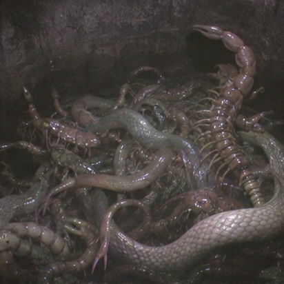
  - 【原典外貌】摘星樓下掘地深五丈、闊百步的漆黑巨坑，坑底翻騰著無數巨蟒、毒蛇、長虺、赤練、毒蠍與蜈蚣，活人一墜入便瞬間被萬口齊噬、頃刻只餘慘白骷髏，淒號震天。
  - 【本作克蘇魯／昆蟲寄生／偽人重構】這就是本作最純正、最不加修飾的**「黑暗地牢（Darkest Dungeon）標準毒坑活體生態」**！如附圖所示，在冰冷潮濕、四壁長滿青黑滑苔的無底石坑深處，根本看不見一寸地面——整座坑底是一層厚達數公尺、不斷緩慢蠕動冒泡並散發濃烈血腥屍臭的**活體黏液蟲海**：數十條體大如臂、甲殼泛著濕亮暗褐色油光的**巨型百足蜈蚣與長尾黑蠍**彼此絞纏攀爬，甲節縫隙間糾結著一團團肥碩暗紅、張開環形齒狀吸盤的**吸血巨水蛭**與覆滿細鱗的**濕滑盲眼毒蛇**；更令人毛骨悚然的是鋪滿坑底縫隙的數百萬隻乳白半透明**鑽肉寄生幼蟲（屍蛆與多足馬陸幼體）**，正密密麻麻從七十二具尚未腐盡的少女白骨眼窩、肋骨腔與開裂嘴顎間鑽進鑽出！整座蟲坑宛如一顆由萬千節肢、毒針與吸血環節拼湊而成的巨大活體消化胃囊，只要有任何一點溫熱血氣靠近坑緣，整個坑面就會像沸騰的黑油般轟然隆起無數搖晃的蠍尾、蛇信與吸血口器！
- **特性**：
  - 【原典記載】集合自然界最致命的百種毒物，再以極端殘忍的活人血祭與七十二條枉死冤魂餵養，不僅物理啃噬與劇毒致死率百分之百，更匯聚了極其污穢陰毒的血怨瘴氣。
  - 【本作衍生】現代都市裡邪修與高階大妖最常效仿的「**地下煉蠱毒巢 × 複合型地形絕殺陷阱**」！牠們已經不只是普通野生毒蟲，而是在長期吞食活人血肉與恐懼激素後產生了**「微弱蜂巢集體意識」**——當獵物跌落深坑時，馬陸與毒蛇會先纏鎖四肢腳踝使其無法結印，水蛭分泌抗凝血麻醉劑防止獵物痛醒掙扎，巨蠍尾針注入溶組織神經毒液，最後數以萬計的鑽肉幼蟲順著鼻孔、耳道與傷口瘋狂鑽入皮下從內部將活人吃空！
- **弱點**：
  - 【原典記載】終究是禁錮於深坑內的肉身毒物集群（未結出單體不死妖丹），無法飛越光滑高牆，且天然畏懼猛烈高溫大火、生石灰與雄黃硫磺煙燻。
  - 【本作衍生】**唯一鐵律：絕對不可跳進深坑近戰！** 面對此等標準地牢毒坑，任何刀劍劈砍或單體掌心雷都像拿針刺大海，毫無意義；正確清場公式為「**高處制空＋封閉毒氣＋無死角焚坑**」——先貼**淨氣避穢符**阻斷坑底浮升的屍毒瘴氣與七十二冤魂幻聽，接著自高處傾倒工業生石灰、硫磺粉與助燃劑覆蓋蟲海表面，再用多張**自製烈火符**同步引爆高溫火海持續悶燒，直至坑底所有甲殼爆裂聲與幼蟲嘶鳴徹底歸零為止！
- **習性**：
  - 【原典記載】被封養在摘星樓前深五丈之石砌巨坑中，日夜飢餓嘶咬，專等上方拋下活人與死屍分食。
  - 【本作衍生】在台灣現代都會多被暗中築於廢棄化工廠地下大型沉澱槽、停業屠宰場廢水處理深池、深山非法私壇枯井或爛尾大樓深不見底的電梯井底層；周遭永遠飄散著潮濕腐肉腥味與無數甲殼層層摩擦的「沙沙」低噪，偶爾還會傳出類似女子溺水求救的微弱回音誘人探頭失足。
- **喜好**：
  - 【原典記載】狂熱嗜食剛拋入坑內、體溫尚熱且劇烈掙扎的活人血肉。
  - 【本作衍生】對人類腎上腺素爆發時的汗味、新鮮溫熱血液與暗濕發霉深坑極度亢奮；極端厭惡乾燥強光、生石灰強鹼燒灼與濃烈雄黃艾草煙味。
- **擅長的招式／異能**：
  - 【原典記載】「萬毒齊噬」、「深坑圍困絕殺」、「血肉怨煞沖天」。
  - 【本作衍生】**「活體蟲潮湧壁」**（萬千馬陸與巨蜈蚣彼此墊腳搭成活體蟲梯，試圖將站在坑邊的除妖師拖入坑底）、**「四重複合毒蠱」**（同步疊加蛇類血循毒、蠍類神經麻痺毒、水蛭抗凝血劑與鑽肉幼蟲皮下吞噬）、**「七十二怨屍瘴」**（坑底腐敗血水蒸騰出灰黑幻霧，令無避穢防護者聽見數十名女子淒厲哭喊而精神恍惚失足跌坑）。

---

## 🐒 第三單元：第 19～26 回｜畸形識妖怪猿・怨肉吐子幼體・異化飛熊與鹿臺群狐赴宴

### [FS1-11] 白面猿猴（西岐千年識妖怪猿・蒼白無毛長臂畸形怪獸）
- **出處順序**：第 19 回《伯邑考進貢贖罪》（西岐傳承千年之奇異靈獸，隨進貢禮器進入朝歌大殿；十二重樓橫骨俱無，能聽琴清唱，更於大殿之中一眼看破蘇妲己千年九尾狐偽人真身，悍然飛爪撲面欲撕其畫皮，惜反遭暴君鐵拳擊斃）
- **類別與造型路線**：`【非人生物恐怖型】`｜蒼白近乎無毛、長臂畸形拖地・針齒狹顎之千年識妖怪獸
- **物種／唯一性**：`物種特異個體`（山野怪猿族群中歷經千年異變、喉骨徹底退化無橫骨且雙瞳演化出極致「破妄識妖」視覺器官之極罕見畸形個體）
- **稀有度與道行對照**：`★★★ 珍級（SR）`｜模糊道行：千年修煉畸變靈獸（論破妄識妖感知可比肩一流高人，一眼貫穿九尾狐頂級偽人皮囊；然體型瘦小脆骨，正面抗擊力遠不及大型妖魔）｜本作階位：二流（感知破妄一流頂；體魄與防禦僅三流頂～二流初）
- **外貌與黑暗地牢／恐怖谷視覺改寫**：
  - 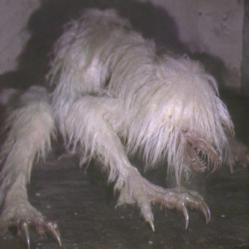
  - 【原典外貌】通體雪白長毛、面龐潔白之嬌小千年白面猿猴，十二重樓橫骨俱無，能於掌上隨琴起舞、口唱三千小曲八百大曲；大殿嗅見妲己妖氣剎那雙眼發光、亮出利爪直撲妖妃面門。
  - 【本作克蘇魯／昆蟲寄生／偽人重構】徹底撕碎「可愛白色寵物猴」的童話包裝，還原成附圖中那頭蹲伏在潮濕地牢水泥地面、令人不寒而栗的**蒼白畸形長臂識妖怪獸**！牠體型佝僂瘦削如長期囚禁在無光地下室的畸形幼童，絕大部分裸露軀幹與四肢呈現**蒼白無毛、濕涼青灰且緊繃包骨的病態死皮**，唯獨脊背、肩頭與頭頂垂掛著一綹綹沾滿潮濕水垢、如浸水白黴菌絲般雜亂覆臉的稀疏慘白濕綹長毛；最令人生理不適的是牠那雙**比例嚴重失調、細長反折得宛如巨型盲蛛步足般的慘白長臂**——雙臂鬆垂拖地時足有身長的兩倍，乾枯多節的手掌張開生著四根如彎曲鐵鉤般的半透明灰白長爪！當牠察覺高階偽人妖物（如九尾狐產卵母體）逼近時，覆額濕白絲毛下那對深陷的針孔識妖眼會滲出冷光，扁平無唇的蒼白口裂向前畸形突伸成一根**佈滿雙排細密針狀交錯利齒的狹長食蟲怪顎**，喉管裡因全無橫骨限制而同時震盪出近似清亮人類女高音與刺耳昆蟲摩擦音的詭異破邪警告！
- **特性**：
  - 【原典記載】1. **全書最早當殿識破千年九尾狐偽裝的生靈**：當滿朝文武與暴君全被妲己美人皮囊迷得神魂顛倒時，唯獨此猿一見即識破其非人妖態，更毫不猶豫飛撲抓臉欲揭穿真形；2. **無橫骨通人音、性情剛烈執拗**：能精準模擬人類聲樂曲調，對邪祟妖氣有著近乎病態的零容忍本能。
  - 【本作衍生】現代除妖界夢寐以求卻極難駕馭的「**活體高階破障雷達 × 專獵偽人怪獸**」！牠那對在黑暗中演化千年的特殊複感視網膜，能直接穿透一切二流至一流頂偽人型妖怪的障眼皮囊，一眼看清九尾狐背脊下蠕動的節肢產卵管或白骨精唇後的鋸齒口器；甚至無須除妖師喝下**開天眼符水**，只要把這頭畸形白猿放進目標建築，牠就會四肢如巨蛛般貼地無聲狂奔，直接衝向藏在人群裡的偽人撕扯其喉嚨！
- **弱點**：
  - 【原典記載】**骨骼纖細脆弱、缺乏護體法力且毫無戰術自制力**——一旦看見妖狐便完全失去冷靜、當殿失控猛撲，結果根本沒防備旁側蠻力暴君的致命重拳，當場頭骨碎裂慘死，連帶害死進貢的主人。
  - 【本作衍生】1. **極端低防禦脆皮體質**：空有一流頂的破妄眼力，肉身抗打擊力卻連二流初階都不到，一記硬派物理重擊、霰彈槍近轟或一張**掌心雷**就能震碎其枯瘦胸骨；2. **見偽人即失控發狂**：極容易在尚未佈陣前就尖叫撲擊打草驚蛇，讓偽人母體提前啟動反殺或脫殼逃竄。
- **習性**：
  - 【原典記載】原受西岐王室供養於幽靜宮館之中，喜聽古琴雅樂起舞吟唱，唯遇狐妖腥臭便兇性畢露。
  - 【本作衍生】若此類千年畸形識妖怪猿留存於現代台灣，極可能蜷縮在深山百年廢棄古剎的陰暗鐘樓閣樓、無人打掃的舊國樂館地下儲藏室或老舊博物館文物庫房；白天把長臂縮在黑暗角落靜止如一團發霉白布，深夜聽見音樂聲或嗅到城市裡傳來的偽人寄生費洛蒙時，便會拖著長臂沿防火巷無聲跟蹤偽人，等待撕破對方人皮的時機。
- **喜好**：
  - 【原典記載】酷愛古琴清音、雅樂小曲，對腥騷狐妖與虛偽畫皮懷有刻骨厭惡。
  - 【本作衍生】對單調規律的弦樂振動頻率有異常安撫反應，嗜食寄生蟲卵與帶殼昆蟲（這或許正是牠本能狂獵「皮下藏蟲的偽人」之生物學根源！）。
- **擅長的招式／異能**：
  - 【原典記載】「千年破妄靈目（識破九尾狐真身）」、「十二重樓無橫骨擬聲清唱」、「凌空飛爪撲面」。
  - 【本作衍生】**「穿透偽皮之視」**（無視一切視覺障眼法與費洛蒙催眠，直接鎖定方圓五十公尺內所有偽人體內的寄生主核與神經根）、**「長臂拖地蛛行突襲」**（藉超長前臂撐地彈射，一秒內跨越十公尺走廊以針齒狹顎咬碎偽人面皮）、**「無骨破音尖嘯」**（喉腔無橫骨共振發出超高頻擬人悲鳴，能強行震斷九尾狐與雉雞精正在施展的精神魅惑與聲波干擾）。

---

### [FS1-12] 西岐吐子三白兔（怨肉催生寄生異獸幼體・半透明脈動內臟觸絲怪兔）
- **出處順序**：第 19 回《伯邑考進貢贖罪》（伯邑考慘遭剁成肉醬蒸餅之死肉伏筆）～第 22 回《西伯侯文王吐子》（姬昌強忍劇痛吞下長子死肉所製三塊肉餅脫險歸岐，伏地劇嘔，吐出之死肉落地竟當場扭動化作三隻蒼白小兔奔入草叢消逝）
- **類別與造型路線**：`【非人生物恐怖型】`｜由死肉怨念催生吐出之蒼白半透明寄生異獸幼體（皮下可見脈動內臟與環口觸絲）
- **物種／唯一性**：`獨一無二`（僅此一例由慘遭極刑烹殺之死肉與極深父子血親悲怨在活體胃囊中異常發酵、嘔出後直接畸變脫胎而成的三枚蒼白寄生幼體異獸）
- **稀有度與道行對照**：`★★ 稀級（R）`（毫無正面戰鬥殺傷力，然其「死肉再生化幼體」之生物異變極度罕見且蘊含極強冤魂追蹤靈性）｜模糊道行：深重極刑死怨與血脈靈氣瞬間催生之異種幼體｜本作階位：未入流～三流（非戰鬥型・極高靈異尋冤與寄生異變研究價值）
- **外貌與黑暗地牢／恐怖谷視覺改寫**：
  - 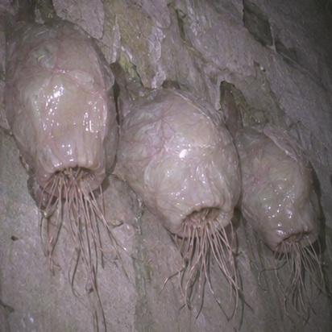
  - 【原典外貌】原本是三塊蒸熟並遭吞入腹中的血親人肉餅，自口中嘔吐落於青草地上的一剎那，死肉翻滾化為三隻通體如雪的白兔，轉眼竄入荒草深處不見蹤影。
  - 【本作克蘇魯／昆蟲寄生／偽人重構】徹底粉碎民俗傳說中可愛毛茸茸小白兔的溫情濾鏡，以附圖中令人胃部劇烈痙攣的**「死肉怨念催生・半透明軟體寄生異獸幼體」**呈現極致黑暗地牢生物恐怖！落地蠕動的根本不是毛皮哺乳類小兔，而是**三枚巴掌大小、通體濕亮慘白泛粉、宛如剛從子宮或腐肉卵囊裡擠出的軟體囊狀幼體**！牠們的表皮薄如浸水半透明黏膜，毫無一根毛髮，**透過發亮濕滑的半透明蒼白表皮，可以清晰看見皮下如蜘蛛網般爬滿的紫紅毛細血管，以及體腔正中央緩慢而絕望地一縮一脹、宛如人類心肺微縮版的暗紅脈動內臟**！前端沒有可愛的兔眼與三瓣嘴，只有一圈不斷痙攣抽縮的**環形肉褶口裂（宛如軟體寄生蟲吸盤口器）**，口裂深處向外伸出數十根如寄生線蟲或潮濕根鬚般瘋狂試探空氣的**蒼白細長感官觸絲**，後端則拖著兩片發育未全、形似軟骨耳瓣的慘白肉翼，在沾滿胃酸與血水的濕泥地上以詭異的節律一蠕一躍鑽進暗處荒草！
- **特性**：
  - 【原典記載】1. **破滅死肉的異常生命化生**：即便肉體已遭凌遲剁碎高溫蒸熟、吞入他人腹腔消化，極致的冤屈與靈脈聯繫依然強行催生出三枚脫離原屍的獨立活體生靈；2. **不傷凡人、落地即遁**：一脫離宿主胃部便本能逃離血腥權力中心，隱匿於山野荒草間無影無蹤。
  - 【本作衍生】在本作都市奇譚中，這三隻「怨肉幼體」屬於極度弔詭的**「非惡意血怨寄生異象體」**——牠們誕生於極端慘烈的人肉分屍烹殺血案現場，卻不會像普通寄生蟲那樣主動攻擊無辜市民；相反地，牠們體內脈動的微縮內臟與口端感官觸絲天生具備「**血仇定位感應**」，會像三條活體怨念羅盤般永遠朝著當年殘害原主的真兇或藏屍地點緩慢爬行！但對凡人而言，親眼目睹有人吐出三團半透明搏動觸絲肉囊並看著它們爬走，其心理衝擊不亞於直面克蘇魯幼神。
- **弱點**：
  - 【原典記載】原典未載戰鬥弱點（實為極度柔弱無攻防能力之新生幼體，唯賴迅速鑽入荒草石縫避禍）。
  - 【本作衍生】表皮極度脆弱濕軟，缺乏幾丁質硬殼或任何防禦甲片，一旦暴露在烈日乾燥高溫、生石灰或高階食肉妖蟲（如蜘蛛精、鐵嘴神鷹）視野下便會迅速脫水萎縮或遭吞食；唯需切記——強行虐殺或拿牠們煉製邪藥的邪修，會立刻引爆牠們體內沉澱的龐大冤死業力反噬。
- **習性**：
  - 【原典記載】嘔出落地後即朝著荒野草叢深處奔躍匿跡，從此不再現身於鬧市朝堂。
  - 【本作衍生】若其同源怨肉異變在現代台灣重現，常在發生過慘烈分屍命案的廢棄屠宰場、荒山無名公墓溝渠或潮濕排水溝荒草叢中成三隻一組出沒；每逢深夜雨後濕度極高時，會貼著柏油路邊緣無聲蠕動跳躍，所過之處留下三條淡淡的半透明腥味黏液痕。
- **喜好**：
  - 【原典記載】原典未載；唯依原魂本性，親近靜謐山野與清雅琴聲，本能極度排斥血肉宴席與九尾狐腥臭。
  - 【本作衍生】偏好陰涼潮濕的露水草根與微弱月光，一聞到烹煮肉類的油煙味或寄生偽人的費洛蒙氣息便會劇烈抽搐、口端觸絲全數炸開發出微弱悲鳴。
- **擅長的招式／異能**：
  - 【原典記載】「死肉吐子化生術」（突破碎屍蒸熟的必死絕境脫胎化活）、「荒草匿蹤」。
  - 【本作衍生】**「血怨觸絲尋蹤」**（前端數十根寄生觸絲能精準感應數公里外殺害原主的兇手氣味與殘骸位置，對開天眼的除妖師而言是無價的尋兇引路異獸）、**「脈動共鳴示警」**（逼近九尾狐等食人偽人母體時，半透明皮下內臟會發出急促如擂鼓般的心跳共振並滲出冷血示警）。

---

### [FS1-13] 東南白額飛熊（膜翼重甲異化飛熊怪獸・幾丁質節片與輻射鰓瓣口器巨獸）
- **出處順序**：第 23 回《文王夜夢飛熊兆》（西岐深夜降臨宮帳夢境之東南方位巨大異獸，生有雙翼與白額奇相，直撲帳中應驗「飛熊」天命；本條目剔除原典周文王、姜子牙與武吉等人間政治神聖詮釋，純取這頭「東南肋生雙翼白額飛熊」怪獸之生物恐怖本體建檔）
- **類別與造型路線**：`【非人生物恐怖型】`｜昆蟲雙翅膜翼 × 灰白幾丁質重甲節片 × 輻射寄生鰓瓣口器之異化飛熊巨獸
- **物種／唯一性**：`獨一無二`（僅此一頭自東南陰霧深淵振翅闖入凡人潛意識與現實交界、兼具重甲爬行蠻力與昆蟲膜翼飛撲威壓的太古異化巨怪）
- **稀有度與道行對照**：`★★★★ 絕級（SSR）`｜模糊道行：千年荒古異獸氣場疊加潛意識夢魘干擾力（實體降臨之威壓可媲美一流頂巨獸，夢兆侵蝕則近乎難以防禦的異象災體）｜本作階位：一流～一流頂（夢境侵蝕・重甲空襲・物理碾壓特化）
- **外貌與黑暗地牢／恐怖谷視覺改寫**：
  - 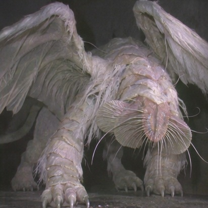
  - 【原典外貌】於深夜自東南方位咆哮生風而至的巨大猛獸，軀體壯碩如山熊猛虎，額頭泛著顯眼雪白斑紋，兩肋竟破毛生出一對寬大巨翼，振翅直撲入殿帳之中，威嚴逼人。
  - 【本作克蘇魯／昆蟲寄生／偽人重構】徹底揚棄「長了天使翅膀的可愛大黑熊」童話造型，完全對齊附圖呈現一頭令人理智掉線的**黑暗地牢克蘇魯重甲膜翼飛熊怪獸**！肩高超過四公尺、身軀沉重得壓裂地牢石板，牠渾身毫無溫暖的熊毛，反而披覆著一層宛如巨大潮蟲與古生代板足鱟般層層疊合的**慘白帶灰褐陰影之厚重幾丁質重甲節片**（原典之「白額」即源於這層慘白如骨瓷的幾丁質前胸與頭背覆甲！）；四條如工業液壓柱般粗壯的分節重甲熊腿上生滿疊瓦護甲，末端伸出五根漆黑厚重、輕輕一抓便能刨穿鋼板的**重甲巨爪**；兩側肩胛甲縫裂開，展開一對翼展逾十公尺、布滿破敗神經脈絡與稀疏腐絲毛的**蒼白半透明昆蟲膜翼（宛如巨型蛾翼與蜻蜓骨膜之畸變混合體）**！最徹底引發深層生理恐懼的則是牠的「臉」——頭部前端全無眼睛與口鼻，而是直接綻放出一朵如**巨型深海星鼻鼴×食肉水螅鰓瓣×寄生蟲吸盤**般向兩側展開的肉紅輻射狀摺皺肉花口器，口器邊緣放射出數十根細長敏感、不斷探測空氣震動與電磁波的**蒼白長鬚觸手**！每當這頭無眼巨獸低吼振翅，整條無窗走廊的空氣都會被昆蟲膜翼震盪出低頻嗡鳴，令人鼻血直湧、大腦直接墜入無邊噩夢！
- **特性**：
  - 【原典記載】原典作為天命大變前夕直貫人皇靈台的夢境異獸徵兆，能無視王宮重兵守衛直接降臨潛意識宮帳，振翅生風卻蘊含翻天覆地的毀滅變局之力。
  - 【本作衍生】在本作設定裡，牠是極度稀有的**「潛意識夢境投影 × 實體化重甲飛蟲巨獸」**！在正式現身於現實都市之前，牠會先連續數夜藉由昆蟲膜翼的低頻次聲波滲透方圓數公里內高靈感者（如除妖師或命格奇特者）的深度睡眠，令目標在夢中反覆看見一頭慘白無眼重甲巨獸撕裂天花板撲向床鋪；而一旦現實濕氣與地脈煞氣累積到臨界點，牠就會在東南方向雷雨濃霧中實體降臨，兼具**重型裝甲推土機的地面破壞力**與**昆蟲膜翼短距低空撲殺**雙重噩夢！
- **弱點**：
  - 【原典記載】原典未載任何實體戰鬥弱點（僅於夢境中顯兆即散）。
  - 【本作衍生】1. **巨大昆蟲膜翼與前端輻射肉花口器是唯二無硬甲防護的致命軟肋**：背腹與四肢的慘白幾丁質重甲極難用常規冷兵器與低階符火擊穿，但其展開的半透明膜翼極度薄脆易燃——只要抓準牠在狹窄街道或地下室無法高飛的環境，用**自製烈火符**精準引燃其雙翼膜，便能立刻剝奪其飛行與次聲波干擾能力！2. **感官長鬚過度敏感**：牠全無眼睛，完全依賴前端輻射鰓瓣與數十根長鬚感知氣流與微弱振動；投擲高分貝音爆彈、強力胡椒氨水霧或以**五雷鎮煞符**在其口器前方引爆強電漿與高壓氣浪，可直接震爛其感官神經使其陷入盲目狂撞。
- **習性**：
  - 【原典記載】僅於王朝將覆、大劫將至之夜自東南方位乘風入夢，平素絕不輕易現跡於塵世。
  - 【本作衍生】若其巢穴隱匿於現代台灣，多半沉睡在台灣東南部深山無人峽谷的巨型鐘乳石裂谷或長年雲霧鎖山的廢棄隧道深處；平時進入數十年如一日的深度滯育休眠，唯有當全島靈脈劇烈動盪或大規模災厄前夕，才會先透過次聲波共振向外投射夢境，繼而在深夜濃霧裡振翅升空巡獵大型活物。
- **喜好**：
  - 【原典記載】原典未載明確食性，唯應大變局與高靈格目標之氣息而現身。
  - 【本作衍生】嗜食高靈氣大型獵物與富含電離氣體的暴風雨前濕霧，極度排斥喧囂乾燥的都市正午強光與高頻刺耳金屬噪音。
- **擅長的招式／異能**：
  - 【原典記載】「東南振翅入夢示兆」、「狂風撲帳威壓」。
  - 【本作衍生】**「膜翼次聲夢魘波」**（高速微震昆蟲雙翼發出 12–19Hz 人耳聽不見的次聲共振，引發目標劇烈暈眩、幻覺與瞬間陷入清醒夢癱瘓）、**「重甲四爪碎牆撲擊」**（藉膜翼滑翔俯衝加速，以四隻裝甲巨爪直接撕碎水泥牆面與貨車車頂）、**「輻射鰓瓣吸絞吞噬」**（無眼肉花口器驟然向外張開超過一公尺，數十根長鬚如鋼絲網般瞬間纏死獵物頭顱並分泌消化酸液軟化骨骼）。

---

### [FS1-14] 軒轅墳眾狐子狐孫（鹿臺赴宴三十九席偽人狐群・醉後裂顎露節肢尾群妖）
- **出處順序**：第 25 回《蘇妲己請妖赴宴》（蘇妲己趁夜返朝歌南門外三十五里軒轅墳，召洞中已能勉強化形之狐子狐孫共三十九席，假冒五色仙師與盤龍雲髻仙姬上鹿臺飲宴；因酒醉失態兼狐騷難掩而當眾露尾，遭陪宴亞相比干識破）、第 26 回《妲己設計害比干》（比干聯手人馬圍堵軒轅墳，以乾柴煙硝火焚全洞，將千百老小妖狐盡數燻燒殆盡並硝皮製裘）
- **類別與造型路線**：`【類人偽人型】`｜三十九席穿冠帶的油汗僵笑「偽人賓客」・酒醉後口角裂開露出幾丁質節肢尾與食腐顎器啃食生肉
- **物種／唯一性**：`物種（群體）`（盤踞軒轅墳古塚寄生巢穴之數百上千隻中低階寄生妖群——其中僅三十九席修成半吊子「偽人皮囊」可混跡高檔宴席，巢穴深處尚有無數未完成蛻殼的幼蟲與低階群體）
- **稀有度與道行對照**：`★ 凡級（N）`～`★★ 稀級（R）`｜模糊道行：數年～數十年淺薄寄生道行（連基本偽人皮囊的體臭與酒後神經控制都維持不住，面對凡人軍隊堵洞火攻便全洞滅絕）｜本作階位：未入流～二流初（群聚低階偽人・極度適合當作都市除妖中段集體潛伏事件對手）
- **外貌與黑暗地牢／恐怖谷視覺改寫**：
  - 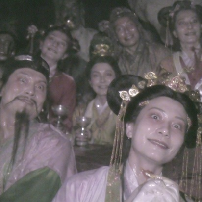
  - 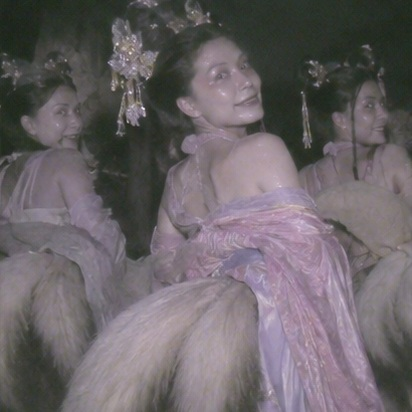
  - 【原典外貌】赴鹿臺時煞有介事地偽裝成仙風道骨的賓客——「袍分五色，各穿青黃赤白黑；帶魚尾冠者、九揚巾者、一字巾者、陀頭打扮者、雙丫髻者，又有盤龍雲髻如仙子仙姬者」，整整坐滿三十九席；然才喝過三巡便酒醉失守，寬大仙袍裙襬後竟齊齊鑽出一條條晃動的長尾，滿堂瀰漫遮蓋不住的刺鼻狐騷臭氣；老巢遭火焚後拖出的全是一片「焦毛爛肉，臭不可聞」。
  - 【本作克蘇魯／昆蟲寄生／偽人重構】嚴格雙圖聯動，將這三十九席古裝神仙徹底翻轉為**令人反胃戰慄的「高檔密室派對三十九具漏餡劣質偽人」**！
    - **偽人赴宴初態（如上圖一《封神-036-軒轅墳眾狐子狐孫》）**：在燈光昏暗潮濕、彷彿長年積水發霉的密閉宴會廳裡，擠滿了身穿華美卻沾著詭異油垢之五色古裝冠帶與鳳釵步搖的男女賓客；初看像一桌歡樂舉杯的權貴派對，卻處處散發令人背脊發涼的**劣質偽人（Mimic）恐怖谷**——所有賓客的臉皮都慘白浮腫、泛著一層像剛蛻皮幼蟲黏液般的詭異油汗反光，一雙雙眼睛死死圓睜毫無聚焦、彷彿根本不懂人類該如何自然眨眼，嘴角全都拉成角度幾乎一模一樣的僵硬怪笑，歪著過分生硬的脖頸盯住鏡頭與席間活人！
    - **酒醉露餡畸變態（如上圖二《FS-02-01-軒轅墳群狐》與黑暗地牢深化）**：只要幾杯烈酒下肚、酒精麻痺了牠們維繫人皮偽裝的薄弱神經中樞，劣質偽裝便會瞬間崩壞！穿著粉紫輕紗露肩華服的女賓客仍掛著那張油汗僵笑的詭異臉龐回眸，但輕紗裙襬下方卻早已像破裂蟲繭般爆脹湧出數條肥厚畸形、黏著污血與粗硬毛刺的巨大尾叢；隨著醉意加深，外層仿造哺乳動物的虛浮軟毛迅速脫落融化，露出底下真正屬於軒轅墳母體一脈的**黑亮幾丁質節肢長尾**（如蠍尾與馬陸節段般喀喀拍打冰冷地板）！與此同時，所有三十九席偽人賓客那張僵笑的人嘴會沿著兩側口角「嘶啦」撕裂至耳根，露出滿口交錯開合、淌著惡臭消化酸液的**食腐甲蟲鋸齒顎器**，集體拋下酒杯撲向餐桌，瘋狂啃咬生肉與活人手指，滿室充斥令人作嘔的幾丁質腐臭與酸腥酒氣！
- **特性**：
  - 【原典記載】1. **道行淺薄、兩大破綻遮不住**：「狐狸騷臭變不得」——無論怎麼穿五色仙袍、點頂級薰香，那股濃烈腥騷臭氣始終散不去；且貪杯嗜酒，稍微喝醉就法力失守、尾巴全部掉出來；2. **群居成窩、背後有絕級母體護短**：單體極弱，但牠們全都是千年九尾狐母體（蘇妲己）在人間最在乎的同巢血親，動了牠們老巢就等於直接引爆一流大妖不死不休的瘋狂報復！
  - 【本作衍生】極適合改編成現代都市除妖案裡的「**高端靈修晚宴／地下私人招待所三十九人偽人派對**」——一群還沒修成完美擬態的低階寄生狐妖，在母體撐腰下假扮成「政商名流、養生宗師與富豪女伴」，包下老舊飯店頂樓宴會廳大吃帶血生肉派對；只要混進場內多勸幾杯高度數高粱或威士忌，就能親眼看見整廳西裝旗袍底下喀喀滑出一排節肢尾、口角裂開成食腐蟲顎的恐怖奇景！
- **弱點**：
  - 【原典記載】1. **酒精麻痺破偽裝**：一喝醉酒立刻無法維持人形、集體露尾現形；2. **極度畏懼「堵死巢口＋乾柴硫磺煙硝火攻」**：身為陰濕穴居妖群，一旦所有出口遭圍堵封死並縱火放毒煙，全洞數百千隻大小妖物毫無還手能力，頃刻間全數窒息烤焦成爛肉；3. **惡臭無法徹底屏蔽**（單憑敏銳凡人嗅覺即可察覺異常）。
  - 【本作衍生】這群未入流至二流初的劣質偽人其實是散修性價比最高的清場目標——切忌在燈紅酒綠的派對現場單挑三十九隻（會被群起裂顎啃碎！），最標準的現代戰術完全師法原典比干與黃飛虎：**先貼「淨氣符」屏除臭味並以免費烈酒灌醉其偽裝、一路暗中跟蹤至牠們白日休眠的廢棄公墓防空洞或地下室總巢，徹底焊死／堵死全部通風口與鐵門，再從縫隙投入數張「自製烈火符」疊加硫磺濃煙窒息悶燒**！唯一必須提前做好萬全準備的，是查清楚牠們背後那隻**千年九尾母體**此刻在哪裡！
- **習性**：
  - 【原典記載】成百上千隻群聚棲息於朝歌南門外三十五里荒僻古墓「軒轅墳」深處的潮濕土窟中，依附九尾狐母體庇護，白日躲洞避光、入夜成群出洞赴宴覓食。
  - 【本作衍生】在台灣現代都會多以家族蟻巢模式盤踞於郊區荒廢土葬公墓後方廢棄防空洞、爛尾溫泉山莊地下室或停業多年的大型地下 KTV 廢墟；白日像成堆脫殼蟑螂般擠在無光積水角落休眠，入夜則換上偷來或買來的廉價古風禮服／西裝套裝，結伴混跡林森北路巷弄、私人招待所與深夜高檔燒肉餐酒館獵食醉客。
- **喜好**：
  - 【原典記載】極度嗜飲美酒佳餚、酷愛扮演高高在上的「神仙賓客」享受凡人跪拜吹捧，甚至寧可冒著露餡殺頭風險也要上鹿臺蹭一頓頂級御酒宴。
  - 【本作衍生】病態沉迷於高濃度甜烈酒、未熟帶血生牛排與生鮮內臟，以及模仿人類上流社會華麗卻早已過時的復古浮誇派對排場。
- **擅長的招式／異能**：
  - 【原典記載】「低階五色偽裝化形術」、「集體夜行陰風移步」（全無高階法寶或頂尖殺招）。
  - 【本作衍生】**「三十九席偽人壓迫場」**（數十具油汗僵笑偽人同時死盯誤闖者，製造極端精神恐慌令單人法師不敢輕易出手）、**「裂顎酸涎亂啃」**（偽裝破裂後全群口角撕裂成食腐顎器，四肢著地並甩動幾丁質節肢尾進行蜂擁圍咬）、**「集體腐騷干擾霧」**（受驚時同時自體表氣門噴出刺鼻難聞的動物尿騷與幾丁質腐臭氣霧，令無防毒者劇烈嘔吐喪失戰力）。

---

## 🪲 第四單元：第 27～35 回｜深淵黑霧寄生巨獸與五彩角質重甲怪獸

### [FS1-15] 墨麒麟（東海黑霧鱗甲寄生巨獸・深淵甲殼輻射觸絲巨怪）
- **出處順序**：第 27 回《太師回兵陳十策》（自東海收伏、隨班師回朝初現之漆黑異獸坐騎；亦活躍於第 31 回追襲五關及卷二西岐諸戰，終戰死絕龍嶺；**本條目嚴格剔除原典騎主太師聞仲及其雷神位格，純取墨麒麟怪獸本體建檔**）
- **類別與造型路線**：`【非人生物恐怖型】`｜潛行黑霧中之濕滑漆黑甲殼鱗片寄生巨獸（口吻與尾端具輻射狀水螅寄生觸絲吸盤陣列）
- **物種／唯一性**：`物種特異個體`（深海暗霧鱗甲巨獸族群中極罕見之漆黑變異霸主，通體覆滿尖銳黑曜甲片且能分泌高壓感電黑霧，須臾千里，獨此一頭）
- **稀有度與道行對照**：`★★★ 珍級（SR）`｜模糊道行：數百年～近千年深海太古異獸靈氣（百獸震懾威壓與高速突擊衝鋒極具壓迫力，然遇更上階太古異獸或頂級鈍器重擊亦會慘亡）｜本作階位：一流（黑霧潛行・高速衝陣・寄生觸絲捕獵）
- **外貌與黑暗地牢／恐怖谷視覺改寫**：
  - 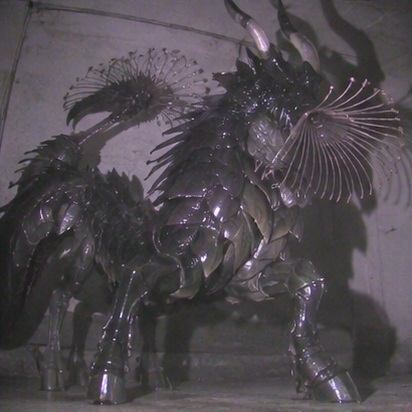
  - 【原典外貌】產自東海之漆黑異獸，通體烏黑如潑墨玄鐵、鱗甲森然、頭生雙角、龍首獅尾，四蹄踏動即湧起滾滾烏雲黑霧，須臾間能奔行千里，尋常戰馬遠遠望見其形便雙腿發軟跪地不敢動彈。
  - 【本作克蘇魯／昆蟲寄生／偽人重構】徹底撕毀傳統祥瑞年畫麒麟造型，完全對齊附圖塑造出一尊令人脊背發寒的**「黑暗地牢濕滑鱗甲寄生巨獸」**！佇立在滲水斑駁的漆黑地下室水泥牆前，牠體格龐大如重型裝甲車，渾身覆蓋著如深海巨型鱟魚與食肉甲蟲重疊而成的**漆黑油亮尖銳幾丁質鱗甲**，每一片重甲邊緣皆如黑曜石刀片般斜立反光，甲縫間不斷滲出潮濕黏滑的黑油液與微弱靜電焦霧；四肢實為漆黑半透明關節重甲包裹的**多節巨型甲殼步足**，末端鈣化為沉重烏黑的裂甲硬蹄，踩踏濕水泥時發出刺耳金屬刮擦聲。頭頂高聳著一對向後彎曲的焦黑骨角，卻徹底沒有任何祥瑞龍臉或哺乳類眼睛——**牠的整個口吻前端與如蠍尾般高高翹起的長尾末端，竟然各自炸裂綻放出一圈直徑逾一公尺、令人密集恐懼症瞬間爆發的「輻射狀水螅寄生觸絲與微吸盤圓傘」**！數十根細長漆黑、末端膨脹成蒼白微吸盤的黏液觸絲在黑霧中如活體雷達般同步擺動收縮，能於漆黑無光環境下精準偵測百公尺內的活體心電與呼吸氣流，並在逼近獵物瞬間如捕蠅草般猛然合攏，將活人直接勒緊吸乾！
- **特性**：
  - 【原典記載】1. **天生百獸震懾威壓**：凡俗牲畜、犬馬與低階精怪一嗅其東海烏雲煞氣便當場軟腳癱地；2. **黑霧疾奔、須臾千里**：四蹄生出濃密漆黑海霧，機動速度在封神前期異獸中名列前茅；3. **性情孤傲暴烈、唯認鐵血強者**。
  - 【本作衍生】極度危險的**「高壓黑霧干擾 × 輻射觸絲捕獵型」**一流怪獸！當牠在現代濱海快速道路、地下行車隧道或深夜港區黑霧中高速潛行時，甲縫散發的潮濕感電黑霧會瞬間讓沿途路燈閃滅、手機與監視器畫面充滿雪花雜訊，同時讓方圓百公尺內一切流浪貓狗與低階蟲妖恐懼僵直；任何試圖靠近牠正面或繞背偷襲的除妖師，都會立刻遭到牠**口、尾雙端輻射觸絲傘**無死角同步反咬與寄生黏液麻痺！
- **弱點**：
  - 【原典記載】1. **遭遇更高階先天異獸坐騎會受血脈壓制**（原典中四不相一現身即震懾商營異獸）；2. **血肉甲殼終究抵不住頂級鈍器自正上方暴擊要害**——最終在絕龍嶺遭一記黃金重棍照背脊直劈，當場硬生生打成兩段斃命。
  - 【本作衍生】1. **口尾兩處輻射觸絲傘毫無硬甲保護且極畏乾燥烈火**：牠周身的漆黑鱗甲刀槍難入，但口吻與尾端外露的數十條潮濕寄生觸絲極度脆弱——只要以**烈火符**搶先燒灼觸絲傘使其因劇痛蜷縮失盲，牠的空間定位與黑霧維繫就會立刻崩潰！2. **衝鋒慣性極大、狹窄地形轉向困難**：切忌在開闊濱海大道與牠比速度，務必誘入密集地下停車場水泥柱林立處，以**陷地符（指地成鋼反向泥化）**卡死其沉重甲蹄，再集中**五雷鎮煞符**與高動能重擊轟斷其背脊中段的甲殼接縫（即原典被一棍打成兩段的致命斷裂帶！）。
- **習性**：
  - 【原典記載】原棲東海孤島黑霧深處，性情猛烈不群，後長年馳騁南北沙場，直至戰死絕龍嶺。
  - 【本作衍生】若其血脈異種潛伏於現代台灣，極偏好棲息於基隆／高雄大型深水商港廢棄海底輸油管溝、跨海大橋陰濕橋墩空腔或濱海廢棄火力發電廠冷卻水涵道；平時渾身裹著濃稠黑霧伏在積水暗影中紋絲不動，每逢東北季風濃霧鎖港或颱風登陸前夕，便會沿著深夜空無一人的濱海公路無聲奔襲獵食，地上只留下一串焦黑冒煙的分裂蹄印與乾涸黑黏液絲。
- **喜好**：
  - 【原典記載】原典未載明確食性，唯嗜東海烏雲雷霧與鐵血殺伐之氣。
  - 【本作衍生】嗜吸高壓鹽霧、靜電雷雲與富含鐵質的新鮮溫熱血液，極度厭惡乾燥內陸炎熱焚風與甜膩線香煙味。
- **擅長的招式／異能**：
  - 【原典記載】「四蹄生烏雲黑霧」、「須臾千里疾奔」、「百獸驚伏威壓」。
  - 【本作衍生】**「深淵黑霧電磁蔽場」**（自黑曜鱗縫噴湧潮濕漆黑腐霧，同時遮斷可視光與現代電子儀器訊號，令除妖師陷入絕對失明）、**「口尾雙傘觸絲捕絞」**（前後兩圈數十條寄生吸盤觸絲同時張開掃射，無死角纏縛近身目標並注入抗凝血麻痺黏液）、**「玄鱗斷骨衝撞」**（壓低雙角於黑霧中高速衝鋒，以重甲身軀直接撞碎磚牆與防爆門）。

---

### [FS1-16] 五色神牛（角質重甲複眼肉瘤異種巨獸・五彩油斑巨兜蟲多足怪獸）
- **出處順序**：第 30 回《周紀激反武成王》（初現商朝武成王府，隨反出五關正式縱橫沙場）、第 31～33 回《聞太師驅兵追襲》～《黃飛虎泗水大戰》（日行八百里托雲突圍，歷戰諸關；**本條目嚴格剔除原典騎主武成王黃飛虎與東嶽大帝神格，純取這頭異種五色怪獸本體建檔**）
- **類別與造型路線**：`【非人生物恐怖型】`｜覆滿五彩斑駁角質重甲與複眼肉瘤之巨型兜蟲／深海等足蟲多足異種巨獸
- **物種／唯一性**：`物種特異個體`（原典為萬中無一、天生身披五色斑紋且能日行八百里之異種巨牛；本作重構為甲殼因重金屬礦化與真菌共生而泛出五彩病態油光的極罕見巨型角質節肢怪獸）
- **稀有度與道行對照**：`★★ 稀級（R）`（近 `★★★` 珍級）｜模糊道行：數十年～百餘年天生異稟怪獸（耐力驚人、抗低階異獸威壓且重甲防禦力強，然面對高階太古凶獸、法寶重擊與魂魄邪法仍難自保）｜本作階位：二流～二流頂（重甲坦度・抗威壓衝撞・破低階幻牆特化）
- **外貌與黑暗地牢／恐怖谷視覺改寫**：
  - 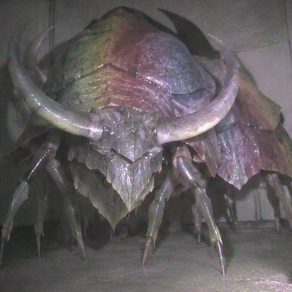
  - 【原典外貌】體格雄偉高大、遍體生出五色斑斕奇異毛色，雙角粗壯彎曲如彎月，能托雲霧日行八百里，尋常戰馬聞之退避，面對多數沙場怪獸咆哮亦不驚不懼。
  - 【本作克蘇魯／昆蟲寄生／偽人重構】徹底屏棄溫馴花斑大水牛的農場畫面，完全對應附圖將其重塑為盤踞在潮濕水泥地下室角落的**「角質重甲五彩油斑巨兜蟲 × 複眼肉瘤多足異獸」**！牠龐大到幾乎塞滿整個地下車庫轉角，整個穹頂般的巨碩身軀毫無牛皮毛髮，全由數塊厚重粗糙、層層疊合宛如深海巨型潮蟲與古生代兜蟲般的**巨大角質重甲板**包覆；所謂「五色」，實為甲殼表面長年浸染腐殖質、重金屬礦鹽與發光黴斑後泛出的**病態青綠、淤紫、暗紅、銹黃與死灰五彩油膜反光**！重甲最前端突出兩根長逾兩公尺、粗壯向上彎弧如死白巨骨鐮刀般的**巨型角質牛角**，雙角之間沒有溫柔的牛眼與濕鼻，而是向下垂掛著數層鋸齒狀的**厚重角質頭蓋與甲殼顎板**，頭蓋陰影裂縫裡密密麻麻擠滿了不斷抽動反光的**暗紅與灰白複眼肉瘤群**！最駭人的是支撐這座重甲肉山的雙腿——那根本不是四隻牛蹄，而是從穹甲底緣左右伸出的**六對（十二條）細長、泛著灰白半透明軟骨光澤、關節尖銳的巨型節肢步足**，十餘隻尖足死死釘進潮濕水泥地縫裡，隨時準備像一輛失控的多足重裝坦克般撞碎眼前的一切障礙！
- **特性**：
  - 【原典記載】1. **長途奔襲耐力極致**：日行八百里、越關過險毫不疲乏，極具忠誠護主本能（騎主中標陣亡時仍死守屍身悲鳴不退）；2. **抗異獸威壓**：不同於一聞妖氣就癱軟的尋常牲畜，面對多數二流怪獸與戰場煞氣依然能保持冷靜衝鋒；3. **無法對抗頂級法寶與上古凶獸**（日後遭遇開天珠震擊或更高階異獸坐騎仍會翻覆受制）。
  - 【本作衍生】極為難纏的**「超高防角質重甲 × 抗精神幻術衝撞型」**二流頂怪獸！由於其神經系統分散在多組角質節片與頭蓋複眼肉瘤中，普通二流以下妖怪的**障眼法、低頻精神干擾與狐騷費洛蒙**對牠幾乎免疫，牠會直接無視幻象一頭撞碎偽裝牆壁！對現代除妖師而言，牠厚重的五彩油斑穹甲足以彈開普通刀斧與零星掌心雷，一旦在狹窄走廊發動全速多足突進，防禦陣線瞬間就會被碾成肉泥。
- **弱點**：
  - 【原典記載】終究未修成高階妖丹與法寶護體，面對頂級上古凶獸坐騎（如九龍島異獸）、重型法寶暗算（如開天珠、戮魂幡）或鎖魂左道術法時依然脆弱受創。
  - 【本作衍生】1. **支撐龐大重甲的半透明細長節肢步足是最大結構破口**：相較於刀槍難入的五彩重甲穹背，牠腹底延伸出的六對半透明細長節肢步足極度脆弱——切忌朝背甲亂砸符咒浪費法力，正確解法是用**陷地符**泥化地面陷住步足，或貼地橫掃、以**掌心雷／鋼索絆馬索**專攻其半透明關節軟骨，只要折斷單側三條步足，重達數噸的五彩穹甲就會瞬間側翻倒地動彈不得！2. **頭蓋縫隙裡的複眼肉瘤懼怕強光與高溫**：掀翻或逼其抬頭衝撞的一瞬，將**自製烈火符**或**五雷鎮煞符**塞進雙角之間的角質頭蓋裂縫直炸複眼肉瘤，即可令這頭多足巨獸徹底失去方向感並燒穿腦核。
- **習性**：
  - 【原典記載】原豢養於王侯高牆府邸之中，性情剛烈擇主，唯對血性剛直者低首俯伏，絕不肯讓怯懦奸佞之輩跨上背甲。
  - 【本作衍生】若這類野生五色角質重甲異獸潛伏於現代台灣，多半藏匿於郊區荒廢重金屬汙染化工廠地下室、山谷廢棄牛墟舊倉儲或河濱高灘地積水涵洞中；平時將十二條透明步足收攏於穹甲底下，遠看宛如一塊長滿五彩青苔與鏽斑的巨大廢棄鐵塊或巨石，只有在嗅到濃烈鐵鏽血氣或受困者散發的強烈求生意志時，才會喀喀撐起節肢破牆衝出。
- **喜好**：
  - 【原典記載】原典未載明確食性，唯忠於剛烈明主、嗜奔馳闖關。
  - 【本作衍生】嗜啃富含礦物質與重金屬鹽分的潮濕山岩苔蘚、腐朽粗鹽塊與硬殼甲蟲屍骸，對刺鼻塑膠燃燒焦味與現代內燃機廢氣極度焦躁，聞之常主動狂暴撞擊發聲車輛。
- **擅長的招式／異能**：
  - 【原典記載】「日行八百里托雲奔襲」、「抗獸威衝陣護主」。
  - 【本作衍生】**「十二足重甲破壁衝鋒」**（六對透明節肢步足交替高速蹬地，推動五彩重甲穹背與彎月雙骨角硬生生撞碎承重磚牆與鐵捲門）、**「角質震地碎符踏」**（多足同步猛踏潮濕水泥地引發劇烈地表震盪，直接震斷除妖師預先埋設的隱形符線、鋼絲陣與蛛絲陷阱）、**「複眼肉瘤抗幻突圍」**（數十枚複眼肉瘤同時多波段掃描環境，強行無視低階鬼打牆與視覺障眼法並直鎖目標真身）。

---

## 🧭 卷末總結：純妖怪篩選核對與卷次銜接

| 項目 | 本卷統計與核對明細 |
| :--- | :--- |
| **涵蓋原典範圍** | 《封神演義》第 01 回《紂王女媧宮進香》～第 35 回《晁田兵伐西岐》全段 |
| **收錄純妖怪／怪獸總數** | 共 **16 條**（編號 `FS1-01`～`FS1-16`），含 `【類人偽人型】` **5 條**、`【非人生物恐怖型】` **11 條** |
| **嵌入圖檔總數** | 共 **15 張**既有實存圖檔（含五大標竿 `FS1-02` 雙圖並列、`FS1-14` 雙圖並列）；未配圖純怪獸預留補繪圖位 **3 處**（`FS1-05`、`FS1-06`、`FS1-07`） |
| **五大標竿核心收錄** | ✅ `[FS1-02] 軒轅墳千年九尾狐狸精（蘇妲己）`（雙圖完整嵌入，嚴守偽人皮囊＋幼蟲鑽顱寄生＋背裂九節肢尾與搏動產卵管定案） |
| **嚴格剔除零神明核驗** | 女媧、三聖皇、元始天尊、十二金仙（太乙・廣成子・赤精子・文殊・普賢・清虛道德真君等）、燃燈、雲中子、南極仙翁、白鶴／碧霞／彩雲／金霞仙童、黃巾力士、四海龍王與敖丙・水府巡海夜叉李艮、姜子牙、申公豹、哪吒、李靖、金吒、木吒、雷震子、聞仲、吉立余慶、黃飛虎、黃天化、崇黑虎、方弼方相、陳桐、余化及諸凡人帝王武將，**全數 100% 剔除** |
| **下卷銜接預告** | 第 36～75 回將進入 [卷二](./02-卷二_第36至75回.md)，收錄東海異獸**龍鬚虎**、九龍島四聖異獸坐騎（狴犴・狻猊・花斑豹・猙獰）、**紫金花狐貂**、腦後鬼手食人心**馬元**、幽燈寄生妖**馬善**、萬里魔禽**羽翼仙**、**十萬毒蜈蜂**、五色異禽妖相**孔宣**、**丘引（曲蟮蚯蚓精）**等中後段純妖魔與怪獸！ |
