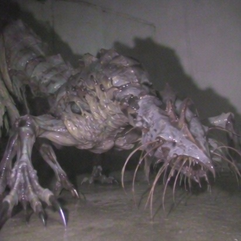
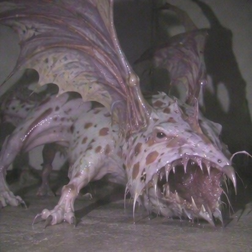
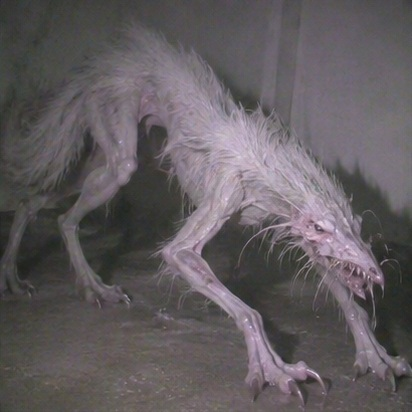
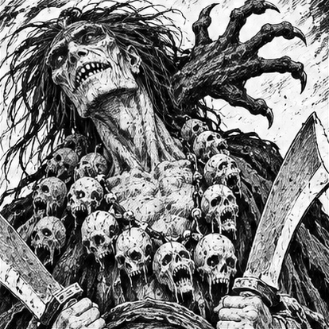
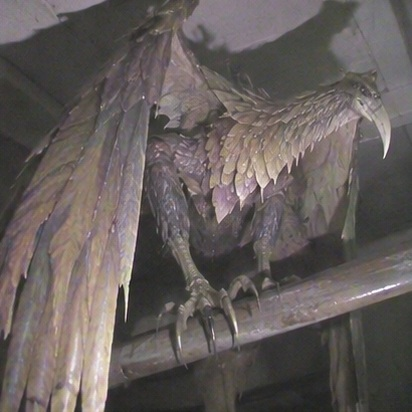
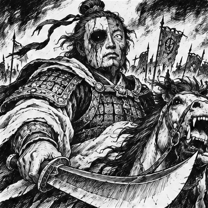
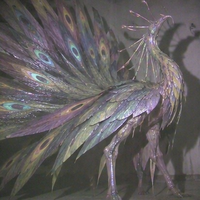
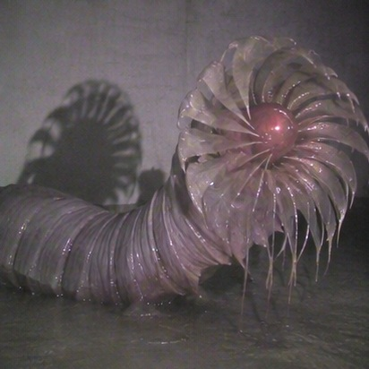

# 🦊 《封神演義》純妖怪與怪獸圖鑑・卷二（第 36～75 回）

> **返回導覽**：[👹 妖怪篇總綱](../00-妖怪篇總綱與圖鑑分級.md) ｜ [📖 封神演義總錄](./00-封神演義妖怪怪獸總錄.md) ｜ [⬅️ 卷一](./01-卷一_第01至35回.md) ｜ [➡️ 卷三](./03-卷三_第76至100回.md)
>
> **插圖統計**：本卷共收錄 **13 條** 純妖怪與怪獸獨立公式書檔案（涵蓋 **20 種／尊** 具名妖怪、異獸與寄生蟲災群體），嵌入既有圖檔 **8 張**，預留補繪圖位 **5 處**。
>
> **純妖怪收錄原則與神明剔除聲明（2026-11-21 定案）**：本卷嚴格依《封神演義》標準百回本第 36～75 回順序，**僅收錄真正屬於妖怪、異獸、寄生毒蟲集群與極度非人異變魔怪者**。原典本區段登場之一切神明、聖人、闡截道人與凡人武將——包含青龍關張桂芳與風林、闡教叛徒申公豹、南極仙翁與白鶴童子、九龍島四聖騎主（王魔・楊森・高友乾・李興霸）、佳夢關魔家四將（魔禮青・魔禮紅・魔禮海・魔禮壽）、玉泉山楊戩、黃花山四將（鄧忠・辛環・張節・陶榮）、清福正神柏鑒、金鰲島十絕陣十天君、燃燈道人、闡教十二金仙、度厄真人、峨眉山趙公明、武夷山蕭升曹寶、西崑崙陸壓、三仙島三霄娘娘與菡芝仙・彩雲仙子、太上老君・元始天尊・通天教主、商朝太師聞仲與雲中子、鄧九公鄧嬋玉、土行孫、蘇護與哼將鄭倫、瘟神呂岳與四弟子、火雲洞三聖皇、韋護、商室二皇子殷洪與殷郊、溫良、火龍島焰中仙羅宣與劉環、龍吉公主與洪錦、首陽山伯夷叔齊、金雞嶺先鋒高繼能、西方教準提與接引二聖、胡雷胡升、火靈聖母、多寶道人、哈將陳奇、余化與余元等——**全數徹底剔除不收**；涉騎主者（九龍島四獸、花狐貂、哮天犬、雙虎、金眼駝、蜈蜂群、三火毒坐騎）僅獨立建檔其**非人怪獸與毒蟲本體**，涉入佛門或封神神格之大妖（馬元、羽翼仙、孔宣、丘引）亦全面剝離神佛化光環，還原其最原始的妖魔怪獸本質。
>
> **黑暗地牢 × 克蘇魯 × 恐怖谷偽人美術鐵律**：全卷揚棄「傳統威風神獸／毛絨動物／美型仙妖」形象，徹底轉向 **【昆蟲・節肢動物・寄生生物・軟體與環節動物】** 四大生物庫，採 `【類人偽人型】` 與 `【非人生物恐怖型】` 雙造型路線，結合黑暗地牢潮濕腐蝕質感、黏液反光、幾丁質甲殼、寄生吸盤與產卵管結構，並嚴守 **【原典記載】×【本作衍生】** 雙軌考據。

---

## 📋 本卷純妖怪與怪獸速查表（第 36～75 回・共 13 條）

| 編號 | 名稱（別稱） | 出處回目 | 造型路線 | 本作黑暗地牢／寄生重構原形 | 物種／唯一性 | 稀有度 | 本作階位 | 配圖 |
| :---: | :--- | :---: | :---: | :--- | :--- | :---: | :--- | :---: |
| `FS2-01` | **東海・龍鬚虎**（少昊畸形異獸） | 第 37～41 回 | `【非人生物恐怖型】` | 潮濕水螅與巨型節肢蝦蟹融合・噴射碎骨巨石觸鬚怪 | `獨一無二` | `★★★` | 一流 | 🖼️ |
| `FS2-02` | **九龍島四大異獸**（狴犴・狻猊・花斑豹・猙獰） | 第 38～39 回 | `【非人生物恐怖型】` | 重甲腐食昆蟲與寄生獠牙四巨獸（剔除騎主・純獸本體） | `物種特異個體` | `★★★` | 二流頂～一流 | ⏳ |
| `FS2-03` | **紫金花狐貂**（魔禮壽豹皮囊寄生獸） | 第 40～41 回 | `【非人生物恐怖型】` | 縮如白鼠・展翼吸血口針與專鑽宿主腹腔啃食臟器魔獸 | `物種特異個體` | `★★★★` | 一流頂 | 🖼️ |
| `FS2-04` | **哮天犬（異獸原型檔）**（細腰追蹤獵獸） | 第 40、47、50 回 | `【非人生物恐怖型】` | 細長節肢感蒼白獵蟲獸・鼻腔嗅覺感應孔與倒鉤犬齒 | `物種特異個體` | `★★★` | 一流（破防一流頂） | 🖼️ |
| `FS2-05` | **白額虎與黑虎（坐騎異獸檔）**（雙虎魔獸） | 第 37、47 回 | `【非人生物恐怖型】` | 去神獸化・背生骨刺與寄生腐蟲之巨型黑甲／白斑腐虎怪 | `物種特異個體` | `★★`～`★★★` | 二流頂～一流初 | ⏳ |
| `FS2-06` | **瘟毒寄生蟲潮與金眼駝**（原呂岳瘟災與坐騎本體） | 第 58～59 回 | `【非人生物恐怖型】` | 黑暗地牢瘟毒寄生蟲潮・血蛭孢子與雙峰爆膿巨眼駝怪 | `物種（群體）`／`特異個體` | `★★★★` | 一流頂（瘟災巔峰） | ⏳ |
| `FS2-07` | **骷髏山・一氣仙馬元（食心怪）** | 第 60～61 回 | `【類人偽人型】` | 瘦長青臉偽人・腦後裂顱伸出蒼白多關節節肢巨手掏心怪 | `獨一無二` | `★★★★` | 一流頂 | 🖼️ |
| `FS2-08` | **蓬萊島・羽翼仙（金翅大鵬怪）** | 第 62～63 回 | `【非人生物恐怖型】` | 重甲骨羽遮天・飛蝗狂風與長型吸血掠食鳥喙口器巨怪 | `物種特異個體` | `★★★★★` | 巔峰 | 🖼️ |
| `FS2-09` | **馬善（琉璃燈芯怪）** | 第 63～64 回 | `【類人偽人型】` | 偽人皮下為陰火燈油軟體水螅／變形蟲不死怪・拉絲癒合 | `獨一無二` | `★★★★` | 一流頂 | 🖼️ |
| `FS2-10` | **三山關・孔宣（天地初開孔雀妖本相）** | 第 69～71 回 | `【類人偽人型】`×`【非人生物恐怖型】` | 偽人武將與濕亮複眼孔雀眼斑寄生羽扇・五色空間吞噬怪 | `獨一無二` | `★★★★★` | 規格外 | 🖼️ |
| `FS2-11` | **蜈蜂毒蟲群（高繼能蜈蜂袋蟲災）** | 第 69～70 回 | `【非人生物恐怖型】` | 漆黑皮袋傾巢千萬毒蜂與微型飛蜈蚣集群・鑽眼耳產卵災禍 | `物種（群體）` | `★★★` | 一流（集群殺傷一流頂） | ⏳ |
| `FS2-12` | **青龍關・丘引（曲蟮蚯蚓精）** | 第 73～74 回 | `【類人偽人型】`×`【非人生物恐怖型】` | 甲冑蒼白偽人・底層十丈濕滑環節巨吸血蚯蚓與裂顱紅眼珠 | `物種特異個體` | `★★★` | 一流 | 🖼️ |
| `FS2-13` | **異化火毒坐騎怪獸群**（赤煙駒・火眼金睛獸・五雲駝） | 第 64、74～75 回 | `【非人生物恐怖型】` | 噴吐硫磺酸液與火蟲孢子之多甲殼腐熱魔獸群（純獸本體） | `物種（群體）`／`特異個體` | `★★★` | 二流頂～一流 | ⏳ |

> **逐回淨化與跨卷歸屬備忘**：
> - 第 36 回（張桂芳・風林）、第 42～46 回（黃花山四將・十絕陣十天君・燃燈與闡教十二金仙）、第 48～57 回（趙公明・蕭升曹寶・陸壓・三霄・聞仲末路・鄧九公鄧嬋玉・土行孫・鄭倫）、第 59 回（韋護・殷洪）、第 65～68 回（殷郊・龍吉・洪錦・伯夷叔齊）與第 71～72 回（胡雷・火靈聖母・多寶・通天）之主要登場角色均屬神明、正神仙道或凡人武將，依純妖怪鐵律一律剔除。
> - 第 72 回《廣成子三謁碧遊宮》初現萬載巨龜原形之**龜靈聖母**，因核心妖身慘劇（萬仙陣遭太古吸血巨蚊道人吸乾精血化為空殼）集中於後段，依 [總綱](../00-妖怪篇總綱與圖鑑分級.md) 歸入 [卷三（第 76～100 回）](./03-卷三_第76至100回.md) 與蚊道人併列詳錄。
> - 卷二原典實數回目核校：羽翼仙實登場於標準百回本第 62～63 回、馬善為第 63～64 回、孔宣與高繼能蜈蜂為第 69～71 回、丘引為第 73～74 回、赤煙駒與火眼金睛獸・五雲駝分見第 64、74～75 回，本卷嚴格依原書實際頁序排列。

---

## 🦐 第一單元：第 37～47 回｜東海觸鬚異獸・九龍島四魔獸・花狐貂・哮天犬與雙虎

### [FS2-01] 東海・龍鬚虎（少昊時生畸形異獸）
- **出處順序**：第 37 回《姜子牙一上崑崙》（初登場自稱少昊時生、欲活吞姜子牙反遭收服拜師；活躍於第 38、39、41 回西岐攻防，後於卷三澠池戰死於巨人鄔文化排扒木下，本檔徹底剔除其後封九醜星之神位）
- **類別與造型路線**：`【非人生物恐怖型】`｜潮濕水螅與巨型節肢蝦蟹融合異獸（噴射碎骨巨石之深海畸形觸鬚怪）
- **物種／唯一性**：`獨一無二`（自稱於上古少昊時期天地潮濕瘴海化生、集多重海洋節肢與無脊椎畸變特徵於一身之獨一東海古怪）
- **稀有度與道行對照**：`★★★ 珍級（SR）`｜模糊道行：自少昊以降千餘年荒古野怪修持（空具毀滅性天賦吐石威能，卻無系統道法與護身重寶）｜本作階位：一流
- **外貌與黑暗地牢／恐怖谷視覺改寫**：
  - 
  - 【原典外貌】第 37 回原典描繪其奇醜無比、縫合七獸特徵：「頭似駝，項似鵝，鬚似蝦，耳似牛，身似魚，手似鷹，足似虎；一隻手大，一隻手小」，生於北海與東海荒崖之間，奔走如飛、聲如沉雷，揚手之間便有漫天磨盤大石從空砸落。
  - 【本作克蘇魯／昆蟲寄生／偽人重構】徹底剝除一切奇幻獸人或憨厚巨人的擬人萌感，直接重構為一頭盤踞於潮濕淹水地下室與海蝕洞窟底層的**潮濕水螅與巨型深海節肢蝦蟹融合畸形怪獸**！牠沒有人類直立脊柱，而是由數十節層層疊壓、灰紫泛油、濕滑滴水的**幾丁質甲殼節段**拼湊出的長條爬行巨軀，宛如一隻體長超過四公尺的腐爛深海巨蝦與水螅肉團強行縫合而成；前端拉長畸形的錐狀頭胸缺乏對稱眼耳，在慘白黏膜下僅有數顆如死蟹般的混濁黑珠眼，尖銳角質吻部裂開一道滿布倒生細刺牙的潮濕口腔，嘴緣與頰側狂亂生長出**二十餘根長逾一公尺、不斷沾滿透明黏液痙攣抽動的紅褐多節蝦鬚與水螅觸鬚**；四肢極度左右不對稱——左前肢腫大肥厚如反折巨蟹螯與猛禽骨爪的結合體，指節嵌著發黑銳利彎爪與半透明軟骨膜，右前肢則詭異瘦小萎縮（呼應原典「一隻手大，一隻手小」）。每當牠劇烈甩動嘴周觸鬚與肥大左爪，體表甲縫與觸鬚末端的鈣化腺體便「噗嗤」噴射出無數裹著腥臭黏液、混雜鈣化碎骨與礁石稜角的沉重巨石！黑白寫實與潮濕地下室打光質感著重強調幾丁質濕亮高光、垂滴黏絲與水泥地面被巨爪摳出的刮痕。
- **特性**：
  - 【原典記載】天生奇能「**發手有石**」——不必撿拾石塊，只需大小雙爪凌空一揮，空中便暴雨般墜下無數磨盤大小巨石，單憑亂石齊砸便曾將九龍島四聖與魔家四將麾下萬餘商軍砸得骨斷筋折、潰不成軍；性情雖兇猛嗜食血肉（初見姜子牙即要一口吞吃），但神智單純憨直、認主之後極度護短死忠。
  - 【本作衍生】屬於黑暗地牢系裡的**「遠程生物火砲級甲殼海怪」**——體內特殊骨質囊袋能不斷將吞食的海蝕岩砂、貝殼與獵物骸骨快速壓縮凝結成帶有腐蝕黏液的「碎骨岩彈」，再藉多條高張力水螅觸鬚與不對稱巨爪如投石機般連發轟擊；單體投射動能足以瞬間砸塌整面磚牆與警用防爆盾，卻因神經構造偏原始節肢生物，在未受強烈刺激時常呆滯伏於陰濕角落，甚至可能對主動投餵鮮肉而未顯殺意的人類展現出詭異的依附與護衛行為。
- **弱點**：
  - 【原典記載】1. 雖修煉千年，卻徹底缺乏高階護體神通與防禦法寶，極易遭精準高速的要害重擊廢除戰力——第 38 回剛大發神威便被高友乾「混元寶珠」一擊正中細長頸項重創墜地；後期於澠池亦死於力量型巨人鄔文化夜襲棍下；2. 細長脆弱的頸節與發育不全的萎縮右肢是明顯結構破口。
  - 【本作衍生】1. **頸部軟膜甲縫與右前萎縮肢死穴**：頭胸與軀幹銜接處的幾丁質最薄且沒有骨甲覆蓋，若以**破障符**避開正面碎骨石雨、從右側盲區以**五雷鎮煞符**或高壓電擊穿刺其濕滑頸縫，極易引發全身節肢痙攣癱瘓；2. **低矮狹窄室內無法展開高拋石雨**，加上體表水螅黏膜極度畏懼高溫乾燥環境，連續投入**烈火符**或工業噴火器烤乾其觸鬚黏液，即可直接廢除其噴石能力。
- **習性**：
  - 【原典記載】上古少昊時期便孤身盤踞於東海與北海荒僻海崖，慣於乘風飛躍、以手生石捕殺山海生靈為食。
  - 【本作衍生】在現代台灣常潛伏於東北角長年漲潮淹水的廢棄海蝕防空坑道、荒廢漁港消波塊最深處、或是臨海工業區滲漏海水的停工地下蓄水室；漲潮深夜會沿著雨水大箱涵緩慢爬向市郊魚市場與潮濕高架橋底，用滿嘴蝦鬚探測積水震動並拖走落單野犬或夜釣客。
- **喜好**：
  - 【原典記載】初登場時嗜食活人與海濱生肉；歸順後最喜立功炫耀「發手有石」的本領。
  - 【本作衍生】極度迷戀高鹽度腐爛海鮮內臟、生魚市場下腳料與富含鈣質的粗大動物骸骨（吞食骨頭可加快體內「碎骨巨石」的凝結速率），極討厭乾熱陽光與刺鼻漂白水。
- **擅長的招式／異能**：
  - 【原典記載】**發手有石**（揮動雙手即憑空砸下漫天磨盤巨石）、迅疾奔躍與怪力搏殺。
  - 【本作衍生】1. **觸鬚碎骨連射**（嘴周二十餘條水螅蝦鬚同時甩動，將體內分泌的黏液碎骨巨石以砲彈初速轟向半徑三十公尺扇區）；2. **腐黏巨螯壓碎**（畸形肥大的左前節肢巨爪猛撲拍擊，連鋼筋水泥柱與汽車引擎蓋一併碾碎）；3. **腥潮滑行遁逃**（遇強敵時分泌大量透明水螅滑液覆蓋地面，使追擊者腳下打滑並順排水溝高速倒退逃竄）。

---

### [FS2-02] 九龍島四大異獸：狴犴・狻猊・花斑豹・猙獰（純魔獸本體檔）
- **出處順序**：第 38 回《四聖西岐會子牙》・第 39 回《姜子牙冰凍岐山》（*本條目嚴格剔除四名截教騎主王魔、楊森、高友乾、李興霸，純粹收錄四頭隨之肆虐西岐戰場的非人魔獸本體*）
- **類別與造型路線**：`【非人生物恐怖型】`｜重甲腐食昆蟲與寄生獠牙四巨獸（徹底去神獸化之四種東海孤島寄生甲蟲／節肢巨獸）
- **物種／唯一性**：`物種特異個體`（皆源自東海九龍島潮濕瘴窟孕育之荒古凶獸血脈，四頭各屬不同異種、經長期以腐肉與血瘴餵養成型的極罕見巨型成體）
- **稀有度與道行對照**：`★★★ 珍級（SR）`｜模糊道行：數百年海島野獸精氣（單憑天生凶威吼聲即可令西岐千軍萬馬癱軟失控，唯懼更高階異獸威壓）｜本作階位：二流頂～一流（四獸齊出合圍可達一流頂）
- **外貌與黑暗地牢／恐怖谷視覺改寫**：
  - <!-- 圖位預留：待補繪 -->
  - 【原典外貌】原典記載四獸分別為「**狴犴**（形似猛虎而具龍威）」「**狻猊**（形如猛獅而好煙火）」「**花斑豹**（身布斑紋、奔行如風）」「**猙獰**（一角五尾、面目極其可憎之絕世凶獸）」，四獸甫現西岐陣前，吼叫聲與異獸氣息便嚇得周軍戰馬盡數伏地不起、無法交鋒。
  - 【本作克蘇魯／昆蟲寄生／偽人重構】徹底刪除一切傳統舞獅、神虎或奇幻花豹的毛茸茸哺乳動物造型，將九龍島四大異獸全面重構為**棲息於黑暗地牢海島屍洞的四尊「重甲腐食昆蟲 × 寄生獠牙巨獸」**：
    1. **狴犴（腐甲龍虎巨兜蟲獸）**：體大如裝甲運兵車，全身並非虎皮，而是層層咬合、佈滿藤壺孔洞與黑亮油漬的**巨型腐食葬甲／犀金龜厚重幾丁質骨甲**；原本應是虎首的頭蓋裂成四瓣外翻大顎，上下交叉著八根像生鏽船錨般向內倒彎的寄生鈣化獠牙，背脊甲縫間密布數排不斷張合抽氣的血紅氣門與細長骨棘，喉部摩擦發出的低頻共鳴能直接震碎凡人與凡獸的內耳平衡器。
    2. **狻猊（硫煙腐獅巨蟻獅怪）**：外貌毫無獅鬃，頭部周圍那一圈蓬鬆輪廓實為數百根不斷冒出滾燙焦黑酸煙、宛如鐵線蟲與腐焦剛毛交織的**排煙氣囊觸鬚**；軀體低伏腫脹如超巨型蟻獅幼蟲與無皮腐獅的畸形融合，六條覆滿焦黑碳化硬殼的反折節肢重重摳進水泥地，巨口深處藏著不斷分泌硫磺黑油的腐食吐酸口器，所過之處吐出伸手不見五指的窒息焦油濃煙。
    3. **花斑豹（寄生瘤眼多足獵蛛豹）**：體態極度細長枯瘦、像一頭剝了皮的巨型盲蛛與鞭蠍融合而成的四足高速獵殺蟲獸；原典「花斑」徹底轉化為遍布蒼白濕滑外骨骼上的**數十顆微凸黑斑瘤眼與暗褐寄生蟲卵囊**——這些斑點在陰暗地下室裡會同時轉動對焦並微微裂縫分泌透明麻痺黏液；四肢末端無肉墊而是鋒利濕滑的幾丁質雙鉤爪，沿天花板與無窗水泥牆面爬行時完全零足音。
    4. **猙獰（獨角五尾寄生蠍蜈巨魔）**：四獸之中最觸目驚心的純粹生物恐怖體——沒有雙眼，整個長條頭殼正中粗暴刺出一根沾滿乾枯血痂與倒鉤骨刺的**巨型幾丁質穿刺獨角**；下顎縱裂為三瓣蒼蠅與水蛭複合吸盤口器；臀部後方則拖曳著**五條各自具備獨立神經反射、長逾四公尺的巨型環節蜈蚣尾與毒蠍產卵尾刺**，五條長尾隨時朝五個不同方向痙攣掃動並甩出腐蝕毒液，宛如五條長在同一具重甲惡獸臀部的吸血大蜈蚣。
- **特性**：
  - 【原典記載】四頭異獸擁有極強的「**百獸威壓場**」，僅僅踏陣咆哮就讓西岐凡馬徹底癱瘓潰逃、武將寸步難行；同時具備高速衝陣、耐寒抗戰與遠海奔馳的體魄，直到第 38 回姜子牙騎乘更上位的異獸出戰才抵消其氣場壓制。
  - 【本作衍生】四獸各自演變成現代黑暗地牢生態裡最難纏的**「四大異質戰術蟲獸模板」**：**狴犴**屬正面防彈級重裝破門坦怪，甲殼震動聲波可令凡人頭暈嘔吐、警犬直接休克；**狻猊**是移動式毒煙致盲機，高濃度硫磺黑煙能瞬間廢除火攻引信並腐蝕氣管；**花斑豹**專精 360 度瘤眼無死角壁行暗殺，專門咬斷目標跟腱後在傷口注入寄生卵；**猙獰**則是中距離五尾絞殺＋獨角衝鋒的屠宰機器，五條蜈蚣毒尾能同時鎖死整個小隊的退路。
- **弱點**：
  - 【原典記載】1. 氣勢壓制完全服從「生物鏈上位壓迫」原則，一旦遭遇更高階異獸或極端酷寒暴雪天象（第 39 回岐山盛夏結冰凍鎖山路），四獸的機動與群衝優勢會大幅受阻；2. 本身缺乏靈寶護體，一旦失去騎主掩護即易遭頂級兵器與法器分頭斬殺。
  - 【本作衍生】1. **極度畏懼急速冷凍失溫與關節凍僵**（呼應第 39 回冰凍岐山）：四獸皆屬變溫節肢與腐食昆蟲變異構造，一旦遭**玄陰冰寒符**、高壓液態氮或低溫冷凍庫困住，其幾丁質關節滑液會瞬間凝結變脆、行動力歸零；2. **各獸單體致命破口明確**：狴犴腹底氣門無硬甲、狻猊排煙氣囊遇**五雷鎮煞符**高壓電火花會引發體內硫氣逆燃爆炸、花斑豹體表瘤眼極怕強光閃光彈與**破障符**致盲、猙獰五條長尾在狹窄鋼筋走廊或鐵絲網地形中極易彼此纏死自亂陣腳。
- **習性**：
  - 【原典記載】長年棲息於東海九龍島荒僻洞穴，食生肉、吸海瘴，性情暴戾嗜血，唯聽從飼主驅使出島獵殺。
  - 【本作衍生】若單獨流竄於現代台灣，多分別盤踞於不同型態的潮濕腐蝕廢墟：狴犴躲在廢棄港口乾船塢與生鏽集裝箱底、狻猊潛伏於報廢垃圾焚化廠與廢棄火力電廠煤渣槽、花斑豹攀附在停業老舊購物中心挑高天井與地下停車場管線夾層、猙獰則棲息於多條下水道交會的腐爛淤泥深井，四獸偶爾會在颱風登陸前的低氣壓暗夜集結共獵。
- **喜好**：
  - 【原典記載】原典未載細節，僅見狻猊好煙火、四獸皆嗜生撕敵軍血肉與馬匹。
  - 【本作衍生】狴犴酷愛啃咬生鏽鋼筋與大型動物頭骨磨牙；狻猊痴迷燒焦塑膠、輪胎黑煙與硫磺溫泉腐味；花斑豹喜歡在活人未死前就先在其大腿肌肉下產入微小寄生卵球；猙獰則極享受用五條蜈蚣尾反覆鞭打獵物直到皮開肉綻再伸獨角貫穿胸腔。
- **擅長的招式／異能**：
  - 【原典記載】**異獸齊吼震馬**（聲威令所有凡馬戰慄伏地）、高速踐踏撲殺、吞煙吐霧（狻猊）與獨角五尾狂掃（猙獰）。
  - 【本作衍生】1. **甲殼次聲波震懾**（狴犴：摩擦重甲與氣門發出 14Hz 次聲波，使半徑二十公尺內凡人與低階法師耳鳴暈眩、法訣中斷）；2. **焦煙酸霧封場**（狻猊：噴出高溫硫油濃煙遮蔽視線並蝕穿普通防護口罩）；3. **萬斑瘤眼鎖定撲殺**（花斑豹：全向視角鎖定背刺，附帶神經麻痺黏液與皮下產卵）；4. **獨角鑿穿・五尾蜈蚣絞陣**（猙獰：獨角破門突刺，五條獨立蜈蚣毒尾同時朝五處關節注射壞死毒素）。

---

### [FS2-03] 紫金花狐貂（魔禮壽豹皮囊寄生食人獸）
- **出處順序**：第 40 回《四天王遇丙靈公》・第 41 回《聞太師兵伐西岐》（*本條目徹底剔除飼主魔禮壽與佳夢關四將之神將檔案，專錄紫金花狐貂此一極具生物恐怖張力之妖獸本體*）
- **類別與造型路線**：`【非人生物恐怖型】`｜雙翼吸血口針與專鑽宿主腹腔啃食臟器之縮放寄生魔獸
- **物種／唯一性**：`物種特異個體`（荒古異種寄生兇獸之罕見煉化個體，平時豢養於陰濕豹皮囊中，世間僅見此一頭修成陰陽縮放隱顯之功）
- **稀有度與道行對照**：`★★★★ 絕級（SSR）`｜模糊道行：數百年至千年奇獸精魄疊加陰陽縮放異能（單體吞殺普通武將與中階仙道如探囊取物）｜本作階位：一流頂
- **外貌與黑暗地牢／恐怖谷視覺改寫**：
  - 
  - 【原典外貌】原典第 40 回極盡驚悚筆法：「囊裡有一物，**形如白鼠**，名曰『花狐貂』，放起空中，**現身似白象，脅生飛翅，食盡世人**」「口似血盆，牙如利刃，亂搶人吃」；詩讚亦云：「此獸修成隱顯功，陰陽二氣在其中。隨時大小皆能變，吃盡人心若野熊。」
  - 【本作克蘇魯／昆蟲寄生／偽人重構】堪稱全書最具**黑暗地牢寄生獸壓迫感**的終極惡夢！完全捨棄毛茸茸貂鼠與卡通白象外型：平時縮身蜷伏在濕腥滴油的腐爛豹皮囊裡時，宛如一隻巴掌大、無毛半透明、體表覆滿病態淡白黏液與暗褐斑塊的**蒼白幼鼠狀寄生蟲體**，皮膚底下清晰可見劇烈搏動的青紫血管與細密寄生節紋；一旦被甩入潮濕空氣中，骨骼便發出令人牙酸的「喀拉」爆裂聲，數秒內劇烈膨脹成重逾數噸、滿身濕亮滲漿的巨大無毛畸形魔獸——慘白油膩的腫脹表皮佈滿一塊塊猶如腐血鏽斑與真菌潰瘍的**紫褐花斑（呼應「紫金花狐」）**，左右背肋撕裂撐開一對沾滿半透明血絲黏液、翼骨如節肢昆蟲翅脈般凸起的巨大紫灰肉膜雙翼；牠沒有溫馴口鼻，整個尖錐狀頭顱正面直接縱向崩裂成一張佔據全身三分之一、內壁密布數層**如蚊式巨型吸血口針與倒鉤手術刀般長短交錯利齒**的深淵噬口，唇邊垂掛數根抽動探血的細長幾丁質觸鬚，口腔深處更藏著一條可彈射鑽入宿主腹腔、直接攪碎並吸乾心肝肺腑的帶齒管狀吸血口器！四肢矮短粗壯、趾爪濕冷銳利，貼伏在淹水暗室水泥地上時宛如從深淵泥沼爬出的巨型噬血蝠蟲巨怪。
- **特性**：
  - 【原典記載】1. **極致體型縮放「隱顯功」**：小可縮如白鼠藏匿皮囊、鑽隙偷襲，大可迎風暴漲如白象展翼吞城食人；2. **毫無節制的嗜血活吞本能**：見人即撲咬吞噬，口齒鋒銳難當，凡人武將與一般修道者一旦被捲入血口頃刻化為血水，曾重創周軍無數兵馬。
  - 【本作衍生】在本作現代台灣都市裡，紫金花狐貂是令所有基層除妖師聞之色變的**「管線潛行 × 腹腔鑽食寄生獵殺王」**——牠無須硬撞防盜門，只需維持十餘公分長的潮濕白鼠寄生態，從老舊公寓浴廁落水頭、廚房排油煙管、冷氣排水孔或電梯纜線縫無聲爬入室內；遇見落單熟睡者，既可直接從口鼻或肚臍咬穿鑽入宿主腹腔啃食溫熱內臟（將受害者掏成空殼後從肋骨裂縫破腹鑽出），也可在客廳或地下停車場瞬間膨脹成卡車大小的帶翼巨獸，撐破隔間牆壁並以巨型吸血口針連人帶家具一口吞噬！更致命的是，白鼠態幾乎不散發妖氣，三流法師開天眼極易將其誤判成陰溝病鼠。
- **弱點**：
  - 【原典記載】1. **腹內臟腑毫無防禦（原典實戰最致命死穴）**：外皮堅韌、利齒兇猛，但內部心肝脆弱不堪！第 40 回牠貪食將修成不壞金身的對手整個人活吞進腹中，反遭對手於肚腹內直接「把手把花狐貂的心一捏」，這頭絕世妖獸當場在空中慘叫斃命、跌落塵埃分為兩段；2. **貪食本能壓過警覺心**：見了活體便急於吞噬或鑽咬，從不先確認獵物體內是否藏有劇毒、烈爆物或破腹利器；3. **無法被飼主識別真偽**：一旦遭擊殺頂替，其縮伏於皮囊中的習性極易成為反咬飼主的致命破綻。
  - 【本作衍生】1. **「誘餌內爆胃袋」戰術（凡人除妖師唯一可行絕殺）**：基層法師絕不可能肉身進肚硬拚，必須善用其貪食活吞與內臟極脆的死穴——將多張**五雷鎮煞符**與**烈火符**包裹於灌滿溫熱豬血、模擬心跳震動的「誘餌肉囊／替身人偶」之中，待花狐貂一口吞入腹腔或伸進口針深吸瞬間同步引爆，從其毫無防護的食道與心臟由內向外炸成碎肉；2. **白鼠期搶攻與強封空間**：於其尚未膨脹前的縮小型態，抗打擊與防禦遠低於巨獸態，若能以**破障符**提早揪出病態白鼠並貼上**鎮妖定身符**壓制其陰陽膨脹，再投入乾燥生石灰與強火焚殺，可大幅降低傷亡；若已膨脹，則必須將其引誘至鋼筋狹縫限制雙翼展開。
- **習性**：
  - 【原典記載】平日蜷縮在潮濕陰暗的豹皮囊中沉眠，一聽放生號令即飛空撲食活人，飽餐後又縮成白鼠鑽回皮囊休憩。
  - 【本作衍生】無主流浪於現代都市時，最偏愛躲藏於大型傳統市場生鮮區陰暗排水總管、老舊醫院地下停屍間冷氣通風槽或廢棄屠宰場積水冷庫；白晝縮為巴掌大病白鼠形緊貼冰冷管壁假死休眠，凌晨一點至四點間沿下水道爬出，專門追蹤深夜獨行暗巷者或潛入一樓舊公寓覓食。
- **喜好**：
  - 【原典記載】「吃盡人心若野熊」——極度嗜食溫熱活人與仍在搏動的鮮活心肝，愈是氣血旺盛、具靈氣的修煉者愈令其狂躁貪食。
  - 【本作衍生】對極度恐懼狀態下腎上腺素飆升、心跳狂跳不止的溫熱胸腔有著病態嗜好；常常故意先用肉翼掀翻燈光與鐵門把獵物逼入無路可退的暗角，等對方心跳衝破每分鐘一百五十下後再張開倒齒巨口連心帶肺撕吞。
- **擅長的招式／異能**：
  - 【原典記載】**陰陽隱顯縮放術**（於白鼠與飛翼白象巨體之間瞬息切換）、**血盆倒齒活吞**、**肋生飛翅低空俯衝掠殺**。
  - 【本作衍生】1. **微隙潛鑽・破腹啃臟**（縮為鼠態鑽入門縫甚至直接鑿穿傷者腹壁，在活體體腔內以吸血口針啃食心肺）；2. **室內瞬膨撐爆**（潛入密閉房間後三秒內暴脹數百倍，靠血肉質量硬生生撐塌隔間並堵死逃生門）；3. **負壓倒齒吸吞**（雙翼猛拍穩住身形，裂開巨口形成強大負壓氣旋，將三公尺內的獵物與飄浮符咒一併吸入強酸胃袋）。

---

### [FS2-04] 哮天犬（異獸原型檔・細腰蒼白追蹤獵獸）
- **出處順序**：第 40 回《四天王遇丙靈公》隨行現身西岐（後續於第 47 回《公明輔佐聞太師》一口咬破準聖級對手頸項、第 50 回《三姑計擺黃河陣》一口咬穿三霄之一肩頭；*本檔徹底剔除主人楊戩之神仙檔案，純粹獨立建檔此獵殺追蹤怪獸之生物原型*）
- **類別與造型路線**：`【非人生物恐怖型】`｜細長節肢感蒼白獵蟲獸（鼻腔佈滿嗅覺感應孔與寄生倒鉤犬齒之無聲暗殺獵獸）
- **物種／唯一性**：`物種特異個體`（犬形獵獸中歷經數百年異化豢養、演變為半生物半殺器之極端特異捕獵個體）
- **稀有度與道行對照**：`★★★ 珍級（SR）`｜模糊道行：數百年異獸精煉（正面體量有限，但偷襲破防實績屢屢越級撕傷 `★★★★★` 級大能！）｜本作階位：一流（盲區偷襲破防達一流頂）
- **外貌與黑暗地牢／恐怖谷視覺改寫**：
  - 
  - 【原典外貌】原典記載為一頭毛色雪白、細腰修長的精瘦白毛獵犬，平時無聲無息伏於袖袍或腳側，放出時化作一道疾若奔雷的白光，直撲強敵咽喉、頸項與肩胛死咬撕肉不放。
  - 【本作克蘇魯／昆蟲寄生／偽人重構】**徹底抹除一切可愛忠犬、威風狼犬或溫馴家犬的寵物感！**重塑為一頭令人本能背脊發涼、彷彿從潮濕地下室裂縫爬出的**細長節肢獵蟲化蒼白獵獸**！牠瘦削得像一具只披著半層濕冷白毛皮膜的畸形獵蛛骨架：肩胛與骨盆異常窄小，腰腹細縮如乾癟螳螂腹節，四條過分修長且反折角度極端詭異的四肢關節腫大發青、肌腱如拉緊的蒼白鋼絲般外凸，四掌無溫熱肉墊，而是如同巨型節肢捕食蟲般的長指爪與發黑彎鉤銳爪；最令人不適的是牠那顆被極端拉長削尖的錐形慘白頭骨——皮膚緊繃滲出冷白濕氣，細長鼻樑兩側與吻部密密麻麻佈滿數十個如蜂巢氣門般微微一張一合的**高靈敏嗅覺感應孔**，臉頰與嘴緣生長出數十根如蟑螂與深海盲蝦般四散顫動的長感應觸鬚；上下顎毫無厚唇包覆，直接裸露著兩排宛如水蛭牙齒與寄生倒鉤融合而成的細密針狀犬齒，一旦咬住獵物皮肉，倒鉤犬齒會瞬間鎖死肌肉纖維，絕不鬆口直到生生扯下一整塊連筋帶皮的血肉！
- **特性**：
  - 【原典記載】堪稱全書「**破防偷襲性價比最高之無聲獵殺獸**」——專挑強敵全神貫注正面拚殺的視覺死角，化白光無聲飛竄咬破護體防禦：第 47 回一口咬傷趙公明脖頸、撕破衣領逼其敗走；第 50 回又趁亂咬傷碧霄肩頭，打斷頂級法寶的連發節奏；且追蹤與識破偽裝嗅覺極端敏銳。
  - 【本作衍生】在本作黑暗都市生態裡屬於**「零氣息超高速破罡獵殺蟲犬」**——1. **多維孔洞嗅覺追蹤**：吻部數十個嗅覺感應孔不僅能追蹤百公里外的血滴與汗味，更能直接「聞出」隱身符、障眼法、偽人皮囊底下的異種費洛蒙與腐敗妖氣，堪稱所有潛伏偽人妖魔的終極天敵；2. **倒鉤齒破罡中斷**：犬齒表層分泌微弱腐蝕性破法涎液，咬合瞬間能直接刺穿二流頂至一流等級的**金光護體咒**，令受咬者劇痛痙攣並強制打斷正在掐唸的法訣！
- **弱點**：
  - 【原典記載】1. 單體正面防禦與血肉體量偏薄，極度專精「盲區突襲第一口」，不適合在完全被敵人鎖定與提前架盾防備的情況下進行正面拉鋸硬拚；2. 缺乏大範圍群殺手段。
  - 【本作衍生】1. **瘦長節肢骨架極脆弱、畏懼正面鈍擊與捕縛限制**：一旦牠的高速直線突襲被預判落空，只要以**指地成鋼符**（陷地符）或高強度鋼絲防暴網兜住其細長反折前肢，牠便立刻失去彈跳爆發力；2. **嗅覺感應孔過度敏感（雙面刃死穴）**：高濃度辣椒催淚劑、生蒜雄黃濃煙或強力化學漂白霧氣瞬間嗆入其鼻樑數十個感應孔時，會令牠嗅覺神經超載劇痛、翻滾失控，徹底喪失鎖敵準度。
- **習性**：
  - 【原典記載】極少主動吠叫暴露行蹤，習慣靜靜蜷伏於陰影死角蓄勢待發，僅在目標露出一絲破綻的剎那閃電撲咬。
  - 【本作衍生】若單獨在現代台灣都市出沒，絕不會與凡犬為伍，而是像一隻蒼白巨型盲蛛般蜷縮在陰暗高架橋墩縫隙、停電地下室牆角陰影或廢棄大樓消防栓暗處；行進時四爪貼地零足音，總是無聲無息尾隨在獵物正後方三步的視覺盲區，等待對方轉頭或開鎖的 0.5 秒瞬間暴射鎖喉。
- **喜好**：
  - 【原典記載】極喜撕咬敵方衣襟、咽喉與肩頸皮肉，忠於狩獵本能。
  - 【本作衍生】對滲有靈氣或高階妖血的生硬頸椎脆骨有強烈執念，極度厭惡發臭的化學溶劑與刺耳高頻超音波。
- **擅長的招式／異能**：
  - 【原典記載】**化白光盲區突襲**（極速直撲敵方頸項與肩頭）、**死咬破防打斷施法**。
  - 【本作衍生】1. **零息白閃鎖喉**（於極低姿勢反折後肢彈射，0.3 秒內跨越二十公尺死角直咬頸動脈）；2. **倒鉤齒破罡撕肉**（針狀倒鉤犬齒咬入後反向開張，撕裂護身罡氣與皮下筋膜，阻止對手結印）；3. **多孔氣味破障追蹤**（以鼻樑數十感應孔穿透煙幕與基礎障眼法，精準鎖定躲藏在牆壁夾層或人皮偽裝下的妖怪本體）。

---

### [FS2-05] 白額虎與黑虎（坐騎異獸檔・骨刺寄生雙腐虎怪）
- **出處順序**：第 37 回《姜子牙一上崑崙》（白額虎初現）・第 47 回《公明輔佐聞太師》（黑虎初現）（*本條目嚴格剔除騎主申公豹與趙公明之仙神檔案，獨立建檔兩頭貫穿卷二戰場之兇悍猛虎異獸本體*）
- **類別與造型路線**：`【非人生物恐怖型】`｜去神獸化・背生骨刺與寄生腐蟲之巨型黑甲虎怪與白斑寄生虎怪
- **物種／唯一性**：`物種特異個體`（皆為深山老林虎屬歷經百年妖瘴異變、化作龐大殺伐凶獸的兩頭極端特異成體——峨眉黑虎與荒野白額虎）
- **稀有度與道行對照**：`★★ 稀級（R）`～`★★★ 珍級（SR）`｜模糊道行：數百年山林凶獸精氣（具備踏風疾走、日行千里與兇殘撲噬能力，唯不具複雜法寶神通）｜本作階位：二流頂（白額虎）～一流初（黑虎）
- **外貌與黑暗地牢／恐怖谷視覺改寫**：
  - <!-- 圖位預留：待補繪 -->
  - 【原典外貌】**白額虎**（第 37 回）體格健碩兇猛、額生醒目白斑，能載人翻山越嶺、疾走四海；**黑虎**（第 47 回）出沒於峨眉山羅浮洞深谷，通體漆黑如墨、咆哮震谷、爪牙森利，奔騰時捲起陰風惡霧，屢屢隨陣衝殺。
  - 【本作克蘇魯／昆蟲寄生／偽人重構】**徹底揚棄「玄壇財神招財萌虎」或「威武山君大貓」的哺乳動物審美！**將兩頭坐騎猛虎完全改寫為黑暗地牢深處、**背脊爆出鈣化骨刺且滿身寄生腐食甲蟲的巨型黑甲／白斑腐虎怪**：
    - **黑虎（重甲骨刺腐蟲巨虎怪）**：體長逾四公尺，全身毫無柔順黑毛，取而代之的是一片片如焦黑巨型甲蟲鞘翅般層層重疊、邊緣滲著腐爛油脂與黑泥的**角質硬黑甲片**；沿著脊椎至尾端猛烈刺出二十餘根如鋸齒蟲腿般歪斜外凸、滴落黏液的灰白骨刺，甲片與皮肉縫隙間密密麻麻寄生著無數隻啃食腐血的黑色葬甲與扁平吸血蜱蟲，行走時全身發出甲殼刮擦與蟲群爬動的沙沙異響；頭骨扁平無耳，上下顎裂開至肩側，內藏三排不斷分泌腐肉屍毒的細長彎牙與水蛭狀暗紅長舌。
    - **白額虎（骨斑寄生蝕肉瘦虎怪）**：體格較黑虎更為修長枯瘦且陰險，原本應是「白額」的額頭中央實為一塊大片潰爛脫皮、直接裸露出慘白鈣化額骨與**數十個白色寄生蟲卵孔**的詭異骨斑！每當牠暴怒嘶吼，額頭白斑的孔洞裡便會鑽出無數細如髮絲的蒼白寄生線蟲隨腥風飛濺；四肢修長近乎節肢化，趾端生著反彎如螳螂刺針的黑爪，在陰暗地下室積水中潛行時眼眶深處泛起兩點蒼白複眼冷光。
- **特性**：
  - 【原典記載】兩頭異獸皆具備遠超凡虎的爆發腳力與山海奔襲耐力（能踏雲駕風、翻越險峰惡谷而不疲），性情兇殘暴虐，戰陣之中光是現身咆哮就能撲殺凡兵、撕裂座騎。
  - 【本作衍生】在本作現代台灣暗夜中屬於極難纏的**「寄生腐毒型高機動重甲衝陣野獸」**——黑虎擅長正面頂著防禦硬撞突破掩體，並靠抖動背甲把數百隻吸血腐蟲與骨刺碎片甩向周遭製造二次寄生感染；白額虎則極擅長陰險尾隨與長途追蹤，額頭白斑孔洞散發的微米級線蟲孢子一旦沾附於受害者傷口或鼻腔，會迅速導致皮下劇癢、肌肉僵硬與高燒昏厥。
- **弱點**：
  - 【原典記載】1. 單體缺乏護身先天法寶與高階智謀，純屬聽命衝鋒的兇悍坐騎；2. 第 47 回黑虎在混戰中眼見騎主遭哮天犬咬傷頸項、釘頭七箭咒煞發作時，本身完全無力阻攔更頂級的神通與暗殺，亦曾受更上位神獸威懾。
  - 【本作衍生】1. **極懼強鹼除蟲烈煙與高溫陽火焚甲**：兩獸背甲縫隙與額頭骨孔藏滿依賴潮濕腐液維生的寄生腐蟲與線蟲，若以**烈火符**配合工業酒精、雄黃粉塵大面積引燃，高溫會令背甲內的寄生蟲群瞬間狂亂鑽噬宿主皮肉，迫使黑虎與白額虎陷入劇痛失控自殘；2. **關節軟膜與下腹無甲死穴**：黑虎背甲雖硬如重鎧，腹部軟皮卻滿布滲血膿包且防禦極低，白額虎瘦長後腿筋膜單薄，以**指地成鋼符**（陷地符）絆倒後集中**掌心雷**轟擊下腹即可一舉重創。
- **習性**：
  - 【原典記載】原棲深山老洞與荒嶺陰谷（黑虎居峨眉深山、白額虎隨行荒野），晝伏夜襲，嗜食生肉。
  - 【本作衍生】在現代台灣常盤踞於山區荒廢公路隧道、棄置大型垃圾掩埋場周邊排水溝、或長年無人進入的廢棄動物園獸籠地下機房；偏愛在雷雨前夕悶熱潮濕的深夜沿河堤防汛道路疾奔獵殺大型流浪畜類與夜跑落單者，並將半腐屍體拖入排水涵洞培養背甲寄生腐蟲。
- **喜好**：
  - 【原典記載】原典未載日常細節，唯見其凶猛嗜血、喜於腥風血雨戰場狂奔衝殺。
  - 【本作衍生】極端嗜食已開始發酵腐敗、佈滿蠅蛆與屍斑的溫熱腐肉（對過度新鮮且抹滿消毒水的肉類反而不屑一顧），白額虎尤其迷戀啃食獵物的額骨與腦髓。
- **擅長的招式／異能**：
  - 【原典記載】**踏風疾馳撲咬**（日行千里高速衝鋒）、**惡虎嘯谷**（低沉虎嘯震懾凡人與凡馬）。
  - 【本作衍生】1. **骨刺抖甲蟲雨**（黑虎：劇烈震動全身重甲，朝半徑八公尺甩出數十根腐毒骨刺與滿天吸血寄生腐蟲群）；2. **白額孢子嘶噴**（白額虎：低伏撲擊前從額頭潰爛白斑噴出一團混雜線蟲幼卵的惡臭冷霧，令對手瞬間失明與皮下鑽癢）；3. **雙顎屍毒絞咬**（三排彎齒咬碎骨骼並注入高速敗血屍毒，三十分鐘內無解毒符水必引發全身壞死）。

---

## 🦠 第二單元：第 58～64 回｜瘟毒蟲潮與金眼駝・食心怪馬元・金翅大鵬羽翼仙・琉璃燈芯怪馬善

### [FS2-06] 瘟毒寄生蟲潮與金眼駝（原呂岳散播之行瘟毒蟲與坐騎本體）
- **出處順序**：第 58 回《子牙西岐逢呂岳》・第 59 回《殷洪下山收四將》（*本條目徹底剔除瘟神呂岳之神明神格、三頭六臂法相與四弟子，僅獨立收錄其於深夜傾瀉至西岐城與水源之「黑暗地牢瘟毒寄生蟲潮、血蛭孢子」與其畸變坐騎「腫脹異獸金眼駝」本體*）
- **類別與造型路線**：`【非人生物恐怖型】`｜黑暗地牢瘟毒寄生蟲潮・微米血蛭孢子與雙峰爆膿巨眼駝怪
- **物種／唯一性**：`物種（群體）`（瘟毒寄生蟲潮與血蛭孢子屬可藉水源與活體瘋狂分裂繁衍之災害集群）｜`物種特異個體`（金眼駝為長年充當活體瘟疫培養皿而高度病變的獨一巨型母獸）
- **稀有度與道行對照**：`★★★★ 絕級（SSR）`｜模糊道行：千年瘟瘴煞毒與活體疫源母獸（一夜可令全城凡俗與普通修者高燒垂死，僅無血肉之軀或頂尖玄功可免）｜本作階位：一流頂（若爆發於高密度都市供水網，災害擴散層級直逼巔峰災厄）
- **外貌與黑暗地牢／恐怖谷視覺改寫**：
  - <!-- 圖位預留：待補繪 -->
  - 【原典外貌】原典第 58 回記述，瘟毒原為夜間暗撒入西岐城內外街巷與井水中的無數漆黑毒丹疫氣，黎明即令滿城軍民發熱昏迷、吐血抽搐、死狀慘烈；其載體坐騎**金眼駝**則是一頭眼泛詭異金光、步履生惡風的奇異巨駝。
  - 【本作克蘇魯／昆蟲寄生／偽人重構】完全去神格化，改寫為一場純粹令人胃部翻攪、極具生理厭惡感的**「黑暗地牢移動活體疫巢 × 血蛭寄生蟲潮」**！
    - **瘟毒寄生蟲潮與血蛭孢子**：原典所謂「行瘟毒丹」在本作顯微鏡與開天眼視野下，根本不是仙家丹藥，而是一團團濕黑發亮、遇水瞬間炸開的**寄生血蛭卵囊與黑斑腐蠅蟲潮**！囊膜破裂後，億萬隻僅針尖粗細、半透明卻吸飽發黑毒血的微米級環節血蛭與長著倒鉤吸盤的瘟毒蜱蟲孢子順著自來水、飛沫與下水道濕氣瘋狂增殖；感染者皮膚底下三小時內便會浮現蜘蛛網狀青黑蠕動隆起，毛孔滲出腐敗黑膿並吐出活生生仍在扭動的血紅細蟲。
    - **腫脹異獸金眼駝（活體瘟疫母體）**：徹底抹除沙漠駱駝的溫順感！牠是一頭高逾兩公尺半、全身脫毛露出死灰癩癬爛皮的**重度腫脹腐爛巨駝怪**——背部兩座龐大駝峰根本不是脂肪，而是兩顆隨時要撐破表皮、表面佈滿蜂窩狀潰瘍孔洞與搏動靜脈的**巨型暗黑寄生膿瘡囊袋**！每一道呼吸都令雙峰劇烈鼓脹收縮，並從孔洞裡「滋滋」擠出濃稠血膿、黑色腐蠅幼蟲與成團發臭的瘟毒血蛭孢子；四肢瘦長異化如枯骨蜘蛛腿，蹄節開裂滴落黑濁屍水；拉長畸形的骷髏馬駱頭顱兩側，眼眶被兩顆異常暴凸、沒有眼瞼、如充膿死魚般泛著病態黃濁金光的**巨大腐腫複眼（金眼）**硬生生撐爆，鼻腔與垂涎裂口不斷呼出帶著腐屍氣泡的滾燙毒霧。
- **特性**：
  - 【原典記載】1. **無聲覆蓋全城水源的極速傳播力**：第 58 回僅憑一夜暗中投毒，不交一兵一卒便讓西岐數十萬軍民與王侯主帥集體染疫倒下、幾近屠城；2. **對血肉臟腑之絕對侵蝕性**：凡有凡胎五臟六腑者幾乎無人倖免，唯獨無血肉臟腑的蓮花化身與修成百毒不侵不壞身者得以免疫。
  - 【本作衍生】在本作現代台灣都市生態中，屬於最絕望的**「基礎設施寄生生化災害」**——金眼駝無須走上大馬路與除妖師搏鬥，只要在深夜潛入老舊社區頂樓未上鎖的混凝土大水塔、大型醫院中央空調冷卻水塔、或自來水淨水場沉澱池旁抖動背上雙峰膿囊，將數十顆血蛭卵囊排入水中，四十八小時內整棟社區甚至整座行政區就會爆發無法被現代抗生素抑止的靈性敗血寄生大疫；金眼駝本身更像一顆裝滿高壓腐膿的活體炸彈，近身砍傷牠反而會被高壓噴濺的寄生血蛭孢子濺滿全身！
- **弱點**：
  - 【原典記載】1. **極畏特定本草藥性（柴胡）與至陽丹藥剋制**：第 58 回以柴胡草配神農賜丹化水灑遍城池與水源，一夜之間即令滿城瘟毒徹底根絕；2. **無血肉之軀完全免疫**：沒有循環血液與溫熱內臟的傀儡、紙人與蓮花化身無法成為寄生宿主；3. **極怕超高溫純陽烈火連體焚毀**（後續卷三瘟陣亦被五火七禽扇徹底燒成飛灰）。
  - 【本作衍生】1. **絕對切斷水源與呼吸媒介＋柴胡符水緊急清毒**：基層除妖師進入疫區必須死貼**淨氣避穢符**、配戴工業級防毒面具，嚴禁接觸生水，並立即大量熬煮**北柴胡、艾草與雄黃濃湯**配合淨化符水內服外灑，柴胡皂苷與純陽符力結合可迅速令血蛭孢子溶壁壞死；2. **嚴禁近距離利刃亂砍金眼駝膿峰**：必須拉開安全距離，先以**烈火符**或高溫火焰噴槍集中焚燒其背上兩座膿瘡囊袋，將內部寄生蟲潮在爆裂前直接高溫碳化滅菌，再用**五雷鎮煞符**爆破其兩顆異常敏感的暴凸巨金眼。
- **習性**：
  - 【原典記載】善於趁夜色深沉、萬籟俱寂之際沿城牆死角與井水暗處悄無聲息散播疫毒，待全城喪失反抗力後再大舉收割。
  - 【本作衍生】金眼駝與瘟毒蟲群最常潛伏於台灣都會區的**廢棄傳染病隔離舊院區、停業老醫院地下太平間排水井、長年未清洗發綠的老舊國宅頂樓水塔、以及悶熱無風的地下污水處理廠**；每逢梅雨季高溫高濕之夜，金眼駝會踏著濕滑蜘蛛骨腿爬上低矮老舊公寓鐵皮屋頂，將背峰膿液滴入破裂的水塔蓋縫中。
- **喜好**：
  - 【原典記載】原典未載細節，唯見金眼駝與疫毒皆嗜血肉腐敗與全城哀嚎病氣。
  - 【本作衍生】瘟毒血蛭孢子極度迷戀人類攝氏三十七度的溫熱靜脈血與發燒病患散發的酸熱汗氣；金眼駝則偏愛浸泡在發酵腐臭的醫院醫療廢水與發霉陰暗積水中休眠，極度痛恨刺鼻高濃度漂白水、紫外線殺菌燈與濃烈柴胡中藥苦味。
- **擅長的招式／異能**：
  - 【原典記載】**全城水源散毒**（一夜令數十萬血肉生靈高燒垂死）、**金眼駝惡風疾馳**。
  - 【本作衍生】1. **膿峰爆噴血蛭潮**（金眼駝劇烈收縮背上雙駝峰，朝半徑十五公尺噴射高壓毒膿與數萬隻鑽孔寄生血蛭）；2. **腐霧孢子擴散**（從鼻孔與潰爛金眼周邊蒸散細密微米毒孢，十秒內腐蝕低階**淨氣符**並令無防備者吸入肺泡出血）；3. **水源無聲繁殖**（僅需一滴母液落入水塔，六小時內便能藉自來水管線蔓延整棟大樓）。

---

### [FS2-07] 骷髏山・一氣仙馬元（食心怪）
- **出處順序**：第 60 回《馬元下山助殷洪》・第 61 回《太極圖殷洪絕命》銜接（*本條目徹底剔除其後被西方準提道人度化歸佛、位列尊王佛之神佛化敘事，純粹還原骷髏山白骨洞極致食人魔怪本相*）
- **類別與造型路線**：`【類人偽人型】`｜瘦長青臉偽人・腦後顱骨裂開伸出蒼白多關節節肢巨手之開膛食心魔怪
- **物種／唯一性**：`獨一無二`（盤踞骷髏山白骨洞、唯一具備「後腦顱骨縱裂伸出獨立節肢食心巨手」極端身體異變之恐怖谷魔怪）
- **稀有度與道行對照**：`★★★★ 絕級（SSR）`｜模糊道行：千年骷髏山荒洞苦修妖魔（憑詭異後腦巨手與凶殘肉搏令周軍聞風喪膽，非高階束縛重寶設伏莫制）｜本作階位：一流頂
- **外貌與黑暗地牢／恐怖谷視覺改寫**：
  - 
  - 【原典外貌】原典第 60 回極盡駭人描寫：「面如瓜皮、滿口獠牙、髮似硃砂、身長丈六，頸掛數十顆人頭骷髏串珠」，手執兩口闊背大刀；最毛骨悚然者乃其**腦後憑空生出一隻青黑巨手**，陣前冷不防探手一把抓破周將武榮胸膛，硬生生掏出仍在跳動的鮮活心臟直接塞進嘴裡嚼血生吞！
  - 【本作克蘇魯／昆蟲寄生／偽人重構】堪稱全卷最具衝擊力的**「極致恐怖谷偽人（Mimic）× 寄生節肢顱裂巨手」**！高逾兩公尺半、體型異常瘦長乾癟的偽人高漢，披著滿是乾涸血垢與濕冷骨渣的黑褐破袍，頸項間掛著一整串大小不一、眼眶空洞滴黑水、下顎猶如在無聲尖叫的真實人類骷髏串珠；表面看去是一張僵硬失真的瘦長青灰死人臉——皮膚像泡發過頭的青黑老瓜皮般佈滿深裂皺紋與皮下細微節肢隆起，眼窩深陷泛著冰冷複眼反光，薄唇向兩頰裂開露出密密麻麻細尖齒列，雙手緊握兩柄沾滿凝血與碎骨渣的寬厚屠宰雙刀。然而當他靠近獵物、臉上肌肉詭異僵笑不動的瞬間，**他後腦勺的髮際與枕骨竟發出濕黏的撕裂聲驟然縱向裂開**——從漆黑滲血的後腦顱骨裂口中，猛然伸出一條**蒼白乾枯、比常人手臂多出兩道反折骨節、覆滿幾丁質粗鱗與倒鉤黑爪的恐怖節肢巨手**！那條多關節巨手繞過他僵硬的肩頸直撲獵物胸膛，五根如寄生螳螂勾爪般的長指硬生生摳斷肋骨、死死扣住受害者仍在劇烈收縮跳動的心臟連血管扯出，接著竟不送回前方嘴部，而是直接反折拉回**他那張不斷開闔滴涎、長滿環形倒齒的後腦顱骨裂口裡活生生吞嚥咀嚼**！黑白高對比墨線把骷髏串珠、青臉偽人僵笑與後腦爆出的漆黑節肢巨爪刻畫得令人寒毛直豎。
- **特性**：
  - 【原典記載】體格異於常人、力大無窮且極端殘忍嗜血；腦後神出鬼沒的巨手堪稱全書最具視覺震懾的必殺掏心怪技，凡人名將乃至一般法師在近身交手或試圖繞背偷襲之際，毫無防備便遭一爪穿胸掏心慘死。
  - 【本作衍生】在現代台灣都市暗夜裡是最恐怖的**「反繞背獵殺型恐怖谷偽人魔怪」**——一般除妖師面對雙刀重型怪物的第一直覺便是利用**輕身符**繞到敵人背後偷襲或貼背符，然而馬元的後腦顱裂才是他真正的進食口器與獵殺核心！他的後腦裂口周圍藏有隱藏的震動感應毛與複眼感光點，任何試圖從背後靠近三公尺內的人類都會在零點二秒內遭多關節節肢巨手反手掏心；更詭異的是，偽人正面那張臉甚至能在後腦巨手正在開膛嚼心時，依舊面無表情地與受害者四目相對、發出乾啞失真的笑聲。
- **弱點**：
  - 【原典記載】**性格暴戾急躁、毫無戰術警覺，極易中誘敵深入與絕對束縛陷阱**——第 60 回遭姜子牙故意詐敗誘入狹窄絕谷，在完全未察覺埋伏的情況下被**遁龍樁**三道金圈直接套死頸、腰、雙腿釘在岩壁上，動彈不得、任人宰割！
  - 【本作衍生】1. **後腦顱骨裂縫與頸椎神經接點為最致命死穴**：當後腦巨手徹底伸展開來掏取獵物、顱口大張準備吞嚥心臟的那一瞬間，後腦枕骨裂縫毫無幾丁質硬甲防護，若由隊友從正面以假人或強光牽制雙刀注意力，再從高處或正側方以高威力**五雷鎮煞符**或浸泡黑狗血的鋼釘直射後腦裂口內部，可令節肢巨手瞬間痙攣壞死並重創腦幹；2. **多段關節極怕三點同步拘束**：比照原典遁龍樁破法，只要提前佈設**鎖妖陣／重型鋼索捕縛網**配合**鎮妖定身符**同時鎖死其頸部、腰部與後腦發力空間，便能徹底廢除雙刀與後腦巨手。**鐵則：絕對禁止單人盲目繞背！**
- **習性**：
  - 【原典記載】獨居於白骨成堆、瘴氣衝天的骷髏山白骨洞（原為石磯舊窟），平素鮮與外人來往，一旦聽聞有大量鮮活血肉可食便興高采烈出洞殺人。
  - 【本作衍生】在現代台灣偏愛潛伏於**郊區廢棄亂葬崗舊納骨塔地下層、停業醫院解剖病理室、深夜空曠的廢棄山區公路長隧道或無人荒廢屠宰場**；偽裝成身形過度瘦高、駝背低頭、頸間披著厚重破圍巾（實則遮掩骷髏串珠）的詭異流浪漢或夜班保全，在凌晨無人的醫院急診室地下停車場與偏僻公車站尾隨夜歸者。
- **喜好**：
  - 【原典記載】極度嗜食「**活人剛從胸腔挖出、仍溫熱跳動的鮮活心臟**」，並熱衷將受害者啃淨的頭骨串在脖子上作為戰利品炫耀。
  - 【本作衍生】對心跳速率越快、越年輕力壯的獵物抱有瘋狂執念——受害者因極度恐懼而心搏飆升時，馬元後腦顱骨裂縫裡的那隻蒼白節肢巨手會按捺不住地自主喀喀抽搐、不斷滲出透明消化黏液。
- **擅長的招式／異能**：
  - 【原典記載】**腦後自生巨手（活體掏心生吞）**、**闊背雙大刀亂斬**、凶悍肉體怪力。
  - 【本作衍生】1. **後顱裂骨節肢掏心**（後腦裂口瞬開，多關節蒼白巨手暴長三公尺反折貫穿護身衣與胸骨，精準摘取跳動心臟拖回後腦吞噬）；2. **雙屠刀壓制誘繞背**（刻意以大開大闔的雙刀露出身後假破綻，引誘除妖師主動衝進後腦巨手的必殺範圍）；3. **骷髏骨串怨鳴**（劇烈晃動胸前數十顆人頭骷髏，發出宛如溺水與斷肋般的集體悽厲尖嘯干擾法師唸咒節奏）。

---

### [FS2-08] 蓬萊島・羽翼仙（金翅大鵬怪）
- **出處順序**：第 62 回《張山李錦伐西岐》（末段登場）・第 63 回《申公豹說反殷郊》（現大鵬本相欲搧乾四海淹沒西岐，終遭腹中念珠鎖心受制；*註：原書標準百回本為第 62～63 回，本檔徹底剔除其後拜師燃燈道人與歸入佛門大鵬護法之神佛光環，純粹還原其非人太古毀滅巨怪本質*）
- **類別與造型路線**：`【非人生物恐怖型】`｜重甲骨羽遮天・飛蝗狂風與長型吸血掠食鳥喙口器巨怪
- **物種／唯一性**：`物種特異個體`（太古金翅大鵬怪獸血脈中盤踞蓬萊海島千年、修成掀海滅城體量之頂級特異巨怪）
- **稀有度與道行對照**：`★★★★★ 神級災厄（UR）`｜模糊道行：千年蓬萊島太古大妖（振翅扶搖九萬里、單憑肉翼即可搧乾四海倒灌淹城，連頂尖高人亦須智取不可力敵）｜本作階位：巔峰
- **外貌與黑暗地牢／恐怖谷視覺改寫**：
  - 
  - 【原典外貌】原典記載其平時能幻化黃袍重棗臉道人、手執一對虯龍錘；一旦徹底暴怒現出本體真身，則為一尊雙翅遮蔽日月、振翅扶搖九萬里的巨型「金翅大鵬雕」，雙翼狂搧便能捲起北海四海波濤倒灌西岐。
  - 【本作克蘇魯／昆蟲寄生／偽人重構】**徹底摒棄金碧輝煌的神禽大鵬或奇幻黃金老鷹造型！**直接回歸如潮濕廢墟深處偷拍般毛骨悚然的**「非人生物恐怖巨怪 × 腐蝕重甲蝗羽掠食大鵬」**！牠盤踞在幽暗高聳的混凝土鋼樑與廢棄造船廠巨架之上，全身毫無蓬鬆柔暖的鳥類羽毛——披覆在瘦長筋肉軀幹上的是一層層泛著死黃油垢與灰紫金屬反光、猶如**巨型腐食飛蝗前翅與硬質幾丁質甲葉**堆疊而成的鋒利骨甲羽片！當牠徹底展開遮天蔽日的十餘公尺巨翼並猛力振翅時，厚重幾丁質羽片劇烈摩擦發出宛如**千萬隻食腐飛蝗過境般的震耳欲聾尖嘯狂風**，甲縫間更不斷震落大量微細致癢羽屑與吸血鳥蝨；雙腿完全節肢化、覆滿漆黑鱗環，末端裂成四根長逾半公尺、反彎如死神鐮刀的漆黑巨爪，死死扣入鋼樑與水泥深處；最令人喪膽的是牠那顆扁狹陰毒、眼窩深嵌漆黑複眼冷光的細長掠食頭顱——嘴部已徹底異化為一支極端修長、下彎如巨型蚊式吸血吸管與食肉禿鷲鉤喙複合而成的**「長型吸血掠食鳥喙口器」**，喙內藏有帶倒鉤的管狀吸舌，專門瞬間鑿穿獵物天靈蓋或胸腹，像喝空椰子般將整具血肉連同靈氣骨髓一吸而乾！
- **特性**：
  - 【原典記載】1. **滅城級自然災害威能**：第 63 回僅靠扇動巨翼便欲將四海狂濤捲起灌淹整座西岐城，若非城內另有至高三光神水護持，凡人與中階戰力根本毫無還手餘地；2. **狂傲極端的掠食本能**：視所有強大生靈皆為口糧，竟敢狂妄張開巨口企圖將大羅金仙級強者一口活吞。
  - 【本作衍生】在四面環海的現代台灣，羽翼仙是令所有除妖機構最高警戒的**「十七級飛蝗風暴與倒灌海嘯製造巨怪」**——牠無須降落街頭與人近戰，只要懸停在基隆港、高雄港或淡水河口上空低頻拍擊幾丁質重羽，就能在十分鐘內憑空抽起直徑數百公尺的漆黑海水水龍捲與飛蝗般的碎鐵狂風，把沿海高樓玻璃帷幕全數刮碎，再趁停電混亂低空俯衝，用長型吸血鳥喙口器逐一刺穿落單逃難者的胸背吸食精血！
- **弱點**：
  - 【原典記載】**極度自負貪食且「內腹臟腑零防禦」**（與花狐貂高度相似之致命貪食病！）——第 63 回牠見食物／對手送上門來竟毫無防備張口狂吞，結果誤將對手暗藏的**一百零八顆念珠**直接吞入腹中，念珠化作無數鎖鏈死死扣住心肝肺腑，痛得這尊遮天大鵬滿地打滾、叩首求饒、徹底喪失戰力！
  - 【本作衍生】外層幾丁質重甲骨羽防彈抗雷，一般二流、一流符咒打在翼面上只會彈開火星，**正面硬拚百分之百團滅**；唯一理論上的制伏破口只有兩條：1. **「高階禁制誘餌吞服」**：利用牠極端自大、酷愛吞噬高靈氣活體與巨型海產的暴食本能，將數枚高階鎮妖雷珠、封靈鐵鎖或定時強酸爆裂符陣偽裝在高靈氣活餌內部誘其連喙吞下，從柔軟無甲的胃囊與心臟內部引爆鎖死；2. **「室內狹窄鋼構封翼」**：一旦能將牠誘入跨度小於十公尺的地下巨型涵洞、廢棄地鐵站或密閉鋼筋倉庫，其遮天巨翼無法展開揮動，便徹底喪失飛蝗狂風與高空音爆優勢。
- **習性**：
  - 【原典記載】獨自盤踞東海蓬萊孤島修煉千年，桀驁孤高，極易受阿諛奉承與挑釁激將而盲目出山逞兇。
  - 【本作衍生】若盤踞於現代台灣周邊，絕不會委身潮濕小暗巷，而是高踞於**東北角無人海蝕斷崖、報廢巨型造船廠挑高陰暗機庫鋼樑、深夜無人跨海大橋百公尺主塔頂端，或停工爛尾摩天大樓的最頂層露天鷹架**；平時收攏重甲巨翼如一座陰暗灰黑雕塑靜伏在冷雨中，唯有夜深或颱風前夕才張翼掠過低雲巡獵海面漁船與高樓天台。
- **喜好**：
  - 【原典記載】酷愛大口吞食龐大活物血肉與高階修煉者精元，極好面子、吃軟不吃硬、最愛聽人吹捧其無敵威名。
  - 【本作衍生】迷戀新鮮溫熱的大型血肉（尤其嗜食剛捕獲滲血的大型深海魚與高靈氣妖魔內臟），並對高空狂風撕裂金屬的轟鳴聲抱有病態亢奮；極度厭惡受困於低矮密閉無法展翅的鐵籠空間。
- **擅長的招式／異能**：
  - 【原典記載】**金翅大鵬本體真身（振翅九萬里・搧捲四海淹城）**、**虯龍雙錘重擊**、**極速吞噬俯衝**。
  - 【本作衍生】1. **飛蝗振翼狂嵐**（重甲羽片超高頻振動掀起十七級腐蝕風暴並伴隨萬千食腐飛蝗般的尖嘯聲波，瞬間撕碎高樓窗戶並抽起沿海倒灌巨浪）；2. **長喙鑿顱吸血**（以音爆級俯衝速度突降，堅硬下彎的長型吸血鳥喙精準刺破頭骨或防彈背心，三秒吸乾獵物全身血液與內臟漿液）；3. **落羽甲雨**（甩翼爆射數十片邊緣如手術刀般的硬化幾丁質羽片，將整條馬路切割成血肉廢墟）。

---

### [FS2-09] 馬善（琉璃燈芯怪）
- **出處順序**：第 63 回《申公豹說反殷郊》・第 64 回《羅宣火焚西岐城》（跨接第 65 回殷郊之役；*本條目徹底剔除靈鷲山燃燈道人之神仙歸屬，獨立建檔這尊由陰火燈油滋生私逃下界的極端詭異不死火妖*）
- **類別與造型路線**：`【類人偽人型】`｜武將偽人皮囊・內部由陰火燈油滋生的軟體水螅／變形蟲類不死怪
- **物種／唯一性**：`獨一無二`（原典中唯一由千年琉璃燈燈芯燈花私逃化形、具備近乎規則級斬首不死與免疫真火體質之獨一火精魔怪）
- **稀有度與道行對照**：`★★★★ 絕級（SSR）`｜模糊道行：千年先天靈燈陰火燈油日積月累滋生之不滅精魅（硬抗三代頂尖神將斬首與三昧真火毫髮無傷）｜本作階位：一流頂
- **外貌與黑暗地牢／恐怖谷視覺改寫**：
  - 
  - 【原典外貌】原典記載其化形為紅甲白袍、手執大刀衝鋒陷陣的悍將模樣；真正令人魂飛魄散之處在於其駭人聽聞的不死表現——第 64 回接連遭五光石重創、利刃砍落首級乃至三昧真火熊熊焚燒，被砍掉的頭顱竟瞬間化煙重接、火中安然大笑走出，宛如毫無血肉弱點的幽靈怪物，直到本體原燈現身才化為一簇微弱燈花被吸回燈盞。
  - 【本作克蘇魯／昆蟲寄生／偽人重構】緊扣黑白插畫裡那張**半張臉崩裂空洞、漆黑眼窩深不見底的恐怖谷武將偽人相**，徹底改寫為**「陰火燈油滋生的軟體水螅／變形蟲類不死怪」**！在第一眼看去，他像是一名披掛陳舊油垢魚鱗鎧甲、緊握豁口大刀的僵硬蒼白武將偽人；但只要靠近三步，便會聞到一股令人窒息的**腐敗屍蠟與劣質陰火燈油燒焦味**——他半邊臉皮像乾裂融化的死白蠟層般佈滿龜裂紋與黑油滴痕，右眼眶完全是一個深黑空洞、不斷往外滲出黏稠冒煙漆黑燈油的無底肉孔，左眼卻保持著過度死板無神的睜眼凝視！一旦刀鋒劈開他的脖頸或腰腹，**切口絕對不會流出半滴鮮紅血液**——甲冑與蠟白偽人皮囊底下根本沒有骨頭與臟腑，全是由滾燙黏稠的陰火燈油與焦黑棉質菌絲滋生出來的**暗黑軟體水螅觸鬚與無定形變形蟲肉漿**！被斬落的頭顱與碎肉塊落地後絕不死亡，而是立刻在潮濕水泥地上瘋狂伸出數十條沾滿焦油的**黏液拉絲與水螅觸手**互相勾連拉扯、三秒內滋滋癒合重組回原貌，並從每一道傷口裂縫噴出高黏度、沾上皮膚就死黏不滅的**黏稠陰火黑焰**！
- **特性**：
  - 【原典記載】1. **近乎無解的物理斬首再生不死身**：因其非正常血肉之軀而是燈芯靈火化形，刀斬、槍刺、石砸皆無法殺死，斷首立刻復原；2. **完全免疫一切凡火與三昧真火**：火燒對他非但毫無傷害，反而像澆上新鮮燈油般讓他在火海中如魚得水、毫髮無傷。
  - 【本作衍生】堪稱所有高度仰賴**烈火符（陽火符）**與物理刀兵搏殺的現代基層除妖師之**「絕對天敵級噩夢怪」**！許家銘這類習慣以烈火符轟殺蜘蛛精、腐蟲妖的法師一旦遇見馬善，不僅利刃斬擊會讓他的變形蟲黑油身軀一分為二反而延伸出更多水螅觸鬚包抄，甩出去的烈火符更是直接成為他的能量燃料——黏稠黑油一吸陽火立刻暴漲燃起三公尺高的腥臭黑焰，將整條地下室化為活體焦油煉獄！
- **弱點**：
  - 【原典記載】1. **絕對受制於本體原生容器（琉璃燈盞）的收攝歸位**：一旦原盞琉璃燈現身呼召，他毫無反抗之力立刻還原為一縷燈花被吸回；2. **除不死防禦外，自身缺乏高階大範圍法寶攻擊手段**，純憑白刃與不死耗命纏鬥。
  - 【本作衍生】既然現代都市中無法請出原典琉璃燈，凡人除妖師必須從其**「陰火燈油軟體變形蟲」**的物理化學本質尋找活路：
    1. **嚴禁使用任何火攻符咒與單純利刃切割**（火助其燃、刀助其分身增殖）；
    2. **徹底隔絕氧氣與極低溫凝固封印（最有效實戰破口）**：陰火黑油雖不怕凡水（水反而會讓油火漂浮擴散！），卻極度畏懼**高壓二氧化碳／乾粉滅火泡沫的完全窒息覆蓋**，以及**玄陰寒冰符／液態氮急速凍結**——只要把軟滑流動的變形蟲油漿凍成堅硬易碎的漆黑蠟塊，再貼上**鎮妖定身符**阻止其拉絲重組，即可強行裝入絕對氣密的厚鋼桶內封死窒息；
    3. **尋毀其寄生油源（原燈座／千年積油古廟長明燈）**：切斷其陰油補給錨點，可大幅削弱其碎肉拉絲癒合速度。
- **習性**：
  - 【原典記載】原為陰暗洞府裡日復一日枯燃千年的琉璃燈芯，因貪戀塵世血戰與熱鬧煙火而私逃下山，投奔強權陣營耀武揚威。
  - 【本作衍生】在現代台灣都市極易藏身於**香油累積數十年發黑黏稠的老舊古廟長明燈神龕、停電陰暗的老舊廢棄教堂祭壇蠟油池、深夜無人老舊電梯不停閃滅的昏黃燈管夾層，或工業區廢棄重油儲槽底部的積水油泥坑**；夜間套上僵硬發蠟的偽人皮囊，扮成面無表情的深夜巡邏守衛或殘破老軍人，在無風處靜靜燃燒著空洞右眼等待獵物靠近。
- **喜好**：
  - 【原典記載】原典未載日常嗜好，僅見其厭倦孤燈寂寞、好爭強鬥勝、嗜戀喧囂火光。
  - 【本作衍生】極度沉迷於吸食高熱量油脂、廚房抽油煙機陳年黑油垢、廟宇香油以及燃燒中的符火與瓦斯明火；最痛恨密不透風的完全真空鐵櫃、高壓滅火泡沫與冰冷乾燥的強風。
- **擅長的招式／異能**：
  - 【原典記載】**不滅燈芯不死身（斬首復生・萬火不傷）**、**大刀近身衝殺**、**白火護體**。
  - 【本作衍生】1. **碎肉拉絲重組**（遭劈砍炸裂後，散落水泥地的每塊黑油肉團立刻伸出數十條水螅黏液觸絲互相牽引癒合，甚至能趁機黏住除妖師的腳踝）；2. **噴射黏稠陰火黑焰**（從空洞右眼與撕裂傷口高壓噴出如凝固汽油彈般的漆黑油焰，附著於皮膚與符紙上持續燒蝕且遇凡水越潑越散）；3. **吞火暴脹**（主動吸收場上一切**烈火符**與明火熱量，令偽人外皮徹底融解化為巨型燃燒變形蟲油怪）。

---

## 🦚 第三單元：第 69～75 回｜三山關孔雀妖相・蜈蜂毒蟲災・青龍關蚯蚓精・火毒異化坐騎群

### [FS2-10] 三山關・孔宣（天地初開孔雀妖本相）
- **出處順序**：第 69 回《孔宣兵阻金雞嶺》・第 70 回《準提道人收孔宣》・第 71 回《姜子牙三路分兵》（*原駐三山關奉調死守金雞嶺；本條目徹底剔除西方教降伏與「孔雀大明王」之神佛化敘事，純粹以混沌初開即誕生的規格外太古怪獸本相建檔*）
- **類別與造型路線**：`【類人偽人型】`（三山關主將偽人態）× `【非人生物恐怖型】`（太古濕亮複眼寄生羽扇孔雀怪獸真身）｜五色複眼眼斑空間吞噬太古怪獸
- **物種／唯一性**：`獨一無二`（天地開闢以來世間誕生的第一隻太古孔雀妖本相，天生獨佔五行空間吞噬異能，世上絕無第二尊同源存在）
- **稀有度與道行對照**：`★★★★★ 神級災厄（UR）`｜模糊道行：混沌初分以降數萬年太古妖力（號稱聖人之下絕無敵手，連刷闡教諸多頂尖強者與絕世重寶如拂塵埃）｜本作階位：規格外（非一般除妖體系所能對抗之絕望級天頂怪獸）
- **外貌與黑暗地牢／恐怖谷視覺改寫**：
  - 
  - 【原典外貌】原典第 69～70 回記載其表面作「面如傅粉、鳳目長眉、戴金冠、穿大紅袍、使大刀金鞭」的威武邊關總兵，身後卻能刷出「青、黃、赤、白、黑」五道先天五行神光，無物不刷、無人不收；直到第 70 回被迫顯出原形，乃一隻雙翅遮天、尾羽絢爛奪目的太古巨型孔雀。
  - 【本作克蘇魯／昆蟲寄生／偽人重構】**徹底剝離佛門大明王與華麗彩羽瑞禽光環！**將孔宣重鑄為雙重形態皆令人理智（SAN 值）瞬間崩潰的**「恐怖谷武將偽人 × 濕亮複眼寄生羽扇太古克蘇魯孔雀怪」**：
    - **偽人武將態**：一名身形過度修長纖直、臉皮慘白毫無毛孔如死瓷面具的冷傲軍官偽人，眼珠始終保持非人的水平停滯、僅在轉頭時頸椎發出鳥類與節肢動物般的細碎喀嗒聲；每當進入獵殺狀態，他背後血肉鎧甲會濕黏撕裂，驟然展開**五片巨大到遮蔽整座地下廠房的克蘇魯寄生羽扇**——這五片光羽毫無柔軟絨毛，而是由數百條濕亮泛著油膜金屬綠紫反光的幾丁質長棘構成，每根棘端都睜開著一顆碩大無比、由**密密麻麻昆蟲複眼與濕潤黏稠孔雀眼斑**融合而成的活體監視眼球，成百上千顆濕亮眼斑在暗室裡同步收縮對焦、分泌出青黃赤白黑五種扭曲光學黏膜！
    - **太古孔雀妖本相（見上圖）**：現出真身棲息於潮濕水泥巨室暗處時，是一頭體高逾四公尺、通體覆滿**濕滑金屬色幾丁質重甲鱗羽**的非人怪獸；牠的雙腿完全節肢化且泛著屍紫黏液反光，細長彎曲的脖頸頂端是一顆狹長冰冷的細喙蟲首，頭冠並非羽絨，而是十餘條末端結著露珠般濕亮毒囊的**細長寄生觸鬚與感應絲**；身後張開那面龐大如肉牆的濕亮複眼羽扇時，每一顆孔雀眼斑都像通往異維度腸道的吞噬吸盤般劇烈搏動，只要眼斑泛起五色冷光橫掃過目標，受照者腳下的空間便立刻像被無形寄生吸盤扯開般扭曲塌陷，將血肉、鋼筋、符咒連同整個物體活生生拖進眼斑深處吞噬殆盡！
- **特性**：
  - 【原典記載】**「五色神光，無物不刷」**——青（木）、黃（土）、赤（火）、白（金）、黑（水）五道光帶涵蓋天下五行，凡落入五行範疇的萬事萬物、生靈血肉、刀槍法寶乃至頂尖大能皆無法抗拒其一刷收攝（曾連刷洪錦、雷震子、哪吒、楊戩、黃飛虎、姜子牙、燃燈與陸壓飛刀，戰績堪稱全書非聖人第一！）；性格極端孤傲冷峻，從不濫殺無辜，被其刷入光中之敵多先遭空間囚禁軟禁。
  - 【本作衍生】在本作設定裡屬於**「絕對法則級空間拖曳吞噬者」**——對所有仰賴五行靈氣運作的道門符咒（**烈火符**屬火、**五雷鎮煞符**與**金光護體咒**屬金木雷、**指地成鋼符**屬土、**玄陰水符**屬水）以及現代鋼鐵槍彈火藥（屬金火）具備**百分之百概念級無效化＋沒收吞噬**！只要被背後複眼羽扇的五色光帶掃中，飛在半空的符紙、發射的子彈與除妖師本人都會在零點一秒內遭空間摺疊拉扯，瞬間從現實世界憑空消失，被關進孔宣尾羽眼斑深處由黏膜與複眼組成的異空間消化囚籠裡。
- **弱點**：
  - 【原典記載】1. **唯懼超越天地五行範疇的「規格外聖器與混元撐破之力」**（第 70 回遭七寶妙樹反刷兵器，即便強行將對手刷入紅光空間，對方仍能從內部顯出十八手二十四首巨身直接由內撐爆其五色光牢，逼其現出孔雀原形）；2. **在尚未展開背後五色羽扇、輕敵大意之際，仍可能被極速突襲的物理暗器擦傷表皮**（第 69 回曾冷不防遭鄧嬋玉五光石打傷左臉皮肉，大怒之下才認真開光橫掃全場）。
  - 【本作衍生】對本作所有三流、二流、一流乃至普通巔峰除妖師而言，孔宣是**「零勝算、遇見即應立即跪地停手祈求不被視作威脅」**的絕對規格外天災！唯一理論上的保命原則只有兩條：1. **絕對不可在牠面前祭出任何五行法寶或主動發動攻擊**（越強的五行法力越像誘餌般激發複眼羽扇的吞噬反射）；2. 唯有完全跳脫五行因果的**無屬性空間裂解至寶**，或在牠收攏羽扇陷入偽人輕敵狀態的瞬間動用非五行純粹動能干擾逃生，才有一絲脫離戰場的機會。
- **習性**：
  - 【原典記載】出身混沌荒古、歷經數萬年修持卻甘居邊關三山關與金雞嶺守土拒敵，行事高傲有度、蔑視偷雞摸狗之徒。
  - 【本作衍生】絕不會像低階寄生蟲妖那樣藏身於發臭化糞池或狹小下水道；若此等太古怪獸的本相或殘影降臨現代台灣，必盤踞於**荒廢巨型地下防空指揮部最深層混凝土圓頂大廳、終年雲霧鎖峰的中央山脈絕頂古隘口，或整棟斷電封鎖的高層建築中庭**；平時收起濕亮眼斑羽扇靜立如冰冷雕像，一旦有攜帶強大靈氣或法寶的勢力試圖硬闖其領地界線，才會緩緩張開那面足以令整座城市光學儀器同時失焦過曝的複眼五色羽扇。
- **喜好**：
  - 【原典記載】孤傲自負、極重強者尊嚴，不屑欺凌毫無反抗力的弱小凡人，只願與世間最頂尖的強敵正面過招。
  - 【本作衍生】對極致對稱的幾何秩序與潔淨無雜質的空間有著怪異潔癖（極厭惡腐臭小妖與卑劣暗算），偶爾會收集令牠感興趣的奇異法寶與強大靈體，宛如標本收藏家般封存在尾羽眼斑的五色空間裡。
- **擅長的招式／異能**：
  - 【原典記載】**五色神光（青黃赤白黑五行先天本命神通，無物不刷、無人不收）**、**大刀與金鞭高超近戰武藝**、**太古孔雀巨身**。
  - 【本作衍生】1. **萬眼羽扇・五色空間拖曳**（背後五片濕亮複眼孔雀眼斑齊開，橫掃出五道扭曲空間的五行光幕，將光幕內一切五行符法、金屬熱兵器與活體直接拖曳吞噬入眼斑異空間）；2. **頭冠毒絲感應鎖敵**（頭頂十餘條濕亮感應觸鬚能瞬間捕捉半徑一公里內所有靈氣與法寶波動，使隱身與潛行毫無意義）；3. **節肢鋼羽反折斬**（不需動用五色光，單憑近戰偽人軍刀與真身硬質幾丁質羽刃便足以瞬殺一流除妖師）。

---

### [FS2-11] 蜈蜂毒蟲群（高繼能蜈蜂袋蟲災）
- **出處順序**：第 69 回《孔宣兵阻金雞嶺》・第 70 回《準提道人收孔宣》（*本條目徹底剔除商將高繼能與其日後封為黑殺星之神格，純粹獨立建檔從其漆黑皮袋傾巢而出的千萬隻毒蜈蜂昆蟲災禍本體*）
- **類別與造型路線**：`【非人生物恐怖型】`｜漆黑皮袋傾巢而出之千萬隻毒蜂與微型飛蜈蚣雜交產卵蟲群
- **物種／唯一性**：`物種（群體）`（由數以千萬計高度異變的劇毒飛蜈蚣與寄生大毒蜂雜交群體組成，成群寄宿於特製濕腥漆黑皮袋中繁衍出擊）
- **稀有度與道行對照**：`★★★ 珍級（SR）`｜模糊道行：數百年秘法豢養之絕毒蠱蟲集群（曾於金雞嶺陣前螫瞎坐騎雙目導致闡教三代名將黃天化落馬慘死，並一舉擊潰五嶽五員悍將合圍！）｜本作階位：一流（於密閉都市空間全面傾巢時，集群屠殺威脅達一流頂）
- **外貌與黑暗地牢／恐怖谷視覺改寫**：
  - <!-- 圖位預留：待補繪 -->
  - 【原典外貌】原典第 70 回記述，高繼能戰至危急關頭猛然打開腰間漆黑「**蜈蜂袋**」，瞬間噴湧出漫天蔽日、嗡鳴震天的劇毒「**蜈蜂**」群，鋪天蓋地專螫敵方人馬雙眼，先螫瞎黃天化座下玉麒麟雙目致其落馬遭刺殺，再把黃飛虎、崇黑虎等五員猛將螫得滿面腫爛、抱頭潰逃。
  - 【本作克蘇魯／昆蟲寄生／偽人重構】堪稱全書最純粹、最令人密集恐懼症瞬間爆發的**黑暗地牢昆蟲產卵災禍**！
    - **棲巢載體（漆黑活體皮袋）**：收容蟲群的絕非乾爽布包，而是一隻彷彿用巨型腐爛動物盲腸與漆黑蟲繭縫製而成的濕黏皮囊，表面不斷因內部千萬隻節肢蟲互相啃咬鑽動而起伏凸起，袋口滲出刺鼻的腐蜜與蟻酸惡臭。
    - **蜈蜂毒蟲本體**：袋口一拉開，便如高壓噴發的漆黑龍捲泥柱般傾巢而出千萬隻成人拇指長短的**「毒蜂 × 微型飛蜈蚣」畸形雜交寄生蟲**！牠們前半段長著**多節黑亮反光的微型蜈蚣身軀**——十餘對沾滿倒刺的漆黑細足在半空瘋狂划動，頭部一對發黑彎曲毒顎不斷開闔滴落神經壞死毒液；背節上卻撕裂生出兩對半透明高頻震動的**血紅膜質毒蜂翼**，尾部拖曳著一根比體長更長、佈滿倒鉤且劇烈搏動的**空心產卵毒針**！這千萬隻毒蟲天生帶有強烈趨濕與趨孔本能——絕不胡亂螫咬厚重衣物，而是發出撕裂耳膜的萬蟲尖嘯，精準鎖定活體獵物的**眼球、耳道、鼻孔與張開呼救的口腔**瘋狂硬鑽進去，邊啃噬眼窩與耳膜軟組織、邊在顱腔與眼球後方直接狂射數十粒高腐蝕毒卵，短短三十秒內即可讓受害者眼球爆裂、七竅爬滿蠕動白蛆活活痛死！
- **特性**：
  - 【原典記載】1. **極端精準的「盲目破防・集體控場」殺傷**：無須跟高階強者比拚法力高低，直接以千萬隻劇毒飛蟲鎖死敵人與坐騎的雙眼要害，迫使對手失明墜馬、護身破功（連身懷重寶的黃天化亦因此殞命）；2. **絕佳的逆風翻盤一對多優勢**：面對五位頂尖猛將合圍照樣一袋全部衝散。
  - 【本作衍生】在現代台灣高密度都會裡是令所有外勤除妖師絕望的**「密閉樓梯間七竅鑽孔蟲災」**——一旦漆黑皮袋在老舊公寓逃生梯、捷運地下連通道或無窗地下室被抖開，千萬隻飛天蜈蜂三秒就能塞滿整個天花板與門縫，連基層法師抬手捏訣點火的 1 秒空檔都會被數十隻飛蜈蚣鑽進指縫、鼻孔與眼角，直接打斷結印並令其休克致死！
- **弱點**：
  - 【原典記載】**絕對受制於「高速集群食蟲猛禽天敵」**——第 70 回崇黑虎打開背後紅葫蘆放出「**一千隻鐵翅神鷹**」，漫天鐵鷹撲進蟲潮大口啄食，轉眼間將數百萬毒蜈蜂吃得乾乾淨淨、片甲不留，徹底破除蟲災！
  - 【本作衍生】單隻蜈蜂血肉與甲殼極度脆弱，所有弱點皆圍繞「**高溫無死角焚滅、封閉孔洞與天敵壓制**」展開：
    1. **廣域烈火爆燃與高濃度雄黃煙霧**：在開闊通風或防爆空間內，連續甩出大範圍**烈火符**配合霧化酒精或粉塵瞬間爆燃，能在一秒內燒焦數十萬隻薄弱蜂翼使蟲群集體墜地炭化；
    2. **鐵壁封鎖七竅＋搶封母袋**：遭遇前兆（聽見牆壁傳出超高頻金屬刮擦嗡鳴）時，除妖師必須立即開滿**金光護體咒**並戴上全罩式防毒護目鏡與耳塞封死眼耳口鼻，絕不可張口大喊唸咒（改採默唸掐訣！），隨後第一時間以**烈火符**或重物死死封印並焚毀源頭那隻「漆黑皮袋」，切斷源源不絕的新生蟲潮；
    3. **禽類式神／召喚靈鷹法器**（對應原典鐵翅神鷹）或高壓除蟲殺蟲劑噴霧亦可有效清掃殘餘蟲群。
- **習性**：
  - 【原典記載】平日極度安靜地蟄伏於漆黑蜈蜂袋內互相擠壓沉眠，一遇袋口解開見風見血氣便瘋狂傾巢而出，不把視野內所有活物雙眼螫瞎絕不回巢。
  - 【本作衍生】若母袋遺失或破損於現代都市，逃逸的蜈蜂毒蟲群會迅速在**廢棄養蜂場腐木箱、老舊危樓長年潮濕的白蟻天花板夾層、廢棄菜市場通風管道或陰暗變電箱箱體內**築起滲出暗紅腐蜜的漆黑泥紙大巢；巢穴周遭終年迴盪著宛如老舊高壓電線漏電般的低沉萬蟲共振嗡鳴，凡走近十公尺者便會遭哨兵蜈蜂無聲尾隨。
- **喜好**：
  - 【原典記載】原典未載日常食性細節，唯見其嗜螫人畜眼球與面門軟肉。
  - 【本作衍生】狂熱嗜食溫熱腐肉、動物眼珠玻璃體與發酵血蜜；雌性飛蜈蚣對活人耳道內的溫熱潮濕環境有著強烈的產卵偏好，極度厭惡強烈的樟腦油、燃燒艾草濃煙與清脆銳利的猛禽尖啼聲波。
- **擅長的招式／異能**：
  - 【原典記載】**開袋漫天蜈蜂潮**（遮天蔽日專螫人馬雙眼，破五嶽、害黃天化落馬）。
  - 【本作衍生】1. **千萬蟲潮鑽竅產卵**（形成直徑十公尺的漆黑嗡鳴蟲雲，繞過防禦衣甲強行鑽入眼眶、耳道與鼻腔產下速孵蝕腦毒卵）；2. **雙重神經蟻酸毒針**（兼備蜈蚣毒顎麻痺與毒蜂尾針劇痛，僅遭三隻同時螫中手指便會立刻腫紫僵硬、徹底喪失畫符結印能力）；3. **飛蜈蚣縫隙滲透**（即便關緊普通門窗，微型飛蜈蚣仍能收攏膜翼憑多足從兩公釐門底縫隙成群鑽入室內）。

---

### [FS2-12] 青龍關・丘引（曲蟮蚯蚓精）
- **出處順序**：第 73 回《青龍關飛虎折兵》・第 74 回《哼哈二將顯神通》（*註：原書標準百回本為第 73～74 回；本條目徹底剔除其於卷三遭飛刀斬殺後受封貫索星之星官神格，還原其最正統的環節動物黑暗地牢大妖本色*）
- **類別與造型路線**：`【類人偽人型】`（青龍關將軍甲冑蒼白偽人態）× `【非人生物恐怖型】`（盔甲底下十丈長濕滑環節吸血巨蚯蚓・裂顱暗紅寄生眼珠真身）｜環節動物吸血巨蚯蚓怪
- **物種／唯一性**：`物種特異個體`（尋常泥土環節動物「曲蟮〔蚯蚓〕」歷經千年吸食陰土腐血異變、修成十丈巨軀與裂顱攝魂紅珠的極端特異巨妖）
- **稀有度與道行對照**：`★★★ 珍級（SR）`｜模糊道行：數百年至千年地底環節蟲妖（憑頭頂紅珠攝魂一舉生擒並斬殺周營少年一流猛將黃天祥，連挫鄧九公、黃飛虎父子）｜本作階位：一流
- **外貌與黑暗地牢／恐怖谷視覺改寫**：
  - 
  - 【原典外貌】原典第 73 回記載其混入商朝出任青龍關總兵，表面頭戴金箍、面如淡金、身穿青袍鐵甲、手使長槍；交戰不敵之際便從頭頂衝出一道白光，白光中現出一顆**碗口大小、滴溜溜高速旋轉的詭異「紅珠」**，敵將抬頭一看頃刻魂飛魄散、昏迷墜馬；其本體乃一條粗長濕滑的千年「曲蟮（蚯蚓）」。
  - 【本作克蘇魯／昆蟲寄生／偽人重構】**全書最正統、最令生理起滿雞皮疙瘩的環節動物黑暗地牢妖怪！**
    - **甲冑蒼白偽人態**：乍看是一名披掛濕冷生鏽重甲、面色死白發青的邊關武將偽人，但全身關節毫無骨骼折角——抬手握槍時手臂像注滿濕泥的軟橡膠管般呈現怪異圓弧扭曲，鎧甲縫隙與脖頸衣領下不斷滲出散發濃重雨後泥腥與腐血味的**透明黏滑體液**，湊近細看更會驚駭發現，他蒼白冰冷的臉皮與頸肉底下竟是一圈圈規律收縮推進的**水平環節肌肉紋路**！
    - **十丈環節巨蚯蚓真身（見上圖）**：一旦撕裂外層偽人鐵甲與人皮空殼，盤踞在淹水地下道與暗室裡的實為一條**長逾十丈（約三十公尺）、粗逾油罐車身的巨型濕滑環節吸血蚯蚓怪**！通體紫灰油亮、佈滿數百道層層擠壓蠕動並狂滲黏液的肉質體環，腹底密生微小剛毛在積水水泥地上拖出令人作嘔的濕滑吸吮聲；**最駭人聽聞的恐怖核心在於牠的前端頭頂**：進攻攝魂瞬間，原本圓鈍盲目的蚯蚓頭端驟然像深海肉食花朵般**呈放射狀徹底撕裂張開十餘片半透明、邊緣生滿細密倒刺並垂滴黏液的肉瓣觸膜**，花瓣裂口最中央緩緩頂出一顆碗口大小、表面濕亮泛血絲、不斷劇烈收縮搏動的**「暗紅寄生肉瘤眼珠（紅珠）」**！那顆暗紅巨眼既能射出直擊腦神經的慘白催眠螺旋閃光攝人魂魄，又能直接作為吸血吸盤把昏迷獵物的頭顱整顆含入環節口瓣中活活抽乾精血！
- **特性**：
  - 【原典記載】極端狡詐陰險，最擅長「**佯敗誘敵 → 頭頂紅珠冷不防攝魂 → 活捉斬首**」的卑劣套路（連武藝極高、連斬多將的少年英傑黃天祥亦因抬頭看了一眼旋轉紅珠便當場魂飛落馬慘死）；且具備環節動物極度滑溜惜命的逃生本能——第 74 回見青龍關失守立刻棄城遁逃，毫無忠義死節可言。
  - 【本作衍生】在現代台灣都市除妖現場屬於極度難纏的**「軟骨鑽隙 × 視覺強制催眠捕食大妖」**——1. **無骨液壓變形遁逃**：只要一塊巴掌大的排水鐵柵孔或破裂廁所排污管，牠就能瞬間捨棄偽人甲冑、把十丈長的軟滑體環壓扁拉細成水柱般鑽入地底箱涵消失無蹤，讓圍剿小隊徹底撲空；2. **裂顱紅珠視覺攝魂**：在幽暗地下停車場或積水捷運工地，頭頂裂開的那顆濕亮暗紅寄生眼珠在黑暗中極具視覺牽引力，只要除妖師本能抬眼直視超過兩秒，三魂便會被紅珠搏動頻率強行抽離休克倒地。
- **弱點**：
  - 【原典記載】1. **紅珠攝魂對無凡人魂魄之軀（如蓮花化身）完全失效**，且極度依賴目標「主動抬頭直視白光與紅珠」；2. **終究不敵專鎖元神首級之絕世銳氣**（卷三遭飛刀定住泥丸斬首現出巨型蚯蚓原形）；3. **身為地下環節動物曲蟮精，生理上絕對無法耐受極端高溫乾燥、正午烈日、強鹼生石灰與高濃度鹽分！**
  - 【本作衍生】針對丘引系環節蚯蚓妖，現代除妖師有四大保命破殺鐵則：
    1. **嚴禁抬頭直視紅珠強光**：交戰全程低頭看地影、配戴偏光墨鏡，或搶先投擲濃煙彈與**破障符**遮斷紅珠的視覺催眠線；
    2. **粗鹽＋生石灰＋乾燥烈火符脫水酷刑（最廉價高性價比神技）**：蚯蚓怪完全仰賴潮濕皮膚表層黏液進行氣體交換與滑行，只要把滿袋**工業粗鹽、生石灰粉**迎頭潑向其紫灰環節體表再補上**烈火符**烘乾水分，強烈的滲透壓脫水會令牠十丈巨軀表皮劇烈痙攣爆裂、滲出白沫血水、瞬間窒息癱軟並徹底喪失鑽孔逃跑能力；
    3. **禁止盲目亂砍成兩段，必須優先以五雷鎮煞符爆破頭頂暗紅寄生眼珠並釘死環節中樞**，避免牠借環節再生特性斷尾脫殼鑽入泥土深處！
- **習性**：
  - 【原典記載】憑妖法偽裝人類武將混跡邊關權貴階層，重用奇術部屬替自己擋災，遇險則第一時間鑽溜逃命。
  - 【本作衍生】在現代台灣都市極愛盤踞於**暴雨積水的地下三層機械停車場、老舊社區連通化糞池與雨水總管交會暗井、爛泥積水的地鐵深開挖工地基坑、以及長年滴水發黴的河濱公園公廁地下室**；每逢梅雨豪雨或颱風夜地下水位暴漲時，便套上潮濕發冷的保全或軍裝偽人皮囊爬上街面，專挑深夜在地下道獨行的年輕人下手。
- **喜好**：
  - 【原典記載】原典未載日常飲食細節，僅見其貪生怕死、酷愛以紅珠生擒英俊強健的少年猛將並虐殺立威。
  - 【本作衍生】極端沉迷梅雨季黑泥腐殖質的潮濕土腥氣與陰涼積水黑暗空間，尤其嗜吸年輕男性劇烈運動後溫熱甘甜的動脈血；對正午烈日柏油路、除濕機乾燥熱風與海鹽鹹味懷有本能恐懼。
- **擅長的招式／異能**：
  - 【原典記載】**頭頂白光攝魂紅珠**（碗口紅珠旋轉放光，攝人魂魄昏厥墜馬）、**長槍搏殺**、**曲蟮鑽土逃遁**。
  - 【本作衍生】1. **裂顱肉瓣・暗紅眼珠攝魂**（頭端瞬間開花撕裂露出濕亮暗紅寄生巨眼，發射高頻催眠脈衝，令直視超過兩秒者瞳孔渙散、魂魄離體昏厥）；2. **無骨環節縮身逃逸**（強行壓縮體腔水分，鑽穿極窄牆縫與水溝孔洞脫逃）；3. **吸血黏膜絞殺**（用十丈濕滑環節肉軀纏緊昏迷獵物，以頭端肉瓣吸盤直接吮吸全身血漿）。

---

### [FS2-13] 異化火毒坐騎怪獸群：赤煙駒・火眼金睛獸・五雲駝
- **出處順序**：第 64 回《羅宣火焚西岐城》（赤煙駒初現）・第 74 回《哼哈二將顯神通》與第 75 回《土行孫盜騎陷身》（火眼金睛獸與五雲駝集中活躍；*註：火眼金睛獸早先亦曾零星見於卷一崇黑虎與汜水關戰場；本條目徹底剔除所有騎主羅宣、陳奇、余化、余元之仙神與正神檔，純粹獨立建檔三種火毒異化坐騎怪獸本體*）
- **類別與造型路線**：`【非人生物恐怖型】`｜噴吐硫磺酸液與火蟲孢子之多甲殼腐熱三魔獸（赤煙駒・火眼金睛獸・五雲駝逐一獨立解剖建檔）
- **物種／唯一性**：`物種（群體）`（火眼金睛獸在原典屢次出現於多位悍將麾下，顯屬可繁衍馴養之荒古火毒異獸種屬）｜`物種特異個體`（赤煙駒與五雲駝分別為火龍島與蓬萊島火山瘴窟長年餵毒淬煉出的稀世單體魔獸）
- **稀有度與道行對照**：`★★★ 珍級（SR）`｜模糊道行：數百年海島火山瘴窟異獸（皆具備踏火駕煙、日行千里、助長火毒與震懾凡馬之兇猛異能）｜本作階位：二流頂～一流
- **外貌與黑暗地牢／恐怖谷視覺改寫**：
  - <!-- 圖位預留：待補繪 -->
  - 【原典外貌】三頭坐騎在原典中均為高階火系與毒系戰場的標誌性神異猛獸：**赤煙駒**（第 64 回）渾身赤紅如炭、四蹄踏火噴煙、助主一夜火焚西岐城；**火眼金睛獸**（第 74～75 回）雙目赤亮如火、矯健兇暴、馳騁如電，常載主馳殺陣前；**五雲駝**（第 75 回，書中亦呼金眼駝）體格高大如山、四足生五色妖雲、神行千里，竟引得土行孫垂涎深夜潛營盜騎而落入圈套。
  - 【本作克蘇魯／昆蟲寄生／偽人重構】徹底剝除傳統「火紅駿馬」「拉風麒麟獅」「祥雲仙駝」的奇幻神獸濾鏡，將三頭坐騎全面重構為棲息於地下熔渣坑與酸霧暗窟的**「多甲殼硫磺噴酸 × 火蟲孢子寄生三魔獸」**：
    1. **赤煙駒（焦殼硫磺噴酸蟲馬怪）**：絕非奔騰烈焰駿馬，而是一頭體型瘦長畸形、全身覆蓋著層層焦黑龜裂、宛如**巨型火山隱翅蟲與焦炭甲蟲複合鞘翅**的無毛多甲殼魔獸！每一道甲殼接縫裡都微微翻湧著亮橙色的滾燙強酸膿液與刺鼻黃白硫磺濃煙；四條反折多節肢馬腿末端沒有圓形馬蹄，而是裂成三瓣滴落沸騰腐酸的暗黑幾丁質骨蹄，每踏過潮濕柏油路面便滋滋蝕出冒煙焦坑；頸側與長裂馬吻內壁密布數百個微細噴氣孔，狂奔時不斷朝四周高壓噴吐腐蝕皮膚的**滾燙硫磺酸液與成團燃燒黑火的寄生火蟲孢子**（遇見易燃物即刻孵化啃咬並引爆連環陰火）。
    2. **火眼金睛獸（熔囊複眼酸涎獵獸）**：去除一切神獅瑞獸感，重塑為體長逾三公尺、頭大腰細、全身覆滿暗紅鏽鐵色濕亮多層甲片的**重甲巨型步行蟲與腐食鬣狗畸變體**！牠最恐怖的構造在於那對佔據半張骷髏蟲臉的**「火眼金睛」**——實為兩顆高溫膨脹、表面滿布六角形昆蟲複眼小面且不斷滲出灼熱強酸油珠的**半透明球狀活體發火囊**！當牠鎖定目標暴怒咆哮，這對過熱複眼會發出刺目白光並從眼眶邊緣裂口噴射高溫酸液霧氣；滿口外翻的幾丁質鋸齒大顎不斷流淌著能溶解凡鐵與符紙的硫磺黏涎，背脊甲縫裡更盤踞著大量靠宿主體熱孵化的紅殼咬人火蟲。
    3. **五雲駝（五殼瘴囊多足巨駝怪）**：並非仙氣飄飄的祥雲白駝，而是一座高逾三公尺、背部疊生著**五層厚重交錯幾丁質背殼與五顆發光發臭毒氣瘤囊**的巨型畸變節肢巨駝！原典之「五雲」實為牠背部五顆瘤囊同時開孔噴射出的五股不同色澤（灰黑、硫黃、腐綠、暗紅、慘白）的**高壓硫磺酸霧與懸浮燃燒火蟲孢子雲**，腳下看似騰雲駕霧，實則靠腹底大量氣門高壓噴氣懸浮疾走；六條細長反折如巨型馬陸與蜘蛛骨腿的硬殼長肢在陰暗地下室飛奔時發出連綿鐵釘刮水泥般的尖銳巨響，頭顱兩側長著可轉向的寄生吸盤觸鬚與雙排研磨骨齒。
- **特性**：
  - 【原典記載】三種異獸皆具有遠超凡馬的極速日行千里機動性、無懼火焰濃煙與血腥戰場的高抗性，並能輔助衝陣、噴煙吐霧擾亂敵軍視線與坐騎陣型；其中五雲駝之神異更令擅長土行的土行孫甘冒殺身之禍深夜偷盜。
  - 【本作衍生】在現代台灣都市除妖實戰中屬於極度危險的**「高機動移動化學酸火污染源」**——牠們不只單純靠撕咬撞擊傷人，光是在狹窄地下停車場、高架橋底或工業區暗巷全速衝鋒一圈，體表甲縫灑落的**硫磺酸液**就會迅速溶穿消防管線與除妖師鞋底，飛散於空氣中的**寄生火蟲孢子**一旦沾上衣服或皮膚，五秒內便會像隱翅蟲強酸混雜高溫白磷般鑽入毛孔引燃灼燒，令二流以下法師根本無法站穩腳步畫符！
- **弱點**：
  - 【原典記載】1. 三獸雖神駿兇惡，卻均缺乏獨立應對高階智謀與至高先天水德法寶的能力——第 64 回赤煙駒隨主縱火，遭先天四海真水與霧露乾坤網徹底澆滅火勢、狼狽潰逃；第 75 回火眼金睛獸與五雲駝亦無法單獨阻攔高階神通與空間法寶束縛；2. 極度依賴體內高溫火氣與毒煙場域發揮威勢。
  - 【本作衍生】1. **極畏「大量中性鹼液＋高壓玄陰寒水」中和酸熱（切忌少量潑凡水！）**：高濃度硫磺酸液遇見少量凡水只會劇烈放熱噴濺灼傷法師自己！必須動用**玄陰寒冰符**、高壓碳酸氫鈉鹼性滅火泡沫，或直接誘其墜入深水河道／蓄洪池以海量冷水瞬間冷卻其高溫甲殼——驟冷熱脹冷縮會令牠們堅硬的多層幾丁質背甲喀嚓爆裂，露出底下柔軟怕冷的體腔與火蟲卵巢；2. **關節縫隙與發熱複眼為脆弱死穴**：赤煙駒反折骨蹄細長、火眼金睛獸暴凸火囊複眼毫無骨蓋遮擋、五雲駝背部五顆噴氣瘤囊一經**五雷鎮煞符**或穿甲雷箭點爆，會引發體內高壓硫氣逆爆自毀！
- **習性**：
  - 【原典記載】分別生於火龍島火山熔窟與蓬萊海外仙島陰穴，晝伏夜奔，嗜處酷熱煙瘴之地。
  - 【本作衍生】若脫離飼主潛伏於現代台灣，最易藏匿於**陽明山／大屯山廢棄硫磺採礦坑道、報廢大型垃圾焚化廠高溫爐底灰渣室、廢棄煉鋼廠冷卻水道或老舊地下化工儲槽廢墟**；每逢酷暑無風悶熱的深夜或乾燥焚風之夜，牠們便沿山區產業道路與無監視器工業區暗巷出動，靠體溫感應獵殺夜間流浪動物與誤闖禁區的探險者。
- **喜好**：
  - 【原典記載】原典未載日常飲食細節，僅見其好火氣煙雲、喜狂奔衝陣。
  - 【本作衍生】三獸皆病態嗜食天然硫磺礦結晶、焦黑生鏽金屬屑、燒焦屍骸油脂與滾燙工業廢油，並喜歡在發熱的變壓器與溫泉噴氣孔旁蛻殼孵化新一批寄生火蟲孢子；極度厭惡寒流冰雪、傾盆大雨與清冽潔淨的活泉水。
- **擅長的招式／異能**：
  - 【原典記載】**赤煙駒踏火噴煙助焚城**、**火眼金睛獸暴走電馳衝陣**、**五雲駝四足生雲日行千里**。
  - 【本作衍生】1. **硫磺酸霧爆噴**（三獸共通核心技：從口器與甲縫高壓噴射沸騰硫磺酸霧，瞬間蝕穿普通防護服與黃紙符籙）；2. **火蟲孢子散播**（赤煙駒與五雲駝劇烈震甲灑出千萬顆灼熱寄生火蟲卵，落地即孵化成啃咬皮肉並自燃的發火毒蟲）；3. **熔眼強光致盲突衝**（火眼金睛獸引燃球狀複眼火囊釋放刺眼強白閃光，趁目標失明瞬間以鋸齒酸顎咬斷咽喉）；4. **五囊噴氣高速懸走**（五雲駝開啟背腹五重毒囊氣門，以五色瘴霧為推力高速貼地滑行，無聲無息閃避地面陷阱）。

---

## 📌 卷二純妖怪結語與卷三銜接指引

- **卷二純妖怪收錄核對（第 36～75 回全淨化完成）**：本卷嚴格遵照「零神明・零正神・零凡將」鐵律，完整重構並收錄第 36～75 回全區間內所有純正妖怪、異獸與寄生毒蟲災禍，共計 **13 條**獨立公式書檔案（`FS2-01`～`FS2-13`，涵蓋 **20 種／尊**具名妖魔異獸與蟲群），全數嵌入既有圖檔 **8 張**、預留補繪圖位 **5 處**，無任何神仙混雜或跳頁遺漏。
- **卷三銜接預告**：下一冊 [卷三：第 76～100 回（龜靈聖母・太古吸血巨蚊道人・截教七妖・桃精柳鬼・梅山七怪袁洪等）](./03-卷三_第76至100回.md) 將緊接第 75 回汜水關之戰，收錄《封神演義》後段最令人毛骨悚然的純妖怪與太古吸血毒蟲大陣容——包含萬仙陣中將龜靈聖母吸成空殼的**太古吸血巨蚊道人**、截教隨侍七妖本相（烏雲仙金鬚鰲魚・虯首仙青獅・靈牙仙白象・金光仙金毛犼等去神化怪獸態）、棋盤山**桃精高明與柳鬼高覺**、**獨角烏煙獸**，以及終盤最龐大的**梅山七怪（白猿袁洪・水牛金大升・狗精戴禮・野豬朱子真・羊精楊顯・白蛇常昊・蜈蚣吳龍）**與軒轅墳三妖末路終局，一路直抵全書第一百回最後一頁。
