# 🦊 《封神演義》純妖怪與怪獸圖鑑・卷三（第 76～100 回）

> **導覽返回**：[👹 妖怪篇總綱](../00-妖怪篇總綱與圖鑑分級.md) ｜ [📖 封神演義總錄](./00-封神演義妖怪怪獸總錄.md) ｜ [⬅️ 卷二](./02-卷二_第36至75回.md)

> **本卷定位與淨化說明（2026-11-21 純妖怪改版定案）**：  
> 本冊為《封神演義》純妖怪與怪獸圖鑑終結收官卷，嚴格依原書第 76 回至第 100 回最後一頁之登場先後，收錄全書剩餘全部 **18 則純妖怪、異獸與怪獸**（含 **20 幅**既有黑白高對比墨線圖檔，零遺漏、零補繪空缺）。  
> **絕對淨化剔除清單**：本卷已**徹底剔除**第 76～100 回全部神明、聖人、道門正神與凡人將領——包含**四聖破誅仙陣（太上老君、元始天尊、通天教主、準提、接引）、金靈聖母、無當聖母、鴻鈞老祖、瘟部呂岳與痘部余化龍父子、澠池凡將張奎與高蘭英、哼哈二將鄭倫與陳奇、封神榜 365 正神名錄，以及肉身成聖七神（李靖、金吒、木吒、哪吒、楊戩、韋護、雷震子）**，一尊不收！所有截教非人異種皆剝除仙號與神格，僅忠實取其**純妖怪／怪獸本相**，並全面依「**黑暗地牢昆蟲／節肢／寄生／環節生物恐怖 × 恐怖谷偽人**」設計鐵律重構。

---

## 🔗 跨卷銜接與無妖回目／剔除神明備忘（第 76～100 回零漏頁索引）

- **第 76 回《鄭倫捉將取關隘》**：核心戰事為鄭倫與陳奇之左道異術對決，二人皆屬練氣凡將／後世護法正神系統，已依淨化鐵律徹底剔除，本回無純妖怪立卡。
- **第 77～78 回（誅仙陣之役）**：四聖會破誅仙陣純屬聖人與仙道陣法對轟，已徹底剔除，無純妖怪登場。
- **第 79～81 回（穿雲關、瘟癀陣、潼關）**：徐芳、龍安吉、馬忠等為凡人守將，呂岳與余化龍父子屬瘟痘部道人正神體系，全數剔除，無新妖怪立卡。
- **第 82～84 回（萬仙陣～臨潼關）**：本回群仙混戰已剔除金靈聖母、無當聖母、鴻鈞老祖與二十八宿星官等全體神仙，精準抽出 **7 則非人妖獸與規格外嗜血怪蟲**（`FS3-01` 龜靈 ～ `FS3-07` 長耳）。
- **第 85～88 回（澠池縣～白魚跳龍舟）**：徹底剔除澠池守將張奎、高蘭英夫婦，僅純取其坐騎怪獸本體 **獨角烏煙獸**（`FS3-08`）；第 88 回「白魚跳龍舟」屬歷史祥瑞徵兆，非妖怪怪獸，不立妖卡。
- **第 89～93 回（孟津戰役～遊魂關）**：全數收錄棋盤山千年草木精怪 **高明、高覺**（`FS3-09`～`FS3-10`）與 **梅山七怪** 完整七尊（`FS3-11`～`FS3-17`）；凡人巨人鄔文化及遊魂關守將竇榮夫婦皆屬凡人，不收錄。
- **第 94～95 回（朝歌攻城）**：皆為殷周兩軍凡人兵馬交戰，無妖怪登場。
- **第 96～97 回（擒三妖～摘星樓自焚）**：收錄 **軒轅墳三妖終局現形補記**（`FS3-18`，互參 [卷一（第 01～35 回）](./01-卷一_第01至35回.md) 主檔案），完整記錄蘇妲己、胡喜媚、王貴人臨斬前徹底撕破偽人皮囊的最終恐怖節肢本相。
- **第 98～100 回（鹿臺散財～歸國封神～分封列國）**：全為人間改朝換代與封神臺冊封 365 正神、肉身成聖七神之儀式，依純妖怪鐵律徹底剔除，本卷至全書末頁再無剩餘妖怪或怪獸。

---

## 📋 本卷純妖怪與怪獸速查表（第 76～100 回・全 18 則｜嵌圖 20 幅）

| 編號 | 名稱（別稱／本體重構） | 出處回目 | 造型路線 | 物種／唯一性 | 稀有度｜本作階位 | 插圖狀態 |
| :---: | :--- | :---: | :---: | :---: | :--- | :---: |
| `FS3-01` | **龜靈**（萬年巨龜妖相・寄生藤壺骨刺空殼獸） | 第 82～84 回 | `非人生物恐怖型` | `物種特異個體` | `★★★★ 絕級（SSR）`｜一流頂～巔峰初階 | **已嵌圖** |
| `FS3-02` | **蚊道人**（鴻蒙嗜血巨蚊怪・破甲長口針） | 第 84 回 | `非人生物恐怖型` | `獨一無二` | `★★★★★ 神級災厄（UR）`｜巔峰～規格外 | **已嵌圖** |
| `FS3-03` | **烏雲**（金鬚鰲魚怪・多鬚吸盤毒刺甲殼獸） | 第 82～83 回 | `非人生物恐怖型` | `物種特異個體` | `★★★★ 絕級（SSR）`｜一流頂～巔峰初階 | **已嵌圖** |
| `FS3-04` | **虯首**（青毛獅子怪・萬仙陣腐食鬃毛獅甲獸） | 第 82～83 回 | `非人生物恐怖型` | `物種特異個體` | `★★★★ 絕級（SSR）`｜一流頂 | **已嵌圖** |
| `FS3-05` | **靈牙**（白象巨怪・多瓣吸血吸盤象鼻怪） | 第 82～83 回 | `非人生物恐怖型` | `物種特異個體` | `★★★★ 絕級（SSR）`｜一流頂 | **已嵌圖** |
| `FS3-06` | **金光**（金毛犼魔獸・複眼噴毒重甲犼獸） | 第 82～83 回 | `非人生物恐怖型` | `物種特異個體` | `★★★★ 絕級（SSR）`｜一流頂 | **已嵌圖** |
| `FS3-07` | **長耳**（異化兔妖・寄生聽毛垂耳偽人怪） | 第 83～84 回 | `類人偽人型` | `物種特異個體` | `★★★ 珍級（SR）`｜一流（咒殺情報） | **已嵌圖** |
| `FS3-08` | **獨角烏煙獸**（夜行獨角腐蝕孢煙重甲怪獸） | 第 85～87 回 | `非人生物恐怖型` | `物種特異個體` | `★★★ 珍級（SR）`｜二流頂～一流初階 | **已嵌圖** |
| `FS3-09` | **棋盤山・高明**（千年桃精・外凸複眼樹根偽人） | 第 89～90 回 | `類人偽人型` | `獨一無二` | `★★★ 珍級（SR）`｜一流（全域監控） | **已嵌圖** |
| `FS3-10` | **棋盤山・高覺**（千年柳鬼・昆蟲震膜耳柳絲偽人） | 第 89～90 回 | `類人偽人型` | `獨一無二` | `★★★ 珍級（SR）`｜一流（全域竊聽） | **已嵌圖** |
| `FS3-11` | **白猿精・袁洪**（梅山〔一〕變形蟲肉塊寄生巨猿） | 第 90～93 回 | `類人偽人型` | `物種特異個體` | `★★★★ 絕級（SSR）`｜一流頂～巔峰 | **已嵌圖** |
| `FS3-12` | **水牛精・金大升**（梅山〔二〕腐蝕牛黃蟲囊甲殼牛） | 第 90～92 回 | `非人生物恐怖型` | `物種特異個體` | `★★★ 珍級（SR）`｜一流 | **已嵌圖** |
| `FS3-13` | **狗精・戴禮**（梅山〔三〕紅珠寄生卵囊偽人犬怪） | 第 90～92 回 | `類人偽人型` | `物種特異個體` | `★★★ 珍級（SR）`｜二流頂～一流初階 | **已嵌圖** |
| `FS3-14` | **野豬精・朱子真**（梅山〔四〕倒齒吸盤食人豬蟲怪） | 第 90～92 回 | `非人生物恐怖型` | `物種特異個體` | `★★★ 珍級（SR）`｜二流頂～一流初階 | **已嵌圖** |
| `FS3-15` | **羊精・楊顯**（梅山〔五〕甲殼羊角吐絲致盲偽人） | 第 90～92 回 | `類人偽人型` | `物種特異個體` | `★★★ 珍級（SR）`｜二流頂～一流初階 | **已嵌圖** |
| `FS3-16` | **蛇精・常昊**（梅山〔六〕蒼白水蛭化腐毒白蛇怪） | 第 90～92 回 | `非人生物恐怖型` | `物種特異個體` | `★★★ 珍級（SR）`｜一流初階 | **已嵌圖** |
| `FS3-17` | **蜈蚣精・吳龍**（梅山〔七〕黑暗地牢百足馬陸巨蜈蚣） | 第 90～92 回 | `非人生物恐怖型` | `物種特異個體` | `★★★ 珍級（SR）`｜一流初階 | **已嵌圖** |
| `FS3-18` | **軒轅墳三妖終局現形補記**（妲己・胡喜媚・王貴人） | 第 96～97 回 | `類人偽人型`→`非人` | `物種特異個體` | `★★★★ 絕級（SSR）`｜一流～一流頂 | **已嵌 3 圖** |

---

## 🦟 壹、第 82～84 回：萬仙陣太古妖獸群與鴻蒙嗜血巨蚊

### [FS3-01] 龜靈（萬年巨龜妖相／深淵寄生藤壺骨刺空殼獸）
- **出處順序**：第 82 回《三教大會萬仙陣》、第 83 回《三大士收伏獅象犼》、第 84 回《子牙兵取臨潼關》
- **類別與造型路線**：`【非人生物恐怖型】`｜深淵甲殼寄生巨龜怪（萬年龜甲 × 密集寄生巨藤壺 × 潮濕鈣化骨刺 × 抽乾空殼殘骸）
- **物種／唯一性**：`物種特異個體`（歷經上萬年深淵沉眠與寄生共生、修成妖相之太古巨龜母體；本圖鑑徹底剝除原典道門聖母尊號，專收其巨龜妖相本體）
- **稀有度與道行對照**：`★★★★ 絕級（SSR）`｜模糊道行：萬年太古水澤妖龜道行（硬甲防禦與法力極厚，但一旦受縛現原形、撞上鴻蒙天敵蚊道人便毫無反抗之力）｜本作階位：一流頂～巔峰初階
- **外貌與黑暗地牢／恐怖谷視覺改寫**：
  - 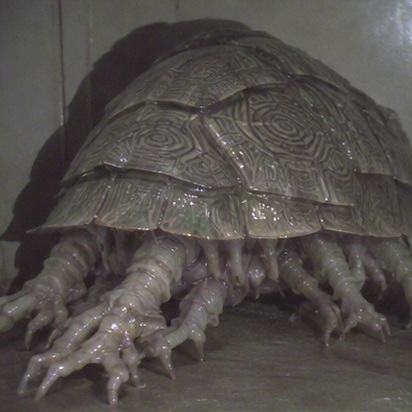
  - 【原典外貌】本相為一頭大如丘陵的萬年巨龜，初時化作道姑持寶劍與日月珠於萬仙陣激戰，遭西方強敵以念珠震破偽裝打回巨大母龜原形，復遭小包袱裹縛；最終在臨潼關外遭蚊道人刺穿甲殼吸盡精血，萬年道行頃刻化作乾癟空殼與滿地灰燼。
  - 【本作克蘇魯／昆蟲寄生／偽人重構】徹底抹除慈悲玄龜或祥瑞神獸印象，以極致黑暗地牢深淵生物恐怖重塑：一具長逾十二公尺、猶如泡發腐朽沉船龍骨的**太古深淵龜甲巨怪**！其厚重陰暗的墨黑背甲表面早已不見整齊龜紋，取而代之的是密密麻麻鑿入殼層深處的**慘白巨型寄生藤壺、層層增生如肋骨墓碑般的潮濕鈣化骨刺，以及不斷從裂縫滲出黑綠腐汁的寄生水蛭巢孔**。自甲殼前端探出的並非溫馴龜首，而是一顆佈滿鬆垮屍皮皺褶、沒有眼皮且雙瞳渾濁如溺死浮魚的骨質巨吻，頸側掛滿隨呼吸一脹一縮的半透明水螅觸絲。最令觀者生理戰慄的，是牠臨終遭嗜血巨蚊刺穿後的**「空殼化殘骸態」**——厚重背甲上開滿無數針孔般滲血的圓洞，殼內血肉與臟器被一滴不剩地吸乾抽空，只餘一具中空回響、佈滿慘白藤壺與乾燥骨刺的巨大空殼，偶爾仍在潮濕地牢積水中因寄生蟲爬動而發出「咯啦、咯啦」的詭異挪移聲。
- **特性**：
  - 【原典記載】性情剛烈暴躁、不知進退，萬仙陣中不顧勸阻獨自追殺懼留孫，反遭暗算打回萬年巨龜原形；最終竟死於一隻名不見經傳的血蚊口下，連元神都被吸食殆盡、徹底形神俱滅，無緣任何後世殘存。
  - 【本作衍生】擁有近乎無法從正面擊碎的**「深淵寄生厚甲」**與超強水壓抗性，常規三流至二流符咒（烈火符、一般五雷符）轟在背甲上只會濺起大片惡臭黏液與碎藤壺，反而激怒這頭重裝巨獸發動震地踐踏；同時其甲縫寄生藤壺與骨刺能持續釋放致腐海水瘴氣，將乾燥房間迅速轉為濕滑深淵積水區。
- **弱點**：
  - 【原典記載】被強大念珠類鎮壓器物震散化形後即淪為行動遲緩的巨龜原形；且對**專破硬甲、直抽生機血肉的「穿刺吸血類寄生天敵」**（如蚊道人）幾乎毫無防禦力，一旦殼內軟組織遭穿刺吸乾即刻徹底潰滅。
  - 【本作衍生】1. **正面硬甲無解，唯一死穴在於「甲縫軟膜」與「穿刺型破甲雷釘」**：切忌浪費火力猛轟背甲中央！高階除妖師須以**「指地成鋼符／陷地符」**先將牠拖入深槽卡死沉重四肢，再將**「五雷鎮煞符」**捲纏於細長精鋼探針或破甲弩箭上，精準打入背甲藤壺間隙或頸側水螅軟膜，直接引爆內腔。2. **極懼強鹼乾燥脫水**：其深淵寄生表皮高度依賴高濕水氣維持活性，大量生石灰與烈火高溫蒸發積水會令其甲縫龜裂、寄生藤壺成片剝落出血。
- **習性**：
  - 【原典記載】原典為截教碧遊宮門下修煉萬年之深淵老龜，性急好鬥、重同門之仇卻易中激將法。
  - 【本作衍生】在台灣現代環境中，這類太古深淵龜甲怪多半沉伏於港灣外海廢棄沉箱、百年跨海大橋水下基樁、或濱海核電廠／工業區龐大的廢棄海水冷卻進水涵洞底部，數十年如礁石般一動不動，唯有颱風大潮倒灌或有人破壞牠領地內的沉屍骨堆時，才會頂著滿背喀喀作響的藤壺骨刺緩緩爬上碼頭。
- **喜好**：
  - 【原典記載】原典未載飲食嗜好，唯執著於復仇與維護截教顏面。
  - 【本作衍生】極度迷戀低溫、高鹽度、混雜腐爛海藻與沉船鏽鐵味的鹹腥黑水，並對閃耀冷白月光的大型圓形寶珠或廢棄燈塔透鏡有異常收集癖。
- **擅長的招式／異能**：
  - 【原典記載】`日月珠`（祭起砸敵的雙寶珠，曾威脅闡教重將）、`萬年龜甲護體`（原形巨殼堅不可摧，唯破於蚊道人口針）。
  - 【本作衍生】`深淵藤壺瘴壓`（震動背甲骨刺噴出高壓鹹腥腐霧與鋒利碎殼雨，刮破皮膚即引發壞死性潰瘍）、`潮汐拖沉重壓`（四肢重踏令地下室瞬間湧出齊腰黑水，藉龐大重甲將獵物活活壓溺在積水底）、`空殼寄生蟲潮`（受創時自甲縫噴湧數以千計吸滿黑血的深海巨水蛭與腐食甲蟲）。

---

### [FS3-02] 蚊道人（鴻蒙嗜血巨蚊怪／吸血鬼之蚊・破甲長口針災厄）
- **出處順序**：第 84 回《子牙兵取臨潼關》
- **類別與造型路線**：`【非人生物恐怖型】`｜鴻蒙太古嗜血巨蚊怪（黑暗地牢「吸血鬼用蚊子」最純正代表・破甲吸血長口針 × 瘋狂低頻震翅 × 膨脹透明血囊）
- **物種／唯一性**：`獨一無二`（鴻蒙初開之際伴隨煞血濁氣孕育而生的唯一太古巨蚊魔怪；全書唯一吃乾萬年大妖、啃毀西方教至寶十二品金蓮三品後仍全身而退、徹底無解的漏網規格外怪獸）
- **稀有度與道行對照**：`★★★★★ 神級災厄（UR）`｜模糊道行：鴻蒙開闢級規格外妖蟲（無視萬年護甲與聖品金蓮防禦，見血與靈氣即抽乾成灰）｜本作階位：巔峰～規格外
- **外貌與黑暗地牢／恐怖谷視覺改寫**：
  - 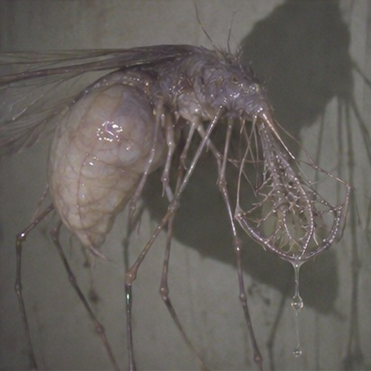
  - 【原典外貌】初時化為一隻微不足道、藏身包袱中的細小飛蟲，一獲釋放即化出本相暴長撲上萬年巨龜，幾息之間將堅硬無比的巨龜吸成乾灰；隨後展翅化作一道詭異血黑陰風直衝西方極樂八寶功德池，一口氣將十二品功德金蓮生生食去三品，從此遁入幽暗再無蹤影。
  - 【本作克蘇魯／昆蟲寄生／偽人重構】**本作「黑暗地牢吸血鬼用蚊子而非蝙蝠」生物恐怖聖經的最高純度圖騰！** 徹底摒棄任何穿黑披風的帥氣血族或普通道人形象——牠展開真身時，是一頭體長逼近三公尺、六條節肢如生鏽枯骨與手術鋼絲般極度細長反折的**鴻蒙嗜血巨蚊怪**。牠的頭顱幾乎完全被兩顆佔據整個臉面、映照出無數畸形倒影的**暗紅血光巨複眼**吞沒，複眼之間垂下一根長逾一公尺半、漆黑發亮、前端帶六片鋸齒微針與螺旋鑽槽的**「鴻蒙破甲吸血長口針」**，針尖時刻掛著一滴永不凝固的暗紫腐血，能像電鑽般毫不費力地貫穿萬年龜甲、防彈鋼板與二流金光護盾！牠的背部覆蓋殘破沾泥的漆黑油亮甲片，四片極薄、佈滿暗紅血管脈絡的濕潤雙翅以肉眼無法捕捉的速度瘋狂高頻震動——**那不是普通蚊子的細微嗡聲，而是宛如千百台失調舊變壓器與腦神經刮擦玻璃般、能令方圓百公尺內所有活人耳膜滲血、理智崩潰發瘋的「低頻震翅嗡鳴」**！牠那條異常碩大、層層環節膨脹的半透明腹部囊袋裡，清晰可見被抽乾的鮮紅人血、泛黑妖血與慘白微光精氣不斷翻湧沸騰，甚至隱約浮沉著未消化完的細小尖叫人臉氣泡。
- **特性**：
  - 【原典記載】全書最神祕、最無法用常理束縛的「生態位頂級吸血捕食者」——不屬於任何陣營、不參與任何仁義算計，純粹為無止境的飢渴而生；連萬年道行的大龜都能在數秒內被牠吸乾成空殼灰燼，更敢直闖西方聖地啃食十二品金蓮三品而揚長而去，連聖人都沒能當場留住牠。
  - 【本作衍生】在本作都市除妖界被列為「**最高級別不可接觸災厄（EX 紅警報）**」——任何三流至一流除妖師在廢棄捷運隧道、地下蓄洪池或老醫院太平間只要聽見那股震得牙齒發痠、耳膜發燙的異常低頻蚊鳴，**唯一正確動作就是立刻切斷體內靈力流動（假裝死物）並全速逃離該行政區**！因為牠能嗅探數十公里外的精純血氣與高階法寶靈氣，且其吸血口針具備「**跨維度無視防禦汲取**」特性：不只吸血與內臟漿液，連除妖師苦修數十年的法力、護身符裡的硃砂靈氣，甚至傳世法寶的核心器靈都能被牠一針刺入、活生生吸成一團無用廢灰！
- **弱點**：
  - 【原典記載】原典未載任何實質弱點或被誅滅紀錄，唯曾因體型微小被意外裹困於西方教特殊包袱之中一時不得脫身（卻因童子大意開啟而釀成大禍）。
  - 【本作衍生】**無常規物理或單兵符咒擊殺方案！** 實戰僅存在三項極限「逃生與封鎖」對策：1. **極度依賴「高純度靈氣／溫熱血脈訊號」定位獵物**：立即捏死**「閉氣訣」**並覆塗冰冷屍泥或貼上多重掩息**「淨氣符／避穢符」**壓低體溫與法力波動，絕不可在牠面前催動高階靈寶或金光護體（那等於在黑夜裡開探照燈喊牠來喝血！）。2. **吸飽膨脹後的短暫笨重期**：剛吸乾一頭大妖或靈物後，牠的半透明血囊會因過載而短暫下垂數分鐘，飛行軌跡轉為直線，此時唯有動用複數一流名宿聯手以「獨立空間封印器（仿古包袱／袖裡乾坤級容器）」或高壓烈陽雷火網才有機會強行將牠封裝轉移，絕不可妄想靠肉身硬拚。
- **習性**：
  - 【原典記載】深伏於無人察覺的狹小幽暗空間中，平時縮成微不可見的漆黑飛蟲假死待機，一旦感應到無防備的高能血食或稀世靈物便瞬間現出真身撲殺吸乾，得手後立刻消失於天際。
  - 【本作衍生】現代都市裡極少現蹤，唯有在**「超大靈脈洩漏點」**或**「大妖重傷垂死的潮濕地下戰場」**才會悄然現身撿尾刀——牠常倒掛在深埋地下數十公尺的廢棄下水道頂部、長年積水的捷運施工豎井暗角，像一團濕冷發黑的巨大蜘蛛網狀乾屍靜默懸吊，等待獵物自己送上門。
- **喜好**：
  - 【原典記載】極度嗜食萬年大妖精血骨髓（龜靈）與天地至寶之純淨靈氣（十二品功德金蓮）。
  - 【本作衍生】對普通凡人稀薄污濁的血液興趣缺缺（除非餓極了會一夜吸乾整棟違建公寓），最令牠瘋狂興奮的是**「道行高深的除妖師精血」「千年大妖內丹漿液」與「開光百年以上的寺廟古器靈氣」**——對牠而言，越是神聖強大的存在，刺進去吸起來越像冰鎮甘露。
- **擅長的招式／異能**：
  - 【原典記載】`破甲吸乾`（一針刺穿萬年龜甲，須臾吸乾血肉魂魄化為空殼飛灰）、`噬寶吞蓮`（無視結界生啃十二品功德金蓮三品）、`縮微遁形`（化作微蟲藏於尋常囊袋，令人防不勝防）。
  - 【本作衍生】`瘋狂低頻震翅場`（雙翅高速震盪引發次聲波精神汙染，令百公尺內法師頭暈吐血、手指痙攣連一張符都點不燃）、`鴻蒙六針穿甲鑽`（口針六瓣鋸齒同步旋轉，瞬間鑽破金光護身符、重裝甲殼乃至防爆鋼門，十秒內將目標連血帶內臟與法力全部抽成乾枯人皮）、`血囊爆壓回噴`（受重擊時反噴出混雜腐蝕消化酸與無數嗜血蚊卵的高壓毒血，沾身即化膿孵化）。

---

### [FS3-03] 烏雲（金鬚鰲魚怪／深海多鬚吸盤毒刺甲殼巨獸）
- **出處順序**：第 82 回《三教大會萬仙陣》、第 83 回《三大士收伏獅象犼》
- **類別與造型路線**：`【非人生物恐怖型】`｜深海巨型多鬚節肢甲殼鰲魚怪（深淵重甲幾丁質螯殼 × 佈滿吸盤毒刺之多鬚觸手 × 鰓裂水壓噴孔）
- **物種／唯一性**：`物種特異個體`（太古深海巨鰲魚異種中吞噬萬千海怪、修成千年凶威之霸主個體；本圖鑑去仙號，專收其金鬚鰲魚怪獸本相）
- **稀有度與道行對照**：`★★★★ 絕級（SSR）`｜模糊道行：數千年深海妖道行（萬仙陣頭陣猛將，正面硬戰連挫廣成子、赤精子兩大高手）｜本作階位：一流頂～巔峰初階
- **外貌與黑暗地牢／恐怖谷視覺改寫**：
  - 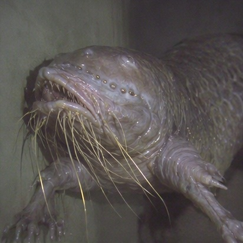
  - 【原典外貌】原為截教隨侍七仙之首，平日顯長鬚黑面道人相、使一把重逾千斤的「混元錘」；於萬仙陣頭陣兇悍絕倫、連敗闡教名宿，終被西方強敵以「六根清淨竹」化為長竿釣入水中，痛極翻滾現出本相——一尾體型龐大、雙頷拖曳金色長鬚的**金鬚鰲魚**。
  - 【本作克蘇魯／昆蟲寄生／偽人重構】摒棄傳統廟宇屋脊吉祥鰲魚雕像，重構為令深海恐懼症患者當場窒息的**「深海節肢甲殼多鬚鰲怪」**：身長超過十公尺，頭顱與胸背完全包覆在宛如巨型深海帝王蟹與大王具足蟲拼接而成的**漆黑濕亮厚重甲殼**裡，甲板邊緣生滿鋒利倒鋸與滲水的寄生白蠣。牠沒有普通魚鰭，腹側反而排生出**十二對如巨型龍蝦步足與螳螂鐮肢般的暗金甲殼節肢**，無論在深海礁石或淹水地下停車場都能高速橫行爬動！最駭人的是牠那張寬達三公尺、內藏三圈反彎骨齒的深淵巨口四周，狂亂垂長出數十條長逾五公尺、泛著腐蝕銅金冷光的**粗壯長鬚觸手**——每一條金鬚腹面皆密密排布著會自行開合吮吸的**環形齒狀吸盤與空心注射毒刺**，一旦纏上獵物便會同時勒斷肋骨並注入令肌肉壞死僵硬的深海神經麻痺毒，嘴邊六對巨型鰓裂開合間不斷湧出腥臭黑水與寄生海蟲。
- **特性**：
  - 【原典記載】兇猛好戰且實力極硬——萬仙陣首戰便以勢不可擋的剛猛錘法連破番天印攻勢並把廣成子、赤精子追得抱頭鼠竄，非頂尖剋制性靈寶難以壓制；一旦落水被六根清淨竹釣穿腮骨，則凶焰盡失、現出巨鰲原形任人牽制。
  - 【本作衍生】兼具**「重裝破牆怪力」**與**「數十條毒刺吸盤金鬚全向封鎖」**的頂級水域巨獸。牠能將整座老舊港區倉庫或地下抽水站瞬間灌滿深海鹹黑惡水，自己潛伏於渾濁黑水中只伸出數條濕滑金鬚偽裝成漂浮電纜，等除妖師涉水踏入範圍即數十鬚齊發拉入水底絞碎。
- **弱點**：
  - 【原典記載】極度受制於**「鉤釣腮顎＋清心鎮煞類竹木法器」**（六根清淨竹一竿釣穿其口顎即現原形喪失戰意）。
  - 【本作衍生】1. **口顎內側與頸後六道鰓裂為致命軟肋**：背殼幾丁質厚如裝甲車，正面轟擊難以奏效，但每一條金鬚與鰓裂都在吞吐水氣時暴露脆弱黏膜——實戰必須先以**「掌心雷／五雷鎮煞符」**配合高壓水下放電令牠滿身金鬚神經痙攣收縮，趁其張口抽搐的兩秒間隙，將繫有重雷符的倒鉤鋼叉或鎮煞竹樁死死鉤進牠的軟顎鰓裂，徹底廢掉牠的呼吸與發力核心。2. **離水久戰後甲縫乾燥僵化**：若能設法將牠引離港灣或抽乾地下積水、配合多張**「烈火符」**高溫烘烤，牠的鰓裂會因乾涸劇痛流血，機動速度驟降七成。
- **習性**：
  - 【原典記載】水生太古鰲魚成精，原典最終遭帶往西方八德池深水看管。
  - 【本作衍生】偏好潛伏在台灣大型商港深水防波堤、跨海隧道沉管接縫、廢棄造船廠乾塢或颱風夜淹水的超大地下滯洪池，極喜趁暴雨滿潮順著雨水幹線鑽進市區深層涵洞獵食大型生靈。
- **喜好**：
  - 【原典記載】原典未載特殊飲食，唯極喜正面力搏強敵。
  - 【本作衍生】嗜吞大型甲殼類腐屍、落水沉車內的淹溺者，以及帶有厚重金屬與雷電氣息的高階重兵器（常將戰利品鐵器捲纏在金鬚毒刺上當作額外流星錘揮砸）。
- **擅長的招式／異能**：
  - 【原典記載】`混元錘重擊`（千鈞重錘正面連退闡教兩大重將）、`翻江倒海巨鰲尾擊`。
  - 【本作衍生】`千鬚吸盤毒網`（數十條佈滿吸盤與空心毒刺的金鬚化作立體囚籠，觸及瞬間吸附表皮、扯落血肉並注入深海河豚級麻痺毒素）、`混元甲骨重錘`（將最粗壯的兩對前螯甲肢與捲纏廢鐵緊握成巨錘，一擊即可震塌地下室承重水泥柱）、`深淵鰓裂黑潮`（自六對鰓孔狂噴高壓腐蝕墨水與寄生海虱，瞬間讓密閉空間陷入伸手不見五指的深海盲區）。

---

### [FS3-04] 虯首（青毛獅子怪／萬仙陣巨型腐食鬃毛獅甲獸）
- **出處順序**：第 82 回《三教大會萬仙陣》、第 83 回《三大士收伏獅象犼》
- **類別與造型路線**：`【非人生物恐怖型】`｜巨型腐食鬃毛獅甲獸（幾丁質重甲軀殼 × 毒針寄生剛毛叢 × 腐食甲蟲巨顎）
- **物種／唯一性**：`物種特異個體`（萬仙陣太極陣主，太古異化獅甲獸族群中修成千年布陣凶威的霸主個體；本圖鑑徹底去仙號，專取青毛獅子怪獸本體）
- **稀有度與道行對照**：`★★★★ 絕級（SSR）`｜模糊道行：千年至數千年大妖霸主（獨掌太極殺陣、聲波碎魂，唯遇專門破陣法寶方現原形）｜本作階位：一流頂
- **外貌與黑暗地牢／恐怖谷視覺改寫**：
  - 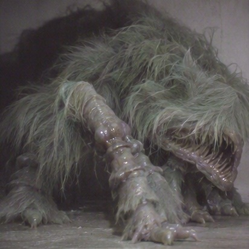
  - 【原典外貌】於萬仙陣中擺下「太極陣」迎敵，手執賓鐵劍，氣焰囂張；陣破後遭盤古幡震散護體妖氣並被綑妖繩／遁龍樁鎖住，當場現出本相——一頭體格魁梧、毛色發青的猙獰**青毛獅子**，最終遭收伏淪為坐騎。
  - 【本作克蘇魯／昆蟲寄生／偽人重構】徹底揚棄動物園大貓或威嚴廟口石獅形象，改寫為極度潮濕腐朽的**「黑暗地牢腐食鬃毛獅甲獸」**：體長達六公尺、肩高近三公尺，整具軀幹包覆在呈現屍斑青灰與黴綠光澤的**重型腐食埋葬蟲幾丁質甲板**之下，每一片甲縫皆滲出淡青色腐肉屍油。原本該是蓬鬆獅鬃的頸周，竟是一大片由數萬根**中空滲毒剛毛、枯黑馬鬃線蟲與寄生毒蜂刺管**密密叢生而成的「活體腐青鬃環」——微風吹過時，那圈青黑剛毛會像水下海葵觸手般各自獨立扭動並發出細微嘶嘶磨擦聲！牠的頭骨前端裂開成四瓣重疊的**腐食甲蟲鐮刀巨顎**，口腔深處沒有舌頭，唯有一座不斷開合搏動、長滿環形倒齒的漆黑共鳴咽喉；四條粗壯反折的節肢腳掌關節處，卡滿被碾碎發白的人類股骨與斷劍殘片，每走一步皆在潮濕水泥地上壓出散發屍臭的青黑黏液腳印。
- **特性**：
  - 【原典記載】萬仙陣三大巨獸陣主之首，專擅構築「太極陣」扭曲空間方位與陰陽氣場，令誤入陣中的強者迷失南北、反遭吞噬；一旦核心陣眼被外力強行撕碎、護體妖氣潰散，即刻原形畢露受制於人。
  - 【本作衍生】天生具備**「封閉空間扭曲力場（腐蝕太極域）」**的巢穴主宰型重甲巨獸。當牠盤踞於廢棄體育館或大型地下停車場時，頸周青黑毒鬃會釋放大量致幻腐臭孢子，同時咽喉發出人耳極難察覺的震盪低頻，令闖入者產生嚴重的「左右反轉、上下顛倒」空間錯亂（宛如鬼打牆的強化殺人版），自己則隱於陰影死角，等獵物撞牆頭破血流之際一口咬碎頭顱。
- **弱點**：
  - 【原典記載】高度仰賴「太極陣」地理環境與陣眼遮蔽，一旦陣法遭純粹破障神器撕開、本體遭綑縛索具鎖死，即毫無脫逃之法。
  - 【本作衍生】1. **破陣優先於硬攻**：絕不可在霧氣與空間扭曲未破之前貿然衝向牠的巨顎！必須先連擲**「破障符」**震散空間幻象、戴死防毒氣罩或貼上**「淨氣符／避穢符」**切斷青鬃致幻孢子，再用**「開天眼符水」**鎖定地下發光的兩處太極陣眼石樁並引爆破壞。2. **青黑剛毛鬃環極度易燃**：牠頸周佈滿含大量易燃屍油的線蟲與剛毛，只要一發**「烈火符」**準確甩進鬃毛叢，瞬間就會引發爆燃火球燒穿牠的頸部軟甲，趁其慘嚎閉合共鳴咽喉時用**「鎮妖定身符」**貼鎖關節再補雷法，即可重創。
- **習性**：
  - 【原典記載】結夥盤踞大陣（與白象、金毛犼分守太極、兩儀、四象三陣），喜藉群勢與險陣壓迫對手。
  - 【本作衍生】多潛伏於結構對稱、宛如太極雙圓的大型廢棄建築——如荒廢的圓形地下停車場坡道、廢棄冷卻塔底槽或百年老戲院旋轉舞台地坑，慣於將獵物屍骸拖回巢穴堆疊成陰陽環狀腐肉堆以滋養頸周寄生蟲鬃。
- **喜好**：
  - 【原典記載】原典未載飲食偏好，唯嗜以陣法困敵顯威。
  - 【本作衍生】嗜食已經開始發脹腐化、生出蛆蟲的半腐屍肉（新鮮溫血反而嫌太寡淡），並喜歡收集發霉的青銅鏡與破損指南針。
- **擅長的招式／異能**：
  - 【原典記載】`太極殺陣`（黑白迷霧困鎖空間、顛倒方向）、`青獅震魂怒吼`、`賓鐵劍術`。
  - 【本作衍生】`腐青太極迷陣`（散發青黑孢子霧並干擾前庭神經，令二流以下除妖師方向感完全顛倒、連自己甩出的符咒都飛往反方向）、`剛毛線蟲飛射`（劇烈甩頭將數百根帶倒鉤的青黑毒毛與活體寄生線蟲如散彈般射出，鑽入皮下持續啃噬肌肉）、`四顎裂骨咆哮`（四瓣甲蟲巨顎張至一百八十度，爆發出震碎耳膜與玻璃的腐蝕音波衝擊波）。

---

### [FS3-05] 靈牙（白象巨怪／多瓣吸血吸盤象鼻蒼白巨怪）
- **出處順序**：第 82 回《三教大會萬仙陣》、第 83 回《三大士收伏獅象犼》
- **類別與造型路線**：`【非人生物恐怖型】`｜蒼白多瓣吸血吸盤巨象怪（病態白化巨型硬皮蟲獸 × 多瓣縱裂環齒吸血鼻管 × 關節人骨嵌合）
- **物種／唯一性**：`物種特異個體`（萬仙陣兩儀陣主，極罕見之太古白化寄生吸血巨象怪；本圖鑑去仙號，專收白象巨怪本相）
- **稀有度與道行對照**：`★★★★ 絕級（SSR）`｜模糊道行：千年至數千年大妖霸主（獨掌兩儀陣、巨體摧城，遭長虹索破陣生擒現原形）｜本作階位：一流頂
- **外貌與黑暗地牢／恐怖谷視覺改寫**：
  - 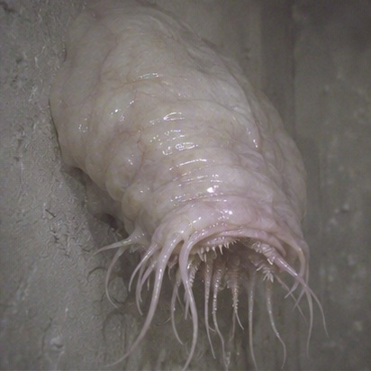
  - 【原典外貌】於萬仙陣主持「兩儀陣」，雙手持劍迎戰強敵，自恃蠻力與大陣威勢傲慢異常；終被破開兩儀陣光、遭長虹索死死綑住並打回原形——一頭龐大如山的**長毛白象**，降伏充作坐騎。
  - 【本作克蘇魯／昆蟲寄生／偽人重構】徹底顛覆莊嚴白象神聖形象，打造成黑暗地牢最令克蘇魯迷發寒的**「蒼白多瓣吸血口器巨怪」**：牠那座高達四公尺、臃腫沉重的身軀完全沒有溫軟象皮，而是如泡在福馬林裡數百年的**病態屍蠟白化厚皮與慘白軟殼褶皺**，體表不規則地垂掛著絲絲縷縷濕冷黏液與灰白寄生菌絲，四條柱狀巨腿的膝節與蹄縫處竟清晰嵌滿無數截斷裂的人類肋骨與顱骨碎片！**整頭怪物最令人胃部翻騰的核心器官，是那條長逾四公尺、粗如地下汙水主幹管的慘白象鼻——這根象鼻根本不是鼻子，而是一條會隨時從正中縱向撕裂開來、綻放成六片血紅濕亮肉瓣的「巨型吸血水蛭吸盤口器」**！六片肉瓣內壁密密層層排列著數百顆細密如七鰓鰻般的角質倒鉤環齒與透明吸血管，兩側原本應是象牙的位置，則突出兩根中空滲出乳白麻醉漿液的慘白骨質毒管；當牠猛撲獵物時，六瓣吸血巨鼻會像開花般「啪」地張開，瞬間將整名活人的頭顱與半截身軀死死罩住吸緊，在三秒內將全身血液連同骨髓從毛孔硬生生吮抽乾淨！
- **特性**：
  - 【原典記載】萬仙陣中鎮守「兩儀陣」，擅長藉兩儀陰陽分化幻影與沉重蠻力正面碾殺敵人，但性格剛愎輕敵，一遭法索束縛便被徹底制伏現原形。
  - 【本作衍生】結合**「裝甲推土機級物理衝撞」**與**「中距六瓣吸血巨鼻精準吸捕」**的毀滅級巨怪。兩儀陣在牠體內轉化為一種「冷熱雙極黏液場」——左毒牙噴出凍裂筋骨的慘白霜酸，右毒牙滴落融化鐵門的沸騰強鹼，再配合長鼻突刺吸乾被凍僵的獵物，堪稱地下結構內的移動屠宰廠。
- **弱點**：
  - 【原典記載】身軀極其龐大笨重，一旦陣勢被破、遭到高韌性索具（長虹索）死鎖四肢與長鼻，即難以轉身還擊。
  - 【本作衍生】1. **六瓣吸血巨鼻雖致命，卻也是全身最脆弱無甲的神經痛點**：其厚實白化軀幹極難靠一般符咒貫穿，但當牠將象鼻綻裂成六瓣肉花準備吸血時，鮮紅內壁完全暴露於空氣中——此時只要硬著頭皮把點燃的**「烈火符」**、高濃度食鹽石灰粉或貼身**「五雷鎮煞符」**直接塞進牠張開的吸盤喉管，劇烈灼燒與電擊會令牠當場噴血癱軟、徹底廢掉最大殺招。2. **利用狹窄門框與「陷地符」限制巨體轉向**：切忌在寬敞廣場與牠正面衝鋒，務必躲進窄小水泥柱列或樓梯間，於必經之路埋設多張**「指地成鋼符／陷地符」**令其萬斤身軀深陷泥化水泥無法拔腿。
- **習性**：
  - 【原典記載】與青獅、金毛犼同鎮萬仙三陣，依陣勢守株待兔。
  - 【本作衍生】盤踞於廢棄大型冷凍肉品加工廠、地下屠宰場冷庫或老舊工地深層地下基礎槽，常將自己龐大的屍白軀體蜷縮在堆滿發白黴菌的冷氣機房裡偽裝成白色大型儲水槽，待誤闖者走近檢查閥門時，驟然伸出六瓣吸血巨鼻將人整個吸乾。
- **喜好**：
  - 【原典記載】原典未載特殊飲食，唯好顯耀雙劍蠻勇。
  - 【本作衍生】對溫熱濃稠的新鮮活血與骨髓有著無底洞般的渴求，每次吸乾獵物後，總喜歡將乾癟的人骨踩進自己四肢濕軟的白化關節縫裡充當硬骨盔甲。
- **擅長的招式／異能**：
  - 【原典記載】`兩儀殺陣`（兩儀清濁氣場困殺敵將）、`白象巨力碾踏`、`雙劍亂砍`。
  - 【本作衍生】`六瓣蛭鼻活吸`（象鼻高速彈射四公尺、縱裂成六瓣環齒吸盤牢牢吸住目標頭胸，同時注入抗凝麻醉涎水並瞬間抽乾血液）、`兩儀霜鹼噴吐`（左右中空骨牙分別噴射極寒白霧與沸騰腐鹼，讓受困者皮膚先凍裂再被融解）、`嵌骨重踏震地`（萬斤白化巨體躍起砸落，直接震垮老舊建物樓板並濺射大量人骨碎刺）。

---

### [FS3-06] 金光（金毛犼魔獸／複眼反光噴毒巨型犼甲獸）
- **出處順序**：第 82 回《三教大會萬仙陣》、第 83 回《三大士收伏獅象犼》
- **類別與造型路線**：`【非人生物恐怖型】`｜複眼噴毒巨型犼甲獸（炮步甲重甲殼板 × 密集血金複眼 × 強酸腐毒噴囊）
- **物種／唯一性**：`物種特異個體`（古籍相傳嗜食龍腦之凶獸「犼」修成千年四象妖相之特異魔獸；本圖鑑去仙號，專收金毛犼魔獸本體）
- **稀有度與道行對照**：`★★★★ 絕級（SSR）`｜模糊道行：千年至數千年凶獸大妖（萬仙陣四象陣主，凶殘嗜殺、力敵一流高手）｜本作階位：一流頂
- **外貌與黑暗地牢／恐怖谷視覺改寫**：
  - 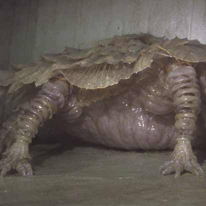
  - 【原典外貌】萬仙陣中坐鎮「四象陣」，神情凶厲狂傲，施展陣法黑風毒焰迎擊敵人，終遭三寶玉如意擊破法陣並被收伏打回原形——一頭兇猛駭人的**金毛犼**。
  - 【本作克蘇魯／昆蟲寄生／偽人重構】將傳統華表金毛犼徹底黑暗地牢甲蟲化，重塑為**「複眼反光噴毒巨型犼甲獸」**：身形宛如一頭長達五公尺、弓背伏行的巨型猛犬與重裝**炮步甲（射砲甲蟲）／巨蠍**之恐怖縫合體！全身覆蓋一層宛如生鏽黃銅混著乾涸膿血般泛著病態暗金油光的**厚實幾丁質甲板**，甲板邊緣並無溫暖獸毛，而是一排排極度堅硬、沾滿凝結毒晶的**暗金色鋸齒甲刺**。牠那張細長猙獰的骨質獸臉上，嵌著兩對總計四顆碩大外凸、表面佈滿數千道六角菱形微鏡面的**「血金反光複眼」**——在伸手不見五指的地下室裡，只要有一絲微弱手電筒光或火光掃過，牠的雙目複眼便會瞬間折射出令人靈魂凍結的刺目慘金冷光，精準鎖定數百公尺內每一絲肌肉微動！牠的尾椎與喉囊深處各連著一顆劇烈搏動、半透明泛黃的**「四象雙腔強酸毒囊」**，一旦張開生滿毒針的狹長口器，便會發出如高壓鍋洩氣般的尖銳「嘶——」爆鳴，將混合百種腐蟲毒液的高溫沸騰毒霧如噴火槍般狂射二十公尺！
- **特性**：
  - 【原典記載】萬仙陣三凶獸中凶性最烈者，坐鎮「四象陣」（包羅地水火風四重殺機）；古傳「犼」本性極度殘暴好食強大異類，不伏則死鬥到底，唯被更高位克制法寶直接鎮壓現形方肯低頭。
  - 【本作衍生】極端危險的**「高精準複眼狙擊＋高溫腐毒化學兵器型甲獸」**。憑藉兩對高倍率反光複眼，牠能完全看穿三流至二流的低階障眼法與隱身草上飛，並在百公尺外預判除妖師的閃避落點，以四種不同屬性的腐蝕毒霧（神經麻痺氣、沸騰強酸液、窒息腐塵與自燃磷火油）交叉封鎖整條逃生走廊。
- **弱點**：
  - 【原典記載】四象陣一旦被純粹玉石類鎮煞法器砸破核心、遭清淨寶瓶類容器壓制，其狂暴毒焰便無從施展。
  - 【本作衍生】1. **反光複眼極度畏懼「超強閃光瞬間致盲」**：牠的血金複眼雖在暗處視力無敵，但對突發性強白光缺乏虹膜收縮保護——實戰中突然引爆高鎂光照明彈、工業強光閃燈或將多張**「烈火符」**在牠眼前半公尺同步炸開，會令牠四顆複眼瞬間灼傷流膿、陷入長達五至十秒的暴躁盲目亂噴期。2. **腹部與喉下「雙腔毒囊」乃自爆死穴**：其化學毒囊內充斥不穩定的過氧化物與腐蝕磷油，只要趁牠致盲仰頭之際，以精準**「五雷鎮煞符」**貫穿喉下軟囊，便會引發劇烈化學殉爆，直接從內部將牠的重甲胸腔炸成兩截。
- **習性**：
  - 【原典記載】鎮守萬仙陣四象殺位，嗜戰好殺，專挑強橫對手吞噬撕咬。
  - 【本作衍生】極愛棲息於化學原料廢棄工廠、老舊電鍍廠地下廢液槽、或是充斥沼氣與硫磺味的地熱溫泉廢墟坑道，藉著吸收工業廢酸與腐敗蟲屍不斷強化體內雙腔毒囊的腐蝕當量。
- **喜好**：
  - 【原典記載】原典未載飲食細節，然古籍通說「犼」嗜食蛟龍腦髓與強大異獸血肉。
  - 【本作衍生】專愛獵殺同為妖物的蛇怪、蜥蜴怪與其他低階毒蟲，吞食牠們的毒腺來濃縮自己的金甲毒素；對微弱閃爍的手電筒光點有著本能的獵殺亢奮。
- **擅長的招式／異能**：
  - 【原典記載】`四象殺陣`（地水火風四氣絞殺）、`凶犼毒焰噴吐`、`利爪撕咬`。
  - 【本作衍生】`複眼動態鎖死`（無視煙霧與低階障眼法，精準捕捉獵物脈搏熱源與閃避軌跡）、`炮步甲沸酸四象噴射`（自口器與尾囊交替噴出高達攝氏百度的沸騰強酸、神經麻痺毒煙與自燃磷毒，沾中護身符紙即刻焦化腐爛）、`金刺重甲衝撞`（全身暗金甲刺倒豎，化作一團噴吐毒煙的高速鐵棘戰車正面碾碎掩體）。

---

### [FS3-07] 長耳（異化兔妖／垂地寄生聽毛偽人笑臉兔怪）
- **出處順序**：第 83 回《三大士收伏獅象犼》、第 84 回《子牙兵取臨潼關》
- **類別與造型路線**：`【類人偽人型】`｜異化長耳寄生兔妖（垂地肉膜長耳 × 細密寄生感覺聽毛 × 僵滯恐怖谷偽人笑臉）
- **物種／唯一性**：`物種特異個體`（天生巨耳異變、專擅竊聽密語與執掌陰毒咒幡的極罕見妖兔個體；本圖鑑徹底去仙號，專論其異化兔妖偽人本質）
- **稀有度與道行對照**：`★★★ 珍級（SR）`｜模糊道行：千年陰詭道行（正面硬拚遠不如烏雲與獅象犼，但憑竊聽偷襲與咒殺至寶「六魂幡」足以暗算絕世強者）｜本作階位：一流（極高危咒殺情報背叛型）
- **外貌與黑暗地牢／恐怖谷視覺改寫**：
  - 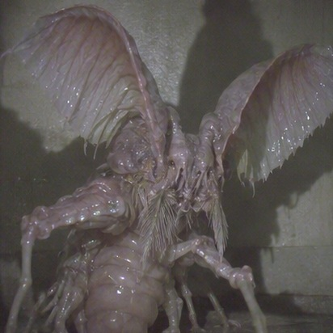
  - 【原典外貌】原典稱截教隨侍七仙之一「長耳定光仙」，受通天教主重託密掌終極咒殺器物「六魂幡」，卻於大戰決生死之際畏死貪生、陣前私藏六魂幡獻予敵營換取富貴生路。（*註：原書未詳載其獸形細節，後世評話與封神妖怪系譜多依「長耳」之名與生性怯懦多疑定性為異化兔精*）
  - 【本作克蘇魯／昆蟲寄生／偽人重構】本卷首位登場的**極致陰森「背叛者偽人（Mimic）」恐怖谷代表**！表面看來是一名身形佝僂瘦削、身穿發灰潮濕長衫、臉上永遠掛著一抹過於卑微討好且嘴角精準僵在四十五度的**蒼白偽人男子**——令人毛骨悚然的是，他的臉頰皮膚薄如半透明洋蔥皮，底下隱約浮現兔形缺唇的暗紅縱裂縫與無數細小蠕動的寄生蟲脈；雙眼眼尾過度上挑、瞳仁泛著死白血絲，永遠不敢與人對視，卻在人轉身的瞬間死死盯著你的後頸！**最令人本能生理反胃的，是他兩側垂掛下來、竟一路拖曳至膝蓋甚至觸及地面的兩條慘白肉膜巨耳**——這對垂地長耳絕非軟毛兔耳，內側耳廓完全外翻，密密麻麻長滿了數萬根宛如**百足蟲剛毛與寄生線蟲般的漆黑微細「感覺聽毛」**！這些細毛全天候在潮濕空氣中自行波浪狀擺動，不只捕捉數公里外最細微的氣音與耳語，甚至能像吸血纖毛般將貼地爬行的細小寄生蟲卵捲進耳道深處，再隨時從寬大袖管底下抽出一面沾滿乾黑血字與活體蛆蟲的「六魂咒幡」，露出那張永遠不變的僵硬諂笑。
- **特性**：
  - 【原典記載】全書最著名的「關鍵陣前叛徒」——受託執掌能改寫全局勝負的「六魂幡」，卻在最緊要關頭審時度勢、毫無道義地出賣同門獻寶求榮，生性極度狡猾怕死、唯利是圖。
  - 【本作衍生】現代都市裡最難防範的**「雙面間諜型情報竊聽與隔空咒殺偽人」**！牠從不跟除妖師正面決戰，平時偽裝成毫不起眼、滿臉堆笑的宮廟雜工、老大樓管理員或黑市法器仲介，藉著藏在圍巾與長髮下的垂地聽毛長耳，隔著三層水泥牆竊聽除妖師的真名、生辰八字、弱點與符紙庫存；一旦發現你快贏了就立刻轉賣情報給你的仇家，或躲在數公里外的潮濕地下室裡，拿著你掉落的髮絲與真名暗中搖動「縮配版六魂咒幡」，讓你莫名其妙在過馬路時心臟驟停或符袋自燃！
- **弱點**：
  - 【原典記載】正面鬥法本事極為平庸，天性極度貪生怕死、毫無硬骨氣，只要陷入無法逃脫的絕境威逼便立刻膝軟投降。
  - 【本作衍生】1. **極度敏感的「寄生聽毛巨耳」正是最大破防死穴**：牠整對垂地長耳的神經放大倍率是常人萬倍，面對突如其來的**超高分貝銳利爆音**（例如近距離敲擊道門大銅磬、震爆彈或「五雷鎮煞符」空爆雷鳴）會立刻讓牠雙耳聽毛狂噴黑血、內耳前庭徹底爆裂倒地抽搐。2. **離了咒幡與地形即毫無正面硬抗力**：只要用**「破障符」**斬斷牠與受害者之間的遠距血名咒線、逼進五公尺內近身肉搏，這隻欺軟怕硬的異化兔偽人連二流除妖師的一記**「掌心雷」**都扛不住，甚至會當場跪地出賣背後的其他大妖換取活命。
- **習性**：
  - 【原典記載】善於察言觀色、潛伏觀望局勢，見勢不妙即刻轉舵賣主。
  - 【本作衍生】極喜潛藏在音響回聲豐富、水管四通八達的老舊公寓管道間、地下室電信機房或二手古玩街暗巷，把兩條佈滿聽毛的垂地巨耳緊貼在金屬排水管與通風管壁上，竊聽整棟樓所有人的祕密與真名。
- **喜好**：
  - 【原典記載】極度貪生怕死，熱衷攀附強大靠山與蒐集強者真名秘密。
  - 【本作衍生】病態沉迷於偷聽別人的隱私對話、蒐集他人剪下的指甲、掉落的頭髮與身分證影本，並喜歡躲在暗處看著昔日同伴慘死而自己毫髮無傷地領賞。
- **擅長的招式／異能**：
  - 【原典記載】`六魂幡咒殺`（書寫目標真名於六條幡尾，早晚拜祭二十一日即可隔空搖幡咒絕對方性命）、`陣前竊密叛遁`。
  - 【本作衍生】`垂耳寄生聽毛竊聽`（將佈滿剛毛的長耳貼附牆壁、水管或地面，最遠可清晰竊聽一公里內的低聲交談、心跳節律與真名口訣）、`殘破六魂咒殺紙幡`（只要偷到受害者的姓名、血漬或毛髮寫入滲血符幡，便可於數公里外隔空引發心悸、窒息與五臟出血）、`脫皮偽人賣友替死`（遭追殺時瞬間褪下一具仍掛著諂笑的空心長耳人皮傀儡混淆追蹤，真身鑽進狹窄排水管逃竄）。

---

## 🌫️ 貳、第 85～89 回：澠池夜行重甲怪獸與棋盤山桃精柳鬼

### [FS3-08] 獨角烏煙獸（澠池夜行獨角腐蝕孢煙重甲怪獸）
- **出處順序**：第 85 回《鄧芮二侯歸周主》、第 86 回《澠池縣五岳歸天》、第 87 回《土行孫夫妻陣亡》
- **類別與造型路線**：`【非人生物恐怖型】`｜夜行獨角重甲孢煙怪獸（重型獨角仙幾丁質裝甲 × 空心噴煙毒角 × 微蟲腐蝕孢子囊）
- **物種／唯一性**：`物種特異個體`（原典澠池一役唯獨記載此一頭異化夜行怪獸；本圖鑑嚴格剔除其凡人星官騎主張奎與高蘭英，**純取獨角烏煙獸怪獸本體**）
- **稀有度與道行對照**：`★★★ 珍級（SR）`｜模糊道行：數百年異獸道行（疾速如漆黑狂煙，夜戰突襲與衝陣威脅直逼一流）｜本作階位：二流頂～一流初階
- **外貌與黑暗地牢／恐怖谷視覺改寫**：
  - 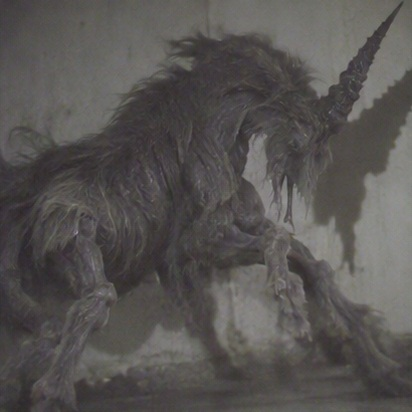
  - 【原典外貌】澠池關卡一頭異常凶悍奇異的坐騎怪獸，頭頂生有一根粗壯獨角，奔行起來「快如烏煙、疾若飛雲掣電」，憑藉驚人奇速多次助陣斬殺強敵；最終卻在對方巧施「替身移花接木」之計時，莫名其妙遭自己陣營誤斬去頭顱，死得極其詭異憋屈。
  - 【本作克蘇魯／昆蟲寄生／偽人重構】徹底剝離「戰馬」與「祥瑞獨角獸」印象，重塑為黑暗地牢式的**「夜行重甲噴煙獨角甲蟲怪獸」**：體長約四公尺半、背脊寬厚如一輛生鏽黑鐵裝甲車，全身包覆在宛如**巨型漆黑獨角仙與腐食糞金龜**般層層重疊的濕亮煤黑色幾丁質硬甲之中，甲片邊緣不停滲出惡臭瀝青色油汗。牠原本應是馬蹄的四肢，已異化為四條關節反折、末端生有倒鉤攀牆鋼爪的粗壯節肢重腿，腹側兩排則密佈隨奔跑節奏一開一闔的漆黑呼吸氣門！**整頭怪獸最駭人的構造，是自額骨正中斜刺向前、長逾一公尺半、形如焦黑煙囪與畸形蟲角結合體的「空心多孔獨角」**——角身遍佈蜂窩狀微細噴孔，全天候翻湧著濃稠如重油焦煙、夾雜數以百萬計微細**「腐蝕黑蟲孢子與嗜肉微蟎」**的漆黑毒煙！在漆黑無燈的隧道裡，根本看不見牠的身形，只能聽見甲殼摩擦鐵軌的喀喀爆響，緊接著一團伸手不見五指、散發刺鼻焦煤與腐屍酸味的活體烏煙以時速百公里轟然撞來，煙霧所過之處，金屬欄杆瞬間鏽蝕剝落、人體皮膚迅速起泡潰爛並鑽滿漆黑微蟲。
- **特性**：
  - 【原典記載】唯一核心長處便是極致的「黑煙級瞬發高速」——一拍獨角便化為一陣滾滾烏煙捲襲沙場，敵手連舉兵格擋都來不及便已被高速撞翻斬首；然而牠本身智商與防術能力不高，缺乏識破替身幻術的能力，最終淪為他人「替死斷頭計」的犧牲品。
  - 【本作衍生】極端棘手的**「無主野化高速夜行重甲怪獸」**。現代都市裡一旦失去馭獸者約束，牠會憑藉獵食本能在深夜快速公路隧道、廢棄鐵路山洞與大型地下連絡道內來回高速衝撞覓食；牠噴出的烏煙不只是視覺遮蔽，更是高密度活體腐蝕微蟲孢子雲，三流法師只要吸入兩口就會氣管潰爛出血、連口訣都唸不出來。
- **弱點**：
  - 【原典記載】不具識破高階幻術與替身轉移的能力（遭替身之計反殺斷頭）；且一旦獨角被鎖死或身陷堅實障礙便難以發揮奇速。
  - 【本作衍生】1. **高度依賴「直線高速衝鋒」與「密閉烏煙濃霧」**：牠的甲殼極為沉重，在高速狀態下幾乎無法急轉彎——實戰切勿在寬敞長直隧道內背對逃跑，必須迅速拐入狹窄柱列或轉角，在必經路面預先貼好**「指地成鋼符／陷地符」**讓地面驟然泥化，將其重甲四肢死死絆翻，令其靠自身慣性狠狠撞牆震裂頭甲。2. **獨角微蟲孢子煙極度畏懼「密閉粉塵爆燃」**：牠噴出的黑煙富含可燃微蟲油脂與有機孢子粉塵！法師只要提前貼好**「淨氣符／避穢符」**護住呼吸、算準牠衝鋒噴煙的剎那甩出一張**「烈火符」**點燃整片烏煙，劇烈的粉塵氣爆會沿著空心獨角倒灌進牠的顱腔與胸腹氣囊，直接從內部炸斷獨角、重創中樞！
- **習性**：
  - 【原典記載】原典為澠池戰將專屬夜行戰獸，平日蟄伏營中，唯臨陣拍角發動疾襲。
  - 【本作衍生】偏好極度陰暗無光且通風不良的線狀長通道——如廢棄舊台鐵紅磚山洞、荒廢煤礦斜坑、深夜罕無人煙的長距離地下車行道或大型污水主幹涵管，白天將四肢縮進黑甲中假裝成一塊長滿黑煤渣的巨岩沉睡，入夜後才噴湧烏煙出巢狂奔狩獵。
- **喜好**：
  - 【原典記載】原典未載特殊喜好。
  - 【本作衍生】極度迷戀老舊柴油廢氣、腐爛柏油焦臭與潮濕煤灰氣味，常會追逐深夜行經偏僻隧道的單獨貨車或夜歸機車，將司機撞昏後再以微蟲孢子慢慢腐蝕分食。
- **擅長的招式／異能**：
  - 【原典記載】`拍角疾奔如烏煙`（瞬間爆發出遠超常規戰騎的極速衝鋒，令對手防不勝防）。
  - 【本作衍生】`獨角腐蝕孢煙幕`（從空心多孔獨角狂噴覆蓋五十公尺的漆黑重油毒煙，徹底剝奪視野並以百萬微蟲孢子啃蝕暴露皮膚與符紙）、`黑甲百噸夜襲撞擊`（藏身烏煙中心發動無聲高速直線衝撞，足以直接撞扁鐵捲門與小客車）、`氣門黑油濺射`（受創翻滾時自腹側氣門噴射滾燙瀝青狀腐蝕黏液，困住近身斬殺的除妖師）。

---

### [FS3-09] 棋盤山・高明（千年桃精・千里眼／外凸複眼樹根節肢偽人）
- **出處順序**：第 89 回《紂王敲骨剖孕婦》、第 90 回《子牙捉神荼鬱壘》
- **類別與造型路線**：`【類人偽人型】`｜千年寄生草木偽人（外凸密集複眼眼球 × 腳底濕黏樹根節肢 × 竊靈古廟泥胎皮囊）
- **物種／唯一性**：`獨一無二`（棋盤山根盤三十里之千年老桃精，因竊附軒轅廟「千里眼」泥塑鬼使而獲異能的唯一植物精怪個體）
- **稀有度與道行對照**：`★★★ 珍級（SR）`｜模糊道行：千年草木精怪道行（單論千里無死角情報監控與先知閃避堪比一流頂，然本體離開老樹根基即脆弱不堪）｜本作階位：一流（全域視覺監控特化型）
- **外貌與黑暗地牢／恐怖谷視覺改寫**：
  - 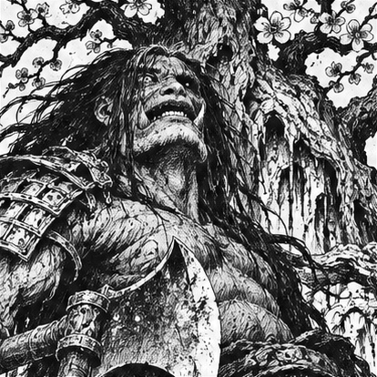
  - 【原典外貌】原典形容高明「面如藍靛，髮似硃砂，巨口獠牙如鋼劍，手持豹尾方天畫戟」；本體乃是棋盤山上一株根盤三十里的千年老桃樹精，因本體受限於泥土樹根，遂將妖魂附著於軒轅廟內「千里眼」泥塑鬼使身上，由此獲得看透千里之外軍情密謀的恐怖視力。
  - 【本作克蘇魯／昆蟲寄生／偽人重構】徹底改寫為令人不寒而慄的**「極致恐怖谷・外凸複眼樹根偽人」**：平日偽裝成一名身高超過兩公尺、四肢細長得像乾枯病樹枝、身穿破爛潮濕長風衣的**極度消瘦青灰偽人男子**。他的臉龐呈病態青藍死屍色，顴骨高聳、雙唇薄而僵硬地向上拉扯，最令人看一眼就脊背發寒的，是那雙**早已撐破人類眼眶、過度向外突出膨脹成兩顆拳頭大小、表面裂化成數百枚各自獨立轉動小眼球的「密集昆蟲複眼瘤」**！每一枚微細小眼都閃爍著濕潤冷白的詭異反光，彷彿上百支針孔監視鏡頭同時鎖死你的毛孔，甚至能看見淡紅桃膠般的黏稠液體順著腫脹眼眶不斷滲流下來。更駭人的是只要低頭看他的褲管下方——他根本沒有人類腳掌！他的雙踝之下已徹底撕裂異化為**十餘條如百年老樹氣根、馬陸多足與濕黏寄生蟲鬚纏繞而成的漆黑「濕黏樹根節肢」**，每邁出一步便發出濕泥拔起般的「啵唧、啵唧」聲響，並悄悄將細如髮絲的桃根神經鬚扎進柏油路縫隙與水泥地板裡，像佈設光纖監控網般偷窺方圓數十公里內的每一個角落。
- **特性**：
  - 【原典記載】與柳鬼高覺兄弟聯手堪稱全書最無解的情報怪物——遠在千里之外商營帳內，竟能將周營一切機密計畫、偷襲路線與法寶出手軌跡看得一清二楚，連哪吒、李靖、楊任等高手輪番施法都被他提前預判閃遁，逼得周軍束手無策。
  - 【本作衍生】現代都市裡最令除妖師絕望的**「全城無死角天眼監控偽人」**！你昨晚在租屋處浴室裡畫了幾張烈火符、符袋暗袋藏了哪張底牌、今天打算從哪個安全梯繞背偷襲，他隔著整個行政區都能透過地底延伸的老樹神經根與外凸複眼看得一清二楚！只要不先拔除他的本體根脈與附靈神像，正面交鋒他永遠提前三秒看穿你的每一招起手式。
- **弱點**：
  - 【原典記載】致命死穴極其明確——**一怕「挖斷並烈火焚燒棋盤山老桃樹根脈」（斬斷再生與妖力來源）；二怕「砸毀軒轅廟千里眼泥塑鬼使」（斷絕附靈神通）；三怕「陣前漫天紅旗招展、濃霧煙塵遮蔽視界」（強行過載干擾其千里眼視覺）**。根斷像毀後，他頃刻間神通盡失、在混戰中遭到輕易斬殺。
  - 【本作衍生】1. **戰術鐵律：絕不在正面硬攻前與他拚資訊戰，必須打「視覺過載遮盲戰」＋「溯源燒根戰」**！先用煙霧彈、漫天飛散的**「破障符」**碎紙灰與高強度工業頻閃雷射燈塞滿他過度膨脹的數百顆外凸複眼，引發劇烈視神經反噬溢血（眼睛一多，受強光刺激的痛覺就放大百倍！）。2. **斬草必除根**：就算在市區把他的偽人軀殼打碎，只要郊山老桃母樹未燒、廢棄古廟裡的寄生泥胎未砸，他三天內就會靠樹根節肢重新長出新偽人皮囊——必須先以**「尋蹤紙鶴」**順著地底桃膠根鬚反追蹤回郊山老樹巢穴，灑滿汽油配合**「烈火符」**把整座三十里老根燒成焦炭，再敲碎古廟寄宿泥像，即可令其徹底灰飛煙滅。
- **習性**：
  - 【原典記載】本體紮根深山老林，妖魂借古廟神像顯聖，極喜窺探人間軍情機密並與高覺互為表裡。
  - 【本作衍生】偏愛在郊區荒廢山坡老樹林紮下龐大地下根系，偽人分體則常於深夜佇立在高樓頂樓水塔旁、老舊監視器盲區或十字路口變電箱陰影裡，一動不動地盯著整座城市萬家燈火的窗戶偷窺活人隱私，腳下樹根節肢則悄悄鑽進雨水下水道吸取陰濕地氣。
- **喜好**：
  - 【原典記載】原典未載飲食嗜好，唯嗜與高覺一同窺破強敵算計、享受高高在上的掌控快感。
  - 【本作衍生】病態沉迷於窺視人類在獨處密室中最隱密狼狽的瞬間，巢穴老樹洞裡掛滿了從各處偷來的報廢監視器鏡頭、破眼鏡與乾枯發白的動物眼球。
- **擅長的招式／異能**：
  - 【原典記載】`千里眼全域透視`（看破千里之遙一切布陣與法寶起手）、`化清風遁走`、`豹尾方天畫戟`。
  - 【本作衍生】`數百複眼無死角預判`（同時追蹤數十道飛符與襲擊軌跡，精準算出零點一秒後的避讓空隙，正面幾乎無法偷襲命中）、`桃膠黏液樹根束縛`（腳底十餘條濕黏樹根節肢驟然暴長鑽出柏油路面，如多足節肢蟲爪般纏死目標腳踝並分泌腐蝕紅膠）、`複眼焦距灼視`（數百枚外凸眼球同時聚焦凝視同一目標，引發除妖師劇烈偏頭痛、幻視與結印中斷）。

---

### [FS3-10] 棋盤山・高覺（千年柳鬼・順風耳／昆蟲震膜耳廓柳絲偽人）
- **出處順序**：第 89 回《紂王敲骨剖孕婦》、第 90 回《子牙捉神荼鬱壘》
- **類別與造型路線**：`【類人偽人型】`｜千年寄生陰柳偽人（大片摺疊昆蟲聽覺震膜耳廓 × 寄生線蟲般漆黑濕柳絲 × 竊靈古廟泥胎皮囊）
- **物種／唯一性**：`獨一無二`（棋盤山根盤三十里之千年老柳鬼，因竊附軒轅廟「順風耳」泥塑鬼使而獲異能的唯一陰柳怪體）
- **稀有度與道行對照**：`★★★ 珍級（SR）`｜模糊道行：千年草木陰鬼道行（竊聽千里密語與心跳頻率堪稱無解，一旦根脈斷絕、神像遭毀則迅速潰滅）｜本作階位：一流（全域聲波竊聽特化型）
- **外貌與黑暗地牢／恐怖谷視覺改寫**：
  - 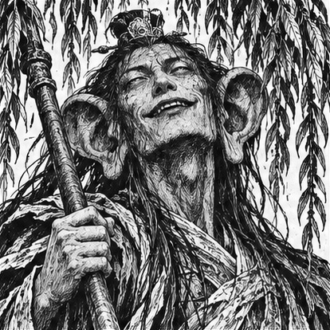
  - 【原典外貌】原典描寫高覺「臉似青松（瓜皮青色），口如血盆，赤鬚似繩，手持如車輪般碩大的加鋼板斧」；本體為棋盤山千年老柳樹精，與桃精高明同寄靈於軒轅廟鬼使泥塑，憑藉「順風耳」神通將千里外周營暗中商議的每一句軍機密語聽得清清楚楚。
  - 【本作克蘇魯／昆蟲寄生／偽人重構】與兄長高明構成極致詭異的視覺／聽覺恐怖谷雙子！表面上是一名總是微微側著頭、臉色發青發黑、彷彿永遠在聚精會神偷聽牆角秘密的**極度陰鬱偽人男子**。他從不正面看人，細看他的雙側耳廓更會瞬間令人胃部抽搐——他完全沒有正常人耳，太陽穴兩側向後撕裂展開成**兩大片半透明泛著死灰油光、層層摺疊如巨型蟬類與蝗蟲腹部聽覺器官般的「昆蟲鼓膜震膜耳廓」**！只要周遭十公里內有人低聲說出他的名字，那兩大片摺疊肉膜便會像受驚的昆蟲翅膀般劇烈高頻震顫並滲出黑綠耳液。而他微駝的後背與發黴風衣下擺之後，竟密密麻麻拖曳著數百條不斷扭曲蠕動、濕冷滑膩得宛如**巨型寄生線蟲與落水腐屍長髮般的「漆黑濕柳絲」**！這些活體濕柳絲在地上緩緩爬行、攀附過積水與金屬管線，不僅能把整棟建築的震動訊號直接傳進他的昆蟲震膜耳裡，更能瞬間絞緊成絞繩勒斷獵物咽喉。
- **特性**：
  - 【原典記載】與高明一明一暗相輔相成——哪怕周營拉上帳幕遮住高明的視線，只要有人張口商議計謀，高覺便能隔著千里風聲字字不漏地聽見，進而搶先截擊或設伏反殺。
  - 【本作衍生】極度陰森的**「全域聲波竊聽與次聲波精神干擾偽人」**！哪怕你躲在無窗隔音的地下安全屋裡商量對策，只要你開口說話、甚至只是呼吸太重或紙符摩挲作響，高覺就能透過微弱的結構震動與風聲將你的戰術倒背如流——更可怕的是，他能藉由監聽除妖師的心跳加速頻率，精準判斷你哪一秒最恐懼、哪一秒法力將竭，然後在最絕望的拍點上派柳絲從背後無聲鎖喉。
- **弱點**：
  - 【原典記載】與高明共享同源死穴——**一懼「掘斷火燒棋盤山千年老柳樹根」；二懼「砸碎軒轅廟順風耳泥塑鬼胎」；三懼「震天巨鼓齊鳴、萬人喧囂轟爆其順風耳」**（原典周營正是同時大擂震天戰鼓＋漫天搖旗，將二怪耳目同時震亂失靈，再配掘根毀廟一舉絕殺）。
  - 【本作衍生】1. **極端過敏的「昆蟲震膜巨耳」怕極了無差別高分貝雜訊衝擊**：商議作戰計畫時**嚴禁出聲交談**（須以紙筆手寫或加密無聲手勢溝通，並防備高明偷窺！）；實戰開打瞬間，立刻同步引爆高分貝防空警報器、超低音爆震喇叭，或在密閉空間內連炸**「五雷鎮煞符」**製造劇烈迴聲轟鳴，他的摺疊昆蟲震膜會瞬間承受不住音壓而撕裂爆血，疼得雙手抱頭滿地打滾。2. **身後漆黑濕柳絲極畏烈火與除草強酸**：用**「烈火符」**配合高溫明火即可把纏人的線蟲狀濕柳絲成片燒焦蜷縮，同時務必派另一組隊員趁亂直撲郊山火燒其千年老柳主根、砸爛寄宿泥胎，否則他會順著陰濕水脈無限復活。
- **習性**：
  - 【原典記載】盤踞深山古柳、附靈古廟，與高明形影不離，喜聽四面八方風聲密語。
  - 【本作衍生】極喜潛伏在風聲呼嘯的跨河老鐵橋橋墩下、廢棄廣播電台發射塔陰影、老舊醫院地下排風井或暴雨後的河濱濕地陰柳叢中，藉著水氣與風道擴大自己的竊聽半徑。
- **喜好**：
  - 【原典記載】原典未載飲食偏好，唯痴迷偷聽萬物密語與截殺洩密者。
  - 【本作衍生】對「深夜密室裡的恐懼低語」「瀕死者的窒息喘息聲」與「指甲刮擦黑板的尖銳雜音」有病態癖好，會將受驚受害者的最後一聲尖叫存留在震膜共鳴腔裡反覆重播。
- **擅長的招式／異能**：
  - 【原典記載】`順風耳千里竊聽`（隔千里聽盡軍帳密謀與細微動靜）、`借風陰遁`、`車輪加鋼板斧劈砍`。
  - 【本作衍生】`昆蟲震膜全頻竊聽`（透過風聲、水管震動與牆面共鳴監聽數十公里內任何語音、心跳與唸咒口訣，提前打斷敵人結印）、`寄生線蟲柳絲絞網`（背後數百條漆黑濕柳絲如活體寄生蟲般暴射纏繞，勒斷四肢同時從傷口鑽入血管吸血）、`倒灌耳鳴死音`（高速震動兩大片摺疊昆蟲耳膜，反吐出令人瞬間眩暈嘔吐、五臟翻攪的刺耳超高頻尖嘯）。

---

## 🐒 參、第 90～93 回：孟津決戰・梅山七怪（全七尊無漏收錄）

### [FS3-11] 梅山七怪〔一〕白猿精・袁洪（梅山之首・變形蟲肉塊寄生巨猿怪）
- **出處順序**：第 90 回《子牙捉神荼鬱壘》、第 91 回《蟠龍嶺燒鄔文化》、第 92 回《楊戩哪吒收七怪》、第 93 回《金吒智取遊魂關》
- **類別與造型路線**：`【類人偽人型】`（主態為俊冷蒼白偽人武將皮囊，臨戰可瞬間裂解重組為 `【非人生物恐怖型】` 變形蟲肉塊寄生巨猿本相）｜變形蟲肉塊寄生巨猿怪（可任意裂解重組肉塊與皮囊 × 斷頭再生無數寄生觸鬚 × 八九玄功無定形生物恐懼）
- **物種／唯一性**：`物種特異個體`（梅山七怪之首，白猿族群中歷經數千年苦修悟透「八九玄功」與極致變形不死肉身之絕世霸主）
- **稀有度與道行對照**：`★★★★ 絕級（SSR）`｜模糊道行：數千年絕世大妖霸主（正面武藝、七十二變與不死肉身直追當世巔峰，曾憑鐵棍斃殺強敵、與楊戩大戰數百回合難分高下）｜本作階位：一流頂～巔峰
- **外貌與黑暗地牢／恐怖谷視覺改寫**：
  - 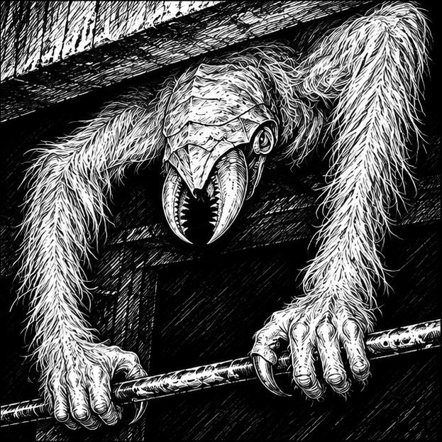
  - 【原典外貌】商朝末年應招賢榜鎮守孟津的大元帥，容貌俊秀冷峻、使一條烏沉沉的鐵棍，本相乃一頭修成千年道行的**通臂白猿**；精通八九玄功與七十二般變化，即便被擒押上法場斬落頭顱，脖頸竟無鮮血湧出，反而綻開一朵慘白妖異蓮花瞬間長出新頭復生，直至祭出陸壓「斬仙飛刀」方才徹底伏誅。
  - 【本作克蘇魯／昆蟲寄生／偽人重構】**全卷壓軸級的「克蘇魯變形蟲偽人 × 極限肉塊寄生不死巨猿」災厄！** 初見之時，他宛如一名身穿暗沉甲衣或黑色修身風衣、膚色慘白如石膏、面容冷俊得近乎完美卻毫無眨眼頻率的**頂級恐怖谷偽人武將**——但那層看似端正的人類外表其實只是一張隨時在皮下輕微鼓泡滑動的**「薄嫩偽人皮囊」**！只要戰鬥白熱化，他體內的骨骼會發出令人牙酸的集體折斷重排爆響，整具身體如**巨型變形蟲與寄生肉瘤集群**般驟然裂解、膨脹、倒錯重組——慘白人皮從脊椎中線嘶啦撐開，湧出大量濕潤發亮、帶著粗硬雪白剛毛與半透明環節肌纖維的蒼白巨猿畸變肉塊，四條過度粗長、指節呈反彎節肢狀的蒼白巨臂拖地橫掃，指縫間不斷流淌黏膩腐液！**最令除妖師徹底崩潰失智的一幕，是當你拚盡性命好不容易把他的頭顱一刀斬飛的瞬間**——斷頸切口既無一滴人類鮮血，也不會倒下，反而像一朵突然炸開的慘白肉花般，從氣管與頸椎孔洞裡狂噴出數百條扭動嘶叫的**慘白吸血寄生觸鬚**！那些觸鬚在半空瘋狂交纏蠕動、吞噬周遭碎肉與陰氣，不到兩秒便當著你的面重新編織出一顆帶著冰冷偽人微笑的新頭顱，同時你斬落在地的那顆舊頭顱還會張開裂嘴、長出細密蜘蛛節肢朝你的小腿反撲咬來！
- **特性**：
  - 【原典記載】梅山七怪絕對統帥與全書戰力天花板級大妖——既懂兵法謀略（收編高明高覺、布兵孟津），本身更具備與楊戩完全對等的「八九玄功」無雙戰力、七十二般變化、元神出竅與極端駭人的「斬首復生不死之身」，尋常神兵利器與斬首刑罰對牠完全無效，必須靠頂級幻境神器「山河社稷圖」誘其現形生擒、再由規則殺器「斬仙飛刀」鎖死元神方能斬絕。
  - 【本作衍生】現代都市裡單體即足以觸發「**封區級一級警戒**」的絕世變形蟲型不死妖帥！牠的「八九玄功」在本作體現為**「細胞級無定形肉塊重組與任意偽人擬態」**——牠可以隨時把自己撕裂重組成路過的警察、隊友的臉、地下水道裡的一灘白肉水蛭，或膨脹成四公尺高的蒼白肉塊巨猿；一般針對單一器官（爆頭、刺心）的致命攻擊對牠形同搔癢，反而會誘發牠的傷口狂生寄生觸鬚進行多角度反殺！
- **弱點**：
  - 【原典記載】1. **極度難敵「天性食慾誘惑＋獨立空間幻境陷阱」**（原典正是被「山河社稷圖」幻化出滿山仙桃誘發白猿天性，鬆懈戒備現出原形吃桃才遭縛妖索生擒）。2. **斬首不死之身唯有「徹底鎖死並摧毀核心元神／中樞」的規則級神兵（斬仙飛刀）方能絕殺**。
  - 【本作衍生】**嚴禁三流與二流除妖師正面交鋒，遇之必死！** 一流名宿聯手圍剿時必須緊扣兩大生死破口：1. **貼斷肢防再生鐵律**：每次斬斷他的頭顱或手臂，必須在**零點五秒內**將高階**「鎮妖定身符」**連同**「五雷鎮煞符」**死死按進斷口血肉裡引爆高壓雷火，趁寄生觸鬚焦黑碳化無法編織的空檔封死再生迴路！2. **誘入獨立結界瓦解其變形本能**：絕不可在開闊鬧市追擊（牠一秒就能融進人群偽裝成任何路人），必須以頂級幻陣或結界鎖死空間，再針對牠隱藏在胸腹變形肉塊深處、唯一一顆不斷游移的**「雪白肉核內丹」**發動因果級或高階雷火覆蓋絕殺，只要震碎那顆游移肉核，整具龐大變形肉山便會瞬間失去聚合力、潰爛成一灘發臭死水。
- **習性**：
  - 【原典記載】盤踞梅山稱尊，率領六頭千年妖怪結義，極具野心與統帥才幹，敢隻身帶領群妖應商朝招賢榜坐鎮孟津對抗天下大軍。
  - 【本作衍生】不會像低階野妖那樣縮在臭水溝撿殘羹，而是極度狡詐地混入現代都市高層人脈或盤踞整座深山廢棄軍事地下指揮所，暗中收編各方散落市區的中高階異化妖物組成地下黑幫式妖群網路，冷眼觀測除妖界動向。
- **喜好**：
  - 【原典記載】對甘美鮮桃有著刻入白猿骨髓的致命嗜好（竟因此中了山河社稷圖之計喪命）；此外好強爭勝、極愛與旗鼓相當的頂尖戰士棋逢對手地硬拚。
  - 【本作衍生】極度沉迷於收集並模仿強大除妖師的臉孔與招式，對新鮮熟透的紅桃氣味有近乎無法自控的進食反射（這也是高階除妖師唯一能設局誘騙牠露綻的微弱心理漏洞）。
- **擅長的招式／異能**：
  - 【原典記載】`八九玄功`（金剛不壞、斷頭再生、刀槍難傷）、`七十二般變化`（千變萬化難測真身）、`烏鐵棍無雙棍法`（曾硬生生打死猛將楊任）、`元神出竅遁逃`。
  - 【本作衍生】`變形蟲偽人裂解重組`（一秒內任意切換完美人類偽裝、十數條寄生肉鬚亂舞態或四公尺巨猿強襲態）、`斷頭白花寄生觸鬚再生`（遭斬首瞬間爆發出百條吸血寄生肉鬚反噬偷襲者，兩秒內重鑄新頭）、`肉骨凝鐵棍`（直接將自身高密度鈣化骨刺與變形肉筋壓縮成重逾千斤的蒼白骨鐵棍，一掃即震塌鋼筋水泥牆）、`百面偽人混戰`（裂解數團肉塊化作外貌與隊友一模一樣的短命擬態分身擾亂防線）。

---

### [FS3-12] 梅山七怪〔二〕水牛精・金大升（腐蝕牛黃蟲囊巨型甲殼水牛怪）
- **出處順序**：第 90 回《子牙捉神荼鬱壘》～第 92 回《楊戩哪吒收七怪》
- **類別與造型路線**：`【非人生物恐怖型】`｜巨型甲殼蟲囊水牛怪（幾丁質重甲水牛軀 × 腹腔高溫腐蝕牛黃蟲囊 × 鍬形巨角鉗顎）
- **物種／唯一性**：`物種特異個體`（梅山七怪戰力次席之千年水牛精，體內煉化出高熱劇毒「牛黃」異囊的凶悍妖將）
- **稀有度與道行對照**：`★★★ 珍級（SR）`｜模糊道行：千年大妖戰將（一擊噴吐火電牛黃直接打爆哼將鄭倫面門並揮刀斬殺，正面猛攻極為駭人）｜本作階位：一流
- **外貌與黑暗地牢／恐怖谷視覺改寫**：
  - 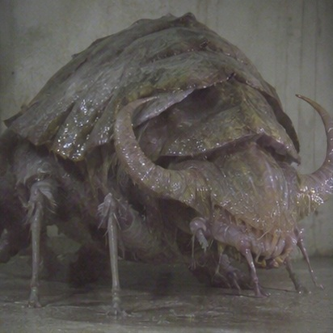
  - 【原典外貌】面目猙獰、力大無窮的商營妖將，騎坐異獸、使一口三尖刀；本體乃一頭修煉千年的巨大**水牛精**，腹內煉成一塊碗口大小的致命妖寶「牛黃」，臨陣大口一張便將牛黃噴出如烈火雷電，直擊敵人面門致死，最終遭伏妖索擒拿斬首現出巨牛原形。
  - 【本作克蘇魯／昆蟲寄生／偽人重構】徹底脫去溫厚農耕水牛外皮，重構為黑暗地牢式的**「高熱腐蝕牛黃蟲囊・重裝甲殼水牛怪」**：身軀龐大如一頭四公尺長的巨型遠古水牛與**漆黑濕亮鍬形重甲大蟲**的畸變合體！整具背脊覆滿厚重粗糙、宛如泡在爛泥沼澤裡長滿寄生苔蘚與腐臭泥漿的墨黑幾丁質裝甲板，頭頂向兩側彎曲展開的並不是普通牛角，而是一對表面密佈倒鉤鋸齒、彷彿**巨型鍬形蟲鉗顎**般可小幅開合剪斷鐵樑的漆黑重角！**最令目擊者作嘔戰慄的核心特徵，在牠那座半透明、隨著粗重喘息劇烈搏動並散發出滾燙焦臭蒸汽的「腐蝕牛黃腹腔」**——牠整個胸腹下方完全沒有硬甲，反而暴露出一個不斷翻滾著暗橘色沸騰強酸漿液與數十顆拳頭大小、表面爬滿密密麻麻耐高溫寄生活蛆的**「活體燃燒牛黃蟲囊」**！每當牠暴怒仰頭吸氣，一顆赤紅滾燙的活體牛黃蟲囊便會順著膨脹食道狂衝上喉，伴隨雷鳴般的爆裂巨響自裂開的巨口噴射而出！
- **特性**：
  - 【原典記載】梅山七怪中除袁洪之外正面爆發力與單殺戰績最兇狠的猛將——臨陣連破強敵，更以快如火電的噴吐「牛黃」直接破防打碎哼將鄭倫鼻樑面門、當場揮刀斬為兩段，逼得高階戰力親自出手祭出專克妖物的「伏妖索」才成功制伏。
  - 【本作衍生】典型的**「重裝衝撞坦克＋高熱酸液活體蟲彈砲台」**！牠噴出的牛黃蟲囊在空中拖曳滾燙腐蝕火尾，一旦砸中目標或掩體便會猛然炸裂，既具備重砲般的鈍擊爆裂威力，炸開後更會濺出大量攝氏兩百度的沸騰強酸膽汁與瘋狂鑽咬皮肉的耐熱寄生火蛆，連二流「金光護身符」都只能勉強硬吃一發隨即自燃報廢。
- **弱點**：
  - 【原典記載】極度畏懼專克妖身的**「高階束縛法索（伏妖索）」**與針對其原形要害的圍剿合擊；且每次噴吐牛黃前胸腹鼓脹蓄力動作明顯。
  - 【本作衍生】1. **高溫膨脹的「無甲半透明牛黃腹腔」正是全身最致命的殉爆弱點**：牠的背脊甲殼與頭頂鍬形巨角硬得連精鋼刀都砍出火花，但肚腹下方為了讓高溫蟲囊散熱而完全暴露著脆弱肉膜！實戰切勿跟牠正臉對轟，必須趁牠抬頭吸氣準備發射牛黃蟲囊、門戶大開的關鍵兩秒，滑鏟或藉地形高差將**「五雷鎮煞符」**或冰寒滅火劑狠狠打進牠發亮的肚腹囊壁，高壓電擊與急冷熱脹冷縮會令整袋沸騰牛黃在牠肚子裡當場自爆，把這頭甲殼巨牛從內而外炸個稀巴爛！2. **「指地成鋼符／陷地符」泥化其沉重步伐**：牠體重驚人，一旦雙前肢陷進泥沼失去衝鋒慣性，便會變成活靶子。
- **習性**：
  - 【原典記載】本體為深山潭澤修煉千年的水牛妖，隨袁洪結義佔據梅山，性情粗暴嗜殺。
  - 【本作衍生】現代都市裡極愛藏身於廢棄傳統屠宰場血水沉澱池、郊區沼澤工業廢泥塘或充滿高溫廢熱蒸汽的地下鍋爐房與垃圾焚化廠底槽，平日浸泡在滾燙惡臭的污水泥潭裡滋養腹腔內的腐蝕牛黃蟲囊。
- **喜好**：
  - 【原典記載】原典未載飲食細節，唯好藉重刀與火電牛黃正面碾壓對手。
  - 【本作衍生】極度迷戀高溫發酵腐爛的動物內臟、生鏽鐵水氣味與硫磺沼氣，常在夜間偷襲郊區畜牧場或廢棄工廠將整批牲畜融化成酸液吞飲。
- **擅長的招式／異能**：
  - 【原典記載】`口噴火電牛黃`（腹內煉成碗口大牛黃如雷電火球直擊面門，打死哼將鄭倫）、`三尖刀剛猛劈砍`。
  - 【本作衍生】`沸酸牛黃蟲彈轟擊`（高速噴吐碗口大赤紅寄生蟲囊，命中瞬間爆炸、飛濺沸騰膽酸與耐熱噬肉幼蛆，同時擊碎護身符並腐蝕呼吸道）、`鍬角重甲破牆衝撞`（埋頭用一對鋸齒巨角硬生生撞穿紅磚牆與鐵捲門）、`腹腔酸霧蒸發`（受近身圍攻時猛裂腹膜洩出高溫腐蝕蒸汽逼退所有近戰敵人）。

---

### [FS3-13] 梅山七怪〔三〕狗精・戴禮（活體紅珠卵囊偽人獵犬怪）
- **出處順序**：第 90 回《子牙捉神荼鬱壘》～第 92 回《楊戩哪吒收七怪》
- **類別與造型路線**：`【類人偽人型】`｜偽人軍將皮囊寄卵獵犬怪（僵冷軍將偽人皮囊 × 下顎縱裂巨口 × 噴射活體紅珠寄生卵囊）
- **物種／唯一性**：`物種特異個體`（梅山七怪之一，千年狼狗成精、能自咽喉孵化劇毒紅珠「狗寶」的高危陰險妖將）
- **稀有度與道行對照**：`★★★ 珍級（SR）`｜模糊道行：數百年至千年山精妖將（近中距暗算奇襲極度陰毒，但天性極畏高位猛犬與照妖破妄器物）｜本作階位：二流頂～一流初階
- **外貌與黑暗地牢／恐怖谷視覺改寫**：
  - 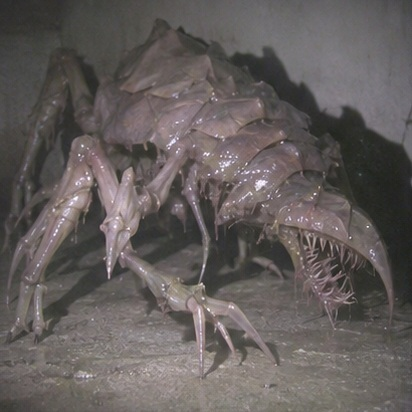
  - 【原典外貌】身穿戎裝、手持三尖兩刃刀的兇狠武將，原形乃一隻千年大狼狗精；臨戰擅自口中噴出一顆碗口大小、閃耀腥紅光芒的妖異「紅珠（狗寶）」如流星般突襲砸人頭顱，最終在哮天犬猛撲壓制下魂飛魄散、遭一刀斬殺現出狗精原形。
  - 【本作克蘇魯／昆蟲寄生／偽人重構】極具窒息壓迫感的**「軍警／保鑣偽人皮囊 × 吐卵寄生犬怪」**！平素看起來是一名身著筆挺深色制服、肩背挺得筆直僵硬、雙目眼神冷酷銳利的**恐怖谷偽人武將（現代則多偽裝成老舊社區夜班警衛或工地保全）**。然而只要靠近三公尺內便會聞到一股濃烈刺鼻的濕爛野狗騷臭混著血腥腐液味——他從不張口說話，因為那張緊閉的人類下顎其實沿著下巴正中切開了一道細微血縫，頸部氣管處更像吞了一顆活物般不停一鼓一縮地劇烈搏動！**當他決定突襲殺人的零點一秒，整張偽人臉龐的嘴角會「嘶啦」一聲直接裂到耳根，下顎如毒蛇與寄生蟲口器般詭異脫臼垂墜，露出滿嘴密密層層的漆黑反鉤犬齒與不斷抽搐的暗紅肉質產卵喉管——緊接著，一顆表面佈滿鮮紅血管、半透明薄膜裡清晰可見數十條尖牙幼蟲瘋狂撞壁蠕動的「活體血紅寄生卵囊（紅珠）」，便會如子彈般自喉管深處高速噴射直轟獵物臉龐！** 他的雙手指甲則泛著濕亮焦黑角質光澤，隨時能像四足節肢獵犬般俯身貼地高速狂奔。
- **特性**：
  - 【原典記載】以極具迷惑性與突然性的「口吐紅珠（狗寶）」暗算成名，常常在正面刀槍相交、敵人分神格擋的瞬間突然張口吐珠直取要害；唯獨血脈本能極度懼怕更強大的異種猛犬（哮天犬一撲便嚇得抽身欲逃、絲毫不敢反抗）。
  - 【本作衍生】最危險的**「近中距離活體寄生彈幕暗殺型偽人」**！那顆高速噴射的「活體紅珠」一旦砸在人臉上不會像石頭一樣彈開，而是瞬間爆裂成滿臉極強黏性的血紅膠液，同時將十餘條極細的吸血犬鉤幼蟲強行擠進受害者的眼眶、鼻腔與毛孔裡，短短半分鐘便會鑽入大腦造成劇烈抽搐失能，讓偽人本體從容上前撕碎咽喉。
- **弱點**：
  - 【原典記載】極度受制於**「血脈高位天敵壓制（如哮天犬猛撲啃咬）」**與**「照妖破妄法器（照妖鑑）」**——一旦偽人皮囊被照破或遭遇頂級煞犬撲殺，立刻喪失戰意、只顧轉身逃命而被一刀斬首。
  - 【本作衍生】1. **「破障符」與強光預判裂口瞬殺**：他噴吐活體紅珠卵囊前，偽人下顎一定會先出現半秒鐘的詭異鼓喉與嘴角裂縫！除妖師只要靠**「開天眼符水」**死盯其咽喉紅光，搶在卵囊未離口前提前一記**「鎮妖定身符」**貼鎖下顎或擲出**「烈火符」**正中張開的口腔，整顆活體卵囊就會卡在喉嚨裡烤熟爆漿，反噬燒穿他的腦幹！2. **極畏高純度陽剛烈味與威懾聲波**：犬怪異變體仍殘留對超敏嗅覺與高位掠食者咆哮的本能恐懼，大量辣椒煙霧、高濃度雄黃艾草燃煙配合道門猛虎／雷煞怒喝符印，能瞬間廢掉他的嗅覺追蹤並令其四肢發軟露綻。
- **習性**：
  - 【原典記載】盤踞梅山為妖，聽命於袁洪號令，慣於隨軍巡哨與伏擊落單敵將。
  - 【本作衍生】在台灣現代都市多偽裝成廢棄工業區、大型老舊墓園或深夜無人河濱工地的沉默守衛，喜歡悄無聲息地跟在落單夜歸人或誤闖廢墟的探險者身後數十公尺，藉著靈敏異常的血腥嗅覺鎖定目標，待對方走進無監視器死角時突然裂嘴噴卵伏殺。
- **喜好**：
  - 【原典記載】原典未載特殊飲食，唯嗜以狗寶紅珠突襲傷敵。
  - 【本作衍生】極度迷戀咀嚼生冷碎骨發出的咯吱聲，並喜愛將自己孵化出的半透明紅珠卵囊悄悄藏在廢棄地下室的潮濕角落裡，像養寵物般用活老鼠與流浪動物血肉定期餵養。
- **擅長的招式／異能**：
  - 【原典記載】`口吐紅珠（狗寶）`（流星般突襲重創敵人要害）、`三尖兩刃刀猛砍`。
  - 【本作衍生】`裂嘴活體紅珠卵囊狙擊`（下顎脫臼高速噴出直徑十五公分的搏動血紅寄生卵囊，命中即爆開黏液並釋出鑽皮吸血幼蟲，連閃避時擦過衣袖也會迅速啃穿布料）、`四足反折偽人狂襲`（瞬間拋棄直立姿態，四肢關節反折如巨型無毛節肢獵犬般貼牆高速折躍突刺）、`血嗅百米鎖蹤`（只要沾到目標一滴汗液或血漬，無論躲進哪層地下室都會在三分鐘內精準嗅出位置）。

---

### [FS3-14] 梅山七怪〔四〕野豬精・朱子真（環形倒齒吸盤食人豬蟲怪）
- **出處順序**：第 90 回《子牙捉神荼鬱壘》～第 92 回《楊戩哪吒收七怪》
- **類別與造型路線**：`【非人生物恐怖型】`｜環形倒齒吸盤食人豬蟲怪（臉部縱裂展開 × 滿佈環形倒齒吸盤口器 × 膨脹腐酸吞人胃囊）
- **物種／唯一性**：`物種特異個體`（梅山七怪中專司「生吞活人」的千年野豬精，異變為巨型環形吸盤食人豬蟲怪）
- **稀有度與道行對照**：`★★★ 珍級（SR）`｜模糊道行：數百年至千年吞噬型山妖（一口生吞全副武裝活人，然腹內防禦極差、一遭體內反攻即痛極跪地求饒）｜本作階位：二流頂～一流初階
- **外貌與黑暗地牢／恐怖谷視覺改寫**：
  - 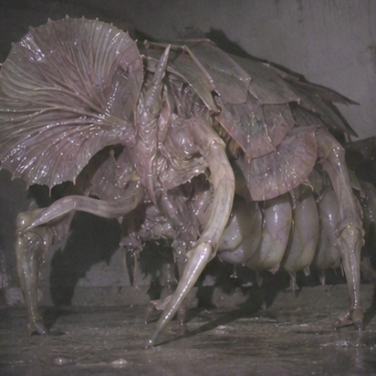
  - 【原典外貌】身軀肥壯臃腫、手持寶劍的兇悍妖將，臨戰現出碩大無比的**野豬原形**，張開血盆大口竟將敵人連人帶甲一口生吞入腹！豈料吞下的是精通變化的楊戩，遭對方在肚裡伸長身軀、狠抓心肝折騰得滿地打滾哀嚎求饒，最終如牽肉豬般被拉回周營當場斬首。
  - 【本作克蘇魯／昆蟲寄生／偽人重構】徹底粉碎普通山豬或卡通肥豬形象，打造成令幽閉與密集恐懼症患者當場癱軟的**「臉部縱裂倒齒吸盤・巨型食人豬蟲怪」**！牠那具重逾數噸、濕滑泛著屍灰粉白光澤的臃腫巨軀，沒有濃密鬃毛，只有層層堆疊如**巨型肥碩白蛆與腐脹溺屍**般的環節肉褶，褶縫裡時刻滲出混雜濃烈豬騷味與胃酸腐臭的灰黃黏液，四肢則退化為八條短粗卻佈滿倒鉤角質蹄爪的節肢爬足。**整頭怪物最恐怖、最超越人智想像的畫面，發生在牠鎖定活人準備進食的剎那——牠整張原本扭曲醜陋的豬臉從鼻樑至下顎轟然「十字縱裂」並向四周翻捲綻開，化作一座直徑將近兩公尺半、不斷向內蠕動收縮的深淵漏斗口器！** 漏斗內壁密密層層嵌滿數十圈如**七鰓鰻、吸血水蛭與寄生絛蟲口器般向喉管傾斜的慘白「環形骨質倒齒吸盤」**，只要獵物半個身子被吸住，任何掙扎都會被數百顆倒齒越咬越深，在三秒內連同衣物、背包與整具活體軀幹被硬生生捲進那座在半透明肚皮下瘋狂鼓脹翻滾的**腐酸食人胃囊**裡，外面甚至還能清晰看見被吞者在胃壁裡絕望頂出的手掌輪廓與微弱悶叫！
- **特性**：
  - 【原典記載】梅山七怪中最嗜食人肉的暴食怪物，一開戰便急著現原形張口吞人，胃口與食道伸縮能力駭人聽聞；但也正因「見人就亂吞、不嚼碎也不確認內容物」的致命貪婪，被強敵順水推舟鑽入腹內反手拿捏心肝，徹底喪失反抗能力。
  - 【本作衍生】都市陰暗地下室裡最令人絕望的**「活體整吞型大型掠食蟲怪」**！牠不像其他妖物那樣慢慢放血折磨，而是藏在廢棄菜市場地下垃圾壓縮室或老舊下水道轉角，一旦有人走過便瞬間展開兩公尺半的倒齒吸盤巨臉，製造宛如工業吸塵器般的駭人負壓吸力，直接把整個人吸進滿是消化酸液的胃囊裡慢慢融化。
- **弱點**：
  - 【原典記載】**內部臟器極度脆弱、毫無反制「體內破壞」的能力**——一旦吞進難纏硬物、法寶或精通防身的敵人，在腹內稍一攪動便劇痛難當、在地上打滾哀求饒命，連一點還手餘地都沒有。
  - 【本作衍生】1. **「誘餌爆破胃囊」是三流與二流除妖師反殺這頭巨怪的經典絕招**：千萬不要嘗試在正面與牠的環形倒齒吸力硬拉角力！由於牠貪吃成性且不經咀嚼直接生吞，實戰中只要把數張延遲引爆的**「五雷鎮煞符」**與**「烈火符」**包進浸滿新鮮溫血的厚重防刺肉包或假人替身（甚至**「替身紙人符」**）主動拋進牠張開的倒齒吸盤裡，等牠心滿意足吞進半透明胃囊深處的瞬間遙控引爆——從胃部炸開的雷火會直接把牠脆弱的心肝炸成焦炭！2. **粗鹽、生石灰與高溫火焰令其濕滑吸盤收縮翻轉**：朝牠縱裂綻開的鮮紅倒齒內壁大量潑灑強鹼粉末或烈火符火浪，會令牠痛得立刻合攏臉瓣並劇烈乾嘔，露出毫無防備的咽喉軟肋。
- **習性**：
  - 【原典記載】盤踞梅山食人成性，見血肉之軀便難抑吞噬本能。
  - 【本作衍生】極偏愛長期堆積廚餘與動物屠宰廢料的潮濕地下結構——如大型傳統批發果菜／肉品市場深夜無人時的地下排水溝、廢棄冷凍肉庫或老社區地下化糞池溢流槽，平時將臃腫環節軀體擠在陰濕牆縫裡消化腐肉，每逢飢餓便爬出獵捕深夜落單的清理工或醉漢。
- **喜好**：
  - 【原典記載】瘋狂嗜食活人，連帶盔甲兵器都敢囫圇吞下。
  - 【本作衍生】對「尚在劇烈掙扎、心跳狂飆的新鮮活人」有著無法克制的暴食執念，極愛感受獵物在自己腐酸胃囊裡逐漸失去掙扎力道的飽脹感。
- **擅長的招式／異能**：
  - 【原典記載】`現原形大口生吞`（一口將整名活人吞入腹中）、`巨體橫衝`、`寶劍劈刺`。
  - 【本作衍生】`縱裂倒齒負壓吞噬`（整張豬臉十字翻開成兩公尺半環形吸盤，猛吸百公斤空氣產生狂暴吸力，將十公尺內未能抓住掩體的目標直接吸進口中生吞）、`腐酸胃液反芻噴流`（受創時自胃囊狂吐夾雜半消化白骨與強酸黏液的巨浪，腐蝕護身符紙與鞋底）、`環節肉山碾壓`（將滿身油脂黏液的數噸白蛆巨體翻滾壓向狹窄走廊，活活擠碎獵物胸骨）。

---

### [FS3-15] 梅山七怪〔五〕羊精・楊顯（甲殼羊角吐絲致盲偽人武將）
- **出處順序**：第 90 回《子牙捉神荼鬱壘》～第 92 回《楊戩哪吒收七怪》
- **類別與造型路線**：`【類人偽人型】`｜甲殼羊角吐絲致盲偽人（蒼白偽人武將皮囊 × 額角裂出盤曲甲殼羊角 × 口腔吐絲致盲白液 × 橫瞳複眼）
- **物種／唯一性**：`物種特異個體`（梅山七怪之一，修煉千年、擅自口中噴吐數丈致盲困魂白光的特異山羊精）
- **稀有度與道行對照**：`★★★ 珍級（SR）`｜模糊道行：數百年至千年控場型妖將（致盲束縛異能極陰險，但本體脆防、遇猛獸血脈威壓即徹底崩潰）｜本作階位：二流頂～一流初階
- **外貌與黑暗地牢／恐怖谷視覺改寫**：
  - 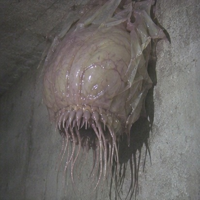
  - 【原典外貌】身穿素白戰袍、手持方天畫戟的森冷武將，本體為一頭千年**白山羊精**；陣前交手時忽張口噴出一道高達數丈的詭異刺目白光，直接罩定對手視線與神魂令人動彈不得；最終在照妖鑑下現出白羊原形，遭楊戩變化為一頭白額斑斕猛虎迎面撲殺，當場嚇癱伏誅。
  - 【本作克蘇魯／昆蟲寄生／偽人重構】極具詭異冷冽壓迫感的**「蒼白偽人武將 × 裂額甲殼羊角 × 吐絲致盲寄生口器」**！第一眼望去，他宛如一名膚色死白如漂白石膏、身穿一塵不染慘白長風衣或舊式素白禮服、站姿筆挺得毫無生氣的**恐怖谷蒼白偽人男子**。然而只要與他四目相對，立刻會被那雙非人的瞳孔嚇得汗毛倒豎——他的眼白裡橫貫著兩道像極了山羊長方形瞳孔、卻在邊緣裂化成無數微細蜂窩格網的**「漆黑橫瞳複眼」**，看人時眼神既冰冷又帶著昆蟲般的麻木聚焦感！**最令人毛骨悚然的異變發生在他啟動攻擊的一刻：他光潔蒼白的額頭兩側皮肉驟然向外崩裂滲出乳白黏液，硬生生頂出一對層層環節盤曲、泛著濕亮焦黑光澤如巨型天牛觸角與硬殼蠍尾融合般的「漆黑幾丁質盤曲甲殼羊角」**！與此同時，他微微張開蒼白嘴唇，喉頭深處擠出如**寄生絲蟲吐絲器與盲蛛毒腺**般的慘白肉管，猛然朝空中狂噴出漫天如強光閃爆般刺眼、黏稠發亮且遇風瞬間拉長硬化成千百條細絲的**「致盲強光白絲黏液」**——既能一瞬間燒瞎暴露的視網膜，又能如濕黏蛛絲般將失明者的四肢與口鼻徹底封死！
- **特性**：
  - 【原典記載】梅山七怪中專精「光學致盲＋定魂困敵」的詭異控場妖將——口吐數丈白光一旦罩住敵人，便能令對方神魂恍惚、視線全盲並僵立原地任憑方天畫戟穿心；唯有破妄照妖法器能看穿白光底下的白羊原形，且生性深植草食動物面對頂級猛虎的血脈死恐。
  - 【本作衍生】極度難纏的**「閃光致盲＋強黏絲液控場偽人」**！他在都市暗巷裡專靠那口突然噴發的強光致盲白液打第一波先手——普通除妖師只要沒戴濾光護目鏡或沒先開靈覺感應，迎面挨了這口發光白絲就會雙眼劇痛流淚、全臉被快速硬化的死白絲膜黏死口鼻窒息，連捏訣唸咒都發不出半點聲音，只能眼睜睜聽著他那雙漆黑甲殼羊角喀喀作響地緩步走近斬首。
- **弱點**：
  - 【原典記載】1. **極度受制於食物鏈天敵威壓（猛虎克羊）**：一見白額猛虎本能即刻戰慄失措、神通大亂，連白光都吐不出來便被一爪撲倒斬首。2. **本體近戰防禦與血肉強度偏薄**，一旦致盲白光失效、陷入近身肉搏即迅速敗亡。
  - 【本作衍生】1. **「破障符」＋「閉眼盲打聽音」直接廢掉他的最大殺招**：切忌直視他微張的蒼白嘴部！戰鬥前立刻在眼周抹上防護符水或配戴深色偏光抗閃護目鏡，一旦察覺他額角裂皮準備吐出致盲白絲，搶先斜側閃避同時甩出**「破障符」**震散強光散射，再用**「烈火符」**把黏稠發白絲液瞬間燒成焦脆灰屑！2. **施展虎煞威壓／高階陽剛雷嘯即可瓦解其心神**：其千年山羊本性仍深埋著被猛獸撕咬的血脈恐懼，高階除妖師只要祭出帶猛虎煞氣的鎮煞符印（如白虎鎮煞符或高壓**「五雷鎮煞符」**如虎嘯般貼臉轟鳴），便能令這隻蒼白偽人當場雙膝一軟、額上甲殼羊角劇烈抽搐崩裂，露出致命破綻。
- **習性**：
  - 【原典記載】盤踞梅山為妖，平日維持冷峻武將儀態，慣於陣前突發白光陰人。
  - 【本作衍生】台灣現代都市中常偽裝成舉止斯文卻面色慘白的夜間值班保全、廢棄醫院白色長廊裡的怪異白袍醫生，或老舊紡織廠庫房裡沉默凝視空地的蒼白男子，總愛把失明癱瘓的獵物用白色黏絲裹成一具具直立的「白色人繭」靠牆排成一列。
- **喜好**：
  - 【原典記載】原典未載飲食細節，唯好以慘白神光困人神魂。
  - 【本作衍生】極度偏執於純白無瑕的空曠走廊、刺眼到令人流淚的白日光燈管，以及欣賞獵物在被白絲封住眼皮後盲目揮舞雙手、絕望求救的無聲恐慌。
- **擅長的招式／異能**：
  - 【原典記載】`口吐數丈白光`（致盲並定住敵人神魂動彈不得）、`方天畫戟突刺`。
  - 【本作衍生】`吐絲致盲強光白液`（口器噴出混合螢光磷粉與寄生絲膠的刺目白漿，瞬間灼傷視網膜並化作上百條高韌性死白絲線糊住目標五官與雙手）、`盤曲甲殼羊角衝撞`（額上幾丁質巨角猛然增生暴長、帶著高速震動摩擦聲直頂目標胸腔穿心）、`橫瞳定魂死視`（被他的長方形複眼在三公尺內鎖定超過三秒者，大腦會出現短暫雪盲與動作僵直）。

---

### [FS3-16] 梅山七怪〔六〕蛇精・常昊（蒼白水蛭化腐毒白蛇怪）
- **出處順序**：第 90 回《子牙捉神荼鬱壘》～第 92 回《楊戩哪吒收七怪》
- **類別與造型路線**：`【非人生物恐怖型】`｜蒼白水蛭化腐毒白蛇怪（半透明屍白水蛭環節軀體 × 腐毒潰爛起泡黑霧 × 縱裂吸血巨顎）
- **物種／唯一性**：`物種特異個體`（梅山七怪之一，修煉千年、吐毒成瘴且異化為巨型水蛭環節白蛇的劇毒凶妖）
- **稀有度與道行對照**：`★★★ 珍級（SR）`｜模糊道行：數百年至千年劇毒蛇妖（腐蝕黑毒霧與巨軀絞殺威脅極高，然遭天敵巨蜈蚣破鱗即刻斃命）｜本作階位：一流初階
- **外貌與黑暗地牢／恐怖谷視覺改寫**：
  - 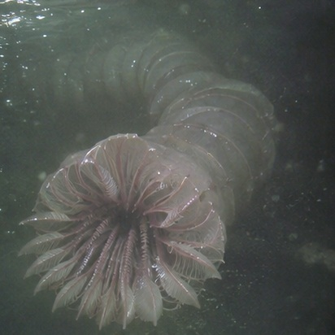
  - 【原典外貌】身形陰冷狹長、使兩口寶劍的妖將，本體為一條長達數丈的**巨型白蛇精**；臨戰大口一張便噴出漫天劇毒陰霧腐蝕兵甲、迷人耳目，隨後現出白蛇真身盤旋絞殺敵人，最終被楊戩以照妖鑑識破本相、變化成一條五色大蜈蚣直咬七寸剪為兩段現原形伏誅。
  - 【本作克蘇魯／昆蟲寄生／偽人重構】徹底揚棄光滑優雅的古典仙氣白蛇傳美感，改以極度令人反胃的**「黑暗地牢・巨型蒼白水蛭化白蛇怪」**呈現！整條長逾十公尺、粗如兩名壯漢合抱的龐大軀體，根本看不到精緻蛇鱗，反而完全異化為宛如**泡水膨脹到發白的超級巨型吸血水蛭與環節寄生蠕蟲**——全身呈現病態半透明屍白色，一圈圈密密麻麻的肥厚環節肉環不斷前後蠕動收縮，濕滑體表流淌著厚重發黏的灰黑屍液，透過慘白薄皮甚至能隱約看見體內緩慢蠕動的暗紫血管與尚未消化完的發黑人骨！牠那顆扁平無眼的慘白蛇首前端，沿著上下顎裂成三瓣形似巨型醫用水蛭的三叉刀片吸口，口緣滲出源源不絕的漆黑腐膿；每當牠吞吐信子，環節體側數十個細小呼吸膿孔便會同步噴湧出一團團沉重貼地翻滾、散發劇烈臭蛋與屍腐惡臭的**「潰爛起泡腐毒黑霧」**——凡暴露在外的活人皮膚只要觸及這層黑霧超過三秒，表皮立刻像被沸油潑中般劇烈紅腫、冒出一整片流淌黃黑膿水的密集毒水泡並迅速潰爛見骨！
- **特性**：
  - 【原典記載】極擅長「大範圍劇毒黑霧封鎖戰場＋巨體盤纏絞殺」的複合式毒妖——先以毒瘴讓敵人暈眩潰傷、視線歸零，再趁亂現出數丈白蛇真身無聲纏繞勒死目標；但一旦被看穿真身並遭剋蛇毒蟲（大蜈蚣）死咬咽喉七寸，龐大身軀便毫無掙扎之力。
  - 【本作衍生】都市封閉地下空間裡最可怕的**「區域性腐蝕毒霧製造機＋無聲水蛭絞殺巨怪」**！牠那層貼地蔓延的潰爛起泡黑霧密度大於空氣，會瞬間灌滿整個地下停車場、防空洞或老舊公寓樓梯間底層；除妖師若只靠普通口罩或低階避穢訣，臉頰、手背與腳踝暴露的皮膚仍會瞬間長滿劇痛水泡潰爛流血，連握緊符紙的手指都因起泡發僵而無法點火！
- **弱點**：
  - 【原典記載】極度懼怕**「專剋長蛇之多足劇毒節肢天敵（大蜈蚣破七寸）」**、**「照妖破妄強光」**與**「烈火高熱焚燒」**。
  - 【本作衍生】1. **水蛭環節肉身缺乏硬甲保護，極度畏懼「強脫水乾燥劑（粗鹽／雄黃粉／生石灰）」與「烈火高溫」**：不同於甲殼類巨怪，牠半透明的蒼白水蛭表皮只要沾上大把混有雄黃與硃砂的粗鹽粉，立刻會像水蛭撒鹽般劇烈滲出大量黑血、痛苦打結蜷縮，連毒霧噴孔都會痙攣閉死！2. **先清毒霧、再直鎖距頭後約兩公尺的「發光暗紫心核七寸」**：面對黑霧務必先向高處撤退（腐毒黑霧偏重會下沉積聚在低窪地面！），貼好**「淨氣符／避穢符」**並連續甩出多張**「烈火符」**將低窪黑霧瞬間熱對流吹散燒淨，再用**「開天眼符水」**透過牠半透明的白皮鎖定心脈七寸位置，以貼身**「五雷鎮煞符」**或精鋼長刃一擊斬斷，即可徹底絕殺。
- **習性**：
  - 【原典記載】潛伏梅山陰暗濕谷，與百足蜈蚣怪吳龍常互為犄角、以黑白雙毒瘴肆虐敵陣。
  - 【本作衍生】最喜歡陰冷潮濕、長年積水長青苔的深層地下室——例如廢棄溫泉地下儲水槽、郊區老舊水廠沉澱池或暴雨後積水的巨大排水箱涵，白天盤成一團蒼白發亮的肉色水蛭巨球沉在水底休眠，夜間才順著潮濕牆面無聲滑行上地面吐霧獵食。
- **喜好**：
  - 【原典記載】原典未載飲食偏好，唯嗜吐毒傷敵與吞食血肉。
  - 【本作衍生】極度嗜喝溫熱流膿的活體組織液與血漿（偏好先把獵物用腐毒黑霧逼到全身起泡潰爛、皮肉軟化後，再用三叉水蛭巨口貼上去整口吸爛吞嚥）。
- **擅長的招式／異能**：
  - 【原典記載】`口吐劇毒黑霧`（腐蝕盔甲、迷亂敵陣）、`白蛇巨軀盤纏絞殺`、`雙劍陰毒刺擊`。
  - 【本作衍生】`潰爛起泡腐毒黑霧`（自體側膿孔與巨口釋放重於空氣的漆黑強酸腐毒霧，沾染暴露皮膚三秒即引發劇痛膿泡潰爛並大幅降低法師結印靈活度）、`水蛭環節絞骨吸噬`（十公尺蒼白濕滑巨體驟然收緊纏繞目標，體表數百個微細環形小吸盤同步吸破皮膚吸血、同時勒斷肋骨）、`脫皮毒囊誘餌`（重創時蛻下一層灌滿腐蝕黑霧的半透明濕白皮囊在原地自爆，真身滑入污水溝逃遁）。

---

### [FS3-17] 梅山七怪〔七〕蜈蚣精・吳龍（極致黑暗地牢百足馬陸巨蜈蚣怪）
- **出處順序**：第 90 回《子牙捉神荼鬱壘》～第 92 回《楊戩哪吒收七怪》
- **類別與造型路線**：`【非人生物恐怖型】`｜極致黑暗地牢百足馬陸巨蜈蚣怪（濕亮幾丁質漆黑重甲百足軀 × 腹側滲出致幻濕冷毒霧 × 密集排卵孔與海量幼蟲）
- **物種／唯一性**：`物種特異個體`（梅山七怪殿後之劇毒蟲妖霸主，修煉千年、身懷漫天致幻毒霧與海量寄生幼蟲的巨型百足母體怪）
- **稀有度與道行對照**：`★★★ 珍級（SR）`｜模糊道行：數百年至千年劇毒多足蟲妖（漫天黑霧遮蔽天地、極擅隱匿奇襲，唯遇雄雞猛禽天敵即刻破功伏誅）｜本作階位：一流初階
- **外貌與黑暗地牢／恐怖谷視覺改寫**：
  - 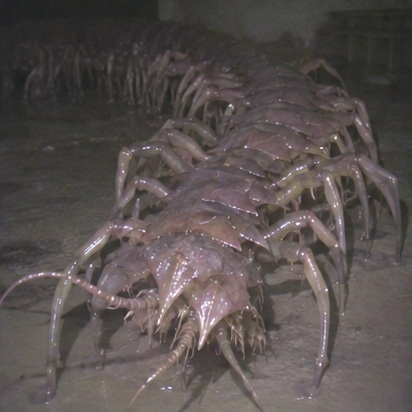
  - 【原典外貌】身披深黑鎧甲、手執大刀的詭詐妖將，本體為一條長達數丈、通體漆黑泛光的**巨型大蜈蚣精**；臨戰大口一張噴出滾滾漫天黑煙毒霧，遮蔽日月、令整支大軍伸手不見五指、陷入迷陣混戰，最終遭照妖鑑照破真身，被楊戩變化為一隻五色大雄雞迎面振翅啼鳴、一口啄死現出巨蜈蚣原形。
  - 【本作克蘇魯／昆蟲寄生／偽人重構】**極致黑暗地牢生物恐怖美學的純粹節肢代表作（與《西遊記》百眼魔君標竿遙相呼應，但更偏向「潮濕陰冷馬陸百足幼蟲巢體」）！** 全身上下完全捨棄任何人類殘留，是一頭長達十二公尺、寬如油罐車的**深淵漆黑百足馬陸巨蜈蚣怪**！整條軀幹由三十六節厚重濕亮、宛如浸泡在發臭下水道汙油裡反光的**黑褐色幾丁質重甲環節**串聯而成，每一節甲殼接縫處都瘋狂排生出四對如生鏽手術彎刀般喀喀作響的銳利步足（總計近三百條不斷波浪式狂舞的濕滑長節肢），能像水銀般毫無聲息地倒掛攀爬在潮濕地下室天花板與水泥柱壁上！牠的頭部生有一對不斷抽動甩打的兩公尺鋸齒毒顎與兩根長如鋼索的感覺觸鬚，最令密集恐懼症患者當場崩潰失聲的，是翻開牠那面慘白濕軟的腹側——**三十六節腹甲邊緣竟密密排布著數百個不斷張合滴液的漆黑氣門與肉質排卵孔，全天候向四周滲出如停屍間冷氣般刺骨潮濕、帶有強烈神經致幻毒素的「濕冷黑霧」，並隨著牠的爬行源源不絕地往地面傾瀉出成千上萬條指頭長、密密麻麻爬滿腳踝的漆黑嗜肉小蜈蚣與蒼白寄生幼蟲！**
- **特性**：
  - 【原典記載】梅山七怪中環境遮蔽與擾亂戰局能力最陰毒的蟲妖——漫天黑煙毒霧一旦擴散開來，不僅能瞬間吞沒整個戰場的光線與方向感，更能讓敵方大軍自相殘殺或遭隱匿在霧裡的毒顎偷襲；然血脈深處對天敵「雄雞／高陽猛禽」存在絕對恐懼，一聞雞鳴破霧即魂飛魄散。
  - 【本作衍生】現代都市裡能一夜把整座地下街或廢棄捷運車站變成「**百足幼蟲致幻地獄**」的母體級蟲災怪獸！牠腹側滲出的濕冷致幻毒霧會大幅拉低環境溫度並產生極度逼真的「蟲爬幻覺」（受害者會覺得自己眼皮底下、耳道裡和衣服內層爬滿了上萬條蟲子，進而瘋狂抓爛自己的臉與咽喉——而最恐怖的是，有一半是真的鑽進衣領的活幼蟲，另一半則是毒霧引發的幻覺，讓你徹底分不清該砍哪裡！）。
- **弱點**：
  - 【原典記載】1. **血脈絕對天敵「五色雄雞（陽禽高頻啼鳴與猛啄）」**：原典楊戩化作五色雄雞一聲啼叫即震散黑霧、一口啄死吳龍。2. **破妄照妖強光**一照便無所遁形。
  - 【本作衍生】1. **腹側濕軟白膜與海量幼蟲極端畏懼「烈火高溫＋高壓雷擊＋至陽雞血硃砂」**：牠背脊幾丁質黑甲極厚且滑溜，從上方斬擊極易打滑，但只要往地下室積水裡貼地甩出一連串**「烈火符」**或**「陽火符」**，乾燥烈焰會瞬間燒散潮濕致幻毒霧、將滿地湧來的小蜈蚣與幼蟲烤成焦爆脆殼，並逼得這頭百足巨怪因腹面灼痛而被迫弓身翻轉——**翻身露出慘白無甲腹側排卵孔的兩秒鐘，就是甩出「五雷鎮煞符」或高壓「掌心雷」一擊貫穿整個神經索的絕殺窗口**！2. **道門「白公雞冠血混硃砂破障符」具備天然血脈壓制**：實戰若提前將陽氣最重的公雞冠血點入**「破障符」**與**「淨氣符／避穢符」**，不但能完全免疫牠的濕冷致幻幻覺，符紙擲中牠的觸鬚更會引發類似天敵猛禽降臨的劇烈神經麻痺抽搐！
- **習性**：
  - 【原典記載】原為深山陰濕朽木爛石間修煉千年的毒蜈蚣精，平素喜暗畏光、慣以黑霧藏身偷襲。
  - 【本作衍生】偏好終年不見陽光、漏水發黴、滿牆壁癌與積水的現代深層地下廢墟——如爛尾樓地下四層積水車庫、廢棄冷戰時期防空坑道或老舊醫院地下太平間管線層，習慣盤繞在潮濕天花板橫樑上靜候誤入者，待人走到正下方時先釋放濕冷致幻霧，再降下鋪天蓋地的幼蟲雨封死退路。
- **喜好**：
  - 【原典記載】原典未載特殊飲食，唯嗜陰暗腐濕與吞噬生靈血肉。
  - 【本作衍生】極度偏愛陰冷潮濕的梅雨季與颱風前夕的低氣壓，嗜食腐爛屍體與剛落入致幻恐慌、神經極度亢奮的活人腦髓，常將整窩活幼蟲產卵在半死不活的獵物胸腔裡充當移動孵育箱。
- **擅長的招式／異能**：
  - 【原典記載】`口吐漫天黑煙毒霧`（遮蔽日月方向、迷亂全軍陣腳）、`百足巨蜈蚣毒顎穿刺`、`大刀突襲`。
  - 【本作衍生】`腹側濕冷致幻毒霧`（從三十六節氣門持續洩出貼壁擴散的冰冷黑霧，令吸入者產生劇烈「全身鑽蟲幻覺」並伴隨體溫驟降與幻聽）、`百足傾巢幼蟲潮`（腹側排卵孔同步擠出成千上萬隻帶麻痺微毒的漆黑小蜈蚣與寄生幼蟲，順著鞋襪與褲管狂鑽撕咬，徹底打斷法師手訣）、`三百步足天花板無聲伏擊`（近三百條鋼刀步足緊扣水泥天花板高速繞背，在致幻霧裡悄無聲息垂下兩公尺鋸齒毒顎一口咬斷頸椎）。

---

## 🦊 肆、第 96～97 回：朝歌城破・軒轅墳三妖終局現形補記

### [FS3-18] 軒轅墳三妖終局現形補記（千年九尾狐・蘇妲己／九頭雉雞精・胡喜媚／玉石琵琶精・王貴人・斬妖臺終末節肢本相）
- **出處順序**：第 96 回《子牙發柬擒妲己》、第 97 回《摘星樓紂王自焚》（*三妖初登場詳細檔案與前史互參 [卷一（第 01～35 回）](./01-卷一_第01至35回.md)，本條為全書末段朝歌城破、斬妖臺臨刑前徹底撕破偽人皮囊的最終本相補記*）
- **類別與造型路線**：`【類人偽人型】` → 瀕死絕望徹底撕裂崩解為 `【非人生物恐怖型】`｜三大千年偽人寄生母體終末集群（偽人美妃撕裂出節肢九尾與產卵管 × 九首複眼鋸齒禽蟲怪 × 玉白幾丁質寄生蟲弦琵琶腔）
- **物種／唯一性**：`物種特異個體`（軒轅墳三尊歷經千年血祭奪舍、共覆殷商六百年社稷的頂級妖物母體——千年九尾狐狸精蘇妲己、九頭雉雞精胡喜媚、玉石琵琶精王貴人）
- **稀有度與道行對照**：`★★★★ 絕級（SSR）`（三妖聯手合擊與禍國級精神魅惑達絕級災厄；單論正面戰力蘇妲己為一流頂～準絕級精神汙染偽人，胡喜媚與王貴人為 `★★★ 珍級（SR）`｜一流）｜模糊道行：千年惑國大妖（奪舍宮廷數十載、臨刑依然差點憑極致魅惑逼瘋全場劊子手，終由規則殺器斬仙飛刀絕殺）｜本作階位：一流～一流頂（極高危偽人精神支配集群）
- **外貌與黑暗地牢／恐怖谷視覺改寫**：
  - 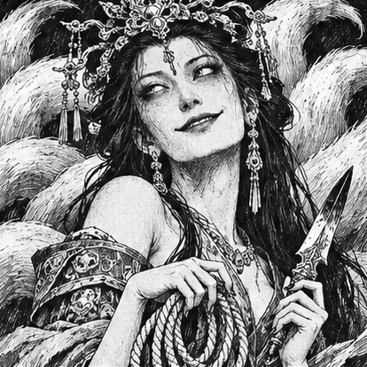
  - 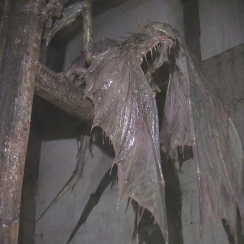
  - 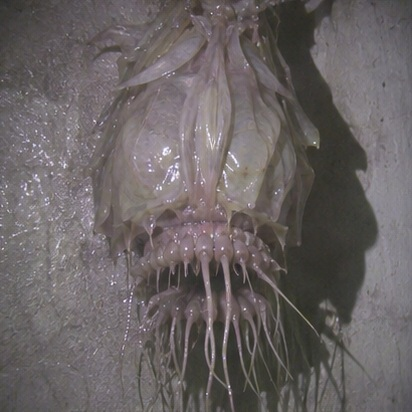
  - 【原典外貌】朝歌城破之夜，軒轅墳三妖見大勢已去、劫營敗走，逃竄途中撞上駕青鸞而來的女媧，非但未獲庇護反被斥責「殘賊生靈、屠毒忠烈」，遭縛妖索生擒押赴朝歌斬妖臺公開問斬。胡喜媚與王貴人先後遭押上刑場斬落首級，當場倒地現出**九頭雉雞**與**焦黑碎裂玉石琵琶**原形；唯獨蘇妲己臨斬之際仍憑千嬌百媚之容與攝魂妖態，令滿場劊子手與圍觀軍士個個酥軟麻木、魂飛魄散、竟無一人舉得起大刀，直至姜子牙親自請出陸壓「斬仙飛刀」一聲「寶貝請轉身」，方將那顆魅惑天下數十載的妖首斬落，現出碩大猙獰的**千年九尾狐狸**屍骸。
  - 【本作克蘇魯／昆蟲寄生／偽人重構】**全書《封神演義》最令人毛骨悚然的終局「偽人皮囊徹底崩碎・節肢本相全露出」三聯黑暗地牢恐怖畫卷！** 當鎮妖索勒緊咽喉、再也無法維持數十年來溫香軟玉的宮廷美人偽裝時，三妖在斬妖臺血泊中徹底撕破了最後一層人皮：
    1. **千年九尾狐・蘇妲己（終末撕裂態，100% 呼應總綱五大標竿定案基準）**：原本神情僵冷絕美、膚如冰瓷的王后偽人皮囊，自雙肩與後背脊椎沿中線「嘶啦」徹底裂開成一道滲流暗紅黏液的巨口——背後噴湧展開的絕非蓬鬆柔軟狐尾，而是**九條長逾三公尺、覆滿濕亮暗紅幾丁質甲節、關節處嵌滿歷代被害宮女細碎指骨、末端張合著搏動不休肉質「寄生產卵管與環形吸血吸盤」的駭人節肢長尾**！哪怕半張人臉已經像乾蠟般脫落露出底下的黑亮甲殼紋路，她那雙佈滿數百道血紅微格的**複眼偽瞳**卻依然死死凝視著行刑者，喉管裂開成昆蟲口器卻依然發出如戀人耳語般讓人大腦融化、雙手自動鬆開刀柄的精神催眠震頻！
    2. **九頭雉雞精・胡喜媚（終末撕裂態）**：美豔妖妃的頸部與鎖骨瞬間向外炸裂出鮮血淋漓的空洞，一團糾結纏繞、宛如九條巨型寄生水蛭與濕冷鳥頸混合而成的暗紅肉柱狂亂擠出——頂端頂著**九顆大小不一、羽毛濕黏發黴脫落、裸露慘白禽骨頭蓋、眼眶裡擠滿密密麻麻漆黑複眼與縱裂鋸齒鳥喙口器的畸變雉雞怪首**！九顆頭顱各自朝不同方向瘋狂歪折、用九種疊加走調的女人嬌笑與尖銳蟲鳴同時嘶吼，喙縫裡不斷滴落腐蝕性極強的腥臭寄生蟲卵漿液。
    3. **玉石琵琶精・王貴人（終末撕裂態）**：平日冰冷端莊、皮膚泛著病態死白玉澤的宮妃偽人，在雷煞鎖壓下發出宛如百年古瓷猛然龜裂的「喀嚓、喀嚓」脆響——整張偽人胸腹皮肉轟然剝落，露出內裡一具呈現**慘白鈣化玉質幾丁質外骨骼、宛如巨型空心琵琶共鳴箱般的恐怖蟲甲腔體**！腔口橫貫繃緊著四根由活體筋膜與吸血寄生線蟲扭絞而成的漆黑血弦，每次隨她臨死抽搐自行震動，便會發出割裂耳膜的詭異低沉琶音，同時從黑洞洞的玉骨音孔裡如決堤般湧出數以千計在白玉骨粉中瘋狂啃噬蠕動的半透明嗜血白蟲！
- **特性**：
  - 【原典記載】三妖合為殷商覆亡的幕後總妖巢——奪舍人間貴女皮囊數十載而無人能一眼識破，更構築鹿臺、酒池肉林與蠆盆百毒坑日夜以活人忠良血肉滋養妖性；即便是臨死五花大綁押上刑場的最後一秒，蘇妲己依然展現出近乎無解的「群體精神魅惑喪志」異能，連久經沙場的精銳行刑軍士都差點當場反戈失魂。
  - 【本作衍生】現代都市奇幻世界觀中最高級別的**「豪門上流奪舍寄生三姊妹偽人集群」**！她們不像山野惡獸那樣靠蠻力拆牆，而是極度冷血地剝取上流名媛、財團千金或關鍵決策者的軀殼與社會身分，把整座摩天大樓頂層私人會所或奢華地下招待所改造成現代版「酒池肉林＋蠆盆毒蟲孵化槽」；而當她們被逼入絕境撕破皮囊進入終末三妖本相時，蘇妲己的「複眼精神汙染」、胡喜媚的「九首複調音攻」與王貴人的「玉骨琶音喚蟲」會形成極度致命的三重感官崩潰場，令二流以下除妖師在十秒內理智徹底歸零、甚至自願割腕獻血！
- **弱點**：
  - 【原典記載】1. **極度畏懼「破妄照妖鏡／上位克制縛妖索」與「不講感情、隔絕視線接觸的規則級斬殺器物（斬仙飛刀）」**——凡是用肉眼直視蘇妲己、靠肉身親手揮刀行刑者，極易在最後一秒遭魅惑中斷動作，唯有藉法器遠距鎖定元神（或徹底不看妖臉）方能絕殺。2. 王貴人玉石本體原本即極懼**三昧真火焚燒**（早年於卷一便曾遭姜子牙真火逼出琵琶原形）。
  - 【本作衍生】1. **對陣蘇妲己鐵律：「絕不對視、絕不聽其求饒、直接遠程雷火或法器斬首」**：切忌因為她臨死前仍維持半張楚楚可憐的人類臉龐而有一絲憐憫或遲疑！行刑與絕殺前必須全員貼緊**「破障符」**清心、戴上抗音耳塞或默唸清心咒隔絕精神催眠震頻，絕不可近身用肉手握刀處決，務必直接以遠距高壓**「五雷鎮煞符」**連發轟斷她背後那九條搏動的節肢產卵尾，同時貫穿頭顱中樞防止寄生複眼繼續釋放催眠波。2. **先焚王貴人玉骨蟲箱、再截胡喜媚九首毒喙**：王貴人的玉質幾丁質共鳴腔雖硬，但腔內嗜血白蟲與筋膜絲弦極懼持續高溫**「烈火符」**焚燒，一旦燒斷四根寄生血弦便能立刻破除群體音場干擾；胡喜媚九首各自獨立卻共享單一胸腔心核，切忌一顆一顆砍頭浪費時間，直接以重雷符鎖定其鎖骨裂口底下的主心核一擊爆碎即可令九首同時癱軟枯萎。
- **習性**：
  - 【原典記載】初居古墓軒轅墳千年，奪舍後深居九重深宮享盡血肉奢華，遇危機便夜襲偷營或遁化妖風逃竄。
  - 【本作衍生】這類高階偽人母體在現代台灣幾乎不會躲在臭水溝，而是潛藏於市中心極度隱密的百年老宅地庫、停業荒廢的頂級溫泉會館地下湯池，或偽裝成高檔古董珠寶私人沙龍，利用地下密室裡堆積的潮濕人骨與寄生毒蟲池維持偽人皮囊的青春不腐。
- **喜好**：
  - 【原典記載】嗜食人心肝與新鮮活人血肉（曾多次索食忠良心肝與宮女精血）、沉迷極致奢華宮廷權勢與虐殺樂趣。
  - 【本作衍生】三妖各自保有扭曲的現代收藏癖——蘇妲己極愛在深夜冰冷的化妝鏡前仔細修補臉上快要裂開的偽人薄皮、並沉迷於折磨意志最堅定的正派法師看他們眼神逐漸迷離屈服；胡喜媚嗜好收集各種發聲悅耳卻帶血腥味的金屬鳥籠與受害者喉骨；王貴人則偏執地用活人筋腱反覆調校她胸口那四根滴血的寄生琶弦。
- **擅長的招式／異能**：
  - 【原典記載】`蘇妲己：九尾狐妖媚惑亂心智`（臨斬前仍能令滿場劊子手手軟棄刀）、`胡喜媚：九頭雉雞妖風毒喙亂襲`、`王貴人：玉石琵琶攝魂迷音`、`軒轅三妖夜襲遁風`。
  - 【本作衍生】`九尾節肢產卵催眠場`（蘇妲己撕裂偽人背皮展開九條節肢長尾，一邊以血紅複眼與低頻魅語強制劫持敵人神經中樞、令對手產生極度依戀幻覺主動放下武器，一邊用尾端產卵管刺入後頸植入控制幼蟲）、`九首複調鋸齒嘶咬`（胡喜媚九顆複眼寄生雉首同時朝九個死角發動超高頻錯亂尖叫與腐毒鋸齒啄擊，令人耳膜爆裂、無從格擋）、`玉骨蟲弦琵琶喪鐘`（王貴人撥動胸腹四根活體筋膜血弦，震出令心律嚴重失常的陰冷琶音並自玉骨音孔傾瀉遮天蔽日的嗜血白蟲狂潮）。

---

## 🏁 本卷終章檢核與導覽

- **卷三收錄總計**：**18 則**純妖怪與怪獸條目（編號 `FS3-01` ～ `FS3-18`；涵蓋《封神演義》第 76～100 回全書剩餘全部純妖怪、太古妖獸、嗜血巨蚊、夜行重甲怪獸、草木偽人、梅山七怪完整七尊及軒轅墳三妖終局現形補記；**四聖、金靈／無當聖母、鴻鈞、張奎、高蘭英、鄭倫陳奇、封神榜 365 正神與肉身成聖七神收錄數皆為 0**）。
- **插圖狀態統計**：已嵌入既有黑白高對比墨線圖檔 **20 幅**（`FS3-01` ～ `FS3-17` 各 1 幅、`FS3-18` 嵌入軒轅墳三妖終末現形 3 幅；全部對應磁碟真實圖檔，缺圖數為 **0**）。
- **全書收官導覽**：[👹 妖怪篇總綱](../00-妖怪篇總綱與圖鑑分級.md) ｜ [📖 封神演義總錄](./00-封神演義妖怪怪獸總錄.md) ｜ [⬅️ 卷二：第 36～75 回](./02-卷二_第36至75回.md)
