# 🏔️ 《山海經》純怪獸與妖怪圖鑑總錄（全十八卷｜零神明・黑暗地牢版）

> **快速導覽**：[👹 妖怪篇總綱](../00-妖怪篇總綱與圖鑑分級.md) ｜ [📘 公式書總覽](../../00-公式書總覽與世界觀.md)

> **本總錄定位（全十八卷完整總匯・共收錄 380 條）**：  
> 本總錄統攝《山海經》自**卷 01〈南山經〉**招搖之山起、迄於**卷 18〈海內經〉**幽都黑水大玄之山止之全部七冊圖鑑分卷。全書貫徹本作核心美術與生態聖經——**「黑暗地牢（Darkest Dungeon）生物恐怖 × 克蘇魯不可名狀 × 恐怖谷偽人（Mimic / Alternate）」**，徹底去神獸化、去萌化、去仙氣化，以昆蟲、節肢動物、吸血寄生蟲、環節軟體與偽人皮囊重構先秦異獸，供《異常現象調查部》都市黑暗地牢單元劇直接調用。

---

## 🚫 一、編纂鐵律與「零神明・純怪獸」收錄邊界

本圖鑑總錄嚴格執行 [妖怪篇總綱](../00-妖怪篇總綱與圖鑑分級.md) 之**「零神明・零純人類・全書無遺漏」**收錄鐵律：

### 1. 嚴格剔除清單（概不入錄）
- ❌ **上古神王世系與創世神祇**：徹底剔除帝俊、黃帝、炎帝、顓頊、帝嚳、堯、舜、羲和、常羲、女媧、西王母（神格本體）、少昊、伏羲、祝融、句芒、蓐收、禺彊、共工、后稷、啟、夸父（神族世系）等古帝與神王譜系。
- ❌ **各山祭祀山神與司職天神**：徹底剔除〈五藏山經〉各單元卷末「凡某山之首……其神狀皆鳥身而龍首／馬身而龍首……其祠之禮用毛糈」之諸山祭祀神祇，以及陸吾、英招、泰逢、武羅、耆童、熏池、計蒙、驕蟲以外之正統祠祀神官。
- ❌ **純人類方國與異民部族**：徹底剔除〈海外四經〉〈海內四經〉〈大荒四經〉中之純人類國族（如君子國、大人國、靖人國、羽民國、貫匈國、交脛國、不死民、三首國、一臂國、奇肱國、丈夫國、女子國、巫咸國、白民國、肅慎氏、軒轅國、犬戎人類部族、毛民國等），僅於該國境內另載「有獸焉／有鳥焉」時單獨提取其怪獸本體。
- ❌ **尋常凡俗物產與純地理條文**：剔除無妖異化記述之一般草木、礦石與單純山川道里。

### 2. 純粹收錄之五大黑暗地牢異類範疇
1. **奇形怪獸與掠食凶獸**：狌狌、鹿蜀、青丘九尾狐、蠱雕、猙、帝江（混沌）、窮奇、諸犍、狍鴞（饕餮）、合窳、蜚、馬腹、夫諸、并封、巴蛇、開明獸、騶吾、封豕、幽都六玄怪群等。
2. **異形妖鳥與災厄怪禽**：鴸、瞿如、顒、肥遺鳥、畢方、勝遇、羅羅、鵸鵌、酸與、精衛、鴆鳥、跂踵、𪀚鳥與𪇳鳥、九鳳、翳鳥等。
3. **異常水怪與深淵異魚**：旋龜、赤鱬、鱄魚、文鰩魚、冉遺魚、何羅魚、茈魚、化蛇、天吳、大蟹、陵魚、大鯾、黑脈深淵魚群等。
4. **劇毒妖蟲與節肢寄生怪**：蝮虫、盼木木蟲、欽原毒蜂、驕蟲母巢、榮余怪蛇與怪蟲、大蜂與朱蛾、蜮、菌人、蜚蛭、琴蟲、獵獵、蝡蛇等。
5. **腐屍異變體與「之尸」活屍系譜**：徹底收錄全書最具恐怖谷震懾力的「之尸」活屍與不死變異體——女丑之尸、奢比之尸、貳負之尸、窫窳之尸、據比之尸、王子夜之尸、犁䰠之尸、祖狀之尸、黃姖之尸、戎宣王尸、相顧之尸、魚婦、旱魃等。

> **雙軌考據與去神化說明**：
> - 原典中少數因先民極度恐懼而冠以「神」字、實質卻為無祭祀儀軌之毀滅性生物怪體者（如天山「帝江／混沌」、朝陽之谷「天吳」、堵山「天愚」、流波山「夔」、凶犁土丘「應龍」、北極「九鳳／彊良」、章尾山「燭陰」、苗民之域「延維」、丹穴「鳳皇」），均**徹底剝離神格崇拜與祥瑞濾鏡**，嚴格還原為位居生物食物鏈極點的「不可名狀太古災厄怪獸」。
> - 全 18 卷中若同一怪獸於不同經卷呈現明顯形態分歧或地域亞種（如〈西山經〉蝟毛牛形窮奇 vs. 〈海內北經〉虎翼集群窮奇；〈北山經〉人面馬足窫窳 vs. 〈海內南經〉弱水龍首窫窳 vs. 〈海內西經〉窫窳之尸；〈南山經〉青丘九尾狐 vs. 〈海外東經〉／〈大荒東經〉／〈中山經〉支脈；〈海外北經〉相柳 vs. 〈大荒北經〉相繇等），本總錄**逐卷如實分條收錄並標明跨卷關聯**，絕不強行刪併，以保留原典最完整的生態譜系。

---

## 🗺️ 二、全十八卷地理架構與黑暗地牢生態總圖

《山海經》全書由內向外分為**「五藏山經（卷 01～05・實境山川蟲瘴圈）」**、**「海外／海內八經（卷 06～13・異界裂隙活屍水脈圈）」**與**「大荒四經暨海內經（卷 14～18・太古深淵幽都終極圈）」**三大圈層，共計 18 卷、7 分冊、380 條純怪獸與妖怪檔案：

```mermaid
flowchart TB
    CORE["🏔️ 《山海經》全十八卷純怪獸總錄 (共 7 冊・380 條・零神明)"]

    CORE --> G1["⛰️ 內圈：五藏山經 (卷 01～05｜共 4 冊・248 條)"]
    CORE --> G2["🌊 中圈：海外四經與海內四經 (卷 06～13｜共 2 冊・71 條)"]
    CORE --> G3["🕳️ 外圈：大荒四經與海內經 (卷 14～18｜共 1 冊・61 條)"]

    G1 --> B1["第一冊｜卷 01〈南山經〉 (31 條)｜南嶺腐潮・嬰啼誘殺與濕熱蟲禽"]
    G1 --> B2["第二冊｜卷 02〈西山經〉 (63 條)｜荒岩毒蜂・帝江混沌與窮奇標竿"]
    G1 --> B3["第三冊｜卷 03～04〈北山經・東山經〉 (92 條)｜深水十蛭・饕餮與瘟疫巨獸蜚"]
    G1 --> B4["第四冊｜卷 05〈中山經〉 (62 條)｜中原蜂巢・馬腹偽人與榮余蟲淵"]

    G2 --> B5["第五冊｜卷 06～09〈海外四經〉 (30 條)｜漂屍系譜・視肉增殖與相柳天吳"]
    G2 --> B6["第六冊｜卷 10～13〈海內四經〉 (41 條)｜崑崙開明・王子夜分屍與黑脈水系"]

    G3 --> B7["第七冊｜卷 14～18〈大荒四經與海內經〉 (61 條)｜蜚蛭血翼・魚婦旱魃與幽都黑水終焉"]

    B7 --> END["🖤 全書終極深淵：卷 18 幽都之山・黑水大玄母巢 (SHJ18-19)"]
```

---

## 📚 三、全書七冊分冊導覽總表（含實際條目數與連結）

| 冊次 | 分冊連結 | 涵蓋經卷 | 地理脈絡與黑暗地牢生態定位 | 實際收錄條目數 | 核心代表怪獸與神級災厄（UR／SSR） |
| :---: | :--- | :--- | :--- | :---: | :--- |
| **第一冊** | [01-卷01_南山經.md](./01-卷01_南山經.md) | 卷 01〈南山經〉（南山三經） | **「南嶺腐潮」濕熱寄生圈**：陰濕捷運維修道、排水涵洞、嬰啼誘食人與旱疫偽人怪禽 | **31 條** | 狌狌、青丘九尾狐、赤鱬、䍺、**蠱雕**、顒（SSR）、**鳳皇（UR）**、鵷鶵（SSR） |
| **第二冊** | [02-卷02_西山經.md](./02-卷02_西山經.md) | 卷 02〈西山經〉（西山四經＋考訂附錄） | **「荒岩毒峰」重甲與標竿圈**：礦坑重甲節肢、毒蜂活體寄生、雙標竿太古四凶核心 | **63 條** | 肥遺蛇（SSR）、朱厭（SSR）、**欽原毒蜂（SSR）**、猙（SSR）、畢方、**帝江／混沌（UR・標竿）**、**窮奇（SSR～UR・標竿）**、孰湖 |
| **第三冊** | [03-卷03至04_北山經與東山經.md](./03-卷03至04_北山經與東山經.md) | 卷 03〈北山經〉（59 條） 卷 04〈東山經〉（33 條） | **「極北暗水 × 東海疫瘴」雙災圈**：多身吸血水蛭、四凶吞噬魔體、食人偽人豬與封城瘟疫獸 | **92 條** | **何羅魚**、諸犍、窫窳（SSR）、**狍鴞／饕餮（SSR）**、精衛、蠪侄（SSR）、當康、合窳（SSR）、**蜚（疫病標竿）** |
| **第四冊** | [04-卷05_中山經.md](./04-卷05_中山經.md) | 卷 05〈中山經〉（十二山經 57 條＋跨卷補遺 5 條） | **「中原蟲窟」都會偽人與蜂巢圈**：最貼近人群聚落之毒蜂總巢、偽人食人虎、水旱雙蛇與萬蟲蟲淵 | **62 條** | 鳴蛇（SSR）、化蛇（SSR）、**馬腹**、夫諸、**驕蟲母巢（SSR）**、天愚（SSR）、鴆鳥、夔牛（SSR）、跂踵（SSR）、榮余怪蟲（SSR） |
| **第五冊** | [05-卷06至09_海外四經.md](./05-卷06至09_海外四經.md) | 卷 06〈海外南經〉（7 條） 卷 07〈海外西經〉（10 條） 卷 08〈海外北經〉（8 條） 卷 09〈海外東經〉（5 條） | **「漂屍荒海」裂隙與不死肉塊圈**：海外孤絕異界、活體不死肉塊、偽人焦屍／蠶母與滅域毒蛭 | **30 條** | 鑿齒（SSR）、**視肉**、𪀚鳥𪇳鳥（SSR）、女丑之尸、并封、乘黃（SSR）、**相柳（UR）**、歐絲吐絲怪、奢比之尸（SSR）、**天吳（UR）** |
| **第六冊** | [06-卷10至13_海內四經.md](./06-卷10至13_海內四經.md) | 卷 10〈海內南經〉（8 條） 卷 11〈海內西經〉（11 條） 卷 12〈海內北經〉（17 條） 卷 13〈海內東經〉（5 條） | **「海內活屍 × 黑脈大水系」終極異變圈**：崑崙九門守衛、七處分屍活怪、虎翼集群窮奇與海溝巨蟹 | **41 條** | 梟陽、窫窳（SSR）、巴蛇（SSR）、貳負之尸（SSR）、**開明獸（UR）**、**窮奇虎翼版（UR・標竿）**、大蜂朱蛾、騶吾（SSR）、**王子夜之尸（SSR）**、**大蟹（UR）**、陵魚 |
| **第七冊** | [07-卷14至18_大荒四經與海內經.md](./07-卷14至18_大荒四經與海內經.md) | 卷 14〈大荒東經〉（10 條） 卷 15〈大荒南經〉（10 條） 卷 16〈大荒西經〉（10 條） 卷 17〈大荒北經〉（12 條） 卷 18〈海內經〉（19 條） | **「太古大荒 × 幽都黑水」全書終焉圈**：四翼飛蛭、偏枯復甦魚婦、八條神級太古災厄與全書壓軸幽都六玄怪群 | **61 條** | **應龍（UR）**、**夔（UR）**、蜮、天犬（SSR）、魚婦（SSR）、**蜚蛭**、**九鳳（UR）**、**相繇（UR）**、**旱魃（UR）**、**燭陰（UR）**、延維（SSR）、**幽都六玄怪群／黑水大玄母巢（UR）** |
| **總計** | **全 7 分冊（18 卷全覆蓋）** | **五藏山經（248 條）＋海經與大荒經（132 條）** | **全書零神明・零純人類・零省略完整收錄** | **380 條** | **涵蓋全部五大標竿雙星（帝江混沌・窮奇）與 15 條純神級災厄（UR）（另含跨級達 UR 2 條）** |

---

## 🎯 四、本作「第 2～10 章黑暗地牢都市單元劇」最強候選怪獸 TOP 15 推薦表

依循主角**許家銘**於序章《01-蜘蛛精》斬殺 `★★ 稀級` 都市變異株後的戰力與認知成長弧線（三流散修 → 二流實戰老手 → 捲入一流與太古災厄黑幕），自全書 380 條中精選最具**「現代台灣深夜都市恐怖感 × 黑暗地牢寄生機制 × 智鬥破局張力」**的 15 組王牌候選：

| 排名 | 編號與怪獸名稱（分冊連結） | 造型路線與稀有度 | 推薦章節 | 台灣現代都會黑暗地牢場景構想 | 核心恐怖機制與主角破局看點 |
| :---: | :--- | :--- | :---: | :--- | :--- |
| **TOP 1** | **窮奇／帝江（混沌）集群** [SHJ02-047 帝江／混沌](./02-卷02_西山經.md) [SHJ02-056](./02-卷02_西山經.md)／[SHJ12-005 窮奇](./06-卷10至13_海內四經.md) | `非人生物恐怖型` `★★★★★ 神級災厄（UR）` *(本作五大標竿雙核)* | **Ch.10** *(卷一終局伏筆／壓軸天災)* | 停電封鎖的地下共構捷運轉運站或跨縣市廢棄地下防空洞群，億萬毒蟲咬合蠕動化作吞噬整座站體的無定形肉山與腐翼獵殺集群 | 不可正面硬拚的**封城級克蘇魯生物集群**：窮奇「食人從首始」專獵守序善良者、帝江混沌無面目寄生扭曲空間認知；迫使多方勢力與特勤組暫時聯手封陣求生，正式揭開上古四凶復甦主線。 |
| **TOP 2** | **欽原毒蜂** [SHJ02-035 欽原](./02-卷02_西山經.md) | `非人生物恐怖型` `★★★★ 絕級（SSR）` | **Ch.6** | 都會老舊公寓頂樓違建夾層、百年老榕樹空心樹洞或大樓中央空調管道間築起之巨型紙質血肉蜂巢 | 體大如鴛鴦的**最純正黑暗地牢毒蜂噩夢**：「中獸則死、中木則枯」的極速壞死毒針＋活體腹腔產卵管；在極狹窄封閉通風管內展開零容錯的煙燻、隔熱防護與直搗蜂后攻防戰。 |
| **TOP 3** | **蜚蛭** [SHJ17-02 蜚蛭](./07-卷14至18_大荒四經與海內經.md) | `非人生物恐怖型` `★★★ 珍級（SR）` | **Ch.2～3** | 豪雨淹水的醫院地下室血庫冷卻管線、夜市屠宰場暗溝或深山溫泉廢棄涵洞 | 全書最純正的**「四翼飛天吸血環節水蛭」**：成群無聲俯衝、千齒吸盤一貼上頸動脈便注入抗凝血麻痺毒液；非常適合銜接序章蜘蛛精，讓許家銘利用粗鹽、生石灰粉塵爆燃與狹道火牆智取群體妖蟲。 |
| **TOP 4** | **蠱雕** [SHJ01-022 蠱雕](./01-卷01_南山經.md) | `非人生物恐怖型` `★★★ 珍級（SR）` | **Ch.2～3** | 深夜雷雨交加的都會大排水溝、地下滯洪池或荒廢水利抽水站深潭 | **「嬰兒啼哭聲誘殺 × 破水螳螂鐮肢斬首」**：四公尺雙角兜蟲螳螂巨雕，躲在黑水中精準廣播新生兒慘哭誘騙熱心路人與搜救隊；破局關鍵在識破聲源共鳴腔並以強光雷符封死其複眼與水面伏擊。 |
| **TOP 5** | **視肉（聚肉）** [SHJ06-005](./05-卷06至09_海外四經.md)／[SHJ11-005 視肉](./06-卷10至13_海內四經.md) | `非人生物恐怖型` `★★★ 珍級（SR）` | **Ch.5** | 隱密權貴私人招待所地下冰庫、黑市高價「長生滋補鍋」私廚或百年古宅陰濕地窖 | **「雙眼凝視 × 割一塊長兩塊」的克蘇魯變形蟲活肉團**：無法靠刀劍物理斬殺，越砍分裂越多，且誤食者體內會萌生寄生肉芽遭反向奪舍；須從「徹底炭化脫水／封煞絕陰」找出生機，極具社會寫實暗黑味。 |
| **TOP 6** | **馬腹** [SHJ05-008 馬腹](./04-卷05_中山經.md) | `類人偽人型` `★★★ 珍級（SR）` | **Ch.4** | 深夜停電的無電梯老公寓樓梯間、荒廢眷村暗巷或社區地下室停車場柱影間 | **「人面虎身 × 嬰兒啼哭 × 貼地四足偽人」**：黑暗角落先露出蒼白慘笑的鄰居人臉與嬰哭聲，靠近才見頸下長滿硬殼剛毛的節肢虎軀；完美放大恐怖谷心理窒息感與極近距離走廊逃殺。 |
| **TOP 7** | **何羅魚** [SHJ03-006 何羅魚](./03-卷03至04_北山經與東山經.md) | `非人生物恐怖型` `★★★ 珍級（SR）` | **Ch.4～5** | 淡水河底廢棄過江管線、都會大型雨水下水道主幹或淹水地下街蓄水池 | **「一首十身巨型環節水蛭 × 狂暴犬吠氣管聲」**：十條成人腰粗的黏液肉體在無光水牢頂壁同時倒吊包夾，唯有精準斬斷其唯一總控口器頭顱方能終結十軀暴走，壓迫構圖堪比血源／黑暗地牢名場面。 |
| **TOP 8** | **王子夜之尸** [SHJ12-014 王子夜之尸](./06-卷10至13_海內四經.md) | `類人偽人型` `★★★★ 絕級（SSR）` | **Ch.7** | 市立殯儀館停屍冰櫃區、封鎖多年之分屍命案凶宅大樓或法醫解剖地下室 | 《山海經》全書最毛骨悚然的**「七處分屍肉絲活怪」**：兩手、兩股、胸、首、牙齒七處斷裂異處卻各自爬行，靠牆角滲血紅肉絲牽引重組；必須同時定位並焚毀七處核心部位才能破除不死分身，懸疑推理感拉滿。 |
| **TOP 9** | **蜚（太山疫病巨獸）** [SHJ04-033 蜚](./03-卷03至04_北山經與東山經.md) | `非人生物恐怖型` `★★★ 珍級（SR）` *(完全體逼近 SSR/UR)* | **Ch.8** | 城市淨水廠蓄水池、老舊傳統市場下水道或颱風後積水不退的封鎖社區 | **「行水則竭、行草則死、見則天下大疫」**：背負億萬腐膿卵囊的黑暗地牢疫病母體，所過之處水管生鏽枯竭、爆發無名黑斑怪疫；迫使主角在疫區封城倒數前，與時間賽跑完成追蹤隔離與火雷焚巢。 |
| **TOP 10** | **開明獸** [SHJ11-003 開明獸](./06-卷10至13_海內四經.md) | `類人偽人型` `★★★★★ 神級災厄（UR）` | **Ch.9～10** | 台北盆地或中央山脈深層地鐵施工意外挖穿之「太古九門地脈裂隙」封印大殿 | **「九首人面節肢虎巨怪」**：九張表情各異（哭、笑、怒、呆滯、死寂）的蒼白偽人巨頭同時轉向闖入者，目光無死角鎖死全場；作為人類除妖師首度直面「規格外古怪」的絕望壓迫名場面，只能靠規律避視與重啟封印逃生。 |
| **TOP 11** | **梟陽／贛巨人** [SHJ10-001 梟陽](./06-卷10至13_海內四經.md) [SHJ18-05 贛巨人](./07-卷14至18_大荒四經與海內經.md) | `類人偽人型` `★★★ 珍級（SR）` | **Ch.3** | 深夜霧濃的北宜／陽明山郊區公車站、廢棄山間露營地或深夜無人公園長椅 | **「反踵長唇 × 見人笑亦笑」**：三公尺高的黑毛偽人怪，腳掌前後反轉，見獵物便張開水蛭肉瓣般的上唇狂笑遮目；原典已自帶「趁其唇蔽雙目之際反殺／釘穿其唇」的絕妙民俗破法，極適合作為前期純粹民俗智鬥章！ |
| **TOP 12** | **歐絲之野吐絲怪** [SHJ08-003 歐絲之野吐絲怪](./05-卷06至09_海外四經.md) | `類人偽人型` `★★★ 珍級（SR）` | **Ch.5～6** | 彰化／新北廢棄老紡織廠、停業婚紗地下倉庫或密室成衣加工廠 | **「跪據樹下無盡嘔吐寄生濕絲之偽人女子」**：看似低頭哭泣的長髮女工，雙膝卻向後反折、張開脫臼下顎噴出布滿幼蟲卵的濕黏絲網，將整棟廠房織成白色肉繭迷宮，畫面詭異度爆表。 |
| **TOP 13** | **魚婦** [SHJ16-09 魚婦](./07-卷14至18_大荒四經與海內經.md) | `類人偽人型` `★★★★ 絕級（SSR）` | **Ch.7～8** | 颱風夜海水倒灌的濱海地下停車場、廢棄漁港冷凍庫或淹水靈骨塔 | **「偏枯半身溺屍魚鰓 × 半身枯蛇鑽骨 × 遇北風湧泉死而復甦」**：每次被斬殺只要吹來冷濕北風或碰到積水便原地復活蛻變，迫使主角破解其「蛇化魚・風水循環」條件，切斷陰濕水脈方能真正絕殺。 |
| **TOP 14** | **狍鴞（鉤吾山饕餮）** [SHJ03-033 狍鴞](./03-卷03至04_北山經與東山經.md) | `類人偽人型` `★★★★ 絕級（SSR）` | **Ch.8～9** | 深夜違法地下屠宰場、大型餐廳廚餘汙水管網或貧民窟地下吞噬肉窟 | **「偽人人臉 × 腋下複眼吸盤 × 永恆飢餓吞噬肉囊」**：上古四凶之一，正面人臉只是誘餌，真正的感知與吞噬口器藏在雙腋與裂開的胸腔；其分裂出的低階貪食肉囊可先於中前期鋪陳伏筆，終局直面本體。 |
| **TOP 15** | **幽都玄狐蓬尾＆玄怪群** [SHJ18-14～19 幽都六玄怪群](./07-卷14至18_大荒四經與海內經.md) | `類人偽人型` × `非人集群` `★★★★～★★★★★` | **Ch.9～10** | 都會深層黑水汙水總管與表層高級商辦大樓並存之「表裡雙城滲透案」 | 以全書末頁壓軸**「幽都六玄怪群」**為高階組織型反派：由混入現代政商名流圈的漆黑瞳偽人指揮官「玄狐蓬尾」操控玄鳥、玄蛇、玄豹、玄虎四路暗殺，身後則隱現「幽都黑水大玄母巢」的終極黑幕。 |

---

## 📖 五、全十八卷逐冊逐條完整收錄總索引表（全 380 條・零省略）

> **索引說明**：
> - 本表依**第一冊至第七冊、卷 01 至卷 18** 之原典自然順序，完整收錄全書全部 **380 條**純怪獸與妖怪條目，絕無任何刪省。
> - 點擊「名稱（分冊連結）」即可直接跳轉至對應分冊閱讀【原典記載】、【黑暗地牢視覺改寫】、【特性／弱點／習性／喜好／擅長招式】與黑白墨線插圖。
> - 造型路線簡標：`類人偽人型`（凡有臉者，極致恐怖谷偽人皮囊＋皮下節肢／口器）；`非人生物恐怖型`（去哺乳／去神獸化，純昆蟲／節肢／寄生／環節軟體怪）。

### 📕 第一冊：卷 01〈南山經〉（全 31 條｜[前往本冊](./01-卷01_南山經.md)）

| 編號 | 名稱（分冊連結） | 所屬經卷 | 造型路線 | 稀有度 |
| :---: | :--- | :--- | :--- | :---: |
| `SHJ01-001` | [狌狌（猩猩／招搖白耳偽人獸）](./01-卷01_南山經.md) | 卷 01〈南山經〉・南山一經・招搖之山 | `類人偽人型`｜雙模態步態偽人・白化蚊式感覺囊耳・縱裂蟲顎怪 | `★ 凡級（N）` |
| `SHJ01-002` | [堂庭白猿（兼錄南次三經・發爽之山多水白猿亞種）](./01-卷01_南山經.md) | 卷 01〈南山經〉・南山一經・堂庭之山（兼發爽之山） | `非人生物恐怖型`｜洞穴白化長肢盲蛛・鐵線蟲絲狀菌毛・共享視覺寄生群怪 | `★ 凡級（N）` |
| `SHJ01-003` | [猨翼諸怪（猨翼之山怪獸・怪魚・怪蛇・怪木異化群）](./01-卷01_南山經.md) | 卷 01〈南山經〉・南山一經・猨翼之山 | `非人生物恐怖型`｜變形蟲黏液異化生物群・節肢與人骨隨機嵌合禁地生態怪 | `★★ 稀級（R）` |
| `SHJ01-004` | [蝮虫（反鼻巨毒蟲蛇｜兼錄羽山・非山之首分佈）](./01-卷01_南山經.md) | 卷 01〈南山經〉・南山一經・猨翼之山（兼羽山・非山之首） | `非人生物恐怖型`｜環節巨蛭與巨型毒蜈蚣融合怪蛇・鼻端鋼針蚊式毒口器 | `★ 凡級（N）` |
| `SHJ01-005` | [鹿蜀（杻陽歌謠白首寄生獸）](./01-卷01_南山經.md) | 卷 01〈南山經〉・南山一經・杻陽之山 | `非人生物恐怖型`｜枯白蟲繭面具巨型竹節螳螂獸・皮下虎斑幼蟲囊・赤紅水蛭產卵尾 | `★★ 稀級（R）` |
| `SHJ01-006` | [旋龜（玄龜・杻陽怪水黑甲蟲怪）](./01-卷01_南山經.md) | 卷 01〈南山經〉・南山一經・杻陽之山（怪水） | `非人生物恐怖型`｜螺旋裂甲巨型深水龍蝨・腐鳥骨喙頭・獨立寄生吸血巨蛭蛇尾 | `★★ 稀級（R）` |
| `SHJ01-007` | [鯥（柢山冬死夏生兩棲牛形蟲魚）](./01-卷01_南山經.md) | 卷 01〈南山經〉・南山一經・柢山 | `非人生物恐怖型`｜牛型兩棲巨田鱉水蟲怪・脅下雙膜蟲翼・乾屍脫水爆殼重生體 | `★★ 稀級（R）` |
| `SHJ01-008` | [類（亶爰之山雌雄同體分裂怪）](./01-卷01_南山經.md) | 卷 01〈南山經〉・南山一經・亶爰之山 | `非人生物恐怖型`｜雌雄同體巨渦蟲與貓骨節肢結合怪・鐵線蟲長鬣・縱向齒縫裂殖體 | `★★ 稀級（R）` |
| `SHJ01-009` | [猼訑（基山背目九尾四耳巨怪）](./01-卷01_南山經.md) | 卷 01〈南山經〉・南山一經・基山 | `非人生物恐怖型`｜巨型吸脹寄生硬蜱與重甲蜘蛛融合怪・四耳聲納角・九條蠍蜈節肢尾・裂背密集複眼群 | `★★★ 珍級（SR）` |
| `SHJ01-010` | [𪁺𩿧（尚付／敞鳧・基山三首六足異禽）](./01-卷01_南山經.md) | 卷 01〈南山經〉・南山一經・基山 | `非人生物恐怖型`｜三頭六複眼巨型腐食毒蜂蟬怪・六刺節肢爪・三膜翼高頻失眠怪禽 | `★★ 稀級（R）` |
| `SHJ01-011` | [青丘九尾狐（嬰啼食人母體族）](./01-卷01_南山經.md) | 卷 01〈南山經〉・南山一經・青丘之山 | `類人偽人型`｜極致恐怖谷偽人皮囊・嬰啼誘殺聲囊・脊裂九條漆黑幾丁質節肢尾與搏動產卵管 | `★★★ 珍級（SR）` |
| `SHJ01-012` | [灌灌（青丘呵斥破惑蟲禽）](./01-卷01_南山經.md) | 卷 01〈南山經〉・南山一經・青丘之山 | `非人生物恐怖型`｜鳴囊極度膨大之巨型食蟲虻・寄生蜂鳥複合怪禽 | `★ 凡級（N）` |
| `SHJ01-013` | [赤鱬（英水人面魚身偽人怪）](./01-卷01_南山經.md) | 卷 01〈南山經〉・南山一經・青丘之山（英水） | `類人偽人型`｜極致恐怖谷溺屍人面魚身偽人・鰓裂環形吸盤・猩紅環節巨蛭水怪 | `★★ 稀級（R）` |
| `SHJ01-014` | [狸力（柜山掘地土功巨怪）](./01-卷01_南山經.md) | 卷 01〈南山經〉・南次二經・柜山 | `非人生物恐怖型`｜巨型地下螻蛄與重甲腐食糞金龜融合怪・鈣化雙距掘爪・腹板摩擦犬吠震地獸 | `★★ 稀級（R）` |
| `SHJ01-015` | [鴸（柜山人手鴟形放士妖禽）](./01-卷01_南山經.md) | 卷 01〈南山經〉・南次二經・柜山 | `非人生物恐怖型`｜脫毛腐食大天蠶蛾鴞身・反折翼關節嵌生慘白人類手掌・猜忌神經孢子怪鳥 | `★★ 稀級（R）` |
| `SHJ01-016` | [長右（長右之山四耳寄生怪猿）](./01-卷01_南山經.md) | 卷 01〈南山經〉・南次二經・長右之山 | `類人偽人型`｜濕白呻吟偽人怪猿・顱側四具搏動吸血水蛭聽覺寄生管・感潮致洪怪獸 | `★★★ 珍級（SR）` |
| `SHJ01-017` | [猾褢（堯光之山彘鬣冬蟄人型怪）](./01-卷01_南山經.md) | 卷 01〈南山經〉・南次二經・堯光之山 | `類人偽人型`｜穴居裸皮偽人苦力・背頸爆出刺蛾毒棘剛毛・裂顎斲木聲誘發徭役災怪 | `★★ 稀級（R）` |
| `SHJ01-018` | [彘（浮玉之山虎形牛尾食人怪）](./01-卷01_南山經.md) | 卷 01〈南山經〉・南次二經・浮玉之山 | `非人生物恐怖型`｜重甲巨型虎甲蟲掠食怪・鞭蠍倒鉤產卵長尾・胸節摩擦狂犬吠聲食人怪獸 | `★★★ 珍級（SR）` |
| `SHJ01-019` | [鮆魚（浮玉之山苕水薄刃刀魚群）](./01-卷01_南山經.md) | 卷 01〈南山經〉・南次二經・浮玉之山（苕水） | `非人生物恐怖型`｜半透明扁薄帶狀吸血水蛭刀蟲群・大頭剪狀蟲顎割筋怪魚 | `★ 凡級（N）` |
| `SHJ01-020` | [䍺（羊患｜洵山無口不死異羊）](./01-卷01_南山經.md) | 卷 01〈南山經〉・南次二經・洵山 | `非人生物恐怖型`｜無口無五官變形蟲肉囊巨蜱・表皮億萬微孔寄生吸蝕・無中樞器官不可殺災體 | `★★★ 珍級（SR）` |
| `SHJ01-021` | [芘蠃（洵山洵水紫螺寄生軟體怪）](./01-卷01_南山經.md) | 卷 01〈南山經〉・南次二經・洵山（洵水） | `非人生物恐怖型`｜紫黑腐肉毒芋螺・腦吸蟲寄生軟體怪・神經麻痺魚叉口針螺 | `★ 凡級（N）` |
| `SHJ01-022` | [蠱雕（簒雕｜鹿吳之山似雕有角嬰啼食人巨螳螂怪）](./01-卷01_南山經.md) | 卷 01〈南山經〉・南次二經・鹿吳之山（澤更之水） | `非人生物恐怖型`｜兩棲巨型捕食螳螂雕怪・兜蟲雙黑角・鋸齒鐮肢・排水道嬰啼誘食人巨怪 | `★★★ 珍級（SR）` |
| `SHJ01-023` | [禱過犀・兕・象異獸群（禱過之山三角血沫重甲獸群）](./01-卷01_南山經.md) | 卷 01〈南山經〉・南次三經・禱過之山 | `非人生物恐怖型`｜超巨型長戟大兜蟲與腐肉巨型象鼻蟲寄生重甲獸群 | `★★ 稀級（R）` |
| `SHJ01-024` | [瞿如（禱過之山白首三足人面怪鳥）](./01-卷01_南山經.md) | 卷 01〈南山經〉・南次三經・禱過之山 | `類人偽人型`｜慘白禿首偽人臉・三條嵌人骨節肢長腳大蚊水禽怪・自呼其名水澤偽人 | `★★ 稀級（R）` |
| `SHJ01-025` | [虎蛟（禱過之山泿水魚身蛇尾寄生怪）](./01-卷01_南山經.md) | 卷 01〈南山經〉・南次三經・禱過之山（泿水） | `非人生物恐怖型`｜巨大博比特海蜈蚣魚殼・雙頭環形齒吸盤巨蛭蛇尾・鴛鴦鳴聲誘獵寄生水怪 | `★★★ 珍級（SR）` |
| `SHJ01-026` | [鳳皇（丹穴之山異化巨型複眼孔雀蟲禽怪相）](./01-卷01_南山經.md) | 卷 01〈南山經〉・南次三經・丹穴之山（兼南禺之山） | `非人生物恐怖型`｜異化巨型複眼孔雀蟲禽克蘇魯怪相・五彩金屬甲蟲殼羽・認知靜默災厄體 | `★★★★★ 神級災厄（UR）` |
| `SHJ01-027` | [育遺與灌湘怪鳥群（凱風毒羽蟲禽集群）](./01-卷01_南山經.md) | 卷 01〈南山經〉・南次三經・旄山育遺谷＆灌湘之山 | `非人生物恐怖型`｜無目狂蠅・腐蛾與畸形怪鴞融合蟲禽集群・集體振翅掀動濕熱孢子凱風 | `★★ 稀級（R）` |
| `SHJ01-028` | [鱄魚（雞山黑水彘毛大旱怪魚）](./01-卷01_南山經.md) | 卷 01〈南山經〉・南次三經・雞山（黑水） | `非人生物恐怖型`｜超巨型深黑海毛蟲與膨脹黑鮒魚融合怪・豚鳴吸水致旱怪魚 | `★★★ 珍級（SR）` |
| `SHJ01-029` | [顒（令丘之山人面四目有耳偽人怪鳥）](./01-卷01_南山經.md) | 卷 01〈南山經〉・南次三經・令丘之山 | `類人偽人型`｜極致枯乾人面四目雙耳偽人焦蛾怪鳥・雙層人眼與昆蟲複眼疊生・枯旱熱孢災厄 | `★★★★ 絕級（SSR）` |
| `SHJ01-030` | [禺稾怪獸與大蛇（禺稾之山盲窟雙生寄生巢）](./01-卷01_南山經.md) | 卷 01〈南山經〉・南次三經・禺稾之山 | `非人生物恐怖型`｜超巨型盲眼環節吸血巨蛭蟒與多足幾丁質怪獸共生母體 | `★★★ 珍級（SR）` |
| `SHJ01-031` | [鵷鶵（南禺之山潮汐水穴・鳳屬蟲禽亞體）](./01-卷01_南山經.md) | 卷 01〈南山經〉・南次三經・南禺之山（佐水） | `非人生物恐怖型`｜金綠寶石泥蜂與蘭花螳螂融合翼禽・潮汐海蝕洞護巢獵手・鳳皇寄生斥候亞體 | `★★★★ 絕級（SSR）` |

### 📙 第二冊：卷 02〈西山經〉（全 63 條｜[前往本冊](./02-卷02_西山經.md)）

| 編號 | 名稱（分冊連結） | 所屬經卷 | 造型路線 | 稀有度 |
| :---: | :--- | :--- | :--- | :---: |
| `SHJ02-001` | [羬羊（錢來馬尾脂羊怪／環節脂腺寄生怪獸）](./02-卷02_西山經.md) | 卷 02〈西山經〉・西山一經・錢來之山 | `非人生物恐怖型`｜環節寄生條蟲長尾・分泌冷脂黏液之巨角異變羊怪 | `★ 凡級（N）` |
| `SHJ02-002` | [䳋渠（螐渠・松果赤足食腐怪禽）](./02-卷02_西山經.md) | 卷 02〈西山經〉・西山一經・松果之山 | `非人生物恐怖型`｜焦黑鞘翅甲殼・血紅節肢長足食腐怪禽 | `★ 凡級（N）` |
| `SHJ02-003` | [肥遺〔怪蛇〕（太華六足四翼巨型節肢旱蛇）](./02-卷02_西山經.md) | 卷 02〈西山經〉・西山一經・太華之山 | `非人生物恐怖型`｜六足鐮肢・四片油膜蝗翼・巨型蜈蚣節肢旱災怪蛇 | `★★★★ 絕級（SSR）` |
| `SHJ02-004` | [赤鷩（小華禦火怪禽｜附記：西山㸲牛群）](./02-卷02_西山經.md) | 卷 02〈西山經〉・西山一經・小華之山（兼嶓冢之山） | `非人生物恐怖型`｜滲出阻燃酸液之焦紅甲蟲羽片・火場食炭怪禽 | `★★ 稀級（R）` |
| `SHJ02-005` | [蔥聾（符禺赤鬣羊形水蛭觸鬚怪）](./02-卷02_西山經.md) | 卷 02〈西山經〉・西山一經・符禺之山 | `非人生物恐怖型`｜脊背叢生猩紅水蛭觸鬚・無眼甲殼骨羊怪 | `★★ 稀級（R）` |
| `SHJ02-006` | [鴖（符禺赤喙滅火水囊怪鳥）](./02-卷02_西山經.md) | 卷 02〈西山經〉・西山一經・符禺之山 | `非人生物恐怖型`｜青綠金龜甲羽・血紅長針口器水囊怪鳥 | `★ 凡級（N）` |
| `SHJ02-007` | [䰷魚（禺水羊鳴軟甲水蛭鼈怪）](./02-卷02_西山經.md) | 卷 02〈西山經〉・西山一經・英山（禺水） | `非人生物恐怖型`｜軟皮瘤殼巨型水蛭鼈・腹側氣門羊鳴水怪 | `★ 凡級（N）` |
| `SHJ02-008` | [肥遺〔怪鳥〕（英山黃身赤喙殺蟲毒禽）](./02-卷02_西山經.md) | 卷 02〈西山經〉・西山一經・英山 | `非人生物恐怖型`｜硫黃膿斑甲殼肥軀・赤紅注毒針喙・獵殺寄生蟲怪鳥 | `★★ 稀級（R）` |
| `SHJ02-009` | [竹山人魚（丹水四足啼嬰黏液水怪）](./02-卷02_西山經.md) | 卷 02〈西山經〉・西山一經・竹山（丹水） | `非人生物恐怖型`｜慘白無眼盲蠑螈黏液軀・四條人骨殘留蹼爪・偽嬰哭聲捕手 | `★★ 稀級（R）` |
| `SHJ02-010` | [豪彘（竹山黑端空心毒棘寄生怪獸）](./02-卷02_西山經.md) | 卷 02〈西山經〉・西山一經・竹山 | `非人生物恐怖型`｜慘白腫脹腐豬蟲軀・背插數百根黑尖空心注卵骨針 | `★★ 稀級（R）` |
| `SHJ02-011` | [盼木木蟲（浮山無傷蛀心寄生妖蟲群）](./02-卷02_西山經.md) | 卷 02〈西山經〉・西山一經・浮山 | `非人生物恐怖型`｜無傷寄宿木髓與人骨之乳白鋸顎蛀蟲集群 | `★ 凡級（N）` |
| `SHJ02-012` | [囂（嚻・羭次長臂反折善投怪獸）](./02-卷02_西山經.md) | 卷 02〈西山經〉・西山一經・羭次之山 | `非人生物恐怖型`｜五節反折超長鐮臂・關節嵌石骨之螳螂類猿投擲怪 | `★★ 稀級（R）` |
| `SHJ02-013` | [橐𩇯（橐蜚・羭次冬見人面一足偽人怪鳥）](./02-卷02_西山經.md) | 卷 02〈西山經〉・西山一經・羭次之山 | `類人偽人型`｜慘白凍僵人面偽人頭・單條漆黑鳥骨節肢獨足・夏眠避雷肉繭怪鳥 | `★★★ 珍級（SR）` |
| `SHJ02-014` | [猛豹（南山食蛇吞鐵重甲腐蟲獸｜附記：尸鳩）](./02-卷02_西山經.md) | 卷 02〈西山經〉・西山一經・南山 | `非人生物恐怖型`｜鏽蝕強酸巨顎・覆滿消化金屬渣滓之重甲腐蟲獸 | `★★★ 珍級（SR）` |
| `SHJ02-015` | [谿邊（天帝山抗蠱獵蟲無毛甲犬怪）](./02-卷02_西山經.md) | 卷 02〈西山經〉・西山一經・天帝之山 | `非人生物恐怖型`｜革質硬鱗・反寄生獵蟲剛毛・體液溶解蠱蟲之濕滑無毛甲獸 | `★★ 稀級（R）` |
| `SHJ02-016` | [櫟（天帝山黑文赤頸食腐怪鳥）](./02-卷02_西山經.md) | 卷 02〈西山經〉・西山一經・天帝之山 | `非人生物恐怖型`｜頸部腫脹血紅氣囊・專啄腐屍瘡口與血栓之禿頭蟲鳥 | `★ 凡級（N）` |
| `SHJ02-017` | [𤣎如（玃如・皋塗人手馬足四角拼合怪獸）](./02-卷02_西山經.md) | 卷 02〈西山經〉・西山一經・皋塗之山 | `非人生物恐怖型`（局部人手異常）｜濕滑甲鹿軀・前肢雙蒼白濕黏人手・額生四支分叉蟲角拼合怪 | `★★★ 珍級（SR）` |
| `SHJ02-018` | [數斯（皋塗人足怪鳥）](./02-卷02_西山經.md) | 卷 02〈西山經〉・西山一經・皋塗之山 | `非人生物恐怖型`（局部人足異常）｜脫毛腐鴟軀幹・垂掛一雙濕脹浮腫人類雙腳之怪鳥 | `★★ 稀級（R）` |
| `SHJ02-019` | [𤛎（牻・黃山蒼黑巨型複眼甲殼怪牛）](./02-卷02_西山經.md) | 卷 02〈西山經〉・西山一經・黃山（兼白於之山） | `非人生物恐怖型`｜漆黑濕亮巨兜蟲重甲軀・額前鼓出臉盆大死白蒼蠅複眼怪牛 | `★★ 稀級（R）` |
| `SHJ02-020` | [鸚䳇（黃山青羽赤喙人舌能言寄生怪鳥）](./02-卷02_西山經.md) | 卷 02〈西山經〉・西山一經・黃山（兼數歷之山） | `非人生物恐怖型`（局部人舌異常）｜青綠幾丁質羽片・喙內伸出活生生腫脹人類肉舌的學舌怪鳥 | `★★ 稀級（R）` |
| `SHJ02-021` | [鸓（翠山兩首四足連體禦火怪禽）](./02-卷02_西山經.md) | 卷 02〈西山經〉・西山一經・翠山 | `非人生物恐怖型`｜赤黑焦痂雙頭連體怪鵲・腹下四條昆蟲鉤爪・噴吐窒息泡沫怪禽 | `★★ 稀級（R）` |
| `SHJ02-022` | [浴水白蛇（泰冒山半透明寄生環節盲蛇群）](./02-卷02_西山經.md) | 卷 02〈西山經〉・西次二經・泰冒之山（浴水） | `非人生物恐怖型`｜半透明死白環節水蛭巨蛇・體內隱約可見未消化人指與寄生卵串 | `★★ 稀級（R）` |
| `SHJ02-023` | [鸞鳥（女牀五彩油膜甲殼毒蛾巨禽）](./02-卷02_西山經.md) | 卷 02〈西山經〉・西次二經・女牀之山 | `非人生物恐怖型`｜五彩腐油虹膜甲殼大翅・振翅灑落致幻安寧毒粉之巨型寄生蛾禽 | `★★★ 珍級（SR）` |
| `SHJ02-024` | [鳧徯（鹿臺人面雄雞兵災偽人怪）](./02-卷02_西山經.md) | 卷 02〈西山經〉・西次二經・鹿臺之山 | `類人偽人型`｜濕腐赤羽公雞蟲軀・慘白中年男子狂嚎人臉・嘴裂鋸齒喙骨怪鳥 | `★★★ 珍級（SR）` |
| `SHJ02-025` | [朱厭（小次白首赤足兵災巨型骨猿蟲怪）](./02-卷02_西山經.md) | 卷 02〈西山經〉・西次二經・小次之山 | `非人生物恐怖型`｜無毛死白骷髏蟲首・浸血赤紅四肢節肢長臂・引爆集體暴戾血煞巨怪 | `★★★★ 絕級（SSR）` |
| `SHJ02-026` | [羅羅（萊山食人鐮翼凶禽群）](./02-卷02_西山經.md) | 卷 02〈西山經〉・西次二經・萊山 | `非人生物恐怖型`｜漆黑骨刺鐮翼・腹懸膨大血囊・成群俯衝開膛剖腹食人怪鳥 | `★★★ 珍級（SR）` |
| `SHJ02-027` | [舉父（崇吾文臂豹虎斑甲殼投擲巨怪）](./02-卷02_西山經.md) | 卷 02〈西山經〉・西次三經・崇吾之山 | `非人生物恐怖型`｜雙臂生虎豹斑甲殼絞紋・指端噴吐黏液骨彈的巨型寄生猿蟲怪 | `★★★ 珍級（SR）` |
| `SHJ02-028` | [蠻蠻（比翼鳥・崇吾寄生連體雙禽洪水怪）](./02-卷02_西山經.md) | 卷 02〈西山經〉・西次三經・崇吾之山 | `非人生物恐怖型`｜一青一赤濕黏半透明翼膜・胸脅血肉縫合連體・各僅一目一翼之寄生雙禽怪 | `★★★ 珍級（SR）` |
| `SHJ02-029` | [峚鍾澤奇鳥怪獸奇魚群（峚山至鍾山腐澤異物群）](./02-卷02_西山經.md) | 卷 02〈西山經〉・西次三經・峚山至鍾山間大澤 | `非人生物恐怖型`｜腐澤寄生變異生態圈・軟體多肢無名怪魚怪鳥混合群落 | `★★★ 珍級（SR）` |
| `SHJ02-030` | [大鶚（欽䲹受戮墮化之兵災骨首凶禽）](./02-卷02_西山經.md) | 卷 02〈西山經〉・西次三經・鍾山之東𡺯崖 | `非人生物恐怖型`｜白骨無羽頭顱・黑斑濕滑硬鞘翼・赤紅鑽孔鐵喙與人骨虎爪凶禽 | `★★★★ 絕級（SSR）` |
| `SHJ02-031` | [鵕鳥（皷受戮墮化之大旱直喙怪鴟）](./02-卷02_西山經.md) | 卷 02〈西山經〉・西次三經・鍾山之東𡺯崖 | `非人生物恐怖型`｜枯白僵屍鳥首・筆直抽血鐵針直喙・赤紅乾裂節肢雙足旱災怪鴟 | `★★★★ 絕級（SSR）` |
| `SHJ02-032` | [文鰩魚（泰器山觀水夜飛巨翼寄生怪魚）](./02-卷02_西山經.md) | 卷 02〈西山經〉・西次三經・泰器之山（觀水） | `非人生物恐怖型`｜蒼斑黏液無鱗巨魚・肋裂兩對濕透昆蟲骨膜翼・夜飛吸腦寄生怪魚 | `★★★ 珍級（SR）` |
| `SHJ02-033` | [槐鬼離侖與恆山窮鬼（諸毗惡鬼・恆山四脅群鬼）](./02-卷02_西山經.md) | 卷 02〈西山經〉・西次三經・槐江之山 | `類人偽人型`｜腐朽枯樹皮與潮濕貧民破衣偽人・眼耳爬出槐根菌絲與吸血壁蝨之雙脈惡鬼 | `★★★ 珍級（SR）` |
| `SHJ02-034` | [土螻（崑崙食人四角重甲羊蟲怪）](./02-卷02_西山經.md) | 卷 02〈西山經〉・西次三經・崑崙之丘 | `非人生物恐怖型`｜巨型腐泥重甲食人蟲羊・四根倒鉤鋸齒骨角・下顎縱裂環形吸盤齒怪 | `★★★ 珍級（SR）` |
| `SHJ02-035` | [欽原（崑崙巨型毒蜂寄生怪）](./02-卷02_西山經.md) | 卷 02〈西山經〉・西次三經・崑崙之丘 | `非人生物恐怖型`｜體大如鴛鴦之黑暗地牢終極巨型毒胡蜂・搏動劇毒螫針與活體腐蝕產卵管 | `★★★★ 絕級（SSR）` |
| `SHJ02-036` | [鶉鳥（崑崙食衣藏屍蓑蛾寄生禽怪）](./02-卷02_西山經.md) | 卷 02〈西山經〉・西次三經・崑崙之丘 | `非人生物恐怖型`｜身披千層失蹤者殘衣織成之腐濕偽裝蓑巢・內藏多足毒鳥本體 | `★★★ 珍級（SR）` |
| `SHJ02-037` | [䱻魚（樂遊山桃水四足巨蛇吞魚怪）](./02-卷02_西山經.md) | 卷 02〈西山經〉・西次三經・樂遊之山（桃水） | `非人生物恐怖型`｜兩棲泥鰻黏液巨蛇身・腹側伸出四條蒼白多指節肢抓爪的吞魚水怪 | `★★ 稀級（R）` |
| `SHJ02-038` | [狡（玉山牛角豹斑腐蟲犬怪）](./02-卷02_西山經.md) | 卷 02〈西山經〉・西次三經・玉山 | `非人生物恐怖型`｜濕爛油亮斑點幾丁質皮囊・頂生雙彎牛角骨螯・以人腐屍肥田之怪獸 | `★★★ 珍級（SR）` |
| `SHJ02-039` | [勝遇（玉山赤羽吐水洪災怪雉）](./02-卷02_西山經.md) | 卷 02〈西山經〉・西次三經・玉山 | `非人生物恐怖型`｜浸血猩紅濕黏膜翅怪雉・喉部噴吐腐水與寄生魚卵之洪災怪鳥 | `★★★ 珍級（SR）` |
| `SHJ02-040` | [猙（章莪五尾一角赤甲重型節肢怪獸）](./02-卷02_西山經.md) | 卷 02〈西山經〉・西次三經・章莪之山 | `非人生物恐怖型`｜血紅硬殼巨型節肢重甲獸・額衝獨支鑿岩骨角・後臀爆伸五條鋼鞭蠍尾 | `★★★★ 絕級（SSR）` |
| `SHJ02-041` | [畢方（章莪獨足怪火白骨蚊喙怪鶴）](./02-卷02_西山經.md) | 卷 02〈西山經〉・西次三經・章莪之山 | `非人生物恐怖型`｜濕滴血紅青灰尖羽・單根漆黑骨節獨足・白骨蚊針長喙引燃怪火怪鶴 | `★★★ 珍級（SR）` |
| `SHJ02-042` | [天狗（陰山白首禦凶吞蟲怪貍）](./02-卷02_西山經.md) | 卷 02〈西山經〉・西次三經・陰山 | `非人生物恐怖型`｜漆黑節肢短腿貍蟲身・慘白無眼肉瘤圓頭・專啃食其他妖蟲卵囊之清道夫怪獸 | `★★★ 珍級（SR）` |
| `SHJ02-043` | [三青鳥（三危三體共生銜屍寄生毒禽）](./02-卷02_西山經.md) | 卷 02〈西山經〉・西次三經・三危之山 | `非人生物恐怖型`｜三隻共享一條消化道黏液索之青紫屍斑怪鳥・替深巢大妖搬運活體血肉 | `★★★ 珍級（SR）` |
| `SHJ02-044` | [獓㹂（𢕟𢓨／獓狠・三危白身四角披蓑食人巨怪）](./02-卷02_西山經.md) | 卷 02〈西山經〉・西次三經・三危之山 | `非人生物恐怖型`｜死白腫脹巨牛蟲軀・四支骨角・全身披覆數千條垂掛濕臭寄生蓑絲食人巨怪 | `★★★★ 絕級（SSR）` |
| `SHJ02-045` | [鴟（三危一首三身連體怪鳥）](./02-卷02_西山經.md) | 卷 02〈西山經〉・西次三經・三危之山 | `非人生物恐怖型`｜一顆膨大漆黑複眼鳥首・頸下撕裂連生三具腐爛節肢鳥軀之畸形怪鳥 | `★★★ 珍級（SR）` |
| `SHJ02-046` | [騩山積蛇（騩山千蛇纏結環節寄生肉球）](./02-卷02_西山經.md) | 卷 02〈西山經〉・西次三經・騩山 | `非人生物恐怖型`｜數百條黏液寄生盲蛇與水蛭互相絞合扭曲之巨型蠕動蛇球群落 | `★★ 稀級（R）` |
| `SHJ02-047` | [帝江／混沌（天山無面目六足四翼太古昆蟲寄生集群災體） ⚠️標竿](./02-卷02_西山經.md) | 卷 02〈西山經〉・西次三經・天山 | `非人生物恐怖型`｜無固定形態的昆蟲集群體・巨大多足寄生肉囊與軟體黏液蠕動災體 | `★★★★★ 神級災厄（UR）` |
| `SHJ02-048` | [讙（翼望一目三尾百聲怪貍）](./02-卷02_西山經.md) | 卷 02〈西山經〉・西次三經・翼望之山 | `非人生物恐怖型`｜額中佔滿整張臉的巨型濕滑單複眼・三條長滿發聲孔洞的節肢骨尾怪獸 | `★★★ 珍級（SR）` |
| `SHJ02-049` | [鵸鵌（鵸鴌・翼望三首六尾善笑食夢怪烏）](./02-卷02_西山經.md) | 卷 02〈西山經〉・西次三經・翼望之山 | `非人生物恐怖型`（帶人類狂笑異常）｜三顆歪斜腫脹無毛腐烏首狂笑不止・臀後垂掛六條濕黏肉鞭尾怪鳥 | `★★★ 珍級（SR）` |
| `SHJ02-050` | [當扈（上申髯飛掠眼怪雉）](./02-卷02_西山經.md) | 卷 02〈西山經〉・西次四經・上申之山 | `非人生物恐怖型`｜咽喉兩側生出數十條半透明昆蟲膜鬚振翅飛行・掠人眼球之怪禽 | `★★ 稀級（R）` |
| `SHJ02-051` | [諸次眾蛇（諸次禁域驅絕鳥獸之吸血盲蛇潮）](./02-卷02_西山經.md) | 卷 02〈西山經〉・西次四經・諸次之山 | `非人生物恐怖型`｜驅絕一切鳥獸、將整片地層化為滑膩水蛭盲蛇毯的寄生蛇潮 | `★★ 稀級（R）` |
| `SHJ02-052` | [𩳁（剛山獨足獨手呻吟偽人魑魅）](./02-卷02_西山經.md) | 卷 02〈西山經〉・西次四經・剛山（剛水） | `類人偽人型`｜蒼白痛苦呻吟人臉・半邊身體萎縮成濕滑蟲殼・僅存單足單手跳行魑魅 | `★★★ 珍級（SR）` |
| `SHJ02-053` | [蠻蠻〔鼠身鼈首怪獸〕（剛山洛水狂吠鼠鼈水怪）](./02-卷02_西山經.md) | 卷 02〈西山經〉・西次四經・剛山之尾（洛水） | `非人生物恐怖型`｜腫脹潰爛巨鼠節肢身・前端長出堅硬軟甲咬合鼈頭的狂吠食腐水怪 | `★★ 稀級（R）` |
| `SHJ02-054` | [冉遺魚（英鞮山涴水六足蛇首馬耳怪魚）](./02-卷02_西山經.md) | 卷 02〈西山經〉・西次四經・英鞮之山（涴水） | `非人生物恐怖型`｜蒼白黏液巨魚軀・六條馬陸步足・蛇頸兩側生一對濕冷抽動馬耳怪魚 | `★★★ 珍級（SR）` |
| `SHJ02-055` | [駮（中曲白甲獨角虎牙食猛獸巨怪）](./02-卷02_西山經.md) | 卷 02〈西山經〉・西次四經・中曲之山 | `非人生物恐怖型`｜慘白幾丁質裝甲馬蟲軀・額插鑿骨獨角・雙排虎牙鋸齒與螳螂鐮爪獵獸巨怪 | `★★★★ 絕級（SSR）` |
| `SHJ02-056` | [窮奇（邽山蝟毛食人無定形昆蟲寄生集群災體） ⚠️標竿](./02-卷02_西山經.md) | 卷 02〈西山經〉・西次四經・邽山 | `非人生物恐怖型`｜無固定形態的昆蟲集群體／巨大多足寄生肉獸・蝟刺膜翼與花瓣觸手口器 | `★★★★～★★★★★（SSR～UR）` |
| `SHJ02-057` | [蠃魚（邽山濛水鳥翼鴛鴦鳴洪水怪魚）](./02-卷02_西山經.md) | 卷 02〈西山經〉・西次四經・邽山（濛水） | `非人生物恐怖型`｜腫脹腐魚軀生兩對沾滿水黴濕翅・口學鴛鴦甜鳴誘人入淹水深坑怪魚 | `★★★ 珍級（SR）` |
| `SHJ02-058` | [鰠魚（鳥鼠同穴山渭水動則大兵巨鰻怪）](./02-卷02_西山經.md) | 卷 02〈西山經〉・西次四經・鳥鼠同穴之山（渭水） | `非人生物恐怖型`｜巨型無鱗環節鐵甲大鰻・翻身震動引發地層鳴響與人類血腥狂亂之水怪 | `★★★ 珍級（SR）` |
| `SHJ02-059` | [𩶯魮之魚（鳥鼠同穴山濫水覆銚鳥首產珠寄生怪魚）](./02-卷02_西山經.md) | 卷 02〈西山經〉・西次四經・鳥鼠同穴之山（濫水） | `非人生物恐怖型`｜倒扣焦黑鐵鍋般重甲龜背・鳥嘴吐出寄生珍珠囊（實為蟲卵）怪魚 | `★★ 稀級（R）` |
| `SHJ02-060` | [鵌與鼵（鳥鼠同穴山共穴臍帶寄生雙體怪）](./02-卷02_西山經.md) | 卷 02〈西山經〉・西次四經・鳥鼠同穴之山 | `非人生物恐怖型`｜黃黑無眼短尾掘土腐鼠與禿毛盲鳥以臍帶黏液索同穴共生的恐怖寄生雙怪 | `★★ 稀級（R）` |
| `SHJ02-061` | [孰湖（崦嵫馬身鳥翼人面蛇尾偽人寄生怪獸）](./02-卷02_西山經.md) | 卷 02〈西山經〉・西次四經・崦嵫之山 | `類人偽人型`｜濕亮無毛肌理馬軀・巨大濕羽翅・粗壯環節蛇尾・微笑濕髮偽人人臉怪獸 | `★★★ 珍級（SR）` |
| `SHJ02-062` | [人面鴞（崦嵫人面蜼身犬尾大旱偽人怪）](./02-卷02_西山經.md) | 卷 02〈西山經〉・西次四經・崦嵫之山 | `類人偽人型`｜倒懸濕暗牆角之蒼白歪頭偽人人面・身接長臂猴蟲軀與腐皮犬尾旱災怪鳥 | `★★★ 珍級（SR）` |
| `SHJ02-063` | [朏朏（霍山白尾長鬣假性解憂寄生怪貍｜附錄考訂）](./02-卷02_西山經.md) | 卷 02 附錄考訂（正出卷 05〈中山經〉霍山） | `非人生物恐怖型`｜濕白條蟲長尾・頸生麻痺費洛蒙剛毛鬣・令人沉溺假性快樂而枯死寄生怪獸 | `★★ 稀級（R）` |

### 📒 第三冊：卷 03～04〈北山經・東山經〉（全 92 條：北山經 59 條＋東山經 33 條｜[前往本冊](./03-卷03至04_北山經與東山經.md)）

| 編號 | 名稱（分冊連結） | 所屬經卷 | 造型路線 | 稀有度 |
| :---: | :--- | :--- | :--- | :---: |
| `SHJ03-001` | [滑魚（赤背怪鱓／滑水黏液蛭魚）](./03-卷03至04_北山經與東山經.md) | 卷 03〈北山經〉・北次一經・求如之山（滑水） | `非人生物恐怖型`｜環節水蛭與盲鱔寄生異變體 | `★ 凡級（N）` |
| `SHJ03-002` | [水馬（求如水黽巨怪）](./03-卷03至04_北山經與東山經.md) | 卷 03〈北山經〉・北次一經・求如之山（滑水） | `非人生物恐怖型`｜涉水巨型節肢水黽與吸血寄生馬獸 | `★ 凡級（N）` |
| `SHJ03-003` | [䑏疏（獨角鑽殼甲蟲怪獸）](./03-卷03至04_北山經與東山經.md) | 卷 03〈北山經〉・北次一經・帶山 | `非人生物恐怖型`｜巨型獨角仙重甲與寄生吸火蟲怪 | `★★ 稀級（R）` |
| `SHJ03-004` | [鵸䳜（鵸鵌・帶山自體產卵蛾鳥）](./03-卷03至04_北山經與東山經.md) | 卷 03〈北山經〉・北次一經・帶山 | `非人生物恐怖型`｜雌雄同體寄生毒蛾與腐屍烏鴉合體怪 | `★★ 稀級（R）` |
| `SHJ03-005` | [儵魚（彭水四首六足寄生怪魚）](./03-卷03至04_北山經與東山經.md) | 卷 03〈北山經〉・北次一經・帶山（彭水） | `非人生物恐怖型`｜多首節肢寄生蟲魚合體怪 | `★★ 稀級（R）` |
| `SHJ03-006` | [何羅魚（十身環節水蛭深水巨怪）](./03-卷03至04_北山經與東山經.md) | 卷 03〈北山經〉・北次一經・譙明之山（譙水） | `非人生物恐怖型`｜一首十身環節水蛭合體深水怪獸 | `★★★ 珍級（SR）` |
| `SHJ03-007` | [孟槐（赤豪腐食蛛貆怪）](./03-卷03至04_北山經與東山經.md) | 卷 03〈北山經〉・北次一經・譙明之山 | `非人生物恐怖型`｜赤紅剛毛巨型腐食蛛與甲殼貆獸異變體 | `★★ 稀級（R）` |
| `SHJ03-008` | [鰼鰼魚（十翼飛蝗寄生魚）](./03-卷03至04_北山經與東山經.md) | 卷 03〈北山經〉・北次一經・涿光之山（嚻水） | `非人生物恐怖型`｜十翼蝗蟲膜翅與濕滑寄生怪魚合體 | `★★ 稀級（R）` |
| `SHJ03-009` | [寓（鼠軀飛蛾吸血怪鳥）](./03-卷03至04_北山經與東山經.md) | 卷 03〈北山經〉・北次一經・虢山 | `非人生物恐怖型`｜鼠形吸血蚊蟲與膜翼蛾鳥異變體 | `★ 凡級（N）` |
| `SHJ03-010` | [耳鼠（毒尾滑翔節肢鼠怪）](./03-卷03至04_北山經與東山經.md) | 卷 03〈北山經〉・北次一經・丹熏之山 | `非人生物恐怖型`｜毒尾滑翔寄生節肢鼠蟲怪 | `★★ 稀級（R）` |
| `SHJ03-011` | [孟極（白殼文題陷阱蛛豹）](./03-卷03至04_北山經與東山經.md) | 卷 03〈北山經〉・北次一經・石者之山 | `非人生物恐怖型`｜慘白甲殼伏擊型巨型陷阱門蜘蛛豹 | `★★ 稀級（R）` |
| `SHJ03-012` | [幽鴳（善笑僵臥偽人猿蟲怪）](./03-卷03至04_北山經與東山經.md) | 卷 03〈北山經〉・北次一經・邊春之山 | `類人偽人型`｜極致恐怖谷偽人皮囊＋皮下寄生蟲囊 | `★★ 稀級（R）` |
| `SHJ03-013` | [足訾（長鬣文臂偽人呼喚怪）](./03-卷03至04_北山經與東山經.md) | 卷 03〈北山經〉・北次一經・蔓聯之山 | `類人偽人型`｜偽人長鬣皮囊＋節肢多節長臂與馬蹄骨節怪 | `★★ 稀級（R）` |
| `SHJ03-014` | [鵁（群居朋飛寄生毒蜂鳥）](./03-卷03至04_北山經與東山經.md) | 卷 03〈北山經〉・北次一經・蔓聯之山 | `非人生物恐怖型`｜群居蜂巢寄生與腐爛雌雉合體怪鳥 | `★ 凡級（N）` |
| `SHJ03-015` | [諸犍（人面牛耳一目豹軀偽人巨怪）](./03-卷03至04_北山經與東山經.md) | 卷 03〈北山經〉・北次一經・單張之山 | `類人偽人型`｜極致恐怖谷人面偽人巨怪 × 節肢寄生巨豹軀 | `★★★ 珍級（SR）` |
| `SHJ03-016` | [白鵺（黴斑寄生蛾禽）](./03-卷03至04_北山經與東山經.md) | 卷 03〈北山經〉・北次一經・單張之山 | `非人生物恐怖型`｜慘白真菌孢子與寄生蛾翼怪雉 | `★ 凡級（N）` |
| `SHJ03-017` | [那父（白尾腐食重甲牛蟲）](./03-卷03至04_北山經與東山經.md) | 卷 03〈北山經〉・北次一經・灌題之山 | `非人生物恐怖型`｜腐食重甲鍬形蟲與白尾蛆囊牛獸 | `★ 凡級（N）` |
| `SHJ03-018` | [竦斯（雌雉人面跳躍偽人怪鳥）](./03-卷03至04_北山經與東山經.md) | 卷 03〈北山經〉・北次一經・灌題之山 | `類人偽人型`｜雌雉寄生鳥軀 × 恐怖谷人面偽人怪鳥 | `★★ 稀級（R）` |
| `SHJ03-019` | [旄牛（潘侯山四節菌絲毛牛蟲）](./03-卷03至04_北山經與東山經.md) | 卷 03〈北山經〉・北次一經・潘侯之山 | `非人生物恐怖型`｜四節關節長滿寄生菌絲剛毛之重甲蟲牛 | `★★ 稀級（R）` |
| `SHJ03-020` | [長蛇（大咸山彘豪擊柝巨百足蛇）](./03-卷03至04_北山經與東山經.md) | 卷 03〈北山經〉・北次一經・大咸之山 | `非人生物恐怖型`｜彘豪毒刺與擊柝甲殼之巨型百足蜈蚣蛇 | `★★★ 珍級（SR）` |
| `SHJ03-021` | [赤鮭（敦薨毒膨蛭河豚）](./03-卷03至04_北山經與東山經.md) | 卷 03〈北山經〉・北次一經・敦薨之山（敦薨之水） | `非人生物恐怖型`｜膨脹赤毒囊與吸血水蛭河豚怪 | `★ 凡級（N）` |
| `SHJ03-022` | [窫窳（少咸山版・赤身人面馬足食人偽人巨怪）](./03-卷03至04_北山經與東山經.md) | 卷 03〈北山經〉・北次一經・少咸之山 | `類人偽人型`｜極致恐怖谷食人偽人巨怪 × 剝皮赤肉寄生節肢牛馬軀 | `★★★★ 絕級（SSR）` |
| `SHJ03-023` | [䰽䰽之魚（敦水劇毒腐酸怪魚）](./03-卷03至04_北山經與東山經.md) | 卷 03〈北山經〉・北次一經・少咸之山（敦水） | `非人生物恐怖型`｜腐酸毒囊與寄生魚骨怪魚 | `★★ 稀級（R）` |
| `SHJ03-024` | [䱻魚（䲃魚・獄法雞足爬行蟲鯉）](./03-卷03至04_北山經與東山經.md) | 卷 03〈北山經〉・北次一經・獄法之山（瀤澤之水） | `非人生物恐怖型`｜節肢雞足兩棲爬行寄生怪鯉 | `★ 凡級（N）` |
| `SHJ03-025` | [山𤟤（山揮・人面善投狂笑偽人風怪）](./03-卷03至04_北山經與東山經.md) | 卷 03〈北山經〉・北次一經・獄法之山 | `類人偽人型`｜極致恐怖谷犬身人面偽人狂笑怪 × 氣囊噴風蟲獸 | `★★★ 珍級（SR）` |
| `SHJ03-026` | [諸懷（北嶽四角人目彘耳食人巨怪）](./03-卷03至04_北山經與東山經.md) | 卷 03〈北山經〉・北次一經・北嶽之山 | `非人生物恐怖型`（局部人目）｜四角重甲節肢食人巨怪 × 局部恐怖谷人目 | `★★★ 珍級（SR）` |
| `SHJ03-027` | [鮨魚（犬首嬰啼吸血水蛭魚）](./03-卷03至04_北山經與東山經.md) | 卷 03〈北山經〉・北次一經・北嶽之山（諸懷之水） | `非人生物恐怖型`｜魚身犬首環節水蛭吸血怪 | `★★ 稀級（R）` |
| `SHJ03-028` | [肥遺（北山一首兩身大旱環節蛇怪）](./03-卷03至04_北山經與東山經.md) | 卷 03〈北山經〉・北次一經・渾夕之山（兼北次三經彭毗之山） | `非人生物恐怖型`｜一首雙軀枯竭寄生環節蛇怪 | `★★★ 珍級（SR）` |
| `SHJ03-029` | [狕（文首潛伏蠍豹怪）](./03-卷03至04_北山經與東山經.md) | 卷 03〈北山經〉・北次一經・隄山 | `非人生物恐怖型`｜文首硬殼與毒蠍尾刺豹骨怪 | `★★ 稀級（R）` |
| `SHJ03-030` | [龍龜（隄水百足蟲巢甲龜）](./03-卷03至04_北山經與東山經.md) | 卷 03〈北山經〉・北次一經・隄山（隄水） | `非人生物恐怖型`｜巨殼寄宿百足蟲巢與濕腐龍首甲龜怪 | `★★ 稀級（R）` |
| `SHJ03-031` | [鮆魚（晉水赤鱗叱聲寄生魚）](./03-卷03至04_北山經與東山經.md) | 卷 03〈北山經〉・北次二經・縣雍之山（晉水） | `非人生物恐怖型`｜赤鱗魚蝨合體與叱聲寄生怪魚 | `★ 凡級（N）` |
| `SHJ03-032` | [𩣡馬（孛馬・白殼獨角水棲蟲馬）](./03-卷03至04_北山經與東山經.md) | 卷 03〈北山經〉・北次二經・敦頭之山（旄水） | `非人生物恐怖型`｜慘白外骨骼獨角水棲巨型水甲蟲馬 | `★★ 稀級（R）` |
| `SHJ03-033` | [狍鴞（鉤吾山饕餮・偽人臉腋下複眼吸盤寄生巨怪）](./03-卷03至04_北山經與東山經.md) | 卷 03〈北山經〉・北次二經・鉤吾之山 | `類人偽人型`｜極致恐怖谷偽人臉 × 腋下複眼吸盤 × 永恆飢餓寄生肉囊食人魔獸 | `★★★★ 絕級（SSR）` |
| `SHJ03-034` | [獨㺜（獨𤞞・白殼犬首彘鬣巨蠍虎）](./03-卷03至04_北山經與東山經.md) | 卷 03〈北山經〉・北次二經・北囂之山 | `非人生物恐怖型`｜白化重甲犬首與彘鬣腐食巨蠍虎 | `★★ 稀級（R）` |
| `SHJ03-035` | [𪄀𪃑（𩿆𩠐・夜行偽人面怪烏）](./03-卷03至04_北山經與東山經.md) | 卷 03〈北山經〉・北次二經・北囂之山 | `類人偽人型`｜烏鴉腐軀 × 夜行恐怖谷偽人面怪鳥 | `★★ 稀級（R）` |
| `SHJ03-036` | [居暨（赤毛尖刺滾球馬陸刺蝟怪）](./03-卷03至04_北山經與東山經.md) | 卷 03〈北山經〉・北次二經・梁渠之山（脩水） | `非人生物恐怖型`｜赤毛剛刺滾球馬陸與腐食刺蝟合體怪 | `★ 凡級（N）` |
| `SHJ03-037` | [囂（四翼一目犬尾寄生蒼蠅巨禽）](./03-卷03至04_北山經與東山經.md) | 卷 03〈北山經〉・北次二經・梁渠之山 | `非人生物恐怖型`｜四翼蒼蠅膜翅 × 單顆巨大複眼 × 犬尾產卵巨禽 | `★★ 稀級（R）` |
| `SHJ03-038` | [湖灌䱇（湖灌吸血環節怪鱔群）](./03-卷03至04_北山經與東山經.md) | 卷 03〈北山經〉・北次二經・湖灌之山（湖灌之水） | `非人生物恐怖型`｜深水無眼吸血環節巨鱔群 | `★ 凡級（N）` |
| `SHJ03-039` | [洹山怪蛇群（無定形寄生蟲巢怪蛇集群）](./03-卷03至04_北山經與東山經.md) | 卷 03〈北山經〉・北次二經・洹山 | `非人生物恐怖型`｜無定形軟體蟲蛇集群與寄生肉巢 | `★★ 稀級（R）` |
| `SHJ03-040` | [䮝（驒・四角有距迴旋鍬形蟲羊獸）](./03-卷03至04_北山經與東山經.md) | 卷 03〈北山經〉・北次三經・太行之山（歸山） | `非人生物恐怖型`｜四角鍬形重甲與利距旋殺節肢羊怪 | `★★ 稀級（R）` |
| `SHJ03-041` | [䴅（鴜・六足白身赤尾節肢怪鵲）](./03-卷03至04_北山經與東山經.md) | 卷 03〈北山經〉・北次三經・太行之山（歸山） | `非人生物恐怖型`｜六足蛛腳寄生怪鵲 | `★ 凡級（N）` |
| `SHJ03-042` | [人魚（決決之水四足嬰啼偽人魚）](./03-卷03至04_北山經與東山經.md) | 卷 03〈北山經〉・北次三經・龍侯之山（決決之水） | `類人偽人型`｜極致恐怖谷四足大鯢軟皮偽人水怪 | `★★ 稀級（R）` |
| `SHJ03-043` | [天馬（白犬黑頭飛蛾寄生怪獸）](./03-卷03至04_北山經與東山經.md) | 卷 03〈北山經〉・北次三經・馬成之山 | `非人生物恐怖型`｜白軀黑頭寄生毒蛾膜翼犬形怪 | `★★ 稀級（R）` |
| `SHJ03-044` | [鶌鶋（白首青身腐食食屍鳥蟲）](./03-卷03至04_北山經與東山經.md) | 卷 03〈北山經〉・北次三經・馬成之山 | `非人生物恐怖型`｜白骨光頭與青腐甲殼食屍鳥蟲 | `★ 凡級（N）` |
| `SHJ03-045` | [飛鼠（天池背膜吸血蚊鼠怪）](./03-卷03至04_北山經與東山經.md) | 卷 03〈北山經〉・北次三經・天池之山 | `非人生物恐怖型`｜背膜裂翅與吸血蚊喙節肢鼠怪 | `★ 凡級（N）` |
| `SHJ03-046` | [領胡（頸掛寄生搏動肉囊之赤尾蟲牛）](./03-卷03至04_北山經與東山經.md) | 卷 03〈北山經〉・北次三經・陽山 | `非人生物恐怖型`｜頸懸巨型寄生卵囊（勾瞿狀𦜜）之赤尾重甲蟲牛 | `★★ 稀級（R）` |
| `SHJ03-047` | [象蛇（五采自為牝牡寄生毒蛾禽）](./03-卷03至04_北山經與東山經.md) | 卷 03〈北山經〉・北次三經・陽山 | `非人生物恐怖型`｜五彩油汙斑毒蛾與自體產卵怪雉合體 | `★★ 稀級（R）` |
| `SHJ03-048` | [䱱父之魚（䱤父魚・魚首彘身寄生水腫怪）](./03-卷03至04_北山經與東山經.md) | 卷 03〈北山經〉・北次三經・陽山（留水） | `非人生物恐怖型`｜魚首豬軀膨脹寄生水蟲怪 | `★ 凡級（N）` |
| `SHJ03-049` | [酸與（四翼六目三足寄生恐慌怪禽）](./03-卷03至04_北山經與東山經.md) | 卷 03〈北山經〉・北次三經・景山 | `非人生物恐怖型`｜蛇軀四翼六目三足克蘇魯寄生怪禽 | `★★★ 珍級（SR）` |
| `SHJ03-050` | [鴣鴶（白文粉蛾寄生怪烏）](./03-卷03至04_北山經與東山經.md) | 卷 03〈北山經〉・北次三經・小侯之山 | `非人生物恐怖型`｜白紋腐羽與寄生粉蛾合體怪烏 | `★ 凡級（N）` |
| `SHJ03-051` | [黃鳥（軒轅山白首食腦怪梟）](./03-卷03至04_北山經與東山經.md) | 卷 03〈北山經〉・北次三經・軒轅之山 | `非人生物恐怖型`｜白首寄生食腦貓頭鷹蟲怪 | `★★ 稀級（R）` |
| `SHJ03-052` | [神囷白蛇與飛蟲（白化盲蛇與吸血飛蟲共生群）](./03-卷03至04_北山經與東山經.md) | 卷 03〈北山經〉・北次三經・神囷之山 | `非人生物恐怖型`｜白化盲蛇與寄生吸血飛蟲群共生巢體 | `★★ 稀級（R）` |
| `SHJ03-053` | [精衛（發鳩之山怨靈寄生銜石怪鳥）](./03-卷03至04_北山經與東山經.md) | 卷 03〈北山經〉・北次三經・發鳩之山 | `類人偽人型`｜溺亡怨靈寄生腐鳥屍軀 × 局部恐怖谷人眼與執念銜石怪鳥 | `★★★ 珍級（SR）` |
| `SHJ03-054` | [䍶䍶（辣辣・獨角耳後單目重甲蟲羊）](./03-卷03至04_北山經與東山經.md) | 卷 03〈北山經〉・北次三經・泰戲之山 | `非人生物恐怖型`｜獨角耳後單目寄生重甲蟲羊 | `★★ 稀級（R）` |
| `SHJ03-055` | [師魚（歷虢劇毒腐酸怪魚）](./03-卷03至04_北山經與東山經.md) | 卷 03〈北山經〉・北次三經・饒山（歷虢之水） | `非人生物恐怖型`｜劇毒溶血寄生怪魚 | `★★ 稀級（R）` |
| `SHJ03-056` | [獂（豲・乾山三足重甲甲蟲牛獸）](./03-卷03至04_北山經與東山經.md) | 卷 03〈北山經〉・北次三經・乾山 | `非人生物恐怖型`｜三足不對稱重甲甲蟲牛怪 | `★★ 稀級（R）` |
| `SHJ03-057` | [羆九（倫山尾端產卵孔異變寄生鹿怪）](./03-卷03至04_北山經與東山經.md) | 卷 03〈北山經〉・北次三經・倫山 | `非人生物恐怖型`｜尾端排泄產卵器官倒置畸變之寄生鹿怪 | `★★ 稀級（R）` |
| `SHJ03-058` | [蒲夷之魚（碣石繩水無定形黏液魚怪）](./03-卷03至04_北山經與東山經.md) | 卷 03〈北山經〉・北次三經・碣石之山（繩水） | `非人生物恐怖型`｜深水變形蟲狀無定形寄生黏液魚怪 | `★ 凡級（N）` |
| `SHJ03-059` | [錞于毋逢赤首大蛇（北海終境赤首牛鳴大旱巨蛇）](./03-卷03至04_北山經與東山經.md) | 卷 03〈北山經〉・北次三經・錞于毋逢之山 | `非人生物恐怖型`｜赤首白身牛鳴大旱巨型環節寄生蛇怪 | `★★★ 珍級（SR）` |
| `SHJ04-001` | [鱅鱅之魚（鱅鱅魚・犂牛彘鳴吸血吸盤巨魚）](./03-卷03至04_北山經與東山經.md) | 卷 04〈東山經〉・東次一經・樕𧐐之山（食水） | `非人生物恐怖型`｜巨型水生吸盤腐肉魚牛怪 | `★★ 稀級（R）` |
| `SHJ04-002` | [活師（藟山異形無眼寄生蝌蚪群）](./03-卷03至04_北山經與東山經.md) | 卷 04〈東山經〉・東次一經・藟山（湖水） | `非人生物恐怖型`｜群聚無眼吸血水蛭蝌蚪群 | `★ 凡級（N）` |
| `SHJ04-003` | [從從（栒狀六足犬形多足節肢怪）](./03-卷03至04_北山經與東山經.md) | 卷 04〈東山經〉・東次一經・栒狀之山 | `非人生物恐怖型`｜六足犬形多節幾丁質捕食節肢怪 | `★★ 稀級（R）` |
| `SHJ04-004` | [𧐐鼠（䖪鼠・雞軀鼠毛大旱寄生蝗鼠鳥）](./03-卷03至04_北山經與東山經.md) | 卷 04〈東山經〉・東次一經・栒狀之山 | `非人生物恐怖型`｜雞形鼠毛寄生蝗蟲與乾旱腐鳥合體 | `★★ 稀級（R）` |
| `SHJ04-005` | [箴魚（長針蚊喙寄生水蟲魚）](./03-卷03至04_北山經與東山經.md) | 卷 04〈東山經〉・東次一經・栒狀之山（𣲵水） | `非人生物恐怖型`｜長針蚊喙與寄生水蟲合體怪魚 | `★ 凡級（N）` |
| `SHJ04-006` | [鱤魚（番條・姑兒鋸齒食肉水蛭怪魚）](./03-卷03至04_北山經與東山經.md) | 卷 04〈東山經〉・東次一經・番條之山（兼姑兒之山） | `非人生物恐怖型`｜鋸齒大顎與環節吸血水蛭合體惡魚 | `★ 凡級（N）` |
| `SHJ04-007` | [堪㐨之魚（豺山暗水寄生水蟲魚）](./03-卷03至04_北山經與東山經.md) | 卷 04〈東山經〉・東次一經・豺山 | `非人生物恐怖型`｜暗水多足寄生水蟲魚怪 | `★ 凡級（N）` |
| `SHJ04-008` | [豺山彘毛夸父獸（大水偽人彘毛巨怪）](./03-卷03至04_北山經與東山經.md) | 卷 04〈東山經〉・東次一經・豺山 | `類人偽人型`｜極致恐怖谷無名類人巨怪（狀如夸父）× 彘毛剛刺大水偽人 | `★★★ 珍級（SR）` |
| `SHJ04-009` | [䖺䗤（脩䗤・條庸・發光魚翼大旱螢蛇怪）](./03-卷03至04_北山經與東山經.md) | 卷 04〈東山經〉・東次一經・獨山（末塗之水） | `非人生物恐怖型`｜黃蛇魚翼與生物螢光大旱寄生蛇怪 | `★★ 稀級（R）` |
| `SHJ04-010` | [狪狪（泰山豚身藏珠寄生蟲卵豬怪）](./03-卷03至04_北山經與東山經.md) | 卷 04〈東山經〉・東次一經・泰山 | `非人生物恐怖型`｜重甲蟲豬 × 皮下鈣化寄生卵珠囊怪獸 | `★★ 稀級（R）` |
| `SHJ04-011` | [軨軨（空桑虎文重甲毒蜂大水牛怪）](./03-卷03至04_北山經與東山經.md) | 卷 04〈東山經〉・東次二經・空桑之山 | `非人生物恐怖型`｜虎紋毒蜂重甲與淹水災厄牛蟲巨獸 | `★★★ 珍級（SR）` |
| `SHJ04-012` | [珠蟞魚（葛山如肺有目六足巨型寄生水蟲怪）](./03-卷03至04_北山經與東山經.md) | 卷 04〈東山經〉・東次二經・葛山之首（澧水） | `非人生物恐怖型`｜肺囊肉塊 × 多目六足藏珠之巨型寄生水蟲怪 | `★★ 稀級（R）` |
| `SHJ04-013` | [犰狳（餘峨鳥喙蛇尾裝死蝗災甲蟲怪）](./03-卷03至04_北山經與東山經.md) | 卷 04〈東山經〉・東次二經・餘峨之山 | `非人生物恐怖型`｜鳥喙鴟目蛇尾裝死寄生蝗巢甲蟲怪 | `★★★ 珍級（SR）` |
| `SHJ04-014` | [朱獳（耿山魚翼狐骨恐慌飛蟲獸）](./03-卷03至04_北山經與東山經.md) | 卷 04〈東山經〉・東次二經・耿山 | `非人生物恐怖型`｜剝皮狐骨 × 魚鰭膜翼寄生恐慌怪獸 | `★★ 稀級（R）` |
| `SHJ04-015` | [鵹鶘（盧其人足鴛鴦軀掘土寄生怪禽）](./03-卷03至04_北山經與東山經.md) | 卷 04〈東山經〉・東次二經・盧其之山（沙水） | `非人生物恐怖型`｜鴛鴦腐軀 × 畸形慘白人足掘土寄生怪鳥 | `★★ 稀級（R）` |
| `SHJ04-016` | [獙獙（姑逢飛翼大旱寄生吸血蛾獸）](./03-卷03至04_北山經與東山經.md) | 卷 04〈東山經〉・東次二經・姑逢之山 | `非人生物恐怖型`｜狐骨巨蛾雙翼大旱吸血怪獸 | `★★★ 珍級（SR）` |
| `SHJ04-017` | [蠪侄（蠪蚳・鳧麗九首九尾虎爪嬰啼食人蜈蚣巨怪）](./03-卷03至04_北山經與東山經.md) | 卷 04〈東山經〉・東次二經・鳧麗之山 | `非人生物恐怖型`｜九首九尾虎爪嬰啼食人巨型百足蜈蚣狐骨魔怪 | `★★★★ 絕級（SSR）` |
| `SHJ04-018` | [峳峳（䃌山四角牛尾狡客寄生蟲馬）](./03-卷03至04_北山經與東山經.md) | 卷 04〈東山經〉・東次二經・䃌山 | `非人生物恐怖型`｜四角羊目重甲蟲馬 × 寄生腦蟲誘騙怪獸 | `★★ 稀級（R）` |
| `SHJ04-019` | [絜鉤（䃌山鳧軀鼠尾登木散疫怪鳥）](./03-卷03至04_北山經與東山經.md) | 卷 04〈東山經〉・東次二經・䃌山 | `非人生物恐怖型`｜鳧軀鼠尾節肢攀爬散疫寄生鳥蟲 | `★★★ 珍級（SR）` |
| `SHJ04-020` | [妴胡（尸胡麋軀魚目寄生水蟲鹿怪）](./03-卷03至04_北山經與東山經.md) | 卷 04〈東山經〉・東次三經・尸胡之山 | `非人生物恐怖型`｜麋鹿重甲骨軀 × 膨脹死魚眼寄生水蟲怪 | `★★ 稀級（R）` |
| `SHJ04-021` | [寐魚（諸鉤嗜眠毒腺寄生黏液魚怪）](./03-卷03至04_北山經與東山經.md) | 卷 04〈東山經〉・東次三經・諸鉤之山 | `非人生物恐怖型`｜嗜眠神經毒腺與環節寄生黏液魚怪 | `★ 凡級（N）` |
| `SHJ04-022` | [跂踵大蛇與蠵龜（深澤巨蛇與湧澤毒甲龜寄生共棲體）](./03-卷03至04_北山經與東山經.md) | 卷 04〈東山經〉・東次三經・跂踵之山（深澤） | `非人生物恐怖型`｜環節巨蛇與重甲巨型毒蠵龜共生巢體 | `★★ 稀級（R）` |
| `SHJ04-023` | [鮯鮯之魚（跂踵六足鳥尾節肢水蟲魚）](./03-卷03至04_北山經與東山經.md) | 卷 04〈東山經〉・東次三經・跂踵之山（深澤） | `非人生物恐怖型`｜鯉軀六足節肢 × 鳥骨尾翼寄生水蟲怪 | `★★ 稀級（R）` |
| `SHJ04-024` | [精精（踇隅牛軀馬尾重甲寄生甲蟲怪）](./03-卷03至04_北山經與東山經.md) | 卷 04〈東山經〉・東次三經・踇隅之山 | `非人生物恐怖型`｜牛軀重甲與鞭狀寄生馬尾蟲怪 | `★★ 稀級（R）` |
| `SHJ04-025` | [獦狚（猲狙・北號剝皮赤首鼠目偽人食人怪獸）](./03-卷03至04_北山經與東山經.md) | 卷 04〈東山經〉・東次四經・北號之山 | `類人偽人型`｜剝皮赤首恐怖谷偽人臉 × 鼠目彘音食人寄生狼蟲怪 | `★★★ 珍級（SR）` |
| `SHJ04-026` | [鬿雀（北號白首鼠足虎爪食人腐屍怪禽）](./03-卷03至04_北山經與東山經.md) | 卷 04〈東山經〉・東次四經・北號之山 | `非人生物恐怖型`｜白骨光首 × 鼠足虎爪寄生腐屍食人巨禽 | `★★★ 珍級（SR）` |
| `SHJ04-027` | [鱃魚（旄山・欽山・太山巨首畸形瘤寄生怪鯉）](./03-卷03至04_北山經與東山經.md) | 卷 04〈東山經〉・東次四經・旄山（兼欽山・太山） | `非人生物恐怖型`｜巨首畸形肉瘤與寄生蟲巢怪鯉 | `★ 凡級（N）` |
| `SHJ04-028` | [茈魚（東始一首十身異香環節水蛭合體魚）](./03-卷03至04_北山經與東山經.md) | 卷 04〈東山經〉・東次四經・東始之山（泚水） | `非人生物恐怖型`｜一首十身香臭幻覺環節水蛭合體魚 | `★★ 稀級（R）` |
| `SHJ04-029` | [薄魚（女烝獨目嘔吐音大旱白化泥鰍怪）](./03-卷03至04_北山經與東山經.md) | 卷 04〈東山經〉・東次四經・女烝之山（石膏水） | `非人生物恐怖型`｜獨目白化石膏殼與嘔吐怪音大旱泥鰍怪 | `★★ 稀級（R）` |
| `SHJ04-030` | [當康（欽山重甲巨牙大穰蟲獸）](./03-卷03至04_北山經與東山經.md) | 卷 04〈東山經〉・東次四經・欽山 | `非人生物恐怖型`｜重裝甲殼巨牙鍬形蟲豬怪 × 腐殖豐穰寄生巨獸 | `★★★ 珍級（SR）` |
| `SHJ04-031` | [䱻魚（子桐發光鳥翼大旱飛蟲魚）](./03-卷03至04_北山經與東山經.md) | 卷 04〈東山經〉・東次四經・子桐之山（子桐之水） | `非人生物恐怖型`｜魚身鳥骨發光膜翼大旱飛蟲魚 | `★★ 稀級（R）` |
| `SHJ04-032` | [合窳（剡山豬身人面嬰啼食人極致恐怖谷偽人豬蟲怪）](./03-卷03至04_北山經與東山經.md) | 卷 04〈東山經〉・東次四經・剡山 | `類人偽人型`｜極致恐怖谷人面偽人豬蟲怪 × 黃膿寄生肉軀 × 嬰啼食人魔獸 | `★★★★ 絕級（SSR）` |
| `SHJ04-033` | [蜚（太山行水則竭・行草則死・腐膿卵囊疫病巨獸）](./03-卷03至04_北山經與東山經.md) | 卷 04〈東山經〉・東次四經・太山 | `非人生物恐怖型`｜背負腐膿卵囊與寄生瘟蟲之黑暗地牢終極疫病巨獸 | `★★★ 珍級（SR）` *(完全體逼近 SSR～UR)* |

### 📗 第四冊：卷 05〈中山經〉（全 62 條：十二山經 57 條＋跨卷補遺 5 條｜[前往本冊](./04-卷05_中山經.md)）

| 編號 | 名稱（分冊連結） | 所屬經卷 | 造型路線 | 稀有度 |
| :---: | :--- | :--- | :--- | :---: |
| `SHJ05-001` | [㔮（文題𤠢鼠／甘棗額紋鼠蟲怪）](./04-卷05_中山經.md) | 卷 05〈中山經〉・中次一經・甘棗之山 | `非人生物恐怖型`｜腐食甲蟲化寄生鼠怪 | `★ 凡級（N）` |
| `SHJ05-002` | [豪魚（赤喙赤羽鮪怪）](./04-卷05_中山經.md) | 卷 05〈中山經〉・中次一經・渠豬之山（渠豬之水） | `非人生物恐怖型`｜毒針甲殼環節水怪 | `★ 凡級（N）` |
| `SHJ05-003` | [飛魚（勞水鮒形翼魚怪）](./04-卷05_中山經.md) | 卷 05〈中山經〉・中次一經・牛首之山（勞水） | `非人生物恐怖型`｜蚊蠅膜翅集群寄生魚怪 | `★ 凡級（N）` |
| `SHJ05-004` | [朏朏（霍山白尾鬣狸寄生怪）](./04-卷05_中山經.md) | 卷 05〈中山經〉・中次一經・霍山 | `非人生物恐怖型`｜神經寄生毛絲蟲獸 | `★★ 稀級（R）` |
| `SHJ05-005` | [鳴蛇（四翼旱災巨蛇）](./04-卷05_中山經.md) | 卷 05〈中山經〉・中次二經・鮮山（鮮水；兼帝囷之山） | `非人生物恐怖型`｜四翅蝗蟲甲殼旱災巨蜈蛇 | `★★★★ 絕級（SSR）` |
| `SHJ05-006` | [化蛇（陽山水災偽人翼蛇怪）](./04-卷05_中山經.md) | 卷 05〈中山經〉・中次二經・陽山（陽水） | `類人偽人型`｜偽人面孔・水蛭翼蛇災厄體 | `★★★★ 絕級（SSR）` |
| `SHJ05-007` | [蠪蚳（昆吾角彘蟲獸）](./04-卷05_中山經.md) | 卷 05〈中山經〉・中次二經・昆吾之山 | `非人生物恐怖型`｜獨角兜蟲化腐食豬怪 | `★★ 稀級（R）` |
| `SHJ05-008` | [馬腹（蔓渠嬰啼偽人虎怪）](./04-卷05_中山經.md) | 卷 05〈中山經〉・中次二經・蔓渠之山（伊水之源） | `類人偽人型`｜恐怖谷偽人面・皮下節肢虎軀怪 | `★★★ 珍級（SR）` |
| `SHJ05-009` | [夫諸（敖岸四角白鹿寄生怪）](./04-卷05_中山經.md) | 卷 05〈中山經〉・中次三經・敖岸之山 | `非人生物恐怖型`｜冬蟲夏草菌絲寄生蒼白骨鹿怪 | `★★★ 珍級（SR）` |
| `SHJ05-010` | [駕鳥（青要密都怪禽）](./04-卷05_中山經.md) | 卷 05〈中山經〉・中次三經・青要之山 | `非人生物恐怖型`｜群聚甲殼食腐怪禽 | `★ 凡級（N）` |
| `SHJ05-011` | [僕纍與蒲盧（墠渚寄生螺蜂共生群）](./04-卷05_中山經.md) | 卷 05〈中山經〉・中次三經・青要之山（墠渚） | `非人生物恐怖型`｜巨型吸血寄生螺 × 細腰寄卵毒蜂共生群 | `★★ 稀級（R）` |
| `SHJ05-012` | [鴢（畛水朱目赤尾水鳥怪）](./04-卷05_中山經.md) | 卷 05〈中山經〉・中次三經・青要之山（畛水） | `非人生物恐怖型`｜水蛭吸盤擬鴨寄生怪鳥 | `★★ 稀級（R）` |
| `SHJ05-013` | [赤文飛魚（正回株／豚形赤紋翼魚怪）](./04-卷05_中山經.md) | 卷 05〈中山經〉・中次三經・騩山（正回之水） | `非人生物恐怖型`｜硬殼甲蟲化赤紋飛豚魚怪 | `★★ 稀級（R）` |
| `SHJ05-014` | [䴦（扶豬人目貉怪）](./04-卷05_中山經.md) | 卷 05〈中山經〉・中次四經・扶豬之山 | `類人偽人型`｜偽人人眼・腐食甲蟲貉怪 | `★★ 稀級（R）` |
| `SHJ05-015` | [犀渠（釐山嬰啼食人牛怪）](./04-卷05_中山經.md) | 卷 05〈中山經〉・中次四經・釐山 | `非人生物恐怖型`｜腐食重甲牛軀・寄生囊啼食人怪 | `★★★ 珍級（SR）` |
| `SHJ05-016` | [虪（釐山鱗甲豬鬣犬怪）](./04-卷05_中山經.md) | 卷 05〈中山經〉・中次四經・釐山（滽滽之水） | `非人生物恐怖型`｜穿山甲毒棘・馬陸鬣刺犬形蟲獸 | `★★ 稀級（R）` |
| `SHJ05-017` | [浮濠人魚（中州赤鯢偽聲水怪）](./04-卷05_中山經.md) | 卷 05〈中山經〉・中次四經・熊耳之山（浮濠之水；兼多山） | `類人偽人型`｜偽人嬰臉・四足腐殖水蛭鯢怪 | `★★ 稀級（R）` |
| `SHJ05-018` | [羬羊與赤鷩（柄山・牡山多節角獸與血甲禽）](./04-卷05_中山經.md) | 卷 05〈中山經〉・中次四經・柄山／牡山（兼夸父・支離之山） | `非人生物恐怖型`｜骨節蟲角寄生羊怪 × 血鏽甲殼毒雉怪 | `★ 凡級（N）` |
| `SHJ05-019` | [䲦鳥（機谷三目有耳鴞怪）](./04-卷05_中山經.md) | 卷 05〈中山經〉・中次五經・首山（機谷） | `非人生物恐怖型`｜三複眼・寄生耳孔食腐鴞蟲怪 | `★★ 稀級（R）` |
| `SHJ05-020` | [驕蟲（平逢二首毒蜂母巢）](./04-卷05_中山經.md) | 卷 05〈中山經〉・中次六經・平逢之山 | `類人偽人型`｜二首偽人外殼・黑暗地牢巨型毒蜂母巢 | `★★★★ 絕級（SSR）` |
| `SHJ05-021` | [鴒䳭（雚谷丹火青喙長尾禽怪）](./04-卷05_中山經.md) | 卷 05〈中山經〉・中次六經・廆山（雚谷） | `非人生物恐怖型`｜赤毒甲殼・青銅螯喙長尾蟲禽 | `★★ 稀級（R）` |
| `SHJ05-022` | [旋龜（豪水株／鳥首鼈尾判木怪龜）](./04-卷05_中山經.md) | 卷 05〈中山經〉・中次六經・密山（豪水） | `非人生物恐怖型`｜腐蝕龜甲・猛禽骨喙・軟甲鱉尾蟲龜怪 | `★★ 稀級（R）` |
| `SHJ05-023` | [脩辟魚（橐水白喙鴟鳴蛙魚怪）](./04-卷05_中山經.md) | 卷 05〈中山經〉・中次六經・橐山（橐水） | `非人生物恐怖型`｜巨黽肉囊・白骨鳥喙鳴叫怪魚 | `★ 凡級（N）` |
| `SHJ05-024` | [山膏（苦山丹火善詈豬蟲怪）](./04-卷05_中山經.md) | 卷 05〈中山經〉・中次七經・苦山 | `非人生物恐怖型`｜剝皮焦紅肉豬・口器偽聲罵街蟲怪 | `★★ 稀級（R）` |
| `SHJ05-025` | [天愚（堵山怪風雨盲目腐蝕魔體）](./04-卷05_中山經.md) | 卷 05〈中山經〉・中次七經・堵山 | `非人生物恐怖型`｜無目多足氣囊・克蘇魯怪風雨腐蝕魔體 | `★★★★ 絕級（SSR）` |
| `SHJ05-026` | [文文（放皋枝尾反舌蜂獸怪）](./04-卷05_中山經.md) | 卷 05〈中山經〉・中次七經・放皋之山 | `非人生物恐怖型`｜巨蜂軀殼・分叉螯尾・倒捲反舌蟲獸 | `★★ 稀級（R）` |
| `SHJ05-027` | [三足龜（狂水三足六眼寄生龜怪）](./04-卷05_中山經.md) | 卷 05〈中山經〉・中次七經・大苦之山（狂水） | `非人生物恐怖型`｜三足鼎立・六複眼肉瘤巨龜怪 | `★★ 稀級（R）` |
| `SHJ05-028` | [鯩魚（來需黑文不睡鮒怪）](./04-卷05_中山經.md) | 卷 05〈中山經〉・中次七經・半石之山（來需之水） | `非人生物恐怖型`｜黑紋甲殼・神經亢奮吸血鮒怪 | `★ 凡級（N）` |
| `SHJ05-029` | [鰧魚（䲀魚／合水居逵赤尾鱖怪）](./04-卷05_中山經.md) | 卷 05〈中山經〉・中次七經・半石之山（合水） | `非人生物恐怖型`｜水底隧道穴居・蒼甲赤尾水蛭鱖怪 | `★ 凡級（N）` |
| `SHJ05-030` | [䱱魚（休水長距白足兩棲蟲魚怪）](./04-卷05_中山經.md) | 卷 05〈中山經〉・中次七經・少室之山（休水） | `非人生物恐怖型`｜長刺白骨蟹足・甲殼爬行蟲魚怪 | `★★ 稀級（R）` |
| `SHJ05-031` | [文魚（雎水紋甲食腐怪魚）](./04-卷05_中山經.md) | 卷 05〈中山經〉・中次八經・景山（雎水） | `非人生物恐怖型`｜蟲蝕符紋硬殼・寄生肉鬚怪魚 | `★ 凡級（N）` |
| `SHJ05-032` | [鮫魚（漳水鋸齒甲殼惡鮫）](./04-卷05_中山經.md) | 卷 05〈中山經〉・中次八經・荊山（漳水） | `非人生物恐怖型`｜珍珠毒疣重甲・巨型蠍尾鋸齒怪鮫 | `★★★ 珍級（SR）` |
| `SHJ05-033` | [鴆鳥（劇毒腐羽食蜚蟲禽）](./04-卷05_中山經.md) | 卷 05〈中山經〉・中次八經・女几／琴鼓之山（兼玉山・瑤碧山） | `非人生物恐怖型`｜劇毒腐羽蟲禽・噬毒甲蟲寄生怪鳥 | `★★★ 珍級（SR）` |
| `SHJ05-034` | [犳（銅山豹紋多足腐食怪獸）](./04-卷05_中山經.md) | 卷 05〈中山經〉・中次八經・銅山 | `非人生物恐怖型`｜銅鏽斑點甲殼・多足蜘蛛狸怪 | `★★ 稀級（R）` |
| `SHJ05-035` | [夔牛（岷山・崌山重甲巨牛蟲獸）](./04-卷05_中山經.md) | 卷 05〈中山經〉・中次九經・岷山／崌山 | `非人生物恐怖型`｜數千斤腐朽重甲・多節獨角甲蟲巨牛怪 | `★★★★ 絕級（SSR）` |
| `SHJ05-036` | [崌山怪蛇與䲀魚（大江斷層寄生蛇魚群）](./04-卷05_中山經.md) | 卷 05〈中山經〉・中次九經・崌山（江水） | `非人生物恐怖型`｜無定形環節怪蛇 × 蛀穴寄生䲀魚群 | `★★ 稀級（R）` |
| `SHJ05-037` | [竊脂（崌山赤身白首禦火鴞怪）](./04-卷05_中山經.md) | 卷 05〈中山經〉・中次九經・崌山 | `非人生物恐怖型`｜剝皮血紅蟲軀・白蠟腐脂怪鴞 | `★★ 稀級（R）` |
| `SHJ05-038` | [𤜣狼（蛇山白尾長耳兵災狐怪）](./04-卷05_中山經.md) | 卷 05〈中山經〉・中次九經・蛇山 | `非人生物恐怖型`｜長耳聽聲節肢・白骨分節尾狐狼怪 | `★★★ 珍級（SR）` |
| `SHJ05-039` | [跂踵（復州一足豬尾大疫怪鳥）](./04-卷05_中山經.md) | 卷 05〈中山經〉・中次十經・復州之山 | `非人生物恐怖型`｜單足潰爛肉柱・豬尾產卵管瘟疫蟲禽 | `★★★★ 絕級（SSR）` |
| `SHJ05-040` | [翼望・畢山・宣山之蛟（中原水脈寄生巨蛟）](./04-卷05_中山經.md) | 卷 05〈中山經〉・中次十一經・翼望／畢／葴／宣四山諸水 | `非人生物恐怖型`｜環節巨蛭・四足鋸齒水棲惡蛟 | `★★★ 珍級（SR）` |
| `SHJ05-041` | [雍和（豐山赤目黃身大恐猿怪）](./04-卷05_中山經.md) | 卷 05〈中山經〉・中次十一經・豐山 | `類人偽人型`｜恐怖谷無皮蠟黃猿臉・皮下蟲群恐慌散播者 | `★★★ 珍級（SR）` |
| `SHJ05-042` | [嬰勺（支離赤目勺尾自呼怪鳥）](./04-卷05_中山經.md) | 卷 05〈中山經〉・中次十一經・支離之山 | `非人生物恐怖型`｜骨勺舀血尾・赤複眼蒼白腐骨怪鵲 | `★★ 稀級（R）` |
| `SHJ05-043` | [青耕（堇理青身白喙禦疫怪禽）](./04-卷05_中山經.md) | 卷 05〈中山經〉・中次十一經・堇理之山 | `非人生物恐怖型`｜青黴甲殼・白骨濾毒喙食疫蟲禽 | `★★ 稀級（R）` |
| `SHJ05-044` | [獜（依軲虎爪鱗甲犬怪）](./04-卷05_中山經.md) | 卷 05〈中山經〉・中次十一經・依軲之山 | `非人生物恐怖型`｜穿山甲重鱗・虎爪鐮刀疾奔蟲犬 | `★★ 稀級（R）` |
| `SHJ05-045` | [三足鱉（從山枝尾三足水鱉怪）](./04-卷05_中山經.md) | 卷 05〈中山經〉・中次十一經・從山（從水） | `非人生物恐怖型`｜軟爛黑皮三足・樹枝觸手尾水怪 | `★★ 稀級（R）` |
| `SHJ05-046` | [𤟑（音戾／樂馬丹火大疫刺蝟蟲怪）](./04-卷05_中山經.md) | 卷 05〈中山經〉・中次十一經・樂馬之山 | `非人生物恐怖型`｜焦紅針囊刺蝟・疫蟲毒刺滾球怪 | `★★★ 珍級（SR）` |
| `SHJ05-047` | [頡（葴山視水青狗水怪）](./04-卷05_中山經.md) | 卷 05〈中山經〉・中次十一經・葴山（視水） | `非人生物恐怖型`｜青苔腐皮・水蛭觸鬚獵犬水怪 | `★★ 稀級（R）` |
| `SHJ05-048` | [狙如（倚帝白耳白喙兵災鼠怪）](./04-卷05_中山經.md) | 卷 05〈中山經〉・中次十一經・倚帝之山 | `非人生物恐怖型`｜慘白耳喙甲蟲鼠・集群啃骨兵災蟲獸 | `★★★ 珍級（SR）` |
| `SHJ05-049` | [移即（鮮山赤喙白尾火災貘蟲怪）](./04-卷05_中山經.md) | 卷 05〈中山經〉・中次十一經・鮮山 | `非人生物恐怖型`｜焦炭重甲貘軀・白磷粉尾縱火蟲獸 | `★★★ 珍級（SR）` |
| `SHJ05-050` | [梁渠（歷石白首虎爪兵災狸怪）](./04-卷05_中山經.md) | 卷 05〈中山經〉・中次十一經・歷石之山 | `非人生物恐怖型`｜白骨骷髏狸首・虎爪螳螂殺戮蟲獸 | `★★★ 珍級（SR）` |
| `SHJ05-051` | [䳅鵌（𩢢餘／丑陽赤足禦火怪烏）](./04-卷05_中山經.md) | 卷 05〈中山經〉・中次十一經・丑陽之山 | `非人生物恐怖型`｜焦炭黑甲烏鴉・赤紅腐足吞火蟲禽 | `★★ 稀級（R）` |
| `SHJ05-052` | [聞獜（几山黃身白首大風豬怪）](./04-卷05_中山經.md) | 卷 05〈中山經〉・中次十一經・几山 | `非人生物恐怖型`｜腫脹風囊黃豬・白骨氣孔大風蟲獸 | `★★★ 珍級（SR）` |
| `SHJ05-053` | [洞庭怪鳥（瀟湘狂風異禽群）](./04-卷05_中山經.md) | 卷 05〈中山經〉・中次十二經・洞庭之山 | `非人生物恐怖型`｜潮濕腐羽・寄生水蛭翼膜雜交怪禽群 | `★★ 稀級（R）` |
| `SHJ05-054` | [䱔與就（暴山腐殖雙怪獸禽）](./04-卷05_中山經.md) | 卷 05〈中山經〉・中次十二經・暴山 | `非人生物恐怖型`｜沼澤多足食腐獸（䱔）× 焦黑骨翅巨雕蟲禽（就） | `★★ 稀級（R）` |
| `SHJ05-055` | [蛫（即公白身赤首禦火龜怪）](./04-卷05_中山經.md) | 卷 05〈中山經〉・中次十二經・即公之山 | `非人生物恐怖型`｜慘白石灰硬甲・猩紅肉瘤寄生龜怪 | `★★ 稀級（R）` |
| `SHJ05-056` | [白蛇與飛蛇（柴桑雙態毒蛇群）](./04-卷05_中山經.md) | 卷 05〈中山經〉・中次十二經・柴桑之山 | `非人生物恐怖型`｜白化盲目環節毒蛇 × 膜翼滑翔寄生騰蛇群 | `★★★ 珍級（SR）` |
| `SHJ05-057` | [榮余怪蛇與怪蟲（中經末山克蘇魯蟲巢）](./04-卷05_中山經.md) | 卷 05〈中山經〉・中次十二經・榮余之山 | `非人生物恐怖型`｜無定形萬蟲寄生聚合體・黑暗地牢百足怪蛇總巢 | `★★★★ 絕級（SSR）` |
| `SHJ05-A01` | [蠪姪（九尾九首虎爪嬰啼寄生群怪｜跨卷補遺）](./04-卷05_中山經.md) | 卷 05 跨卷補遺（正出卷 04〈東山經〉鳧麗之山） | `非人生物恐怖型`｜九首多頭寄生蟲群・九條環節毒尾食人巨怪 | `★★★★ 絕級（SSR）` |
| `SHJ05-A02` | [傲因（獓𤝱／百結衣長舌食腦偽人怪｜跨卷補遺）](./04-卷05_中山經.md) | 卷 05 跨卷補遺（西山經三危山獓𤝱 × 神異經合流） | `類人偽人型`｜百結爛衣偽人老乞・丈餘巨舌食腦虎爪魔 | `★★★★ 絕級（SSR）` |
| `SHJ05-A03` | [鴸（人手怪鴟・放士厄鳥｜跨卷補遺）](./04-卷05_中山經.md) | 卷 05 跨卷補遺（正出卷 01〈南山經〉櫃山） | `類人偽人型`｜畸形十指人手・人面紋怪鴟偽鳥 | `★★★ 珍級（SR）` |
| `SHJ05-A04` | [狙（山林偽聲食腐怪猿群｜跨卷補遺）](./04-卷05_中山經.md) | 卷 05 跨卷補遺（鬲山猨蜼 × 倚帝山狙如跨考） | `類人偽人型`｜過長類人四肢・裂面複眼食腐偽猿群 | `★★ 稀級（R）` |
| `SHJ05-A05` | [九尾狐系・中原支脈（偽人皮下節肢尾寄生母株｜跨卷補遺）](./04-卷05_中山經.md) | 卷 05 跨卷補遺（青丘九尾狐流入中原異化支脈） | `類人偽人型`｜極致恐怖谷僵冷美人偽人・皮下裂出九條節肢毒尾與產卵管 | `★★★★ 絕級（SSR）` |

### 📘 第五冊：卷 06～09〈海外四經〉（全 30 條：南經 7＋西經 10＋北經 8＋東經 5｜[前往本冊](./05-卷06至09_海外四經.md)）

| 編號 | 名稱（分冊連結） | 所屬經卷 | 造型路線 | 稀有度 |
| :---: | :--- | :--- | :--- | :---: |
| `SHJ06-001` | [南山蛇魚異象（蟲為蛇・蛇號為魚／名實錯置環節怪群）](./05-卷06至09_海外四經.md) | 卷 06〈海外南經〉・南山（結匈國東南） | `非人生物恐怖型`｜盲眼帶魚皮囊環節水蛭蛇蟲集群 | `★★ 稀級（R）` |
| `SHJ06-002` | [比翼鳥（海外系／蠻蠻支脈・青赤連體雙翼蟲禽）](./05-卷06至09_海外四經.md) | 卷 06〈海外南經〉・南山之東 | `非人生物恐怖型`｜側腹寄生縫合・雙體共生甲殼蟲禽 | `★★ 稀級（R）` |
| `SHJ06-003` | [畢方鳥（人面一腳譌火怪禽）](./05-卷06至09_海外四經.md) | 卷 06〈海外南經〉・青水西 | `類人偽人型`｜焦萎老者偽人面・單足節肢枯枝焦蛾火蟲禽 | `★★★ 珍級（SR）` |
| `SHJ06-004` | [鑿齒（壽華之野巨型突齒偽人食人怪）](./05-卷06至09_海外四經.md) | 卷 06〈海外南經〉・壽華之野 | `類人偽人型`｜巨型裂唇突齒偽人・鍬形蟲骨顎與重甲食人魔怪 | `★★★★ 絕級（SSR）` |
| `SHJ06-005` | [視肉（聚肉／狄山雙眼割復變形蟲活肉團）](./05-卷06至09_海外四經.md) | 卷 06〈海外南經〉・狄山（兼卷 08／卷 09） | `非人生物恐怖型`｜克蘇魯變形蟲雙眼活肉團・無定形原生質寄生巨肝體 | `★★★ 珍級（SR）` |
| `SHJ06-006` | [離朱與𩿾久（狄山守陵赤烏惡鴞蟲禽群）](./05-卷06至09_海外四經.md) | 卷 06〈海外南經〉・狄山（兼務隅之山） | `非人生物恐怖型`｜赤眼腐蠅寄生猛禽（離朱）與無聲毒蛾屍鴞（𩿾久）共生群 | `★★ 稀級（R）` |
| `SHJ06-007` | [虖交與狄山守陵怪獸群（蜼・文虎・熊羆豹腐化變體）](./05-卷06至09_海外四經.md) | 卷 06〈海外南經〉・狄山范林 | `非人生物恐怖型`｜海蜈蚣寄生虎蛟亞種（虖交）與仰鼻長蛭尾猿（蜼）腐陵節肢獸群 | `★★ 稀級（R）` |
| `SHJ07-001` | [滅蒙鳥（青身赤尾腐蛾禽・毒蜂產卵尾怪）](./05-卷06至09_海外四經.md) | 卷 07〈海外西經〉・結匈國之北 | `非人生物恐怖型`｜青黴鱗粉巨型鬼臉天蛾鳥・猩紅搏動毒蜂產卵長尾 | `★★ 稀級（R）` |
| `SHJ07-002` | [虎文獨目獨手怪馬（一臂國單側畸變節肢馬）](./05-卷06至09_海外四經.md) | 卷 07〈海外西經〉・一臂國境內 | `非人生物恐怖型`｜單側畸形虎斑馬陸重甲獸・額央蒼蠅巨複眼・前胸單柄螳螂手 | `★★ 稀級（R）` |
| `SHJ07-003` | [奇肱赤黃兩頭鳥（雙首互噬腐酸蜂鳥・附奇肱文馬）](./05-卷06至09_海外四經.md) | 卷 07〈海外西經〉・奇肱之國旁 | `非人生物恐怖型`｜赤黃雙首互噬腐酸寄生蜂鳥・雙喉交替反芻幼蟲黏液 | `★★ 稀級（R）` |
| `SHJ07-004` | [𪀚鳥與𪇳鳥（維鳥・人面亡國蝗疫災禽）](./05-卷06至09_海外四經.md) | 卷 07〈海外西經〉・女祭之北（居山上） | `類人偽人型`｜慘白人面偽人腐禽（𪀚鳥）率青黃蝗疫寄生蟲禽群（𪇳鳥）過境 | `★★★★ 絕級（SSR）` |
| `SHJ07-005` | [女丑之尸（十日炙焦遮面爬行屍怪）](./05-卷06至09_海外四經.md) | 卷 07〈海外西經〉・丈夫國之北山頂 | `類人偽人型`｜十日炙烤碳化焦屍偽人・右手黏骨遮面爬行・裂皮湧出嗜熱寄生蛆群 | `★★★ 珍級（SR）` |
| `SHJ07-006` | [并封（屏蓬・前後雙首無肛黑豬怪）](./05-卷06至09_海外四經.md) | 卷 07〈海外西經〉・巫咸國之東 | `非人生物恐怖型`｜前後皆生巨頭之雙向進食寄生黑甲豬怪・雙端環形吸盤大顎無肛循環 | `★★★ 珍級（SR）` |
| `SHJ07-007` | [軒轅丘四蛇（四向纏丘巨蛭蛇禁陣）](./05-卷06至09_海外四經.md) | 卷 07〈海外西經〉・軒轅之丘 | `非人生物恐怖型`｜首尾相銜環鎖四方之巨型環節吸血水蛭蛇・體側人骨倒刺活體禁陣 | `★★★ 珍級（SR）` |
| `SHJ07-008` | [諸夭鸞鳥與惑神卵禽群（海外支脈・屍蜜操屍寄生蜂禽）](./05-卷06至09_海外四經.md) | 卷 07〈海外西經〉・諸夭之野 | `非人生物恐怖型`｜鳴蟬共鳴腔彩甲寄生蜂禽・以甘露屍蜜與活蟲卵操縱宿主行屍 | `★★★ 珍級（SR）` |
| `SHJ07-009` | [龍魚（鼈魚・陵居有翼龍蝨田鱉怪）](./05-卷06至09_海外四經.md) | 卷 07〈海外西經〉・諸夭之野之北 | `非人生物恐怖型`｜陸棲巨型龍蝨田鱉鯉甲怪・背裂濕膜蟲翼・九對水蜈蚣步足 | `★★★ 珍級（SR）` |
| `SHJ07-010` | [乘黃（茲白・背生寄生兜蟲雙角吊命異獸）](./05-卷06至09_海外四經.md) | 卷 07〈海外西經〉・白民之國境內 | `非人生物恐怖型`｜脫毛濕皮巨型寄生蟲狐體・背脊破皮刺出空心兜蟲雙角注射吊命毒液 | `★★★★ 絕級（SSR）` |
| `SHJ08-001` | [相柳（相柳氏／九首食九山腐毒水蛭偽人巨怪）](./05-卷06至09_海外四經.md) | 卷 08〈海外北經〉・昆侖之北・柔利之東 | `類人偽人型`｜九首青黑偽人面 × 九條巨型吸血腐毒水蛭合體巨怪・毒血腐地成澤 | `★★★★★ 神級災厄（UR）` |
| `SHJ08-002` | [共工臺四隅虎色巨蛇（臺隅衝南腐酸毒蜈蛇）](./05-卷06至09_海外四經.md) | 卷 08〈海外北經〉・共工之臺 | `非人生物恐怖型`｜虎斑幾丁質巨蜈蚣環節毒蛇・四隅聯動首衝南方噴吐腐泥血酸 | `★★★ 珍級（SR）` |
| `SHJ08-003` | [歐絲之野吐絲怪（歐絲女偽人蠶蛾怪）](./05-卷06至09_海外四經.md) | 卷 08〈海外北經〉・歐絲之野 | `類人偽人型`｜跪樹反折腿偽人女子・皮下家蠶肥大環節蠕動・脫臼巨口無盡嘔吐寄生濕絲 | `★★★ 珍級（SR）` |
| `SHJ08-004` | [平丘青鳥（腐果肉丘翠蠅禽）](./05-卷06至09_海外四經.md) | 卷 08〈海外北經〉・平丘 | `非人生物恐怖型`｜金屬青綠金蠅複眼腐食鳥群・與視肉共生於發酵果腐泥池散播蟲卵 | `★★ 稀級（R）` |
| `SHJ08-005` | [騊駼（北海四怪獸・寒帶重甲巨龍蝨馬形怪）](./05-卷06至09_海外四經.md) | 卷 08〈海外北經〉・北海內 | `非人生物恐怖型`｜寒帶重甲巨龍蝨馬形節肢怪・螳螂鋸刺長肢・馬蠅切割吸血吻器 | `★★ 稀級（R）` |
| `SHJ08-006` | [駮（北海四怪獸・慘白外骨骼鋸牙噬虎怪）](./05-卷06至09_海外四經.md) | 卷 08〈海外北經〉・北海內 | `非人生物恐怖型`｜慘白外骨骼巨型虎甲蟲馬怪・鏈鋸幾丁質巨顎專噬他妖・背嵌殘骨 | `★★★ 珍級（SR）` |
| `SHJ08-007` | [蛩蛩（北海四怪獸・死白腐蠟骨鉤寄生馬陸獸）](./05-卷06至09_海外四經.md) | 卷 08〈海外北經〉・北海內 | `非人生物恐怖型`｜死白腐蠟色無毛寄生馬陸獸・腹下密布骨鉤吸盤強行扣鎖活體代步 | `★★ 稀級（R）` |
| `SHJ08-008` | [羅羅（北海青虎型／深青黴斑巨蠍虎怪）](./05-卷06至09_海外四經.md) | 卷 08〈海外北經〉・北海內 | `非人生物恐怖型`｜深青黴斑幾丁質巨蠍虎怪・雙柄鋸齒螳螂螯爪・尾拖毒針產卵囊 | `★★★ 珍級（SR）` |
| `SHJ09-001` | [𨲠丘青馬（嗟丘腐果青甲金龜馬怪）](./05-卷06至09_海外四經.md) | 卷 09〈海外東經〉・𨲠丘（嗟丘） | `非人生物恐怖型`｜泛青金屬光澤腐食金龜馬怪・腹垂水螅觸手吸食腐果泥與視肉汁液 | `★★ 稀級（R）` |
| `SHJ09-002` | [奢比之尸（肝榆之尸・雙青蛭蛇穿耳操腦偽人腐屍怪）](./05-卷06至09_海外四經.md) | 卷 09〈海外東經〉・大人國之北 | `類人偽人型`｜浮腫人面獸化腐屍偽人・腫大雙耳遭兩條活體青水蛭巨蛇穿耳操腦控屍 | `★★★★ 絕級（SSR）` |
| `SHJ09-003` | [𧈢𧈢（音虹・柴油虹彩雙首吸血巨蛭怪）](./05-卷06至09_海外四經.md) | 卷 09〈海外東經〉・君子國之北 | `非人生物恐怖型`｜體表浮現病態柴油虹彩黏液之巨型雙首吸血水蛭・兩端環形齒吸盤抽血 | `★★★ 珍級（SR）` |
| `SHJ09-004` | [天吳（朝陽水伯・八首人面八足海蜈蚣水蛭巨怪）](./05-卷06至09_海外四經.md) | 卷 09〈海外東經〉・朝陽之谷 | `類人偽人型`｜八首青黃浮腫溺屍偽人面 × 深淵巨型八足海蜈蚣甲殼 × 八條水蛭產卵尾 | `★★★★★ 神級災厄（UR）` |
| `SHJ09-005` | [青丘九尾狐（海外補檔／四足九尾都會偽人蠍尾妖狐）](./05-卷06至09_海外四經.md) | 卷 09〈海外東經〉・青丘國 | `類人偽人型`｜冷豔都會偽人皮囊・微弱複眼冷光・脊裂九條幾丁質蜈蚣蠍尾與產卵管 | `★★★★ 絕級（SSR）` |

### 📓 第六冊：卷 10～13〈海內四經〉（全 41 條：南經 8＋西經 11＋北經 17＋東經 5｜[前往本冊](./06-卷10至13_海內四經.md)）

| 編號 | 名稱（分冊連結） | 所屬經卷 | 造型路線 | 稀有度 |
| :---: | :--- | :--- | :--- | :---: |
| `SHJ10-001` | [梟陽（狒狒／贛巨人／長唇反踵模仿笑臉偽人怪）](./06-卷10至13_海內四經.md) | 卷 10〈海內南經〉・北朐之西 | `類人偽人型`｜極致恐怖谷模仿笑臉偽人・翻唇寄生口器・反踵節肢山怪 | `★★★ 珍級（SR）` |
| `SHJ10-002` | [兕（舜葬東重甲獨角腐獸）](./06-卷10至13_海內四經.md) | 卷 10〈海內南經〉・舜葬東、湘水南 | `非人生物恐怖型`｜蒼黑腐食巨型獨角仙兜蟲獸・齦肉外翻毒角針・滲液重甲怪 | `★★ 稀級（R）` |
| `SHJ10-003` | [狌狌（海內知人名變種／豕身人面偽人怪）](./06-卷10至13_海內四經.md) | 卷 10〈海內南經〉・舜葬西 | `類人偽人型`｜腫脹腐豬甲殼身・中年寫實偽人臉・複眼微光喚名定身怪 | `★★ 稀級（R）` |
| `SHJ10-004` | [犀牛（海內黑甲三甲異獸）](./06-卷10至13_海內四經.md) | 卷 10〈海內南經〉・狌狌西北 | `非人生物恐怖型`｜三層脫殼漆黑巨型三叉犀金龜蟲獸・半透明腐內臟甲縫・噴酸三角 | `★★ 稀級（R）` |
| `SHJ10-005` | [窫窳（猰貐／弱水龍首食人巨怪｜兼考卷十一屍變終態）](./06-卷10至13_海內四經.md) | 卷 10〈海內南經〉・狌狌之西、弱水中 | `非人生物恐怖型`（咽喉殘留偽人人面）｜弱水腐甲龍首寄生巨怪・多顎水蛭吞噬腔 | `★★★★ 絕級（SSR）` |
| `SHJ10-006` | [氐人魚怪（氐人國／人面魚身無足偽人魚怪）](./06-卷10至13_海內四經.md) | 卷 10〈海內南經〉・建木西 | `類人偽人型`｜極致恐怖谷無足人面魚身偽人怪・鋸齒鰓裂吸盤・腹生寄生剛毛爬行水怪 | `★★ 稀級（R）` |
| `SHJ10-007` | [巴蛇（食象三歲出其骨／極致巨型環節蠕蟲吞噬怪）](./06-卷10至13_海內四經.md) | 卷 10〈海內南經〉・犀牛西 | `非人生物恐怖型`｜極致巨型環節蠕蟲與吸血盲蛭吞噬災怪・半透明腐酸消化囊 | `★★★★ 絕級（SSR）` |
| `SHJ10-008` | [旄馬（四節長毛節肢馬怪）](./06-卷10至13_海內四經.md) | 卷 10〈海內南經〉・巴蛇西北、高山南 | `非人生物恐怖型`｜脫肉暗夜竹節馬骨節肢怪・四節關節爆生鐵線蟲黑髮毛叢 | `★ 凡級（N）` |
| `SHJ11-001` | [貳負之尸（疏屬山枷鎖腐屍怪）](./06-卷10至13_海內四經.md) | 卷 11〈海內西經〉・疏屬之山、開題西北 | `類人偽人型`｜雙手與長髮反綁枯木・右足戴枷・掘木蟲巢寄生拖木爬行活屍怪 | `★★★★ 絕級（SSR）` |
| `SHJ11-002` | [孟鳥（三色東鄉腐蛾巨鳥）](./06-卷10至13_海內四經.md) | 卷 11〈海內西經〉・貊國東北 | `非人生物恐怖型`｜赤黃青三色毒斑巨型天蠶蛾毒蜂禽・翅下垂掛靜默蟲蛹群 | `★★ 稀級（R）` |
| `SHJ11-003` | [開明獸（九首人面節肢虎巨怪）](./06-卷10至13_海內四經.md) | 卷 11〈海內西經〉・海內崑崙之虛九門 | `類人偽人型`｜九顆異相恐怖谷偽人人頭・巨大幾丁質多節肢虎甲巨軀・九門守衛 | `★★★★★ 神級災厄（UR）` |
| `SHJ11-004` | [崑崙戴蛇鳳皇・鸞鳥群（共生血蛇腐蛾巨禽）](./06-卷10至13_海內四經.md) | 卷 11〈海內西經〉・開明西 | `非人生物恐怖型`｜頭頂腳踏吸血赤蛭・胸腔共生環節血蛇・頂盾腐蛾異化巨禽 | `★★★★ 絕級（SSR）` |
| `SHJ11-005` | [視肉（聚肉雙目肉塊怪）](./06-卷10至13_海內四經.md) | 卷 11〈海內西經〉・開明北與開明南表池 | `非人生物恐怖型`｜無定形腐肝變形蟲軟體肉團・體表陷生兩顆永遠凝視之濕潤人眼 | `★★★ 珍級（SR）` |
| `SHJ11-006` | [窫窳之尸（蛇身人面腐屍態）](./06-卷10至13_海內四經.md) | 卷 11〈海內西經〉・開明東 | `類人偽人型`｜縫合針孔潰爛偽人面・下身塌縮為滲綠不死毒藥之腐蛇巨蛭屍 | `★★★★ 絕級（SSR）` |
| `SHJ11-007` | [三頭人（服常樹三首偽人怪）](./06-卷10至13_海內四經.md) | 卷 11〈海內西經〉・開明北服常樹上 | `類人偽人型`｜下顎癒合三顆蒼白偽人頭・六複眼 360 度窺視倒吊節肢枯瘦體 | `★★★ 珍級（SR）` |
| `SHJ11-008` | [六首蛟（兼考六首樹鳥）](./06-卷10至13_海內四經.md) | 卷 11〈海內西經〉・開明南 | `非人生物恐怖型`｜六頭獨立搏動環形齒水蛭巨蛟・四對反折蟹爪・共生六首腐鳥 | `★★★ 珍級（SR）` |
| `SHJ11-009` | [開明南大蝮與怪蛇（兼陰窟豹）](./06-卷10至13_海內四經.md) | 卷 11〈海內西經〉・開明南 | `非人生物恐怖型`｜倒鉤蚊喙巨型蜈蚣毒蝮・半透明滿腹線蟲腐蛇・卵孔甲殼寄生豹 | `★★ 稀級（R）` |
| `SHJ11-010` | [蜼（仰鼻叉尾倒吊猴蟲怪）](./06-卷10至13_海內四經.md) | 卷 11〈海內西經〉・開明南 | `非人生物恐怖型`｜仰翻黑洞鼻孔盲猴節肢怪・雨天以分岔吸血水蛭長尾塞鼻蓄毒 | `★★ 稀級（R）` |
| `SHJ11-011` | [誦鳥與鶽（表池低語禽與骨雕）](./06-卷10至13_海內四經.md) | 卷 11〈海內西經〉・開明南表池樹木間 | `非人生物恐怖型`｜複誦死者遺言複眼誦鳥・身披鈣化人骨甲殼俯衝巨型螳螂腐雕 | `★★ 稀級（R）` |
| `SHJ12-001` | [三青鳥（崑崙北取食腐肉三禽）](./06-卷10至13_海內四經.md) | 卷 12〈海內北經〉・崑崙虛北 | `非人生物恐怖型`｜屍斑青黑三連神經絲巨型食腐青蠅禿鷲・蚊式抽血管啄食心眼 | `★★★ 珍級（SR）` |
| `SHJ12-002` | [吉量（縞身朱鬣文馬異獸）](./06-卷10至13_海內四經.md) | 卷 12〈海內北經〉・犬封國境 | `非人生物恐怖型`｜慘白骨蠟甲殼馬怪・血蛭紅線蟲朱鬣・背刺釘穿騎手造千年活屍 | `★★★ 珍級（SR）` |
| `SHJ12-003` | [鬼國一目怪（人面獨眼偽人怪）](./06-卷10至13_海內四經.md) | 卷 12〈海內北經〉・貳負之尸北 | `類人偽人型`｜平滑無鼻偽人臉・額中橫裂巨大蜘蛛單眼聚合獨目・滲灰黏液 | `★★★ 珍級（SR）` |
| `SHJ12-004` | [蜪犬（青色食人從首始犬蟲怪）](./06-卷10至13_海內四經.md) | 卷 12〈海內北經〉・窮奇南 | `非人生物恐怖型`｜青綠脫毛腐犬鞭蠍虎甲蟲怪・脫臼圓筒倒鉤齒顎套頭活啃腦漿 | `★★★ 珍級（SR）` |
| `SHJ12-005` | [窮奇（海內虎翼食人版） ⚠️標竿](./06-卷10至13_海內四經.md) | 卷 12〈海內北經〉・蜪犬北 | `非人生物恐怖型`｜無定形昆蟲寄生集群狩獵相・萬蟲咬合虎斑甲・蒼蠅毒蚊殘膜翼 | `★★★★★ 神級災厄（UR）` |
| `SHJ12-006` | [大蜂與朱蛾（食人巨蜂與劇毒蛾）](./06-卷10至13_海內四經.md) | 卷 12〈海內北經〉・窮奇近域 | `非人生物恐怖型`｜體如鴛鴦酒壺漆黑產卵管食人巨胡蜂・腥紅腐肉酸粉劇毒朱蛾 | `★★★ 珍級（SR）` |
| `SHJ12-007` | [蟜（虎文腫脛人面偽人怪）](./06-卷10至13_海內四經.md) | 卷 12〈海內北經〉・窮奇東 | `類人偽人型`｜瘦高人皮透虎斑甲殼紋・畸形膨大蝗蟲跳躍肌腫瘤小腿肚偽人怪 | `★★ 稀級（R）` |
| `SHJ12-008` | [闒非（人面青色獸身偽人怪）](./06-卷10至13_海內四經.md) | 卷 12〈海內北經〉・蟜近域 | `類人偽人型`｜溺死青白無血色偽人面・頸下接青黑濕亮四足腐食甲蟲屍斑獸軀 | `★★ 稀級（R）` |
| `SHJ12-009` | [據比之尸（折頸無手活屍怪）](./06-卷10至13_海內四經.md) | 卷 12〈海內北經〉・闒非近域 | `類人偽人型`｜180 度折斷頸骨被髮垂頭・白線蟲代頸椎・斷肩爆射水蛭觸手活屍 | `★★★ 珍級（SR）` |
| `SHJ12-010` | [環狗（環拘・獸首／黃蝟狗怪）](./06-卷10至13_海內四經.md) | 卷 12〈海內北經〉・據比之尸近域 | `非人生物恐怖型`｜人形枯軀頂黃膿毒棘縱裂犬蟲首・蜷縮成滾動毒刺電鋸蝟狗球 | `★★ 稀級（R）` |
| `SHJ12-011` | [袜（礻末／襪・黑首縱目魅怪）](./06-卷10至13_海內四經.md) | 卷 12〈海內北經〉・環狗近域 | `類人偽人型`｜蒼白瘦長人身・焦黑甲殼黑首・臉中雙道垂直裂開複眼豎瞳魅怪 | `★★★ 珍級（SR）` |
| `SHJ12-012` | [戎（人首三角偽人角怪）](./06-卷10至13_海內四經.md) | 卷 12〈海內北經〉・袜近域 | `類人偽人型`｜僵面偽人顱頂破皮鑽出三根螺旋鍬形蟲寄生骨角・低頻震腦 | `★★ 稀級（R）` |
| `SHJ12-013` | [騶吾（五采長尾異化巨獸）](./06-卷10至13_海內四經.md) | 卷 12〈海內北經〉・林氏國境 | `非人生物恐怖型`｜劇毒五彩寶石甲蟲重甲巨螳螂獸・超長倒鉤鞭蠍毒尾極速追獵怪 | `★★★★ 絕級（SSR）` |
| `SHJ12-014` | [王子夜之尸（七處分屍肉絲活怪）](./06-卷10至13_海內四經.md) | 卷 12〈海內北經〉・古帝臺南 | `類人偽人型`｜兩手兩股胸首牙齒七處斷裂異處・靠濕紅寄生肉絲牽引爬行克蘇魯怪 | `★★★★ 絕級（SSR）` |
| `SHJ12-015` | [大蟹（蓋千里深海大陸巨蟹怪）](./06-卷10至13_海內四經.md) | 卷 12〈海內北經〉・東北海中 | `非人生物恐怖型`｜深海大陸級移動地牢巨型甲殼節肢蟹・背甲滿布藤壺屍窟與蟹蝨潮 | `★★★★★ 神級災厄（UR）` |
| `SHJ12-016` | [陵魚（人面手足魚身偽人魚怪）](./06-卷10至13_海內四經.md) | 卷 12〈海內北經〉・大蟹近域海中 | `類人偽人型`｜溺屍偽人人面＋反折四肢手足＋臃腫產卵巨魚身・登岸壁行吸盤怪 | `★★★ 珍級（SR）` |
| `SHJ12-017` | [大鯾（俗傳大鯥・海中巨扁魚怪）](./06-卷10至13_海內四經.md) | 卷 12〈海內北經〉・陵魚近域海中 | `非人生物恐怖型`｜三十公尺極薄深海巨渦蟲扁甲魚怪・腹面萬口吸盤包船吸乾血肉 | `★★★ 珍級（SR）` |
| `SHJ13-001` | [韓鴈（海中鐵羽寄生怪雁）](./06-卷10至13_海內四經.md) | 卷 13〈海內東經〉・都州南海中 | `非人生物恐怖型`｜漆黑幾丁質薄片鐵羽與水蛭膜海怪雁・針喙集群啄顱遷徙怪禽 | `★★ 稀級（R）` |
| `SHJ13-002` | [始鳩（海中先聲霧毒鳩怪）](./06-卷10至13_海內四經.md) | 卷 13〈海內東經〉・轅厲南海中 | `非人生物恐怖型`｜藤壺濕藻甲殼海霧毒蛾鳩・滲霧巨複眼・低頻幻聲誘船入礁怪禽 | `★★ 稀級（R）` |
| `SHJ13-003` | [鮒魚之山四衛蛇（陵窟聯體巨蛭）](./06-卷10至13_海內四經.md) | 卷 13〈海內東經〉・漢水發源地鮒魚之山 | `非人生物恐怖型`｜四條青白環節吸盤盲蛭蛇・尾端深埋地下水脈癒合共用產卵肉核 | `★★★ 珍級（SR）` |
| `SHJ13-004` | [海內大水系異魚怪（黑脈深淵魚群）](./06-卷10至13_海內四經.md) | 卷 13〈海內東經〉・海內二十餘條黑脈大水系 | `非人生物恐怖型`｜腐甲魚蝨母巢巨鮒・暗渠人牙七鰓鰻水蛭魚・逆流鑽管細魚群 | `★★ 稀級（R）` |
| `SHJ13-005` | [鳥鼠同穴雙生怪（鵌𪕬連體寄生怪）](./06-卷10至13_海內四經.md) | 卷 13〈海內東經〉・渭水發源地鳥鼠同穴山 | `非人生物恐怖型`｜濕黑複眼鐮爪穴禽「鵌」腹腔肉洞內嵌吸血短尾肉瘤鼠蟲「𪕬」 | `★★ 稀級（R）` |

### 📔 第七冊：卷 14～18〈大荒四經與海內經〉（全 61 條：大荒東 10＋南 10＋西 10＋北 12＋海內經 19｜[前往本冊](./07-卷14至18_大荒四經與海內經.md)）

| 編號 | 名稱（分冊連結） | 所屬經卷 | 造型路線 | 稀有度 |
| :---: | :--- | :--- | :--- | :---: |
| `SHJ14-01` | [犁䰠之尸（犁𩵀之尸／無手足腐屍寄生怪）](./07-卷14至18_大荒四經與海內經.md) | 卷 14〈大荒東經〉・大壑之外 | `類人偽人型`｜無手足腐屍寄生偽人・皮下環節線蟲蠕動肉囊怪 | `★★★ 珍級（SR）` |
| `SHJ14-02` | [青丘九尾狐（大荒東荒野化支脈）](./07-卷14至18_大荒四經與海內經.md) | 卷 14〈大荒東經〉・青丘之國 | `類人偽人型`｜潮霧偽人皮囊・脊裂九條幾丁質節肢產卵尾怪 | `★★★ 珍級（SR）` |
| `SHJ14-03` | [大蟹（女丑荒海巨蟹怪）](./07-卷14至18_大荒四經與海內經.md) | 卷 14〈大荒東經〉・海內荒域 | `非人生物恐怖型`｜深海寄生巨型幾丁質螯蟹・腹甲嵌人骨幼蟲槽怪 | `★★★ 珍級（SR）` |
| `SHJ14-04` | [載日之烏（湯谷扶木灼日腐鴉群）](./07-卷14至18_大荒四經與海內經.md) | 卷 14〈大荒東經〉・孽搖頵羝山・湯谷扶木 | `非人生物恐怖型`｜沸泉硫磺巨型磷火食腐虻鴉・灼背寄生蟲囊怪 | `★★★ 珍級（SR）` |
| `SHJ14-05` | [奢比之尸（大荒東經雙青蛇犬耳腐屍怪）](./07-卷14至18_大荒四經與海內經.md) | 卷 14〈大荒東經〉・孽搖頵羝山・湯谷之側 | `類人偽人型`｜僵冷犬耳偽人腐屍・雙青水蛭穿耳寄生母體 | `★★★★ 絕級（SSR）` |
| `SHJ14-06` | [五采妖鳥群（相鄉棄沙・猗天蘇門異禽集群）](./07-卷14至18_大荒四經與海內經.md) | 卷 14〈大荒東經〉・東海大荒（猗天蘇門之山） | `非人生物恐怖型`｜虹彩腐蠅甲殼妖鳥集群・排沙產卵音爆蜂禽 | `★★ 稀級（R）` |
| `SHJ14-07` | [天吳（大荒八首十尾水怪相）](./07-卷14至18_大荒四經與海內經.md) | 卷 14〈大荒東經〉・大荒海隅 | `類人偽人型`｜八顆浮腫溺斃偽人首・十條環節水蛭巨尾深海潮汐怪 | `★★★★★ 神級災厄（UR）` |
| `SHJ14-08` | [應龍（凶犁土丘・羽鱗巨怪異化相）](./07-卷14至18_大荒四經與海內經.md) | 卷 14〈大荒東經〉・大荒東北隅・凶犁土丘 | `非人生物恐怖型`｜深陷泥沼太古墮落巨怪・腐翼寄生巨蛭與蓄水肉囊母體 | `★★★★★ 神級災厄（UR）` |
| `SHJ14-09` | [夔（東海流波山・一足無角雷鳴巨蟲怪）](./07-卷14至18_大荒四經與海內經.md) | 卷 14〈大荒東經〉・東海流波山 | `非人生物恐怖型`｜單根巨型甲殼躍足・蒼黑膨大發聲震鳴腔黑暗地牢巨蟲怪 | `★★★★★ 神級災厄（UR）` |
| `SHJ14-10` | [雷獸（東海流波共鳴骨甲蟲怪）](./07-卷14至18_大荒四經與海內經.md) | 卷 14〈大荒東經〉・東海流波山 | `非人生物恐怖型`｜中空壓電石灰質骨甲巨蠍蟬・斷骨自鳴雷擊怪 | `★★★★ 絕級（SSR）` |
| `SHJ15-01` | [䟣踢（跊踢／左右雙首食人野豬怪）](./07-卷14至18_大荒四經與海內經.md) | 卷 15〈大荒南經〉・赤水之西・流沙之東 | `非人生物恐怖型`｜左右雙首食人野豬甲蟲怪・雙端鋸齒裂顎連體獸 | `★★★ 珍級（SR）` |
| `SHJ15-02` | [雙雙（三青獸相併連體寄生獸）](./07-卷14至18_大荒四經與海內經.md) | 卷 15〈大荒南經〉・南海之外・赤水之西 | `非人生物恐怖型`｜三軀側融合青綠幾丁質馬陸寄生連體獸・共循環黏液囊怪 | `★★★ 珍級（SR）` |
| `SHJ15-03` | [蒼梧群怪（離俞・𩿨久・委維・視肉生態群）](./07-卷14至18_大荒四經與海內經.md) | 卷 15〈大荒南經〉・氾天之山・蒼梧之野 | `非人生物恐怖型`｜無骨變形蟲「視肉」再生母體與共生腐禽毒蛇寄生生態群 | `★★★ 珍級（SR）` |
| `SHJ15-04` | [黑水玄蛇與巫山黃鳥（食麈巨蛇與司蛇寄生妖禽）](./07-卷14至18_大荒四經與海內經.md) | 卷 15〈大荒南經〉・黑水之南・巫山 | `非人生物恐怖型`｜吞鹿級環節吸血黑巨蟒 × 皮下產卵馭蛇毒蜂妖鳥 | `★★★ 珍級（SR）` |
| `SHJ15-05` | [育蛇（宋山楓木赤血寄生蛇）](./07-卷14至18_大荒四經與海內經.md) | 卷 15〈大荒南經〉・宋山（楓木之域） | `非人生物恐怖型`｜猩紅血鏽環節水蛭蛇・楓根與腹腔孕幼寄生怪 | `★★ 稀級（R）` |
| `SHJ15-06` | [鑿齒（融天山大荒版・巨齒偽人掠食怪）](./07-卷14至18_大荒四經與海內經.md) | 卷 15〈大荒南經〉・融天之山 | `類人偽人型`｜穿唇巨型鑿齒偽人掠食怪・皮下隱藏螳螂骨鐮怪 | `★★★ 珍級（SR）` |
| `SHJ15-07` | [蜮（含沙射影水蟲毒怪・兼蜮山黃蛇）](./07-卷14至18_大荒四經與海內經.md) | 卷 15〈大荒南經〉・蜮山 | `非人生物恐怖型`｜純正黑暗地牢水生毒蟲・三足扁平蜱蠍甲殼噴射毒卵影沙怪 | `★★★ 珍級（SR）` |
| `SHJ15-08` | [祖狀之尸（方齒虎尾腐屍異變怪）](./07-卷14至18_大荒四經與海內經.md) | 卷 15〈大荒南經〉・大荒南境 | `類人偽人型`｜方塊骨齒僵冷活屍偽人・尾椎撕裂巨蠍蜈蚣毒尾怪 | `★★★ 珍級（SR）` |
| `SHJ15-09` | [蛫（南荒異傳・赤首白甲禦火水蟲龜怪）](./07-卷14至18_大荒四經與海內經.md) | 卷 15〈大荒南經〉關聯株（正出卷 05 即公之山） | `非人生物恐怖型`｜慘白石灰殼水生巨蝨龜・充血紅瘤伸縮吸盤首怪 | `★★ 稀級（R）` |
| `SHJ15-10` | [菌人（極微小寄生菌類人怪）](./07-卷14至18_大荒四經與海內經.md) | 卷 15〈大荒南經〉・甘淵・蓋猶之山近域 | `類人偽人型`｜極微小掌心冬蟲夏草菌絲偽人・裂顱噴吐控腦孢子怪 | `★★ 稀級（R）` |
| `SHJ16-01` | [狂鳥（五色有冠・磷粉蜂巢狂亂妖鳥）](./07-卷14至18_大荒四經與海內經.md) | 卷 16〈大荒西經〉・西荒澤野 | `非人生物恐怖型`｜五彩腐蛾磷粉怪鳥・肉冠寄生蜂巢鳴聲致急性狂亂 | `★★★ 珍級（SR）` |
| `SHJ16-02` | [三青鳥（大鵹・少鵹・青鳥・赤首黑目三聯寄生禽）](./07-卷14至18_大荒四經與海內經.md) | 卷 16〈大荒西經〉・西荒高丘（三危山近域） | `非人生物恐怖型`｜猩紅剝皮肉瘤首・漆黑巨型蒼蠅複眼三聯寄生禽 | `★★★ 珍級（SR）` |
| `SHJ16-03` | [崑崙白虎異獸（人面虎身・皆白鈣化偽人巨怪）](./07-卷14至18_大荒四經與海內經.md) | 卷 16〈大荒西經〉・崑崙之丘 | `類人偽人型`｜白化死屍偽人人面・鈣化虎甲蟲軀・倒鉤白尾怪 | `★★★★ 絕級（SSR）` |
| `SHJ16-04` | [龍魚（西荒陵居跨卷株・陸行肺魚巨蜈蚣怪）](./07-卷14至18_大荒四經與海內經.md) | 卷 16〈大荒西經〉關聯株（正出卷 07 海外西經） | `非人生物恐怖型`｜離水陸行濕滑肺魚巨蜈蚣・背生寄生吸附肉鞍 | `★★★ 珍級（SR）` |
| `SHJ16-05` | [屏蓬（左右雙首・重甲腐蛆連體巨彘）](./07-卷14至18_大荒四經與海內經.md) | 卷 16〈大荒西經〉・鏖鏊鉅山 | `非人生物恐怖型`｜左右獨立雙首寄生重甲巨彘・腹腔翻湧腐蛆膿囊 | `★★★ 珍級（SR）` |
| `SHJ16-06` | [黃姖之尸（金門山・蠟黃蜜蠟蜂巢屍婦偽人）](./07-卷14至18_大荒四經與海內經.md) | 卷 16〈大荒西經〉・金門之山 | `類人偽人型`｜蠟黃浮腫屍液婦人偽人・五官滲蜜蠟幼蟲蜂巢體 | `★★★ 珍級（SR）` |
| `SHJ16-07` | [西荒比翼鳥與玄喙白鳥（線蟲縫骨連體鳥 × 蚊針食腐鳥）](./07-卷14至18_大荒四經與海內經.md) | 卷 16〈大荒西經〉・金門之山近域 | `非人生物恐怖型`｜線蟲縫骨連體腐鳥 × 漆黑蚊針彎喙慘白食腐鳥 | `★★ 稀級（R）` |
| `SHJ16-08` | [天犬（赤犬・兵災剝皮鞭蠍犬蟲巨怪）](./07-卷14至18_大荒四經與海內經.md) | 卷 16〈大荒西經〉・金門之山近域 | `非人生物恐怖型`｜剝皮暗紅巨型鞭蠍犬蟲・高空墜落散播狂暴血孢 | `★★★★ 絕級（SSR）` |
| `SHJ16-09` | [魚婦（偏枯復甦・半溺屍魚鰓半蛇鑽偽人怪）](./07-卷14至18_大荒四經與海內經.md) | 卷 16〈大荒西經〉・西荒大水泉 | `類人偽人型`｜半溺屍魚鰓偽人 × 半乾癟鑽蛇屍身・死而復甦異變體 | `★★★★ 絕級（SSR）` |
| `SHJ16-10` | [三面之人異變怪相（大荒之山・三臉單臂不死畸胎偽人）](./07-卷14至18_大荒四經與海內經.md) | 卷 16〈大荒西經〉・大荒之山 | `類人偽人型`｜三張不同步死白偽人臉・胸口單生多節巨臂不死畸胎 | `★★★★ 絕級（SSR）` |
| `SHJ17-01` | [附禺寒荒群怪（大物・小物・琅鳥・黃蛇共生群）](./07-卷14至18_大荒四經與海內經.md) | 卷 17〈大荒北經〉・附禺之山 | `非人生物恐怖型`｜凍土無定形肉塊「大物／小物」與金屬羽琅鳥黃蛇群 | `★★ 稀級（R）` |
| `SHJ17-02` | [蜚蛭（不咸山・四翼巨型吸血環節水蛭怪）](./07-卷14至18_大荒四經與海內經.md) | 卷 17〈大荒北經〉・不咸之山 | `非人生物恐怖型`｜最純正環節水蛭黑暗地牢怪・四片血管腐膜翅・千齒吸盤 | `★★★ 珍級（SR）` |
| `SHJ17-03` | [琴蟲（不咸山・偽人弦鳴誘獵蟲怪）](./07-卷14至18_大荒四經與海內經.md) | 卷 17〈大荒北經〉・不咸之山 | `類人偽人型`｜獸首蛇身／偽人人面雙態蟲怪・撥動幾丁質體弦誘獵 | `★★★ 珍級（SR）` |
| `SHJ17-04` | [不咸大青蛇（黃頭食麈・毒囊環節巨蛭蟒）](./07-卷14至18_大荒四經與海內經.md) | 卷 17〈大荒北經〉・大人國近域 | `非人生物恐怖型`｜硫磺黃毒囊巨首・青黑滑膩吞鹿級環節巨蛭蟒 | `★★★ 珍級（SR）` |
| `SHJ17-05` | [獵獵（衡天荒域・純黑重甲熊軀埋葬蟲怪）](./07-卷14至18_大荒四經與海內經.md) | 卷 17〈大荒北經〉・衡天叔歜之域 | `非人生物恐怖型`｜熊軀直立純黑重甲埋葬蟲怪・腹藏密排倒鉤捕食足 | `★★★ 珍級（SR）` |
| `SHJ17-06` | [犬戎白犬怪獸（自相牝牡白犬蟲群 × 人面獸身偽人母體）](./07-卷14至18_大荒四經與海內經.md) | 卷 17〈大荒北經〉・融父山／賴丘 | `類人偽人型`｜自相牝牡白化剝皮犬蟲群 × 人面獸身肉食偽人母體 | `★★★ 珍級（SR）` |
| `SHJ17-07` | [戎宣王尸（融父山・剝皮無頭赤馬寄生巨口屍怪）](./07-卷14至18_大荒四經與海內經.md) | 卷 17〈大荒北經〉・融父山近域 | `非人生物恐怖型`｜剝皮猩紅無頭馬屍怪・斷頸裂開環形齒盤寄生巨口 | `★★★ 珍級（SR）` |
| `SHJ17-08` | [九鳳（北極天櫃山・九首人面腐鳥偽人災厄）](./07-卷14至18_大荒四經與海內經.md) | 卷 17〈大荒北經〉・北極天櫃之山 | `類人偽人型`｜九顆慘白偽人人臉擠生腐鳥軀幹・同步裂顎九重哀啼 | `★★★★★ 神級災厄（UR）` |
| `SHJ17-09` | [彊良（北極天櫃山・虎首長肘四蹄銜蛇巨怪）](./07-卷14至18_大荒四經與海內經.md) | 卷 17〈大荒北經〉・北極天櫃之山 | `非人生物恐怖型`｜螳螂反折長肘・四鈣化蟲蹄・口操神經寄生毒蛇巨怪 | `★★★★ 絕級（SSR）` |
| `SHJ17-10` | [相繇（相柳大荒毒潭版・九首自環腐蝕環節巨蛭災體）](./07-卷14至18_大荒四經與海內經.md) | 卷 17〈大荒北經〉・崑崙之北（共工之臺旁） | `非人生物恐怖型`｜九首自環腐蝕環節巨蛭・屍血崩地成苦毒黑潭災體 | `★★★★★ 神級災厄（UR）` |
| `SHJ17-11` | [旱魃（係昆山・青衣赤枯蝗蟲寄生活屍偽人災厄）](./07-卷14至18_大荒四經與海內經.md) | 卷 17〈大荒北經〉・係昆之山 | `類人偽人型`｜青衣赤枯龜裂活屍偽人・皮下鑽滿乾渴蝗蟲幼體抽水災 | `★★★★★ 神級災厄（UR）` |
| `SHJ17-12` | [燭陰（章尾山・千米猩紅環節巨蛇 × 縱目偽人巨臉災厄）](./07-卷14至18_大荒四經與海內經.md) | 卷 17〈大荒北經〉・章尾山 | `類人偽人型`｜千米猩紅環節巨蛇 × 巨型慘白偽人臉・縱目爆光灼燒神經 | `★★★★★ 神級災厄（UR）` |
| `SHJ18-01` | [蝡蛇（靈山・樹棲啃木猩紅巨型天牛幼蟲環節蛇）](./07-卷14至18_大荒四經與海內經.md) | 卷 18〈海內經〉・靈山 | `非人生物恐怖型`｜樹棲啃木猩紅巨型天牛幼蟲環節蛇・噴吐腐木強酸 | `★★ 稀級（R）` |
| `SHJ18-02` | [窫窳（海內龍首・蛇身人面裂顱食人偽人怪）](./07-卷14至18_大荒四經與海內經.md) | 卷 18〈海內經〉・建木之南 | `類人偽人型`｜死而復甦蛇身人面偽人・裂顱展開龍首蟲顎生吞活人 | `★★★★ 絕級（SSR）` |
| `SHJ18-03` | [猩猩（海內青獸人面版・濕冷甲殼溺屍偽人獵手）](./07-卷14至18_大荒四經與海內經.md) | 卷 18〈海內經〉・建木之南 | `類人偽人型`｜青黑濕冷甲殼人面溺屍偽人・暗處學聲伏擊獵手 | `★★ 稀級（R）` |
| `SHJ18-04` | [朱卷黑蛇（青首食象・螢光毒腺環節水蛭巨蟒）](./07-卷14至18_大荒四經與海內經.md) | 卷 18〈海內經〉・朱卷之國近域 | `非人生物恐怖型`｜漆黑油亮環節水蛭巨蟒・青綠螢光毒腺巨首吞象怪 | `★★★★ 絕級（SSR）` |
| `SHJ18-05` | [贛巨人（南方・三公尺反踵黑毛長脣狂笑偽人怪）](./07-卷14至18_大荒四經與海內經.md) | 卷 18〈海內經〉・南方 | `類人偽人型`｜三公尺反踵黑毛偽人・水蛭肉瓣長脣狂笑蔽目噬人 | `★★★ 珍級（SR）` |
| `SHJ18-06` | [虎首鳥足食蛇黑怪（南方・純黑幾丁質虎顎禽爪掠食畸怪）](./07-卷14至18_大荒四經與海內經.md) | 卷 18〈海內經〉・南方 | `非人生物恐怖型`｜純黑幾丁質虎顎巨首・禽爪節肢生啖毒蛇掠食畸怪 | `★★★ 珍級（SR）` |
| `SHJ18-07` | [封豕（嬴民之域・巨型重甲兜蟲腐食毒牙巨彘）](./07-卷14至18_大荒四經與海內經.md) | 卷 18〈海內經〉・嬴民之域 | `非人生物恐怖型`｜巨型重甲兜蟲腐食巨彘・鐮刀毒牙與硬蜱寄生群 | `★★★ 珍級（SR）` |
| `SHJ18-08` | [延維（委蛇・車轅長左右雙首偽人紫膜巨蛇）](./07-卷14至18_大荒四經與海內經.md) | 卷 18〈海內經〉・苗民之域 | `類人偽人型`｜長如車轅左右雙首偽人巨蛇・紫黑血膜與充血吸盤冠 | `★★★★ 絕級（SSR）` |
| `SHJ18-09` | [菌狗（山囷狗・青黴菌絲寄生硬蜱犬群）](./07-卷14至18_大荒四經與海內經.md) | 卷 18〈海內經〉・南方濕林 | `非人生物恐怖型`｜如兔青黴菌絲寄生硬蜱犬・朝生暮死高速散播孢子 | `★★ 稀級（R）` |
| `SHJ18-10` | [翠鳥與孔鳥（金屬毒蜂吸血翠鳥 × 複眼尾屏孔鳥）](./07-卷14至18_大荒四經與海內經.md) | 卷 18〈海內經〉・南方濕林 | `非人生物恐怖型`｜金屬毒蜂吸血翠鳥 × 尾屏密布轉動蒼蠅複眼孔鳥 | `★★ 稀級（R）` |
| `SHJ18-11` | [翳鳥（北海蛇山・蔽鄉極巨型毒蛾集群鳥）](./07-卷14至18_大荒四經與海內經.md) | 卷 18〈海內經〉・北海之內・蛇山 | `非人生物恐怖型`｜翼展遮蔽全鎮之極巨型毒蛾集群鳥・降下腐蝕鱗粉黑雨 | `★★★★ 絕級（SSR）` |
| `SHJ18-12` | [相顧之尸（北海之內・反縛木枷背刺骨戈反首凝視偽人活屍）](./07-卷14至18_大荒四經與海內經.md) | 卷 18〈海內經〉・北海之內 | `類人偽人型`｜反縛木枷慘白活屍偽人・背刺骨戈・頭顱反轉凝視目標 | `★★★ 珍級（SR）` |
| `SHJ18-13` | [朱厭（卷末跨卷補遺・白首赤足兵災狂猿偽人怪）](./07-卷14至18_大荒四經與海內經.md) | 卷 18 跨卷補遺（正出卷 02〈西山經〉小次之山） | `類人偽人型`｜脫毛死白顱・浸血赤足偽人狂猿・誘發群體血腥暴動 | `★★★★ 絕級（SSR）` |
| `SHJ18-14` | [幽都玄鳥（幽都六玄怪群之一・吞光腐蠅偵察巨鴉）](./07-卷14至18_大荒四經與海內經.md) | 卷 18〈海內經〉末頁・幽都之山 | `非人生物恐怖型`｜漆黑油膜複眼腐蠅巨鴉・吞光消音高空偵察寄生禽 | `★★★ 珍級（SR）` |
| `SHJ18-15` | [幽都玄蛇（幽都六玄怪群之二・無眼柏油環節巨蛭蛇）](./07-卷14至18_大荒四經與海內經.md) | 卷 18〈海內經〉末頁・幽都之山 | `非人生物恐怖型`｜無眼純黑柏油環節巨蛭蛇・潛行黑水溝渠絞殺產卵 | `★★★ 珍級（SR）` |
| `SHJ18-16` | [幽都玄豹（幽都六玄怪群之三・多節肢鞭蠍暗影獵豹）](./07-卷14至18_大荒四經與海內經.md) | 卷 18〈海內經〉末頁・幽都之山 | `非人生物恐怖型`｜墨黑濕滑多節肢鞭蠍獵豹・暗影牆壁靜音倒掛撲殺 | `★★★ 珍級（SR）` |
| `SHJ18-17` | [幽都玄虎（幽都六玄怪群之四・黑曜重甲埋葬蟲巨虎）](./07-卷14至18_大荒四經與海內經.md) | 卷 18〈海內經〉末頁・幽都之山 | `非人生物恐怖型`｜黑曜幾丁質重甲埋葬蟲巨虎・多層顎齒咬碎防禦結界 | `★★★★ 絕級（SSR）` |
| `SHJ18-18` | [幽都玄狐蓬尾（幽都六玄怪群之五・漆黑瞳偽人 × 鐵線蟲巨尾）](./07-卷14至18_大荒四經與海內經.md) | 卷 18〈海內經〉末頁・幽都之山 | `類人偽人型`｜漆黑瞳孔偽人皮囊・尾椎爆裂蓬鬆黑色鐵線蟲菌絲巨尾 | `★★★★ 絕級（SSR）` |
| `SHJ18-19` | [幽都黑水大玄母巢（幽都六玄怪群之六・無定形黑水菌床災體）](./07-卷14至18_大荒四經與海內經.md) | 卷 18〈海內經〉全書終點・幽都黑水・大玄之山 | `非人生物恐怖型`｜沉澱黑水底層之無定形變形蟲黏液菌床・孕育終極暗影怪群 | `★★★★★ 神級災厄（UR）` |

---

## 🏁 全書終檢核對

- **收錄總數驗證**：第一冊（31）＋ 第二冊（63）＋ 第三冊（92：北山 59＋東山 33）＋ 第四冊（62：正文 57＋補遺 5）＋ 第五冊（30：海外南 7＋西 10＋北 8＋東 5）＋ 第六冊（41：海內南 8＋西 11＋北 17＋東 5）＋ 第七冊（61：大荒東 10＋南 10＋西 10＋北 12＋海內經 19）＝ **全十八卷共 380 條完整收錄，零神明、零純人類、零省略**。
- **返回導覽**：[👹 妖怪篇總綱](../00-妖怪篇總綱與圖鑑分級.md) ｜ [📘 公式書總覽](../../00-公式書總覽與世界觀.md)
