# 🏔️ 《山海經》純怪獸與妖怪圖鑑・卷 01〈南山經〉

> **返回導覽**：[👹 妖怪篇總綱](../00-妖怪篇總綱與圖鑑分級.md) ｜ [📖 山海經總錄](./00-山海經怪獸妖怪總錄.md) ｜ [➡️ 卷02 西山經](./02-卷02_西山經.md)
>
> **收錄統計與範圍（2026-11-21 定案・純怪獸零神明鐵律）**：本卷嚴格依原典順序，自〈南山一經〉首山**招搖之山**起，貫穿〈南次二經〉**柜山**至**漆吳之山**，迄於〈南次三經〉末山**南禺之山**，完整收錄南山三經全數 **31 條**實體怪獸、異鳥、異魚、怪蛇、妖螺與寄生蟲怪群（嵌入磁碟實存黑白墨線圖檔 **13 張**，預留補繪圖位 **18 處**），全卷從首頁到末頁絕無缺漏。
> **嚴格剔除純祭祀山神名單聲明**：依本作純妖怪怪獸鐵律，原典三經卷末所載之純祭祀山神統譜——包含〈南山一經〉「其神狀皆鳥身而龍首」（瘞璋玉、稌米、一璧、稻米白菅為席）、〈南次二經〉「其神狀皆龍身而鳥首」（瘞毛用一璧、糈用稌）、〈南次三經〉「其神狀皆龍身而人首」（瘞一白狗、糈用稌）等祭祀神祇名單，以及純屬無生命礦物草木條目——**一律剔除不另立怪獸檔案**！唯將涉及劇情道具之異草異木（如招搖之山「祝餘」「迷穀」、麗𪊨之水「育沛」、侖者之山「白䓘」）附註於地理導覽供參。
> **美術與生物恐怖重構鐵律**：全卷徹底揚棄傳統神話毛絨走獸、吉獸祥瑞與古風仙禽框架，全面以 **【昆蟲・節肢動物・寄生生物・軟體環節動物】** 結合 **黑暗地牢（Darkest Dungeon）潮濕腐蝕感 × 克蘇魯不可名狀感 × 恐怖谷偽人（Mimic）** 雙路線徹底重構，所有條目均嚴格區分 `【原典記載】` 與 `【本作衍生】` 雙軌考據。

---

## 🗺️ 本卷地理脈絡與「南嶺腐潮」生態總覽

〈南山經〉位居《山海經》開卷首篇，橫跨南方三大山脈系統：**南山一經（䧿山之首｜招搖之山 → 箕尾之山）**、**南次二經（柜山山系｜柜山 → 漆吳之山）**與**南次三經（天虞山系｜天虞之山 → 南禺之山）**，古稱凡四十山、綿延萬餘里。

在本作現代都市靈異世界觀中，這三條斷裂的古老南方靈脈被台灣除妖界統稱為「**南嶺腐潮系譜**」：隨著山海靈氣枯竭與沿海地殼沉降，原棲息於濕熱古山與深潭暗洞的南山怪獸並未絕種，而是順著亞熱帶季風、地下水脈與海岸排水系統，大規模湧入台灣高濕悶熱的**都市雨水箱涵、老舊國宅管線夾層、廢棄隧道、地下停車場與河口淤泥**之中。

原典〈南山經〉有一個極其詭異的共通點——大量條目皆標註「**食之治某病／佩之免某災**」（如食之善走、食之不蠱、食之無臥、佩之不畏、佩之宜子孫），或者「**見則大水／大旱／大繇／多放士**」。在本作黑暗地牢視角下，這並非古人浪漫的藥用神話，而是殘酷的**生物寄生與神經毒素真相**：所謂「藥效」，實質上是獵殺取用怪蟲的內分泌腺體、甲殼資訊素或抑菌分泌物所換取的危險代價——台灣地下黑市至今仍在私下獵捕販賣南山系怪蟲的蛻殼與體液，導致無數買家在不知情下淪為寄生母體或誘發區域性都市災厄。

> **本卷非生物原典要物備忘（供道具與除妖法器設定引用，不另立怪獸條目）**：
> - **祝餘**（招搖之山）：草，狀如韭而青華，食之不饑。
> - **迷穀**（招搖之山）：木，狀如榖而黑理，其華四照，佩之不迷（破除狌狌與山魅迷陣之關鍵靈材）。
> - **育沛**（麗𪊨之水）：水生異物／礦貝，佩之無瘕疾（古稱體內積聚寄生蟲病，本作可作驅蟲抗寄生護符素材）。
> - **白䓘**（侖者之山）：木，狀如穀而赤理，其汗如漆，其味如飴，食者不饑、可以釋勞、可以血玉。
> - **礦產異石**：杻陽之山赤金白金、青丘之山青雘、柜山丹粟、漆吳之山博石（日次之地）。

---

## 📋 本卷純怪獸與妖怪速查表（南山三經全錄・共 31 條）

| 編號 | 名稱（別稱） | 所屬經卷與山脈 | 造型路線 | 本作黑暗地牢／寄生／偽人重構原形 | 物種／唯一性 | 稀有度 | 本作階位 | 配圖 |
| :---: | :--- | :--- | :---: | :--- | :--- | :---: | :--- | :---: |
| `SHJ01-001` | **狌狌**（猩猩／招搖白耳獸） | 南山一經・招搖之山 | `【類人偽人型】` | 僵立步態切換偽人・巨型慘白聽覺觸囊耳・縱裂蟲顎 | `物種（群體）` | `★ 凡級（N）` | 未入流～三流 | 🖼️ |
| `SHJ01-002` | **堂庭白猿**（兼錄發爽水白猿） | 南山一經・堂庭之山 | `【非人生物恐怖型】` | 洞穴白化長肢盲蛛・鐵線蟲白絲菌毛・無目群體共享視覺怪 | `物種（群體）` | `★ 凡級（N）` | 未入流～三流 | 🖼️ |
| `SHJ01-003` | **猨翼諸怪**（怪獸・怪魚・怪蛇・怪木群） | 南山一經・猨翼之山 | `【非人生物恐怖型】` | 變形蟲黏液異化禁地集群・多節肢縫合腐生怪群 | `物種（群體）` | `★★ 稀級（R）` | 三流（禁區一流） | 🖼️ |
| `SHJ01-004` | **蝮虫**（反鼻蛇・兼錄羽山／非山） | 南山一經・猨翼之山等三山 | `【非人生物恐怖型】` | 綬紋幾丁質環節巨蛭蜈蚣・鼻端鋼針蚊式毒口器 | `物種（群體）` | `★ 凡級（N）` | 三流 | 🖼️ |
| `SHJ01-005` | **鹿蜀**（杻陽歌謠白首怪） | 南山一經・杻陽之山 | `【非人生物恐怖型】` | 枯白蟲繭面具竹節螳螂獸・皮下虎斑幼蟲囊・赤紅水蛭產卵尾 | `物種（群體）` | `★★ 稀級（R）` | 二流初～中 | 🖼️ |
| `SHJ01-006` | **旋龜**（玄龜・怪水黑甲怪） | 南山一經・杻陽之山怪水 | `【非人生物恐怖型】` | 螺旋裂殼深水巨甲蟲・腐鳥喙頭・獨立意識吸血毒蛭蛇尾 | `物種（群體）` | `★★ 稀級（R）` | 二流 | 🖼️ |
| `SHJ01-007` | **鯥**（冬死夏生兩棲牛形魚） | 南山一經・柢山 | `【非人生物恐怖型】` | 牛型重甲兩棲巨田鱉・脅下雙膜蟲翼・乾屍脫水夏雨爆殼重生怪 | `物種（群體）` | `★★ 稀級（R）` | 二流 | 🖼️ |
| `SHJ01-008` | **類**（自為牝牡分裂怪） | 南山一經・亶爰之山 | `【非人生物恐怖型】` | 雌雄同體巨渦蟲貓骨節肢獸・鐵線蟲長鬣・中線齒縫縱裂繁殖體 | `物種（群體）` | `★★ 稀級（R）` | 三流頂～二流 | 🖼️ |
| `SHJ01-009` | **猼訑**（背目九尾四耳怪） | 南山一經・基山 | `【非人生物恐怖型】` | 巨型寄生硬蜱甲蟲怪・四耳聲納角・九條蠍蜈尾・裂背密集複眼群 | `物種（群體）` | `★★★ 珍級（SR）` | 二流頂～一流初 | 🖼️ |
| `SHJ01-010` | **𪁺𩿧**（尚付／敞鳧・三首六足鳥） | 南山一經・基山 | `【非人生物恐怖型】` | 三頭六複眼巨型腐食毒蜂蟬怪・六刺節肢・三膜翼高頻致失眠怪禽 | `物種（群體）` | `★★ 稀級（R）` | 二流 | ⏳ |
| `SHJ01-011` | **青丘九尾狐**（嬰啼食人母體族） | 南山一經・青丘之山 | `【類人偽人型】` | 偽人嬰啼誘殺皮囊・脊裂九條漆黑幾丁質節肢尾與搏動產卵管結構 | `物種（群體）` | `★★★ 珍級（SR）` | 二流頂～一流 | 🖼️ |
| `SHJ01-012` | **灌灌**（呵斥鳩形破惑蟲禽） | 南山一經・青丘之山 | `【非人生物恐怖型】` | 鳴囊膨大食蟲虻寄生鳩・高頻呵斥音爆驅蟲怪禽 | `物種（群體）` | `★ 凡級（N）` | 三流 | ⏳ |
| `SHJ01-013` | **赤鱬**（英水人面魚身偽人怪） | 南山一經・青丘之山英水 | `【類人偽人型】` | 極致溺屍人面魚身偽人怪・鰓裂環形吸盤・猩紅環節巨蛭身與鴛鴦誘鳴 | `物種（群體）` | `★★ 稀級（R）` | 二流 | ⏳ |
| `SHJ01-014` | **狸力**（柜山掘地土功巨怪） | 南次二經・柜山 | `【非人生物恐怖型】` | 地下掘土巨型螻蛄糞金龜重甲怪・鈣化雙距掘爪・腹板摩擦犬吠震地 | `物種（群體）` | `★★ 稀級（R）` | 二流中～頂 | 🖼️ |
| `SHJ01-015` | **鴸**（人手鴟形放士妖禽） | 南次二經・柜山 | `【非人生物恐怖型】` | 脫毛腐蛾鴞身・反折關節嵌生慘白人手爪・散播猜忌神經孢子怪鳥 | `物種（群體）` | `★★ 稀級（R）` | 二流 | ⏳ |
| `SHJ01-016` | **長右**（四耳寄生怪猿・水災兆） | 南次二經・長右之山 | `【類人偽人型】` | 濕白呻吟偽人怪猿・顱側四具搏動水蛭聽覺寄生管・誘發都市暴雨大水 | `物種（群體）` | `★★★ 珍級（SR）` | 二流頂～一流初 | ⏳ |
| `SHJ01-017` | **猾褢**（彘鬣冬蟄人型怪） | 南次二經・堯光之山 | `【類人偽人型】` | 穴居裸皮偽人苦力・背頸爆出刺蛾毒棘剛毛・裂顎斲木聲誘發大規模徭役災 | `物種（群體）` | `★★ 稀級（R）` | 二流 | ⏳ |
| `SHJ01-018` | **彘**（浮玉虎形牛尾食人怪） | 南次二經・浮玉之山 | `【非人生物恐怖型】` | 重甲巨型虎甲蟲・鞭蠍倒鉤產卵長尾・胸節摩擦犬吠伏擊食人怪獸 | `物種（群體）` | `★★★ 珍級（SR）` | 二流頂 | ⏳ |
| `SHJ01-019` | **鮆魚**（苕水薄刃刀魚群） | 南次二經・浮玉之山苕水 | `【非人生物恐怖型】` | 透明扁薄帶狀吸血水蛭刀蟲群・大頭剪狀蟲顎割筋魚群 | `物種（群體）` | `★ 凡級（N）` | 未入流～三流 | ⏳ |
| `SHJ01-020` | **䍺**（羊患｜無口不死異羊）* | 南次二經・洵山 | `【非人生物恐怖型】` | 無口無五官變形蟲肉囊巨蜱・表皮億萬微孔吸蝕・無中樞器官不可殺災體 | `物種特異個體` | `★★★ 珍級（SR）` | 一流（不死特化） | ⏳ |
| `SHJ01-021` | **芘蠃**（洵水紫螺寄生軟體怪） | 南次二經・洵山洵水 | `【非人生物恐怖型】` | 紫黑腐肉芋螺毒管寄生螺・射出麻痺魚叉口針奪取宿主腦幹 | `物種（群體）` | `★ 凡級（N）` | 未入流～三流 | ⏳ |
| `SHJ01-022` | **蠱雕**（簒雕｜似雕有角嬰啼食人怪） | 南次二經・鹿吳之山澤更水 | `【非人生物恐怖型】` | 兩棲巨型捕食螳螂雕怪・兜蟲雙黑角・鋸齒鐮肢・排水道嬰啼誘食人怪 | `物種（群體）` | `★★★ 珍級（SR）` | 二流頂～一流 | 🖼️ |
| `SHJ01-023` | **禱過犀・兕・象異獸群**（三角血沫甲獸） | 南次三經・禱過之山 | `【非人生物恐怖型】` | 巨型長戟兜蟲與象鼻蟲寄生重甲獸群・三角口吐血酸腐沫 | `物種（群體）` | `★★ 稀級（R）` | 二流～二流頂 | ⏳ |
| `SHJ01-024` | **瞿如**（白首三足人面怪鳥） | 南次三經・禱過之山 | `【類人偽人型】` | 慘白禿首偽人臉・三條嵌人骨節肢長腳大蚊水禽怪・自呼其名 | `物種（群體）` | `★★ 稀級（R）` | 二流 | ⏳ |
| `SHJ01-025` | **虎蛟**（泿水魚身蛇尾寄生怪） | 南次三經・禱過之山泿水 | `【非人生物恐怖型】` | 巨大博比特海蜈蚣魚殼・雙頭環形齒吸盤巨蛭蛇尾・鴛鴦鳴聲誘獵寄生怪 | `物種（群體）` | `★★★ 珍級（SR）` | 二流頂～一流初 | ⏳ |
| `SHJ01-026` | **鳳皇**（丹穴異化巨型複眼蟲禽怪相） | 南次三經・丹穴之山／南禺之山 | `【非人生物恐怖型】` | 異化巨型複眼孔雀蟲禽克蘇魯怪相・五彩甲殼眼紋認知靜默災厄體 | `獨一無二` | `★★★★★ 神級災厄（UR）` | 巔峰～規格外 | 🖼️ |
| `SHJ01-027` | **育遺與灌湘怪鳥群**（凱風毒羽蟲禽集群） | 南次三經・育遺谷／灌湘之山 | `【非人生物恐怖型】` | 無目狂蠅腐蛾怪禽集群・振翅掀動濕熱孢子凱風 | `物種（群體）` | `★★ 稀級（R）` | 三流～二流（集群） | ⏳ |
| `SHJ01-028` | **鱄魚**（黑水彘毛大旱怪魚） | 南次三經・雞山黑水 | `【非人生物恐怖型】` | 巨型海毛蟲（多毛綱）剛毛黑魚怪・豚鳴抽乾地下水脈致大旱 | `物種（群體）` | `★★★ 珍級（SR）` | 一流（旱災領域） | ⏳ |
| `SHJ01-029` | **顒**（人面四目有耳偽人怪鳥） | 南次三經・令丘之山 | `【類人偽人型】` | 極致枯乾人面四目雙耳偽人焦蛾怪鳥・四眼雙層複眼・呼名散發枯旱熱孢 | `物種特異個體` | `★★★★ 絕級（SSR）` | 一流頂（旱厄級） | ⏳ |
| `SHJ01-030` | **禺稾怪獸與大蛇**（盲窟雙生寄生巢） | 南次三經・禺稾之山 | `【非人生物恐怖型】` | 巨型盲眼環節吸血巨蛭蟒・共生纏繞多足甲殼怪獸母體 | `物種（群體）` | `★★★ 珍級（SR）` | 二流頂～一流 | ⏳ |
| `SHJ01-031` | **鵷鶵**（南禺潮汐穴鳳屬蟲禽亞體） | 南次三經・南禺之山佐水 | `【非人生物恐怖型】` | 金綠寶石蜂與蘭花螳螂融合翼禽・夏出冬閉海蝕洞潮汐護巢獵手 | `物種（群體）` | `★★★★ 絕級（SSR）` | 一流～一流頂 | ⏳ |

> **考據辨誤備註（`*` 關於「䍺」與「羬羊」）**：〈南次二經・洵山〉原典所載之異羊為「**䍺**（音還／患，亦作羊患；狀如羊而無口，不可殺也）」，坊間常誤與〈西山經・錢來之山〉的「**羬羊**（狀如羊而馬尾，其脂已腊）」混淆；本卷恪守原典，於 `SHJ01-020` 如實收錄洵山無口不死怪「䍺」，真正之羬羊另歸檔於 [卷02 西山經](./02-卷02_西山經.md)。另〈南山一經・基山〉原典三首六目異鳥正字作「**𪁺𩿧**」（字構為「尚鳥・付鳥」，音敞孚），近代多簡轉稱「**尚付**」，本卷於 `SHJ01-010` 雙名並錄。

---

## 🪳 第一單元：南山一經（䧿山之首｜招搖之山 → 箕尾之山）

> **本單元涵蓋山脈（共十山脈絡）**：招搖之山 → 堂庭之山 → 猨翼之山 → 杻陽之山 → 柢山 → 亶爰之山 → 基山 → 青丘之山 → 箕尾之山（箕尾之山踆於東海、多沙石白玉，無實體怪獸記載；本經卷末「鳥身龍首」祭祀山神名單依鐵律剔除）。

### [SHJ01-001] 狌狌（猩猩／招搖白耳偽人獸）
- **出處順序**：卷 01〈南山經〉・南山一經・招搖之山（本經第 1 山）
- **類別與造型路線**：`【類人偽人型】`｜雙模態步態偽人・白化蚊式感覺囊耳・縱裂蟲顎怪
- **物種／唯一性**：`物種（群體）`（原典以「有獸焉」泛稱並記載「食之善走」之獵食效用，屬可群居繁衍之低階山野偽人妖族）
- **稀有度與道行對照**：`★ 凡級（N）`｜模糊道行：數年至數十年淺薄妖氣，約當西遊／封神中未成氣候之山野小妖｜本作階位：未入流～三流
- **外貌與黑暗地牢／恐怖谷視覺改寫**：
  - 
  - 【原典外貌】「有獸焉，其狀如禺而白耳，伏行人走，其名曰狌狌，食之善走。」——體形如長尾獼猴（禺），生著異常醒目的白耳，時而四足伏地疾奔，時而如人類般直立行走。
  - 【本作克蘇魯／昆蟲寄生／偽人重構】徹底揚棄傳統猿猴可愛感，轉化為令人背脊發寒的**「捷運維修道直立偽人怪」**：身高介於消瘦少年與畸形長臂猿之間，通體覆蓋泡水發白、如腐敗脫毛屍皮般的灰白薄皮，毛髮只在脊骨與膝肘處結成濕黏黑綹；皮膚底下隱約浮現昆蟲幾丁質環節紋路。最駭人的是頭顱兩側那對異常腫大、慘白半透明的**巨型白耳**——仔細看根本不是哺乳類耳廓，而是兩片像泡脹白蠟、密布黑色毛細血管與細密蚊式振動剛毛的**半開聽覺觸囊**，會在無風暗室中各自微微抽搐旋轉！其臉龐五官過度逼近人類孩童，雙眼留白無瞳或閃過微弱蒼蠅複眼冷光，微抿的唇縫一受驚便直接向上下左右四瓣撕裂，露出一圈濕滑的寄生環形細齒。切換步態的瞬間最為詭異：前一秒還像直立上班族般插兜低頭散步，下一秒骨盆與膝蓋關節「喀啦」向後反折成捕食螳螂般的四足姿態，指爪摳穿水泥地瘋狂爬行。黑白墨線以大量細密排線刻畫潮濕皺皮、反折多餘關節與慘白巨耳的高對比死白。
- **特性**：
  - 【原典記載】「食之善走」——食用其肉可獲極高腳力與奔走耐力；後世文獻亦衍生其能言、知人姓名與過往、嗜酒著屐之說。
  - 【本作衍生】雙白耳觸囊能精準截聽兩百公尺內人類的心跳、腳步節奏與輕聲交談，因而極擅長**精準模仿剛聽過的人聲與走路姿態**。台灣地下黑市至今仍把乾製狌狌腿節與肌腱磨粉製成違禁「疾走散」，供非法跑單幫與夜班外送員提神狂奔，但長期服用者膝關節會逐漸反折鈣化、耳廓發白潰爛。
- **弱點**：
  - 【原典記載】原典未載明確弱點；惟同山產異木「迷穀」（佩之不迷），暗示招搖山系多迷障陷阱，迷穀紋理與其靈脈相剋。
  - 【本作衍生】1. **慘白聽覺觸囊耳是最大死穴**：對高頻金屬銳響極度脆弱，敲擊廟宇銅磬、吹響法師招魂銅鈴或施放高頻聲波，會瞬間震裂其耳囊微血管使其伏地痙攣；2. **懼迷穀符與強光**：繪有招搖迷穀紋的「不迷符」或強光手電筒直射其無眼瞼眼球，會令其步態切換失控而無法偽裝成人類。
- **習性**：
  - 【原典記載】伏行人走，棲於臨西海、多桂樹與金玉之招搖之山。
  - 【本作衍生】極度適應現代台灣夜間潮濕水泥空間，常潛伏於台北與高雄捷運末班車後的隧道維修通道、無電梯老舊公寓陰暗樓梯間及郊山產業道路排水溝。習慣在凌晨一兩點尾隨落單行人身後十步，逐字模仿對方剛打完電話的語氣與步頻，一旦對方猛然回頭便瞬間折斷關節趴地竄進暗管。
- **喜好**：
  - 【原典記載】原典未載；惟招搖之山「多桂」，或偏愛桂木陰林氣息。
  - 【本作衍生】對濃烈桂花香精、發酵酸酒氣味與「人類穿過的潮濕運動鞋」有病態執念；其潮濕巢穴常堆滿從公寓鞋櫃偷來的數十隻單邊球鞋，並且會試圖把多節蟲腳硬塞進鞋內練習模仿人類腳步聲。
- **擅長的招式／異能**：
  - 【原典記載】伏行人走（極速奔走與雙足直立偽裝）。
  - 【本作衍生】**「人步・偽人擬態」**（直立後壓低帽簷或背對監視器，短時間內連行車紀錄器與肉眼皆會誤判為普通路人）、**「白耳截聲呼名」**（精準模擬受害者親友聲線從身後輕喚本名，誘使目標回頭破功）、**「反關節四足疾竄」**（關節反折後短距爆發時速逾五十公里，可在無燈樓梯間如巨蜘蛛般垂直折返伏擊）。

---

### [SHJ01-002] 堂庭白猿（兼錄南次三經・發爽之山多水白猿亞種）
- **出處順序**：卷 01〈南山經〉・南山一經・堂庭之山（本經第 2 山；另於南次三經第 4 山「發爽之山：無草木，多水，多白猿」複見水棲亞種）
- **類別與造型路線**：`【非人生物恐怖型】`｜洞穴白化長肢盲蛛・鐵線蟲絲狀菌毛・共享視覺寄生群怪
- **物種／唯一性**：`物種（群體）`（原典於堂庭之山與發爽之山兩度明言「多白猿」，屬高度群聚成災的洞穴寄生族群）
- **稀有度與道行對照**：`★ 凡級（N）`｜模糊道行：單體僅數年山精妖氣，聚群時可借巢穴靈氣與共享視覺形成二流級圍獵網｜本作階位：未入流（單體）／三流（整群）
- **外貌與黑暗地牢／恐怖谷視覺改寫**：
  - 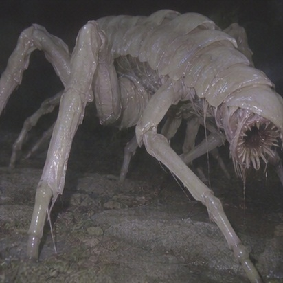
  - 【原典外貌】堂庭之山「多棪木，多白猿，多水玉，多黃金」；發爽之山「無草木，多水，多白猿」。郭璞注：「今白猿，山猿也，臂長，便捷。」
  - 【本作克蘇魯／昆蟲寄生／偽人重構】徹底剝離雪白靈猴的神話仙氣，以**盲洞白化節肢蜘蛛與寄生鐵線蟲菌絲群**重構！體型乾癟如吊死在水溝裡的瘦長白猿骨架，卻完全沒有哺乳類毛皮——覆蓋全身那層看似漂白濕拖把的慘白長毛，實為數以萬計寄生於甲殼孔洞中、隨濕氣緩慢扭動的**乳白鐵線蟲與濕黏白黴絲**！牠們的四肢長達軀幹兩倍以上，肘腕間多出兩節如盲蛛與長腳蛛般纖細反折的硬殼骨節，拖地爬行時會將指節磨得露出森白人骨殘留。頭部沒有鼻孔與唇瓣，只有一張平滑蒼白、嵌著六顆純黑針孔單眼的卵形甲面。整群潛伏於全黑潮濕岩壁或廢棄建築樑柱上時，黑白畫面僅見漆黑背景中懸垂數十條死白長臂與成排完全同步轉頭的慘白盲面，宛若吊滿停屍間的濕冷蟲繭。發爽山系水棲亞種則體表無毛、全覆半透明水生黏液膜，長臂生有吸盤可在湍急涵洞倒掛。
- **特性**：
  - 【原典記載】原典僅記其色白且數量眾多，常伴水玉（水晶）、黃金與充沛水脈而生。
  - 【本作衍生】**「菌絲連網共享視覺」**：同巢白猿體表寄生的白色鐵線蟲菌絲會釋放微弱化學脈衝，只要其中一隻在天花板角落瞥見獵物，整群數十隻便會於半秒內同時鎖定目標座標，達成無死角立體包圍。因長年盤踞水晶石英礦脈與地下水洞，牠們對乾淨金屬與高純度陰氣極其敏銳。
- **弱點**：
  - 【原典記載】原典未載。
  - 【本作衍生】1. **極度畏懼乾燥高熱、明火與強光**：體表白色鐵線蟲菌絲蘊含可燃黏脂，一張**烈火符**或工業噴燈即可讓整片白毛瞬間爆燃並燒斷視覺連動；2. **首領母體斬首**：整群依賴體型最碩大、雙臂最長的「白絲母體」發號施令，以**破障符**識破群影、直斬母體胸口卵囊，餘群即陷入盲目自殘。
- **習性**：
  - 【原典記載】棲於多棪木與水玉之堂庭山，以及無草木多水之發爽山。
  - 【本作衍生】現代台灣多見於陽明山與新北郊山廢棄煤礦坑道、停業山區遊樂園荒廢纜車站、以及長年滲水的水庫排洪檢修洞；夜間會結隊在生鏽鋼索與地下室消防管線上無聲垂降擺盪，專挑落單夜爬者與廢墟探險客。
- **喜好**：
  - 【原典記載】原典未載；堂庭山多棪木（果似柰可食）、水玉與黃金。
  - 【本作衍生】病態收集一切會反射冷光的玻璃碎片、腕錶、手電筒鏡片、金屬眼鏡框與碎水晶，並用潮濕白絲將這些亮晶晶的戰利品連同受害者指骨一起吊掛在洞頂，形成宛如風鈴般的毛骨悚然「白骨反光陣」。
- **擅長的招式／異能**：
  - 【原典記載】臂長便捷（郭璞注）。
  - 【本作衍生】**「盲蛛長臂垂絞」**（從三公尺高黑影垂下數條濕滑白臂同時套住獵物頸踝，將人倒吊拖入管線夾層）、**「群目菌網同步」**（單隻發現即全群精準預測躲避路線）、**「水絲濺黏」**（發爽亞種猛甩長臂，噴出能令符紙受潮報廢的寄生白絲黏液）。

---

### [SHJ01-003] 猨翼諸怪（猨翼之山怪獸・怪魚・怪蛇・怪木異化群）
- **出處順序**：卷 01〈南山經〉・南山一經・猨翼之山（又作即翼之山，本經第 3 山）
- **類別與造型路線**：`【非人生物恐怖型】`｜變形蟲黏液異化生物群・節肢與人骨隨機嵌合禁地生態怪
- **物種／唯一性**：`物種（群體）`（原典不逐一命名，僅以「多怪獸、水多怪魚、多怪蛇、多怪木，不可以上」統稱整片禁地之異化怪物群落）
- **稀有度與道行對照**：`★★ 稀級（R）`（單體凡級至稀級；以整座「不可以上」異化禁區威脅計為珍級環境災厄）｜模糊道行：山脈地脈腐敗所化之雜生異種｜本作階位：單體未入流～三流；整片禁區視同一流級封鎖區域
- **外貌與黑暗地牢／恐怖谷視覺改寫**：
  - 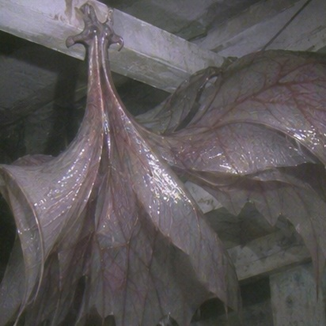
  - 【原典外貌】「其中多怪獸，水多怪魚，多白玉，多蝮虫，多怪蛇，多怪木，不可以上。」——原典罕見地徹底拒絕給予具體形態描述，只反覆強調「怪」與「不可以上」。
  - 【本作克蘇魯／昆蟲寄生／偽人重構】本作最標準的**克蘇魯「不可名狀」變形蟲腐肉融合禁地**！所有闖入者與調查員拍下的相片永遠失焦糊成一團濕暗重影，唯獨在肉眼近距離直視時，會看見令人理智崩潰的拼湊解剖學：**怪獸**像是將腐食甲蟲胸殼、數十條痙攣馬陸步足與發脹水蛭軟肉隨意縫合的畸形爬行團塊，背脊插著方向顛倒的獸肋與人牙；**怪魚**沒有魚鰭，靠兩側裂開的肉質觸鬚在黑泥裡蠕爬，吻部開闔著整齊慘白的人類臼齒；**怪蛇**皮下擠滿鼓動的透明蟲囊，鱗片間竟倒生出一片片翻白帶泥的指甲；**怪木**的濕腐樹皮滲出腥臭黑汁，扭曲木瘤形成無數張開無聲哀嚎的負片臉洞，氣根末梢長著吸血水螅口盤。黑白墨線刻意採用重黑塗實與高反差反白留痕，製造整頁窒息發霉的視覺噪音。
- **特性**：
  - 【原典記載】「不可以上」——整座猨翼之山被標記為絕對禁足的死域。
  - 【本作衍生】**「地脈造怪孢子場」**：猨翼靈脈本身是一座活體寄生培養皿，空氣與積水中懸浮著肉眼難見的變形蟲原生質孢子。任何活物（人、犬、鳥、魚乃至植物）一旦滯留禁區超過半小時並吸入潮氣，體內組織便會被強制改寫、增生出節肢關節、複眼肉瘤與無用軟骨，最終融入這片永不停止蠕動的「諸怪」生態。
- **弱點**：
  - 【原典記載】原典未載個體弱點，唯一忠告即「不可以上」；惟同山產「白玉」，暗示潔淨玉石具鎮壓隔絕之能。
  - 【本作衍生】1. **離脈即崩**：所有被猨翼靈脈異化出來的「諸怪」皆高度依賴禁區地氣，只要強行引誘或拖出靈脈邊界逾五百公尺，其拼湊肉體便會於數分鐘內融化成發臭黑水；2. **白玉四隅鎖脈陣**：以純淨白玉塊或硃砂寫成的**淨氣避穢符**封鎖出入口四角，配合高濃度生石灰與**烈火符**焚毀濕腐地衣，可暫時止住「造怪領域」向外擴張。
- **習性**：
  - 【原典記載】密布整座猨翼之山及其周邊水潭，吞噬一切擅登者。
  - 【本作衍生】在現代台灣常對應於各地「封閉數十年、失蹤案頻傳」的廢棄公路舊隧道、被雙層刺絲網圍死卻沒人說得清原因的溪谷深潭，以及半山腰長年漏水發霉的爛尾社區大樓。
- **喜好**：
  - 【原典記載】原典未載。
  - 【本作衍生】極度渴望「尚未異化的新鮮完整軀體」——會透過雜訊干擾手機導航，或由已異化的半人怪木發出微弱呼救，將登山客、試膽大學生與誤入卡車司機引入禁區深處充當新培養基。
- **擅長的招式／異能**：
  - 【原典記載】原典未載（以「不可以上」示其全域致命性）。
  - 【本作衍生】**「濕孢子異化場」**（未貼避穢符者在領域內呼吸十五分鐘即出現指節分岔、皮膚生出幾丁質硬斑與幻聽）、**「無定形腐群合圍」**（怪魚離水爬行、怪木氣根絞踝、怪蛇自頭頂滴落，同步封鎖立體退路）。

---

### [SHJ01-004] 蝮虫（反鼻巨毒蟲蛇｜兼錄羽山・非山之首分佈）
- **出處順序**：卷 01〈南山經〉・南山一經・猨翼之山（本經第 3 山；另複見於南次二經第 4 山「羽山：其下多水，其上多雨，無草木，多蝮虫」，以及南次三經第 6 山「非山之首：其上多金玉，無水，其下多蝮虫」）
- **類別與造型路線**：`【非人生物恐怖型】`｜環節巨蛭與巨型毒蜈蚣融合怪蛇・鼻端鋼針蚊式毒口器
- **物種／唯一性**：`物種（群體）`（貫穿南山一、二、三經三座大山之經典劇毒群體怪蟲，橫跨濕雨與乾岩雙環境）
- **稀有度與道行對照**：`★ 凡級（N）`｜模糊道行：十年至數十年聚毒成精的劇毒爬蟲怪｜本作階位：三流（羽山巨型濕潮母體可達三流頂）
- **外貌與黑暗地牢／恐怖谷視覺改寫**：
  - 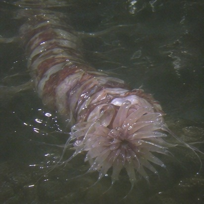
  - 【原典外貌】三經皆載「多蝮虫」。晉・郭璞注：「蝮虫，色如綬文，鼻上有鍼，大者百餘斤，一名反鼻。」——體大者逾百斤，體表花紋如古代官員綬帶般繁密對稱，鼻端上翹並長有一根銳利毒針。
  - 【本作克蘇魯／昆蟲寄生／偽人重構】緊扣原典用字「**虫**」而非單純普通蝮蛇，重塑為粗如成人大腿、重逾百斤的**「重甲環節水蛭 × 巨蜈蚣 × 吸血蚊針」三棲毒怪**！牠沒有平滑蛇鱗，全身由一節節深黑濕亮、邊緣密生微小抓鉤步足的**幾丁質硬甲環**套疊而成；郭注所謂「色如綬文」的詭麗條紋，近看竟是甲環縫隙裡不斷蠕動分泌的黑亮毒腺與酷似扭曲咒符的共生蟲卵紋路！最致命的是其扁平倒三角的頭端——鼻尖高高向上反翹，伸出一根長逾十公分、呈中空金屬烏黑質感的**超巨型蚊式穿刺口針（反鼻鍼）**，針尖始終掛著一滴濃稠發黑的腐蝕神經毒汁；針下橫裂的口部不是蛇嘴，而是三瓣向內收縮的吸血水蛭環形齒盤，咬合後便將鼻針深深刺入獵物頸動脈泵入致幻劇毒與微細卵液。
- **特性**：
  - 【原典記載】體重可達百餘斤，體色如綬文、鼻端生鍼，毒性極烈（古籍並載其毒「齧人立死」），廣布於猨翼禁地、多雨羽山與乾燥非山三處。
  - 【本作衍生】鼻端鋼針注入的並非單純血循毒，而是混有**寄生微蟲與高強度恐懼致幻毒素**的黏稠黑液：中針者在三分鐘內會出現嚴重感官反轉與極端恐慌幻覺（看見自身皮下爬滿無數細針），並於極度驚恐的飆高心率中加速毒素攻心而亡。羽山多雨種體表滑溜分泌強酸黏液，非山無水種則甲殼更硬、擅長偽裝成生鏽粗電纜。
- **弱點**：
  - 【原典記載】原典未載明確弱點。
  - 【本作衍生】1. **反鼻毒針是毒素中樞與重心**：只要用長柄鐵鉗、厚重鋼鏟或**金剛護身符**硬格並精準折斷其鼻端中空骨針，其毒囊便會因氣壓逆衝而在顱內炸裂；2. **極懼高濃度硫磺粉、雄黃燻煙與乾燥強鹼**：幾丁質環節氣門一旦吸入雄黃硫磺煙，全身百對隱蔽微足便會劇烈抽搐、無法捲曲彈射。
- **習性**：
  - 【原典記載】群居猨翼山禁域、陰雨連綿的羽山及無水多岩的非山山麓。
  - 【本作衍生】現代都市裡極為常見的「下水道惡夢」——常沿老社區化糞池連通管、大樓地下室汙水泵浦井與梅雨季倒灌的雨水箱涵成窩盤踞；冬季寒流來襲時，甚至會順著室外排水管與冷氣穿牆套管鑽進人類陽台的熱水器外殼或洗衣機底座取暖。
- **喜好**：
  - 【原典記載】原典未載。
  - 【本作衍生】偏愛潮濕悶熱卻局部發燙的陰暗窄縫（如變電箱地下管溝、老舊餐廳油脂截留槽、醫院鍋爐房）；對溫血生物散發的二氧化碳與汗液鹽分異常敏感。
- **擅長的招式／異能**：
  - 【原典記載】反鼻生鍼、劇毒噬咬。
  - 【本作衍生】**「反鼻高壓針刺」**（盤捲幾丁質環節如彈簧蓄力，瞬間將十公分中空鼻針貫穿鞋底或防護衣注入恐懼毒液）、**「綬紋致暈蠕動」**（甲縫毒腺同步泛出濕亮反光波紋，在手電筒微光下誘發人類視覺暈眩與短暫僵直）、**「斷尾蛭逃」**（尾端數節可自主脫落化作十餘條盲目彈跳的吸血毒蛭干擾除妖師追擊）。

---

### [SHJ01-005] 鹿蜀（杻陽歌謠白首寄生獸）
- **出處順序**：卷 01〈南山經〉・南山一經・杻陽之山（本經第 4 山）
- **類別與造型路線**：`【非人生物恐怖型】`｜枯白蟲繭面具巨型竹節螳螂獸・皮下虎斑幼蟲囊・赤紅水蛭產卵尾
- **物種／唯一性**：`物種（群體）`（原典記載「佩之宜子孫」，顯示可被長期獵捕剝取外皮甲膜，屬穩定存在之群體怪獸）
- **稀有度與道行對照**：`★★ 稀級（R）`｜模糊道行：百年左右山林異獸精怪（具聲波致幻與隱蔽寄生繁殖力）｜本作階位：二流初～中階
- **外貌與黑暗地牢／恐怖谷視覺改寫**：
  - 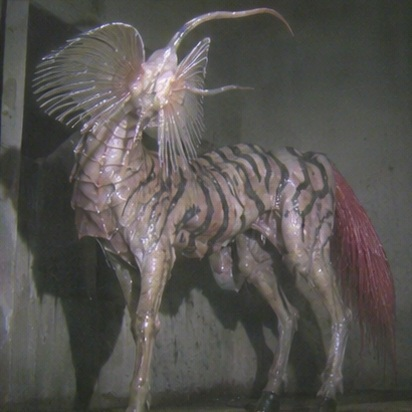
  - 【原典外貌】「有獸焉，其狀如馬而白首，其文如虎而赤尾，其音如謠，其名曰鹿蜀，佩之宜子孫。」——形如駿馬、頭顱純白、遍體生虎斑條紋、拖著赤紅長尾，鳴聲婉轉宛如人類吟唱歌謠。
  - 【本作克蘇魯／昆蟲寄生／偽人重構】徹底撕碎「唯美神話彩馬」的幻想，將其重構為一頭在深夜潮濕停車場無聲踱步的**「高腳枯骨螳螂 × 產卵寄生母囊」恐怖巨怪**！身高如消瘦病馬，四條修長「馬腿」實為外覆硬質骨殼、每隻腳掌裂作三瓣倒鉤的**超巨型竹節蟲與螳螂節肢**，肋骨極端凸露且甲縫滲水；原典所謂「其文如虎」絕非毛皮條紋，而是半透明灰白膜皮底下，一排排橫向鼓起、緩慢脈動的**黑褐條狀寄生幼蟲囊帶**！整顆「白首」毫無眼睛、鼻孔與耳廓，光滑慘白宛如一具結滿硬絲的**巨大石膏蠶繭面具**，唯獨正中縱向裂開一道濡濕發音氣縫，伴隨胸腔氣門震動不斷溢出輕柔陰冷、猶如老舊錄音帶倒轉般的童謠哼唱！身後那條觸目驚心的「赤尾」，則是一束由數十條濕滑鮮紅、不斷滴落血腥黏液並蠕動探路的**吸血巨水蛭與肉質產卵管**絞成的血色肉鞭，在黑白墨線中以濃墨實塗襯托死白面具與密集排線虎紋，生理厭惡感拉滿。
- **特性**：
  - 【原典記載】「其音如謠」「佩之宜子孫」——叫聲像人唱歌謠，將其皮毛佩帶於身可使家族子嗣繁盛。
  - 【本作衍生】**「宜子孫之恐怖真相＝寄生生殖費洛蒙」**：鹿蜀蛻下的虎斑皮膜浸滿高濃度催產與生殖激素費洛蒙，在台灣黑市遭不孕求子仲介高價切塊裝入「求子香包」販售。佩戴者確實極易受孕，但所懷胎兒往往帶著微弱蟲鳴胎音，且夜半剛滿月的嬰兒會在黑暗中睜開無神雙眼，跟著窗外傳來的歌謠低聲齊唱——原來每一枚流出的鹿蜀皮都在將人類血脈改造成下一代鹿蜀幼蟲的溫床！
- **弱點**：
  - 【原典記載】原典未載。
  - 【本作衍生】1. **破謠斷頻**：牠的一切精神誘控高度仰賴胸腔氣門與白繭口縫的共振歌謠，一旦以響亮廟會鑼鼓、道門破穢真言大聲誦念或工業高分貝警報徹底打斷其音律，鹿蜀即陷入神經錯亂原地兜圈；2. **擊碎白繭首殼**：純白無眼面具實為保護核心神經節的脆硬幾丁質繭殼，貼身以**掌心雷**或鐵棍重錘砸裂白首，便會瞬間洩盡體壓倒地化膿。
- **習性**：
  - 【原典記載】棲於杻陽之山（陽多赤金，陰多白金）。
  - 【本作衍生】專愛在深夜兩三點徘徊於老舊婦產科診所後巷、知名求子廟宇（註生娘娘廟）周邊暗渠與無燈地下室停車場，沿著柱子繞出詭異正圓小跑，一邊發出輕柔童謠尋找體質虛弱或剛流產的女性宿主。
- **喜好**：
  - 【原典記載】原典未載。
  - 【本作衍生】對新生兒啼哭聲、羊水腥氣與產房醫療廢棄物氣味有極端本能執著，常隔著醫院地下排水管循哭聲爬行靠近。
- **擅長的招式／異能**：
  - 【原典記載】其音如謠（聲波異能）。
  - 【本作衍生】**「宜子孫・育兒幻謠」**（透過白繭氣縫唱出宛如母親搖籃曲的低頻歌謠，強制刺激聽者大腦催產素分泌，令受害者產生強烈母性／父愛幻覺，誤將眼前這頭滴血節肢怪物當成自己走失的幼童而主動張開雙臂擁抱）、**「赤蛭尾鞭播卵」**（趁獵物卸防擁抱瞬間，赤紅水蛭尾束驟然散開死死勒住四肢，將數十枚針尖大小寄生卵刺入皮膚毛孔）。

---

### [SHJ01-006] 旋龜（玄龜・杻陽怪水黑甲蟲怪）
- **出處順序**：卷 01〈南山經〉・南山一經・杻陽之山・怪水（本經第 4 山水域）
- **類別與造型路線**：`【非人生物恐怖型】`｜螺旋裂甲巨型深水龍蝨・腐鳥骨喙頭・獨立寄生吸血巨蛭蛇尾
- **物種／唯一性**：`物種（群體）`（原典明載「其中多玄龜」，且可取甲佩戴治聾與足底老繭，屬水域群生異種）
- **稀有度與道行對照**：`★★ 稀級（R）`｜模糊道行：數十年至百餘年潛伏泥潭之重甲水族妖怪｜本作階位：二流
- **外貌與黑暗地牢／恐怖谷視覺改寫**：
  - 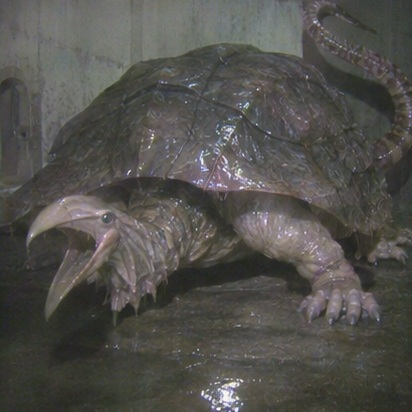
  - 【原典外貌】「怪水出焉，而東流注於憲翼之水。其中多玄龜，其狀如龜而鳥首虺尾，其名曰旋龜，其音如判木，佩之不聾，可以為底。」——墨黑龜形、長著鳥頭與毒蛇（虺）之尾，叫聲像斧頭猛力劈開硬木。
  - 【本作克蘇魯／昆蟲寄生／偽人重構】捨棄溫馴玄武烏龜印象，重構為一頭盤踞在黑臭淤泥裡、外殼酷似**超巨型深水鱟與腐食甲蟲**的雙生寄生水怪！其直徑逾一公尺的漆黑穹頂硬甲遍布深深旋捲的**螺旋溝壑與裂縫**，裂縫深處並非石紋，而是擠滿數百張如藤壺與食腐甲蟲般不斷喀喀開闔的細小角質咬喙；前伸的「鳥首」是一顆完全脫毛、灰肉腐爛如禿鷲死屍的骨喙巨頭，眼眶裡卻嵌著一對濕潤泛黃、宛如人類老者般的渾濁眼球，每次張喙便從喉管震出「喀啦——！」宛如硬木炸裂的駭人爆音！身後那條「虺尾」根本不是同一個體的尾巴，而是一條與其尾椎神經共生、各自擁有獨立殺意與四瓣吸血吸盤的**漆黑巨型毒水蛭／盲蛇寄生體**，經常自行昂首吐信戒備後方死角。四肢則是生滿倒刺剛毛、沾滿黑泥與死魚碎骨的粗壯水生節肢槳足。
- **特性**：
  - 【原典記載】「其音如判木，佩之不聾，可以為底」——佩戴其甲殼可治療耳聾，並消除足底厚繭（底通「胝」）。
  - 【本作衍生】旋龜螺旋黑甲內部藏有精密的**水壓震動共鳴腔**，黑市陰派法師常高價收購其碎甲磨粉製成「聽靈耳符」，佩者聽覺會瞬間變得極端靈敏、甚至能聽見死水下亡魂與百公尺外管線裡的蟲爬聲——代價則是耳膜會逐漸鈣化出螺旋細紋，夜半不斷幻聽斧頭劈骨的巨響。
- **弱點**：
  - 【原典記載】原典未載。
  - 【本作衍生】1. **雙腦共生矛盾**：鳥首本體與虺尾寄生體各自獨立運作、彼此常因搶食內訌，法師只要利用**聲東擊西符**或拋出淋血生肉誘惑其中一端，常能令毒蛇尾反口咬進鳥首頸縫造成自我中毒；2. **仰翻致命與腹膜軟肋**：一旦利用槓桿或**震地衝擊符**將其沉重穹甲掀翻，其蒼白軟爛、爬滿水生寄生蟲的腹部暴露在空氣中便無法自行翻正，一發**五雷鎮煞符**即可徹底貫穿擊斃。
- **習性**：
  - 【原典記載】棲息於杻陽之山怪水，隨水流注入憲翼之水。
  - 【本作衍生】藏身於淡水河、基隆河與大漢溪底厚重黑淤泥中，特別偏愛混跡於台灣各地**宮廟放生池**——成百上千隻被信眾放生的普通巴西龜與斑龜之中，常靜靜潛伏著一隻偽裝成發霉大黑石的旋龜，專挑深夜在池畔偷撈烏龜的醉漢或誤踩水階的孩童下口。
- **喜好**：
  - 【原典記載】原典未載。
  - 【本作衍生】對浸水腐朽的木造古物有奇特啃食癖好，極愛啃咬廢棄渡船頭腐木樁、漂流浮木乃至隨洪水沖落的落難木雕神像，藉此補充體內共振腔所需之木質纖維。
- **擅長的招式／異能**：
  - 【原典記載】其音如判木（劈木爆音）。
  - 【本作衍生】**「判木裂界鳴」**（螺旋背甲與骨喙同步釋放高壓衝擊音爆，一聲便能震裂門窗玻璃、震碎木質法器與普通三流防禦結界，並使近距離人類耳膜穿孔失衡）、**「虺尾獨立突刺」**（鳥首正面假裝縮殼防禦時，寄生蛇尾猛然彈射三公尺繞背注入腐肉麻痺毒液）。

---

### [SHJ01-007] 鯥（柢山冬死夏生兩棲牛形蟲魚）
- **出處順序**：卷 01〈南山經〉・南山一經・柢山（本經第 5 山）
- **類別與造型路線**：`【非人生物恐怖型】`｜牛型兩棲巨田鱉水蟲怪・脅下雙膜蟲翼・乾屍脫水爆殼重生體
- **物種／唯一性**：`物種（群體）`（原典記載「食之無腫疾」，屬可被採集食用的季節性群體異魚）
- **稀有度與道行對照**：`★★ 稀級（R）`｜模糊道行：具備跨季假死重組異能的百年異變怪獸｜本作階位：二流
- **外貌與黑暗地牢／恐怖谷視覺改寫**：
  - 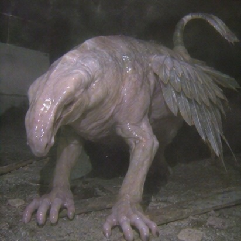
  - 【原典外貌】「有魚焉，其狀如牛，陵居，蛇尾有翼，其羽在魼下，其音如留牛，其名曰鯥，冬死而夏生，食之無腫疾。」——體形如牛卻是魚類，棲居陸地丘陵，生蛇尾、脅下（魼下）長羽翼，鳴聲如犁牛，冬季死亡、夏季復生。
  - 【本作克蘇魯／昆蟲寄生／偽人重構】徹底揚棄童話飛魚意象，以**「脫水隱生水熊蟲 × 牛體型巨型負子蟲／田鱉 × 蟬蛻破殼恐怖」**徹底重構！活體狀態宛如一頭泡脹浮腫、足有黃牛大小的灰黑無毛水怪，表面並非魚鱗，而是覆蓋沾滿青苔的**重疊甲蟲硬殼片**，殼縫裡卡著幾縷濕爛如腐牛毛的黑色絲藻；腫脹扁平的牛頭上凸出兩顆毫無靈氣、灰白混濁的死魚巨眼，嘴部則是能將整顆人頭吞進去的圓形吸吮腐肉口囊。肋骨下方兩道暗紅深裂（魼下）藏著一對半透明、布滿粗黑血管與黏液的**濕漉漉巨大昆蟲膜翼**，震動時向四周狂噴惡臭防腐汁液；後方拖著一條多節環狀、前端帶刺的巨型寄生蠕蟲蛇尾。最具生理衝擊力的是牠「冬死而夏生」的循環：每年霜降後便乾癟萎縮成一具輕飄飄、皮骨緊貼如百年臘肉魚乾的硬殼屍體；翌年梅雨雷雨季濕氣一至，乾屍表皮便發出「劈啪」爆裂聲，大量鮮紅泡脹的肉芽與內臟從破口瘋狂湧出重組，場面宛如地牢活體孵化噩夢！
- **特性**：
  - 【原典記載】「陵居」「冬死而夏生，食之無腫疾」——水怪卻上岸陵居，依四季輪迴死而復生，食其肉可消腫去水腫。
  - 【本作衍生】鯥之所以能「冬死夏生」，靠的是類似極端節肢昆蟲的**完全脫水隱生機制（Cryptobiosis）**：體內含有超強吸濕消腫的異變保水蛋白。台灣偏方黑市常把冬天撿到的鯥乾屍切片當成昂貴「消腫乾魚藥材」收進中藥抽屜——殊不知只要夏天冷氣故障、室內濕度飆破 80%，整抽屜的切片就會在半夜黏合膨脹，化作一頭滴著腥水的牛形肉蟲撞破藥櫃逃逸！
- **弱點**：
  - 【原典記載】冬季必死（嚴格受季節低溫支配）。
  - 【本作衍生】1. **極端懼怕急凍低溫與徹底除濕**：現代除妖實戰中，利用**玄冰寒氣符**、工業乾冰或將其誘入大型急凍冷庫，可在數分鐘內強制觸發其「冬死」脫水僵化機制；2. **冬死狀態焚灰斷根**：夏季活體狀態下即使斬斷頭尾也能靠黏液快速癒合，**唯有趁其進入「冬死」乾屍態時，潑灑高純度酒精並以烈火符徹底燒成純白灰燼**，方能永絕後患。
- **習性**：
  - 【原典記載】陵居於無草木多水的柢山丘陵。
  - 【本作衍生】在現代台灣多於端午節至中元節的酷熱颱風季現身，棲伏於地勢低窪的淹水地下室、停電斷冷的批發魚市場大型冷凍庫、以及暴雨後積水未退的郊區重劃區泥地。
- **喜好**：
  - 【原典記載】原典未載。
  - 【本作衍生】極度迷戀高溫高濕與持續滴水聲，初夏復甦時常循著整排公寓冷氣室外機的滴水管線，沿著濕滑牆根爬行聚集。
- **擅長的招式／異能**：
  - 【原典記載】冬死夏生、鳴如留牛、陸上滑翔。
  - 【本作衍生】**「夏生・爆殼重組」**（只要空氣濕度夠高，重傷時可原地蛻下殘破外殼，從裂口瞬間膨脹出完好無傷的濕滑新軀）、**「魼翼酸液低空掠擊」**（撐開肋下黏液膜翼低空震盪滑撲，將強酸黏液灑滿整個狹窄地下室）、**「留牛沉悶共振吼」**（低頻腹鳴令獵物內耳積水、噁心失衡）。

---

### [SHJ01-008] 類（亶爰之山雌雄同體分裂怪）
- **出處順序**：卷 01〈南山經〉・南山一經・亶爰之山（本經第 6 山）
- **類別與造型路線**：`【非人生物恐怖型】`｜雌雄同體巨渦蟲與貓骨節肢結合怪・鐵線蟲長鬣・縱向齒縫裂殖體
- **物種／唯一性**：`物種（群體）`（原典明言「自為牝牡」，無須異性交配即可無性／自體繁衍成災）
- **稀有度與道行對照**：`★★ 稀級（R）`｜模糊道行：數十年成精之異化分裂妖怪（單體戰力中等，但放任繁殖數週可化作災級蟲海）｜本作階位：三流頂～二流
- **外貌與黑暗地牢／恐怖谷視覺改寫**：
  - 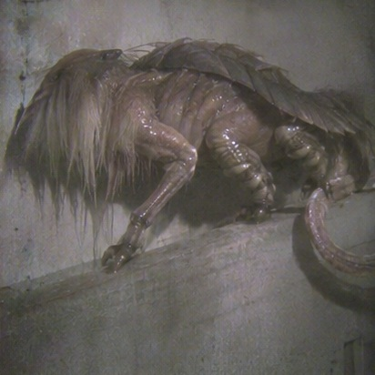
  - 【原典外貌】「亶爰之山，多水，無草木，不可以上。有獸焉，其狀如狸而有髦，其名曰類，自為牝牡，食者不妒。」——形似野貓（狸），頸背生有長鬃毛（髦），自體兼具雌雄雙性。
  - 【本作克蘇魯／昆蟲寄生／偽人重構】摒棄毛絨妖貓形象，改採**「可無限再生分裂的巨大陸生渦蟲 × 畸形節肢野貓骨骸」**打造極致不對稱噁心感！體型如瘦長流浪犬，但整具軀體沿著正中線被一條深黑濕滑、咬合著兩排細密乳白肉齒的**縱向縫合裂口**硬生生切成完全異質的左右兩半——左半身蒼白腫軟如浸水軟體水蛭、右半身覆滿硬質漆黑甲蟲節片與反折長爪！頸後拖地的所謂「長髦」，根本不是獸鬃，而是數百條酷似人類濕爛長黑髮、會各自獨立捲曲攀牆的**粗壯黑褐鐵線蟲與觸絲**！繁殖時畫面最為驚悚：中央那條齒狀縫合線發出撕裂布帛般的濕響，整頭怪獸從額頭一路裂開到尾椎，翻捲出粉紅黏膩的內臟囊膜，於十秒內硬生生分裂成兩頭各自發出尖銳嘶鳴的獨立「類」！
- **特性**：
  - 【原典記載】「自為牝牡，食者不妒」——雌雄同體自行繁殖，食用其肉會徹底失去嫉妒之心。
  - 【本作衍生】黑市情感詐騙集團與地下邪教曾走私類的乾燥中線肉膜製成非法「無妒錠」，混進受害者飲料中；服食者不僅對伴侶背叛徹底麻木無感，連同**自我保護欲、領地戒心與求生憤怒**都會被其神經毒素一併溶解，淪為任人宰割掏空家產的微笑空殼。
- **弱點**：
  - 【原典記載】原典未載；惟其棲地亶爰之山「不可以上」，示其極端排外隱蔽。
  - 【本作衍生】1. **分裂中線是致命軟肋**：正處於縱向裂殖的十秒空檔內毫無防禦力，若以硃砂浸漬的**鎮煞紅線**或**定身符**沿其中線釘封，便能徹底鎖死分裂機制；2. **極畏猛犬吠聲與乾燥粗鹽**：原生渦蟲軟肉一沾粗鹽、生石灰或高熱火焰便會劇烈脫水融化；烈性陽犬（如黑狗）的狂吠亦會令其雙半身神經協調失靈。
- **習性**：
  - 【原典記載】盤踞無草木、多水且不可攀登之亶爰之山。
  - 【本作衍生】常躲藏在老舊公寓漏水天花板輕鋼架夾層、頂樓違建暗閣或情侶租屋處發霉的浴室排風管內；只要吸足潮氣與屋內負面情緒，單隻一個月內即可分裂成擠爆整片天花板夾層的寄生獸窩。
- **喜好**：
  - 【原典記載】原典未載。
  - 【本作衍生】對人類「嫉妒、猜疑與爭吵時分泌的腎上腺素汗味」極度上癮，最喜歡潛伏在頻繁發生情感糾紛、出軌冷戰的公寓頂部吸食「妒氣」，同時將長如人髮的鐵線蟲髦毛垂出冷氣孔滴落鎮靜黏液。
- **擅長的招式／異能**：
  - 【原典記載】自為牝牡（自體繁殖）、使人無妒。
  - 【本作衍生】**「中線裂殖」**（受致命斬擊時乾脆順著刀傷直接分裂成兩頭體型減半、行動更快的雙體同時夾擊）、**「無妒麻痺霧」**（從中線肉齒噴出甜膩薄霧，讓除妖師在戰鬥中瞬間喪失警戒心與反擊鬥志）、**「髮蟲纏窒」**（頸後百條黑髮鐵線蟲暴長纏緊武器與咽喉）。

---

### [SHJ01-009] 猼訑（基山背目九尾四耳巨怪）
- **出處順序**：卷 01〈南山經〉・南山一經・基山（本經第 7 山）
- **類別與造型路線**：`【非人生物恐怖型】`｜巨型吸脹寄生硬蜱與重甲蜘蛛融合怪・四耳聲納角・九條蠍蜈節肢尾・裂背密集複眼群
- **物種／唯一性**：`物種（群體）`（原典記載「佩之不畏」，示其為基山棲息且曾遭古人獵取之異種怪獸族群）
- **稀有度與道行對照**：`★★★ 珍級（SR）`｜模糊道行：數百年以上山嶺凶獸（全向感知、極難偷襲、神經鎮恐力極強）｜本作階位：二流頂～一流初
- **外貌與黑暗地牢／恐怖谷視覺改寫**：
  - 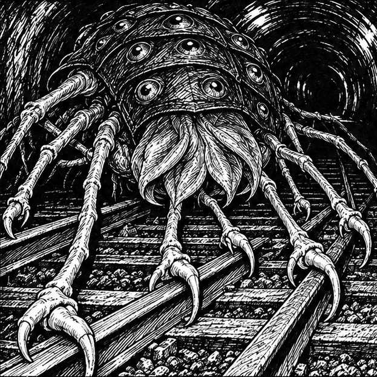
  - 【原典外貌】「有獸焉，其狀如羊，九尾四耳，其目在背，其名曰猼訑，佩之不畏。」——形似山羊，卻生著九條尾巴、四隻耳朵，而且所有的眼睛全都長在背脊之上。
  - 【本作克蘇魯／昆蟲寄生／偽人重構】徹底推翻「多尾山羊」的畜生外型，重塑為一尊盤踞於黑暗地牢潮濕石殿裡的**「膨脹寄生硬蜱 × 巨型複眼蠍蛛」密集恐懼噩夢**！雖然大體輪廓仍保有一絲瘦骨嶙峋的四足羊形骨架，但頭顱前端完全盲閉無眼、光禿禿如一塊發灰的蟲殼；本該是眼眶的位置已被四隻向外放射張開、內壁布滿濕潤黏膜與細毛的**漏斗狀節肢聽覺角（四耳）**佔據！最令人胃部翻絞的是牠的整個背部——從頸後一路裂到尻部的厚重硬甲向兩側翻開，露出整片宛如巨型蒼蠅與盲蛛集合的**數十顆大小不一、獨立轉動、滲出黏液的漆黑複眼與球面單眼肉床（「其目在背」）**，無論獵物從哪個方位偷襲，整片背脊的眼珠都會瞬間齊刷刷死盯過來！身後更不是九條羊毛尾，而是九條漆黑油亮、末端生著倒鉤毒針與寄生吸盤的**多節巨型鞭蠍／蜈蚣長尾**，不斷拍打地面發出喀喀硬殼聲，黑白墨線以極細排線勾勒背眼密布的反光高光與潮濕幾丁質甲縫。
- **特性**：
  - 【原典記載】「其目在背」「佩之不畏」——眼睛長在背上防備全方位死角，佩帶其皮甲能令人膽大無畏、百毒不驚。
  - 【本作衍生】**「絕恐神經阻斷腺」**：猼訑背眼周圍的幾丁質腺體會分泌強效杏仁核抑制素——在黑市被盜獵者製成「無畏骨片」，供地下拳手與亡命悍匪貼身佩戴，使人徹底感受不到恐懼與痛覺；然而失去恐懼本能的人類往往會毫無避險意識地直面致命傷或直接失血戰死，成為猼訑最愛拖回巢穴享用的「無恐懼活屍肉塊」。
- **弱點**：
  - 【原典記載】原典未載。
  - 【本作衍生】1. **背脊裸露眼床是唯一脆弱軟組織**：頭腹四肢覆滿厚硬幾丁質骨甲難以破防，唯獨張開的「背目肉床」沒有甲殼保護——以高濃度辣椒素粉、生石灰霧、強光閃光彈或從高空灑落**破穢火油＋烈火符**直接灼傷其整片背眼，即可令牠喪失360度鎖敵能力並痛極翻滾；2. **四耳聽覺過載**：連續投擲爆音雷符震破四隻漏斗耳膜，能使牠九條蠍尾胡亂揮刺自傷。
- **習性**：
  - 【原典記載】棲於基山（其陽多玉，其陰多怪木）。
  - 【本作衍生】潛伏於多層結構的廢棄立體停車場、大型變電所地下電纜廊道或空置百貨地下室；特別喜歡藏身於低矮樑柱下，以四耳聆聽上方樓板動靜，並用背脊眼床死死盯著天花板與每一個樓梯轉角，絕不給除妖師任何背刺機會。
- **喜好**：
  - 【原典記載】原典未載。
  - 【本作衍生】嗜食體內腎上腺素極度飆升、卻又在最後一刻被牠壓抑掉恐懼感的獵物心臟；平時喜愛在潮濕石壁磨擦九條節肢尾尖保持倒鉤鋒利。
- **擅長的招式／異能**：
  - 【原典記載】九尾四耳、目在背（全向監視）、無畏氣場。
  - 【本作衍生】**「背目三百六十度凝視」**（無死角鎖定並預判任何輕身符閃現與繞背突襲）、**「九尾蠍鞭絞殺陣」**（九條幾丁質節肢長尾如鋼鞭般封鎖整條走廊，同時穿刺四肢關節）、**「絕恐麻痺氣場」**（釋放杏仁核抑制費洛蒙，誘發敵方除妖師陷入盲目狂妄而衝進死亡陷阱）。

---

### [SHJ01-010] 𪁺𩿧（尚付／敞鳧・基山三首六足異禽）
- **出處順序**：卷 01〈南山經〉・南山一經・基山（本經第 7 山）
- **類別與造型路線**：`【非人生物恐怖型】`｜三頭六複眼巨型腐食毒蜂蟬怪・六刺節肢爪・三膜翼高頻失眠怪禽
- **物種／唯一性**：`物種（群體）`（原典記載「食之無臥」，可被捕食之基山怪鳥族群）
- **稀有度與道行對照**：`★★ 稀級（R）`｜模糊道行：數十年至百年成精之畸變山林怪禽｜本作階位：二流
- **外貌與黑暗地牢／恐怖谷視覺改寫**：
  - <!-- 圖位預留：待補繪 -->
  - 【原典外貌】「有鳥焉，其狀如雞而三首六目、六足三翼，其名曰𪁺𩿧，食之無臥。」（郭璞注音「敞孚」，近代因字構由「尚鳥、付鳥」組成亦通稱「尚付」，並註「其性急，食之使人少眠」。）
  - 【本作克蘇魯／昆蟲寄生／偽人重構】將「三頭六目六足三翼」直接還原成令人毛骨悚然的**「畸形六足昆蟲融合體 × 脫毛焦骨食腐怪雞」**！軀幹約如巨型鬥雞般乾硬鼓脹，卻覆滿漆黑發亮的**巨型虎頭蜂與夏蟬幾丁質甲節**；胸前並排伸出**三條不斷互相啄咬爭食的長頸**，每顆頭皆無羽毛，覆著灰紅濕爛肉冠與一對佔據半張臉的**膨大蒼蠅複眼（共六目）**，鳥喙實為能夠向下垂刺並吐酸溶肉的**昆蟲刺吸長口針**！腹下並排生著**六條帶有鋸齒倒刺的漆黑節肢步足**，走動時發出疾促凌亂的喀啦聲；背部則不對稱地長出**三片半透明焦黃、布滿黑粗翅脈的巨型昆蟲膜翼**——正因三翼無法維持正常對稱飛行，牠起飛時會發出刺耳撕裂的超高頻亂流嗡鳴，伴隨大量黑色寄生蟎蟲與刺激神經的粉塵四散飛濺。
- **特性**：
  - 【原典記載】「食之無臥」——性情急躁，吃了牠的肉就會精神異常亢奮、難以入睡。
  - 【本作衍生】**「永晝神經亢奮毒」**：𪁺𩿧三顆頭輪流休眠、終生從不徹底闔眼，體液飽含超強中樞神經興奮毒素。黑市暗網將其乾燥膜翼粉冒充「特效熬夜神丹」賣給爆肝工程師與考前學生；起初確實能連熬七日頭腦清醒，但第十天起服食者便徹底喪失睡眠機制，眼球布滿血絲凸出、聽覺幻化出三道焦躁催促的低語，最終在極度躁鬱中活活心臟爆裂或自殘而死！
- **弱點**：
  - 【原典記載】原典未載（惟郭注「其性急」，暗示情緒極易失控）。
  - 【本作衍生】1. **三首內訌與性急陷阱**：三個腦袋共用一個極度焦躁的神經系統，法師只要同時在三個方向拋出閃光誘餌或點燃驅蟲煙，三顆頭便會因爭奪優先捕食權而互相撕咬纏頸、空中失衡墜地；2. **懼靜神鎮魂音與黏網**：三片不對稱膜翼一旦沾上**黏膠網**或灑水加重即徹底無法振翅，施展**靜神符**與低沉梵鐘誦經更能反向衝垮其亢奮神經，令六足抽搐昏厥。
- **習性**：
  - 【原典記載】棲於基山陰面怪木林間。
  - 【本作衍生】極度討厭安靜與黑暗睡眠環境，在現代台灣專挑徹夜燈火通明的二十四小時大型機房通風塔、跨夜施工工地鷹架、不夜城招牌後方鋼架與醫院急診室外牆盤踞；專門在深夜隔著窗戶用三翼高頻亂震逼瘋失眠住戶。
- **喜好**：
  - 【原典記載】原典未載。
  - 【本作衍生】嗜食高咖啡因與高腎上腺素的極度過勞者腦髓；喜歡高壓變電器發出的六十赫茲電流嗡鳴聲，常倒掛在變電箱鐵架上集體磨擦三翼。
- **擅長的招式／異能**：
  - 【原典記載】三首六目視察、致人無臥。
  - 【本作衍生】**「三翼高頻失眠噪波」**（三片不對稱膜翼瘋狂亂震，發出令人頭痛欲裂、心跳飆破一百八的次聲與高頻混合噪音，強行打斷法師掐訣唸咒）、**「六目三喙連環刺吸」**（三條長頸分攻雙眼與咽喉，六足死扣肩胛注入強酸消化液）。

---

### [SHJ01-011] 青丘九尾狐（嬰啼食人母體族｜⚠️ 偽人嬰啼 × 節肢九尾產卵基準）
- **出處順序**：卷 01〈南山經〉・南山一經・青丘之山（本經第 8 山；亦見卷 09〈海外東經〉、卷 14〈大荒東經〉；封神軒轅墳蘇妲己即此族千年特異母體）
- **類別與造型路線**：`【類人偽人型】`｜極致恐怖谷偽人皮囊・嬰啼誘殺聲囊・脊裂九條漆黑幾丁質節肢尾與搏動產卵管結構
- **物種／唯一性**：`物種（群體）`（青丘之山原生食人九尾妖狐族群；與封神演義「軒轅墳千年九尾狐妲己」之物種特異個體同脈異支，本作保留《山海經》最原始兇殘之「嬰啼食人」野性群體設定）
- **稀有度與道行對照**：`★★★ 珍級（SR）`（青丘成年野性母體；高階老祖級特異個體可達 `★★★★ 絕級`）｜模糊道行：數百年以上凶猛寄生食人妖族｜本作階位：二流頂～一流
- **外貌與黑暗地牢／恐怖谷視覺改寫**：
  - 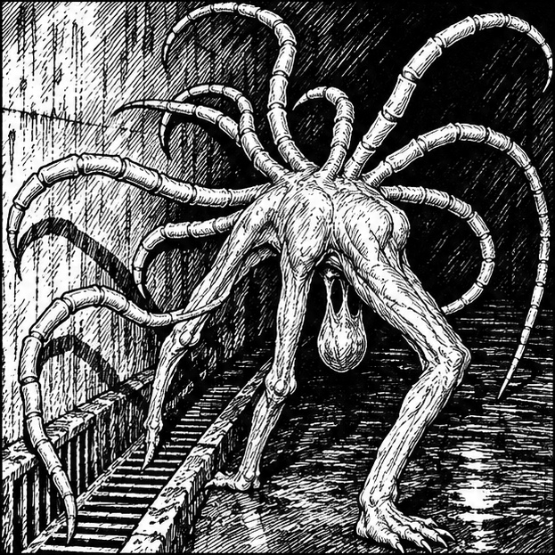
  - 【原典外貌】「又東三百里，曰青丘之山，其陽多玉，其陰多青雘。有獸焉，其狀如狐而九尾，其音如嬰兒，能食人；食者不蠱。」——《山海經》原典中九尾狐絕非唯美祥瑞或柔弱寵妃，而是**會發出嬰兒哭聲誘獵、並直接吞食活人的恐怖凶獸**！
  - 【本作克蘇魯／昆蟲寄生／偽人重構】**嚴格對齊本作「五大標竿・九尾狐偽人節肢產卵」核心聖經，同時高度還原青丘原始「嬰啼食人」之荒蠻噩夢！**平時偽裝成徘徊於潮濕無燈山路、老舊公寓地下室或雨夜巷尾的瘦削慘白女子（或懷抱一團濕布包的僵冷年輕母親），臉部輪廓清秀卻毫無血色與表情起伏，眼白近乎消失、瞳孔漆黑反光如冰冷昆蟲複眼，每當嘴角微微拉開一毫米，喉間竟發出極度逼真、穿透雨幕的**新生嬰兒撕心裂肺啼哭聲（「其音如嬰兒」）**——仔細盯著她纖細的頸側，才會駭然發現喉結處正有兩枚半透明蟲氣囊像蛙鳴般痙攣膨縮！一旦好心路人靠近探看，她整具人類皮囊便會從後頸一路向下沿脊椎血肉淋漓地**縱向崩裂**，從濕滑暗紅的皮下深處猛然爆伸出**九條漆黑油亮、遍布倒刺關節與骨質毒螯的巨型蠍蜈節肢長尾**！九條幾丁質硬尾之間，更纏繞吐出數條蒼白半透明、末端生滿環形肉齒且劇烈搏動的**巨型寄生蟲產卵管**；她的下巴同時喀嚓脫臼垂落至胸口，露出縱裂的昆蟲大顎，將獵物活生生拖進九尾與產卵管交織的潮濕牢籠中撕碎吞食或注入蟲卵！黑白高對比墨線著重描繪僵冷美人偽人臉、裂背滴落的拉絲黏液與九條幾丁質節肢尾的金屬般漆黑硬光。
- **特性**：
  - 【原典記載】「其音如嬰兒，能食人；食者不蠱」——能發出嬰兒啼哭聲、嗜食活人；而人類若能反殺並食用其肉，便能免於百蟲毒蠱之害。
  - 【本作衍生】**「以毒攻毒之青丘抗蠱腺」**：青丘九尾狐之所以「食者不蠱」，正是因為牠本身就是站在寄生昆蟲食物鏈頂端的**超級掠食寄生母體**！其體內九尾根部與產卵管分泌的免疫酶能瞬間溶解所有低階蟲卵、蠱毒與寄生幼蟲。台灣極秘除妖世家在斬殺野生青丘狐後，偶會高價提煉其焦化尾根腺體作為「抗蠱解藥」，但劑量稍有偏差便會令服藥者脊椎發癢、皮下浮出細小節肢紋路！
- **弱點**：
  - 【原典記載】原典未載明確弱點（惟同山青丘亦有異鳥「灌灌，佩之不惑」，暗示青丘九尾狐極擅以聲音與幻覺惑人，灌灌之鳴與羽毛實為其同地天敵剋星）。
  - 【本作衍生】1. **灌灌音頻與破妄符破偽裝**：凡在深夜無人的地下道、暗巷或山谷聽見突兀且節奏過分規律的嬰兒哭聲，**嚴禁單獨循聲接近**，必須先點開**開天眼符水**或施展**破障符**，一旦看穿喉部發音蟲囊與皮下節肢影，其先手誘殺優勢便宣告瓦解；2. **後頸大椎至胸椎裂縫是總神經核**：九條節肢尾與產卵管全數匯集於脊椎中段，以雷擊桃木錐、老枯松木劍或貼身**五雷鎮煞符**重創其脊背裂口，再以**烈火符**連爆燒盡散落蟲卵，即可徹底斬絕。
- **習性**：
  - 【原典記載】棲於青丘之山（多玉、多青雘），夜啼如嬰以誘食生人。
  - 【本作衍生】不同於混跡權貴豪宅的軒轅墳高階特異個體，野生青丘九尾狐族群更偏好潛伏在台灣山區廢棄育幼院、高速公路涵洞、老社區陰暗地下室與颱風夜無人公車候車亭，慣以淒厲嬰啼觸發人類本能的憐憫與救援衝動，將獨行路人與搜救人員誘入死角群起獵殺。
- **喜好**：
  - 【原典記載】嗜食活人血肉。
  - 【本作衍生】極度偏愛懷抱沾有嬰兒奶香的潮濕舊娃娃或浸血繈褓當作誘餌道具；對具有強烈同情心、聽到孩童哭聲便會停步張望的人類抱有病態狩獵快感。
- **擅長的招式／異能**：
  - 【原典記載】擬嬰啼鳴、食人凶性、九尾異形。
  - 【本作衍生】**「偽人嬰啼誘殺頻」**（透過頸側發音蟲囊精準投射多方向回音，讓獵物誤以為暗溝深處有棄嬰待救）、**「九尾幾丁質絞殺籠」**（九條漆黑蠍蜈節肢長尾自裂背同時展開，高速交錯封死三公尺內所有逃生縫隙）、**「搏動產卵管活體注卵」**（刺穿被制伏獵物的腹腔或氣管，注入具麻痺消化酶的寄生卵，使受害者淪為孵化下一代青丘幼蟲的活體溫箱）。

---

### [SHJ01-012] 灌灌（青丘呵斥破惑蟲禽）
- **出處順序**：卷 01〈南山經〉・南山一經・青丘之山（本經第 8 山）
- **類別與造型路線**：`【非人生物恐怖型】`｜鳴囊極度膨大之巨型食蟲虻・寄生蜂鳥複合怪禽
- **物種／唯一性**：`物種（群體）`（原典記載「佩之不惑」，屬棲息於青丘之山、與九尾狐共存相剋的族群異鳥）
- **稀有度與道行對照**：`★ 凡級（N）`｜模糊道行：數年至數十年山林異禽｜本作階位：三流
- **外貌與黑暗地牢／恐怖谷視覺改寫**：
  - <!-- 圖位預留：待補繪 -->
  - 【原典外貌】「有鳥焉，其狀如鳩，其音若呵，名曰灌灌，佩之不惑。」——外形如鳩鴿，叫聲像人發怒大聲呵斥。
  - 【本作克蘇魯／昆蟲寄生／偽人重構】打破和平鴿印象，重塑為一種專以寄生幼蟲為食、長相詭異暴躁的**「膨脹氣囊巨食蟲虻 × 腐骨斑鳩」**！體型大如烏鴉，雙翼並非柔羽，而是兩層厚實灰黑、沾滿金屬油光與細密硬刺的**甲蟲鞘翅與半透明脈翼**；最觸目驚心的是牠整個喉嚨與胸膛位置——膨脹成一顆佈滿青紫血管、薄如豬膀胱的**巨型肉質共振鳴囊**，一呼一吸便劇烈鼓漲回縮。頭部密布針刺硬毛，生著一對冷酷無情的暗紅食蟲虻大複眼與尖如外科剪刀的硬質剪喙；每當發現隱藏在陰影裡的偽人或幻覺費洛蒙，整個胸囊便猛然炸縮，爆出一聲震耳欲聾、宛如狂怒壯漢貼在耳邊暴喝「滾——！」般的恐怖**呵斥音爆（「其音若呵」）**！
- **特性**：
  - 【原典記載】「其音若呵」「佩之不惑」——叫聲宛如人聲斥責，佩帶其羽甲可免於迷惑與幻覺。
  - 【本作衍生】**「天然除魔聲納」**：灌灌在青丘生態鏈中是專吃九尾狐幼蟲與寄生孢子的兇猛掠食蟲禽！牠發出的暴躁呵斥聲波能直接震碎空氣中的幻覺費洛蒙分子並強制震醒遭催眠的人類大腦，因此牠的乾燥鳴囊膜片與硬刺羽片，是台灣正統除妖師製作頂級**破障符**與**靜神護身符**夢寐以求的珍稀輔料。
- **弱點**：
  - 【原典記載】原典未載。
  - 【本作衍生】體質偏脆、極度神經質，膨脹的喉部共振氣囊毫無甲殼防護；一旦遭精準鈍器或彈丸擊破鳴囊，牠便立刻失聲窒息且喪失所有反擊手段。
- **習性**：
  - 【原典記載】與九尾狐同棲青丘之山。
  - 【本作衍生】在現代都市極為罕見，偶爾會被強烈的偽人費洛蒙吸引，棲息於鬧鬼廢棄大樓頂樓水塔、老墓園枯樹或青丘狐巢穴附近的高壓電塔上，在半夜無端對著空無一人的暗巷發出震天怒喝聲，常被不知情居民誤認為瘋漢在樓頂罵街。
- **喜好**：
  - 【原典記載】原典未載。
  - 【本作衍生】瘋狂嗜食各式妖蟲幼體、寄生蟲卵與九尾狐產卵管分泌的黏液塊，聞到幻術瘴氣便會異常興奮。
- **擅長的招式／異能**：
  - 【原典記載】呵斥之鳴、破除迷惑。
  - 【本作衍生】**「呵斥震妄波」**（貼臉爆出高壓定向聲波，直接震散二流以下妖怪的全感官障眼法、驅散迷魂費洛蒙，並讓近身偽人皮囊瞬間龜裂抽搐）、**「剪喙啄腦」**（趁妖物障眼法破碎硬直瞬間，以剪刀狀硬喙精準啄穿其複眼與神經節）。

---

### [SHJ01-013] 赤鱬（英水人面魚身偽人怪｜⚠️ 極致人面偽人基準）
- **出處順序**：卷 01〈南山經〉・南山一經・青丘之山・英水（本經第 8 山水域）
- **類別與造型路線**：`【類人偽人型】`｜極致恐怖谷溺屍人面魚身偽人・鰓裂環形吸盤・猩紅環節巨蛭水怪
- **物種／唯一性**：`物種（群體）`（原典載「其中多赤鱬」「食之不疥」，屬成群潛伏於暗流深潭之水域偽人群體）
- **稀有度與道行對照**：`★★ 稀級（R）`｜模糊道行：數十年至百餘年水澤成精妖魚（極擅水中擬人誘溺與皮膚寄生）｜本作階位：二流
- **外貌與黑暗地牢／恐怖谷視覺改寫**：
  - <!-- 圖位預留：待補繪 -->
  - 【原典外貌】「英水出焉，南流注於即翼之澤。其中多赤鱬，其狀如魚而人面，其音如鴛鴦，食之不疥。」——長著一張人類臉孔的怪魚，叫聲宛如鴛鴦相和，吃了牠的肉不會長疥瘡皮膚病。
  - 【本作克蘇魯／昆蟲寄生／偽人重構】本作**〈南山經〉最令人毛骨悚然的「水面極致偽人怪」**！徹底抹除任何美人魚的浪漫遐想，還原成一具浮在黑臭積水裡、讓人瞬間心臟驟停的**「發脹溺屍人頭 × 猩紅巨型吸血水蛭魚軀」**！當牠垂直懸浮於淹水地下室或夜間運河水面時，只露出一張浸泡過度、慘白微腫卻五官端正得令人窒息的**無毛人類臉孔**——沒有眼瞼的乳白眼球內閃爍著細微昆蟲複眼暗光，嘴角死死維持著溺水者臨終前那種怪異微笑；唯有當你俯身靠近水面想拉「落水者」一把時，才會在手電筒光束下駭然看見：這張人臉的雙頰與下顎邊緣竟整齊切開了六道不斷開闔滲血的**深紅鰓裂**，每道鰓裂裡都擠滿密密麻麻、像七鰓鰻與寄生水蛭般旋轉咬合的**環形角質吸齒**！人頭頸下完全沒有肩膀與手臂，而是直接銜接著一條長達兩公尺、無鱗濕滑、通體泛著剝皮鮮肉般暗紅光澤的**環節巨蛭狀魚身**，背鰭與尾鰭則是由數十條半透明黏膜水螅觸手拼成的血色肉鰭，在烏黑污水下緩緩擺盪，口中不斷溢出甜膩詭異、酷似情侶低語又像鴛鴦戲水般的啾啾鳴聲（「其音如鴛鴦」）。
- **特性**：
  - 【原典記載】「其狀如魚而人面，其音如鴛鴦，食之不疥」——人面魚身、聲如鴛鴦、食之治皮膚疥瘡。
  - 【本作衍生】**「腐膚啃噬抑菌黏液」**：赤鱬體表分泌的猩紅黏液含有極強的噬菌體與剝離角質酵素，確實能瞬間殺死人類表皮所有疥蟎與黴菌——但在活體狀態下，這層黏液是用來將溺水獵物的皮膚連同毛囊整片軟化剝離、方便牠貼臉吸食皮下微血管鮮血的恐怖消化酸！黑市美容偏方曾非法摻入赤鱬體液製成「換膚神露」，使用者皮膚起初光潔無瑕，半個月後雙頰卻開始裂開會滲血呼吸的細小鰓縫！
- **弱點**：
  - 【原典記載】原典未載。
  - 【本作衍生】1. **極度畏懼乾燥、高壓電流與強鹼生石灰**：離開水域超過十分鐘，其猩紅水蛭軀幹便會劇烈脫水龜裂、行動力暴跌九成；若在積水地下室遭遇，嚴禁貿然下水，直接向水面投擲**五雷鎮煞符**引發水體導電，即可將潛伏水下的整群赤鱬一網電斃；2. **識破水面倒影破綻**：開天眼符水下可見其人面下顎不斷湧出暗紅寄生蟲泡，絕不可伸手施救。
- **習性**：
  - 【原典記載】成群棲息於青丘之山英水與即翼之澤。
  - 【本作衍生】潛伏於台灣暴雨後的地下車道積水、工業區大型蓄水池、廢棄游泳池黑水及河濱公園深夜漲潮的涵洞口；常三五成群將慘白人臉齊齊浮出黑水面，模仿溺水呼救與情侶親暱低笑聲誘使路人俯身探望。
- **喜好**：
  - 【原典記載】原典未載。
  - 【本作衍生】嗜吸新鮮活人臉頰與頸動脈血液；特別喜歡在月光照不到的漆黑靜水中成對交纏，互相舔舐對方人面鰓裂裡積聚的腐皮碎屑。
- **擅長的招式／異能**：
  - 【原典記載】人面惑目、鴛鴦之鳴。
  - 【本作衍生】**「溺屍偽人浮面誘拉」**（單獨露出慘白微笑人臉漂浮水面並發出輕柔鴛鴦般的嗚咽低鳴，引誘目擊者伸手打撈後瞬間暴起咬腕拖入深水）、**「雙頰鰓裂環齒吸附」**（人臉左右鰓裂猛然翻轉擴大，死死吸住獵物口鼻使其在水中迅速窒息並被同時吸乾面血）、**「血鰭酸霧」**（拍水甩出腐蝕性猩紅黏液，令沾染者皮膚奇癢脫皮）。

> **南山一經全經檢核備忘**：招搖之山（狌狌）→ 堂庭之山（堂庭白猿）→ 猨翼之山（猨翼諸怪、蝮虫）→ 杻陽之山（鹿蜀、旋龜）→ 柢山（鯥）→ 亶爰之山（類）→ 基山（猼訑、𪁺𩿧／尚付）→ 青丘之山（青丘九尾狐、灌灌、赤鱬）→ 箕尾之山（無怪獸記載）。南山一經共計 **13 條**怪獸檔案悉數收錄完畢；卷末純祭祀鳥身龍首山神已依鐵律剔除。

---

## 🪲 第二單元：南次二經（柜山山系｜柜山 → 漆吳之山）

> **本單元涵蓋山脈（共十七山）**：柜山 → 長右之山 → 堯光之山 → 羽山（多蝮虫，主檔併詳見 `SHJ01-004`）→ 瞿父之山（無怪）→ 句餘之山（無怪）→ 浮玉之山 → 成山（無怪）→ 會稽之山（無怪）→ 夷山（無怪）→ 僕勾之山（無鳥獸無水）→ 咸陰之山（無草木無水）→ 洵山 → 虖勺之山（無怪）→ 區吳之山（無怪）→ 鹿吳之山 → 漆吳之山（處於東海日次，無怪獸記載）。本經卷末「龍身鳥首」純祭祀山神名單依鐵律剔除。

### [SHJ01-014] 狸力（柜山掘地土功巨怪）
- **出處順序**：卷 01〈南山經〉・南次二經・柜山（本經第 1 山）
- **類別與造型路線**：`【非人生物恐怖型】`｜巨型地下螻蛄與重甲腐食糞金龜融合怪・鈣化雙距掘爪・腹板摩擦犬吠震地獸
- **物種／唯一性**：`物種（群體）`（原典以「有獸焉……見則其縣多土功」紀其族群習性，屬地底穴居群體怪獸）
- **稀有度與道行對照**：`★★ 稀級（R）`｜模糊道行：數十年至百年聚土煞成精之地底重甲掘獸｜本作階位：二流中～二流頂
- **外貌與黑暗地牢／恐怖谷視覺改寫**：
  - 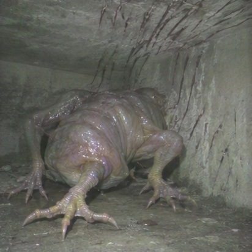
  - 【原典外貌】「有獸焉，其狀如豚，有距，其音如狗吠，其名曰狸力，見則其縣多土功。」——形似肥豬（豚），腳踵生有銳利硬距（如雞距般的骨刺掘爪），叫聲宛如狂犬吠叫；一現身該郡縣便會興起大規模土木挖掘工程。
  - 【本作克蘇魯／昆蟲寄生／偽人重構】徹底剝除肥豬形象，重塑為一頭在都市地下箱涵與地基泥層中瘋狂掘進的**「超巨型盲眼螻蛄 × 腐食糞金龜」重甲地下蟲獸**！體型大如小型休旅車，通體包裹著黑褐濕亮、沾滿潮濕黃泥與生鏽鋼筋碎屑的**厚重圓拱幾丁質盾甲**，背甲接縫間不斷滲出潤滑泥漿的油脂黏液；本該是豬鼻的前端實為一片鏟狀硬質骨盾與兩根粗壯內彎、生滿鋸齒的**鍬形蟲碎岩大顎**，沒有眼睛，只在頭甲裂縫裡探出數對濕黏顫動的觸角感受地層震動。原典強調的「有距」，在本作演化為四肢外側爆生出的**四對灰白鈣化巨型掘地鐮距**——形如巨大螻蛄鏟足與慘白殘骨合體，旋轉刮刨鋼筋水泥宛如切豆腐！腹底層疊的硬質甲板互相高速刮擦時，會從地下深處震出極度怪異、彷彿數十頭惡犬在悶罐中同時狂吠的**悶響吠音（「其音如狗吠」）**。黑白高對比墨線以粗硬焦墨刻畫厚重泥甲裂痕、鋸齒掘距與地下土層坍塌的窒息壓迫感。
- **特性**：
  - 【原典記載】「見則其縣多土功」——所現之處必致當地大興土木、掘地築堤或修補塌陷。
  - 【本作衍生】**「地基淘空災兆」**：原典「多土功」在本作有著殘酷的現代都市真相——不是狸力預言了工程，而是牠們成群在地底瘋狂啃掘土壤與老舊磚基，把整條街道的地下掏成巨大蜂巢空洞！只要都市某區深夜開始從下水道傳來莫名悶沉犬吠，往往不出三天就會發生馬路天坑塌陷、捷運潛盾工程滲水或老屋地基傾斜，迫使政府緊急開挖搶修（「多土功」）！
- **弱點**：
  - 【原典記載】原典未載。
  - 【本作衍生】1. **極畏高頻震地波與深水灌淹**：牠靠觸角與地下低頻震動辨識方位，施放**震地雷符**或直接以高壓消防水柱混入**五雷鎮煞符**灌入地洞，能瞬間使其甲縫泥膜短路並因氣門嗆水被迫鑽出地面；2. **腹底摩擦發音軟膜為唯一軟肋**：背甲堪比鋼板，唯有利用陷坑或**指地成鋼符**（反將泥土石化卡死其四隻掘距！）令其卡死動彈不得，再從腹側甲縫刺入雷擊桃木樁或灌入烈火符引爆。
- **習性**：
  - 【原典記載】棲於西臨流黃、東望長右之柜山，善掘土穴。
  - 【本作衍生】盤踞於台灣都會區捷運地下施工工地、老城區百年紅磚暗溝、大型地下滯洪池周邊土層與山坡地社區擋土牆後方；特別愛在連續豪雨軟化土質的深夜大舉開掘產卵隧道。
- **喜好**：
  - 【原典記載】原典未載；柜山英水多白玉、丹粟（硃砂細粒）。
  - 【本作衍生】嗜食含鐵量高的地下濕土、腐爛樹根、地下電纜橡膠外皮與地層礦砂（尤其偏愛混有丹砂與鐵鏽的深層紅土），偶爾會順著塌陷坑洞把墜落的流浪犬與夜間巡邏工人拖進地底啃噬。
- **擅長的招式／異能**：
  - 【原典記載】掘土成穴、聲如狗吠。
  - 【本作衍生】**「天坑瞬陷」**（在敵方腳下數公尺地層急速掏空並以甲背猛頂土柱，使整片柏油路面連同除妖師瞬間崩落地下洞窟）、**「犬吠震土波」**（腹甲高速摩擦發出猛烈低頻犬吠震波，震鬆老舊水泥牆與地下管線）、**「雙距鑽岩突進」**（低頭合攏碎岩大顎如活體潛盾機般撞穿地下室磚牆）。

---

### [SHJ01-015] 鴸（柜山人手鴟形放士妖禽）
- **出處順序**：卷 01〈南山經〉・南次二經・柜山（本經第 1 山）
- **類別與造型路線**：`【非人生物恐怖型】`｜脫毛腐食大天蠶蛾鴞身・反折翼關節嵌生慘白人類手掌・猜忌神經孢子怪鳥
- **物種／唯一性**：`物種（群體）`（原典以「有鳥焉……見則其縣多放士」紀其異象，屬群體怪禽）
- **稀有度與道行對照**：`★★ 稀級（R）`｜模糊道行：數十年至百年專司離間與散播猜忌陰氣的詭異妖禽｜本作階位：二流
- **外貌與黑暗地牢／恐怖谷視覺改寫**：
  - <!-- 圖位預留：待補繪 -->
  - 【原典外貌】「有鳥焉，其狀如鴟而人手，其音如痺，其名曰鴸，名自號也，見則其縣多放士。」——體形如貓頭鷹（鴟），卻長著人類的雙手，叫聲滯澀沉悶如痺（或自呼「鴸、鴸」），一出現該地就會有許多賢士遭到流放驅逐。
  - 【本作克蘇魯／昆蟲寄生／偽人重構】緊扣「**鴟身人手**」製造令人靈魂發寒的異類拼貼恐怖！軀幹是一頭徹底去羽化、長達一公尺多的**巨型腐食天蠶蛾與禿骨怪鴞合體**：表皮呈發霉灰褐色幾丁質，覆著油膩脫落的粉狀毒鱗與濕冷氣門；圓盤狀無耳鴞臉上生著兩顆佔據整張臉、漆黑無反光的巨型蜂巢複眼與一根朝下彎曲的吸髓尖喙。最突破生理承受極限的，是牠展開那對如破爛濕蛾翅般的雙翼時——翼腕關節與腹下本該長爪的位置，竟赫然嫁接著**一雙毫無羽毛、皮膚泡白起皺、連指紋與青紫指甲都清晰得駭人的「活體人類手掌」（「而人手」）**！十根纖長慘白的人類手指神經質地反覆開闔、抓撓虛空，落到老舊公寓冷氣鐵窗或辦公室窗台時，會像小偷般用十根冰涼人指緊緊摳住窗框，喉間發出宛如中風患者喉頭卡痰般乾澀壓抑的「鴸……鴸……（「其音如痺，名自號也」）」低鳴，同時從人手掌心汗腺不斷抖落肉眼難見的淡灰神經寄生孢子！
- **特性**：
  - 【原典記載】「名自號也，見則其縣多放士」——自呼其名，出現之處必致大量賢能官員或士人被排擠、罷黜與流放。
  - 【本作衍生】**「社會性猜忌寄生孢子」**：鴸從人手掌紋與蛾鱗抖落的微細寄生孢子，一旦隨中央空調吸入封閉職場、家族或除妖團隊成員的鼻腔，會專攻大腦前額葉的信任評估區域——不出七日，組織內部就會爆發毫無理由的極端猜忌、構陷與集體霸凌，最正直有能力的核心人物必先遭到眾人聯手孤立驅逐（「多放士」），而鴸則藏在陰暗通風管裡，貪婪吸食被排擠者陷入孤獨絕望時散發出的冷汗與怨氣。
- **弱點**：
  - 【原典記載】原典未載。
  - 【本作衍生】1. **極懼清心鎮神香與空氣乾燥加熱**：以艾草、檀香混合**靜神符**灰燼薰燒空調出風口，可瞬間滅活其猜忌孢子；2. **慘白人手關節即其脆弱神經裸露處**：牠的十根人類手指其實是外翻的敏感寄生觸器，一旦被**鎮煞紅線**纏死或遭強光直射灼傷手掌，鴸便會發出刺耳慘叫並徹底喪失抓握降落能力，直接失速撞牆墜落。
- **習性**：
  - 【原典記載】棲息於柜山林岩間。
  - 【本作衍生】偏愛現代台灣高壓冷漠的商辦大樓冷氣外牆凹槽、公家機關頂樓機房與老舊學區宿舍陰暗屋簷；深夜無聲展開濕蛾翅貼上高樓落地窗，將兩隻慘白人手死死按在玻璃上朝室內窺視，留下一整片發霉油印掌紋。
- **喜好**：
  - 【原典記載】原典未載。
  - 【本作衍生】極度迷戀人類團體內鬥時散發的焦慮荷爾蒙與孤立絕望氣息，喜歡收集遭公司解雇或遭親友孤立者丟棄的識別證與名牌。
- **擅長的招式／異能**：
  - 【原典記載】鳴聲如痺、致縣多放士。
  - 【本作衍生】**「放士・離間孢霧」**（拍動蛾翼撒下猜忌孢子，令聯手除妖的隊友在三分鐘內互相懷疑對方已被偽人調包而拔刀相向）、**「人手扣顱摘目」**（無聲俯衝後以一雙冰冷慘白人手猛扣目標太陽穴，十指嵌入眼眶拉扯，伴隨嘴部毒喙直刺後腦）、**「痺音鎖喉」**（滯澀卡痰般的鳴叫引發近距聽者胸悶痙攣、唸咒結巴中斷）。

---

### [SHJ01-016] 長右（長右之山四耳寄生怪猿｜⚠️ 水災凶兆）
- **出處順序**：卷 01〈南山經〉・南次二經・長右之山（本經第 2 山）
- **類別與造型路線**：`【類人偽人型】`｜濕白呻吟偽人怪猿・顱側四具搏動吸血水蛭聽覺寄生管・感潮致洪怪獸
- **物種／唯一性**：`物種（群體）`（原典以山命名獸「其名長右，見則郡縣大水」，屬隨地下暗河與暴雨脈動現身之罕見災害怪族）
- **稀有度與道行對照**：`★★★ 珍級（SR）`｜模糊道行：數百年聚水煞成精之天災級山妖（能共振引爆區域性都市洪患）｜本作階位：二流頂～一流初
- **外貌與黑暗地牢／恐怖谷視覺改寫**：
  - <!-- 圖位預留：待補繪 -->
  - 【原典外貌】「東南四百五十里曰長右之山，無草木，多水。有獸焉，其狀如禺而四耳，其名長右，其音如吟，見則郡縣大水。」——形似長尾猿（禺），生有四隻耳朵，叫聲像人痛苦呻吟，一旦現身便會引發郡縣大水災。
  - 【本作克蘇魯／昆蟲寄生／偽人重構】**緊扣「四耳寄生怪猿 × 濕冷偽人呻吟」徹底重塑！**牠宛如一名瘦長畸形、全身浸泡發白且皮肉垂垮如水腫溺屍的赤裸佝僂偽人猿——四肢骨節反折拉長、皮膚呈現死灰半透明狀，皮下清楚可見數條如發黑水線蟲般的濕滑寄生血管緩慢抽動！牠那張與人類極為逼近的瘦削臉龐永遠緊鎖眉頭、眼皮半垂露出一絲死白眼縫，張開的漆黑嘴洞裡不斷溢出極其滲人、宛如瀕死傷者在積水地下室低聲哀號的**「唔……啊……」濕濁人聲呻吟（「其音如吟」）**！最令人頭皮發麻的是其顱骨左右兩側——並非長出普通獸耳，而是從皮肉撕裂的四道暗紅膿孔裡，各自鑽出兩條（共**四具**）不斷膨脹蠕動、邊緣生滿環形感壓細鬚的**肉質寄生水蛭漏斗管（「四耳」）**！這四條寄生耳管如同活體水文探測器般各自獨立旋轉，每當暴雨將至，四耳便瘋狂搏動噴出濃霧與混濁污水，連帶牠身後的脊椎長尾亦裂成水螅觸手在積水中狂亂拍打！
- **特性**：
  - 【原典記載】「其音如吟，見則郡縣大水」——呻吟聲起便伴隨毀滅性大水災。
  - 【本作衍生】**「水脈共振致洪寄生體」**：長右顱側的四具寄生耳管其實是與整座城市地下水層、河道與暴雨低氣壓連動的生物低頻共振器！牠本身並非單純「預報洪水」，而是會先藏身於水庫洩洪道或老城區地下排水總幹管內，以四耳吸收低氣壓並反覆發射極低頻的呻吟共振波，強行阻塞抽水站機組、撕裂老舊堤防裂縫並聚攏周邊濕氣成雲致雨，直接把一場普通午後雷陣雨放大成淹沒整個行政區的「郡縣大水」！
- **弱點**：
  - 【原典記載】原典未載。
  - 【本作衍生】1. **四具寄生水蛭耳管是洪水共振總開關**：牠的一切操水異能與感潮預警全數仰賴頭側四條濕軟寄生耳管；只要法師頂著暴雨貼近，以高溫**烈火符**焦灼或以浸滿生石灰與粗鹽的利刃斬斷其中兩條以上寄生耳，其引水共振場便會瞬間崩潰，周遭積水亦會迅速退流；2. **懼純陽燥土鎮水陣**：以乾燥硃砂混黃土佈下**鎮水止煞符陣**，能大幅削弱其體表濕滑水蛭膜的自癒力。
- **習性**：
  - 【原典記載】棲於無草木、多水之長右之山。
  - 【本作衍生】現代台灣多在颱風警報發布前四十八小時或梅雨滯留鋒面壓境前，悄悄現身於低窪地區地下道涵洞、老舊抽水站機井、河堤水閘門暗影與淹水高風險區的地下停車場，蹲在積水牆角發出酷似受困老人的微弱呻吟聲，引誘巡檢人員與值班保全靠近後將其拖入暗渠溺斃。
- **喜好**：
  - 【原典記載】原典未載。
  - 【本作衍生】極度沉迷於暴漲黑泥水的腥濁氣味、排水管悶響回音與人類在淹水黑暗中發出的恐慌嗆水聲。
- **擅長的招式／異能**：
  - 【原典記載】四耳感潮、呻吟致大水。
  - 【本作衍生】**「四耳引洪・郡縣大水」**（四具寄生耳管同步張開如喇叭瘋狂震動，強制抽湧地下管線積水倒灌噴發，十分鐘內令整層地下室滅頂並於地面街區引發局部強降雨）、**「偽人呻吟誘溺」**（精準模仿受困傷患的微弱痛苦呻吟，誘使救難者蹚水進入深井陷阱）、**「水蛭耳管抽吸」**（四條耳管驟然暴長兩公尺，末端齒盤牢牢吸住目標頭部同步吸取腦脊液與灌入污水）。

---

### [SHJ01-017] 猾褢（堯光之山彘鬣冬蟄人型怪）
- **出處順序**：卷 01〈南山經〉・南次二經・堯光之山（本經第 3 山）
- **類別與造型路線**：`【類人偽人型】`｜穴居裸皮偽人苦力・背頸爆出刺蛾毒棘剛毛（彘鬣）・裂顎斲木聲誘發大規模徭役災怪
- **物種／唯一性**：`物種（群體）`（原典記其「穴居而冬蟄……見則縣有大繇」，屬隨季節蟄伏於土石穴洞中的人型怪獸族群）
- **稀有度與道行對照**：`★★ 稀級（R）`｜模糊道行：百年左右穴居山魅妖人（力量奇大、具強迫性勞動精神污染）｜本作階位：二流
- **外貌與黑暗地牢／恐怖谷視覺改寫**：
  - <!-- 圖位預留：待補繪 -->
  - 【原典外貌】「有獸焉，其狀如人而彘鬣，穴居而冬蟄，其名曰猾褢，其音如斲木，見則縣有大繇。」——體形宛如人類，卻生著野豬般粗硬豎立的剛毛鬃鬣，習慣挖洞穴居並在冬季冬眠蟄伏，叫聲像斧頭砍伐木頭，現身之處必有繁重徭役苦差。
  - 【本作克蘇魯／昆蟲寄生／偽人重構】**把「其狀如人而彘鬣」推向極致的工地暗坑偽人恐怖！**初看像一名渾身沾滿濕水泥灰、赤裸上身、筋骨異常粗壯佝僂的失蹤勞工或老礦工，五官僵硬呆滯、嘴唇乾裂發紫、雙眼如死去多日的灰白濁瞳；但當你繞到他身後或用手電筒斜照其頸肩，便會看到令人作嘔的生物異變——從他後腦勺一路順著背脊延至雙肩皮下，密密麻麻扎破人皮、直豎爆生出數千根粗黑油亮、末端倒鉤且滲著黃綠毒液的**超巨型刺蛾毒棘與馬陸剛毛（「彘鬣」）**！平時這片背棘緊貼著發黑汗衫或爛雨衣藏匿，一旦受驚便如豪豬與毒毛蟲般「刷啦」全數炸豎！他張開的人類下顎沒有牙床，內側覆著兩片厚實漆黑的**天牛啃木大顎**，每次用力咬合便爆出清脆沉重、彷彿巨斧狠劈硬木般的「叩！叩！叩！」駭人巨響（「其音如斲木」）。冬季寒潮來襲時，他會將整具軀體蜷縮成球，吐出大量帶土泥絲把自己糊死在工地地基水泥縫裡徹底「冬蟄」。
- **特性**：
  - 【原典記載】「穴居而冬蟄」「見則縣有大繇」——冬季潛伏不出，一現身便會引發沉重的全民勞役（大繇）之災。
  - 【本作衍生】**「工蟻強迫勞動費洛蒙」**：猾褢之所以總與「大繇（繁重苦役）」綁定，是因為牠背脊刺蛾毒棘會持續揮發類似**寄生蜂控制宿主或行軍蟻工蟻化**的神經信息素！受其斲木聲與信息素長期感染的工地工人、包商或附近居民，會陷入詭異的狂熱過勞狀態——不眠不休地瘋狂加班挖土、搬運建材、甚至徒手拆牆重築，直到雙手血肉模糊、過勞暴斃仍面露僵笑地重複機械動作，為猾褢構築出四通八達的地下水泥巢穴！
- **弱點**：
  - 【原典記載】冬季必蟄伏（冬蟄休眠期毫無反抗能力）。
  - 【本作衍生】1. **極畏嚴寒與玄冰法術**：體質與變溫昆蟲無異，低溫環境或連續貼上**寒霜符**能強行迫使其新陳代謝停擺、當場蜷縮僵化進入「冬蟄」態；2. **忌徒手近身搏殺、宜以烈火焚棘**：背頸毒剛毛一旦扎入皮膚即釋放神經強迫毒與劇痛腫脹，必須先以**烈火符**燒光其外露彘鬣剛毛，再以重物或**掌心雷**直轟其沒有毒棘覆蓋的胸腹與啃木下顎。
- **習性**：
  - 【原典記載】穴居堯光之山，春醒冬蟄。
  - 【本作衍生】常於春季驚蟄過後，在台灣深山隧道開挖工地、大型重劃區連續壁深坑、廢棄地下防空洞與老舊礦坑復甦活動；冬天則常被不知情的施工隊封進灌漿水泥牆或空心梁柱夾層裡冬眠，直到隔年春雷一響便直接咬破水泥重現人間。
- **喜好**：
  - 【原典記載】原典未載；堯光之山陽多玉、陰多金。
  - 【本作衍生】對電鑽打石聲、鐵槌敲擊聲與重度過勞者的酸臭汗味極為迷戀；最喜歡躲在工地工寮旁聽著加班噪音，用天牛大顎跟著節拍叩響「斲木」之音。
- **擅長的招式／異能**：
  - 【原典記載】穴居蠻力、斲木之音、引致大繇。
  - 【本作衍生】**「大繇・工蟻催勞音」**（以天牛大顎敲出規律斲木節拍並釋放費洛蒙，迫使意志薄弱者強行服從機械指令甚至拿起工具反攻同伴）、**「毒鬣爆刺」**（縮肩震背，將數十根帶倒鉤刺蛾毒棘如散彈般震射而出）、**「啃木碎骨顎」**（人臉下顎裂開四十五度，一口咬斷鋼筋或手臂骨骼）。

---

### [SHJ01-018] 彘（浮玉之山虎形牛尾食人怪）
- **出處順序**：卷 01〈南山經〉・南次二經・浮玉之山（本經第 7 山）
- **類別與造型路線**：`【非人生物恐怖型】`｜重甲巨型虎甲蟲掠食怪・鞭蠍倒鉤產卵長尾・胸節摩擦狂犬吠聲食人怪獸
- **物種／唯一性**：`物種（群體）`（原典以「有獸焉……其名曰彘，是食人」泛稱，屬浮玉山系兇猛食人掠食怪族）
- **稀有度與道行對照**：`★★★ 珍級（SR）`｜模糊道行：數百年嗜血兇殘之山林食人猛妖｜本作階位：二流頂
- **外貌與黑暗地牢／恐怖谷視覺改寫**：
  - <!-- 圖位預留：待補繪 -->
  - 【原典外貌】「又東五百里，曰浮玉之山，北望具區，東望諸毗。有獸焉，其狀如虎而牛尾，其音如吠犬，其名曰彘，是食人。」——形似猛虎卻拖著一條細長末端帶簇毛的牛尾，叫聲像狗吠，性情兇猛嗜食活人。
  - 【本作克蘇魯／昆蟲寄生／偽人重構】**徹底去除條紋大貓感，以地面速度最恐怖的掠食昆蟲「超巨型虎甲蟲」疊加「巨型鞭蠍尾」重構！**體型如一頭低伏伏擊的公虎，全身卻覆滿黃黑金屬光澤、沾滿乾涸血痂與腐葉泥垢的**高密度幾丁質裝甲板**——原典「狀如虎」的斑紋，竟是一道道像虎甲蟲鞘翅般錯落反光的漆黑與暗褐骨板縫！六條（前四條特化為粗壯奔襲抓爪、後二條隱藏於肋腹協助彈跳）反關節節肢步足踩地無聲，頭顱扁寬，生著兩顆向外凸出、能精準測距的**暗黃巨型掠食複眼**，以及一對長逾三十公分、交錯如鋸齒大剪刀的**漆黑鐮狀虎甲蟲巨顎**，滴淌著消化血肉的棕黑酸涎！身後那條「牛尾」絕非溫順牛尾，而是一條長逾三公尺、覆著環形幾丁質軟節的**鞭蠍式細長毒尾**，尾端那簇看似牛尾毛的構造，張開時竟是一叢能射出麻痺神經毒針與產卵絲的**倒鉤毒鬚花冠**！獵殺前，牠會高速震動前胸發音器，在漆黑河濱草叢裡爆出極似惡犬逼近的暴躁犬吠（「其音如吠犬」），讓受害者誤以為只是野狗群而錯失第一時間逃命良機！
- **特性**：
  - 【原典記載】「其音如吠犬，是食人」——聲如狗吠，毫無掩飾的純粹食人猛獸。
  - 【本作衍生】**「閃電伏擊掠食者」**：繼承虎甲蟲瞬間百倍體長爆發速度的生物特性，短距離衝刺快到連人類肉眼都只看得見一道漆黑模糊殘影！由於狂飆速度過快會令牠的複眼在高速移動瞬間暫時「視覺跟不上（失明空窗）」，所以牠習慣採用「**暴衝十公尺 → 急煞停頓半秒重新鎖定 → 再暴衝**」的恐怖分段閃現式獵殺節奏！
- **弱點**：
  - 【原典記載】原典未載。
  - 【本作衍生】1. **高速衝刺後的「半秒鎖敵硬直」**：熟知虎甲蟲生態的除妖師，只需掐準牠每次急煞重新對焦的那零點五秒死角，瞬間側閃並施展**陷地符**或撒下帶倒刺鋼絲網絆鎖其六足，就能徹底打斷其獵殺節奏；2. **胸腹發音甲縫防禦最薄**：正臉巨顎與背甲極硬，但當牠仰起前胸發出狂吠震懾時，頸下軟膜會短暫裸露，貼身一記**掌心雷**即可直接炸穿中樞神經。
- **習性**：
  - 【原典記載】盤踞北望太湖（具區）之浮玉之山林澤。
  - 【本作衍生】極度偏好現代台灣河濱公園夜間無人自行車道、堤防高草叢、郊區廢棄工廠草坪與山腳產業道路彎道；常躲在草叢陰影裡發出成群流浪狗吠聲，誘使夜跑者或騎車路人減速張望，隨即從側翼閃現撲殺並將屍體拖回堤防涵洞深處以酸液溶解啃食。
- **喜好**：
  - 【原典記載】嗜食人肉（「是食人」）。
  - 【本作衍生】特別鍾愛夜間運動後體溫偏高、滿身汗味與急促喘息的活人獵物；偶爾會先咬死當地真實的流浪野狗群，將狗屍掛在草叢邊掩蓋自己散發的甲殼腥臭味。
- **擅長的招式／異能**：
  - 【原典記載】犬吠欺敵、猛撲食人。
  - 【本作衍生】**「虎甲分段閃衝」**（極速停頓交替撲殺，令低階法師根本無法穩定瞄準甩符）、**「牛尾毒鬚鞭抽」**（三公尺長鞭蠍尾橫掃抽爛目標腿筋，尾端毒鬚同步注入酸液麻痺血液）、**「鋸齒剪顎斷腰」**（一咬即能將成年人腰椎連同護身銅錢甲直接剪成兩截）。

---

### [SHJ01-019] 鮆魚（浮玉之山苕水薄刃刀魚群）
- **出處順序**：卷 01〈南山經〉・南次二經・浮玉之山・苕水（本經第 7 山水域）
- **類別與造型路線**：`【非人生物恐怖型】`｜半透明扁薄帶狀吸血水蛭刀蟲群・大頭剪狀蟲顎割筋怪魚
- **物種／唯一性**：`物種（群體）`（原典明言「其中多鮆魚」，成千上萬密集群游於水域之低階怪魚群）
- **稀有度與道行對照**：`★ 凡級（N）`｜模糊道行：單體僅微弱陰煞妖氣，群聚成群時對涉水活體具致命剝肉威脅｜本作階位：未入流（單體）／三流（大群）
- **外貌與黑暗地牢／恐怖谷視覺改寫**：
  - <!-- 圖位預留：待補繪 -->
  - 【原典外貌】「苕水出於其陰，北流注於具區，其中多鮆魚。」晉・郭璞注：「鮆魚狹薄而長，頭大，大者尺餘，一名刀魚。」
  - 【本作克蘇魯／昆蟲寄生／偽人重構】將「狹薄如刀、頭大尺餘」放大成令人涉水喪膽的**「半透明活體手術刀帶狀水蛭 × 巨顎寄生魚蟲群」**！每條長約三十至四十公分，軀幹卻薄如一張沾滿黏液的慘白半透明刀片，在渾濁黑水中幾乎完全隱形，唯獨皮下那條填滿暗紅宿血的細長消化管與一排排細密硬骨刺宛如脊椎鋸條般閃著冷光！前端不成比例地長著一顆腫大扁硬、覆滿漆黑幾丁質薄甲的**巨型蟲頭**，雙眼白濁退化，口部則是一副上下密咬、鋒利到能瞬間切斷人體跟腱的**鋸齒剪刀狀大顎**！成百上千條鮆魚在淹水地下室裡同步貼著水底翻游時，水面下只見無數銀白冷光如飛散的刮鬍刀片般交錯閃爍，劃過腳踝的瞬間甚至感覺不到疼痛，直到整雙小腿在溫熱血霧中突然失去支撐跪倒水裡！
- **特性**：
  - 【原典記載】群居苕水注入太湖流域，狹薄而長、頭大如刀。
  - 【本作衍生】**「嗜血群聚剝肉效應」**：單條鮆魚體弱膽小，但只要水中滲入一滴新鮮人血，其大頭側線與觸鬚便會於兩秒內引爆狂暴進食費洛蒙，方圓五十公尺內的所有鮆魚立刻匯集成一道旋轉刀片漩渦，三分鐘內即可將落水獵物腳踝以下啃成慘白森骨。
- **弱點**：
  - 【原典記載】原典未載。
  - 【本作衍生】1. **體薄脆弱、極懼低壓雷電與熱水／生石灰**：軀體薄如紙片毫無抗震能力，一張最低階的**掌心雷**打入水中或傾倒漂白水／生石灰粉，就能讓整群鮆魚集體翻肚腐爛；2. **厚底雨鞋與護脛防護**：普通防割橡膠高筒雨鞋即可有效抵擋初輪割筋突襲，切忌赤腳或穿拖鞋涉入來源不明的黑水地下室。
- **習性**：
  - 【原典記載】群居浮玉之山陰面苕水與具區大澤。
  - 【本作衍生】常於豪雨淹水期順著雨水倒灌湧入台灣老舊社區地下室車道、夜市排水溝積水與河岸低窪草地，趁著人們捲起褲管涉水推車或撿拾物品時無聲發動足踝割筋群襲。
- **喜好**：
  - 【原典記載】原典未載。
  - 【本作衍生】極度偏愛微溫血腥味、泡水發白的傷口角質與淹水地下室裡漂浮的油脂汙垢。
- **擅長的招式／異能**：
  - 【原典記載】群聚水游。
  - 【本作衍生】**「薄刃群割跟腱」**（整群潛伏渾水底部，先集中十餘條無聲咬斷涉水者阿基里斯腱令其跌坐水中，再由整片刀蟲漩渦蜂擁撲上口鼻頸部）、**「透體隱形」**（側面扁薄且呈半透明，從水面俯視幾乎無法靠肉眼察覺）。

---

### [SHJ01-020] 䍺（羊患｜洵山無口不死異羊，俗常誤混西山羬羊）
- **出處順序**：卷 01〈南山經〉・南次二經・洵山（本經第 13 山）
- **類別與造型路線**：`【非人生物恐怖型】`｜無口無五官變形蟲肉囊巨蜱・表皮億萬微孔寄生吸蝕・無中樞器官不可殺災體
- **物種／唯一性**：`物種特異個體`（原典明言「其狀如羊而無口，不可殺也」，極端罕見且近乎無法以物理方式消滅之禁忌奇體；*考據註：原典本作「䍺」，音還／患，坊間常與卷 02〈西山經〉錢來之山馬尾怪獸「羬羊」相混，本條嚴格還原南山經洵山無口不死異羊原貌，真羬羊詳見卷 02*）
- **稀有度與道行對照**：`★★★ 珍級（SR）`｜模糊道行：違背常規生靈生理結構之數百年異質太古怪胎（正面進攻緩慢，卻擁有令高階除妖師絕望的「物理與常規法術不可殺」特性）｜本作階位：一流（絕對不死特化災體）
- **外貌與黑暗地牢／恐怖谷視覺改寫**：
  - <!-- 圖位預留：待補繪 -->
  - 【原典外貌】「又東四百里，曰洵山，其陽多金，其陰多玉。有獸焉，其狀如羊而無口，不可殺也，其名曰䍺。」——形體似羊，卻完全沒有嘴巴，且無論怎麼刀劈火攻都「不可殺死」。
  - 【本作克蘇魯／昆蟲寄生／偽人重構】**克蘇魯不可名狀感與變形蟲／巨型吸脹軟蜱恐怖的極致結晶！**牠根本沒有骨骼、內臟、心臟與大腦，更沒有任何羊類的毛皮與可愛輪廓——整頭「䍺」是一具大如肥羊、卻由**高度濃縮的灰白濕滑變形蟲原生質與密密麻麻寄生軟蜱殼膜**聚合而成的臃腫肉囊怪！四條粗短無蹄的肉柱腳踩在濕地上會微微融化貼附地面滑行，頭端光滑圓鈍、覆著一層繃緊發亮的死肉灰皮：**沒有嘴巴、沒有鼻孔、沒有眼睛、沒有耳洞（「而無口」）**，平滑得令人陣陣作嘔！唯獨當你用強光逼近檢視那層灰白濕皮，才會發現整張表皮佈滿數以百萬計像海綿與吸盤蟲般不斷微張開闔的**微米級寄生吸孔**，滲出一股混合濕羊毛、腐敗起司與甲醛的窒息酸黏液！即便你用散彈槍、開山刀甚至雷符將牠攔腰劈成八塊，斷面裡不會流出鮮血，只有宛如生麵團混合透明水螅黏膠的濃稠灰漿，每一塊碎肉立刻蠕動著爬回彼此身邊，於三秒內發出「咕啾」濕響重新融合成完好無缺的無口灰羊（「不可殺也」）！
- **特性**：
  - 【原典記載】「無口，不可殺也」——無須進食口器，且天地間尋常殺戮手段無法使其死亡。
  - 【本作衍生】**「分散式變形蟲微孔吞噬與零中樞不死性」**：䍺沒有嘴巴是因為牠全身億萬個表皮微孔都是嘴巴！牠靠直接爬上活物或腐屍表面，將整個無口軟軀像巨型變形蟲般攤開包裹住目標，透過微孔分泌消化酶直接吸收一切有機質、靈氣甚至符紙墨水！因為體內完全沒有單一神經中樞或致命要害，傳統的斬首、穿心、劇毒與局部雷火全數無效，堪稱除妖師最不願接手的「不死死纏爛打活體軟泥怪」。
- **弱點**：
  - 【原典記載】原典明言「不可殺也」（即無常規必殺弱點）。
  - 【本作衍生】**「不可殺，但可『分裝封印』與『極端脫水凍結』」**：台灣除妖世家對付䍺的唯一鐵律是**「絕不浪費體力試圖殺死牠，改以鎮封隔離收容」**——1. 先以高純度強酸液或**玄冰符**將其黏液軀體暫時凍硬脆化，趁其失去流動性時，以繪滿**四象鎮封符**的厚壁不鏽鋼鉛桶或特大號陶瓷法壇直接倒扣密封、灌注生石灰徹底隔絕水氣，使其陷入無限期休眠；2. 嚴禁將其剁碎後隨意丟入下水道，否則只要有一塊指尖大小的殘渣沾到陰氣污水，三個月後整座社區就會出現十頭各自獨立的無口䍺！
- **習性**：
  - 【原典記載】棲於陽多金、陰多玉之洵山。
  - 【本作衍生】行動極慢卻永不疲倦，常出沒於廢棄醫院太平間冷凍庫後方走廊、久無人居的潮濕地下室倉庫與老舊屠宰場排水槽；平時像一袋被遺忘的濕灰帆布沙包靜靜蜷伏在牆角，只有當獨行者經過背對牠時，才無聲無息地滑近腳踝開始包裹吞噬。
- **喜好**：
  - 【原典記載】原典未載。
  - 【本作衍生】對一切含高水分與高靈氣密度的物體（活人軀體、剛畫好的硃砂濕符、滲水古玉與腐敗生肉）皆有本能趨向性，會像趨光變形蟲般緩慢卻堅定地筆直爬向目標。
- **擅長的招式／異能**：
  - 【原典記載】無口不死之軀。
  - 【本作衍生】**「無口包覆窒息消化」**（軟化整具羊形肉囊如巨大灰白水蛭膜般猛然撲罩目標全身，堵死口鼻並透過百萬表皮微孔開始滲酸溶解皮肉與衣物）、**「碎肉分流重組」**（遭猛烈斬擊爆破時故意分裂成數十顆彈跳黏液肉球繞開防禦網，再於法師腳邊重新合體纏住雙腿）、**「吞符化墨」**（貼在身上的普通紙符會被其表皮微孔直接吸乾硃砂靈力而失效）。

---

### [SHJ01-021] 芘蠃（洵山洵水紫螺寄生軟體怪）
- **出處順序**：卷 01〈南山經〉・南次二經・洵山・洵水（本經第 13 山水域）
- **類別與造型路線**：`【非人生物恐怖型】`｜紫黑腐肉毒芋螺・腦吸蟲寄生軟體怪・神經麻痺魚叉口針螺
- **物種／唯一性**：`物種（群體）`（原典明言「其中多芘蠃」，大量繁生於水域之軟體寄生怪群）
- **稀有度與道行對照**：`★ 凡級（N）`｜模糊道行：數年淺煞水棲寄生蟲螺（個體微弱，然中針寄生後極難察覺）｜本作階位：未入流～三流
- **外貌與黑暗地牢／恐怖谷視覺改寫**：
  - <!-- 圖位預留：待補繪 -->
  - 【原典外貌】「洵水出焉，而南流注於閼之澤，其中多芘蠃。」晉・郭璞注：「芘蠃，紫色螺也。」
  - 【本作克蘇魯／昆蟲寄生／偽人重構】將看似無害的「紫色螺」徹底扭轉為結合**「致命雞心芋螺毒魚叉」與「彩蚴吸蟲劫腦寄生」**的濕滑軟體噩夢！大小如成人拳頭至嬰兒頭顱不等，尖旋螺殼呈現病態淤青般的**暗紫發黑濕亮光澤**，殼表爬滿無數極細的鈣化骨刺與腐爛藻絲；當牠從深紫殼口緩緩探出肥厚暗紅、滴滿黏液的軟體腹足時，兩根眼柄裡竟不斷抽搐閃爍著如寄生吸蟲幼體般的紫白環紋！更致命的是其軟吻深處暗藏一根中空透明、帶有連串倒鉤的**高速彈射鈣質毒魚叉（齒舌口針）**，一旦感應到溫熱腳掌或水面波動，便如微型魚雷般「咻」地彈出十餘公分，將混有微小寄生腦幼蟲與強效無痛麻醉劑的紫黑毒汁直接注入宿主微血管！
- **特性**：
  - 【原典記載】群生於洵水入閼之澤處，色呈詭異紫色。
  - 【本作衍生】**「無痛麻痺＋趨水自殺寄生」**：芘蠃毒魚叉含有超強鎮痛神經毒素，受害者在積水溝邊或溪畔被刺中腳踝時甚至感覺不到痛，僅以為被碎石劃了一下；但在七十二小時內，順著血液游入腦幹的紫螺幼蟲便會接管宿主前額葉，迫使宿主在深夜雙眼翻白、口角滴落紫紅泡沫，如行屍走肉般自行走入深水池塘或大排水溝溺斃，讓屍體腐爛成為數百隻新生芘蠃的產卵溫床！
- **弱點**：
  - 【原典記載】原典未載。
  - 【本作衍生】1. **極畏高濃度粗鹽、乾燥高熱與烈火符**：軟體構造毫無防禦高滲透壓鹽分的能力，撒下大量食用粗鹽或點燃乾燥火符，即可令整窩芘蠃吐出紫黑泡沫迅速脫水乾斃；2. **早期排毒破寄**：中針二十四小時內若立刻用**淨氣解毒符水**配合高濃度大蒜雄黃膏敷創逼蟲，尚能阻止幼蟲上行侵入腦幹。
- **習性**：
  - 【原典記載】群棲於洵水與閼之澤泥底。
  - 【本作衍生】現代常混跡於台灣郊區灌溉溝渠、荒廢農田積水窪、夜釣野塘爛泥岸與老舊水產養殖池底，偽裝成普通福壽螺或大田螺；曾有不知情民眾誤當特色紫田螺撿回家快炒，卻在清洗時遭螺口彈針刺中指尖而全家陷入集體夢遊投水慘案。
- **喜好**：
  - 【原典記載】原典未載。
  - 【本作衍生】嗜食水底沉屍腐脂與鐵鏽味重的水生藻泥，對溫熱人體皮脂與足底汗液散發的丁酸極度敏感。
- **擅長的招式／異能**：
  - 【原典記載】原典未載。
  - 【本作衍生】**「無痛紫叉暗刺」**（無聲彈射毒齒舌刺穿皮膚注入麻醉劑與腦寄生幼蟲）、**「紫殼群墜」**（成群攀附於老舊橋墩涵洞頂部，趁夜間船隻或涉水人經過時集體鬆爪墜落雨淋式襲擊）。

---

### [SHJ01-022] 蠱雕（簒雕｜鹿吳之山似雕有角嬰啼食人巨螳螂怪）
- **出處順序**：卷 01〈南山經〉・南次二經・鹿吳之山・澤更之水（本經第 16 山水域）
- **類別與造型路線**：`【非人生物恐怖型】`｜兩棲巨型捕食螳螂雕怪・兜蟲雙黑角・鋸齒鐮肢・排水道嬰啼誘食人巨怪
- **物種／唯一性**：`物種（群體）`（原典於澤更之水明載「水有獸焉，名曰蠱雕……是食人」，屬水陸兩棲之頂級食人掠食怪族）
- **稀有度與道行對照**：`★★★ 珍級（SR）`｜模糊道行：數百年以上極度兇殘狡詐之兩棲食人凶獸（《山海經》最具代表性的誘獵食人魔禽獸之一）｜本作階位：二流頂～一流
- **外貌與黑暗地牢／恐怖谷視覺改寫**：
  - 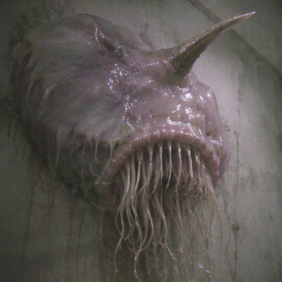
  - 【原典外貌】「又東五百里，曰鹿吳之山，上無草木，多金石。澤更之水出焉，而南流注于滂水。水有獸焉，名曰蠱雕，其狀如雕而有角，其音如嬰兒之音，是食人。」——注意原典明確稱之為「**水有獸焉**（潛伏水中的怪獸）」，卻生得如巨型猛禽蒼雕一般，頭生雙角，叫聲宛如嬰兒啼哭，兇殘食人。
  - 【本作克蘇魯／昆蟲寄生／偽人重構】**徹底捨棄傳統毛羽大雕造型，依本作重構鐵律打造為從潮濕黑暗水牢中破水暴起的「超巨型兩棲捕食螳螂 × 長戟兜蟲角雕怪」！**展翅近四公尺，全無乾燥鳥羽，通體覆滿濕漉漉、泛著腐黑油光的**重疊幾丁質硬甲與沾滿黑泥水藻的殘破革質蟲翼膜**；細長如蛇般的濕冷胸頸頂著一顆倒三角的**巨型捕食螳螂頭顱**，額頭高聳竄出兩根漆黑粗彎、布滿骨節鋸齒的**兜蟲式惡魔雙角（「而有角」）**，兩側嵌著一對巨大冰冷、在手電筒光下泛出暗紅偽瞳孔的**多面複眼**！彎曲如鐵鉤的鷹喙其實是三瓣能完全張開的**腐食昆蟲咀嚼剪顎**，喙下膨脹著兩顆暗紅濕滑、隨呼吸震顫的發音氣囊——正是牠用來在黑暗涵洞裡廣播極度淒慘逼真的**「哇啊——哇啊——」新生嬰兒啼哭聲（「其音如嬰兒之音」）**的誘殺擴音器！本該是雕爪的前肢，徹底演化成兩柄長逾兩公尺、內側排滿鋼釘般漆黑倒鉤刺的**超巨型捕食螳螂鋸齒鐮肢**，收攏於胸前宛如合十祈禱，一瞬間爆出即可把整名成年男性攔腰夾斷並反折吊起吞噬！腹尾節片間還隱約滲出大量半透明寄生蛆液與尚未消化的受害者衣物碎布，黑白高對比墨線以強烈濕亮高光與凌厲銳角勾勒其恐怖的昆蟲猛禽壓迫感。
- **特性**：
  - 【原典記載】「水有獸焉」「其音如嬰兒之音，是食人」——能潛伏深水之中，擬嬰兒哭聲誘人靠近並活活吃掉。
  - 【本作衍生】**「水陸雙棲聲學伏擊王」**：與同在〈南山經〉也會發出嬰啼的青丘九尾狐不同，青丘狐善用偽人皮囊近距離滲透產卵，而**蠱雕是純粹的極致暴力伏擊獵手**！牠能把全身浸在混濁暴雨涵洞與滯洪池水面下長達三小時（靠腹節氣泡膜與鰓孔呼吸），只把發音氣囊與雙黑角露出黑水面一公分，藉著圓形水泥管道的天然回音放大嬰兒哭聲，連經驗豐富的消防搜救人員與巡警都極易上當深入涵洞，隨後在狹窄無退路的黑暗水道中被一對巨型螳螂鐮肢當場斬首拖入水底！
- **弱點**：
  - 【原典記載】原典未載。
  - 【本作衍生】1. **發音喉囊與複眼是高價值破口**：牠背甲與雙黑角極度堅硬可硬扛普通刀劍，但喙下兩顆暗紅發音氣囊毫無外甲包覆，只要聽見不自然反覆循環的嬰啼立刻點燃**強光照明彈／爆閃燈**干擾其複眼測距，並以**五雷鎮煞符**或狙擊鋼箭直穿喉下發音囊，牠不僅立刻失聲，體內氣壓失衡更會迫使牠無法下潛逃回深水；2. **極懼乾燥烈火封翼與高壓電水**：兩棲膜翼一遇高熱乾燥烈火符便會迅速蜷縮焦化失去滑翔力；若牠潛伏在積水箱涵，切忌下水肉搏，直接把高階雷符連結銅線投入水道引爆，就能逼牠全身痙攣翻浮水面。
- **習性**：
  - 【原典記載】潛伏於鹿吳之山澤更之水（入滂水）。
  - 【本作衍生】在現代台灣常盤踞於大型都會雨水下水道主幹管、山谷水壩溢洪道暗洞、颱風夜淹水的地下聯通道與廢棄造紙廠汙水沉澱池；專門挑選狂風暴雨或凌晨霧濃視線不佳的時段出獵，將吃剩的骸骨與頭顱整齊卡在涵洞頂部鐵梯橫桿上作為領地標記。
- **喜好**：
  - 【原典記載】嗜食生人血肉。
  - 【本作衍生】最偏好新鮮活人胸腔與肩頸部位的肌肉組織；對人類急促驚慌的腳步水花聲與「有人在嗎？小朋友你在哪裡？」的呼喊回應極度興奮，往往會在獵物走近五公尺內時故意把哭聲壓低裝作氣若游絲，引誘對方徹底低下頭來。
- **擅長的招式／異能**：
  - 【原典記載】潛水伏擊、擬嬰啼聲、食人巨力。
  - 【本作衍生】**「暗渠嬰啼誘殺」**（利用水道回音精準模擬溺水或受困嬰兒的斷續哭聲，極難單憑人耳辨偽）、**「螳螂鋸齒鐮肢閃斬」**（零點二秒內從渾濁黑水暴起，雙鐮交錯剪斷防禦法器與脊椎並將獵物死死釘在倒刺溝槽裡）、**「兜角衝撞破壁」**（俯衝時以額頭雙黑兜角硬撞汽車車窗與水泥隔間牆，粉碎掩體）、**「腐水酸涎噴射」**（口部剪顎噴出大量消化酶黑汁融解護身衣物與紙符）。

> **南次二經全經檢核備忘**：柜山（狸力、鴸）→ 長右之山（長右）→ 堯光之山（猾褢）→ 羽山（多蝮虫，詳見 `SHJ01-004`）→ 瞿父之山・句餘之山（無怪）→ 浮玉之山（彘、鮆魚）→ 成山・會稽之山・夷山・僕勾之山・咸陰之山（無怪）→ 洵山（䍺／羊患、芘蠃）→ 虖勺之山・區吳之山（無怪）→ 鹿吳之山（蠱雕）→ 漆吳之山（日次之地，無怪）。南次二經新增 **9 條**怪獸檔案悉數收錄完畢（連同羽山複見蝮虫共涵蓋全經十七山無一遺漏）；卷末純祭祀龍身鳥首山神已依鐵律剔除。

---

## 🦋 第三單元：南次三經（天虞山系｜天虞之山 → 南禺之山）

> **本單元涵蓋山脈（古稱十四山脈絡）**：天虞之山（其下多水，不可以上，無特定怪獸名）→ 禱過之山 → 丹穴之山 → 發爽之山（多水多白猿，亞種併詳見 `SHJ01-002`）→ 旄山之尾（育遺谷多怪鳥，凱風自出）→ 非山之首（多蝮虫，旱岩種併詳見 `SHJ01-004`）→ 陽夾之山（無草木多水，無怪）→ 灌湘之山（多怪鳥，無獸）→ 雞山（黑水鱄魚）→ 令丘之山（顒）→ 侖者之山（多金玉青雘與異木白䓘，無怪）→ 禺稾之山（多怪獸、多大蛇）→ 南禺之山（夏出冬閉潮汐水穴，佐水出鳳皇、鵷鶵）。本經卷末「龍身人首」純祭祀山神名單依鐵律剔除。

### [SHJ01-023] 禱過犀・兕・象異獸群（禱過之山三角血沫重甲獸群）
- **出處順序**：卷 01〈南山經〉・南次三經・禱過之山（本經第 2 山）
- **類別與造型路線**：`【非人生物恐怖型】`｜超巨型長戟大兜蟲（犀／兕）與腐肉巨型象鼻蟲（象）寄生重甲獸群
- **物種／唯一性**：`物種（群體）`（原典明記「其下多犀、兕，多象」，屬盤踞禱過山麓之太古重裝大型怪獸群落）
- **稀有度與道行對照**：`★★ 稀級（R）`｜模糊道行：數十年至百年聚地煞異化之重甲山林巨獸（物理裝甲極厚、衝撞破陣力強）｜本作階位：二流～二流頂
- **外貌與黑暗地牢／恐怖谷視覺改寫**：
  - <!-- 圖位預留：待補繪 -->
  - 【原典外貌】「東五百里，曰禱過之山，其上多金玉，其下多犀、兕，多象。」晉・郭璞注：「犀似水牛，豬頭、埤腳，腳似象，有三蹄，大腹，黑色，三角：一在頂上，一在額上，一在鼻上……好噉棘，口中常灑血沫。兕狀如水牛，青黑，一角重厚。」
  - 【本作克蘇魯／昆蟲寄生／偽人重構】徹底揚棄動物園大象犀牛形象，把《山海經》遠古「三角灑血沫之犀、青黑獨角之兕、龐然巨象」重構為黑暗地牢裡步履沉重、甲殼摩擦如鐵塊相撞的**「超巨型重甲兜蟲 × 寄生巨象鼻蟲」攻城蟲獸群**！**禱過犀**宛如卡車大小的漆黑大兜蟲融合膨脹水牛腐屍，全身覆蓋如鑄鐵般厚實發亮、爬滿寄生藤壺與白癬真菌的幾丁質裝甲板，頂骨、額心與鼻尖並排爆長出**三根倒鉤黑甲犄角**，口顎嚼碎帶刺荊棘與碎骨時不斷從甲縫噴灑酸腐腥臭的**暗紅血沫**；**禱過兕**體表呈現溺屍般的陰冷青黑金屬殼色，額前獨生一根長逾兩公尺、中空帶毒液溝槽的厚重獨角；**禱過象**更是令人反胃——肥大無毛的灰爛肉軀支撐在數條粗腫節肢柱足上，垂墜前方的長鼻實為一根表面環生倒刺、末端開裂出四瓣啃噬顎與吸血吸盤的**超巨型象鼻蟲穿刺吻管**，鼻管內壁不斷蠕動著幫忙消化木石與肉塊的乳白寄生蛆群！
- **特性**：
  - 【原典記載】犀生三角且「口中常灑血沫」，兕青黑一角重厚，與象同踞禱過山麓。
  - 【本作衍生】**「腐血甲殼攻城隊」**：這三種巨型甲蟲獸共享共生巢穴，犀與兕憑藉超厚幾丁質重甲正面硬撞碾碎結界與鋼筋水泥牆，噴灑的酸血沫能迅速腐蝕金屬武器與道門銅鈴；象鼻蟲巨怪則在後方伸長三公尺吻管，精準吸食碎石瓦礫下受困傷患的骨髓。
- **弱點**：
  - 【原典記載】原典未載。
  - 【本作衍生】1. **轉身遲緩與甲節腹縫**：全身背甲堪比裝甲車，連三流烈火符都難以貫穿，唯有利用狹窄建築地形或**輕身符**繞至其沉重腹側，以高壓**五雷鎮煞符**沿幾丁質節縫灌電，方能燒灼其內部濕潤神經束；2. **象鼻吻管懼火燒與強鹼**：一旦燒斷巨象穿刺吻管尖端，牠便無法進食與噴酸而迅速暴走逃竄。
- **習性**：
  - 【原典記載】群居禱過之山山腳密林與沼澤。
  - 【本作衍生】極為罕見，唯在深山大型隧道坍方後、或被山林靈脈斷層撕開的偏遠採石場廢礦坑與荒廢重機具場偶有目擊；平日沉睡於泥炭與碎石堆中宛如生鏽挖掘機殘骸。
- **喜好**：
  - 【原典記載】郭注載犀「好噉棘」（喜啃食帶刺荊棘）。
  - 【本作衍生】嗜咬生鏽鐵絲網、帶刺灌木叢、廢棄鋼索與混有鮮血的硬骨渣，以此補充甲殼硬化所需之礦物與鐵質。
- **擅長的招式／異能**：
  - 【原典記載】三角血沫（犀）、獨角重衝（兕）。
  - 【本作衍生】**「三角血沫腐蝕噴濺」**（狂甩巨首灑出高酸性腥血毒沫，腐蝕防具並致皮膚潰爛）、**「青黑獨角破壁撞」**（兕全力衝鋒可直接貫穿地下停車場雙層磚牆與防爆門）、**「吻管穿刺吸髓」**（巨象吻管如液壓鑽頭般刺穿掩體吸扯獵物）。

---

### [SHJ01-024] 瞿如（禱過之山白首三足人面怪鳥）
- **出處順序**：卷 01〈南山經〉・南次三經・禱過之山（本經第 2 山）
- **類別與造型路線**：`【類人偽人型】`｜慘白禿首偽人臉・三條嵌人骨節肢長腳大蚊水禽怪・自呼其名水澤偽人
- **物種／唯一性**：`物種（群體）`（原典以「有鳥焉……其名曰瞿如，其鳴自號也」泛稱，屬棲息於禱過山濕地水岸的詭異偽人怪禽族群）
- **稀有度與道行對照**：`★★ 稀級（R）`｜模糊道行：數十年至百年水澤成精人面怪禽（視覺驚嚇與精神震懾極強）｜本作階位：二流
- **外貌與黑暗地牢／恐怖谷視覺改寫**：
  - <!-- 圖位預留：待補繪 -->
  - 【原典外貌】「有鳥焉，其狀如鵁，而白首、三足、人面，其名曰瞿如，其鳴自號也。」——體形如長腿涉水鳥（鵁，類似蒼鷺／水鶴），卻生著慘白光禿的頭、一張人類的臉、以及三條細長鳥腿，叫聲就是在反覆呼喊自己的名字「瞿如」。
  - 【本作克蘇魯／昆蟲寄生／偽人重構】**把「白首、三足、人面」的荒誕水鳥徹底推進極致恐怖谷暗巷噩夢！**站在起霧的積水空地或廢棄橋墩淺灘上，遠看宛如一名披著破爛濕雨衣、光頭慘白的瘦長詭異行者正拄著一根細鐵枴杖單腳佇立；但當車燈或手電筒掃過，觀者的理智會瞬間崩裂——牠根本沒有身體與雙手，所謂「披雨衣的軀幹」其實是一隻兩公尺高、背甲濕滑滲油的**巨型長腳大蚊與無羽腐鷺融合蟲軀**，折疊在兩側的「翼」是一對布滿發黑血脈紋路的濕破蟲膜翅！身下並非兩條腿，而是**三條**過長反折、漆黑細長宛如蜘蛛步足卻在關節處詭異嵌著**慘白人類指骨與膝蓋骨殘留**的怪異三足（「三足」），呈三角鼎立姿態在水面上無聲滑步涉行！最令人毛骨悚然的是頂端那顆「白首人面」：光禿如死蠟的慘白人頭毫無毛髮，五官是一張極端僵冷、眉梢微微下垂宛如悲傷喪家者的**中年人臉**，眼眶裡的黑色瞳孔隱現複眼微光，嘴唇以不自然的垂直幅度反覆開合，發出沙啞、像人喉嚨灌進冷水般的呼喚：「瞿……如……瞿……如……（「其鳴自號也」）」！
- **特性**：
  - 【原典記載】白首、三足、人面，自呼其名。
  - 【本作衍生】**「三足定點凝視與偽人失神效應」**：瞿如只要用三條節肢長腳穩穩釘在積水裡，便能將慘白人臉保持絕對靜止不晃動（宛如生物雲台），死死鎖定移動中的獵物；人類在霧夜與牠慘白悲傷的人臉對視並持續聽見「瞿如、瞿如」單調人聲時，大腦會陷入嚴重的**認知失調僵直（恐怖谷震懾）**，雙腳如灌鉛般無法邁步逃離。
- **弱點**：
  - 【原典記載】原典未載。
  - 【本作衍生】1. **三條細長節肢步足是致命平衡軸**：軀體重心極高且翅膀受潮難飛，一旦用長桿、鋼索或低空橫掃的**破風斬符**折斷其中一條嵌骨細足，整個三角支撐結構立刻崩塌摔進泥水裡任人宰割；2. **懼強光直射白首與高分貝爆音**：慘白人面皮下其實覆滿密集感光複眼神經，強光爆閃燈直射能瞬間令牠失明翻白眼尖叫。
- **習性**：
  - 【原典記載】棲息於禱過之山水岸林澤。
  - 【本作衍生】出沒於台灣濱海廢棄魚塭、高架橋下長年積水的陰暗涵洞、河口紅樹林泥灘與起濃霧的郊區稻田排水溝；習慣在凌晨四五點天色未亮時，靜靜用三足立在路邊積水中，用慘白人臉直直望著早起慢跑或騎車經過的路人。
- **喜好**：
  - 【原典記載】原典未載。
  - 【本作衍生】嗜食水邊青蛙、巨型水蛭與溺水動物眼球；對反光平靜的黑水面有某種自戀般的凝視癖好，常低頭盯著水面裡自己那張慘白人臉反覆輕喚「瞿如」。
- **擅長的招式／異能**：
  - 【原典記載】人面三足、自號怪鳴。
  - 【本作衍生】**「白首凝視・恐怖谷定身」**（靜止人臉與悲傷空洞眼神疊加單調呼名，令心理防線薄弱者瞬間雙腿發軟失語）、**「三足長蚊刺躍」**（第三條中足如彈簧撐地暴起，兩條前足帶著嵌骨骨刃高速戳刺獵物咽喉）、**「裂唇口針吸髓」**（悲傷人臉的嘴唇一旦貼近獵物便猛然翻開，彈出三十公分長的中空巨蚊口針直刺眉心）。

---

### [SHJ01-025] 虎蛟（禱過之山泿水魚身蛇尾寄生怪）
- **出處順序**：卷 01〈南山經〉・南次三經・禱過之山・泿水（本經第 2 山水域）
- **類別與造型路線**：`【非人生物恐怖型】`｜巨大博比特海蜈蚣魚殼・雙頭環形齒吸盤巨蛭蛇尾・鴛鴦鳴聲誘獵寄生水怪
- **物種／唯一性**：`物種（群體）`（原典明記「其中有虎蛟……食者不腫，可以已痔」，屬棲息於入海河道與暗渠之兇猛水域寄生怪族）
- **稀有度與道行對照**：`★★★ 珍級（SR）`｜模糊道行：數百年潛伏入海深水與汙水暗河之兇殘共生寄生怪｜本作階位：二流頂～一流初
- **外貌與黑暗地牢／恐怖谷視覺改寫**：
  - <!-- 圖位預留：待補繪 -->
  - 【原典外貌】「泿水出焉，而南流注于海。其中有虎蛟，其狀魚身而蛇尾，其音如鴛鴦，食者不腫，可以已痔。」——長著魚的身軀與毒蛇的尾巴，叫聲婉轉如鴛鴦，食用其肉能消腫且治療痔瘡血疾。
  - 【本作克蘇魯／昆蟲寄生／偽人重構】**緊扣「魚身蛇尾寄生怪」徹底擺脫無趣的普通長尾怪魚，改以深海夢魘「超巨型博比特海蜈蚣 × 吸血環形巨水蛭 × 腐敗巨魚皮殼」構建極致水下生理恐怖！**體長逾四公尺，前端那截看似「魚身」的軀幹，實為一具泡漲潰爛、生滿虎斑狀暗黑淤青與無數濕滑肉刺的**巨型掠食魚類外殼**，魚嘴兩側藏著五對能瞬間彈射夾斷鋼管的**博比特蟲剪刀狀幾丁質巨顎**，鰓孔內不斷噴湧暗紅血絲與密密麻麻的共生魚虱！而從魚腹後方破肉而出的那條「蛇尾」，根本不是尾巴，而是一條長達三公尺、通體覆滿黏液環節的**巨型吸血寄生盲蛇蛭**！這條蛇尾與魚身呈現詭異的「**宿主與寄生體雙向合體**」：蛇尾末端生著一個碗口大、翻捲出三圈乳白倒鉤利齒的**環形寄生吸盤與產卵針管**，平時將魚身埋伏在淤泥下，單獨把細長蛇尾探出水面搖晃，並震動腹內氣囊發出清脆柔和的**鴛鴦戲水啾鳴（「其音如鴛鴦」）**吸引夜間水邊生物靠近，下一秒魚殼巨顎與蛇尾吸盤便同時破水夾擊，將受害者雙端分食吸乾！
- **特性**：
  - 【原典記載】「其音如鴛鴦，食者不腫，可以已痔」——聲如鴛鴦，具強效消腫與止血化瘀（治痔）之異能。
  - 【本作衍生】**「超強水蛭抗凝血與組織抽液毒」**：原典「不腫、已痔」的冷酷生物學真相，在於虎蛟寄生蛇尾吸盤分泌的**超級抗凝血溶栓酶與強效滲透脫水劑**——活體咬中人類時，會讓受害者全身微血管無法凝血、並瞬間把體內水腫與淤血連同活血一起抽乾；黑市地下密醫若能高溫滅活其寄生蟲卵並精準稀釋蛇尾腺液，確實能瞬間消除嚴重血栓與惡性腫塊，但未經徹底滅卵的生食者，不出半月就會在直腸與下肢靜脈裡孵出一窩往外鑽咬的小虎蛟蛭！
- **弱點**：
  - 【原典記載】原典未載。
  - 【本作衍生】1. **魚身與蛇尾的「寄生接合縫」是致命斷裂點**：在魚尾與巨蛭蛇尾交接處有一圈發紅腫脹的無鱗軟肉環，法師只要以塗抹高濃度雄黃粉或**五雷鎮煞符**附著的利刃精準劈斷這道接合縫，魚殼宿主與寄生蛇尾便會立刻失去神經協同、當場在泥水裡互相瘋狂撕咬至死；2. **畏烈火乾燥與高壓電水**：離開潮濕暗渠與深水超過二十分鐘即劇烈失水僵直。
- **習性**：
  - 【原典記載】棲息於禱過之山泿水入海口一帶。
  - 【本作衍生】潛伏於台灣沿海大排水口、河口漲退潮交界的深黑汙水箱涵、老舊漁港廢棄碼頭水下木樁縫隙與大型臨海工廠冷卻水排放道；漲潮夜裡會順著海水倒灌深入市區排水暗渠百餘公尺伏擊夜釣客與巡水人員。
- **喜好**：
  - 【原典記載】原典未載。
  - 【本作衍生】極度偏愛富含血腥味、發炎滲液與淤積血塊的生物血肉（對有開放性外傷、嚴重水腫或下肢靜脈曲張者散發的微弱血腥味具有公里級嗅覺追蹤力）。
- **擅長的招式／異能**：
  - 【原典記載】魚身蛇尾雙態、鴛鴦誘鳴、消腫化血體液。
  - 【本作衍生】**「博比特潛泥瞬咬」**（將魚殼埋入黑淤泥只留觸鬚，待獵物踏足上方時以高速剪顎從腳下突襲拖入泥底）、**「寄生蛇尾環齒抽血」**（蛇尾從後方無聲纏繞大腿或腰際，環形利齒吸盤注入強效抗凝血毒液使傷口血流不止、三分鐘內失血休克）、**「鴛鴦水音誘獵」**（在寂靜河口涵洞發出輕柔無害的水鳥啾鳴降低目標警戒）。

---

### [SHJ01-026] 鳳皇（丹穴之山異化巨型複眼孔雀蟲禽怪相｜⚠️ 規格外災厄）
- **出處順序**：卷 01〈南山經〉・南次三經・丹穴之山（本經第 3 山；另複見於本經末山第 13 山「南禺之山・佐水」）
- **類別與造型路線**：`【非人生物恐怖型】`｜異化巨型複眼孔雀蟲禽克蘇魯怪相・五彩金屬甲蟲殼羽・認知靜默災厄體（**徹底剝離傳統祥瑞神鳥與神祇信仰，純以不可名狀太古蟲禽災獸定位！**）
- **物種／唯一性**：`獨一無二`（貫穿丹穴至南禺之山、君臨整個南嶺腐潮生態系最頂端的不可複製太古規格外災厄母體；其從屬護巢亞體為南禺之山的「鵷鶵」）
- **稀有度與道行對照**：`★★★★★ 神級災厄（UR）`｜模糊道行：數千年不可名狀之太古荒獸聖體（非神明，純粹位居生物與靈異食物鏈極點的毀滅級怪獸，地位比肩相柳、帝江混沌與孔宣妖相）｜本作階位：巔峰～規格外（凡人除妖師遇之唯有一死或陷入永久認知靜默）
- **外貌與黑暗地牢／恐怖谷視覺改寫**：
  - 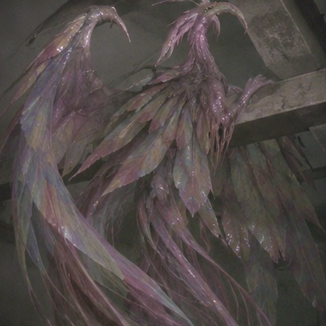
  - 【原典外貌】「又東五百里，曰丹穴之山，其上多金玉。丹水出焉，而南流注于渤海。有鳥焉，其狀如雞，五采而文，名曰鳳皇，首文曰德，翼文曰義，背文曰禮，膺文曰仁，腹文曰信。是鳥也，飲食自然，自歌自舞，見則天下安寧。」（郭璞引《廣雅》注：雞頭、燕頷、蛇頸、龜背、魚尾，五采，高六尺許。）
  - 【本作克蘇魯／昆蟲寄生／偽人重構】**徹底顛覆「雍容華貴、祥瑞神鳥」的一切傳統審美，依本作生物恐怖鐵律重構為一尊令人望之一秒即理智崩解的「異化巨型複眼孔雀蟲禽克蘇魯怪相」！**身高逾六公尺、展開屏翼遮蔽整片地下岩窟穹頂，全無一絲溫暖毛羽——整具龐大鳥形甲軀由層層疊合、閃爍著腐油與寶石金龜子般詭異虹彩反光的**超重型幾丁質硬甲板**構成！其修長蜿蜒的「蛇頸」實為一節節滲著琥珀色黏液、左右不斷抽搐開闔著氣門的**巨型擬蠍與螳螂環節頸柱**，頂著一顆細小卻恐怖的無毛骨冠雞頭：臉頰嵌著一對巨大到扭曲頭骨比例、在黑暗中微微搏動的**深紅蜂巢複眼**，彎喙下方裂出多對宛如毒蛾與寄生蜂般的細長觸鬚口器！最令目擊者當場淚流不止、大腦過載的是牠那對如巨大孔雀尾屏與雙翼般轟然張開的**數百片半透明幾丁質脈翅與長尾翎**——每一片尾翎與翼甲上，都鑲嵌著一顆**濕潤光亮、各自獨立旋轉瞳孔的巨型生物擬態眼斑與真實複眼球**！而原典所謂「首文曰德、翼文曰義、背文曰禮、膺文曰仁、腹文曰信」的神秘五彩紋路，在近距離黑白高對比墨線的特寫下，竟是由**無數隻微細閃光寄生金龜蟲與反光幾丁質眼紋排列扭曲而成的不可名狀克蘇魯幾何符文**——人類大腦根本無法安全解讀這些不斷蠕動重組的生物文字，凡試圖辨認「德義禮仁信」五紋者，視神經便會瞬間遭強烈認知污染！當牠在潮濕熔岩裂谷或海蝕洞深處緩緩展屏、以千百隻複眼同時鎖定你並震動膜翅跳起詭異的「自歌自舞」時，空氣中會瀰漫令人靈魂戰慄的完美寂靜。
- **特性**：
  - 【原典記載】「飲食自然，自歌自舞，見則天下安寧」——不靠捕獵凡俗血肉維生，自歌自舞，一現身便使天下陷入絕對「安寧」。
  - 【本作衍生】**「天下安寧的克蘇魯真相＝大範圍神經靜默與萬蟲臣服場」**：鳳皇之所以被古人恐懼又敬畏地記作「見則天下安寧」，絕非帶來什麼儒家盛世，而是因為牠一旦展開五彩複眼蟲屏並開始「自歌自舞」，其數百顆複眼閃爍的幾何催眠頻率加上翅膀摩擦釋放的**十公里級超高濃度安寧神經信息素**，會瞬間強制壓制覆蓋範圍內一切活物的攻擊衝動、恐懼、憤怒與求生慾望！所有中低階妖怪與寄生蟲會立刻癱軟伏地停止獵食，所有人類則會面帶極度詭異的呆滯幸福微笑、放下手邊一切動作與武器，陷入不吃不喝、不爭不鬥、宛如被製成活體標本般的**集體木僵「安寧」狀態**——換言之，所謂「天下安寧」，是整座城市被牠當成巨大無聲靜態巢穴徹底神經癱瘓的末日奇觀！而「飲食自然」，則是牠靠甲殼複眼直接吞噬周遭環境裡停滯散逸的靈氣、地熱與無數被靜默生物自然分泌的腦波微光維生。
- **弱點**：
  - 【原典記載】原典未載任何弱點。
  - 【本作衍生】**規格外等級，現代人類除妖師與任何常規現代軍武皆無力正面擊殺！**實戰中若於深山火山地熱裂縫或東海海蝕斷層意外偵測到其「五彩幾何複眼干擾」與異常寧靜徵兆，唯一鐵律是**立即封閉視覺與聽覺（配戴全黑盲罩與防噪耳塞）、貼滿高階靜神避穢符並於三分鐘內向反方向撤離十公里以上**；絕對不可試圖用攝影機直拍其尾屏眼紋（影像本身亦殘留輕微認知誘導），僅可依賴數座古廟聯合敲響沉重青銅古鐘的混濁亂頻，在邊緣地帶勉強干擾其「自歌自舞」的完美和諧共振場，爭取撤離時間。
- **習性**：
  - 【原典記載】棲於丹穴之山（丹水出焉，南流注渤海）與南禺之山（佐水與夏出冬閉潮汐海穴）。
  - 【本作衍生】絕大多數世紀均深埋於台灣東北與東南部海底火山裂谷或深層溫泉地熱斷層洞窟裡以「巨大五彩蟲繭」形態沉睡；唯有每隔數百年地殼靈脈劇烈翻動、或南嶺群怪失控成災之際，才會在酷暑潮汐大退潮的深夜從丹水／佐水海蝕洞深處破繭展屏短暫現身。
- **喜好**：
  - 【原典記載】飲食自然，自歌自舞。
  - 【本作衍生】對極端純淨的高溫地熱硫磺氣體、金玉礦脈輻射與「毫無雜音的絕對寂靜」有至高執念；極端厭惡無序的喧囂、低劣惡臭的腐肉與雜亂噪音，凡在其蘇醒區域內大聲喧嘩鬥毆之妖魔或人類，會第一時間遭到牠無數複眼聚焦並焚化／靜默成無聲雕像。
- **擅長的招式／異能**：
  - 【原典記載】五采符文（德義禮仁信）、自歌自舞、令天下安寧。
  - 【本作衍生】**「五文複眼屏・認知靜默」**（展開布滿數百轉動複眼與扭曲五文符號的巨型孔雀蟲屏，直視者大腦瞬間被寫入強制「安寧」指令，化作雙眼流淚卻微笑不動的活體標本）、**「自歌自舞・萬蟲跪伏波」**（幾丁質鞘翅與環節頸柱摩擦發出宛如天籟卻暗藏次聲摧毀力的和鳴，令方圓十公里所有低於巔峰的妖蟲當場爆殼或癱瘓臣服）、**「丹穴焦光」**（所有複眼聚焦折射地熱光束，無聲將阻擋在視線內的鋼鐵與建築瞬間汽化蒸發）。

---

### [SHJ01-027] 育遺與灌湘怪鳥群（凱風毒羽蟲禽集群）
- **出處順序**：卷 01〈南山經〉・南次三經・旄山之尾「育遺谷」（本經第 5 山）＆灌湘之山（本經第 8 山）
- **類別與造型路線**：`【非人生物恐怖型】`｜無目狂蠅・腐蛾與畸形怪鴞融合蟲禽集群・集體振翅掀動濕熱孢子凱風
- **物種／唯一性**：`物種（群體）`（原典兩處皆以「多怪鳥」群稱，不立單名，尤以育遺谷「多怪鳥，凱風自是出」及灌湘之山「多怪鳥，無獸」彰顯其遮天蔽日的生態排他性）
- **稀有度與道行對照**：`★★ 稀級（R）`｜模糊道行：單體為數年淺妖氣雜鳥蟲怪，數千隻結陣翻飛時可化為吞噬山谷的二流級毒風蟲雲｜本作階位：未入流（單體）／三流～二流（集群）
- **外貌與黑暗地牢／恐怖谷視覺改寫**：
  - <!-- 圖位預留：待補繪 -->
  - 【原典外貌】旄山之尾「其南有谷，曰育遺，多怪鳥，凱風自是出」（郭璞注：凱風，南風也；引《廣雅》稱鵽、鷭、鷦、鷯、爰居、鴟雀皆怪鳥之屬）；灌湘之山「上多木，無草；多怪鳥，無獸」。
  - 【本作克蘇魯／昆蟲寄生／偽人重構】摒棄單一鳥類形象，重構為遮蔽整條狹窄潮濕山谷的**「數千隻畸形盲眼狂蠅 × 濕爛毒蛾 × 碎骨怪鳥」拼貼集群生態**！單隻大小如瘦骨鴿子至烏鴉不等，卻每一隻都長得截然不同、極度殘缺詭異：有的沒長頭顱只在胸口裂開一排蒼蠅吸管口器，有的雙翼全由密密麻麻黏連在一起的**枯黑飛蛾翅膀與吸血蚊足**拼成，有的腹腔半透明、擠滿不停抖落的細小黃褐寄生粉蟎！灌湘之山之所以「上多木，無草；多怪鳥，無獸」，正是因為這群怪鳥分泌的強酸排泄物與寄生鱗粉早把地面一切草本植物與走獸啃蝕腐爛殆盡！最駭人的是當數千隻怪鳥在狹長山谷或廢棄隧道裡受驚同時起飛時，千百對黏濕蟲翅瘋狂拍打匯聚成一股滾燙潮濕、腥臭撲鼻的**劇毒熱南風（「凱風自是出」）**，鋪天蓋地灌出洞口，將迎面遇上的任何生物瞬間刮成掛滿蟲卵的慘白骸骨！
- **特性**：
  - 【原典記載】育遺谷怪鳥聚居處為「凱風（熱南風）」源頭；灌湘山有木無草、唯獨怪鳥漫山而絕無走獸存活。
  - 【本作衍生】**「生物熱流毒風製造機」**：單隻怪鳥極脆，但成千上萬隻倒掛在無草濕熱樹冠或地下通道頂部時，集體體溫與高頻振翅能人為製造出高達攝氏四十餘度的腥熱強風（凱風），風中夾雜極細微的脫落毒蛾鱗毛與狂蠅蛆卵，吸入肺部即引發劇烈咳血與呼吸道寄生感染。
- **弱點**：
  - 【原典記載】原典未載。
  - 【本作衍生】1. **極畏大範圍火攻與高壓水霧沉降**：牠們飛散的毒蛾鱗毛在封閉空間內極度易燃，只要戴好防毒面罩並點燃**連環烈火符**或拋擲燃燒彈，就能瞬間觸發整片怪鳥群的「粉塵連環爆燃」，一舉焚盡數百隻；2. **無須硬拚、防毒避風口**：切忌站在狹長山谷或廢棄隧道的下風口迎戰，優先貼妥**淨氣避穢符**防範毒鱗粉入肺。
- **習性**：
  - 【原典記載】盤踞育遺深谷與灌湘山高木樹冠。
  - 【本作衍生】現代台灣偶見於長年荒廢的深山舊鐵路隧道、停業多時的大型養禽場密閉鐵皮廢墟與沿海高濕悶熱的防風林深處；盛夏吹起悶熱反常南風的黃昏時分最愛傾巢而出。
- **喜好**：
  - 【原典記載】原典未載。
  - 【本作衍生】極度偏愛悶熱無雨的南風天、腐爛木頭滲出的甜酸樹汁與被毒風窒息倒地的溫熱動物屍體。
- **擅長的招式／異能**：
  - 【原典記載】聚群興凱風、排絕走獸。
  - 【本作衍生】**「育遺凱風・毒鱗狂吹」**（全群同步高頻振翅掀動裹挾腐蝕毒鱗與幼蟲的滾燙腥風，瞬間吹滅明火並令目標皮膚紅腫潰爛、雙目劇痛流淚）、**「灌湘絕獸雨」**（從高樹冠或隧道頂部集體降下強酸鳥糞與墜落寄生蟲雨，封鎖整個地面行動空間）。

---

### [SHJ01-028] 鱄魚（雞山黑水彘毛大旱怪魚）
- **出處順序**：卷 01〈南山經〉・南次三經・雞山・黑水（本經第 9 山水域）
- **類別與造型路線**：`【非人生物恐怖型】`｜超巨型深黑海毛蟲（多毛綱剛毛環節蟲）與膨脹黑鮒魚融合怪・豚鳴吸水致旱怪魚
- **物種／唯一性**：`物種（群體）`（原典以「其中有鱄魚……見則天下大旱」泛稱，屬棲息於黑水深脈、能觸發嚴重旱災的罕見水怪種族）
- **稀有度與道行對照**：`★★★ 珍級（SR）`｜模糊道行：數百年潛伏地下暗河與枯井之旱煞妖魚（能抽乾整個流域水氣引發災難）｜本作階位：一流（區域旱災領域特化）
- **外貌與黑暗地牢／恐怖谷視覺改寫**：
  - <!-- 圖位預留：待補繪 -->
  - 【原典外貌】「又東五百里，曰雞山，其上多金，其下多丹雘。黑水出焉，而南流注於海。其中有鱄魚，其狀如鮒而彘毛，其音如豚，見則天下大旱。」——形似鯽魚（鮒），全身卻不長鱗片而長滿硬邦邦的野豬剛毛（彘毛），叫聲像豬嚎，一旦現身就會導致天下大旱。
  - 【本作克蘇魯／昆蟲寄生／偽人重構】徹底拋棄普通帶毛鯽魚的荒謬滑稽感，直接取材自令人極端生理不適的海洋環節怪物「**巨型海毛蟲（多毛綱剛毛蟲）× 腐爛脹氣黑魚屍**」！體長兩公尺、寬厚肥腫如一頭發黑巨豬，外表全無平滑魚鱗，整具漆黑油膩的肉囊身軀密密麻麻扎出數以萬計粗硬如鋼絲、中空吸濕且泛著金屬暗光的**漆黑幾丁質毒剛毛（「而彘毛」）**！只要仔細觀察那些豎立晃動的黑剛毛，就會駭然發現每一根剛毛其實都是微型毛細吸水導管，正瘋狂把周遭空氣與水域裡的所有水分子嘶嘶吸進牠膨脹滾燙的體內！牠的魚眼早已退化成兩個乾裂的炭黑凹洞，扁圓魚嘴一張開竟是無數層重疊收縮的吸水管瓣，每抽吸一口便從體內滾燙的儲水沸囊發出低沉悶濁、彷彿巨豬被扼住咽喉般的「呼嚕——嗷——！」駭人**豚鳴（「其音如豚」）**！牠所游過的水面會詭異地迅速乾涸蒸發、留下龜裂發臭的黑泥與焦黑水藻！
- **特性**：
  - 【原典記載】「見則天下大旱」——明明是水裡生出的魚，現身卻會招致毀滅性天下大旱。
  - 【本作衍生】**「活體水脈海綿抽乾體」**：鱄魚之所以「身為魚卻招大旱」，是因為牠體內那套高度異化的剛毛與儲水囊構造就像一塊永不滿足的**克蘇魯黑洞吸濕海綿**！牠會順著水庫底部進水口或城市地下自來水主幹管逆流潛伏，瘋狂抽乾整個流域的地下水層、農田灌溉水脈與空氣濕度，並將水分在體內高溫轉化為無影蒸氣排入高空逆溫層，短短兩週便能讓整座水庫見底龜裂、農作枯死、都市陷入限水停水恐慌（「天下大旱」）！
- **弱點**：
  - 【原典記載】原典未載。
  - 【本作衍生】1. **極端忌憚「超量灌水撐爆」與冰凍凝固**：牠雖然瘋狂吸水，但體內儲水沸囊存在物理極限——若除妖師聯手佈下**水德湧泉陣**或趁其鑽出枯竭水庫底泥時，集中數張**玄冰寒氣符**將其體內剛毛吸滿的滾燙高壓水瞬間凍結膨脹，整頭鱄魚便會像結冰炸裂的鑄鐵水管般從內部轟然爆殼碎裂；2. **切勿徒手碰觸黑彘毛**：每根剛毛皆帶有倒鉤與強力脫水酶，刺入掌心會瞬間把整條手臂皮肉抽乾成木乃伊狀。
- **習性**：
  - 【原典記載】棲於雞山陰暗黑水（南流注海）。
  - 【本作衍生】常於台灣枯水期與反聖嬰乾旱年悄悄潛入見底水庫的死水淤泥坑、乾涸溪床底層暗流、以及老舊自來水淨水場沉澱池底；每逢夜深人靜便浮出僅剩的黑泥漿發出低沉如豬嚎的吸水抽氣聲。
- **喜好**：
  - 【原典記載】原典未載。
  - 【本作衍生】對清冽冰涼的地下水脈與人類體內高達七成的水分（尤其是血液與眼球玻璃體）有永無止境的極度渴求。
- **擅長的招式／異能**：
  - 【原典記載】豚鳴震耳、現則大旱。
  - 【本作衍生】**「千毛瞬吸・大旱領域」**（體表萬根中空剛毛瞬間張開，將方圓三十公尺內空氣濕度驟降至零，除妖師瞬間口乾舌燥、雙眼乾澀流血、一切沾水符墨瞬間龜裂脫落）、**「豚鳴震沸蒸氣」**（發出巨豬嚎叫並自口瓣噴出高壓灼熱水蒸氣柱煮熟近身敵人）、**「彘毛脫水刺」**（甩尾震出數十根鋼針狀黑剛毛，命中即瘋狂抽取受害者血液水分使其局部乾癟壞死）。

---

### [SHJ01-029] 顒（令丘之山人面四目有耳偽人怪鳥｜⚠️ 極致偽人旱厄）
- **出處順序**：卷 01〈南山經〉・南次三經・令丘之山（本經第 10 山）
- **類別與造型路線**：`【類人偽人型】`｜極致枯乾人面四目雙耳偽人焦蛾怪鳥・雙層人眼與昆蟲複眼疊生・呼名散發枯旱熱孢災厄
- **物種／唯一性**：`物種特異個體`（原典記於無草木多火之令丘之山，「其狀如梟，人面四目而有耳，其名曰顒，其鳴自號也，見則天下大旱」，乃南山三經除鳳皇外最具壓迫感之高階災厄級偽人怪鳥）
- **稀有度與道行對照**：`★★★★ 絕級（SSR）`｜模糊道行：數百年至千年聚火旱毒煞成精之天災級偽人魔禽（能引發跨縣市酷熱大旱與大規模中暑精神崩潰）｜本作階位：一流頂（旱厄級高階偽人）
- **外貌與黑暗地牢／恐怖谷視覺改寫**：
  - <!-- 圖位預留：待補繪 -->
  - 【原典外貌】「又東四百里，曰令丘之山，無草木，多火。其南有谷焉，曰中谷，條風自是出。有鳥焉，其狀如梟，人面四目而有耳，其名曰顒，其鳴自號也，見則天下大旱。」——形似貓頭鷹（梟），卻長著人類的臉、**四隻眼睛**並且生有**人類的雙耳**，叫聲自呼「顒、顒」，出現便致天下大旱。
  - 【本作克蘇魯／昆蟲寄生／偽人重構】**本作〈南山經〉恐怖谷與生理厭惡的最高峰之一——「高溫乾屍偽人臉 × 四目雙層複眼 × 焦黑燃火巨蛾梟怪」！**牠平時無聲蹲踞在酷夏四十度曝曬的水泥大樓頂樓水塔、變電所高壓鋼架或廢棄焚化爐煙囪上，雙翼收攏宛如一塊焦黑龜裂、微微冒著熱煙與飛灰的巨大腐枯樹皮；但當你抬頭與牠對望的剎那，渾身血液必將瞬間凍結——圓滾滾的焦蛾梟身上，正對著你的是一張極端逼真、乾癟龜裂宛如千年風乾人屍卻仍掛著冷漠神情的**慘灰人類臉龐（「人面」）**！頭顱兩側赫然貼著一對輪廓清晰、微微發焦起泡的**真實肉質人類雙耳（「而有耳」）**，彷彿能聽見三公里外人們因酷暑煩躁的每一聲低語！而整張乾枯人臉上最摧毀心智的，是那**上下重疊排列的四隻無眼瞼眼睛（「四目」）**：上方兩隻是佈滿乾涸血絲、瞳孔針縮如死人般毫無生氣的**人類眼球**，下方緊貼顴骨裂開的另一對眼眶裡，則嵌著兩顆漆黑濕亮、泛著熾熱炭紅微光的**巨大掠食昆蟲複眼**！四顆眼球上下錯拍轉動鎖定目標，那張乾裂人嘴緩緩拉開——裡頭沒有舌頭，只有不斷噴出乾燥滾燙火星與寄生熱孢的黑色蜂巢氣孔，震出冷酷空洞的乾啞人聲：「顒……顒……（「其鳴自號也」）」！展開的雙翼實為覆滿焦炭色脆硬幾丁質鱗片的巨型天蛾翅膀，每一揮動便灑下炙烤萬物的滾燙枯旱焦塵。
- **特性**：
  - 【原典記載】棲於無草木多火之令丘之山，人面四目有耳、自呼其名、現則天下大旱。
  - 【本作衍生】**「熱島乾旱神經寄生災厄」**：顒並非只會噴火的蠢怪，而是一頭具備極高冷酷智商的**都市熱島災厄操控者**！牠最擅長潛伏於台灣盛夏都會區熱島效應最嚴重的老舊鐵皮頂樓與大型變電所上方，一邊用雙人耳傾聽城市耗電與供水警訊，一邊無聲拍動焦蛾翼向高空吹出吸乾雲層濕氣的「條風焦孢」——短短十日便能讓整座城市陷入連月無雨的極端酷暑、山林自燃、變電箱接連跳電爆燃，並令高溫下脫水煩躁的民眾在聽見「顒、顒」低鳴後爆發無差別狂躁暴力！
- **弱點**：
  - 【原典記載】原典未載。
  - 【本作衍生】1. **極度畏懼暴雨甘霖、純陰寒氣與大規模灑水滅孢**：牠的焦黑鱗翅與旱熱氣場高度依賴乾燥低濕度環境；現代除妖行動對付顒，往往必須先調動消防水車、大樓自動灑水系統或聯手數名高階法師強行施展**祈雨招雲符陣＋玄冰凍煞符**強壓周圍濕度至 90% 以上，一旦牠焦脆的幾丁質蛾翅吸飽冷水變得沉重濕軟，便會徹底喪失飛行與散播旱孢之能；2. **雙層四目懼強光致盲與聲波震耳**：用高功率雷射強光同時灼瞎其下層複眼，並針對兩隻過度敏感的肉質人耳投擲**五雷轟頂爆音符**，即可令這尊高階偽人妖禽神智混亂從高塔墜落。
- **習性**：
  - 【原典記載】居令丘之山（無草木，多火，南有中谷出條風）。
  - 【本作衍生】酷愛高溫曝曬、零遮蔭且絕無積水的燥熱高處——如廢棄煉鋼廠高爐、頂樓鐵皮加蓋違建水塔蓋上、高壓電塔絕緣礙子旁與山林大火過後的焦黑枯木林；白天完全偽裝成高溫熱浪裡的焦黑人形剪影，黃昏氣溫猶高時現身巡獵。
- **喜好**：
  - 【原典記載】原典未載。
  - 【本作衍生】極度沉迷於觀看生物在酷熱缺水中緩慢脫水發狂的過程；嗜吸中暑熱衰竭亡者乾涸發熱的腦髓與心血，對火場餘燼的焦木味與乾裂泥土氣味異常陶醉。
- **擅長的招式／異能**：
  - 【原典記載】四目監察、自呼其名、招致天下大旱、伴生條風。
  - 【本作衍生】**「四目雙層視界・熱源鎖定」**（上層人眼看破障眼法偽裝、下層昆蟲複眼直接捕捉紅外線體溫，方圓五百公尺內絕無死角）、**「顒鳴・枯旱條風」**（人面張口呼喚「顒、顒」並噴出乾燥燃燒孢子熱風，瞬間令敵方口渴暈眩、所有濕潤護符瞬間焦黃自燃、草木與衣物直接起火）、**「雙人耳讀心竊語」**（超常聽覺可清晰截聽百公尺外除妖小隊的低聲戰術部署與咒語起手式並搶先打斷）。

---

### [SHJ01-030] 禺稾怪獸與大蛇（禺稾之山盲窟雙生寄生巢）
- **出處順序**：卷 01〈南山經〉・南次三經・禺稾之山（亦作禺槀之山，本經第 12 山）
- **類別與造型路線**：`【非人生物恐怖型】`｜超巨型盲眼環節吸血巨蛭蟒（大蛇）・共生纏繞多足幾丁質怪獸母體（怪獸）
- **物種／唯一性**：`物種（群體）`（原典以「又東五百八十里，曰禺稾之山，多怪獸，多大蛇」雙並記載，屬漆黑深窟中緊密共生之群體巨怪巢穴）
- **稀有度與道行對照**：`★★★ 珍級（SR）`｜模糊道行：百年至數百年盤踞無光暗窟之巨型共生蟲獸群｜本作階位：二流頂～一流
- **外貌與黑暗地牢／恐怖谷視覺改寫**：
  - <!-- 圖位預留：待補繪 -->
  - 【原典外貌】「又東五百八十里，曰禺稾之山，多怪獸，多大蛇。」——未細描單體形態，唯獨強調怪獸與大蛇並盛成群。
  - 【本作克蘇魯／昆蟲寄生／偽人重構】將「多怪獸，多大蛇」設計為黑暗地牢深處最令人頭皮炸裂的**「雙物種強制寄生共生噩夢」**！所謂**「禺稾大蛇」**絕非普通蟒蛇，而是體長逾十公尺、直徑粗如大水管的**超巨型盲眼環節吸血巨水蛭 × 巨型百足岩蜈蚣混合體**，通體濕亮慘白泛青、毫無眼睛，表皮每道環節都生著一排用來倒掛濕滑洞壁的微小漆黑鉤爪，吻部則是一張能吞下整台機車的三瓣齒狀吸血盤！而與之共生的**「禺稾怪獸」**，則是體型如熊羆卻長滿無序節肢與膨大產卵囊的**盲眼多足腐甲巨獸**——令人毛骨悚然的是，每一頭怪獸的脊椎與肋骨之間，都緊緊盤繞著一至兩條鑽穿其皮肉、靠吸取怪獸體液維生同時充當其「遠程觸手與護衛」的禺稾大蛇！兩者在無光深洞裡融合成一團不斷蠕動、滴落腥濁黏液的克蘇魯多頭肉山，黑白墨線以大量濕黏反光與交錯蛇體環節勾勒出極致密集壓迫感。
- **特性**：
  - 【原典記載】怪獸與大蛇並多於禺稾之山。
  - 【本作衍生】**「攻防一體雙生寄生戰術」**：怪獸負責以厚重多足幾丁質硬甲承受正面衝擊並震塌石頂，纏繞其背脊的大蛇則從陰暗盲區無聲探出數公尺，進行三百六十度遠程絞殺與吸血注毒；兩者共享神經痛覺警告，極難被單獨各個擊破。
- **弱點**：
  - 【原典記載】原典未載。
  - 【本作衍生】1. **徹底失明、高度依賴震動與體溫**：長居全黑深窟導致兩者視覺完全退化，投擲高熱暖暖包誘餌、燃燒彈或施展**隱息屏氣符**即可大幅降低被鎖定機率；2. **重創大蛇即可觸發宿主排異狂亂**：怪獸與大蛇的寄生連結極度脆弱且充滿痛苦，一旦用**五雷鎮煞符**或塗抹大量雄黃烈酒的火攻專門焦灼背上的大蛇，大蛇會在劇痛下發狂反咬怪獸脊椎，導致整組雙生怪物瞬間內訌瓦解。
- **習性**：
  - 【原典記載】聚居於禺稾之山深壑巖洞。
  - 【本作衍生】潛伏於台灣深山徹底停工廢棄的長距離國道／鐵路探勘隧道、無人涉足的大型鐘乳石暗洞與深層地下軍用廢棄坑道，平日蜷縮於深洞積水處休眠，一旦感應到探勘隊腳步震動便全巢甦醒封堵洞口。
- **喜好**：
  - 【原典記載】原典未載。
  - 【本作衍生】極度偏愛完全無光、終年滲水且空氣混濁的深層洞穴環境，嗜食誤闖洞穴的大型哺乳動物與迷途探險者。
- **擅長的招式／異能**：
  - 【原典記載】怪獸成群、大蛇纏繞。
  - 【本作衍生】**「雙生暗窟絞殺」**（怪獸壓步封死退路，背脊盤繞的兩條大蛇同步從洞頂與貼地兩個方向合圍絞碎胸骨）、**「百環震壁落石」**（大蛇猛力抽打潮濕岩壁引發局部坍方活埋獵物）、**「吸血毒漿吐霧」**（三瓣吸盤張開噴出腐敗抗凝血黑霧，令防具滑膩脫手）。

---

### [SHJ01-031] 鵷鶵（南禺之山潮汐水穴・鳳屬蟲禽亞體）
- **出處順序**：卷 01〈南山經〉・南次三經・南禺之山・佐水（本經末山第 13 山，亦為整卷〈南山經〉收尾最後一種怪獸異禽！）
- **類別與造型路線**：`【非人生物恐怖型】`｜金綠寶石泥蜂與蘭花螳螂融合翼禽・潮汐海蝕洞護巢獵手・鳳皇之寄生斥候亞體
- **物種／唯一性**：`物種（群體）`（原典於〈南山經〉最末條「南禺之山」與鳳皇並列收錄，郭璞注「鵷鶵，鳳屬也」；本作定為環繞規格外災厄「鳳皇」誕生的群體護巢高階蟲禽亞體）
- **稀有度與道行對照**：`★★★★ 絕級（SSR）`｜模糊道行：數百年至千年寄生掠食神禽亞體（遠不及規格外鳳皇本尊，卻足以單體輕易虐殺一流以下除妖師與中階妖魔）｜本作階位：一流～一流頂
- **外貌與黑暗地牢／恐怖谷視覺改寫**：
  - <!-- 圖位預留：待補繪 -->
  - 【原典外貌】「又東五百八十里，曰南禺之山，其上多金玉，其下多水。有穴焉，水出輒入，夏乃出，冬則閉。佐水出焉，而東南流注于海，有鳳皇、鵷鶵。」（晉・郭璞注：「鵷鶵，鳳屬也。」後世古籍常載其「非梧桐不止，非練實不食，非醴泉不飲」，性極高潔挑剔。）
  - 【本作克蘇魯／昆蟲寄生／偽人重構】**徹底撕碎溫文儒雅的瑞鳥形象，以自然界最冷酷優雅的殘忍寄生掠食昆蟲——「寶石泥蜂（扁頭泥蜂）× 蘭花螳螂 × 濕滑海蝕洞異禽」打造鳳皇麾下的致命護巢斥候！**體長近兩公尺半，線條纖細修長卻充滿金屬冷硬的幾何銳感：全身沒有一根柔軟鳥羽，而是覆蓋著泛出陰冷死寂金黃與翡翠油光、極度平滑反光的**超硬質寶石蜂幾丁質甲殼**！修長纖細的雙翼呈半透明慘白花瓣狀薄膜（宛如蘭花螳螂擬態步足與巨蜂脈翼合體），沾滿南禺海蝕洞裡滴落的鹹腥水珠；狹長鳥首實為一顆冰冷的倒三角蜂頭，一對碩大的暗金多面複眼毫無情感，細長如外科長針的彎喙內部收摺著一根專門用來精準穿刺獵物大腦神經節的**寶石蜂級神經劫持毒針**！尾部長著兩根過分修長的雙叉飄帶狀幾丁質感覺絲，隨著潮汐海洞的水氣上下浮動。當夏季南禺海蝕水穴「夏乃出」轟然吐水開啟時，數隻鵷鶵便無聲滑出漆黑水霧，猶如一隊冰冷無情的寶石色外科殺戮機器！
- **特性**：
  - 【原典記載】與鳳皇同棲南禺之山佐水，伴隨「水出輒入，夏乃出，冬則閉」的神秘潮汐水穴現身；古傳其極端挑食潔癖。
  - 【本作衍生】**「極端挑食之恐怖真相＝大腦神經精準奴役（寶石泥蜂機制）」**：古人以為鵷鶵「非練實不食、非醴泉不飲」是清高優雅，實則是因為這群高階寄生蟲禽對宿主與食物的純淨度有著病態強迫症！牠們絕不啃食腐肉或低等污穢妖魔，而是專門獵殺修為精純的**一流妖怪、高階妖獸或靈氣清澈的正統除妖師**——先以針狀細喙精準刺入受害者後腦特定神經節，注入微劑量神經劫持毒液，不將獵物殺死，而是將其變成失去逃跑意志、乖乖自己走回南禺海蝕洞深處充當活體保鮮儲糧與孵化溫床的「高潔活屍傀儡」！
- **弱點**：
  - 【原典記載】受南禺山海蝕水穴季節制約（「夏乃出，冬則閉」——嚴冬穴閉潛伏不出）。
  - 【本作衍生】1. **極端潔癖反成致命戰術破口**：鵷鶵對腐臭污穢、黑狗汙血、化糞池濁泥與陰屍腐汁具有強烈的神經性厭惡反應——若遭遇鵷鶵鎖定，除妖師直接向自身與周遭潑灑混有穢泥、腐油與臭硫磺的**破穢污血水**，竟能迫使其因極端生理噁心而本能後退、大幅減緩近身穿刺意圖，藉此爭取逃生空窗；2. **嚴寒與潮汐封穴期無力反擊**：深冬寒潮或高階**玄冰陣**能強行壓低其體溫，迫使幾丁質關節硬化失去超高速閃避優勢。
- **習性**：
  - 【原典記載】棲息於南禺之山佐水與夏出冬閉之潮汐水穴，護衛鳳皇靈域。
  - 【本作衍生】在現代台灣常隨著夏季大潮與颱風潮汐，悄悄從東海岸深邃隱蔽的海蝕洞穴（潮水忽湧忽退、冬季因巨浪暗礁封口無人可入者）飛出，沿河口溯溪巡弋數十公里，清掃一切可能驚擾沉睡鳳皇的強大妖物與高階修行者。
- **喜好**：
  - 【原典記載】古傳偏愛潔淨梧桐、竹實（練實）與甘美泉水（醴泉）。
  - 【本作衍生】病態執著於潔淨無垢的環境、高純度靈泉礦脈，以及靈氣澄澈、毫無菸酒腐臭氣息的年輕純陽體質除妖師——越是潔身自好、內功精純的修士，在牠們暗金複眼裡越像一道垂涎欲滴的頂級活體美饌。
- **擅長的招式／異能**：
  - 【原典記載】鳳屬高階飛禽、伴潮汐水穴出沒。
  - 【本作衍生】**「寶石針喙・腦節奴役刺」**（以超越肉眼反應的高速弧線掠過敵後，將中空細喙精準刺入後腦延髓注入神經奴役毒，令中針者當場卸下戒備並自動跟隨牠走向海蝕洞）、**「蘭花膜翼・盲區擬態」**（貼伏於海洞濕岩或夜間白霧中展開慘白半透明脈翼，完美隱沒於水霧反光之中）、**「翡翠毒羽切風」**（高速俯衝時翼緣幾丁質刃片可如高壓水刀般無聲切斷鋼索與高階法器）。

---

> **南次三經全經檢核備忘**：天虞之山（多水不可上，無怪名）→ 禱過之山（禱過犀兕象群、瞿如、虎蛟）→ 丹穴之山（鳳皇）→ 發爽之山（多白猿，併詳見 `SHJ01-002`）→ 旄山之尾育遺谷（育遺怪鳥群）→ 非山之首（多蝮虫，併詳見 `SHJ01-004`）→ 陽夾之山（無怪）→ 灌湘之山（灌湘怪鳥群）→ 雞山（鱄魚）→ 令丘之山（顒）→ 侖者之山（異木白䓘，無怪）→ 禺稾之山（禺稾怪獸與大蛇）→ 南禺之山（鳳皇、鵷鶵）。南次三經新增 **9 條**怪獸檔案悉數收錄完畢；卷末純祭祀龍身人首山神已依鐵律剔除。
>
> **卷 01〈南山經〉總計結案**：全卷自第一座山**招搖之山**迄於最後一座山**南禺之山**，涵蓋南山一經（13 條）、南次二經（9 條）、南次三經（9 條），總計完整收錄 **31 條**純怪獸與妖怪檔案（零祭祀山神、零遺漏），精準嵌入磁碟實存黑白墨線圖檔 **13 張**，並於其餘 **18 條**標註 `<!-- 圖位預留：待補繪 -->`。下一卷請見：[➡️ 卷02 西山經](./02-卷02_西山經.md)。
