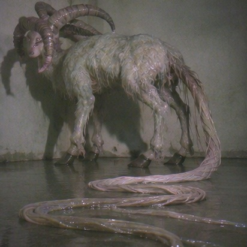
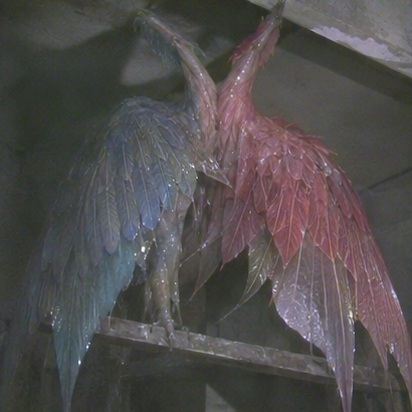
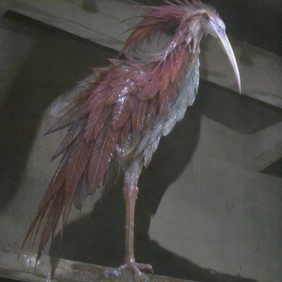
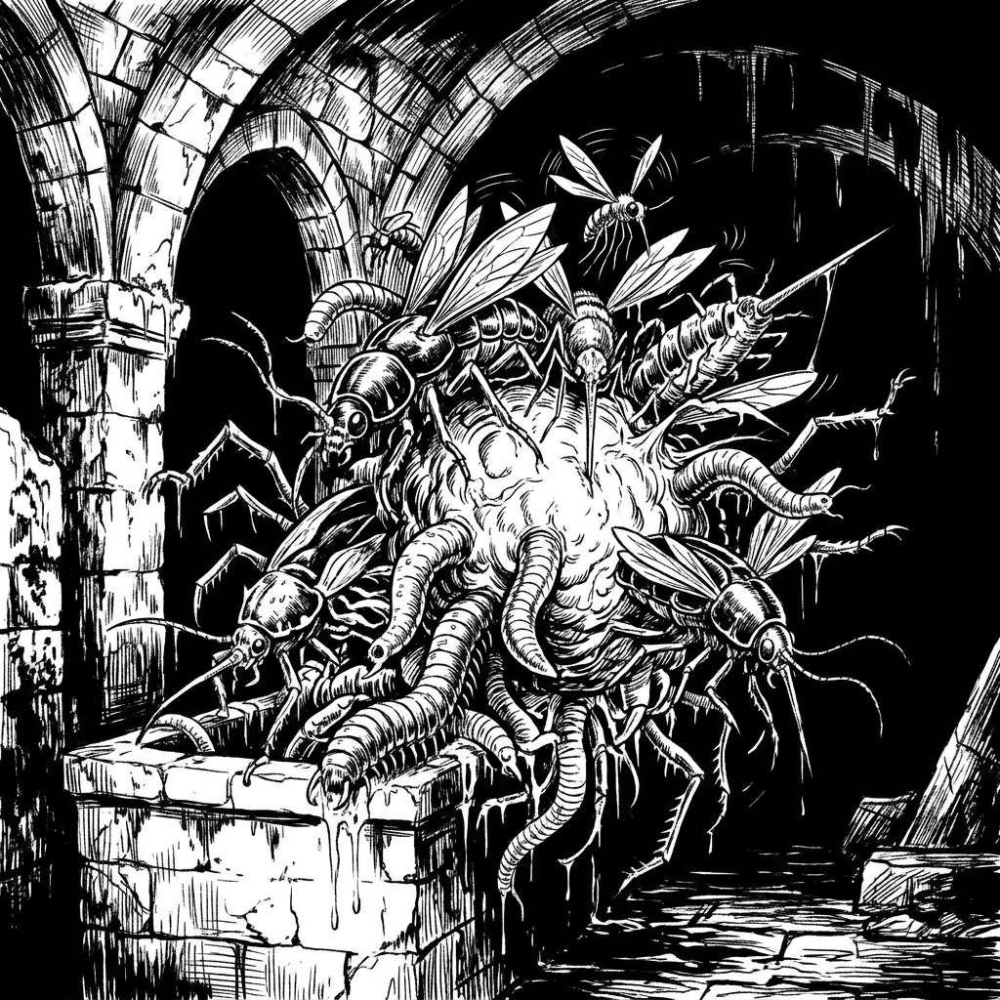
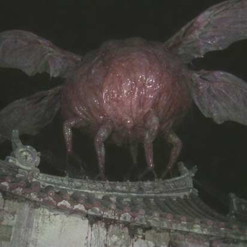
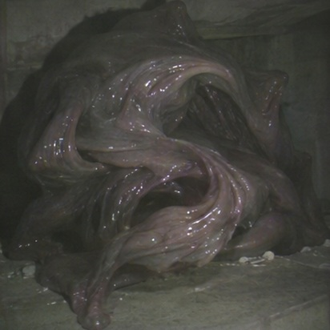
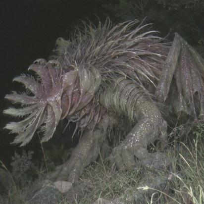
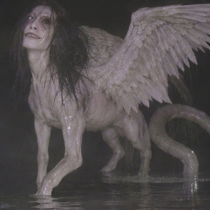

# 🏔️ 《山海經》純怪獸與妖怪圖鑑・卷 02〈西山經〉

> **返回導覽**：[👹 妖怪篇總綱](../00-妖怪篇總綱與圖鑑分級.md) ｜ [📖 山海經總錄](./00-山海經怪獸妖怪總錄.md) ｜ [⬅️ 卷01](./01-卷01_南山經.md) ｜ [➡️ 卷03～04](./03-卷03至04_北山經與東山經.md)
>
> **插圖統計**：本卷嚴格依《山海經・卷二・西山經》四列山系（西山一經 19 山、西次二經 17 山、西次三經 23 山、西次四經 19 山，合計 78 座山）逐山考據，正編收錄 **62 條**純怪獸・異鳥・異魚・怪蛇・妖蟲・山鬼公式書檔案，另於卷末附錄考訂收錄 **1 條**常被俗本誤併西山經之經典條目（`SHJ02-063` 朏朏，實出卷 05〈中山經・霍山〉），全卷總計 **63 條**。全卷共嵌入 **9 處**（計 **8 張**磁碟實存圖檔，含五大標竿核心條目 `[SHJ02-047] 帝江／混沌` 三圖並列、`[SHJ02-056] 窮奇` 雙圖並列，以及羬羊、蠻蠻〔比翼鳥〕、畢方、孰湖實拍／墨線檔案），其餘 **57 條**尚未配圖條目皆已附 `<!-- 圖位預留：待補繪 -->`。
>
> **純妖怪收錄邊界與神明剔除聲明（2026-11-21 定案鐵律）**：本卷嚴格執行「**零神明、零天帝、零山嶽正神、零祭祀禮神**」篩選紅線！原典〈西山經〉登場之一切至高神明、天帝屬神與各山系守山祭祀神祇——包含**西王母**（玉山司天之厲及五殘）、**白帝少昊與員神磈氏**（長留之山）、**神蓐收與神紅光**（泑山）、**神陸吾**（崑崙之丘司天九部）、**神英招與八足二首馬尾天神**（槐江之山）、**神長乘**（蠃母之山）、**神江疑**（符惕之山）、**神耆童**（騩山）、**黃帝與后稷**、**鍾山神與其子皷神形・神欽䲹神形・天神葆江**，以及**西山一經華山冢與羭山神、西次二經十人面馬身神與七人面牛身飛獸之神、西次三經二十三羊身人面山神、西次四經諸祠神**——**一律徹底剔除不收**！僅收錄真正屬於**怪獸、異鳥、異魚、怪蛇、寄生妖蟲與非神山林魑魅**之存在（其中鍾山皷與欽䲹受戮墮化之凶禽「大鶚」「鵕鳥」、天山太古凶獸原形「帝江／混沌」皆嚴格剝離神格，純取怪獸與災厄蟲團本體建檔）。
>
> **黑暗地牢 × 昆蟲寄生 × 恐怖谷偽人設計鐵律**：全卷徹底捨棄傳統威風神話哺乳走獸、祥瑞仙禽與可愛圓球神獸框架，全面取材自**昆蟲、節肢動物、寄生生物、軟體與環節動物**四大生物原型庫，疊加克蘇魯不可名狀感與黑暗地牢潮濕腐蝕壓迫感，分以 `【類人偽人型】`（凡具人面者皆為皮下藏蟲之極致恐怖谷偽人）與 `【非人生物恐怖型】` 雙路線重構，嚴守【原典記載】×【本作衍生】雙軌考據。

---

## 📋 本卷純怪獸與妖怪速查表（西山四經 78 山全錄・共 63 條）

| 編號 | 名稱（別稱） | 出處山脈 | 造型路線 | 本作黑暗地牢／寄生／偽人重構原形 | 物種／唯一性 | 稀有度 | 本作階位 | 配圖 |
| :---: | :--- | :--- | :---: | :--- | :--- | :---: | :--- | :---: |
| `SHJ02-001` | **羬羊**（錢來馬尾脂羊怪） | 西山一經・錢來之山 | `【非人生物恐怖型】` | 濕結黏液環節巨角・拖地寄生條蟲長尾脂腺怪獸 | `物種（群體）` | `★ 凡級（N）` | 三流 | 🖼️ |
| `SHJ02-002` | **䳋渠**（螐渠・赤足黑羽怪禽） | 西山一經・松果之山 | `【非人生物恐怖型】` | 焦黑硬鞘翅・血紅節肢長足・濾食瘡膿食腐怪禽 | `物種（群體）` | `★ 凡級（N）` | 未入流～三流 | ⏳ |
| `SHJ02-003` | **肥遺〔怪蛇〕**（太華六足四翼旱蛇） | 西山一經・太華之山 | `【非人生物恐怖型】` | 六條鐮刃節肢足・四片半透明油膜蝗翼巨型百足旱蛇 | `物種特異個體` | `★★★★ 絕級（SSR）` | 一流頂（旱災級） | ⏳ |
| `SHJ02-004` | **赤鷩**（小華禦火怪禽｜附記㸲牛） | 西山一經・小華之山 | `【非人生物恐怖型】` | 滲出阻燃酸液之焦紅甲蟲羽片・火場食炭怪禽 | `物種（群體）` | `★★ 稀級（R）` | 三流頂～二流 | ⏳ |
| `SHJ02-005` | **蔥聾**（符禺赤鬣羊蟲怪） | 西山一經・符禺之山 | `【非人生物恐怖型】` | 脊背叢生猩紅蠕動水蛭觸鬚・無眼甲殼骨羊怪 | `物種（群體）` | `★★ 稀級（R）` | 三流～二流初 | ⏳ |
| `SHJ02-006` | **鴖**（符禺赤喙禦火鳥） | 西山一經・符禺之山 | `【非人生物恐怖型】` | 青綠油亮金龜甲羽・血紅長針口器滅火水囊怪鳥 | `物種（群體）` | `★ 凡級（N）` | 未入流～三流 | ⏳ |
| `SHJ02-007` | **䰷魚**（禺水羊鳴鼈形水怪） | 西山一經・英山・禺水 | `【非人生物恐怖型】` | 軟皮瘤殼巨型水蛭鼈・腹側氣門發出顫慄羊鳴水怪 | `物種（群體）` | `★ 凡級（N）` | 三流 | ⏳ |
| `SHJ02-008` | **肥遺〔怪鳥〕**（英山殺蟲毒禽） | 西山一經・英山 | `【非人生物恐怖型】` | 硫黃膿斑甲殼肥軀・赤紅注射器口喙・寄生獵蟲怪鳥 | `物種（群體）` | `★★ 稀級（R）` | 二流初 | ⏳ |
| `SHJ02-009` | **竹山人魚**（丹水四足啼嬰水怪） | 西山一經・竹山・丹水 | `【非人生物恐怖型】` | 慘白無眼盲蠑螈黏液軀・四條人骨殘留蹼爪・偽嬰哭聲捕手 | `物種（群體）` | `★★ 稀級（R）` | 三流頂～二流 | ⏳ |
| `SHJ02-010` | **豪彘**（竹山黑端毒棘怪獸） | 西山一經・竹山 | `【非人生物恐怖型】` | 慘白腫脹腐豬蟲軀・背插數百根黑尖空心注卵骨針 | `物種（群體）` | `★★ 稀級（R）` | 二流 | ⏳ |
| `SHJ02-011` | **盼木木蟲**（浮山蛀心寄生妖蟲群） | 西山一經・浮山 | `【非人生物恐怖型】` | 無傷寄宿木髓與人骨之乳白鋸顎蛀蟲集群 | `物種（群體）` | `★ 凡級（N）` | 未入流～三流（群） | ⏳ |
| `SHJ02-012` | **囂**（嚻・羭次長臂善投怪） | 西山一經・羭次之山 | `【非人生物恐怖型】` | 雙臂拉長反折五節・關節嵌石骨的螳螂鐮臂投擲巨怪 | `物種（群體）` | `★★ 稀級（R）` | 二流 | ⏳ |
| `SHJ02-013` | **橐𩇯**（橐蜚・冬見人面一足怪鳥） | 西山一經・羭次之山 | `【類人偽人型】` | 慘白凍僵人面偽人頭・單條漆黑鳥骨節肢獨足・夏眠避雷肉繭 | `物種（群體）` | `★★★ 珍級（SR）` | 二流頂 | ⏳ |
| `SHJ02-014` | **猛豹**（南山食蛇吞鐵獸｜附記尸鳩） | 西山一經・南山 | `【非人生物恐怖型】` | 鏽蝕酸腺巨顎・全身覆滿消化金屬渣滓之重甲腐蟲獸 | `物種（群體）` | `★★★ 珍級（SR）` | 二流頂～一流初 | ⏳ |
| `SHJ02-015` | **谿邊**（天帝山抗蠱獵蟲犬怪） | 西山一經・天帝之山 | `【非人生物恐怖型】` | 滿身革質硬鱗與寄生獵殺剛毛・體液溶解蠱蟲之濕滑無毛甲獸 | `物種（群體）` | `★★ 稀級（R）` | 二流 | ⏳ |
| `SHJ02-016` | **櫟**（天帝山黑文赤頸怪鳥） | 西山一經・天帝之山 | `【非人生物恐怖型】` | 頸部腫脹血紅氣囊・專啄腐屍瘡口與血栓之禿頭食腐蟲鳥 | `物種（群體）` | `★ 凡級（N）` | 未入流～三流 | ⏳ |
| `SHJ02-017` | **𤣎如**（玃如・人手四角拼合怪） | 西山一經・皋塗之山 | `【非人生物恐怖型】` | 骨瘦濕滑甲鹿軀・前肢生兩隻蒼白濕黏人手・額生四支分叉蟲角 | `物種（群體）` | `★★★ 珍級（SR）` | 二流頂 | ⏳ |
| `SHJ02-018` | **數斯**（皋塗人足怪鳥） | 西山一經・皋塗之山 | `【非人生物恐怖型】` | 脫毛腐鴟軀幹下方垂掛一雙濕脹浮腫人類雙腳的怪鳥 | `物種（群體）` | `★★ 稀級（R）` | 二流 | ⏳ |
| `SHJ02-019` | **𤛎**（牻・黃山蒼黑大目怪牛） | 西山一經・黃山 | `【非人生物恐怖型】` | 漆黑濕亮巨兜蟲軀・額前鼓出兩顆如臉盆大小之死白蒼蠅複眼 | `物種（群體）` | `★★ 稀級（R）` | 二流～二流頂 | ⏳ |
| `SHJ02-020` | **鸚䳇**（黃山人舌能言怪禽） | 西山一經・黃山 | `【非人生物恐怖型】` | 青綠幾丁質羽片・喙內伸出一條活生生腫脹人類肉舌的學舌怪鳥 | `物種（群體）` | `★★ 稀級（R）` | 二流初 | ⏳ |
| `SHJ02-021` | **鸓**（翠山兩首四足禦火怪禽） | 西山一經・翠山 | `【非人生物恐怖型】` | 赤黑焦痂雙頭連體怪鵲・腹下四條昆蟲鉤爪・噴吐窒息泡沫 | `物種（群體）` | `★★ 稀級（R）` | 二流 | ⏳ |
| `SHJ02-022` | **浴水白蛇**（泰冒山慘白盲蛇群） | 西次二經・泰冒之山 | `【非人生物恐怖型】` | 半透明死白環節水蛭巨蛇・體內隱約可見未消化人指與寄生卵串 | `物種（群體）` | `★★ 稀級（R）` | 三流頂～二流 | ⏳ |
| `SHJ02-023` | **鸞鳥**（女牀偽安寧毒蛾巨禽） | 西次二經・女牀之山 | `【非人生物恐怖型】` | 五彩腐油虹膜甲殼大翅・振翅灑落致幻安寧毒粉之巨型寄生蛾禽 | `物種特異個體` | `★★★ 珍級（SR）` | 一流（精神幻域） | ⏳ |
| `SHJ02-024` | **鳧徯**（鹿臺人面兵災雞怪） | 西次二經・鹿臺之山 | `【類人偽人型】` | 濕腐赤羽公雞軀頂著慘白中年男子狂嚎人臉・嘴裂露出鋸齒喙骨 | `物種（群體）` | `★★★ 珍級（SR）` | 二流頂～一流初 | ⏳ |
| `SHJ02-025` | **朱厭**（小次白首赤足兵災怪） | 西次二經・小次之山 | `【非人生物恐怖型】` | 無毛死白骷髏蟲首・浸血赤紅四肢節肢長臂・引爆集體暴戾血煞 | `物種特異個體` | `★★★★ 絕級（SSR）` | 一流頂（兵災級） | ⏳ |
| `SHJ02-026` | **羅羅**（萊山食人凶禽群） | 西次二經・萊山 | `【非人生物恐怖型】` | 漆黑骨刺鐮翼・腹懸膨大血囊・成群俯衝開膛剖腹之食人怪鳥 | `物種（群體）` | `★★★ 珍級（SR）` | 二流（群體一流） | ⏳ |
| `SHJ02-027` | **舉父**（崇吾文臂善投巨怪） | 西次三經・崇吾之山 | `【非人生物恐怖型】` | 臂滿虎豹斑甲殼絞紋・指端噴吐黏液骨彈的巨型寄生猿蟲怪 | `物種（群體）` | `★★★ 珍級（SR）` | 二流頂～一流初 | ⏳ |
| `SHJ02-028` | **蠻蠻**（比翼鳥・連體寄生雙禽怪） | 西次三經・崇吾之山 | `【非人生物恐怖型】` | 一青一赤濕黏半透明翼膜・胸脅血肉縫合連體・各僅一目一翼洪水怪 | `物種（群體）` | `★★★ 珍級（SR）` | 二流頂～一流初 | 🖼️ |
| `SHJ02-029` | **峚鍾澤奇鳥怪獸奇魚群**（大澤異物群） | 西次三經・峚山至鍾山 | `【非人生物恐怖型】` | 腐澤寄生變異生態圈・軟體多肢無名怪魚怪鳥混合群落 | `物種（群體）` | `★★★ 珍級（SR）` | 個體二流／澤域一流 | ⏳ |
| `SHJ02-030` | **大鶚**（欽䲹墮化兵災凶禽） | 西次三經・鍾山𡺯崖 | `【非人生物恐怖型】` | 白骨無羽頭顱・黑斑濕滑硬鞘翼・赤紅鑽孔鐵喙與人骨虎爪凶禽 | `獨一無二` | `★★★★ 絕級（SSR）` | 一流～一流頂 | ⏳ |
| `SHJ02-031` | **鵕鳥**（皷墮化大旱凶禽） | 西次三經・鍾山𡺯崖 | `【非人生物恐怖型】` | 枯白僵屍鳥首・筆直抽血鐵針直喙・赤紅乾裂節肢雙足旱災怪鴟 | `獨一無二` | `★★★★ 絕級（SSR）` | 一流～一流頂 | ⏳ |
| `SHJ02-032` | **文鰩魚**（觀水夜飛巨翼怪魚） | 西次三經・泰器之山 | `【非人生物恐怖型】` | 蒼斑黏液無鱗巨魚・肋裂兩對濕透昆蟲骨膜翼・夜飛吸腦寄生怪魚 | `物種（群體）` | `★★★ 珍級（SR）` | 二流頂 | ⏳ |
| `SHJ02-033` | **槐鬼離侖與恆山窮鬼**（諸毗槐鬼・四脅窮鬼） | 西次三經・槐江之山 | `【類人偽人型】` | 腐朽枯樹皮與潮濕貧民衣裝偽人・眼耳爬出樹根菌絲與吸血壁蝨 | `物種特異個體` | `★★★ 珍級（SR）` | 一流 | ⏳ |
| `SHJ02-034` | **土螻**（崑崙食人四角羊蟲怪） | 西次三經・崑崙之丘 | `【非人生物恐怖型】` | 巨型腐泥重甲食人蟲羊・四根倒鉤鋸齒骨角・下顎縱裂環形吸盤齒 | `物種（群體）` | `★★★ 珍級（SR）` | 一流初 | ⏳ |
| `SHJ02-035` | **欽原**（崑崙巨型毒蜂寄生怪） | 西次三經・崑崙之丘 | `【非人生物恐怖型】` | 體大如鴛鴦之黑暗地牢終極巨型胡蜂・搏動毒針與腐蝕活體產卵管 | `物種（群體）` | `★★★★ 絕級（SSR）` | 一流頂（劇毒寄生） | ⏳ |
| `SHJ02-036` | **鶉鳥**（崑崙食衣藏屍蓑蛾禽怪） | 西次三經・崑崙之丘 | `【非人生物恐怖型】` | 身披千層失蹤者殘衣織成之腐濕偽裝蓑巢・內藏多足毒鳥本體 | `物種特異個體` | `★★★ 珍級（SR）` | 二流頂～一流初 | ⏳ |
| `SHJ02-037` | **䱻魚**（桃水四足巨蛇怪魚） | 西次三經・樂遊之山 | `【非人生物恐怖型】` | 兩棲泥鰻黏液巨蛇身・腹側伸出四條蒼白多指節肢抓爪的吞魚水怪 | `物種（群體）` | `★★ 稀級（R）` | 二流 | ⏳ |
| `SHJ02-038` | **狡**（玉山牛角豹斑腐蟲犬怪） | 西次三經・玉山 | `【非人生物恐怖型】` | 濕爛油亮斑點幾丁質皮囊・頂生雙彎牛角骨螯・以人腐屍肥田之怪 | `物種（群體）` | `★★★ 珍級（SR）` | 二流頂 | ⏳ |
| `SHJ02-039` | **勝遇**（玉山赤羽洪水怪禽） | 西次三經・玉山 | `【非人生物恐怖型】` | 浸血猩紅濕黏膜翅怪雉・喉部吐出大量腐水與寄生魚卵之洪災怪鳥 | `物種（群體）` | `★★★ 珍級（SR）` | 二流頂～一流初 | ⏳ |
| `SHJ02-040` | **猙**（章莪五尾一角重甲怪獸） | 西次三經・章莪之山 | `【非人生物恐怖型】` | 血紅硬殼巨型節肢重甲獸・額衝獨支鑿岩骨角・後臀爆伸五條鋼鞭蠍尾 | `物種特異個體` | `★★★★ 絕級（SSR）` | 一流～一流頂 | ⏳ |
| `SHJ02-041` | **畢方**（章莪獨足怪火鶴怪） | 西次三經・章莪之山 | `【非人生物恐怖型】` | 濕滴血紅青灰尖羽・單根漆黑骨節獨足・白骨蚊針長喙引燃怪火 | `物種特異個體` | `★★★ 珍級（SR）` | 一流（縱火災異） | 🖼️ |
| `SHJ02-042` | **天狗**（陰山白首禦凶吞怪獸） | 西次三經・陰山 | `【非人生物恐怖型】` | 漆黑節肢短腿貍蟲身・慘白無眼肉瘤圓頭・專啃食其他妖蟲卵囊 | `物種（群體）` | `★★★ 珍級（SR）` | 二流頂～一流初 | ⏳ |
| `SHJ02-043` | **三青鳥**（三危三體銜屍腐禽） | 西次三經・三危之山 | `【非人生物恐怖型】` | 三隻共享一條消化道黏液索之青紫屍斑怪鳥・專替高階母體搬運肉塊 | `物種特異個體` | `★★★ 珍級（SR）` | 二流頂（三體聯動） | ⏳ |
| `SHJ02-044` | **獓㹂**（𢕟𢓨・三危披蓑食人四角怪） | 西次三經・三危之山 | `【非人生物恐怖型】` | 死白腫脹巨牛蟲軀・四支骨角・全身披覆數千條垂掛濕臭寄生蓑絲 | `物種（群體）` | `★★★★ 絕級（SSR）` | 一流～一流頂 | ⏳ |
| `SHJ02-045` | **鴟**（三危一首三身連體怪鳥） | 西次三經・三危之山 | `【非人生物恐怖型】` | 一顆膨大漆黑複眼鳥首・頸下同時撕裂連生三具腐爛節肢鳥軀 | `物種（群體）` | `★★★ 珍級（SR）` | 二流頂 | ⏳ |
| `SHJ02-046` | **騩山積蛇**（騩山千蛇纏結肉球） | 西次三經・騩山 | `【非人生物恐怖型】` | 數百條黏液寄生盲蛇與水蛭互相絞合扭曲之巨型蠕動蛇球群落 | `物種（群體）` | `★★ 稀級（R）` | 二流（群體二流頂） | ⏳ |
| `SHJ02-047` | **帝江／混沌** ⚠️ **五大標竿** | 西次三經・天山 | `【非人生物恐怖型】` | **無固定形態的昆蟲集群體／巨大多足寄生肉囊，無面目、六足四翼不斷蠕動變形** | `獨一無二` | `★★★★★ 神級災厄（UR）` | 巔峰～規格外 | 🖼️×3 |
| `SHJ02-048` | **讙**（翼望一目三尾百聲怪） | 西次三經・翼望之山 | `【非人生物恐怖型】` | 額中佔滿整張臉的巨型濕滑單複眼・三條長滿發聲孔洞的節肢骨尾 | `物種（群體）` | `★★★ 珍級（SR）` | 二流頂 | ⏳ |
| `SHJ02-049` | **鵸鵌**（翼望三首六尾善笑怪烏） | 西次三經・翼望之山 | `【非人生物恐怖型】` | 三顆歪斜腫脹無毛腐烏首狂笑不止・臀後垂掛六條濕黏肉鞭尾 | `物種（群體）` | `★★★ 珍級（SR）` | 二流頂～一流初 | ⏳ |
| `SHJ02-050` | **當扈**（上申髯飛盲目怪雉） | 西次四經・上申之山 | `【非人生物恐怖型】` | 咽喉兩側長出數十條半透明昆蟲膜鬚振翅飛行・掠人眼球之怪禽 | `物種（群體）` | `★★ 稀級（R）` | 二流 | ⏳ |
| `SHJ02-051` | **諸次眾蛇**（諸次禁域吸血盲蛇潮） | 西次四經・諸次之山 | `【非人生物恐怖型】` | 驅絕一切鳥獸、將整片排水地層化為滑膩水蛭盲蛇毯的寄生蛇潮 | `物種（群體）` | `★★ 稀級（R）` | 二流（群體一流初） | ⏳ |
| `SHJ02-052` | **𩳁**（剛山獨足獨手魑魅） | 西次四經・剛山・剛水 | `【類人偽人型】` | 蒼白痛苦呻吟人臉・半邊身體萎縮成濕滑蟲殼・僅存單足單手跳行 | `物種（群體）` | `★★★ 珍級（SR）` | 二流頂 | ⏳ |
| `SHJ02-053` | **蠻蠻〔鼠身鼈首怪〕**（剛山洛水怪獸） | 西次四經・剛山之尾 | `【非人生物恐怖型】` | 腫脹潰爛巨鼠節肢身・前端長出堅硬軟甲咬合鼈頭的狂吠食腐水怪 | `物種（群體）` | `★★ 稀級（R）` | 二流 | ⏳ |
| `SHJ02-054` | **冉遺魚**（涴水六足蛇首馬耳怪魚） | 西次四經・英鞮之山 | `【非人生物恐怖型】` | 蒼白黏液巨魚軀・六條馬陸步足・蛇頸兩側生一對濕冷抽動馬耳 | `物種（群體）` | `★★★ 珍級（SR）` | 二流頂 | ⏳ |
| `SHJ02-055` | **駮**（中曲獨角虎牙食猛獸巨怪） | 西次四經・中曲之山 | `【非人生物恐怖型】` | 慘白幾丁質裝甲馬蟲軀・額插鑿骨獨角・口生雙排虎牙鋸齒與鐮爪 | `物種特異個體` | `★★★★ 絕級（SSR）` | 一流～一流頂 | ⏳ |
| `SHJ02-056` | **窮奇** ⚠️ **五大標竿** | 西次四經・邽山 | `【非人生物恐怖型】` | **無固定形態的昆蟲集群體／巨大多足寄生肉獸，渾身蝟刺膜翼與花瓣觸手口器不斷蠕動** | `獨一無二` | `★★★★ 絕級（SSR）`～`★★★★★` | 一流頂～巔峰 | 🖼️×2 |
| `SHJ02-057` | **蠃魚**（濛水鳥翼鴛鴦鳴大水怪魚） | 西次四經・邽山・濛水 | `【非人生物恐怖型】` | 腫脹腐魚軀生兩對沾滿水黴的濕翅・口學鴛鴦甜鳴誘人入淹水深坑 | `物種（群體）` | `★★★ 珍級（SR）` | 二流頂～一流初 | ⏳ |
| `SHJ02-058` | **鰠魚**（渭水動則大兵巨鰻怪） | 西次四經・鳥鼠同穴之山 | `【非人生物恐怖型】` | 巨型無鱗環節鐵甲大鰻・翻身震動引發地層鳴響與人類血腥狂亂 | `物種特異個體` | `★★★ 珍級（SR）` | 一流初 | ⏳ |
| `SHJ02-059` | **𩶯魮之魚**（濫水覆銚鳥首產珠怪魚） | 西次四經・鳥鼠同穴之山 | `【非人生物恐怖型】` | 倒扣焦黑鐵鍋般重甲龜背・鳥嘴吐出寄生珍珠囊（實為蟲卵）怪魚 | `物種（群體）` | `★★ 稀級（R）` | 二流 | ⏳ |
| `SHJ02-060` | **鵌與鼵**（鳥鼠同穴共生寄生雙體） | 西次四經・鳥鼠同穴之山 | `【非人生物恐怖型】` | 黃黑無眼短尾掘土腐鼠與禿毛盲鳥以臍帶黏液索同穴共生的恐怖雙怪 | `物種（群體）` | `★★ 稀級（R）` | 二流（雙體共生） | ⏳ |
| `SHJ02-061` | **孰湖**（崦嵫馬身鳥翼人面蛇尾怪） | 西次四經・崦嵫之山 | `【類人偽人型】` | 濕亮無毛肌理馬軀・巨大濕羽翅・粗壯環節蛇尾・頂著微笑濕髮偽人人臉 | `物種特異個體` | `★★★ 珍級（SR）` | 一流 | 🖼️ |
| `SHJ02-062` | **人面鴞**（崦嵫人面蜼身犬尾旱怪） | 西次四經・崦嵫之山 | `【類人偽人型】` | 倒懸濕暗牆角之蒼白歪頭偽人人面・身接長臂猴蟲軀與腐皮犬尾 | `物種（群體）` | `★★★ 珍級（SR）` | 一流初 | ⏳ |
| `SHJ02-063` | **【附錄考訂】朏朏**（實出中山經霍山・解憂怪狸） | 附錄考訂（正出卷05霍山） | `【非人生物恐怖型】` | 濕白條蟲長尾・頸生麻痺費洛蒙剛毛鬣・令人沉溺假性快樂而枯死的寄生獸 | `物種（群體）` | `★★ 稀級（R）` | 二流（精神寄生） | ⏳ |

---

## ⛰️ 第一單元：西山一經（華山之首｜錢來之山 → 騩山，共 19 山｜收錄 21 條）

> **本經山脈逐山零遺漏核對（共 19 山）**：`1.錢來之山`（羬羊）→ `2.松果之山`（䳋渠）→ `3.太華之山`（肥遺蛇）→ `4.小華之山`（赤鷩，附記㸲牛）→ `5.符禺之山`（蔥聾、鴖）→ `6.石脆之山`（無怪獸，僅產條草、流赭）→ `7.英山`（䰷魚、肥遺鳥）→ `8.竹山`（人魚、豪彘）→ `9.浮山`（盼木木蟲）→ `10.羭次之山`（囂、橐𩇯）→ `11.時山`（無草木怪獸，產水玉）→ `12.南山`（猛豹，附記尸鳩）→ `13.大時之山`（無怪獸，產銀玉）→ `14.嶓冢之山`（僅見常獸犀兕熊羆、白翰及已收之赤鷩）→ `15.天帝之山`（谿邊、櫟）→ `16.皋塗之山`（𤣎如、數斯）→ `17.黃山`（𤛎、鸚䳇）→ `18.翠山`（鸓，陰多常獸旄牛麢麝）→ `19.騩山`（無草木怪獸，多玉丹粟）。全經祭祀山神（華山冢、羭山神等）依純妖鐵律徹底剔除。

---

### [SHJ02-001] 羬羊（錢來馬尾脂羊怪／環節脂腺寄生怪獸）
- **出處順序**：卷 02〈西山經〉・西山一經・錢來之山（華山之首第 1 山）
- **類別與造型路線**：`【非人生物恐怖型】`｜環節寄生條蟲長尾・分泌冷脂黏液之巨角異變羊怪
- **物種／唯一性**：`物種（群體）`（原典於錢來之山、英山、鹿臺之山、白於之山屢見「其獸多羬羊」，為分布廣泛的群居異變物種）
- **稀有度與道行對照**：`★ 凡級（N）`｜模糊道行：數十年山陰濕瘴所化底層異獸｜本作階位：三流
- **外貌與黑暗地牢／恐怖谷視覺改寫**：
  - 
  - 【原典外貌】「《西山經》華山之首，曰錢來之山……有獸焉，其狀如羊而馬尾，名曰羬羊，其脂可以已腊。」——外形似羊卻長著一條極長的馬尾，體內油脂可治皮膚皸裂。
  - 【本作克蘇魯／昆蟲寄生／偽人重構】徹底剝除牧場山羊的溫馴絨毛，重構為盤踞潮濕積水水泥地下室角落的「**腐脂環節寄生怪獸**」（如上圖所示）：全身皮毛泡滿慘白濃稠的蠟狀冷油與灰黃黏液，濕黏糾結成一條條腐爛水草般的肉縷，四肢修長乾癟、蹄殼漆黑如角質甲片，站立在反光黑水裡悄無聲息；頭顱畸形偏小，雙眼被腫脹泛紅的濕爛眼縫擠成兩道詭異細裂，頭頂卻瘋狂螺旋扭生出**多對粗壯且布滿環節紋路的巨型甲蟲角／寄生蠕蟲角**，角尖死死倒彎回勾，幾乎要重新刺穿牠自己的面頰與肩背！最令人胃液翻湧的是那條「馬尾」——根本不是馬毛，而是由數十股半透明灰粉、濕亮打滑、不斷緩慢蠕動糾纏的**巨型寄生條蟲肉辮**組成，長度超過軀幹三倍，宛如一團活生生的人類大腸與水蛭束般綿延拖曳在整個潮濕地板的積水之中！
- **特性**：
  - 【原典記載】「其脂可以已腊」——其體脂極具滋潤修復功效，塗抹可治嚴寒凍裂與皮膚乾裂（腊，皮膚粗裂）。
  - 【本作衍生】羬羊體表滲出的「冷脂」實為一種**高濃度寄生蟲營養凝膠**：塗在人類皮膚傷口上確實能在十秒內讓裂口神奇癒合、光滑如嬰兒，但凝膠裡混有肉眼看不見的休眠寄生絲卵——連續使用超過七天，使用者的皮下脂肪層就會開始增生出一縷縷濕黏的「長尾巴肉絲」，逐漸把人體改造成新的產脂宿主。台灣黑市醫美地下診所曾走私提煉其油脂充當「極速回春凍齡針」，引發多起恐怖皮下蠕動病變案。
- **弱點**：
  - 【原典記載】原典未載。
  - 【本作衍生】1. **極度畏火與強鹼洗劑**：全身覆滿高燃點動物蠟脂與濕黏液，一遇**烈火符**或工業強鹼噴霧便會從長尾肉辮一路爆燃回脊椎；2. **角根神經節脆裂**：盤繞頭部的螺旋環節巨角其實是其過重的外骨骼平衡器，以鈍器或**掌心雷**重擊角根便會令其重心傾覆、四蹄滑倒在自己的黏液裡難以起身。
- **習性**：
  - 【原典記載】棲於多松、多洗石之錢來之山，亦見於英山、鹿臺之山與白於之山。
  - 【本作衍生】偏愛台灣老舊公寓淹水的防空避難室、廢棄屠宰場油脂截留池及停業地下停車場；平時一動不動貼著發霉牆角站立，將長達數公尺的條蟲尾辮浸入黑色積水中「釣餌」，只要有人踩到水中黏滑肉絲，牠的尾巴便會瞬間絞緊腳踝將人拖入暗處分泌冷脂窒息包裹。
- **喜好**：
  - 【原典記載】原典未載；所居錢來之山多松、多洗石（可搓垢去脂之石）。
  - 【本作衍生】極度迷戀廚房廢油管、下水道油脂塊與陰冷潮濕的油汙死水，也會反覆在粗糙水泥牆面（類似原典「洗石」）摩擦角殼脫落老舊寄生蟲卵。
- **擅長的招式／異能**：
  - 【原典記載】體生奇脂（可治皮膚皸裂）。
  - 【本作衍生】**「條蟲尾辮絞殺」**（拖地黏液肉尾如數十條獨立水蛭分叉甩出，在積水中無聲無息纏死獵物雙腿）、**「腐脂窒息噴塗」**（猛烈甩身將黏稠冷油糊滿對手眼口鼻，在三秒內凝固成密不透氣的蠟膜）、**「癒合寄生」**（誘使不知情凡人塗抹其油脂，於皮下播種）。

---

### [SHJ02-002] 䳋渠（螐渠・松果赤足食腐怪禽）
- **出處順序**：卷 02〈西山經〉・西山一經・松果之山（第 2 山）
- **類別與造型路線**：`【非人生物恐怖型】`｜焦黑鞘翅甲殼・血紅節肢長足食腐怪禽
- **物種／唯一性**：`物種（群體）`（原典「有鳥焉……可以已𦢊」，屬可捕殺取藥的族群）
- **稀有度與道行對照**：`★ 凡級（N）`｜模糊道行：數年～數十年荒冢腐氣滋生之低階妖禽｜本作階位：未入流～三流
- **外貌與黑暗地牢／恐怖谷視覺改寫**：
  - <!-- 圖位預留：待補繪 -->
  - 【原典外貌】「西四十五里，曰松果之山……有鳥焉，其名曰䳋渠，其狀如山雞，黑身赤足，可以已𦢊。」（𦢊，皮膚皸裂凍瘡或潰瘍）。
  - 【本作克蘇魯／昆蟲寄生／偽人重構】絕非林間色彩雅致的山雞，而是如**腐食埋葬蟲與禿鷲縫合**的潮濕地牢食腐怪禽：軀體覆蓋的「黑羽」實為層層重疊、浸著屍油發亮的漆黑**甲蟲硬質鞘翅與剛毛**，受驚展開時會發出乾硬甲殼互相刮擦的「喀啦」噪音；兩條「赤足」剝落了所有皮膚與鱗片，像剛從強酸裡撈出的暗紅生肉節肢，足關節反折多出一節，爪尖中空如蚊式針管，能直接插進腐肉吸吮膿血；頭頂光禿佈滿黑褐色腐斑，雙眼是一對泛著濁黃反光的蒼蠅複眼，細長尖喙內壁長滿細密刷毛，專門刮食傷口潰爛組織。
- **特性**：
  - 【原典記載】「可以已𦢊」——食用其肉可治皮膚乾裂與潰爛之疾。
  - 【本作衍生】其口腔分泌一種強效「**清創溶屍唾液**」，能瞬間液化壞死腐肉並麻痺痛覺神經——古人誤以為吃牠能治潰瘍，實則牠天生以「活體潰瘍與腐瘡」為食，一旦被牠的赤紅空心爪刺破皮膚，溶肉酶反而會把健康血肉迅速轉化為可供其吸食的膿瘡！
- **弱點**：
  - 【原典記載】原典未載。
  - 【本作衍生】外層黑甲雖硬卻極脆，且飛行笨重遲緩（僅能短距低飛撲擊）；只要以**除濕燥火符**灼乾其體表屍油，或用濃烈松節油／酒精噴灑其複眼與氣門，牠便會劇烈抽搐墜地。
- **習性**：
  - 【原典記載】棲於多銅、濩水所出之松果之山。
  - 【本作衍生】常成三五成群躲在台灣偏鄉老舊醫院醫療廢棄物暫存間、重油汙市場後巷或無主荒墓排水溝，專循糖尿病足潰瘍、車禍腐傷或死鼠的腐臭味聚集。
- **喜好**：
  - 【原典記載】原典未載；松果之山多銅。
  - 【本作衍生】嗜食帶銅鏽味的腐敗血痂與化膿傷口，深夜會偷偷棲在露宿者腳邊，無痛麻痺其腳踝後一點一點刮食肉層。
- **擅長的招式／異能**：
  - 【原典記載】藥性已𦢊（無載主動攻擊）。
  - 【本作衍生】**「麻痺刮瘡喙」**（趁獵物熟睡或激戰分心時，以無痛溶肉唾液悄無聲息挖出深洞吸膿血）、**「黑鞘震噪」**（振動硬質黑翼鞘發出高頻嗡鳴干擾法師念咒）。

---

### [SHJ02-003] 肥遺〔怪蛇〕（太華六足四翼巨型節肢旱蛇）
- **出處順序**：卷 02〈西山經〉・西山一經・太華之山（第 3 山）
- **類別與造型路線**：`【非人生物恐怖型】`｜六足鐮肢・四片油膜蝗翼・巨型蜈蚣節肢旱災怪蛇
- **物種／唯一性**：`物種特異個體`（雖與英山怪鳥、渾夕山雙身怪蛇同名，然太華之山「鳥獸莫居」絕壁所育之六足四翼旱蛇極其罕見，百年方現一隻成體）
- **稀有度與道行對照**：`★★★★ 絕級（SSR）`｜模糊道行：千年旱煞地氣凝結之災厄大妖蛇（單隻出世即能令一省水庫龜裂）｜本作階位：一流頂（區域氣候災變級）
- **外貌與黑暗地牢／恐怖谷視覺改寫**：
  - <!-- 圖位預留：待補繪 -->
  - 【原典外貌】「又西六十里，曰太華之山，削成而四方，其高五千仞，其廣十里，鳥獸莫居。有蛇焉，名曰肥𧔥（肥遺），六足四翼，見則天下大旱。」
  - 【本作克蘇魯／昆蟲寄生／偽人重構】絕非光滑漂亮的奇幻飛蛇，而是把**百足巨蜈蚣、沙漠飛蝗與乾裂古蛇**揉合到令人窒息的**黑暗地牢巨型節肢旱蛇**！體長逾十二公尺，沒有任何柔軟蛇皮，整具身軀由一節節焦黑龜裂、宛如被烈日烤焦的河床淤泥般的**厚重幾丁質骨環**扣合而成，甲殼縫隙間滲出滾燙黏稠的瀝青狀黑油，每爬行一步便發出如碎玻璃摩擦的乾啞銳響；軀幹前中段左右爆伸出**六條極長、布滿倒刺與反折關節的螳螂／巨蠍鐮肢步足**，能死死摳進垂直混凝土大樓外牆與斷崖岩壁；脊背裂縫中張開**四片巨大、半透明卻佈滿暗紅血脈紋路的乾硬蝗蟲／蟬式油膜巨翼**，振翅時沒有風聲，只有萬千飛蝗擦翅般的金屬尖嘯！牠的頭部是一具扁平三角形的焦骨蟲首，下顎左右裂成四片鋸齒大顎，咽喉深處嵌著一枚如灼紅炭塊般搏動的「吸濕肉囊」，所過之處空氣水氣瞬間被抽乾，連人的眼球與嘴唇都會在十秒內乾裂滲血！
- **特性**：
  - 【原典記載】「見則天下大旱」——棲息於削壁四方、鳥獸莫居之絕境太華山，一經現身便引發大範圍酷旱災變。
  - 【本作衍生】肥遺是純粹的「**活體生物抽濕災核**」！牠全身甲殼微孔與體內吸濕囊能瘋狂吞噬方圓數公里內的地下水脈、空氣濕度與活物體液，藉此維持體內乾熱寄生卵的孵化溫度。牠並非不愛潮濕——相反，牠極度飢渴，總是循著水庫、蓄水池與濕潤血肉而來，將一切水分榨乾成焦土，把受害者變成站立乾癟的「人乾蟲蛹」！
- **弱點**：
  - 【原典記載】原典未載；惟其「鳥獸莫居」之孤僻屬性暗示無法忍受過量活水衝擊。
  - 【本作衍生】1. **過量驟水漲裂破口**：肥遺的吸濕囊雖能抽乾常態水氣，但一旦遭受**超大流量驟洪、高壓消防水柱混和冰寒鎮水符水**瞬間灌入口器，牠過度乾燥的幾丁質外殼會因劇烈熱脹冷縮發出爆裂巨響、當場炸開節縫！2. **四片油膜翼極脆**：折斷其兩片以上膜翼，牠龐大的節肢重軀便會從高樓垂直墜落，陷入無法升空的鈍重態，此時以**五雷鎮煞符**直擊腹部最軟的白色吸濕氣門即可破防。
- **習性**：
  - 【原典記載】盤踞削成四方、高五千仞、鳥獸莫居的太華山絕壁。
  - 【本作衍生】現代都市裡偏愛盤踞在垂直高聳如「削成四方」的**玻璃帷幕摩天商辦頂樓機械層、大型水庫壩體維修豎井或枯水期乾涸的地下滯洪池**；平時蜷縮成焦黑乾殼進入數十年休眠，一旦台灣面臨反聖嬰乾旱年或水庫蓄水跌破警戒線，牠便會破殼而出，夜半張開四片蟲翼貼著高樓玻璃滑行，把整棟大樓水塔與住戶一夜榨乾。
- **喜好**：
  - 【原典記載】原典未載。
  - 【本作衍生】極度渴望「濃縮液體」——活人眼球玻璃體、脊髓液、水庫底最後一窪溫熱死水與發電廠冷卻塔蒸氣。
- **擅長的招式／異能**：
  - 【原典記載】現身引動天下大旱。
  - 【本作衍生】**「千里抽濕域」**（張開四片蟲翼高頻震盪，令方圓三百公尺內濕度驟降至零，符紙自燃脆裂、法師口乾失聲無法念咒、活人皮膚數分鐘內皸裂出血）、**「六鐮絕壁突襲」**（六條反折節肢步足沿垂直水泥牆高速奔襲，以鋸齒鐮刀肢直接腰斬目標）、**「焦油吐息與脫水注卵」**（從四裂大顎噴射高溫吸濕焦油黏住獵物，再將耐旱幼蟲直接注入脫水昏迷者的氣管）。

---

### [SHJ02-004] 赤鷩（小華禦火怪禽｜附記：西山㸲牛群）
- **出處順序**：卷 02〈西山經〉・西山一經・小華之山（第 4 山；亦複見於第 14 山嶓冢之山）
- **類別與造型路線**：`【非人生物恐怖型】`｜滲出阻燃酸液之焦紅甲蟲羽片・火場食炭怪禽
- **物種／唯一性**：`物種（群體）`（原文「鳥多赤鷩，可以禦火」，成群棲息之物種）
- **稀有度與道行對照**：`★★ 稀級（R）`｜模糊道行：數十年～百年火場陰煞與礦石毒氣滋生異禽｜本作階位：三流頂～二流
- **外貌與黑暗地牢／恐怖谷視覺改寫**：
  - <!-- 圖位預留：待補繪 -->
  - 【原典外貌】「又西八十里，曰小華之山，其木多荊杞，其獸多㸲牛……鳥多赤鷩，可以禦火。」（郭璞注：赤鷩即山雞之屬，胸腹洞赤，冠金背黃。*附記同山「㸲牛」：原典於小華、英山、鹿臺、大次、厎陽、西皇、白於諸山屢見，即犛牛／野牛，本作偶見其遭濕瘴寄生異化為長毛糾結血蟲的荒野底層怪牛，不另重複立條*。）
  - 【本作克蘇魯／昆蟲寄生／偽人重構】徹底揚棄錦雞般的豔麗羽毛，改構為棲身燒焦廢墟潮濕灰燼中的**「阻燃毒液甲殼腐禽」**：胸腹與背翼覆蓋著暗紅如凝結腐血般的**厚實角質甲蟲鱗片**，每一片鱗片邊緣都不斷滲出一層黏稠滑膩、散發刺鼻氨水與焦油惡臭的「阻燃灰白泡沫黏液」；頭部無毛，頂冠是一排腫脹搏動、像燒傷水泡般的暗黃毒腺肉瘤；細長漆黑的彎鉤嘴裡滿是堅硬黑炭碎屑與焦黑人骨粉，雙眼漆黑外凸，沒有瞬膜，永遠死盯著明火與高溫熱源。
- **特性**：
  - 【原典記載】「可以禦火」——飼養或取其羽皮能防火避火災。
  - 【本作衍生】赤鷩體表分泌的阻燃黏液對「物理明火與低階火符」擁有極高抗性，使牠成為許多依賴**烈火符**除妖的台灣散修最頭疼的剋星！更恐怖的是，牠會在火災發生後搶在消防隊破門前鑽進悶燒濃煙的火場，專門吞食被燒得半焦、尚存餘溫的焦屍與灼傷倖存者，並將帶阻燃膜的卵囊產在焦屍胸腔裡。
- **弱點**：
  - 【原典記載】原典未載。
  - 【本作衍生】既然天生免疫火攻，反向破口便是**極度畏懼低溫冰煞與高壓電流**！牠體表濕滑的氨水阻燃黏液恰好是絕佳導體——只要放棄火符，改打一記**掌心雷**或**水雷符**，高壓電流會瞬間沿黏液貫穿全身神經節，令其當場焦炸癱軟！
- **習性**：
  - 【原典記載】多棲於多荊杞、多磬石美玉之小華之山與嶓冢之山。
  - 【本作衍生】潛伏於老舊工業區廢棄鍋爐房、火災燒毀後未拆除的鐵皮工廠滲水地基與焚化爐外圍暗溝，常在濃煙升起的瞬間無聲滑翔而至。
- **喜好**：
  - 【原典記載】原典未載。
  - 【本作衍生】嗜食焦炭、烤焦的動物油脂與剛熄滅的濕焦木屑；對消防泡沫的味道異常敏感。
- **擅長的招式／異能**：
  - 【原典記載】禦火。
  - 【本作衍生】**「阻燃腐泡噴吐」**（張口吐出一大團刺鼻黏稠的灰紅泡沫，瞬間澆熄法師的烈火符並糊住口鼻造成化學灼傷）、**「焦甲衝撞」**（頂著完全無視火焰的硬甲鱗羽，穿越火牆直啄對手雙眼）。

---

### [SHJ02-005] 蔥聾（符禺赤鬣羊形水蛭觸鬚怪）
- **出處順序**：卷 02〈西山經〉・西山一經・符禺之山（第 5 山）
- **類別與造型路線**：`【非人生物恐怖型】`｜脊背叢生猩紅水蛭觸鬚・無眼甲殼骨羊怪
- **物種／唯一性**：`物種（群體）`（原典「其獸多蔥聾」，為成群出沒之怪獸族群）
- **稀有度與道行對照**：`★★ 稀級（R）`｜模糊道行：數十年～百年銅鐵礦煞滋生群居蟲獸｜本作階位：三流～二流初
- **外貌與黑暗地牢／恐怖谷視覺改寫**：
  - <!-- 圖位預留：待補繪 -->
  - 【原典外貌】「又西八十里，曰符禺之山，其陽多銅，其陰多鐵……其獸多蔥聾，其狀如羊而赤鬛。」——外形像羊，頸脊長著赤紅色的長鬣毛。
  - 【本作克蘇魯／昆蟲寄生／偽人重構】將「赤鬣」徹底推向黑暗地牢寄生恐怖：這是一具沒有雙眼與雙耳（「聾」的生理隱喻）、渾身覆滿青灰濕滑幾丁質板塊的畸形無毛瘦羊體，臉部只有一塊光滑慘白、微微內凹的骨板與底部一道橫向鋸齒咬合縫；從後腦一路延伸至尾椎的所謂「赤鬣」，其實是**數百條血紅油亮、如巨型吸血水蛭與水螅觸手般瘋狂擺動伸縮的肉質紅鬚**！每條紅鬚頂端都裂著一個微小的環形齒狀吸盤，不斷在潮濕黑暗空氣中試探氣流、嗅探熱源與心跳震動；一旦獵物靠近，整排赤紅鬣鬚會像毒海葵般驟然暴長兩公尺，將受害者死死吸住拖向牠腹下裂開的進食腔！
- **特性**：
  - 【原典記載】僅記其狀如羊而赤鬣，棲於多銅鐵之符禺山。
  - 【本作衍生】雖然雙目退化、完全耳聾（免疫所有視覺致盲與音波干擾類法術），卻靠滿背數百條赤紅水蛭鬣鬚感應空氣微震、紅外線體溫與金屬磁場！且其幾丁質皮殼富含從銅鐵礦脈吸收的微粒，普通菜刀砍上去只會濺出火花。
- **弱點**：
  - 【原典記載】原典未載；同山所生「文莖」已聾、「條草」使人不惑。
  - 【本作衍生】1. **極度依賴熱源與體溫鎖定**：貼上**斂息冷身符**（或潑灑冷水遮蔽體溫）即可在牠面前徹底隱形；2. **鹽巴、濃醋與烈火為赤鬣死穴**：牠的赤紅鬣鬚本質是裸露水蛭環節肉條，撒上粗鹽、高濃度食鹽水或一記**烈火符**就能令滿背紅鬚瞬間蜷縮冒煙、分泌大量白沫壞死！
- **習性**：
  - 【原典記載】群居符禺之山（陽多銅、陰多鐵，符禺之水北流注於渭）。
  - 【本作衍生】台灣都會區多潛伏於廢棄老舊電鍍廠、地鐵廢棄變電坑道與重金屬污染的河川暗渠；夜間成群靜止如生鏽鐵塊，直到有人經過散發體溫才驟然炸開滿背紅鬚。
- **喜好**：
  - 【原典記載】原典未載。
  - 【本作衍生】嗜飲富含鐵質的溫熱鮮血與銅綠鏽水，經常舔舐淹水地下室生鏽的鐵管與冷氣銅管。
- **擅長的招式／異能**：
  - 【原典記載】原典未載。
  - 【本作衍生】**「百蛭紅鬣絞網」**（脊背數百條赤紅吸盤鬚同時暴伸甩出，貼上獵物皮膚即刻吸血並注射抗凝血毒素）、**「銅殼無聲衝撞」**（無視閃光彈與爆音符，直接朝熱源筆直狂衝）。

---

### [SHJ02-006] 鴖（符禺赤喙滅火水囊怪鳥）
- **出處順序**：卷 02〈西山經〉・西山一經・符禺之山（第 5 山）
- **類別與造型路線**：`【非人生物恐怖型】`｜青綠金龜甲羽・血紅長針口器水囊怪鳥
- **物種／唯一性**：`物種（群體）`（原典「其鳥多鴖」，為群棲異禽）
- **稀有度與道行對照**：`★ 凡級（N）`｜模糊道行：數年～數十年山澗水氣凝結之低階怪禽｜本作階位：未入流～三流
- **外貌與黑暗地牢／恐怖谷視覺改寫**：
  - <!-- 圖位預留：待補繪 -->
  - 【原典外貌】「其鳥多鴖，其狀如翠而赤喙，可以禦火。」——體態似翠鳥，嘴喙赤紅，可防禦火災。
  - 【本作克蘇魯／昆蟲寄生／偽人重構】打破翠鳥小巧靈動的印象，改塑為一團體大如烏鴉、泛著冰冷金屬青綠屍光澤的**「水蛭囊甲蟲怪鳥」**：體表覆滿如糞金龜般濕亮堅硬的青綠角質板甲，咽喉至整個胸腹異常膨大下垂成一只半透明、滿是血絲與晃動黑水的**巨型軟水囊**；頭部尖窄，前端延伸出一根血紅骨質、長度超過身軀一半的**巨蚊式空心穿刺長口針（赤喙）**，能高壓噴射腐臭冷水，也能一針刺入活人胸腔吸乾體液補水！
- **特性**：
  - 【原典記載】「可以禦火」——據信飼養或攜其羽能避火災。
  - 【本作衍生】體內水囊儲存大量富含有機窒息黏液的陰井腐水，遇見任何火光或除妖師點燃的**烈火符**都會本能發狂俯衝，從血紅針喙高壓射出腐水將火焰與符籙徹底淋濕報廢！
- **弱點**：
  - 【原典記載】原典未載。
  - 【本作衍生】過度腫脹的半透明胸腹水囊毫無甲殼保護，且飛行重心極不穩定；只要以細針、飛刀或**雷電符**刺破水囊，牠便會因失壓失衡當場炸裂枯死。
- **習性**：
  - 【原典記載】棲於符禺之山及符禺之水沿岸。
  - 【本作衍生】築巢於台灣大樓地下室消防蓄水池頂蓋、蓄水塔內壁與長滿青苔的橋墩排水孔，專愛盯著半夜打火機火光、香菸火星或路邊燒紙錢的金爐俯衝滅火傷人。
- **喜好**：
  - 【原典記載】原典未載。
  - 【本作衍生】對任何閃爍紅光與明火有著病態的「滅火強迫症」，會衝進深夜烤肉攤或廟口金爐狂噴腥臭黑水，順便用赤紅口針扎穿躲避不及者的手腕吸血。
- **擅長的招式／異能**：
  - 【原典記載】禦火。
  - 【本作衍生】**「高壓陰水針噴」**（從血紅長喙射出如水刀般的高壓腐水柱，能瞬間熄滅火符並切開輕薄衣物）、**「赤喙吸血俯衝」**（以翠鳥插水般的直線高速扎入目標動脈抽血）。

---

### [SHJ02-007] 䰷魚（禺水羊鳴軟甲水蛭鼈怪）
- **出處順序**：卷 02〈西山經〉・西山一經・英山・禺水（第 7 山）
- **類別與造型路線**：`【非人生物恐怖型】`｜軟皮瘤殼巨型水蛭鼈・腹側氣門羊鳴水怪
- **物種／唯一性**：`物種（群體）`（原典「其中多䰷魚」，為水系群居怪魚）
- **稀有度與道行對照**：`★ 凡級（N）`｜模糊道行：數十年深潭腐泥滋生之底層水怪｜本作階位：三流
- **外貌與黑暗地牢／恐怖谷視覺改寫**：
  - <!-- 圖位預留：待補繪 -->
  - 【原典外貌】「又西七十里，曰英山……禺水出焉，北流注于招水，其中多䰷魚，其狀如鼈，其音如羊。」——形似甲魚（鼈），叫聲像羊咩。
  - 【本作克蘇魯／昆蟲寄生／偽人重構】外表是一頭直徑超過一公尺半、沒有堅硬骨甲而是覆滿**灰黑濕爛革質肉瘤與寄生藤壺**的畸形巨鼈：裙邊是一圈如百隻肥大水蛭並排蠕動的軟肉吸盤，能緊緊吸附在潮濕涵洞壁上爬行；四肢細長帶黑亮彎甲；頭頸伸縮自如如粗壯盲鰻，嘴喙是兩片鋒利如鐵剪的角質咬板；最詭異的是牠發聲的部位不在嘴裡，而是背甲邊緣一排一開一合、冒著血紅黏液泡泡的**呼吸氣門**——空氣擠過濕黏氣門時，會發出宛如迷路羔羊或垂死老婦喉嚨卡痰般的低沉顫慄「咩——呃——」哀鳴，誘騙夜行者靠近水岸！
- **特性**：
  - 【原典記載】形如鼈，音如羊，群居禺水。
  - 【本作衍生】極擅於濁水與泥漿中「擬音誘溺」——牠的羊鳴聲在夜間排水箱涵與河濱步道聽起來極像受困小動物或失足老人的求救悲鳴，凡彎腰往黑水裡探頭查看者，會在半秒內被牠暴伸出一公尺半的長頸一口咬掉半張臉拖進淤泥！
- **弱點**：
  - 【原典記載】原典未載。
  - 【本作衍生】離水超過十分鐘革質軟甲便會乾裂失活；翻肚後腹甲極為柔軟，且極懼**生石灰粉、雄黃水與電擊**（水中投以弱電或**引雷符**可令整群䰷魚瞬間翻白浮上水面）。
- **習性**：
  - 【原典記載】潛居英山所出、北注招水之禺水。
  - 【本作衍生】藏匿於台灣河濱公園滯洪池、大排水溝涵洞出口與老舊水圳淤泥底，午後雷陣雨淹水時常順著排水溝爬進地下室車庫積水區。
- **喜好**：
  - 【原典記載】原典未載。
  - 【本作衍生】嗜吃落水死狗、腐魚及誤踏深水區的活人腳踝嫩肉。
- **擅長的招式／異能**：
  - 【原典記載】其音如羊。
  - 【本作衍生】**「氣門哀鳴誘餌」**（於暗水深處反覆發出詭異求救般羊鳴誘導獵物低頭）、**「彈射鐵剪長頸」**（彈簧般射出超過一公尺的軟頸，以角質剪喙咬碎腳筋拖入泥底）。

---

### [SHJ02-008] 肥遺〔怪鳥〕（英山黃身赤喙殺蟲毒禽）
- **出處順序**：卷 02〈西山經〉・西山一經・英山（第 7 山；*與第 3 山太華之山六足四翼肥遺蛇同名異物*）
- **類別與造型路線**：`【非人生物恐怖型】`｜硫黃膿斑甲殼肥軀・赤紅注毒針喙・獵殺寄生蟲怪鳥
- **物種／唯一性**：`物種（群體）`（原典「有鳥焉……食之已癘，可以殺蟲」，為可捕獵之異禽族群）
- **稀有度與道行對照**：`★★ 稀級（R）`｜模糊道行：數十年～百年毒瘴硫黃礦脈異變禽妖｜本作階位：二流初
- **外貌與黑暗地牢／恐怖谷視覺改寫**：
  - <!-- 圖位預留：待補繪 -->
  - 【原典外貌】「有鳥焉，其狀如鶉，黃身而赤喙，其名曰肥遺，食之已癘，可以殺蟲。」——形如鵪鶉，黃色身軀、赤紅尖喙，食其肉可治惡疫癩病（癘）並能滅蟲。
  - 【本作克蘇魯／昆蟲寄生／偽人重構】體態圓腫肥厚如泡脹的鵪鶉屍體，但體表毫無柔軟鳥羽，而是覆蓋著一層**滲出亮黃色硫黃毒脂、佈滿蜂窩狀腺孔的半硬幾丁質甲皮**，走動時身上腺孔不斷滴落散發劇烈殺蟲劑與腐蛋惡臭的黃色膿汁；一對退化的短翅掛滿乾枯骨刺，前端伸出一支暗紅如充血注射器般的**中空針狀赤喙**，內部能高壓噴出令所有節肢蟲妖神經痙攣的天然劇毒酸霧！雖然名字與太華山大旱蛇相同，在本作卻是令無數底層昆蟲妖聞風喪膽的「**以毒攻毒清道夫怪鳥**」。
- **特性**：
  - 【原典記載】「食之已癘，可以殺蟲」——肉含奇異殺菌驅蟲劇藥效力，可療惡疾癘疫。
  - 【本作衍生】其血液與體表黃脂蘊含極強的「**神經毒素級天然殺蟲酶**」——任何蜘蛛精、蜈蚣精、蠱蟲妖只要被牠的黃膿濺到，幾丁質甲殼都會當場溶解抽搐！然而對人類而言同樣帶有強烈肝腎毒性，黑市法師不敢生吃，僅敢冒死收集牠滴落的黃脂調配「萬蟲絕殺毒墨」畫製驅蟲符。
- **弱點**：
  - 【原典記載】原典未載。
  - 【本作衍生】軀體笨重、幾乎無法長距飛行，且體內高濃度硫黃毒脂極度易燃！只要遠距投擲一張**烈火符**，整隻肥遺鳥就會像一顆硫黃汽油彈般劇烈爆燃，化作嗆人藍火。
- **習性**：
  - 【原典記載】棲於多鐵、多赤金之英山。
  - 【本作衍生】常潛伏於陽明山、北投硫磺谷廢棄溫泉管線與老舊化工廠排水陰溝，夜間循著其他妖蟲的費洛蒙氣味大肆獵殺蜘蛛、蜈蚣與寄生幼蟲。
- **喜好**：
  - 【原典記載】原典未載。
  - 【本作衍生】極度嗜食各類有毒昆蟲、寄生蟲卵囊與含硫礦泥，偶爾也會把身上長有低階妖蟲寄生的活人當成「自助餐盒」，直接用針喙剖開宿主皮肉啄食皮下幼蟲！
- **擅長的招式／異能**：
  - 【原典記載】已癘、殺蟲。
  - 【本作衍生】**「硫黃殺蟲膿霧」**（從全身蜂窩腺孔猛力噴射刺鼻黃色毒液霧，對所有昆蟲節肢類妖怪造成毀滅性溶解傷害，亦會灼傷人類眼角膜與呼吸道）、**「赤針剖皮啄蟲」**（以極快頻率連刺目標軀幹，將皮下組織連同寄生體一併抽空）。

---

### [SHJ02-009] 竹山人魚（丹水四足啼嬰黏液水怪）
- **出處順序**：卷 02〈西山經〉・西山一經・竹山・丹水（第 8 山；*全書首見「人魚」之處*）
- **類別與造型路線**：`【非人生物恐怖型】`｜慘白無眼盲蠑螈黏液軀・四條人骨殘留蹼爪・偽嬰哭聲捕手
- **物種／唯一性**：`物種（群體）`（原典「丹水出焉……其中多水玉，多人魚」，為群居水域怪異）
- **稀有度與道行對照**：`★★ 稀級（R）`｜模糊道行：數十年～百年陰河淹死鬼氣沾染兩棲異獸｜本作階位：三流頂～二流
- **外貌與黑暗地牢／恐怖谷視覺改寫**：
  - <!-- 圖位預留：待補繪 -->
  - 【原典外貌】「丹水出焉，東南流注于洛水，其中多水玉，多人魚。」（參《北山經》及郭璞注：「人魚即鯢也，似鮎而四足，聲如小兒啼」，絕非西方童話美人魚！）
  - 【本作克蘇魯／昆蟲寄生／偽人重構】徹底粉碎任何浪漫美人魚幻想，呈現最令人脊背發寒的「**盲洞巨蠑螈 × 人骨寄生黏液水怪**」：體長超過兩公尺半，通體慘白泛青如浸泡污水多日的浮腫溺屍，皮膚完全無鱗且覆蓋一層厚重拉絲的半透明窒息黏液；頭部寬扁如巨型鯰魚，兩顆針孔般退化的小白眼埋在皺皮之下，橫貫整張臉的巨大弧形口裂內排列著三排向內倒鉤的細針牙與一條粉紅寄生吸舌；最毛骨悚然的是牠的「四足」——四條短粗的前後肢末梢根本不是普通魚鰭，而是各生著**五根慘白、關節腫大、指甲殘缺、宛如浸水腐爛嬰兒手掌般的人形軟骨蹼爪**，爬上暗渠水泥台階時會留下一串濕黏的「嬰兒爬行手印」！
- **特性**：
  - 【原典記載】原典丹水僅記其多；郭注與北山經載其四足、聲如小兒啼，膏脂燃之不滅（傳說人魚膏）。
  - 【本作衍生】喉部共鳴腔能極度逼真地模仿**「剛出生棄嬰在排水溝深處微弱斷續的啼哭聲」**！在台灣暴雨夜或無人的地下滯洪池裡，這陣逼真到令人心碎的嬰兒哭聲幾乎能讓所有路人或救援人員失去戒心爬下水溝查看，從而落入其群體圍獵。其體脂高燃不滅的特性亦被邪派術士盜煉為「長明屍油燈」。
- **弱點**：
  - 【原典記載】原典未載。
  - 【本作衍生】1. **極度畏懼強乾燥熱源與粗鹽**：撒下大把工業粗鹽或打出一發**燥火符**，體表黏液瞬間沸騰脫水、皮肉龜裂；2. **聲帶氣囊外露**：模仿嬰啼時牠咽喉底部會鼓起一顆半透明粉紅氣泡，以飛刀、電擊或**金剛錐符**擊穿該氣泡即立刻失聲並陷入劇痛狂亂。
- **習性**：
  - 【原典記載】群居竹山所出、注於洛水之丹水。
  - 【本作衍生】長期潛伏於台灣都會區地下雨水下水道、山區涵洞與廢棄溫泉暗渠；暴雨淹水時會成對爬進老舊國宅地下室蓄水坑，躲在積水陰影裡發出嬰兒啼哭。
- **喜好**：
  - 【原典記載】原典未載；丹水多水玉。
  - 【本作衍生】嗜食新鮮溺水動物與誤闖暗渠的活人血肉，偏愛收集掉進水溝的嬰兒奶嘴、童鞋與發亮玻璃球堆在巢穴泥坑裡。
- **擅長的招式／異能**：
  - 【原典記載】聲如小兒啼、四足陸行。
  - 【本作衍生】**「暗渠嬰啼誘殺」**（極高擬真度模仿棄嬰哭聲，引誘目標單獨探身進入狹窄涵洞）、**「溺屍黏液窒息纏」**（撲上目標全身滾動，分泌極厚拉絲膠質封死鼻孔與氣管，使其在陸地上活活「溺斃」）。

---

### [SHJ02-010] 豪彘（竹山黑端空心毒棘寄生怪獸）
- **出處順序**：卷 02〈西山經〉・西山一經・竹山（第 8 山；*西次二經鹿臺之山另見「白豪」*）
- **類別與造型路線**：`【非人生物恐怖型】`｜慘白腫脹腐豬蟲軀・背插數百根黑尖空心注卵骨針
- **物種／唯一性**：`物種（群體）`（原典「有獸焉……名曰豪彘」，群居異獸）
- **稀有度與道行對照**：`★★ 稀級（R）`｜模糊道行：數十年～百餘年深山陰竹毒瘴所孕毒刺怪獸｜本作階位：二流
- **外貌與黑暗地牢／恐怖谷視覺改寫**：
  - <!-- 圖位預留：待補繪 -->
  - 【原典外貌】「有獸焉，其狀如豚而白毛，大如笄而黑端，名曰豪彘。」（郭璞注：「夾尾有毛如簪，白而黑端，能以毛射物」——似豬、全身白毛粗如髮簪而尖端漆黑，古籍稱其能發射剛刺）。
  - 【本作克蘇魯／昆蟲寄生／偽人重構】絕非動物園可愛的豪豬，而是令人患上重度密集恐懼症的**「活體寄生注卵針筒腐豬怪」**！軀體如一頭慘白浮腫、泡水發脹的病態死豬，沒有毛皮，皮膚半透明可見底下層層疊疊如蠕蟲般擠壓的白色毒腺；從後腦一直到尾椎的整片背部，密密麻麻豎插著數百根粗如象牙髮簪、長逾半公尺、前端焦黑發亮的**空心幾丁質毒針（白毛黑端）**！每根空心長針的根部都像插在爛肉裡的注射針頭般不斷滲出灰濁膿水，且針管內部竟然能看見微小的黑影——**數百顆休眠寄生幼蟲**——正在隨著牠粗重的喘息一上一下緩慢滑動！臉部極度萎縮，口部是一圈向外翻捲的肉質吸盤與兩對黃黑交錯的鋸齒獠牙。
- **特性**：
  - 【原典記載】毛粗如簪、白而黑端；郭注稱其能震動射出長刺傷敵。
  - 【本作衍生】豪彘的「飛針射擊」本質是**高壓氣囊發射活體寄生針筒**！當牠背脊肌肉劇烈痙攣時，數十根黑端空心骨針會如十字弓箭矢般朝四周激射；一旦刺入獵物肌肉，針尖焦黑倒鉤會瞬間張開無法拔出，同時將中空管內的麻痺毒液與活體鑽肉幼蟲全數打入傷口深處，十分鐘內就能把受傷部位啃成蜂窩狀的腐爛巢穴！
- **弱點**：
  - 【原典記載】原典未載。
  - 【本作衍生】1. **腹部毫無防禦且極為脆弱**：所有毒針都長在背部與臀尾，肚皮是薄如油紙的透明軟囊；2. **齊射後的冷卻僵直期**：連續發射三輪毒針後，背部血孔會大量出血並陷入十餘秒的肌肉抽搐僵直，此時以長柄兵器翻轉其軀體或打入**鎮煞符釘**貫穿軟腹即可一擊斃命；3. 切記遭刺中後**嚴禁徒手硬拔**，必須立刻以明火燒灼斷針尾端燙死管內幼蟲再由醫療與符法並行取出。
- **習性**：
  - 【原典記載】棲於多喬木、多鐵、多竹箭之竹山。
  - 【本作衍生】潛伏於台灣郊山荒廢竹林深處、廢棄養豬場豬舍下方的化糞溝，以及堆滿建築廢料的無窗工地地下室；平時把全身毒針緊緊貼伏，遠看像一團蓋著灰白帆布的垃圾堆。
- **喜好**：
  - 【原典記載】原典未載；竹山多竹箭、黃雚。
  - 【本作衍生】喜歡嚼食含鐵銹的廢土、腐爛竹筍與地下室受潮發霉的石膏板，也愛在陰暗處收集獵物身上脫落的毛髮鋪墊產卵床。
- **擅長的招式／異能**：
  - 【原典記載】背刺如簪（郭注能以毛射物）。
  - 【本作衍生】**「百簪散射注卵」**（背脊痙攣猛震，向扇形範圍高壓噴射三十餘根黑尖空心骨針，貫穿普通防刺衣並直接注入幼蟲）、**「倒退刺牆衝撞」**（發現近身對手繞背時，突然炸起全身毒針猛烈倒車碾壓）。

---

### [SHJ02-011] 盼木木蟲（浮山無傷蛀心寄生妖蟲群）
- **出處順序**：卷 02〈西山經〉・西山一經・浮山（第 9 山）
- **類別與造型路線**：`【非人生物恐怖型】`｜無傷寄宿木髓與人骨之乳白鋸顎蛀蟲集群
- **物種／唯一性**：`物種（群體）`（原典「多盼木，枳葉而無傷，木蟲居之」，係成群寄宿於活體內部的妖蟲族群）
- **稀有度與道行對照**：`★ 凡級（N）`｜模糊道行：數年～數十年腐木陰氣孕育之群居底層妖蟲｜本作階位：未入流（單體）／三流（整巢集群）
- **外貌與黑暗地牢／恐怖谷視覺改寫**：
  - <!-- 圖位預留：待補繪 -->
  - 【原典外貌】「又西百二十里，曰浮山，多盼木，枳葉而無傷，木蟲居之。」——盼木雖有大量木蟲居於樹幹之中，樹表卻「無傷」（毫無蛀孔與破損痕跡）。
  - 【本作克蘇魯／昆蟲寄生／偽人重構】將「木蟲居之而無傷」放大成毛骨悚然的**「無痕空心寄生白蟻／天牛幼蟲集群」**！單隻體長約五至十公分，通體半透明乳白如肥膩脂肪條，頭部是一塊漆黑光亮的硬質幾丁質盾板，長著兩把高速微震如手術骨鋸般的大顎，背節布滿細密倒鉤剛毛；最駭人的是牠們鑽入活木或活人骨骼後，尾部會同時分泌一種能「即時無痕修復表皮與樹皮」的膠原封口黏液！因此被數千隻木蟲盤踞掏空的巨樹、老宅樑柱乃至活人四肢，表面看起來依舊完好無損、紅潤光滑（「無傷」），直到某天輕輕一碰，整根樑柱或整條手臂便瞬間轟然粉碎，湧出滿地蠕動吱吱作響的乳白胖蟲！
- **特性**：
  - 【原典記載】寄居盼木之中卻令樹木表面毫無傷口（無傷）。
  - 【本作衍生】極致隱蔽的「**內部空心化無痕寄生**」：不僅能無痕蛀空老屋神桌、寺廟木樑與法師隨身桃木劍，更能在潮濕夜晚趁人熟睡時從指甲縫或耳道鑽入人體長骨髓腔，一邊吃掉骨髓一邊把入口黏合得天衣無縫！受害者只會覺得四肢莫名變輕、關節裡隱約傳來「沙沙」刮骨聲，直到某次下樓梯雙腿突然像空心威化餅般粉碎折斷！
- **弱點**：
  - 【原典記載】原典未載；同山所生「薰草」（臭如蘼蕪，佩之已癘）之辛香可推測為驅蟲線索。
  - 【本作衍生】1. **極懼辛香煙燻與純陽薰草氣**：以艾草、蘼蕪、樟腦或道門**驅穢薰煙符**濃煙密閉燻蒸，即可迫使無痕潛伏的木蟲發狂破皮逃竄；2. **無外甲保護**：一旦離開寄主空腔暴露於乾燥空氣，牠們極為脆弱，高溫熱風或普通**烈火符**即可整片烤爆。
- **習性**：
  - 【原典記載】寄居於浮山盼木內部。
  - 【本作衍生】潛藏於台灣南部與北部潮濕老木造平房、古蹟廟宇大樑、二手古董木家具行及潮濕殯儀館木棺倉庫；常透過廉價二手木衣櫃滲透進現代公寓。
- **喜好**：
  - 【原典記載】唯居盼木。
  - 【本作衍生】酷愛陰濕腐朽的老檜木、楠木、神像木胎，以及缺乏鈣質或重病臥床老人的疏鬆長骨。
- **擅長的招式／異能**：
  - 【原典記載】居木而無傷。
  - 【本作衍生】**「無痕封口蛀蝕」**（邊啃食邊封死入口，使開天眼以下的凡人與一般醫療掃描難以察覺空心異變）、**「空心木偶崩潰」**（在敵人揮劍或法師發力瞬間，同時咬斷桃木劍或房屋承重柱最後一層支撐殼，造成毀滅性塌陷）。

---

### [SHJ02-012] 囂（嚻・羭次長臂反折善投怪獸）
- **出處順序**：卷 02〈西山經〉・西山一經・羭次之山（第 10 山）
- **類別與造型路線**：`【非人生物恐怖型】`｜五節反折超長鐮臂・關節嵌石骨之螳螂類猿投擲怪
- **物種／唯一性**：`物種（群體）`（原典「有獸焉……其名曰嚻」，為山林怪獸族群）
- **稀有度與道行對照**：`★★ 稀級（R）`｜模糊道行：數十年～百年深谷礦洞陰氣滋生之遠攻怪獸｜本作階位：二流
- **外貌與黑暗地牢／恐怖谷視覺改寫**：
  - <!-- 圖位預留：待補繪 -->
  - 【原典外貌】「又西七十里，曰羭次之山……有獸焉，其狀如禺而長臂，善投，其名曰嚻。」——外形似獼猴（禺），手臂極其修長，極善於投擲石塊擊物。
  - 【本作克蘇魯／昆蟲寄生／偽人重構】完全去猿猴化，改寫為一頭令人窒息的**「多關節長臂螳螂骨猿怪」**：軀幹瘦小乾癟如裹著濕黑幾丁質硬皮的枯猴，胸骨突出、沒有眼睛，整張臉是一個向下垂落的漏斗狀聽覺肉腔，周緣排列著感音剛毛；最恐怖的是牠那雙長度超過身高三倍的「長臂」——雙臂並非人類骨骼結構，而是由**五段可 360 度反折旋轉的漆黑節肢骨節**接續而成，肘關節與腕部肌肉層內嵌滿了被皮肉包裹固定的碎石、建築鋼筋殘片與人骨碎塊！臂末不是手掌，而是如投石機勺斗般向內彎曲的三根巨型螳螂鐮指，每次蓄力甩臂都會發出「喀喀喀喀」令人牙酸的骨骼脫臼回彈聲！
- **特性**：
  - 【原典記載】「長臂，善投」——擅長遠距離精準投擲重物打擊目標。
  - 【本作衍生】五節反折節肢臂構成恐怖的「**生物多段鞭式加速槓桿**」：牠隨手抓起的一塊紅磚、生鏽扳手或骨頭，經由五段關節同時反折彈甩出手，初速堪比小型迫擊砲彈，能直接將汽車門板打穿或震碎除妖師的護體金光罩！加上牠極度狡猾，絕不與人近身硬拚，永遠躲在暗處高點冷槍拋投。
- **弱點**：
  - 【原典記載】原典未載。
  - 【本作衍生】1. **狹窄低矮空間完全廢武功**：五節超長臂需要至少四公尺以上的迴旋半徑才能完成蓄力加速，只要把牠逼進低矮地下走廊、樓梯轉角或電梯井，牠的投擲威力立刻暴跌九成；2. **關節韌帶暴露易斷**：五段臂節交界處露著半透明發白的高張力肌腱，以利刃或**破甲劍符**斬斷其中任一段關節，整條長臂便會反彈抽打自己失控報廢。
- **習性**：
  - 【原典記載】棲於多竹箭、赤銅、嬰垣玉之羭次之山。
  - 【本作衍生】盤踞於台灣廢棄採石場、高架橋底維修平台、爛尾大樓鷹架與荒廢磚造工廠天車高台；深夜專門朝經過橋下或工地圍牆的夜歸騎士與流浪狗精準「砸頭」，等獵物腦漿迸裂後再垂下長臂把屍體像釣魚一樣吊回高台啃食。
- **喜好**：
  - 【原典記載】原典未載。
  - 【本作衍生】病態沉迷收集重量趁手、邊緣鋒利的金屬螺帽、碎水泥塊與受害者頭蓋骨，並按大小整齊排放在高處巢穴邊緣當「彈藥庫」。
- **擅長的招式／異能**：
  - 【原典記載】善投。
  - 【本作衍生】**「五節鞭骨爆投」**（五段節肢臂反折蓄能一瞬間甩出重石或生鏽鋼筋，伴隨刺耳破空音爆貫穿掩體）、**「高台盲聽狙擊」**（靠漏斗臉聽覺剛毛鎖定百公尺內腳步聲，隔著黑暗精準盲投）、**「垂臂釣屍」**（在不落地的情況下垂下四公尺節肢鐮爪，直接扣住路人天靈蓋向上拉扯）。

---

### [SHJ02-013] 橐𩇯（橐蜚・羭次冬見人面一足偽人怪鳥）
- **出處順序**：卷 02〈西山經〉・西山一經・羭次之山（第 10 山）
- **類別與造型路線**：`【類人偽人型】`｜慘白凍僵人面偽人頭・單條漆黑鳥骨節肢獨足・夏眠避雷肉繭怪鳥
- **物種／唯一性**：`物種（群體）`（原典「有鳥焉……服之不畏雷」，為可捕取羽皮的族群）
- **稀有度與道行對照**：`★★★ 珍級（SR）`｜模糊道行：數百年寒冬陰煞與靜電絕緣蟲繭異變偽人妖禽｜本作階位：二流頂
- **外貌與黑暗地牢／恐怖谷視覺改寫**：
  - <!-- 圖位預留：待補繪 -->
  - 【原典外貌】「有鳥焉，其狀如梟，人面而一足，曰橐𩇯，冬見夏蟄，服之不畏雷。」——外形似貓頭鷹（梟），長著一張人臉、只有一隻腳，冬天出現、夏天蟄伏休眠，佩帶其羽毛可不懼雷擊。
  - 【本作克蘇魯／昆蟲寄生／偽人重構】本卷首批登場的極致 **`【類人偽人型】`** 恐怖谷噩夢！乍看之下，冬天寒流夜裡老舊公寓頂樓水塔旁似乎蹲著一名披著破舊黑灰大衣、縮著脖子凍得臉色鐵青的瘦小老人——但若用手電筒照過去，那張「人臉」僵白浮腫宛如凍死在太平間冰櫃三天的屍體，雙眼眼白發灰、瞳孔深處隱約閃爍貓頭鷹與蒼蠅複眼交織的死冷反光，脖頸竟能在毫無預警下發出「咯咯」幾丁質摩擦聲**整整旋轉一百八十度**盯住你！當牠驚起振開破大衣似的雙翼時，衣物徹底撕裂露出真相：那是覆滿乾燥絕緣蠟粉與灰黑腐羽的巨梟蟲軀，腹下根本沒有雙腿，只垂著**一條粗壯漆黑、表面長滿硬甲關節且爪節酷似凍黑人類腳趾的單根獨足**！而原本緊閉的僵冷人嘴竟會從人中與下巴同時裂開成十字蟲口，滴出冰涼刺骨的黏液！
- **特性**：
  - 【原典記載】1. **冬見夏蟄**：嚴冬出沒，夏季潛伏休眠；2. **服之不畏雷**：佩戴其羽或肉可免受雷電劈擊（絕緣避雷體質）。
  - 【本作衍生】本作法師界最棘手的「**雷法絕對絕緣體**」！橐𩇯的羽毛與偽人皮下包裹著厚實的生物橡膠質蠟脂與絕緣幾丁質空腔——許家銘最依賴的「掌心雷」「五雷鎮煞符」打在牠身上會被完全彈開或無效化！更致命的是牠的「夏蟄期」：夏天時牠會躲進潮濕地下電纜管道或變電所角落，吐出厚實膠膜把自己包成一顆人頭大小的灰黑「**絕緣肉繭**」，經常被誤當成廢棄電纜膠球而被施工人員無意割破驚醒！
- **弱點**：
  - 【原典記載】「冬見夏蟄」——極度畏懼夏季酷暑高溫。
  - 【本作衍生】既然完全免疫雷法，破口便精準鎖定在**高溫明火與物理獨足失衡**！牠體表的絕緣蠟粉雖抗雷電，卻在攝氏六十度以上急速融化自燃——一記**烈火符**或高溫火焰噴槍就能讓牠陷入極度痛苦的「偽夏熱昏厥」；另外，單足是牠唯一支撐點，只要用紅線絆索、鋼絲網或斬擊封死獨足，牠就會翻滾在地無法起飛。
- **習性**：
  - 【原典記載】冬見夏蟄，棲於羭次之山。
  - 【本作衍生】每年十一月至翌年三月寒流襲台時最為活躍，常單腳停立在高壓電塔絕緣礙子、老國宅頂樓避雷針或深夜無人公車候車亭頂棚，裝成低頭避寒的老人，等路人靠近問候便突然倒轉人頭撲臉啄眼；四月氣溫一升高便鑽入陰冷地下室管溝結繭夏眠。
- **喜好**：
  - 【原典記載】原典未載。
  - 【本作衍生】極度迷戀冰冷寒雨夜、高壓變電所的微弱「嗡嗡」電流聲，以及冷凍庫剛解凍的新鮮眼珠。
- **擅長的招式／異能**：
  - 【原典記載】冬見夏蟄、不畏雷擊。
  - 【本作衍生】**「萬雷絕緣蠟羽」**（展開乾燥蠟粉腐羽吸收並導流一切雷電符法與高壓電擊，甚至能把殘餘靜電反彈麻痺近身法師）、**「百八十度偽人驚嚇」**（靜止如凍斃老人，趁目標回頭瞬間 180 度無聲轉首並裂開十字口器釋放極寒窒息氣霧）、**「獨足靜音墜擊」**（靠貓頭鷹式消音羽無聲從高空俯衝，單條鐵爪精準貫穿天靈蓋）。

---

### [SHJ02-014] 猛豹（南山食蛇吞鐵重甲腐蟲獸｜附記：尸鳩）
- **出處順序**：卷 02〈西山經〉・西山一經・南山（第 12 山；*此為西山經內之南山，非終南山*）
- **類別與造型路線**：`【非人生物恐怖型】`｜鏽蝕強酸巨顎・覆滿消化金屬渣滓之重甲腐蟲獸
- **物種／唯一性**：`物種（群體）`（原典「獸多猛豹，鳥多尸鳩」，郭璞注即食銅鐵之猛豹／貘系前身）
- **稀有度與道行對照**：`★★★ 珍級（SR）`｜模糊道行：數百年礦脈重金屬陰煞滋養之鋼顎怪獸｜本作階位：二流頂～一流初
- **外貌與黑暗地牢／恐怖谷視覺改寫**：
  - <!-- 圖位預留：待補繪 -->
  - 【原典外貌】「又西百七十里，曰南山……獸多猛豹，鳥多尸鳩。」郭璞注：「猛豹似熊而小，毛淺，有光澤，能食蛇，食銅鐵，出蜀中。」（*附記同山「尸鳩」：原典為布穀鳥類，本作衍生為替猛豹充當眼線、專在停屍間與廢鐵場盤旋發出空洞「咕咕」報死聲的底層腐鳥，不另立條*。）
  - 【本作克蘇魯／昆蟲寄生／偽人重構】徹底推翻「似熊似貘」的可愛圓胖形象，將「食蛇、食銅鐵、有光澤」重構為黑暗地牢最駭人的**「重金屬甲殼鍬形食鐵腐蟲獸」**：體型如半截小貨車，背部並非毛皮，而是將吞食消化後的廢銅爛鐵重新分泌析出、在濕亮幾丁質外骨骼上結成一層**油黑泛青、布滿鏽蝕血斑與鉚釘狀骨瘤的天然重金屬裝甲**！四肢短粗反折如重型穿山甲與掘土步甲，利爪尖端泛著寒鐵亮光；頭部像一隻巨型虎甲蟲與爛熊頭的噩夢融合，沒有鼻子，口器左右橫開成兩對**如液壓剪般厚重鋸齒的生鏽鐵顎**，口角不斷滴落能把鋼筋融出白煙的深綠強酸胃液，胃囊半透明的腹側隱約可見數十條仍在掙扎抽搐、半融化的毒蛇與生鏽螺絲釘！
- **特性**：
  - 【原典記載】郭注：似熊而小、毛淺有光澤、能食蛇、能食銅鐵。
  - 【本作衍生】現代都市除妖師的「**法器與熱兵器天敵**」！猛豹不僅能一口咬碎銅錢劍、桃木包鐵法杖與槍械鐵管，還能將吞入腹中的金屬煞氣與蛇毒共同提煉成強化背甲的「毒鏽層」；連一般毒蛇系小妖都被牠當成開胃麵條整條吸食！
- **弱點**：
  - 【原典記載】原典未載。
  - 【本作衍生】1. **金屬背甲成為絕佳引雷避雷針**：牠吞鐵成甲，全身導電率高得驚人——避開正面物理兵刃對拚，直接貼上或遠距砸出**五雷鎮煞符**與**引雷陣**，超高壓電流會在牠體內銅鐵胃渣之間瘋狂拉弧，直接把牠的內臟從裡面徹底烤熟！2. **忌純木純玉非金屬攻勢**：對不含鐵質的雷擊棗木錐、純玉鎮煞印與軟質縛妖索幾乎沒有咬碎的衝動，行動反應明顯遲鈍。
- **習性**：
  - 【原典記載】棲於多丹粟、丹水所出之西山南山。
  - 【本作衍生】藏身於台灣大型報廢汽車解體場、五金廢鐵回收場淹水深坑、老舊台鐵廢棄調車場與地下金屬管線井；深夜會把停在暗巷的機車排氣管或鐵捲門直接咬開一個大洞大快朵頤。
- **喜好**：
  - 【原典記載】食蛇、食銅鐵。
  - 【本作衍生】極度偏愛沾著屍血的生鏽鐵器、高銅含量電纜線、活生生的毒蛇，以及除妖師身上掛滿銅鈴與五帝錢的法器腰包！
- **擅長的招式／異能**：
  - 【原典記載】食蛇、食銅鐵。
  - 【本作衍生】**「液壓鐵顎碎器」**（兩對鋸齒鋼顎猛然咬合，一口將法師銅錢劍、防暴盾牌連同手臂骨直接剪斷嚼碎）、**「毒鏽強酸嘔吐」**（從胃囊噴出混雜半融化毒蛇屍液與鏽鐵渣的高腐蝕綠酸，瞬間溶穿防水靴與護身法衣）、**「重甲碾壓」**（捲縮成一顆帶刺鏽鐵甲蟲球沿傾斜地下車道高速滾撞）。

---

### [SHJ02-015] 谿邊（天帝山抗蠱獵蟲無毛甲犬怪）
- **出處順序**：卷 02〈西山經〉・西山一經・天帝之山（第 15 山）
- **類別與造型路線**：`【非人生物恐怖型】`｜革質硬鱗・反寄生獵蟲剛毛・體液溶解蠱蟲之濕滑無毛甲獸
- **物種／唯一性**：`物種（群體）`（原典「有獸焉……席其皮者不蠱」，為可剝皮取用之物種族群）
- **稀有度與道行對照**：`★★ 稀級（R）`｜模糊道行：數十年～百年深山陰濕處演化出抗蠱免疫之獵食異獸｜本作階位：二流
- **外貌與黑暗地牢／恐怖谷視覺改寫**：
  - <!-- 圖位預留：待補繪 -->
  - 【原典外貌】「又西三百五十里，曰天帝之山……有獸焉，其狀如狗，名曰谿邊，席其皮者不蠱。」——外形像狗，鋪著牠的皮當坐席可免受蠱毒侵害。
  - 【本作克蘇魯／昆蟲寄生／偽人重構】徹底洗去忠犬氣息，改造成一具讓所有玩蠱術士與低階寄生蟲妖毛骨悚然的**「獵蟲剝皮甲犬怪」**：骨架細長乾瘦如餓斃的巨型獵犬，全身光禿無毛，披著一層濕滑泛灰、厚度達兩公分且排列著細密倒鉤骨鱗的**類穿山甲／蠍殼革質厚皮**；每片骨鱗縫隙裡不斷滲出冰冷辛辣、散發強烈甲醛與苦杏仁味的透明「抗蠱溶蟲黏液」；吻部極長、下顎骨可脫臼張開達一百二十度，口腔裡長著一條遍布細小角質倒刺的長舌，能直接插進深洞或活人潰爛傷口裡把鑽肉蠱蟲一條條舔出來嚼碎！雙眼沒有眼瞼，覆蓋一層半透明硬質護膜防止毒蟲噴酸。
- **特性**：
  - 【原典記載】「席其皮者不蠱」——坐臥於其皮上即不受一切蠱毒、巫蟲侵害。
  - 【本作衍生】谿邊生來就是「**寄生蟲與蠱毒的生態天敵**」！牠的皮革即使在死亡剝離後，內層腺體仍能持續十年釋放令一切節肢蟲卵、水蛭、蠱毒休眠壞死的特殊生物鹼；本作除妖界黑市將其製成「避蠱防蟲睡袋」與防護背心。然而活體谿邊極具攻擊性——牠會將**任何體內潛藏哪怕一顆休眠蟲卵或病菌的人類**視為「裝滿點心的蟲巢」，瘋狂撲殺開膛尋找獵物！
- **弱點**：
  - 【原典記載】原典未載。
  - 【本作衍生】1. **高度依賴嗅覺鎖定「蟲氣／腐氣」**：身體潔淨、身帶純陽**淨身符**且無蠱毒氣味者，在牠面前反而威脅度極低；2. **懼劇烈鈍擊與火烘失水**：革質硬皮能防蟲毒與輕微刀割，但一旦遭遇重鎚砸斷細長脊椎，或被**乾燥烈火符**烤乾表皮黏液導致骨鱗脆裂，便會立刻喪失防禦力。
- **習性**：
  - 【原典記載】棲於多椶柟、多菅蕙之天帝之山。
  - 【本作衍生】出沒於台灣山腳潮濕溪谷（「谿邊」本意）、廢棄養狗場、流浪動物焚化舊址及曾有降頭師／養蠱邪修活動的舊社區暗巷；夜間循著腐蟲氣味獵殺其他低階妖蟲與養蠱邪修。
- **喜好**：
  - 【原典記載】原典未載；同山產「杜衡」（走馬已癭）。
  - 【本作衍生】瘋狂嗜吃高階蠱王、蜘蛛精幼蟲與百足毒蟲；對一般凡人肉反而興趣缺缺，除非對方身上沾染了妖蟲黏液或中了寄生咒。
- **擅長的招式／異能**：
  - 【原典記載】皮可避蠱。
  - 【本作衍生】**「抗蠱溶蟲黏液」**（抖身甩出辛辣透明黏液，瞬間溶解周遭所有蠱蟲、毒霧與寄生絲，並使蟲系妖怪皮膚劇痛潰爛）、**「倒刺長舌掏巢」**（脫臼張開長吻，彈射倒刺長舌探入敵人護甲縫或創口撕扯內臟）。

---

### [SHJ02-016] 櫟（天帝山黑文赤頸食腐怪鳥）
- **出處順序**：卷 02〈西山經〉・西山一經・天帝之山（第 15 山）
- **類別與造型路線**：`【非人生物恐怖型】`｜頸部腫脹血紅氣囊・專啄腐屍瘡口與血栓之禿頭蟲鳥
- **物種／唯一性**：`物種（群體）`（原典「有鳥焉……食之已痔」，為可捕食之異禽族群）
- **稀有度與道行對照**：`★ 凡級（N）`｜模糊道行：數年～數十年山溝屍氣孕育之底層食腐妖鳥｜本作階位：未入流～三流
- **外貌與黑暗地牢／恐怖谷視覺改寫**：
  - <!-- 圖位預留：待補繪 -->
  - 【原典外貌】「有鳥焉，其狀如鶉，黑文而赤翁，名曰櫟，食之已痔。」（翁，鳥頸下毛——外形像鵪鶉，身有黑斑紋、頸部赤紅，食其肉可治痔瘡惡疾）。
  - 【本作克蘇魯／昆蟲寄生／偽人重構】將「黑文赤翁、已痔」轉譯為令人極度生理不適的**「血栓腫瘤氣囊禿鶉怪」**：體型如肥大黑鴉，身軀覆滿黏著黑色屍斑紋路的濕黏殘羽，翅膀退化僅能貼地竄跳；整個頸下（「赤翁」）毫無羽毛，而是垂掛著一串紫紅發亮、狀似充血巨型靜脈瘤與水蛭群般不斷一縮一脹的**搏動血囊**！光禿慘白的腦袋上嵌著一雙毫無神采的死白圓眼，細長彎曲的鉤喙極擅精準夾斷發炎腫脹的血管與腐肉組織。
- **特性**：
  - 【原典記載】「食之已痔」——食用其肉能消瘀血、治痔瘡腫痛。
  - 【本作衍生】其血紅頸囊中囤積高濃度天然「**溶栓抗凝水蛭素**」，一口啄破腫脹血管後，血液不會凝固結痂而是源源不絕噴湧供牠暢飲！古方之所以傳其「已痔」，正是民間偏方冒死生吞其溶血頸囊以化瘀，結果卻常導致服用者內臟大出血身亡。
- **弱點**：
  - 【原典記載】原典未載。
  - 【本作衍生】頸部那串腫脹充血的赤紅氣囊毫無保護，只要被一記飛針、彈弓石子或**破氣符**劃破，體內高壓抗凝毒血會瞬間噴乾令其休克斃命。
- **習性**：
  - 【原典記載】棲於天帝之山。
  - 【本作衍生】棲身於台灣老舊公寓化糞池通氣管旁、傳統市場宰殺場排水溝與醫院肛腸科外圍陰暗花圃，專在暗夜循著血腥與淤血體味成群跳行。
- **喜好**：
  - 【原典記載】原典未載。
  - 【本作衍生】嗜飲發炎淤滯的黑紅靜脈血與腐爛內臟血塊。
- **擅長的招式／異能**：
  - 【原典記載】食之已痔（溶瘀特性）。
  - 【本作衍生】**「抗凝血喙啄」**（以極快速度竄至敵人腳跟或腿肚狠啄一口並注入強效水蛭素，使微小的傷口血流不止、數分鐘內失血暈眩）、**「血囊自爆」**（瀕死時鼓爆赤紅頸囊，將腐臭抗凝毒血濺滿敵人眼口）。

---

### [SHJ02-017] 𤣎如（玃如・皋塗人手馬足四角拼合怪獸）
- **出處順序**：卷 02〈西山經〉・西山一經・皋塗之山（第 16 山）
- **類別與造型路線**：`【非人生物恐怖型】`（局部帶極致恐怖谷人手異常）｜濕滑甲鹿軀・前肢雙蒼白濕黏人手・額生四支分叉蟲角拼合怪
- **物種／唯一性**：`物種（群體）`（原典「有獸焉……名曰𤣎如」，為畸變異獸族群）
- **稀有度與道行對照**：`★★★ 珍級（SR）`｜模糊道行：數百年深山毒石礜礦與屍骨畸變合體之凶怪｜本作階位：二流頂
- **外貌與黑暗地牢／恐怖谷視覺改寫**：
  - <!-- 圖位預留：待補繪 -->
  - 【原典外貌】「西南三百八十里，曰皋塗之山……有獸焉，其狀如鹿而白尾，馬足，人手而四角，名曰𤣎如。」——體態似鹿而拖白尾，後足如馬蹄、前肢卻長著一雙人類的手，頭上生有四支角。
  - 【本作克蘇魯／昆蟲寄生／偽人重構】宛如從黑暗地牢畸形解剖室逃出來的**「人手寄生節肢四角鹿怪」**！軀幹瘦削得肋骨根根頂破濕灰薄皮，沒有鹿毛，皮膚像覆著一層浸水的濕冷幾丁質蟲蛻，臀後拖著一條慘白肥大、如百隻蛆蟲結束般不斷抖動滴液的「白尾」；頭顱細長無唇，露出整排細密食肉針齒，頭頂骨殼裂開四道血槽，爆長出**四支漆黑分叉、宛如巨型鍬形蟲大顎與枯骨鹿角混合的銳利骨角**；最令人寒毛直豎、瞬間掉理智的，是牠的肢體配置——後肢是兩條肌肉糾結、蹄鐵般漆黑沉重的馬腿，胸前卻垂掛著**兩條與人類手臂一模一樣、蒼白泡腫、十指異常修長且指甲縫塞滿腐泥血垢的「活生生人類雙手」**！牠奔跑時用後馬蹄高速躍進，這雙慘白人手會在黑暗裡猛然伸出來**推開你家門鎖、擰開水龍頭、或者從背後輕輕摀住你的雙眼與嘴巴**！
- **特性**：
  - 【原典記載】鹿身白尾、馬足、人手、四角，棲於產毒石「礜」與毒草「無條」之皋塗之山。
  - 【本作衍生】極度致命的「**高靈巧人手操作 × 毒石礦煞耐性**」！不同於大多數不會開門的野獸妖怪，𤣎如那雙寄生融合而來的蒼白人手完美保留了人類的指骨結構與肌肉記憶——牠能熟練扭動門把、拉開鐵捲門插銷、拔掉除妖師貼在門上的鎮宅符，甚至奪取人類的尖刀或扳手行兇！更駭人的是，牠天生啃食皋塗山毒石「礜」（砷礦砒霜原石），指甲縫與體液常年帶有劇烈砷毒。
- **弱點**：
  - 【原典記載】原典未載。
  - 【本作衍生】1. **前肢人手神經排異痛點**：那雙人手實為高階寄生結構接駁在非人鎖骨上，肩胛交界處有一圈發紅潰爛的縫合肉環——只要以利刃或**掌心雷**精準重擊其雙肩接駁環，人手便會劇烈痙攣反抓牠自己的咽喉；2. **後馬足無法在極度濕滑油面發力**：潑灑機油、肥皂水或布設**陷泥符**即可令其重心大亂前傾撲倒。
- **習性**：
  - 【原典記載】棲於多丹粟、金銀、桂木、毒石礜之皋塗之山。
  - 【本作衍生】常潛伏於台灣偏鄉廢棄礦坑、老舊三合院空屋或深夜無人樓梯間；極度喜歡在半夜兩三點用那雙慘白人手輕輕轉動獨居者的房門喇叭鎖，測試誰忘了反鎖，並模仿人類指節「叩、叩、叩」敲擊浴室毛玻璃。
- **喜好**：
  - 【原典記載】原典未載；同山多桂木與毒鼠礜石。
  - 【本作衍生】病態收集死者的戒指、手錶與手套，試圖套在自己那雙越長越腫脹的蒼白人手上；偶爾舔舐含砷農藥或老舊老鼠藥增強爪毒。
- **擅長的招式／異能**：
  - 【原典記載】人手、馬足、四角。
  - 【本作衍生】**「暗夜開鎖奪符」**（悄無聲息用人手扯下屋門護符、打開門鎖潛入室內）、**「人手扼喉・四角頂穿」**（先以冰冷濕黏的雙手死死扣住獵物頸部動脈並捂嘴消音，隨即低頭以四支分叉蟲角將受害者胸腔貫穿釘在水泥牆上）、**「礜毒指爪」**（指甲刮破皮膚即注入劇烈砷礦毒素，十分鐘內引發劇吐與器官衰竭）。

---

### [SHJ02-018] 數斯（皋塗人足怪鳥）
- **出處順序**：卷 02〈西山經〉・西山一經・皋塗之山（第 16 山）
- **類別與造型路線**：`【非人生物恐怖型】`（局部帶極致恐怖谷人足異常）｜脫毛腐鴟軀幹・垂掛一雙濕脹浮腫人類雙腳之怪鳥
- **物種／唯一性**：`物種（群體）`（原典「有鳥焉……食之已癭」，為可捕食之異禽族群）
- **稀有度與道行對照**：`★★ 稀級（R）`｜模糊道行：數十年～百年荒嶺屍氣孕育之畸形怪禽｜本作階位：二流
- **外貌與黑暗地牢／恐怖谷視覺改寫**：
  - <!-- 圖位預留：待補繪 -->
  - 【原典外貌】「有鳥焉，其狀如鴟而人足，名曰數斯，食之已癭。」——外形像鷂鷹／貓頭鷹（鴟），卻長著一雙人類的腳，吃了牠的肉可治頸部甲狀腺腫瘤（癭）。
  - 【本作克蘇魯／昆蟲寄生／偽人重構】極具生理衝擊力的黑暗地牢怪鳥！上半身是一頭體大如成年老鷹、羽毛大面積脫落露出灰黑雞皮疙瘩與幾丁質骨刺的**食腐禿鴟怪軀**，雙翅沾滿濕黏腐臭的黑血污垢，鳥頭扁平、兩顆渾濁血黃的複眼死盯地面，彎鉤嘴角沾著乾枯肉絲；然而視線往牠腹下一落，卻會令人瞬間反胃——牠根本沒有鳥爪，鳥腹下方光禿的骨盆處竟血淋淋地垂掛著**一雙與成年人類無異、泡水泛白浮腫、青筋暴突且十根腳趾抽搐彎曲的「活體赤裸人腳」**！當牠夜間在老舊社區柏油路或醫院長廊上行走時，會發出「啪嗒、啪嗒」與赤腳瘋子一模一樣的濕滑腳步聲，甚至能像人一樣雙腳站立貼在門縫外徘徊，直到抬頭才發現上方是一具張開腐翅的怪鳥！
- **特性**：
  - 【原典記載】「狀如鴟而人足，食之已癭」——能治大脖子病（頸瘤／癭）。
  - 【本作衍生】數斯之所以「已癭」，在本作暗藏惡毒的寄生反轉：牠專愛從高處俯衝，用那雙濕滑冰冷的人類雙腳像鐵鉗般死死**踩住受害者咽喉與頸部甲狀腺**，再以尖銳鳥喙精準剖開頸肉，專門吸食人類頸部腫瘤、甲狀腺組織與淋巴液！因此牠的體內蓄積了大量扭曲變異的內分泌激素。
- **弱點**：
  - 【原典記載】原典未載。
  - 【本作衍生】1. **赤裸人足皮薄怕燙怕碎玻璃**：牠沒有猛禽堅硬角質鱗爪，那雙赤裸浮腫的人類腳板極度脆弱——在地面撒佈碎玻璃、生石灰、圖釘或貼地燃放**火線符**，便能瞬間燙爛牠的雙腳令其失去落地站立與抓握能力；2. **重心畸形**：飛行時沈重的人腿會拖垮機動力，以拋網或**縛靈索**纏住腳踝即可將其硬生生拽落地面。
- **習性**：
  - 【原典記載】棲於皋塗之山（多桂木、丹粟、礜石）。
  - 【本作衍生】常於深夜出沒在台灣郊區公墓、老舊國宅頂樓平台與醫院舊大樓走道；極愛赤腳在剛下過雨的濕柏油路上留下成串詭異的「只有人腳印、走到馬路中央卻突然消失（起飛）」的靈異痕跡。
- **喜好**：
  - 【原典記載】原典未載。
  - 【本作衍生】酷愛偷竊陽台晾曬的舊襪子與濕布鞋胡亂塞進鳥巢，以及鎖定患有嚴重頸疾、氣喘或聲音沙啞的夜行獵物。
- **擅長的招式／異能**：
  - 【原典記載】人足行、飛鴟相。
  - 【本作衍生】**「赤足鎖喉墜壓」**（無聲俯衝後以一雙冰冷黏滑的人腳精準踩踏夾死目標頸動脈，讓受害者窒息無法呼救）、**「假人足音誘敵」**（躲在視線死角的防火梯轉角反覆「啪嗒、啪嗒」踱步，誘使獵物誤以為是迷路光腳路人而放鬆戒備）。

---

### [SHJ02-019] 𤛎（牻・黃山蒼黑巨型複眼甲殼怪牛）
- **出處順序**：卷 02〈西山經〉・西山一經・黃山（第 17 山）
- **類別與造型路線**：`【非人生物恐怖型】`｜漆黑濕亮巨兜蟲重甲軀・額前鼓出臉盆大死白蒼蠅複眼怪牛
- **物種／唯一性**：`物種（群體）`（原典「有獸焉……其名曰𤛎」，另見於西次四經白於之山「其獸多𤛎牛」，為群居異獸）
- **稀有度與道行對照**：`★★ 稀級（R）`｜模糊道行：數十年～百餘年深山陰礦氣脈所化重甲目怪｜本作階位：二流～二流頂
- **外貌與黑暗地牢／恐怖谷視覺改寫**：
  - <!-- 圖位預留：待補繪 -->
  - 【原典外貌】「又西百八十里，曰黃山，無草木，多竹箭……有獸焉，其狀如牛，而蒼黑大目，其名曰𤛎。」——形似牛，通體蒼黑，長著一雙異常巨大的眼睛。
  - 【本作克蘇魯／昆蟲寄生／偽人重構】捨棄溫厚耕牛印象，徹底化作一頭如裝甲車般壓迫的**「蒼黑巨兜蟲 × 蒼蠅複眼畸形肉牛怪」**：全身裹覆厚重油滑、在暗處泛著深青黑屍光的**幾丁質硬殼節片**，關節縫隙間垂滿滴水的黑褐色毛氈藻泥；整顆牛頭幾乎被額前那兩顆畸形膨大、直徑宛如臉盆大小的**半球形死白蒼蠅複眼**完全吞沒！複眼表面由數萬枚六角形濕亮小眼面拼合而成，每一個微小切面都在黑暗裡同時反射出獵物驚恐變形的臉；複眼底下沒有鼻梁，只有一道噴出腥熱酸霧的縱裂食腐大口，口中兩排扁平臼齒能將厚重水泥柱生生磨成粉！
- **特性**：
  - 【原典記載】狀如牛、蒼黑大目，棲於無草木之黃山與白於之山。
  - 【本作衍生】那對佔據整個頭部的巨型複眼擁有**近乎 300 度的全景動態視覺與微弱靈氣顯影能力**——普通隱身符、煙霧彈與低階障眼法在牠數萬枚複眼切面下形同虛設！同時蒼黑幾丁質背甲具備極高抗打擊力，發狂衝鋒時能直接撞塌老舊磚牆。
- **弱點**：
  - 【原典記載】原典未載。
  - 【本作衍生】成也大目、敗也大目！那兩顆佔滿頭部的巨型濕潤複眼毫無眼瞼與眉骨保護，極度畏懼**瞬間超強閃光（鎂粉閃光彈／太陽爆光符）與刺激性酸辣噴霧**！一發高流明爆閃能同時燒灼牠數萬枚感光小眼，讓這頭重甲巨獸陷入長達一分鐘的劇痛失明狂亂，一頭撞死在鋼筋水泥樑柱上。
- **習性**：
  - 【原典記載】居無草木多竹箭之黃山，盼水出焉；亦見於白於之山。
  - 【本作衍生】潛伏於台灣郊區未點燈的長隧道避難避車彎、廢棄大型貨櫃集散場與荒廢地下捷運施工豎井；習慣將龐大黑軀完全隱沒在黑暗死角，只露出那兩顆隱約反光的慘白大眼默默注視路過車輛與行人。
- **喜好**：
  - 【原典記載】原典未載；黃山多竹箭、多玉。
  - 【本作衍生】極度討厭刺眼車頭遠光燈，反而痴迷於昏暗微弱的幽綠緊急出口逃生燈光，常聚在停電半暗的地下逃生梯口發呆啃嚼潮濕水泥塊。
- **擅長的招式／異能**：
  - 【原典記載】蒼黑大目。
  - 【本作衍生】**「萬目破隱凝視」**（巨型複眼同步鎖定視野內一切高速移動與低階隱身目標，使其產生被萬人窺視的極端精神壓迫與雙腿僵直）、**「蒼黑重甲衝撞」**（伏低頭顱發動宛如失控卡車般的直線毀滅突襲）。

---

### [SHJ02-020] 鸚䳇（黃山青羽赤喙人舌能言寄生怪鳥）
- **出處順序**：卷 02〈西山經〉・西山一經・黃山（第 17 山；*亦複見於西次二經第 3 山數歷之山「其鳥多鸚䳇」*）
- **類別與造型路線**：`【非人生物恐怖型】`（局部帶極致恐怖谷「人舌與人聲」異常）｜青綠幾丁質羽片・喙內伸出活生生腫脹人類肉舌的學舌怪鳥
- **物種／唯一性**：`物種（群體）`（原典於黃山、數歷之山皆記其多，為群居異禽）
- **稀有度與道行對照**：`★★ 稀級（R）`｜模糊道行：數十年～百年吸食亡者遺言怨氣之擬聲禽妖｜本作階位：二流初
- **外貌與黑暗地牢／恐怖谷視覺改寫**：
  - <!-- 圖位預留：待補繪 -->
  - 【原典外貌】「有鳥焉，其狀如鴞，青羽赤喙，人舌能言，名曰鸚䳇。」——體大如貓頭鷹（鴞），青羽赤喙，口中長著一條像人一樣的舌頭、能開口說人話（此乃中國古籍最早對鸚鵡之神怪記載，體型竟如猛禽鴞鳥！）。
  - 【本作克蘇魯／昆蟲寄生／偽人重構】絕非寵物店裡七彩可愛的金剛鸚鵡，而是體大如成年老鷹、令人毛骨悚然的**「人舌寄生腐鴞怪」**！全身「青羽」是帶著腐爛銅綠與屍斑青光的**濕黏半透明硬殼羽片**，雙眼如無眼白漆黑死珠；前端生著一張泛著鮮血暗紅、布滿細密鋸齒缺口的巨大猛禽彎鉤赤喙；然而最令人胃部痙攣的恐怖畫面發生在牠開口說話之際——赤紅鐵喙上下大張，裡頭伸出來的竟是一條**腫脹粉紅、長滿人類味蕾顆粒、沾滿拉絲透明唾液、根部連著白色寄生神經絲的「活體人類舌頭」**！牠不僅能模仿人話，更能精準重播死者生前最後一刻哭喊求救、叫喚親人乳名的絕望原聲！
- **特性**：
  - 【原典記載】「狀如鴞，青羽赤喙，人舌能言」——長著人舌而能流利口吐人言。
  - 【本作衍生】鸚䳇的「人舌」其實是一種**活體聲帶盜錄寄生器官**！只要牠啄食過一名人類的舌根與喉管，牠就能完美複製該名死者的音色、口癖、方言甚至道門法師念誦過的半句殘咒！常在伸手不見五指的廢墟暗巷中，用受害者失蹤親人或隊友的聲音大喊「我在這裡、快過來拉我」，將搜救者一一引進其他頂級怪獸的產卵陷阱，或直接從背後飛撲割斷對方舌頭「更新資料庫」！
- **弱點**：
  - 【原典記載】原典未載。
  - 【本作衍生】1. **聲音循環邏輯破綻**：牠雖能完美複製聲線卻無法理解複雜抽象語意，對牠突然拋出毫無上下文的怪問題或默契暗號，牠會瞬間卡殼、怪異地重複你剛說的最後三個字並伴隨咽喉「咯咯」黏液雜音；2. **肉舌外露最致命**：張嘴發聲時那條腫脹人舌毫無甲殼防護，以辣椒水、強酸或**封口鎮言符**直擊口腔即可令其劇痛失能並墜地。
- **習性**：
  - 【原典記載】棲於黃山與數歷之山。
  - 【本作衍生】盤踞於台灣廢棄醫院病房通風口、老舊電梯井頂部、停業 KTV 包廂天花板與深山失蹤者常發生的產業道路樹冠；極擅長在濃霧或停電建築內玩「傳聲筒捉迷藏」。
- **喜好**：
  - 【原典記載】原典未載。
  - 【本作衍生】病態沉迷於人類極度恐懼時的尖叫聲、母親喚兒聲與臨終遺言；巢穴裡常堆滿風乾的人類與動物舌頭。
- **擅長的招式／異能**：
  - 【原典記載】人舌能言。
  - 【本作衍生】**「亡者原聲誘殺」**（零誤差模仿剛遇害者或隊友聲音呼救、報假方位，瓦解除妖小隊陣型）、**「盜咒干擾」**（複誦法師剛念過的半截符咒造成靈氣回音錯亂、打斷施法）、**「赤鉤斷舌」**（無聲貼臉俯衝，用鋸齒赤喙強行撬嘴扯出受害者舌頭）。

---

### [SHJ02-021] 鸓（翠山兩首四足連體禦火怪禽）
- **出處順序**：卷 02〈西山經〉・西山一經・翠山（第 18 山）
- **類別與造型路線**：`【非人生物恐怖型】`｜赤黑焦痂雙頭連體怪鵲・腹下四條昆蟲鉤爪・噴吐窒息泡沫怪禽
- **物種／唯一性**：`物種（群體）`（原典「其鳥多鸓」，為成群異禽物種）
- **稀有度與道行對照**：`★★ 稀級（R）`｜模糊道行：數十年～百年山火焦木與雙生畸變寄生異禽｜本作階位：二流
- **外貌與黑暗地牢／恐怖谷視覺改寫**：
  - <!-- 圖位預留：待補繪 -->
  - 【原典外貌】「又西二百里，曰翠山……其鳥多鸓，其狀如鵲，赤黑而兩首四足，可以禦火。」——外形似喜鵲，羽色赤黑，長著兩顆頭與四隻腳，能防禦火災。
  - 【本作克蘇魯／昆蟲寄生／偽人重構】徹底剝除喜鵲報喜的民俗印象，改塑為令人生理不適的**「連體雙首四肢焦痂怪鵲」**：軀體約如大公雞，表皮一半焦黑如炭塊、一半暗紅如翻捲潰爛的生皮肉（「赤黑」），羽毛稀疏乾硬宛如沾滿焦油的昆蟲剛毛；頸部從鎖骨處一分為二，並排頂著**兩顆神經彼此扯皮、不斷互相狠啄撕咬的畸形鳥頭**——左頭盲眼僅靠尖喙吐出白色阻燃滅火泡沫，右頭生滿密密麻麻細小黑眼珠、負責鎖定獵物撕肉！胸腹下方密佈著**四條反折漆黑、覆滿倒刺的巨型蜘蛛／螳螂節肢長足**，使牠不僅能低空亂竄，更能在潮濕水泥天花板與直立牆壁上如巨型帶翼毒蛛般四足狂奔！
- **特性**：
  - 【原典記載】「赤黑而兩首四足，可以禦火」——雙頭四腳，具禦火之性。
  - 【本作衍生】與小華山赤鷩並列「西山滅火雙孽」：左頭分泌的高壓阻燃泡沫能直接封滅除妖師的明火符籙與打火機，右頭則趁對手陷入黑暗慌亂的瞬間率領四足爬牆猛撲！同時因具備雙頭四足的冗餘生理結構，斬斷單頭或折斷一兩條腿並不會讓牠立刻死亡，反而會激發另一顆頭進入瘋狂血怒態。
- **弱點**：
  - 【原典記載】原典未載。
  - 【本作衍生】1. **雙頭彼此內耗破口**：兩顆頭各自爭奪吞食主導權，只要在昏暗狹窄空間內投擲沾血肉餌並伴隨高頻爆音符，兩顆頭常會當場搶食互啄撕裂對方氣管；2. **懼極寒與電擊**：阻燃泡沫遇低溫會迅速結成厚重冰殼黏死牠自己的四條節肢足，或直接以**掌心雷**沿濕泡沫一擊雙殺。
- **習性**：
  - 【原典記載】群居於多椶枏、竹箭、黃金美玉之翠山。
  - 【本作衍生】棲身於台灣老舊百貨商場廢棄消防管線天花板夾層、燒烤店油膩排煙罩深處與工地地下電機室，夜間常四足倒掛於水泥頂板發出兩組不同頻率的刺耳「嘎嘎」雜鳴。
- **喜好**：
  - 【原典記載】原典未載。
  - 【本作衍生】喜歡吞食電線塑膠皮、焦黑死昆蟲與溫熱血肉，極度憎恨任何在牠巢穴附近點亮的明火光源。
- **擅長的招式／異能**：
  - 【原典記載】禦火、兩首四足。
  - 【本作衍生】**「雙首分工圍獵」**（左首噴塗阻燃酸泡澆熄火符兼糊眼，右首同步猛啄頸動脈）、**「四足倒掛天花板襲殺」**（四條節肢鉤爪緊扣水泥板無聲橫爬，突然自目標頭頂垂直墜落壓制）。

---

## ⛰️ 第二單元：西次二經（鈐山 → 萊山，共 17 山｜收錄 5 條）

> **本經山脈逐山零遺漏核對（共 17 山）**：`1.鈐山`（多銅玉杻橿，無怪獸）→ `2.泰冒之山`（浴水白蛇）→ `3.數歷之山`（多鸚䳇，已見 `SHJ02-020`）→ `4.高山`（涇水，多銀青碧雄黃，無怪獸）→ `5.女牀之山`（鸞鳥；常獸虎豹犀兕不另立）→ `6.龍首之山`（無怪獸）→ `7.鹿臺之山`（鳧徯；同山㸲牛、羬羊、白豪已見前條）→ `8.鳥危之山`（無怪獸）→ `9.小次之山`（朱厭）→ `10.大次之山`（常獸㸲牛、麢羊）→ `11.薰吳之山`（無草木怪獸）→ `12.厎陽之山`（常獸犀兕虎犳㸲牛）→ `13.眾獸之山`（常獸犀兕）→ `14.皇人之山`（無怪獸）→ `15.中皇之山`（無怪獸）→ `16.西皇之山`（常獸麋鹿㸲牛）→ `17.萊山`（羅羅）。本經結語十七山祭祀山神（十人面馬身神、七人面牛身四足一臂飛獸之神）依純妖鐵律徹底剔除。

---

### [SHJ02-022] 浴水白蛇（泰冒山半透明寄生環節盲蛇群）
- **出處順序**：卷 02〈西山經〉・西次二經・泰冒之山・浴水（西次二經第 2 山）
- **類別與造型路線**：`【非人生物恐怖型】`｜半透明死白環節水蛭巨蛇・體內隱約可見未消化人指與寄生卵串
- **物種／唯一性**：`物種（群體）`（原典「浴水出焉，東流注于河，其中多藻玉，多白蛇」，為水中群居怪蛇）
- **稀有度與道行對照**：`★★ 稀級（R）`｜模糊道行：數十年～百年礦脈陰河水煞滋生寄生蛇群｜本作階位：三流頂～二流
- **外貌與黑暗地牢／恐怖谷視覺改寫**：
  - <!-- 圖位預留：待補繪 -->
  - 【原典外貌】「西二百里，曰泰冒之山，其陽多金，其陰多鐵。浴水出焉，東流注于河，其中多藻玉，多白蛇。」
  - 【本作克蘇魯／昆蟲寄生／偽人重構】絕非《白蛇傳》裡晶瑩唯美的修仙白蛇，而是黑暗地牢積水暗渠裡令人反胃的**「死白盲洞巨大水蛭條蟲蛇」**！成體長約兩至四公尺，毫無蛇鱗，體表是一層如煮熟豬腸般濕滑泛青白、一節一節隆起收縮的**半透明環節軟體皮膜**；借著微弱手電筒冷光，竟能直接透視牠們慘白肚皮內部——裡頭密密麻麻排滿一串串乳黃搏動的寄生卵球，以及尚未完全溶化、泛著死灰的人類手指骨與斷齒！頭部完全沒有雙眼，只有一張可像寄生盲鰻般向外翻轉的**圓形三環鋸齒吸盤口**，口緣滲出大量黏稠乳白滑液，只要纏上獵物就絕不鬆口，直接往體表啃開圓洞鑽進體腔裡取暖！
- **特性**：
  - 【原典記載】群居泰冒山所出浴水，與藻玉共生。
  - 【本作衍生】遇見溫熱活物便會本能執行「**活體鑽腔入宿**」：牠們不像毒蛇用毒液麻痺，而是靠圓形齒盤發動電鑽般的旋轉啃咬，在二十秒內從溺水者或昏迷者的腹部軟組織鑽入體內，將人體當成移動溫水囊（「浴水」之惡意反諷）！更致命的是牠們極耐水壓與金屬礦毒，能沿著老舊住宅地下給水管網一路游到馬桶或浴室排水孔！
- **弱點**：
  - 【原典記載】原典未載。
  - 【本作衍生】1. **極度畏懼強光紫外線與乾燥粗鹽**：作為盲洞半透明環節怪蛇，強紫外線燈照射會令牠們薄透表皮瞬間起泡潰爛；撒上粗鹽、漂白水或**燥陽符**則會令牠們脫水捲曲；2. **懼金屬鐵銹震音與雄黃煙燻**：敲擊銅鈸或撒入濃雄黃粉能迫使蛇群倉皇縮回深水暗管。
- **習性**：
  - 【原典記載】群潛浴水之中，東流注於黃河。
  - 【本作衍生】盤踞台灣老舊社區地下蓄水池、溫泉管線廢井與年久失修的浴室排水總管；常在半夜住戶放熱水泡澡時，順著溢水口無聲無息探出慘白鋸齒吸盤頭！
- **喜好**：
  - 【原典記載】原典未載；浴水多藻玉。
  - 【本作衍生】偏愛攝氏三十七至四十度的溫熱積水、浴缸肥皂垢與活體內臟溫度。
- **擅長的招式／異能**：
  - 【原典記載】水中群棲。
  - 【本作衍生】**「三環吸盤鑽腹」**（圓形齒盤貼上皮膚高速旋轉切開圓孔，強行鑽入體腔寄生）、**「乳白滑液脫縛」**（遭遇徒手擒拿時瞬間分泌過量黏蛋白，連符繩與鐵夾都極易打滑脫手）。

---

### [SHJ02-023] 鸞鳥（女牀五彩油膜甲殼毒蛾巨禽）
- **出處順序**：卷 02〈西山經〉・西次二經・女牀之山（西次二經第 5 山）
- **類別與造型路線**：`【非人生物恐怖型】`｜五彩腐油虹膜甲殼大翅・振翅灑落致幻安寧毒粉之巨型寄生蛾禽
- **物種／唯一性**：`物種特異個體`（原典雖以「有鳥焉」起筆，然其「見則天下安寧」之異常氣場極為罕見，數百年方於女牀山脈現身一隻成熟巨體）
- **稀有度與道行對照**：`★★★ 珍級（SR）`｜模糊道行：數百年山澤致幻毒瘴與巨蛾蟲母變異之精神控場巨怪｜本作階位：一流（大範圍精神催眠與毒粉域特化）
- **外貌與黑暗地牢／恐怖谷視覺改寫**：
  - <!-- 圖位預留：待補繪 -->
  - 【原典外貌】「西南三百里，曰女牀之山……有鳥焉，其狀如翟而五采文，名曰鸞鳥，見則天下安寧。」——形似長尾野雞（翟），羽色具五彩斑紋，傳說現身預兆天下安寧。
  - 【本作克蘇魯／昆蟲寄生／偽人重構】**徹底顛覆「祥瑞仙禽」的溫情濾鏡！** 本作將「五采文」與「天下安寧」重構為黑暗地牢裡最詭譎絕望的**「神經麻痺毒鱗大蛾禽怪」**：體大如雙開門冰箱，長著修長畸形的脫毛鳥軀與兩對展開寬逾五公尺的巨大殘翅，但翅面絕非柔軟彩羽，而是由數十萬片泛著**死水機油與屍水腐爛彩虹光澤（五采文）的濕黏巨型毒蛾鱗片與甲蟲膜翅**重疊而成！每片假羽末端都垂著細如髮絲的半透明白色寄生毒腺絲；原本應是鳥尾的長翎實為兩條長達三公尺、一開一闔如大天蠶蛾羽狀觸角的肉質粉囊；頭部是萎縮的無眼鳥顱，喙部裂開露出一根捲曲的漆黑巨蛾虹吸長管！當牠於潮濕暗夜緩緩展開五彩油光雙翼時，撒滿整片街區的螢光毒粉會讓所有吸入的人類放下武器、臉上掛著呆滯流口水的極樂微笑癱軟在地——所謂「天下安寧」，其實是**整座城池徹底喪失抵抗意志、淪為牠安靜吸食腦漿與產卵的「靜音屠宰場」**！
- **特性**：
  - 【原典記載】「五采文，見則天下安寧」——身具五彩斑紋，出現之處爭鬥平息、一片安寧。
  - 【本作衍生】極度恐怖的「**假性祥瑞・大範圍多巴胺致幻毒域**」！凡身處鸞鳥振翅方圓兩百公尺內者，連原本殺紅眼的惡徒、互咬的野犬甚至正在拚命的除妖師，都會在吸入五彩毒鱗粉後陷入極度安詳的幻覺，感覺自己正躺在母親懷裡聽著搖籃曲，微笑著任由那條漆黑虹吸長管插進自己的鼻孔與太陽穴緩慢吸乾腦髓！
- **弱點**：
  - 【原典記載】原典未載。
  - 【本作衍生】1. **徹底隔絕呼吸道與視覺油光**：交戰前必戴防毒面具、貼妥**清心醒神符**與**閉氣避瘴符**；只要沒吸入致幻鱗粉，牠本身的物理防禦極差，薄脆的油膜巨翅極易撕裂；2. **狂風與烈火點爆粉塵**：鸞鳥播撒的五彩毒鱗粉本質是高度易燃有機油脂微粒——只要法師咬破舌尖保持清醒、立刻甩出一張**烈火符**或引爆火源，漫天懸浮毒粉就會瞬間發生劇烈「粉塵閃爆」，直接把鸞鳥自己連翼帶殼燒成火球！
- **習性**：
  - 【原典記載】棲於陽多赤銅、陰多石涅（石墨／煤炭）、多虎豹犀兕之女牀之山。
  - 【本作衍生】藏身於台灣老舊廢棄劇院、大型安養院頂樓機房或深夜無人的大賣場挑高天花板桁架；偏好選在社會衝突激烈、急診室混亂或抗爭街區上空無聲盤旋，撒下「安寧毒粉」收割整批麻痺獵物。
- **喜好**：
  - 【原典記載】原典未載。
  - 【本作衍生】酷愛吸食處於極度平靜幻覺中（沒有腎上腺素酸苦味）的溫熱大腦腦脊髓液與眼液。
- **擅長的招式／異能**：
  - 【原典記載】現身致天下安寧。
  - 【本作衍生】**「天下安寧・五彩致幻鱗粉」**（振翅釋放滿天微光毒粉，使半徑兩百公尺內所有生物喪失戰意與痛覺、陷入微笑癱瘓）、**「極樂虹吸吸髓」**（悄然降落在微笑不動的目標肩頭，將兩公尺長黑管刺入耳道或鼻腔無痛抽空腦髓）、**「油彩複眼迷光」**（巨翅上對稱的巨大擬態油斑眼紋同步脈動，直視超過三秒即誘發深度催眠）。

---

### [SHJ02-024] 鳧徯（鹿臺人面雄雞兵災偽人怪）
- **出處順序**：卷 02〈西山經〉・西次二經・鹿臺之山（西次二經第 7 山）
- **類別與造型路線**：`【類人偽人型】`｜濕腐赤羽公雞蟲軀・慘白中年男子狂嚎人臉・嘴裂鋸齒喙骨怪鳥
- **物種／唯一性**：`物種（群體）`（原典「有鳥焉……其鳴自叫也，見則有兵」，為預兆兵災的異禽族群）
- **稀有度與道行對照**：`★★★ 珍級（SR）`｜模糊道行：數百年戰場怨氣與瘟雞腐屍凝結之兵災偽人怪｜本作階位：二流頂～一流初
- **外貌與黑暗地牢／恐怖谷視覺改寫**：
  - <!-- 圖位預留：待補繪 -->
  - 【原典外貌】「又西二百里，曰鹿臺之山……有鳥焉，其狀如雄雞而人面，名曰鳧徯，其鳴自叫也，見則有兵。」——體態像雄雞，卻長著一張人臉，叫聲就是自己名字的讀音，一出現便會爆發戰亂兵災。
  - 【本作克蘇魯／昆蟲寄生／偽人重構】令人頭皮發麻的典型 **`【類人偽人型】`** 地牢惡夢！牠有著比成年火雞還大上一圈的僵硬腐敗雄雞軀體，全身暗紅與焦黑羽毛像浸過殺雞場髒血般一縷縷濕黏板結，雞爪細長漆黑、生有長逾十公分且不斷滴落鐵鏽毒液的**螳螂鐮刀狀巨型雞距骨刺**；然而脖頸頂端沒有雞頭，卻生生縫接了一顆**與普通台灣中年憔悴男子極度相似、青白無血色、滿臉冷汗且嘴角神經質抽搐的活體人頭**！頭頂沒有雞冠，而是從頭皮裂縫硬擠出一條血紅腫脹、像開顱露出的腦膜般的肉冠！平日牠縮在黑暗高處只露出那張慘白人臉窺視路人，一旦張開看似正常的人類雙唇準備「鳴叫」——整張下巴瞬間垂直脫臼撕裂至鎖骨，從人類牙床深處彈出一對不斷高速開闔磨擦的**漆黑昆蟲鋸齒鳴器與銳利骨喙**，發出猶如防空警報與瘋漢嘶吼疊加的刺耳怪叫：「峬——徯——！峬——徯——！」
- **特性**：
  - 【原典記載】「其鳴自叫也，見則有兵」——高聲自報其名，出現之處必生兵戈殺戮之禍。
  - 【本作衍生】鳧徯的鳴叫是一種致命的**「次聲波腎上腺素過載催化音」**！牠那張偽人嘴裡彈出的節肢摩擦鳴器能同時釋放人耳聽不見的 18 赫茲恐懼次聲波與高頻尖叫，直接刺激周邊半徑一公里內所有人類的杏仁核——鄰居為了停車位拔刀互砍、夜市路人莫名爆發流血群毆、甚至原本互相掩護的除妖小隊成員也會在三分鐘內因強烈被害妄想互舉法器死拚！牠則蹲在高壓電線或天橋欄杆上，頂著那張微笑抽搐的中年男人臉，靜靜等下面死傷一片後飛下來啄食最新鮮的憤怒心臟與眼球！
- **弱點**：
  - 【原典記載】原典未載。
  - 【本作衍生】1. **先封雙耳、斷其發聲**：遭遇鳧徯的第一要務是立刻捏訣或塞入浸過符水的耳塞並貼上**靜心清神符**，阻斷次聲波致狂干擾；2. **偽人頸喉發聲腔是唯一死穴**：牠高亢鳴叫時，蒼白人類脖頸會充氣膨脹得像半透明氣球，裡頭清晰可見高速振動的黑亮鳴骨——以精準遠程飛符、氣槍或**破喉劍氣**貫穿咽喉，鳴叫瞬間啞火，群眾狂暴效應即刻中斷，失去聲波的鳧徯肉搏戰力僅剩二流初。
- **習性**：
  - 【原典記載】棲於多白玉、銀礦之鹿臺之山。
  - 【本作衍生】常在選舉造勢前夜、幫派火拚地帶、大型傳統電宰活禽市場廢墟與交通混亂的老舊天橋上出沒；白天躲在悶熱潮濕的鐵皮違建夾縫裡靜音沉睡，深夜或衝突升溫前便飛上路燈頂端開始呼名催殺。
- **喜好**：
  - 【原典記載】原典未載。
  - 【本作衍生】病態嗜吃處於極端暴怒與恐懼狀態下死亡者的熱血肉（腎上腺素濃度越高牠越興奮），也喜歡模仿電視政論節目或吵架怒吼聲練習發音。
- **擅長的招式／異能**：
  - 【原典記載】其鳴自叫、引發兵災。
  - 【本作衍生】**「喚兵狂嚎・次聲波血怒」**（裂開偽人下顎高頻震鳴，強制觸發範圍內人類與低階妖物陷入無差別互殺狂暴）、**「鐮距跳斬」**（以雄雞鬥雞般的爆發跳躍力彈起三公尺高，雙腳十公分毒骨距專踢對手頸動脈與眼眶）。

---

### [SHJ02-025] 朱厭（小次白首赤足兵災巨型骨猿蟲怪）
- **出處順序**：卷 02〈西山經〉・西次二經・小次之山（西次二經第 9 山）
- **類別與造型路線**：`【非人生物恐怖型】`｜無毛死白骷髏蟲首・浸血赤紅四肢節肢長臂・引爆集體暴戾血煞巨怪
- **物種／唯一性**：`物種特異個體`（原典「有獸焉……見則大兵」，乃與肥遺並列西山前二經最凶戾之大災異獸，數百年方醒一頭成體）
- **稀有度與道行對照**：`★★★★ 絕級（SSR）`｜模糊道行：千年古戰場屍山血海怨煞凝結之大兵災凶獸｜本作階位：一流頂（區域動亂災難級）
- **外貌與黑暗地牢／恐怖谷視覺改寫**：
  - <!-- 圖位預留：待補繪 -->
  - 【原典外貌】「又西四百里，曰小次之山，其上多白玉，其下多赤銅。有獸焉，其狀如猿，而白首赤足，名曰朱厭，見則大兵。」——外形似巨猿，頭部慘白、雙足赤紅，現身即預兆天下大戰。
  - 【本作克蘇魯／昆蟲寄生／偽人重構】徹底消滅任何威風神猴或紅白帥氣魔猿的少年漫幻想！朱厭是一頭高逾三公尺半、令人瞬間窒息的**「剝皮血肉節肢巨猿蟲怪」**：全身沒有一根猿毛，軀幹包覆著一塊塊如焦黑古銅鏽甲般互相咬合的**厚重幾丁質外骨骼**，甲縫裡滾滾冒出灼熱腥臭的血紅蒸汽；整顆「白首」是一具毫無血肉、如同用濃漂白水浸爛的**慘白巨型蟲骨頭顱**，眼窩深黑空洞、裡面蠕動著密密麻麻血紅發亮的寄生紅蟎蟲團，上下顎裂至耳後、長滿如鋸齒鯊魚與大兜蟲顎刺交錯的重疊白牙；最駭人的是牠的「赤足」（含四肢末梢）——從肘部與膝蓋以下徹底沒有甲殼與皮膚，赤裸露出**彷彿剛從滾沸血鍋裡撈出、筋脈暴跳且滴落腐蝕血漿的鮮紅多節肢爪足**，每踩在水泥地上一步便會烙出焦黑冒煙的血爪深坑！
- **特性**：
  - 【原典記載】「見則大兵」——不同於鳧徯的局部「有兵」，朱厭引發的是足以捲入整個城市乃至國家的毀滅級「**大兵**」！
  - 【本作衍生】朱厭體表紅蟎與血霧是行走的「**生物戰亂費洛蒙反應爐**」：牠的血紅四肢走過之地，滲入地下排水與空氣微粒的血霧能讓凡人產生極端暴力衝動、武器走火、甚至引發軍事設施與維安系統集體誤判！而正面搏殺時，牠更是無視大部分低階法術、純粹以超規格節肢巨力與狂暴體能將一流法師撕成碎肉的肉搏夢魘！
- **弱點**：
  - 【原典記載】原典未載；惟其棲山「上多白玉，下多赤銅」，暗示冰寒純玉可鎮其赤銅燥煞。
  - 【本作衍生】1. **赤足血肉無甲為極限弱點**：牠軀幹與白骨頭顱堪比坦克裝甲，但四肢肘膝以下鮮紅裸露的「赤足」卻完全沒有硬殼保護！以**極寒冰煞符、高濃度鎮煞鹽水或雷擊破煞釘**專攻其赤紅腳踝筋脈，能瞬間令其劇痛潰爛、喪失恐怖的高速撲殺機動力；2. **以極靜純玉陣切斷血霧費洛蒙**：面對朱厭絕對不可正面拚血氣怒火（怒氣越盛、牠吸食煞氣回血越快），唯有維持絕對冷靜心境，以白玉鎮壇布下**清涼定心結界**壓制紅霧，再集火轟碎其慘白空眼窩內的紅蟎神經中樞！
- **習性**：
  - 【原典記載】潛居上多白玉、下多赤銅之小次之山。
  - 【本作衍生】長期沉眠於台灣廢棄軍事地下坑道、舊砲台彈藥庫深井與戰爭紀念碑底下的陰濕斷層；平時體溫冰冷如屍，唯有察覺人間殺機大起或地脈鐵煞共鳴時，才會破土而出在深夜都會街頭狂奔播撒血紅霧氣。
- **喜好**：
  - 【原典記載】原典未載。
  - 【本作衍生】極度沉迷於火藥硝煙味、金屬兵刃碰撞聲、成群人類互相殘殺時蒸騰的濃郁血氣，以及啃咬沾血的防彈背心與軍靴。
- **擅長的招式／異能**：
  - 【原典記載】見則大兵。
  - 【本作衍生】**「大兵血霧場」**（四肢赤足蒸騰猩紅血氣與微米寄生紅蟎，籠罩數條街區誘發大規模暴動、失控互殺與法師心魔反噬）、**「赤爪撕裝甲」**（雙臂反折暴發遠超重型怪手的撕裂巨力，徒手撕開裝甲車門與護體金光罩）、**「白首蟎潮吐息」**（從無肉白骨大口噴出數萬隻沸騰灼熱的吸血紅蟎，瞬間覆蓋對手全身鑽入毛孔）。

---

### [SHJ02-026] 羅羅（萊山食人鐮翼凶禽群）
- **出處順序**：卷 02〈西山經〉・西次二經・萊山（西次二經第 17 山，本經最末山）
- **類別與造型路線**：`【非人生物恐怖型】`｜漆黑骨刺鐮翼・腹懸膨大血囊・成群俯衝開膛剖腹食人怪鳥
- **物種／唯一性**：`物種（群體）`（原典「其鳥多羅羅，是食人」，係成群結隊掠食人類的群居凶禽）
- **稀有度與道行對照**：`★★★ 珍級（SR）`｜模糊道行：數百年荒山陰林吞吃無數行商旅人之群居食人妖禽｜本作階位：單體二流／成群襲擊達一流級
- **外貌與黑暗地牢／恐怖谷視覺改寫**：
  - <!-- 圖位預留：待補繪 -->
  - 【原典外貌】「又西三百五十里，曰萊山，其木多檀楮，其鳥多羅羅，是食人。」（原典惜字如金，未形容羽色，僅以冷酷三字定性——「是食人」！）
  - 【本作克蘇魯／昆蟲寄生／偽人重構】將原典刻意留白的恐怖感化作黑暗地牢最純粹的**「空中食人鐮刀腐禽蜂群」**：單體翼展約兩公尺半，全身脫毛腐黑，雙翼骨架外翻暴露出如**螳螂鋸齒鐮刀與黑曜石骨片**般的冰冷翼刃，翼膜半透明且滿佈寄生吸血蝨痕；腹部垂掛著一只像飽血巨蚊般發黑膨大、隨著飛行一晃一晃滴落新鮮血珠的**儲血軟囊**；頭顱極小卻無眼睛，臉部中央是一圈不斷旋轉磨合的**三瓣骨質開膛絞喙**，能像工業開罐器一樣在低空掠過瞬間直接劃開人類胸腹！最致命的視覺震懾在於「群聚性」——牠們從不單獨出現，總是數十隻如黑雲般無聲鋪滿整個巷口天空，發出陰冷重疊的「囉、囉、囉」骨喙敲擊聲！
- **特性**：
  - 【原典記載】「其鳥多羅羅，是食人」——以活人為專職獵物的群居食人凶禽。
  - 【本作衍生】羅羅群展現出如**行軍蟻與虎頭蜂般的高度戰術圍獵智慧**：前鋒數隻先以極低高度擦過目標頭頂，用翼緣鋸齒骨刃割斷肌腱與視神經；待獵物倒地哀嚎出血，後排數十隻便蜂擁而下將活人徹底淹沒，在兩分鐘內吸乾所有內臟血肉並將沾血的濕骨頭銜回高處築巢，現場往往只留下一攤空衣服與幾根白骨！
- **弱點**：
  - 【原典記載】原典未載；萊山多檀楮，乃高林密木之地。
  - 【本作衍生】1. **極懼封閉無頂隙空間與大面積防空網**：羅羅群依賴俯衝加速發揮鐮翼殺傷力，一旦躲進堅固水泥室內、無窗地下室或撐起**天羅金光結界傘**，牠們便會一頭撞死在障礙物上；2. **群體聽覺共用破口**：無眼的羅羅群全靠彼此骨喙敲擊的回聲定位（類似蝙蝠與蝗蟲群），在空中引爆高分貝震盪**五雷震空符**或施放煙火密集火網，能瞬間震亂整個鳥群的聲納系統，讓牠們在半空彼此撞擊、鐮翼互相割成碎塊！
- **習性**：
  - 【原典記載】群居西次二經盡頭、多檀楮之萊山。
  - 【本作衍生】築巢於台灣偏遠山區廢棄電信發射塔、高壓輸電鐵塔頂端與荒廢高樓露台；逢起霧陰雨天或深夜郊區公路停電時，常整群沿路燈盲區低空巡獵落單機車騎士與登山客。
- **喜好**：
  - 【原典記載】是食人（專嗜活人血肉）。
  - 【本作衍生】只吃溫熱跳動的活體人肉與內臟，對死超過兩小時的腐屍反而興致缺缺；極愛在活人驚恐狂奔時俯衝戲弄割傷。
- **擅長的招式／異能**：
  - 【原典記載】群聚食人。
  - 【本作衍生】**「黑潮鐮翼掠殺」**（數十隻輪番以時速八十公里低空貼地俯衝，鐮刀骨翼連環凌遲切斷獵物四肢韌帶）、**「三瓣絞喙開膛」**（降落胸口後旋轉三瓣鋸齒喙瞬間鑽穿肋骨吸空心肺）、**「血雨迷目」**（高空集體擠壓膨大血囊潑灑黏稠腐血，糊死目標護目鏡與符紙）。

---

## ⛰️ 第三單元：西次三經（崇吾之山 → 翼望之山，共 23 山｜收錄 23 條）

> **本經山脈逐山零遺漏核對（共 23 山，分上下兩半呈現）**：
> - **上半（崇吾之山 → 樂遊之山）**：`1.崇吾之山`（舉父、蠻蠻）→ `2.長沙之山`（無草木怪獸）→ `3.不周之山`（僅嘉果、泑澤，無怪獸）→ `4.峚山`（與鍾山間大澤：峚鍾澤奇鳥怪獸奇魚群）→ `5.鍾山`（嚴格剔除鍾山神・皷神形・欽䲹神形・葆江，純收墮化凶禽大鶚、鵕鳥）→ `6.泰器之山`（文鰩魚）→ `7.槐江之山`（嚴格剔除神英招、八足二首天神、后稷，純收槐鬼離侖與恆山窮鬼）→ `8.崑崙之丘`（嚴格剔除神陸吾，純收土螻、欽原、鶉鳥）→ `9.樂遊之山`（䱻魚）。
> - **下半（羸母之山 → 翼望之山）**：詳見本單元後半。本經結語二十三山羊身人面祭祀山神依純妖鐵律徹底剔除。

---

### [SHJ02-027] 舉父（崇吾文臂豹虎斑甲殼投擲巨怪）
- **出處順序**：卷 02〈西山經〉・西次三經・崇吾之山（西次三經第 1 山）
- **類別與造型路線**：`【非人生物恐怖型】`｜雙臂生虎豹斑甲殼絞紋・指端噴吐黏液骨彈的巨型寄生猿蟲怪
- **物種／唯一性**：`物種（群體）`（原典「有獸焉……名曰舉父」，為山澤巨型怪獸族群）
- **稀有度與道行對照**：`★★★ 珍級（SR）`｜模糊道行：數百年大河荒澤煞氣淬鍊之重臂怪獸（遠勝西山一經之囂）｜本作階位：二流頂～一流初
- **外貌與黑暗地牢／恐怖谷視覺改寫**：
  - <!-- 圖位預留：待補繪 -->
  - 【原典外貌】「《西次三經》之首，曰崇吾之山……有獸焉，其狀如禺而文臂，豹虎而善投，名曰舉父。」（清代學者校勘多指「豹虎」即「豹尾」或臂如豹虎斑紋；整體係手臂有虎豹花紋、善於猛投重物之巨猿怪）。
  - 【本作克蘇魯／昆蟲寄生／偽人重構】相較於細瘦長臂的「囂」，舉父是體格龐大如巨型大猩猩、壓迫感窒息的**「重甲寄瘤投擲巨蟲猿」**：整個背部與雙臂異常粗壯失衡，皮膚並非毛皮，而是鑲滿一塊塊黑黃斑駁、如**毒斑蝥甲蟲殼與腐爛虎豹皮塊**縫合的濕滑硬甲（「文臂、豹虎」）；雙臂關節隆起數十顆搏動的腐肉毒腺囊，五指肥粗生滿吸盤墊，胸腹下竟有一條直通胃囊的**反芻骨彈道**——牠不僅能徒手拔起整根水泥電線桿或整塊人行道石磚砸向敵人，更能在雙手無物可抓時，直接將吞下未消化的受害者頭骨與碎石裹上一層高黏度腐蝕唾液吐進掌心，當成「腐肉砲彈」猛擲而出！
- **特性**：
  - 【原典記載】文臂、豹虎斑紋、極善投擲（郭注：「能投擲，亦猶囂也」）。
  - 【本作衍生】舉父是近遠程全能的「**重型陣地壓制怪獸**」！牠投擲出的重物或裹酸骨彈附帶極強的物理破壞力與腐蝕濺射，能輕鬆砸穿老舊民宅外牆將躲藏其中的除妖師逼出掩體；且雙臂虎豹斑硬甲能像防爆盾般交叉擋在胸前硬抗熱兵器與低階法術轟擊。
- **弱點**：
  - 【原典記載】原典未載。
  - 【本作衍生】1. **下盤短小且轉身笨重**：過度膨大的重甲雙臂與上身導致牠的短腿根本無法快速急轉，繞到其背後低腰處攻擊毫無甲殼覆蓋的後腰腎區與膝窩韌帶，即可令其轟然倒地；2. **臂囊遇高壓雷電會內部自爆**：雙臂虎豹斑塊間的搏動酸液毒腺極怕**掌心雷**貫穿，一旦引爆臂囊，強酸會倒流腐蝕牠自己的雙臂肌腱。
- **習性**：
  - 【原典記載】棲於河之南、北望冡遂、東望䗡淵之崇吾之山。
  - 【本作衍生】盤踞於台灣河川行水區廢棄砂石場、拆除中的老舊大樓工地與跨河大橋下方的巨大水泥橋墩陰影；喜歡居高臨下對任何闖入領地的活物進行「打地鼠式」石塊轟炸。
- **喜好**：
  - 【原典記載】原典未載；同山產「員葉白柎赤華黑理之木（食之宜子孫）」。
  - 【本作衍生】迷戀圓潤沈重的混凝土碎塊、報廢啞鈴與堅硬的動物頭骨，會把它們反覆吞吐裹上黏液拋光。
- **擅長的招式／異能**：
  - 【原典記載】善投。
  - 【本作衍生】**「虎紋重臂擲棟」**（單手舉起數百公斤重的機車、水泥紐澤西護欄精準砸碎目標掩體）、**「腐酸骨彈連投」**（從喉囊連吐裹滿溶肉酸液的碎骨石球，落地爆裂造成大範圍化學灼傷與破防）、**「交叉甲臂盾擊」**（近身時將虎斑硬甲雙臂合攏如撞城錘般猛烈橫掃）。

---

### [SHJ02-028] 蠻蠻（比翼鳥・崇吾寄生連體雙禽洪水怪）
- **出處順序**：卷 02〈西山經〉・西次三經・崇吾之山（西次三經第 1 山；*卷 06〈海外南經〉複見「比翼鳥」*）
- **類別與造型路線**：`【非人生物恐怖型】`｜一青一赤濕黏半透明翼膜・胸脅血肉縫合連體・各僅一目一翼之寄生雙禽怪
- **物種／唯一性**：`物種（群體）`（原典「有鳥焉……相得乃飛，名曰蠻蠻，見則天下大水」，成雙連體共生之災禽族群；*注意與西次四經剛山之尾「鼠身鼈首之蠻蠻」同名異物*）
- **稀有度與道行對照**：`★★★ 珍級（SR）`｜模糊道行：數百年大水淹溺怨氣與畸形寄生連體異變妖禽｜本作階位：二流頂～一流初（水災異象級）
- **外貌與黑暗地牢／恐怖谷視覺改寫**：
  - 
  - 【原典外貌】「有鳥焉，其狀如鳧，而一翼一目，相得乃飛，名曰蠻蠻，見則天下大水。」（參《海外南經》：「其為鳥青、赤，兩鳥比翼」——各僅長一隻眼睛與一隻翅膀，必須緊緊拼合在一起方能起飛，現身即預兆天下特大洪災）。
  - 【本作克蘇魯／昆蟲寄生／偽人重構】徹底撕碎後世文人強加給比翼鳥的「忠貞愛情浪漫濾鏡」！還原牠在黑暗地牢中的本來面目——令人毛骨悚然的**「一青一赤血肉黏合寄生連體畸形雙鳥」**（如上圖所示）：棲息於潮濕地下天花板生鏽鐵樑上，兩具等身大、全身滴淌著半透明拉絲黏液與水珠的怪鳥從胸腔至側腹緊密皮肉融合！左側個體泛著溺屍般的病態**屍斑青藍**，右側個體則像剛被剝皮滲血般的**生肉猩紅**；牠們的所謂「羽毛」末端已退化成半透明濕滑、佈滿水脈筋絡的**昆蟲／魚鰭狀膠質薄翼膜**！彼此僅存外側一隻展開的巨翼與外側一顆冰冷死白眼球，兩條濕滑瘦長、扭曲如巨型寄生蟲的肉頸在中央互相死命摩擦纏繞，交接的胸脅縫合處密密麻麻長著互咬的細小肉質吸盤與神經肉絲——牠們根本不是相愛，而是兩個天生殘缺、在無盡痛苦中互相吞噬卻又不敢扯斷對方的**血肉共生寄生體**！
- **特性**：
  - 【原典記載】「一翼一目，相得乃飛，見則天下大水」——單獨無法飛行，雙體相合即引動特大暴雨洪災。
  - 【本作衍生】1. **「連體寄生吸濕引洪」**：青、赤雙體靠共享心臟泵動產生強大低氣壓靈力渦旋，只要牠們緊密貼合振翅超過半小時，周遭數公里上空便會積聚異常厚重的黑雨積雨雲，引發排水系統全面崩潰的城市內澇淹水！2. **「強制綁定寄生咒（比翼縫命）」**：牠們極度忌妒並扭曲模仿人類親密關係——一旦被蠻蠻雙翼的濕黏液滴濺到兩名同行者（如搭檔除妖師、情侶或母子），兩人體內的痛覺神經與生命力會被無形寄生菌絲強行「縫合」，傷一人則兩人同痛同死，且彼此距離只要拉開超過十公尺就會劇烈窒息！
- **弱點**：
  - 【原典記載】「一翼一目，相得乃飛」——結構完全依賴雙體相合，分離即失去飛行與引水能力。
  - 【本作衍生】1. **中線血肉縫合處即致命死穴**：青、赤兩隻怪鳥胸脅黏合的那道暗紅肉縫雖布滿寄生吸盤，卻毫無骨甲防護——以銳利法刃、**破煞剪刀符**或一發精準**掌心雷**直劈兩鳥交界中線，只要硬生生斬斷三成以上肉絲，雙體平衡瞬間崩解、從半空螺旋墜落並在地上互相發狂互啄致死！2. **視覺盲區在兩鳥中央內側**：因為各僅有一隻外側眼，正對著牠們胸口中縫筆直突刺是最完美的視覺死角！
- **習性**：
  - 【原典記載】棲於南望䍃之澤、東望䗡淵之崇吾之山。
  - 【本作衍生】偏愛梅雨季與颱風登陸前夕，潛伏在台灣都會區地下滯洪池頂樑、老舊河濱抽水站天花板與瀕水情侶旅館頂樓水塔夾層，兩顆濕黏長頸並排探出陰影發出重疊刺耳的水鳥哀鳴。
- **喜好**：
  - 【原典記載】原典未載。
  - 【本作衍生】酷愛暴雨淹水時漂浮在濁水裡的溺水者屍體，以及專挑形影不離的情侶、雙胞胎或默契搭檔進行「強行縫合寄生」。
- **擅長的招式／異能**：
  - 【原典記載】相得乃飛、見則天下大水。
  - 【本作衍生】**「雙翼渦旋大水」**（青赤兩翼同步高速拍打，引動局地致災性特大暴雨並令周邊所有排水孔倒灌黑水）、**「比翼縫命黏絲」**（從胸口中縫噴出兩股半透明膠絲分別黏住兩名敵人，將兩人傷勢、毒素與移動距離強制連帶綁死）、**「互啄毒血雨」**（空中盤旋時兩頭故意互相啄破對方的頸部毒腺，將青紅雙色腐蝕毒血灑滿戰場）。

---

### [SHJ02-029] 峚鍾澤奇鳥怪獸奇魚群（峚山至鍾山四百六十里腐澤異物群）
- **出處順序**：卷 02〈西山經〉・西次三經・峚山至鍾山之間（西次三經第 4～5 山間大澤）
- **類別與造型路線**：`【非人生物恐怖型】`｜腐澤寄生變異生態圈・軟體多肢無名怪魚怪鳥混合群落
- **物種／唯一性**：`物種（群體）`（原典明言「自峚山至于鍾山，四百六十里，其間盡澤也。是多奇鳥、怪獸、奇魚，皆異物焉」，為龐大未個別命名之異化生物群落）
- **稀有度與道行對照**：`★★★ 珍級（SR）`（以「整片異變澤域」整體威脅計）｜模糊道行：單體數十年～百年，整體受上古殘玉膏腐化之禁區生態｜本作階位：個體三流～二流／整片澤域達一流級禁區
- **外貌與黑暗地牢／恐怖谷視覺改寫**：
  - <!-- 圖位預留：待補繪 -->
  - 【原典外貌】「自峚山至于鍾山，四百六十里，其間盡澤也。是多奇鳥、怪獸、奇魚，皆異物焉。」——峚山溢出的沸騰玉膏與丹水匯成綿延四百六十里的巨澤，孕育出無數難以歸類、原典連名字都無法賦予的「奇鳥、怪獸、奇魚」。
  - 【本作克蘇魯／昆蟲寄生／偽人重構】與南山經「猨翼諸怪」遙相呼應的西方**「克蘇魯腐澤畸變生物湯」**！在這片長年泛著乳白玉膏泡沫（實為高濃度變異靈氣黴菌黏液）的黑暗死沼中，沒有任何兩隻怪物長得完全一樣：水面上漂浮著生有六隻手掌狀肉鰭、背脊長滿氣泡眼珠的**軟骨奇魚**；蘆葦與腐木裡潛伏著鳥首蟹身、靠數條水蛭觸手代步的**無名奇鳥**；黑泥底下則蠕動著彷彿把甲蟲、青蛙與殘缺人骨塞進攪拌機重新拼湊的**軟體怪獸**！牠們通體濕亮反光、器官位置全數錯亂（心臟掛在喉外、氣門開在眼眶裡），構成最純粹的「不可名狀」黑暗地牢沼澤噩夢！
- **特性**：
  - 【原典記載】綿延四百六十里盡為大澤，皆異物焉（原典不給定名，代表徹底脫離已知生物譜系）。
  - 【本作衍生】「**腐澤強制突變生態**」——這片異物群的體液皆攜帶來自峚山玉膏腐敗後的「靈質突變孢子」：任何外來正常生物（包含人類與普通動物）一旦在此沼澤區遭咬傷或吸入過多白霧，傷口處便會在數小時內長出不屬於自己的魚鰓、羽管或幾丁質節肢，逐步被同化成新的「無名異物」！
- **弱點**：
  - 【原典記載】原典未載。
  - 【本作衍生】1. **離開濕澤源頭即快速失活崩解**：這群高度畸變的軟體異物生理結構極度不穩定，一旦脫離潮濕腐澤環境超過三小時，內臟便會因無法維持滲透壓而自行溶解成臭水；2. **以生石灰與燥陽火陣斷絕水域孢子**：切忌在澤中與無窮無盡的雜怪消耗靈力，必須貼緊**避瘴淨身符**並盡速以烈火高溫封死孢子噴口或撤出澤域。
- **習性**：
  - 【原典記載】充斥峚山至鍾山之間四百六十里大澤。
  - 【本作衍生】現代靈脈斷層對應於台灣廢棄海埔新生地積水沼澤、長期荒廢滲漏地下水的巨型地下商場停工大坑（俗稱「都市大水坑」），每逢長雨便會從積水底端爬出連除妖圖鑑都找不到名目的畸形小怪。
- **喜好**：
  - 【原典記載】原典未載。
  - 【本作衍生】極度渴望吞食「基因與靈魂結構完整」的新鮮外來活物，用以修補自己隨時要爛掉的畸形肉身。
- **擅長的招式／異能**：
  - 【原典記載】皆異物焉（無法分類之多樣異形）。
  - 【本作衍生】**「玉膏變異孢子霧」**（群體受驚時同時噴出乳白發臭霧氣，令未防護的闖入者皮膚長出畸形肉芽與節肢突起）、**「無規則混種圍獵」**（水下怪魚咬腳、空中奇鳥抓眼、泥中怪獸拖曳，令敵人完全無法靠單一應對公式防禦）。

---

### [SHJ02-030] 大鶚（欽䲹受戮墮化之兵災骨首凶禽）
- **出處順序**：卷 02〈西山經〉・西次三經・鍾山之東𡺯崖（西次三經第 5 山；*嚴格剔除原典神祇欽䲹與天神葆江，純收戮死後墮化之純凶禽怪體*）
- **類別與造型路線**：`【非人生物恐怖型】`｜白骨無羽頭顱・黑斑濕滑硬鞘翼・赤紅鑽孔鐵喙與人骨虎爪凶禽
- **物種／唯一性**：`獨一無二`（原典明記係欽䲹遭戮於𡺯崖後怨屍墮化所成，舉世僅此一尊凶禽怪體）
- **稀有度與道行對照**：`★★★★ 絕級（SSR）`｜模糊道行：太古極刑處決怨念與屍毒化生之千年兵災凶禽｜本作階位：一流～一流頂
- **外貌與黑暗地牢／恐怖谷視覺改寫**：
  - <!-- 圖位預留：待補繪 -->
  - 【原典外貌】「帝乃戮之鍾山之東曰𡺯崖，欽䲹化為大鶚，其狀如鵰而黑文白首，赤喙而虎爪，其音如晨鵠，見則有大兵。」——身形如巨鵰，身上有黑色斑紋、白色頭顱、赤紅尖喙，長著老虎般的巨爪，叫聲像清晨的鵠鳥，現身即引爆大戰。
  - 【本作克蘇魯／昆蟲寄生／偽人重構】絕非威武的蒼穹巨鷹，而是一頭渾身散發刑場斷頭屍臭的**「斷首白骨鞘翅噬戰凶禽」**：展開翼展超過六公尺，覆羽全數異化為沾滿焦黑血斑與乾涸瀝青的**厚重甲蟲黑紋骨鞘**，振翅時發出鋼板碰撞般的低沉轟鳴；整顆「白首」毫無一絲羽毛或皮肉，純粹是一顆泛著死人骨灰白、眼眶深陷冒出黑紅肉蟲的**巨型裂紋白骨禽顱**，前端卻長著一張滴淌滾燙鮮血、內部帶螺旋鑽齒的**鮮紅骨質赤喙**；腹下垂掛的「虎爪」更是恐怖——一對粗壯反折、覆滿黑亮節肢硬節卻在指關節處**嵌滿層層人類指骨與尖銳劍齒虎骨爪**的漆黑巨腳，抓握力足以直接把鋼骨混凝土柱捏爆成碎石！
- **特性**：
  - 【原典記載】「見則有大兵」——因極刑殺戮怨氣墮化，其存在本身即為大型兵禍與屠殺的催生源，鳴聲如晨鵠般淒厲穿透黎明。
  - 【本作衍生】與小次山朱厭並稱西山「兩大兵災凶獸」：大鶚的「晨鵠淒鳴」能於拂曉前滲透進都市防空警報與人類淺眠腦波，讓整座城市的居民集體夢見屠殺與無端恐懼；其黑紋硬鞘羽能硬抗普通槍砲彈片與中階劍符，且極擅長從高空雲層垂直俯衝，一爪抓穿建築屋頂將整名一流法師提上百公尺高空直接撕裂分屍！
- **弱點**：
  - 【原典記載】原典未載（線索：其前身因「戮於𡺯崖」而亡，頸椎留有無法癒合的極刑斷頸裂痕）。
  - 【本作衍生】1. **白骨頭顱與黑軀之間的「刑戮斷頸縫」**：仔細觀察牠白骨頭顱與胸腔交接的脖頸處，有一道永遠滲著黑血、無法完全合攏的環狀舊斬痕——那裡沒有幾丁質黑甲防護，只要以重型雷法（**五雷正法／天雷符劍**）或剛猛純陽破煞刃精準斬入該道環形斬痕，整顆白骨頭顱便會劇烈震盪失控脫落！2. **極忌高壓強磁與破煞金光網**：高空俯衝路徑筆直且轉向半徑極大，若能以誘餌誘使其俯衝並於低空瞬間張開浸滿黑狗血與硃砂的鋼絲破煞天羅網，即可鎖死巨翼迫使其墜地受縛。
- **習性**：
  - 【原典記載】誕於鍾山之東𡺯崖（極刑戮處）。
  - 【本作衍生】棲息於台灣高山斷崖雲霧頂端、廢棄軍事雷達站天線塔或都會最高摩天大樓的避雷針尖；常在黎明前最黑暗、霧氣最重的四點至五點發出如晨鵠般的淒厲長鳴，巡獵高樓露台與空曠山谷。
- **喜好**：
  - 【原典記載】原典未載。
  - 【本作衍生】痴迷於高處極刑般的俯視感、金屬兵器血腥味，以及將獵物從高空摔成肉泥後再用赤紅螺旋喙慢慢鑽碎骨頭吸骨髓。
- **擅長的招式／異能**：
  - 【原典記載】晨鵠之鳴、大兵之兆、虎爪搏殺。
  - 【本作衍生】**「晨鵠喚兵嘯」**（黎明前釋放穿透數公里的淒厲高頻聲波，引發大範圍人員恐慌暴走與耳膜破裂）、**「刑崖垂直斷頭落」**（從雲端收攏黑鞘翼化作黑鐵隕石垂直俯衝，以人骨虎爪鎖死獵物頭肩直接凌空扯斷頸椎）、**「赤喙螺旋鑽骨」**（赤紅巨喙高速微震旋轉，能瞬間鑽穿鋼板掩體與護身法盾）。

---

### [SHJ02-031] 鵕鳥（皷受戮墮化之大旱直喙怪鴟）
- **出處順序**：卷 02〈西山經〉・西次三經・鍾山之東𡺯崖（西次三經第 5 山；*嚴格剔除原典神子皷之人面龍身神形，純收戮死後墮化之純旱災凶禽怪體*）
- **類別與造型路線**：`【非人生物恐怖型】`｜枯白僵屍鳥首・筆直抽血鐵針直喙・赤紅乾裂節肢雙足旱災怪鴟
- **物種／唯一性**：`獨一無二`（原典明記係皷遭戮於𡺯崖後怨屍墮化所成，與大鶚並生於刑崖之孤例凶禽）
- **稀有度與道行對照**：`★★★★ 絕級（SSR）`｜模糊道行：太古極刑怨念與焦旱枯氣凝結之千年旱災凶禽｜本作階位：一流～一流頂
- **外貌與黑暗地牢／恐怖谷視覺改寫**：
  - <!-- 圖位預留：待補繪 -->
  - 【原典外貌】「皷亦化為鵕鳥，其狀如鴟，赤足而直喙，黃文而白首，其音如鵠，見即其邑大旱。」——形如貓頭鷹／鷂鷹（鴟），赤紅雙足、筆直長喙、身帶黃色斑紋、白色頭顱，鳴聲如鵠，出現處城邑大旱。
  - 【本作克蘇魯／昆蟲寄生／偽人重構】與大鶚的暴力撕裂截然不同，鵕鳥呈現出極致陰森、乾癟榨血的**「巨蚊針喙 × 乾屍黃斑怪鴟」**：體型如兩公尺高駝背巨梟，羽毛乾脆泛灰並佈滿一塊塊如**黃色硫磺乾痂與毒蜂蠟斑般的硬質斑紋（黃文）**，振翅時不斷簌簌掉落令人喉嚨劇痛發乾的燥熱骨粉；「白首」是一顆皮膚緊緊貼在骨頭上、彷彿風乾百年木乃伊般的**慘白皺皮鳥頭**，雙眼乾癟成兩粒發燙的焦炭球；最令人膽寒的是牠的「直喙」——並非猛禽彎鉤嘴，而是一根**長逾一公尺、筆直漆黑如特大號巨蚊吸血口針與解剖抽液鋼管般的空心尖喙**，插入大地能把百公尺內地下水脈抽成乾沙，插進活人天靈蓋能在五秒內把整個人吸成薄紙般的脆骨人乾！腹下兩條「赤足」佈滿乾裂出血的深紅幾丁質關節，踩過之處柏油融化、青苔枯死！
- **特性**：
  - 【原典記載】「見即其邑大旱」——降臨之城鎮即時爆發嚴重乾旱，鳴聲淒冷如鵠。
  - 【本作衍生】鵕鳥是精準針對「城鎮與現代基礎設施」的**精準抽水旱災怪禽**！牠不像太華山肥遺蛇橫掃千里，而是專挑一座城鎮的自來水淨水廠、醫院儲水塔或核心社區，將筆直空心針喙直接插進地下主幹水管與土壤地脈中狂吸不止，三天之內就能讓整個行政區全面停水、植物焦枯、居民嚴重脫水中暑並陷入水源搶奪暴動！
- **弱點**：
  - 【原典記載】原典未載（同具𡺯崖極刑怨屍之頸部斷裂烙印）。
  - 【本作衍生】1. **插管抽水時的絕對固定破綻**：當鵕鳥將一公尺長的筆直空心針喙深插進地面水管或獵物體內吸水時，牠至少需要三至五秒才能將口針完全拔出——這正是除妖師貼身斬斷其細長直喙的黃金殺機！一旦折斷直喙，牠便會像漏氣的乾癟氣球般喪失所有抽濕與吸血能力；2. **極懼高濃度寒水符陣與水淹窒息**：牠體表乾裂黃斑極易在驟然浸入大量冰冷**玄水鎮火符水**時發生嚴重滲透壓裂解！
- **習性**：
  - 【原典記載】與大鶚同誕於鍾山之東𡺯崖。
  - 【本作衍生】潛伏於台灣旱季見底的水庫集水區枯木林、廢棄農田水利會抽水站與都會區大型地下儲水槽頂端；夜間靜默滑翔，專門尋找剛加滿水的蓄水池與流汗奔跑的夜跑者。
- **喜好**：
  - 【原典記載】原典未載。
  - 【本作衍生】對一切流動的清涼液體有著永無止境的病態乾渴，尤嗜剛從活人胸腔抽出的高溫動脈鮮血與冰鎮純淨水。
- **擅長的招式／異能**：
  - 【原典記載】直喙、鵠鳴、見則其邑大旱。
  - 【本作衍生】**「抽邑成旱・針喙汲脈」**（將筆直空心喙刺入自來水幹管或地底水脈，以超自然負壓在數小時內吸乾整個社區水源並釋放焦熱燥風）、**「巨蚊直刺抽乾」**（如標槍般垂直俯衝，一公尺直喙直接貫穿對手肩胛或腹部，三秒內抽乾體內一半血液與水分令其瞬間脫水休克）、**「焦粉黃痂塵」**（抖落滿身硫磺黃痂形成強烈致渴毒塵，令吸入者口舌開裂出血無法念咒）。

---

### [SHJ02-032] 文鰩魚（泰器山觀水夜飛巨翼寄生怪魚）
- **出處順序**：卷 02〈西山經〉・西次三經・泰器之山・觀水（西次三經第 6 山）
- **類別與造型路線**：`【非人生物恐怖型】`｜蒼斑黏液無鱗巨魚・肋裂兩對濕透昆蟲骨膜翼・夜飛吸腦寄生怪魚
- **物種／唯一性**：`物種（群體）`（原典「是多文鰩魚……食之已狂，見則天下大穰」，為大群夜間跨海遷徙之怪魚族群）
- **稀有度與道行對照**：`★★★ 珍級（SR）`｜模糊道行：數百年跨海陰氣與深海飛魚異變之夜行空水雙棲怪魚｜本作階位：二流頂
- **外貌與黑暗地牢／恐怖谷視覺改寫**：
  - <!-- 圖位預留：待補繪 -->
  - 【原典外貌】「又西百八十里，曰泰器之山。觀水出焉，西流注于流沙。是多文鰩魚，狀如鯉魚，魚身而鳥翼，蒼文而白首，赤喙，常行西海，遊於東海，以夜飛。其音如鸞雞，其味酸甘，食之已狂，見則天下大穰。」
  - 【本作克蘇魯／昆蟲寄生／偽人重構】絕非浮世繪裡優美翱翔星空的仙境飛魚！本作將文鰩魚徹底拉進潮濕悶熱的黑暗地牢深海恐怖：體長超過兩公尺的腫脹腐敗巨魚軀，毫無硬鯉鱗，覆蓋著一層滑膩冰冷、佈滿青灰屍斑紋路（「蒼文」）的**盲鰻膠皮**；兩側肋骨竟像被外力狠狠剖開般向外翻張，從血淋淋的魚鰓裂縫裡爆長出一對寬逾三公尺、半透明滴水、骨架如**白骨鳥翅與大蝗蟲膜翼**交織的詭異巨翼！整顆魚頭慘白浮腫（「白首」），沒有魚眼，兩側腮幫各掛著數串蠕動吸盤，前端卻生著一張暗紅銳利、不斷滴落酸甜腥液的**猛禽裂口赤喙**！深夜低空掠過台灣海岸或市區高架橋時，成群滑翔的濕膩翼膜拍打空氣發出宛如「濕毛巾抽打水泥地」疊加「怪異雞啼（鸞雞）」的毛骨悚然響動！
- **特性**：
  - 【原典記載】1. **以夜飛，常行西海遊於東海**（跨海夜行遷徙）；2. **其味酸甘，食之已狂**（肉味酸甜，可治狂癲之症）；3. **見則天下大穰**（現身預兆豐收）。
  - 【本作衍生】1. **「酸甘鎮靜毒液＝強制情感切除」**：原典「食之已狂」在本作揭示出極度驚悚的代價——文鰩魚的血肉確實富含強烈天然鎮靜神經鹼，生吃或遭牠赤喙啄傷注入酸甜唾液的癲狂患者會立刻平靜下來，但同時大腦前額葉會遭魚體內的微米寄生扁蟲逐步蛀蝕，從「不再發狂」變成徹底失去喜怒哀樂、只會呆笑流口水的「活體植物人」！2. **「見則大穰之殘酷真相」**：牠們之所以出現在豐收年，是因為牠們每逢大氣暖濕氣流過盛便成群夜飛遷徙，並把腐敗魚黏液與大量寄生卵像酸雨一樣灑在農田與蓄水池裡當作肥料與孵化床！
- **弱點**：
  - 【原典記載】「以夜飛」——嚴格懼怕白晝烈日強光。
  - 【本作衍生】1. **強光瞬間灼乾翼膜**：文鰩魚的夜飛巨翼必須時刻保持濕潤才能維持氣流浮力，只要用高功率防爆探照燈、汽車遠光燈齊射或打出一發**烈陽爆光符**，牠們半透明的黏液翼膜會在十秒內乾縮捲曲如烤焦魷魚片，整群劈哩啪啦從半空墜落窒息！2. **赤喙與鰓裂連通心肺**：高溫乾燥煙霧吸入其外翻魚鰓即刻引發劇烈痙攣。
- **習性**：
  - 【原典記載】居泰器山觀水，定期以夜飛往返西海與東海之間。
  - 【本作衍生】每逢台灣春夏之交、海霧濃重或秋颱外圍環流夜裡，常從西海岸（彰化、嘉義、台南）廢棄魚塭與出海口涵洞成群浮出，貼著濱海公路與港口貨櫃碼頭上空低空滑翔，途經之處地面會留下一大片散發詭異「酸甜腐魚味」的黏液雨。
- **喜好**：
  - 【原典記載】原典未載。
  - 【本作衍生】嗜食海港漂浮腐屍、高鹽分潮濕夜霧，以及情緒極度激動或精神躁鬱者的溫熱腦漿（據說對牠們而言「狂亂者的血液」格外香甜）。
- **擅長的招式／異能**：
  - 【原典記載】夜飛、音如鸞雞。
  - 【本作衍生】**「酸甘失神黏液雨」**（群體低空掠過時抖落酸甜發光魚液，接觸皮膚便透過毛孔滲入血液，令除妖師神經麻痺、斗志盡失、徹底失去危機意識）、**「外翻鰓翼絞殺」**（以濕滑無鱗巨身高速俯衝撞倒目標，用肋側銳利骨膜翼割裂咽喉）。

---

### [SHJ02-033] 槐鬼離侖與恆山窮鬼（槐江山北望諸毗惡鬼・東望恆山四脅群鬼）
- **出處順序**：卷 02〈西山經〉・西次三經・槐江之山（西次三經第 7 山；*嚴格剔除原典槐江之山神英招、八足二首馬尾天神與后稷，僅收錄純鬼魅妖邪「槐鬼離侖」與「窮鬼」*）
- **類別與造型路線**：`【類人偽人型】`｜腐朽枯樹皮與潮濕貧民破衣偽人・眼耳爬出槐根菌絲與吸血壁蝨之雙脈惡鬼
- **物種／唯一性**：`物種特異個體`（「槐鬼離侖」為獨名大樹鬼怪，「恆山窮鬼」為聚居山體四側之群體惡鬼，二者同載於槐江之山四望，本作合檔列記）
- **稀有度與道行對照**：`★★★ 珍級（SR）`｜模糊道行：數百年千年古槐屍根怨煞與貧病饑荒屍氣聚成之高階鬼魅｜本作階位：一流（離侖單體）／二流～一流（窮鬼群落）
- **外貌與黑暗地牢／恐怖谷視覺改寫**：
  - <!-- 圖位預留：待補繪 -->
  - 【原典外貌】「又西三百二十里，曰槐江之山……北望諸毗，槐鬼離侖居之，鷹鸇之所宅也。東望恆山四成，有窮鬼居之，各在一搏。」（郭璞注：搏猶脅也，言群鬼各以類聚處山之四脅）。
  - 【本作克蘇魯／昆蟲寄生／偽人重構】雙雙打造為令人靈魂結凍的**台灣暗巷 `【類人偽人型】` 寄生鬼怪**！
    - **槐鬼離侖**：第一眼看起來像一名穿著深褐長風衣、身材高瘦乾癟、站在老榕樹與老槐樹暗影下低頭抽菸的陰鬱男子；但若強光掃過其面容，你會發現他那張看似平靜的「人臉」全是乾裂滲汁的**腐朽古槐樹皮與蒼白菌絲**勉強拼湊出的偽人假面！沒有眼球，眼窩深處密密麻麻擠滿正探頭張望的**黑色天牛幼蟲與食腐壁蝨**；寬大袖口底下垂出來的根本不是人類手掌，而是泡滿腐黑泥水、會像吸血寄生藤蔓與千足蜈蚣般瞬間分裂纏繞的**血色樹根觸肢**！
    - **恆山窮鬼群**：各據四方角落（「各在一搏」）的群體偽人鬼魅——外貌宛如四名衣衫濕爛、永遠蜷縮在地下道四個潮濕轉角、低頭顫抖伸出乾枯灰手乞討的流浪漢或貧病老人；然而當路人出於同情靠近或回頭瞥視，四名「乞丐」會在同一秒以完全一致的僵硬角度同時抬頭微笑——牠們的破衣底下全是**凹陷發黑、被數千隻肥大寄生跳蚤與蒼白吸血水蛭蛀空的空洞胸腔**，咧開的嘴裡沒有牙齒，只湧出一股帶著發霉舊鈔與飢餓胃酸惡臭的腐潮黑煙！
- **特性**：
  - 【原典記載】離侖居於鷹鸇所宅之諸毗（凶禽與古槐惡鬼共生之地）；窮鬼群分據四成恆山四脅，乃後世「送窮」驅厄習俗之最古惡鬼原型。
  - 【本作衍生】1. **離侖「根脈寄魂寄生」**：離侖能將帶有樹皮菌絲的寄生幼蟲混入行道樹落葉或雨水滴落在路人後頸，三天內菌絲便會順著脊髓發芽生根，把活生生的人類改造成站立在暗巷陰影裡、隨時替牠伏擊下一名獵物的「行屍槐傀」；2. **窮鬼「四隅榨運吸脂陣」**：四隻窮鬼必定成組佔據一棟老舊大樓地下室、地下道或十字路口的四個陰濕轉角，只要凡人走進四隅包圍網，身上的陽氣、體脂與氣運就會被無形吸血菌絲瘋狂抽空，輕則突發低血糖昏倒破財連連，重則三日內活活暴瘦脫水如饑荒乾屍！
- **弱點**：
  - 【原典記載】原典未載（後世民俗驅窮鬼多用送窮火焚與破舊掃帚穢物驅離；槐樹鬼極懼雷擊木與純陽烈火）。
  - 【本作衍生】1. **離侖懼雷擊烈火與截斷地底根脈**：切忌在老樹盤根錯節的泥地上與離侖纏鬥，必須將牠引誘至乾燥無土的鋼筋柏油路面，並以**五雷鎮煞符**疊加高溫**烈火符**焚燒其菌絲偽人面具，斷其地脈供養即迅速炭化；2. **窮鬼怕強陽爆竹火光與破其四隅陣型**：恆山窮鬼威力全靠「各在一搏」的四方共鳴——只要強行擊殺或以**淨宅爆雷符**轟散其中一角，其餘三隻的榨運吸脂力場立刻反噬崩潰！
- **習性**：
  - 【原典記載】離侖居北望諸毗，與鷹鸇同宅；窮鬼各居東望恆山四脅。
  - 【本作衍生】離侖常盤踞台灣老社區百年老樹盤根的陰暗廢屋、荒廢公園樹洞及古墓旁的老木；窮鬼群則死守無監視器的火車站陰濕地下人行道、荒廢傳統市場四角落與破敗國宅中庭四角。
- **喜好**：
  - 【原典記載】原典未載。
  - 【本作衍生】離侖極度喜愛伴隨食腐猛禽（鷹鸇）一同分食屍體，偏好埋葬在老樹根下的無主怨骨；窮鬼群則嗜好吸收人類的貧困焦慮、債務絕望情緒與潮濕發霉的破爛舊衣物。
- **擅長的招式／異能**：
  - 【原典記載】離侖聚鷹鸇為宅；窮鬼據四脅成群。
  - 【本作衍生】**「槐根菌絲傀儡術」**（離侖從偽人袖口射出十餘條滲血樹根觸肢刺入敵人四肢關節，強行接管神經將其變成活人肉盾）、**「四脅榨運吸脂域」**（四隻窮鬼在四個陰影角落同步張口吸氣，令踏入中央者體能、法力與血液循環斷崖式流失，皮膚瞬間乾癟起皺）。

---

### [SHJ02-034] 土螻（崑崙食人四角重甲羊蟲怪）
- **出處順序**：卷 02〈西山經〉・西次三經・崑崙之丘（西次三經第 8 山；*嚴格剔除原典崑崙之丘司神陸吾，純收錄崑崙三大純怪獸：土螻、欽原、鶉鳥*）
- **類別與造型路線**：`【非人生物恐怖型】`｜巨型腐泥重甲食人蟲羊・四根倒鉤鋸齒骨角・下顎縱裂環形吸盤齒怪
- **物種／唯一性**：`物種（群體）`（原典「有獸焉……名曰土螻，是食人」，係盤踞崑崙外圍之食人怪獸族群）
- **稀有度與道行對照**：`★★★ 珍級（SR）`｜模糊道行：數百年古地脈泥沼怨煞與食人魔羊蟲化生之高危凶獸｜本作階位：一流初
- **外貌與黑暗地牢／恐怖谷視覺改寫**：
  - <!-- 圖位預留：待補繪 -->
  - 【原典外貌】「西南四百里，曰崑崙之丘……有獸焉，其狀如羊而四角，名曰土螻，是食人。」——外形似羊卻長有四支角，性情殘暴，專吃活人（字面含「土」與「螻」〔螻蛄昆蟲〕，原典字根已深埋「泥土巨蟲」密碼！）。
  - 【本作克蘇魯／昆蟲寄生／偽人重構】深挖「土螻」字根中的「**泥土＋螻蛄巨蟲**」基因，將傳統「四角食人山羊」徹底改造成黑暗地牢最駭人的**「泥漿重甲四角螻蛄羊怪」**！體型如小型裝甲車般肥大厚實，全身沒有半點柔軟羊毛，覆蓋著一層沾滿腐黑爛泥、一節一節重疊如**巨型地底螻蛄與掘土甲蟲背殼**般的灰褐幾丁質重甲，甲縫間塞滿未完全消化的碎衣布料與濕腐頭髮；四條粗短強壯的腿末梢並非羊蹄，而是像巨型螻蛄掘土前足般帶四齒鋸刃的**鏟狀漆黑挖骨爪**，能在三秒內輕鬆刨穿潮濕泥地與紅磚地板潛行突襲！頭顱狹長慘白，額骨裂開爆長出**四根粗壯且佈滿向後倒鉤鋸齒的漆黑骨角**（上兩角直刺穿腹、下兩角橫掃開膛）；最致命的是牠的下顎——根本不是草食羊嘴，而是從鼻孔一路縱裂到喉嚨的**肉質四瓣食人吸盤大口**，口內層層旋轉排列著如七鰓鰻般的角質鑽齒，咬住人頭便能直接連皮帶骨絞成血泥吞嚥！
- **特性**：
  - 【原典記載】「其狀如羊而四角，是食人」——以活人為食的四角猛怪。
  - 【本作衍生】土螻是極度陰險的「**地底潛掘突襲型重甲食人魔**」！平時潛伏在潮濕泥土、工地地基深處或破敗一樓地面底下（「土螻」掘土本能），靠地表微震鎖定獨行人類腳步聲，冷不防破土竄出——四支倒鉤骨角瞬間將目標貫穿鎖死在頭頂，隨即張開縱裂吸盤口直接就地活生生將人拉回土坑深處分食！
- **弱點**：
  - 【原典記載】原典未載。
  - 【本作衍生】1. **鋼筋水泥厚地板與高樓層能徹底封死掘土潛行**：土螻的螻蛄挖骨爪雖能掘穿泥土、柏油薄層與紅磚地，卻無法快速刨穿高標號鋼筋混凝土厚樓板——遭遇土螻務必立刻衝上二樓以上水泥建築或堅硬鐵橋高處！2. **四根重角極易卡死在狹窄鐵欄或鋼筋陣中**：牠一旦埋頭發動直線衝鋒就幾乎無法急煞，故意引誘牠一頭撞進工地鋼筋籠、鐵窗格柵或堅固電線桿，讓四根倒鉤骨角死死卡住進退不得，再以**五雷鎮煞符**或重鈍器轟擊牠毫無甲殼保護的咽喉縱裂軟口！
- **習性**：
  - 【原典記載】盤踞崑崙之丘外圍山麓。
  - 【本作衍生】潛伏於台灣郊區開挖中的大型地下室建築工地泥坑、暴雨坍方邊坡、老舊墓園濕土層及廢棄地下防空土洞；尤其偏愛在陰雨鬆軟泥土夜裡無聲掘洞潛近人類住家後院。
- **喜好**：
  - 【原典記載】是食人（嗜食活人）。
  - 【本作衍生】最愛趁活人驚慌掙扎、血液奔湧時連泥帶血吞食整條小腿與軀幹，也會把嚼不爛的金屬皮帶扣、鑰匙串像貓頭鷹吐食繭一樣吐成一顆顆噁心的「人骨泥丸」堆在土洞口。
- **擅長的招式／異能**：
  - 【原典記載】四角頂殺、食人。
  - 【本作衍生】**「土螻破地穿刺」**（無聲潛掘至獵物腳下正下方，猛然向上破土頂出四支鋸齒倒鉤角直接貫穿下腹並將人拖入暗坑）、**「四瓣七鰓鰻絞噬」**（縱裂大口徹底張開扣住獵物胸膛或頭顱，環形鋸齒高速收縮絞肉）、**「泥漿甲殼重衝」**（渾身甩出混雜腐蟲卵的濕重黑泥遮蔽視線，借數百公斤重甲勢能撞碎防線）。

---

### [SHJ02-035] 欽原（崑崙巨型毒蜂寄生怪｜最純正黑暗地牢毒蜂噩夢）
- **出處順序**：卷 02〈西山經〉・西次三經・崑崙之丘（西次三經第 8 山）
- **類別與造型路線**：`【非人生物恐怖型】`｜體大如鴛鴦之黑暗地牢終極巨型毒胡蜂・搏動劇毒螫針與活體腐蝕產卵管
- **物種／唯一性**：`物種（群體）`（原典「有鳥焉，其狀如蜂，大如鴛鴦，名曰欽原」，係可成群築巢於陰暗深壑、單隻即具毀滅殺傷力的頂級毒蜂怪種）
- **稀有度與道行對照**：`★★★★ 絕級（SSR）`｜模糊道行：千年荒古極毒瘴氣孕育之劇毒蟲母大怪（單論致死毒殺與活體寄生恐怖，直逼西遊蠍子精與封神蚊道人下階）｜本作階位：一流頂（極毒即死・活體寄生特化）
- **外貌與黑暗地牢／恐怖谷視覺改寫**：
  - <!-- 圖位預留：待補繪 -->
  - 【原典外貌】「有鳥焉，其狀如蜂，大如鴛鴦，名曰欽原，蠚鳥獸則死，蠚木則枯。」——被古人誤歸於鳥類的巨型飛行毒蟲！體型龐大得像一隻肥碩的鴛鴦（約六十至八十公分長），外形宛如毒蜂；凡被其毒針螫中的鳥獸必死無疑，連參天大樹被牠螫一下都會瞬間枯萎壞死！
  - 【本作克蘇魯／昆蟲寄生／偽人重構】**全卷最具指標性、完全無須勉強變形就 100% 契合「黑暗地牢昆蟲寄生美學」的原生終極毒蜂怪！** 體長近一公尺，重量沉得像一具濕冷鐵箱，卻能靠背部兩對殘破半透明、沾滿屍膿油光且邊緣如黑玻璃鋸齒的**巨型胡蜂焦黃膜翅**在潮濕地下走廊裡懸停滑行，發出的不是普通蜂鳴，而是足以震得人牙根發麻、胸腔共鳴的**低頻發電機轟響**！頭部是碩大如成人頭顱的黑黃焦斑角質頭殼，嵌著兩顆佔滿側臉、反射冰冷金屬死光的**巨型漆黑複眼**與三顆排列在額頂的血紅單眼；嘴下懸掛著兩把如剪鐵絲鉗般粗壯、沾著黑綠腐蝕黏液的**鋸齒大顎**，六條長滿倒鉤剛毛的漆黑節肢細腿上仍零星卡著前一名受害者的殘破衣料與碎指骨！最令人靈魂崩潰的是牠那顆腫脹如橄欖球般不斷一縮一脹、半透明節縫透出濃綠毒漿的**巨型蜂腹**——尾端根本不是細小蜂刺，而是一根長逾二十五公分、漆黑油亮且能如機械活塞般反覆伸縮抽插的**「複合式劇毒螫針 × 活體搏動產卵管」**，針尖永遠懸掛著一滴落到水泥地上都能燒出滋滋白煙的墨綠劇毒死液！
- **特性**：
  - 【原典記載】「大如鴛鴦，蠚鳥獸則死，蠚木則枯」——雙重毀滅級極毒，對動物神經與植物細胞同時具備接觸即死／枯死的恐怖毒性！
  - 【本作衍生】1. **「即死腐蝕神經毒（蠚獸則死）」**：欽原一針刺入活體，注入的並非單純蜂毒，而是混合了「極速溶血酶＋神經徹底阻斷毒素」的濃縮墨綠死液——凡人或三流以下散修只要被擦破一層油皮，十秒內就會血管發黑暴突、肺泡溶血窒息慘死！連一流法師護體罡氣都會被那根二十五公分黑針硬生生鑽破！2. **「枯木朽符毒（蠚木則枯）」**：原典「蠚木則枯」在本作延伸為所有道門法師的終極夢魘——只要欽原的毒針或毒液沾到**桃木劍、雷擊棗木法印、黃紙符籙或木造房屋承重樑柱**，所有木質與紙質法器會在三秒內瞬間發黑炭化、粉化碎裂，徹底失效！3. **「活體蜂屍育嬰室（寄生蜂本能）」**：面對實力強橫的法師或健壯活人，欽原往往不立刻殺死，而是將毒劑量精準減半，令受害者全身癱瘓但意識完全清醒、雙眼圓睜流淚，再把整根搏動產卵管猛刺入受害者胸腹，在活人跳動的肺葉與肝臟裡產下數十顆米粒大的黑黃蜂卵！受害者會在七天內活生生感覺體內幼蟲破殼啃食內臟，直到胸腔爆裂飛出一窩新生的幼體欽原！
- **弱點**：
  - 【原典記載】原典未載。
  - 【本作衍生】1. **絕對禁用木質法器與紙符近身，改用純金屬・玉石・烈火濃煙對策**：面對欽原，桃木劍與一般貼身黃紙符極易一碰即枯——法師必須改持**純銅／玄鐵短戟、玉雕鎮煞印**，並提前穿戴厚實防刺凱夫拉護甲防止擦傷！2. **高濃度硫磺苦艾濃煙＋瞬間烈火焚翼**：昆蟲氣門呼吸是牠改不掉的生理死穴——在密閉地下室或暗巷裡大量點燃**雄黃硫磺煙霧彈**或催動**大範圍烈火煙陣**，濃煙會瞬間堵死欽原腹部兩側的十對巨大呼吸氣門，使這頭巨蜂陷入劇烈窒息、複眼迷亂並無法維持高頻懸停，一旦跌落地面翻背，牠那顆沈重腫脹的毒腹便無法迅速翻身，正是以**五雷鎮煞符（借純金屬引雷針擊發）**直接將其轟成焦炭的唯一活路！
- **習性**：
  - 【原典記載】棲於崑崙之丘，常懸飛於古木與絕壑之間。
  - 【本作衍生】在現代台灣都市，欽原喜歡把巢穴築在**廢棄工廠巨大高聳的煙囪內壁、停業購物中心挑空天井頂部、或老舊國宅無人進入的電梯機房**！巢體是由牠嚼碎枯木、水泥灰與人類骸骨混和腐蝕唾液糊成的巨大灰黑濕黏**巨型蜂巢肉塔**，塔內塞滿數十具尚未完全死透、肚子微微起伏的活體癱瘓「育蟲人繭」！
- **喜好**：
  - 【原典記載】原典未載。
  - 【本作衍生】偏愛靈氣充沛、血氣旺盛的除妖師、年輕運動員與古樹靈脈（用作孵化高階蜂后的頂級活體營養槽），也喜歡把整個老舊社區的行道樹一棵棵螫枯，打造出毫無生機的焦黑枯木領地。
- **擅長的招式／異能**：
  - 【原典記載】巨蜂毒螫（蠚鳥獸則死、蠚木則枯）。
  - 【本作衍生】**「枯木死針・破器即死刺」**（以時速逾百公里俯衝，二十五公分尾針高速連刺，瞬間朽毀桃木劍與黃紙符並注入即死溶血毒）、**「活體麻痺注卵」**（六條倒刺節肢死死反扣獵物雙肩，先注半量癱瘓毒使人意識清醒卻無法動彈，再將搏動產卵管強插胸腹注下數十枚蜂卵）、**「腐蝕毒霧灑落」**（高空懸停猛振四翼，將尾針甩出的墨綠毒滴霧化成腐蝕酸雨封死整條走廊）、**「低頻震翅暈眩」**（在密閉地下空間振動巨翼引發強烈低頻共振，震碎玻璃並使人內耳失衡嘔吐）。

---

### [SHJ02-036] 鶉鳥（崑崙食衣藏屍蓑蛾寄生禽怪）
- **出處順序**：卷 02〈西山經〉・西次三經・崑崙之丘（西次三經第 8 山）
- **類別與造型路線**：`【非人生物恐怖型】`｜身披千層失蹤者殘衣織成之腐濕偽裝蓑巢・內藏多足毒鳥本體
- **物種／唯一性**：`物種特異個體`（原典「有鳥焉，其名曰鶉鳥，是司帝之百服」，係崑崙獨具怪異職能之特殊異禽）
- **稀有度與道行對照**：`★★★ 珍級（SR）`｜模糊道行：數百年沉積無數亡者遺物怨氣之偽裝掠食怪鳥｜本作階位：二流頂～一流初
- **外貌與黑暗地牢／恐怖谷視覺改寫**：
  - <!-- 圖位預留：待補繪 -->
  - 【原典外貌】「有鳥焉，其名曰鶉鳥，是司帝之百服。」（原典未寫羽毛形狀，僅記牠專職掌管「百服」——無數衣裳服飾）。
  - 【本作克蘇魯／昆蟲寄生／偽人重構】徹底去神話官員化，借鏡昆蟲界最令人發毛的**「巨型蓑蛾（避債蛾）＋食衣蠹蟲＋腐濕怪鶉」**重構出極度克蘇魯的「**百衣藏屍巢鳥**」！遠遠望去，廢棄衣櫥或舊衣回收箱陰影裡似乎堆著一座兩公尺高、發霉滴水、不斷輕微蠕動呼吸的**巨型破舊衣服山（百服）**——上頭層層纏繞著幾十件失蹤者的沾血外套、泛黃校服、撕碎絲襪與舊布鞋，全被灰白拉絲的潮濕黏液緊緊編織成一只厚實沉重的「布質蓑巢」！一旦活人靠近檢視這堆怪異濕衣，整座衣服山突然從中裂開一道濕黑血口，裡面伸出**六條長滿倒刺細毛的枯黑鳥足與蟲肢**，以及一顆雙眼退化、滿臉皺皮生滿衣魚蛀蟲的**禿頭巨鶉怪首**！更令人寒毛直豎的是，每件縫在牠背上的失蹤者衣物裡，往往還殘留著已被吸乾成紙片、卻依然穿著那件衣服的受害者乾屍碎片！
- **特性**：
  - 【原典記載】「是司帝之百服」——與萬千衣裳服飾有極深執念與支配力。
  - 【本作衍生】1. **「百衣完美擬態與法衣剝奪」**：鶉鳥能將身邊任何布料纖維瞬間分泌膠絲操控硬化，平時偽裝成路邊滿出來的舊衣回收箱、洗衣店污衣堆或廢棄成衣廠布料山，讓開天眼以下的人毫無防備；交戰時更能直接操控敵人身上穿的外套、領帶、道袍與圍巾突然「活過來」緊勒脖子、反綁雙臂！2. **百層濕衣防彈減傷**：厚達數十公分的濕臭衣物蓑巢宛如極佳防刺凱夫拉重甲，普通刀劍與符釘根本刺不透裡頭的鶉鳥本體！
- **弱點**：
  - 【原典記載】原典未載。
  - 【本作衍生】1. **極怕潑灑助燃劑與烈火焚衣**：乾燥衣物遇火即燃，即便牠刻意保持衣物濕臭，只要以高溫**烈火符**或三昧真火持續烘烤外層布蓑，濕布焦燃冒出的滾燙蒸汽與濃煙會直接把躲在布巢裡頭的本體活活蒸熟逼出！2. **遭遇戰立刻脫掉寬大外衣與法袍**：打鶉鳥最蠢的死法就是穿著寬鬆道袍或連帽外套被自己的衣服勒死——實戰中許家銘這類聰明除妖師會第一時間甩脫外衣，赤膊上陣並以剪刀破除布絲操控！
- **習性**：
  - 【原典記載】棲於崑崙之丘。
  - 【本作衍生】潛伏於台灣街頭無人清理的慈善舊衣回收箱內部、廢棄傳統自助洗衣店暗室、停業百貨服飾倉庫與老屋堆滿亡者遺物的潮濕儲藏間；夜晚拖著龐大的濕衣蓑巢在無人的巷口像巨型蝸牛般無聲滑行，伺機奪取活人衣裳與性命。
- **喜好**：
  - 【原典記載】司掌百服（對各式衣物有絕對執念）。
  - 【本作衍生】極度迷戀殘留強烈人體汗味、血腥味與恐懼氣味的高級訂製服、道士法衣、新娘婚紗與學生制服，會將剛剝下來的溫熱衣服立刻糊上自己的蓑巢炫耀。
- **擅長的招式／異能**：
  - 【原典記載】司百服。
  - 【本作衍生】**「百服縊殺」**（釋放無形黏液絲與怨念波，令目標身上所穿的上衣、領帶、褲管瞬間絞緊勒斷氣管與關節）、**「舊衣山吞噬」**（整座腐濕衣山驟然張開化作布幔巨口將受害者整個人捲入衣堆深處窒息溶肉）、**「殘衣替身脫殼」**（遭遇致命斬擊時將外層沾血濕衣蓑殼脫下充當替身，本體化作光禿濕滑的瘦長毒鶉從衣堆底下高速竄逃）。

---

### [SHJ02-037] 䱻魚（樂遊山桃水四足巨蛇吞魚怪）
- **出處順序**：卷 02〈西山經〉・西次三經・樂遊之山・桃水（西次三經第 9 山）
- **類別與造型路線**：`【非人生物恐怖型】`｜兩棲泥鰻黏液巨蛇身・腹側伸出四條蒼白多指節肢抓爪的吞魚水怪
- **物種／唯一性**：`物種（群體）`（原典「其中多䱻魚」，為水域群居怪魚）
- **稀有度與道行對照**：`★★ 稀級（R）`｜模糊道行：數十年～百餘年深潭陰水淤泥孕育之兩棲蛇魚怪｜本作階位：二流
- **外貌與黑暗地牢／恐怖谷視覺改寫**：
  - <!-- 圖位預留：待補繪 -->
  - 【原典外貌】「又西三百七十里，曰樂遊之山。桃水出焉，西流注于稷澤，是多白玉，其中多䱻魚，其狀如蛇而四足，是食魚。」——身形如巨蛇卻生有四隻腳，專以魚類為食（水陸兩棲異魚）。
  - 【本作克蘇魯／昆蟲寄生／偽人重構】把「蛇身四足」推向最原始濕冷的黑暗地牢兩棲寄生恐怖：體長三公尺半、粗如消防水帶的深灰暗綠**無鱗盲鰻巨蛇軀**，背脊長著一排鋸齒狀軟骨黏液鰭，每條體節都滲出濃厚發臭的腥滑透明黏液；腹側前後竟長出**四條比例極度不協調、細長蒼白且長滿水生節肢關節與六根長鉤爪的怪異爬行足**，能在濕滑青苔河堤與水溝水泥壁上以極快的「S 型扭動＋四足摳抓」飛速追殺陸地目標！蛇首扁長，上下顎可完全脫臼張大至直徑六十公分，咽喉內壁長滿如深海海龜與七鰓鰻般的密密麻麻**向內倒生肉刺**，一旦吞進嘴裡就絕無滑出的可能！
- **特性**：
  - 【原典記載】「其狀如蛇而四足，是食魚」——兼具蛇的纏繞柔軟與四足的陸岸機動性，乃兇猛掠食性水怪。
  - 【本作衍生】雖然原典說牠「食魚」，但在現代台灣缺乏大型靈魚的都市水脈中，飢餓的䱻魚早已將食譜擴大至**任何會發出拍水聲或帶有魚腥味的活體（尤其是釣客、魚市場夜班工人與濕身溺水者）**！牠能把半個身子吊在河堤排水涵洞口，只靠四條蒼白長爪死死摳住水泥縫，等夜釣者走過瞬間張開倒刺巨口一口咬住小腿拖進黑水！
- **弱點**：
  - 【原典記載】原典未載。
  - 【本作衍生】1. **極怕高壓電流與乾燥高溫**：滿身濕厚高導電黏液使牠在水中遭遇**引雷符**或工業電魚式雷法時毫無招架之力；2. **四足關節脆弱易斷**：四條細長抓足雖能幫牠上岸高速衝刺，但一旦斬斷前兩爪，牠在粗糙乾燥的柏油地上便只能笨重翻滾，失去陸戰威脅。
- **習性**：
  - 【原典記載】群居樂遊山所出、西注稷澤之桃水。
  - 【本作衍生】潛伏於台灣各大河口紅樹林淤泥、大型傳統魚市場汙水排水總管、水庫溢洪道陰暗蓄水池與廢棄釣蝦場蓄水溝；暴雨水位暴漲時常成群爬上河濱自行車道伏擊夜騎者。
- **喜好**：
  - 【原典記載】是食魚。
  - 【本作衍生】對強烈魚腥味、發臭內臟血水與夜釣浮標螢光棒的微弱綠光有極度偏執的吞食衝動。
- **擅長的招式／異能**：
  - 【原典記載】四足水陸雙棲、吞食水族。
  - 【本作衍生】**「倒刺巨口活吞」**（脫臼張開六十公分滿佈倒生肉刺的咽喉，直接咬死並活吞對手整條小腿或半身）、**「四足青苔壁衝」**（沿垂直濕滑河堤與箱涵側壁高速奔襲，無視斜坡與積水阻礙）。

---

> **西次三經下半山脈逐山零遺漏核對（羸母之山 → 翼望之山）**：`10.羸母之山`（嚴格剔除神長乘，無怪獸）→ `11.玉山`（嚴格剔除西王母！純收狡、勝遇）→ `12.軒轅之丘`（無草木怪獸）→ `13.積石之山`（無具名怪獸）→ `14.長留之山`（嚴格剔除白帝少昊與員神磈氏；同山「其獸皆文尾，其鳥皆文首」係高靈壓染紋地脈現象）→ `15.章莪之山`（猙、畢方）→ `16.陰山`（天狗）→ `17.符惕之山`（嚴格剔除神江疑；山多怪雨）→ `18.三危之山`（三青鳥、獓㹂、鴟）→ `19.騩山`（嚴格剔除神耆童！純收騩山積蛇）→ `20.天山`（帝江／混沌⚠️五大標竿）→ `21.泑山`（嚴格剔除神蓐收與神紅光，無怪獸）→ `22～23.翼望之山`（讙、鵸鵌；*清儒校勘指古本西次三經總數二十三山含行文衍目，實記二十二山名，全數核實無遺*）。

---

### [SHJ02-038] 狡（玉山牛角豹斑腐蟲犬怪）
- **出處順序**：卷 02〈西山經〉・西次三經・玉山（西次三經第 11 山；*嚴格剔除玉山神明西王母，僅收錄純怪獸狡與勝遇*）
- **類別與造型路線**：`【非人生物恐怖型】`｜濕爛油亮斑點幾丁質皮囊・頂生雙彎牛角骨螯・以人腐屍肥田之怪獸
- **物種／唯一性**：`物種（群體）`（原典「有獸焉……其名曰狡……見則其國大穰」，為異變犬蟲怪族群）
- **稀有度與道行對照**：`★★★ 珍級（SR）`｜模糊道行：數百年荒山礦骨陰氣與屍肥寄生菌異變之怪獸｜本作階位：二流頂
- **外貌與黑暗地牢／恐怖谷視覺改寫**：
  - <!-- 圖位預留：待補繪 -->
  - 【原典外貌】「又西三百五十里，曰玉山……有獸焉，其狀如犬而豹文，其角如牛，其名曰狡，其音如吠犬，見則其國大穰。」——體態像狗，身生豹紋、頭頂牛角，叫聲如犬吠，傳說出現之處國家會迎來五穀大豐收。
  - 【本作克蘇魯／昆蟲寄生／偽人重構】打破「角犬瑞獸」的溫良幻想，將「豹文、牛角、見則大穰」重構為令人胃酸上湧的**「屍菌豹斑巨螯腐犬怪」**：體大如成年藏獒，卻毫無絲毫皮毛，整張身軀包覆在濕冷黏滑、泛著油黑青光的**薄層幾丁質皮囊**裡，皮囊表面密佈著一塊塊如金錢豹紋般對稱排列的**暗黃腐爛發光孢子囊斑塊（豹文）**，每塊斑點中央都開著不斷噴吐細微白色黴菌絲的小孔！額頭兩側裂開血槽，衝出兩支弧度彎曲如水牛角、表面卻滿是**巨型鍬形蟲鋸齒與吸盤孔洞的漆黑骨角（角如牛）**；嘴吻瘦長，張開發出低沉空洞如金屬管迴音般的「汪、汪」犬吠聲，嘴裡卻滴落濃稠發臭的褐綠色腐熟屍水！牠所經之處之所以「大穰（植物瘋長）」，正是因為牠天生會將獵殺吞食的人畜血肉轉化為高肥力腐屍菌肥，連同孢子斑塊一併播撒進泥土與農地裡！
- **特性**：
  - 【原典記載】「見則其國大穰」——凡現身之國度必農作物瘋長豐收。
  - 【本作衍生】1. **「以屍肥田・寄生菌豐收陷阱」**：凡是被狡的腐屍菌孢子沾染過的稻田、果園或大樓頂樓菜圃，農作物確實會在七天內爆長至正常體積的三倍且甘甜無比——然而每一顆異常肥大的蔬果內部都塞滿了狡的休眠寄生卵與神經孢子，凡食下這些「大豐收農產」的居民，一個月後都會出現腹脹如鼓、半夜像狗一樣爬出門吃生泥土的恐怖病變！2. **牛角骨螯衝撞破甲**：雙角如工業剪鉗，近戰時能直接把除妖師雙腿夾斷拖進土坑埋成「人肉堆肥」。
- **弱點**：
  - 【原典記載】原典未載。
  - 【本作衍生】1. **豹斑孢子囊極度懼烈火與生石灰**：牠的威脅全在滿身散播屍菌的黃黑豹斑，遭遇時絕不可近身硬拚，必須先貼**避瘴淨氣符**，再用**烈火符**或高濃度漂白水／生石灰水大面積潑灑，瞬間高溫焚毀所有孢子孔洞；2. **雙角過重導致低頭衝撞難以抬首**：引誘其雙角插進厚重木板或軟泥坑，趁其掙扎拔角時重擊脆弱的後頸軟膜！
- **習性**：
  - 【原典記載】棲於玉山（多玉石荒嶺）。
  - 【本作衍生】常潛伏在台灣農業大縣（雲林、彰化、嘉義）荒廢堆肥場、非法廢棄土方填埋坑與靠近農田的夜總會（公墓）排水溝；深夜發出詭異空洞犬吠巡視農地，將落單守夜農夫或流浪漢拖進田埂活埋作肥。
- **喜好**：
  - 【原典記載】原典未載。
  - 【本作衍生】極度迷戀剛翻新的潮濕黑土、發酵腐臭的動物內臟與高有機質農地堆肥。
- **擅長的招式／異能**：
  - 【原典記載】音如吠犬、見則大穰。
  - 【本作衍生】**「豹斑腐菌孢子爆」**（劇烈甩身將全身豹斑菌孔內的黃綠孢子炸成毒霧，吸入者肺部快速長出白色菌絲並喪失體力）、**「牛螯夾骨拖埋」**（雙彎鋸齒角猛然夾鎖對手腰腹，高速拖進泥坑分泌黏液活埋發酵）。

---

### [SHJ02-039] 勝遇（玉山赤羽吐水洪災怪雉）
- **出處順序**：卷 02〈西山經〉・西次三經・玉山（西次三經第 11 山）
- **類別與造型路線**：`【非人生物恐怖型】`｜浸血猩紅濕黏膜翅怪雉・喉部噴吐腐水與寄生魚卵之洪災怪鳥
- **物種／唯一性**：`物種（群體）`（原典「有鳥焉……名曰勝遇，是食魚……見則其國大水」，為洪災怪鳥族群）
- **稀有度與道行對照**：`★★★ 珍級（SR）`｜模糊道行：數百年大河氾濫溺屍怨氣與深水紅蟲凝結之水災妖禽｜本作階位：二流頂～一流初（水災異象級）
- **外貌與黑暗地牢／恐怖谷視覺改寫**：
  - <!-- 圖位預留：待補繪 -->
  - 【原典外貌】「有鳥焉，其狀如翟而赤，名曰勝遇，是食魚，其音如錄，見則其國大水。」——外形似長尾山雉（翟）而通體赤紅，喜食魚類，鳴聲如鹿（錄通鹿），出現即預兆該地爆發大洪水。
  - 【本作克蘇魯／昆蟲寄生／偽人重構】絕非華麗的紅腹錦雞，而是一頭彷彿剛從血泥洪水中打撈出來的**「紅水蛭羽囊 × 食魚腐水怪雉」**：體長逾一公尺八，通體呈現令人不安的暗血猩紅，滿身所謂「赤羽」其實是由數千條沾滿水藻黏液、邊緣半透明並像**深海赤紅多毛沙蠶與血蛭**般微微抽動扭曲的肉質紅羽片構成！身後拖著一條長逾兩公尺、浸飽黑水滴滴答答作響的濕爛血紅尾索；咽喉至胸腔異常腫脹垂落成一只不斷咕嚕作響的半透明血紅水囊，裡頭密密麻麻翻滾著半消化的死魚眼珠與數萬顆灰白**寄生魚卵**；雙爪極長帶透明蹼膜，尖喙一開，竟發出如鹿鳴般低沉幽遠、穿透豪雨雷聲的詭異「呦——呦——」水響，緊接著地下排水管便開始轟隆隆倒灌黑紅腥水！
- **特性**：
  - 【原典記載】「是食魚……見則其國大水」——以水族為食，降臨之處即引動特大淹水洪災。
  - 【本作衍生】勝遇體內儲存著直通陰脈地下暗河的**「活體虹吸儲水器官」**：牠每吞食一條魚或一名溺水者，喉部水囊的儲水上限便擴大數倍；一旦牠停留在低窪社區或地下捷運隧道深處發出「如錄（鹿）」的低頻共鳴叫聲，方圓數百公尺的地下水脈、河川堤防暗管與暴雨雲氣會瞬間遭虹吸匯聚，令整片區域在半小時內淹沒至二樓高度，同時牠嘔吐出的數萬顆寄生魚卵會順著洪水鑽進無數居民的飲水塔與傷口裡！
- **弱點**：
  - 【原典記載】原典未載。
  - 【本作衍生】1. **極懼乾燥燥土鎮水陣與烈陽灼水**：勝遇的紅蛭羽片與龐大水囊全仰賴陰濕水氣支撐，以**戌土鎮水符**封死周遭排水孔切斷其地脈補水，再連續打入高溫**烈火符**蒸發其喉囊水分，牠會像被丟上滾燙鐵板的巨型紅水蛭般劇烈萎縮翻滾；2. **食道水囊極度畏電**：高壓**掌心雷**打中牠正鼓脹吐水的半透明咽喉，電弧會順著水流倒灌回牠體內直接炸裂心臟！
- **習性**：
  - 【原典記載】棲於玉山，喜近水捕魚。
  - 【本作衍生】偏愛在颱風警報發布前夜、豪雨特報期間現身於台灣易淹水低窪鄉鎮（如西南沿海地層下陷區、老舊地下車道與大型批發魚市場排水渠），佇立在積水淹沒半截的招牌上靜靜鳴叫喚水。
- **喜好**：
  - 【原典記載】是食魚。
  - 【本作衍生】極度迷戀活蹦亂跳的腥臭生魚（尤愛鯰魚與吳郭魚）、洪水沖出的腐爛屍體，以及大雨傾盆時屋頂鐵皮震耳欲聾的雨聲。
- **擅長的招式／異能**：
  - 【原典記載】音如錄（鹿鳴）、見則大水。
  - 【本作衍生】**「虹吸喚洪・淹城黑水」**（喉囊鼓脹發出穿透雨幕的詭異鹿鳴，強制引發周邊下水道暴衝倒灌與瞬間局地豪雨積水）、**「魚卵腐水高壓吐息」**（從血紅鳥嘴噴出混雜半消化毒魚骨與數千顆活性寄生魚卵的高壓髒水柱，擊中人體會立刻造成傷口寄生感染）、**「紅蛭長尾鞭抽」**（兩公尺濕紅尾索甩出如鋼鞭般抽裂防禦並留下吸血紅蛭黏附）。

---

### [SHJ02-040] 猙（章莪五尾一角赤甲重型節肢怪獸）
- **出處順序**：卷 02〈西山經〉・西次三經・章莪之山（西次三經第 15 山）
- **類別與造型路線**：`【非人生物恐怖型】`｜血紅硬殼巨型節肢重甲獸・額衝獨支鑿岩骨角・後臀爆伸五條鋼鞭蠍尾
- **物種／唯一性**：`物種特異個體`（原典「章莪之山，無草木，多瑤碧。所為甚怪。有獸焉……其名曰猙」，係西山最著名的重型凶猛怪獸之一，成體極稀）
- **稀有度與道行對照**：`★★★★ 絕級（SSR）`｜模糊道行：千年玉石礦脈凶煞與荒岩血甲淬鍊之頂級戰鬥怪獸｜本作階位：一流～一流頂（近戰重裝破城特化）
- **外貌與黑暗地牢／恐怖谷視覺改寫**：
  - <!-- 圖位預留：待補繪 -->
  - 【原典外貌】「又西二百八十里，曰章莪之山，無草木，多瑤碧。所為甚怪。有獸焉，其狀如赤豹，五尾一角，其音如擊石，其名曰猙。」——外形似赤紅色巨豹，長著五條尾巴與頭頂一支獨角，叫聲如同巨石互相猛烈撞擊。
  - 【本作克蘇魯／昆蟲寄生／偽人重構】**徹底拋棄「紅色奇幻魔豹」的威風動漫造型！** 將「赤豹、五尾、一角、音如擊石」重構為黑暗地牢最駭人的**「赤紅幾丁質重甲巨蠍獨角獸」**：體長超過四公尺，流線卻充滿病態壓迫感的伏地巨軀全無一根豹毛，通體包裹在一層如同浸透陳年乾血、表面滿佈礦物結晶與蜂窩凹坑的**厚重血紅幾丁質裝甲板（赤豹）**下，每塊重甲交接縫裡都滲著暗紅潤滑黏液與細密剛毛，走動時甲板相互摩擦撞擊發出如花崗岩相撞的沉悶「鏗！鏗！」石響！狹長低伏的無毛蟲首沒有眼睛與嘴唇，只有三排緊密閉合的鋸齒大顎，額頭正中央向前筆直暴突出一根長逾一公尺、呈螺旋鑽頭狀的**漆黑礦質鑿岩獨角**，能像隧道潛盾機般直接貫穿三十公分鋼筋水泥牆！最致命的視覺震懾在牠身後——尾椎骨徹底裂開如血肉花萼，向外瘋狂延伸出**五條長達四公尺、覆滿猩紅與漆黑相間重甲環節的巨型毒蠍／百足鋼鞭長尾**！五條巨尾各有分工（兩條帶巨型螯剪、兩條帶穿刺毒針、正中一條末端裂開為三瓣寄生吸血吸盤），在潮濕黑暗的地下停車場裡同時高高揚起如五座死神吊臂，隨時發動 360 度無死角金屬貫穿絞殺！
- **特性**：
  - 【原典記載】1. **五尾一角**（極致攻防異形結構）；2. **其音如擊石**（發聲非獸吼而是堅硬礦石撞擊般的金石巨響）；3. 棲於「無草木、多瑤碧、所為甚怪」之章莪山。
  - 【本作衍生】猙是本作中堪稱「**現代除妖戰術裝甲破壁機**」的頂級重甲凶獸！牠的「擊石之音」實為腹腔與獨角礦質共鳴腔釋放的高壓次聲震盪波，震波所及之處牆面龜裂、玻璃全數震成齏粉、除妖師內臟移位吐血；五條各具毒螯、毒針與吸盤的獨立蠍尾徹底消滅了「繞背偷襲」的可能——任何試圖近身纏鬥的武者或法師，都會在五尾交錯編織的死亡鐵網中被瞬間釘穿吸乾！
- **弱點**：
  - 【原典記載】原典未載。
  - 【本作衍生】1. **重甲過重導致極度畏懼極寒低溫脆化與水下沼澤**：赤紅幾丁質礦甲雖硬抗步槍子彈與低階飛劍，卻在極低溫冰凍下會變得像陶瓷般脆裂！先以**玄冰寒煞符**或液態氮等級的低溫急冷其血紅重甲，再補上一發高壓**五雷鎮煞符**或重型鈍擊，整片裝甲就會像破裂陶罐般大片崩落露出裡頭粉紅軟肉！2. **五尾尾椎總神經花萼為唯一要害**：五條蠍尾雖各有反射神經，但全數匯聚於臀部中央那處濕紅裸露的「裂骨花萼」——以遠程狙擊穿甲符箭精準轟碎尾根總神經節，五條巨尾便會同時癱軟垂地！
- **習性**：
  - 【原典記載】盤踞無草木、多美玉（瑤碧）且異象頻生之章莪之山。
  - 【本作衍生】藏身於台灣東部花東大理石／玉石廢棄採礦坑道、深層地下捷運潛盾機廢棄隧道與老舊大型地下多層停車場底層；喜歡在完全無植披、滿是冰冷水泥與碎石的黑暗空洞裡靜臥，用獨角反覆頂撞石柱發出「鏗、鏗」巨響磨利角尖並標記領地。
- **喜好**：
  - 【原典記載】原典未載；章莪山多瑤碧美玉。
  - 【本作衍生】嗜食高硬度玉石礦砂（用以修補血紅礦化重甲）與靈力強大的高級除妖師鮮血——骨頭越硬、反抗越猛烈的獵物越能激發牠五尾狂舞的狩獵欲。
- **擅長的招式／異能**：
  - 【原典記載】五尾、一角、音如擊石。
  - 【本作衍生】**「擊石碎骨震波」**（高頻摩擦重甲與獨角發出震耳欲聾的金石轟鳴，直接震碎三十公尺內玻璃、護身玉珮並令敵人耳鼻噴血短暫失聰）、**「五蠍尾死亡花萼絞殺」**（五條四公尺長蠍尾同時從五個不同角度突刺、剪腿、封喉與吸盤鎖頭，徹底封殺閃避空間）、**「螺旋獨角破壁衝鋒」**（壓低赤甲巨軀以獨角高速旋轉撞穿水泥承重牆，將躲在掩體後的目標連牆帶人頂成肉醬）。

---

### [SHJ02-041] 畢方（章莪獨足怪火白骨蚊喙怪鶴）
- **出處順序**：卷 02〈西山經〉・西次三經・章莪之山（西次三經第 15 山；*卷 06〈海外南經〉複見人面一腳畢方鳥*）
- **類別與造型路線**：`【非人生物恐怖型】`（高階亞種可局部呈現乾枯老人臉恐怖谷異象）｜濕滴血紅青灰尖羽・單根漆黑骨節獨足・白骨蚊針長喙引燃怪火怪鶴
- **物種／唯一性**：`物種特異個體`（原典「有鳥焉……名曰畢方，其鳴自叫也，見則其邑有譌火」，乃極具名望之單足怪火凶禽，成體極罕）
- **稀有度與道行對照**：`★★★ 珍級（SR）`｜模糊道行：千年山林無名怪火與磷火沼氣凝結之縱火凶禽｜本作階位：一流（都市無名火災災異特化）
- **外貌與黑暗地牢／恐怖谷視覺改寫**：
  - 
  - 【原典外貌】「有鳥焉，其狀如鶴，一足，赤文青質而白喙，名曰畢方，其鳴自叫也，見則其邑有譌火。」——體態像仙鶴，卻只有一條腿，青灰色身軀生著赤紅斑紋、長著白色長喙，叫聲像直呼自己名字「畢方」，一現身城邑就會莫名竄起怪火（譌火）。
  - 【本作克蘇魯／昆蟲寄生／偽人重構】絕非遊戲裡飄逸仙氣的青紅火鳳仙鶴，而是潮濕陰暗水泥廢墟橫樑上令人毛骨悚然的**「浸血尖刺甲羽 × 單足骨節 × 白骨巨蚊長喙縱火怪鶴」**（如上圖所示）！體高逾一公尺半，靜靜棲立在腐朽木樑或潮濕高壓電纜上，渾身卻詭異地濕漉漉滴落著散發強烈白磷與松節油惡臭的透明易燃油液——「青質」是如淹水屍體胸腹般的**慘青腐鱗甲片**，「赤文」則是覆滿肩背與長翅、像浸滿濃稠腐血般一簇簇緊緊板結成銳利刀片狀的**暗紅剛硬長羽刺**！腹下僅垂著**一條極度修長、關節僵硬反折如枯黑巨型蝗蟲腿與骨節鳥腳融合的單根獨足**，枯爪緊緊摳入木頭或電線外皮，所立之處已開始冒出細密焦黑青煙！最恐怖的是牠慘白萎縮的細長頭顱前端——延伸出一根**慘白如象牙人骨、筆直向下微彎如巨型吸血蚊針般的超長空心白喙**，喙尖不斷滴下接觸乾燥空氣便「嗤」一聲瞬間自燃成慘綠磷火的詭異分泌液！
- **特性**：
  - 【原典記載】「一足，赤文青質而白喙，其鳴自叫也，見則其邑有譌火」——現身即引發查無起火點的怪異無名大火（譌火）。
  - 【本作衍生】1. **「無名譌火＝自燃白磷油液播種」**：畢方體表那些看似「潮濕水珠」的透明液體，實為混雜高活性白磷孢子與揮發性有機毒油的「譌火分泌物」——只要牠單足停過某棟老舊公寓的電線盒、堆滿雜物的逃生梯間或瓦斯管線，留下的隱形油滴會在數小時甚至七天後濕度驟降的一瞬間**同時自燃爆發幽藍與血紅怪火**，連消防鑑識科都完全查不出任何電線走火或人為縱火證據！2. **高溫免疫與吞火修復**：尋常**烈火符**打在畢方身上不僅無效，反而會被牠那根白骨長喙像吸麵條一樣整團吸進肺囊轉化為更暴烈的磷火噴吐！
- **弱點**：
  - 【原典記載】原典未載（參《海外南經》載其棲於「青水之西」，水為其界限）。
  - 【本作衍生】1. **獨足即致命平衡死穴**：全重皆支撐在那一根細長漆黑單足上——只要趁牠停棲高處噴火蓄力瞬間，以鋼絲索、**縛靈鎖鏈**或重擊打斷或絆死那條獨足，這頭失衡怪鶴就會狼狽翻滾摔進地面，徹底失去俯衝機動性；2. **大量隔氧泡沫・砂土・純陰玄水符水剋制白磷譌火**：切記撲滅畢方怪火不可只灑一點水（點滴水分反會助長油火飛濺），必須動用**大範圍玄水覆滅符陣、二氧化碳隔氧滅火劑或大量乾濕沙土**徹底隔絕氧氣，再以**極寒冰符**凍凝牠的白骨針喙噴口！
- **習性**：
  - 【原典記載】與猙同棲於多怪異之章莪之山。
  - 【本作衍生】台灣老舊無消防通道的鐵皮違建社區、木造隔間出租雅房頂樓電線桿與深夜空無一人的古蹟木造老廟屋脊，都是畢方最愛光顧的「點火打卡點」；深夜在老巷裡若聽見屋頂傳來短促乾啞的「畢——方——」尖鳴並伴隨濃重火柴頭磷臭，代表這條巷子天亮前必起無名惡火！
- **喜好**：
  - 【原典記載】原典未載。
  - 【本作衍生】極度迷戀老舊剝皮電線、油垢滿佈的夜市抽油煙機管線、堆滿舊報紙的樓梯間，以及聽見火場裡人類無路可逃的窒息哭喊。
- **擅長的招式／異能**：
  - 【原典記載】其鳴自叫、引發譌火。
  - 【本作衍生】**「白骨針喙・無名譌火點射」**（隔空甩出一滴肉眼難辨的自燃白磷黏液，沾上敵人衣物或背後符袋兩秒後轟然爆燃幽紅毒火）、**「獨足高空磷雨」**（單足猛蹬屋脊騰空盤旋，抖落滿身濕油血羽化作一整條街的延時自燃火網）、**「畢方奪魂鳴」**（發出尖銳刺耳的「畢方」自叫聲波，強制引爆周遭所有殘留油滴與瓦斯微漏同時起火）。

---

### [SHJ02-042] 天狗（陰山白首禦凶吞蟲怪貍）
- **出處順序**：卷 02〈西山經〉・西次三經・陰山（西次三經第 16 山；*注意與西次四經首山「陰山」同名異山，此處為濁浴之水所出之西次三經陰山*）
- **類別與造型路線**：`【非人生物恐怖型】`｜漆黑節肢短腿貍蟲身・慘白無眼肉瘤圓頭・專啃食其他妖蟲卵囊之清道夫怪獸
- **物種／唯一性**：`物種（群體）`（原典「有獸焉……名曰天狗……可以禦凶」，為山野群居異獸，與後世星象流星天狗、日本長鼻紅臉天狗皆不同源！）
- **稀有度與道行對照**：`★★★ 珍級（SR）`｜模糊道行：數百年深山陰潭食煞吞凶演化之「以凶制凶」異獸｜本作階位：二流頂～一流初
- **外貌與黑暗地牢／恐怖谷視覺改寫**：
  - <!-- 圖位預留：待補繪 -->
  - 【原典外貌】「又西三百里，曰陰山。濁浴之水出焉，而南流注于蕃澤，其中多文貝。有獸焉，其狀如狸而白首，名曰天狗，其音如榴榴，可以禦凶。」——形似野貓（狸）而頭顱雪白，叫聲如「榴榴」，飼養或攜其身物可防禦凶邪。
  - 【本作克蘇魯／昆蟲寄生／偽人重構】徹底區隔神話大狼或日本紅面天狗，緊扣《山海經》原典「**如狸而白首、禦凶**」，重構為黑暗地牢裡讓其他中低階妖怪退避三舍的**「蒼白無眼肉瘤首・漆黑食妖節肢貍怪」**：體型如瘦長家貓與巨型蠼螋的結合體，身軀覆著濕黑油滑的**多節硬殼皮甲**，腹側除了四條帶鉤爪的細長貍腿外，肋緣還隱約藏著三對輔助攀爬的短小蟲足；整顆「白首」異常膨大光滑，宛如一顆蒼白發脹、毫無眼鼻耳孔的**剝皮寄生蟲卵球或死白骨面具**，唯獨下半張臉橫貫著一道裂至後腦的鋸齒大口，口中不斷發出低沉沙啞、像硬殼咀嚼碎骨般的「榴榴、榴榴」喉音！每當周遭瀰漫強烈的惡鬼怨氣、寄生蟲費洛蒙或低階凶煞時，這顆死白圓頭會像雷達般劇烈抽搐轉向，張開血盆巨口直接把漂浮的妖氣連同小妖一口咬碎吞噬！
- **特性**：
  - 【原典記載】「其音如榴榴，可以禦凶」——能壓制驅離凶邪災煞。
  - 【本作衍生】天狗是妖怪生態鏈中極度罕見的**「專食煞氣與低階妖蟲卵囊的頂級掠食清道夫」**！牠對純淨凡人反而沒多大興趣，卻把蜘蛛精的卵囊、怨鬼的黑霧、蠱蟲母體當成無上美味！古代豪門與現代地下大法師之所以冒險飼養天狗「禦凶」，就是把牠鎖在地下室暗籠裡當作活體「除煞吞妖吸塵器」——但代價極其慘烈：一旦屋裡沒有足夠的妖氣或邪祟餵飽牠，飢餓的天狗便會把**沾染哪怕一丁點霉運、病氣或陰煞的屋主本人**當成「凶物」活活啃食殆盡！
- **弱點**：
  - 【原典記載】原典未載。
  - 【本作衍生】1. **對毫無煞氣的純陽正氣毫無胃口且會產生劇烈排斥**：身佩潔淨純陽**清淨護身符**、不帶半點血污與邪器者，往往能安全從牠身旁退開；2. **白首神經球畏強烈聲波與銳器直刺**：那顆無眼蒼白大頭完全依賴靈壓震動與空氣微流鎖敵，以純陽**鎮魂銅鈴**近距離狂搖或用潔淨桃木雷擊釘直刺白首中央，即可令其感官過載抽搐斃命。
- **習性**：
  - 【原典記載】棲於陰山（濁浴之水出焉）。
  - 【本作衍生】出沒於台灣事故頻傳的凶宅大樓地下室、荒廢火葬場骨灰冷卻室及大型妖物巢穴外圍陰影；哪裡鬧鬼或有中階妖蟲作亂，哪裡的陰暗防火梯角落往往就蹲著一隻歪著慘白圓頭、發出「榴榴」聲流口水的天狗。
- **喜好**：
  - 【原典記載】原典未載。
  - 【本作衍生】酷愛吞吃陰氣極重的鬼霧、蟲妖卵囊、法師貼在門上的廢棄舊符（吸飽煞氣的那種）以及惡性腫瘤患者的腐壞氣味。
- **擅長的招式／異能**：
  - 【原典記載】禦凶、其音如榴榴。
  - 【本作衍生】**「榴榴吞煞裂口」**（白首下半張臉瞬間撐開至直徑半公尺，產生強大吸力將敵人發出的陰煞毒霧、咒怨飛蟲乃至護身黑符一口吞盡轉化為自身體力）、**「以凶噬妖撲殺」**（鎖定身上沾染妖血或陰煞者發動閃電般多足突襲，鋸齒大口直接咬碎靈脈與咽喉）。

---

### [SHJ02-043] 三青鳥（三危三體共生銜屍寄生毒禽）
- **出處順序**：卷 02〈西山經〉・西次三經・三危之山（西次三經第 18 山；*嚴格去仙使化，純取異禽怪鳥本體*）
- **類別與造型路線**：`【非人生物恐怖型】`｜三隻共享一條消化道黏液索之青紫屍斑怪鳥・專替深巢大妖搬運活體血肉的恐怖清道夫
- **物種／唯一性**：`物種特異個體`（原典「三青鳥居之」，三隻必定成組出現、生死共生之罕見異禽組體）
- **稀有度與道行對照**：`★★★ 珍級（SR）`｜模糊道行：數百年深山禁窟腐屍毒氣演化之三體聯動妖禽｜本作階位：二流頂（三體聯動圍獵達一流初）
- **外貌與黑暗地牢／恐怖谷視覺改寫**：
  - <!-- 圖位預留：待補繪 -->
  - 【原典外貌】「又西二百二十里，曰三危之山，三青鳥居之。」（郭璞注稱其為取食之鳥，然原典僅載三隻青色異鳥棲於險惡之三危山，與食人獓㹂、一首三身之鴟共處一山！）。
  - 【本作克蘇魯／昆蟲寄生／偽人重構】徹底粉碎陶淵明詩中「翩翩三青鳥，毛色奇可憐」的唯美濾鏡！還原牠們棲身於食人巨獸獓㹂與畸形怪鳥鴟身旁的真實地牢駭狀——**「三體寄生臍帶相連・屍斑青紫銜肉怪禽」**：三隻體型如瘦長禿鷲的恐怖怪鳥，渾身「青色」實為死屍高度腐敗後滲出的**屍綠泛青油亮裸皮與沾滿蛆蟲卵的濕黏稀疏青羽**！三隻怪鳥各自獨立飛行捕獵，卻在腹部中央垂掛著一條細長半透明、可彈性拉長至三十公尺以上的**活體半透明腸膜黏液臍帶索**，將三者的胃囊與神經系統永遠連在一起！牠們的鳥喙寬大如腐屍搬運鉗、內襯三排向內彎折的吸血吸盤齒——每次出動，兩隻負責俯衝扯斷受害者手腳肌腱、第三隻則直接把活生生還在一口氣掙扎的獵物像包裹一樣吊起，運回深淵陰暗巢穴裡「取食進貢」給更高階的太古大怪或整窩待哺的巨蟲母體！
- **特性**：
  - 【原典記載】三隻成組棲於三危之山（郭注主「取食」，善於長途搜獵搬運食物）。
  - 【本作衍生】1. **「三體共享感官與營養臍帶」**：三隻青鳥透過半透明黏液臍帶實時共享視覺、痛覺與體力——只要其中一隻還吸得到鮮血，另外兩隻哪怕翅膀被炸爛也能在十秒內靠臍帶輸送血漿極速再生！2. **「戰術協同擄人」**：絕不跟強敵硬打正面消耗戰，專門盯上隊伍裡受傷落單的成員或普通凡人，三隻同時從三個死角俯衝拉起臍帶網將人活活絞綁拖上高空！
- **弱點**：
  - 【原典記載】原典未載。
  - 【本作衍生】1. **切斷半透明黏液臍帶即瞬間瓦解再生**：那條連接三隻怪鳥的透明腸膜臍帶在黑暗中幾乎隱形，但只要點燃**破障顯形符**或朝半空潑灑麵粉／硃砂粉，臍帶輪廓立刻現形！用附著**烈火符**的利刃斬斷臍帶，三隻怪鳥會同時噴出大量青綠膽汁陷入失血休克；2. **狹窄室內無法展開三體合圍**：鑽入走廊或矮屋就能逼牠們自相纏結臍帶。
- **習性**：
  - 【原典記載】棲息廣員百里之三危之山，常跨山遠飛覓食。
  - 【本作衍生】盤踞在台灣深山廢棄礦區高聳纜車站與都市高架橋下的陰暗鋼樑間，常充當盤踞地下深巢的高階怪獸（如饕餮、獓㹂或大型蟲母）的「外送血肉獵手」，深夜在高樓陽台與暗巷上空靜靜盤旋「找外賣」。
- **喜好**：
  - 【原典記載】主取食（對新鮮活體肉食有極致強迫症）。
  - 【本作衍生】偏愛四肢健全、尚存心跳的新鮮活人（牠們必須把「活著的糧食」帶回巢穴，死透變冷的屍體會讓牠們焦躁狂叫）。
- **擅長的招式／異能**：
  - 【原典記載】三體群飛、遠距取食。
  - 【本作衍生】**「三體臍帶天羅網」**（三隻怪鳥高速繞飛目標，用彼此相連的高黏性強酸腸膜臍帶將獵物像木乃伊般層層勒緊吊往高空）、**「共享血漿極速再生」**（一隻受創，其餘兩隻立刻透過臍帶回輸黑血數秒內封口癒合）、**「青屍腐喙撕腱」**（三鳥輪番俯衝精準剪斷目標腳筋與手腕防止反抗）。

---

### [SHJ02-044] 獓㹂（𢕟𢓨／獓狠・三危白身四角披蓑食人巨怪）
- **出處順序**：卷 02〈西山經〉・西次三經・三危之山（西次三經第 18 山）
- **類別與造型路線**：`【非人生物恐怖型】`｜死白腫脹巨牛蟲軀・四支骨角・全身披覆數千條垂掛濕臭寄生蓑絲之食人巨怪
- **物種／唯一性**：`物種（群體）`（原典「其上有獸焉……其名曰𢕟𢓨，是食人」，為三危山頂級食人凶獸物種）
- **稀有度與道行對照**：`★★★★ 絕級（SSR）`｜模糊道行：千年苦寒陰煞與食人怨骨孕育之巨型食人魔怪｜本作階位：一流～一流頂
- **外貌與黑暗地牢／恐怖谷視覺改寫**：
  - <!-- 圖位預留：待補繪 -->
  - 【原典外貌】「其上有獸焉，其狀如牛，白身四角，其豪如披蓑，其名曰𢕟𢓨（獓㹂／獓狠），是食人。」——形似巨牛，通體慘白，頭生四支角，滿身長毛粗硬垂掛得像披著一件破爛草蓑衣，以活人為食。
  - 【本作克蘇魯／昆蟲寄生／偽人重構】將「白身、四角、豪如披蓑、食人」徹底異化為黑暗地牢最令人反胃的**「死白腫脹蟲肉巨牛 × 千條活體寄生蓑絲怪」**：體高近三公尺、身長逾五公尺，如一座移動的淹水腐肉冰山！所謂「白身」是一層毫無血色、脹滿腐敗氣體且隨時滲出冰冷白漿的**死屍軟甲肥軀**；頭顱極度扭曲向下低垂，額骨與顴骨爆伸出**四根長短不一、沾滿乾枯人頭皮與腐布碎片的慘白鋸齒骨角**，口鼻裂成一座深不見底的黑洞巨顎，裡面密布著層層倒鉤軟顎齒！最讓人理智徹底斷線的是牠「如披蓑」的怪異毛髮——根本不是毛，而是從牠蒼白背皮數千個流膿毛囊裡長出來的**數千條粗如小指、濕爛發黑、層層垂落拖地如腐爛蓑衣般的「活體馬尾線蟲與寄生觸絲」**！牠靜止不動時像一座披著濕透破蓑衣的怪石堆，一旦偵測到活人靠近，整片厚重「蓑衣」驟然如數千條暴怒鐵線蟲般炸開飛舞，將獵物瞬間裹纏勒窒，拖進白肉巨口活活嚼碎！
- **特性**：
  - 【原典記載】「白身四角，其豪如披蓑，是食人」——身披極厚硬豪、四角食人的巨型猛獸。
  - 【本作衍生】1. **「千條寄生蓑絲護甲＝極限物理卸力與反咬」**：普通刀劍劈砍、手槍子彈甚至低階符箭打在牠層層垂落的厚濕「寄生蓑絲」上，都會像砍進浸水的超厚麻繩堆裡一樣被瞬間纏住卸力！更可怕的是被切斷掉落在地上的每一根蓑絲都會立刻變成獨立扭動的**寄生線蟲**，順著褲管鑽進除妖師小腿肌肉！2. **食人巨力與惡臭壓迫**：龐大死白身軀散發濃烈腐敗羊水與爛蓑草惡臭，單純近身撲壓就足以震碎凡人胸骨。
- **弱點**：
  - 【原典記載】原典未載。
  - 【本作衍生】1. **高溫純陽烈火焚蓑為唯一正攻法**：那些層層疊疊的濕臭寄生蓑絲雖能抵擋劈砍與穿刺，卻對**持續性高溫純陽烈火（三昧真火符／高濃縮汽油彈配合連環烈火符）**極為敏感——只要先用強風燥陽符吹乾表層黏液再瞬間點燃，數千條纏結線蟲會化作整件包裹在牠身上的「活體燃燒火蓑」，將牠底層毫無防禦的死白肥肉活活烤熟爆裂！2. **四角重心前傾・忌狹窄低門**：體型過於龐大臃腫，退進低矮堅固的鋼筋水泥窄門內以遠距火雷消耗是散修唯一生路。
- **習性**：
  - 【原典記載】盤踞廣員百里、毒禽凶怪環伺之三危之山。
  - 【本作衍生】藏身於台灣高山廢棄伐木工寮、深山暴雨坍方阻斷的舊隧道口及潮濕陰暗的荒廢大型屠宰場冷庫；喜歡在大霧傾盆大雨的夜晚靜靜披著千絲「蓑衣」佇立在偏僻山路路邊，讓遠光燈照過的駕駛誤以為是一名穿著破舊雨衣蓑衣的怪異巨漢！
- **喜好**：
  - 【原典記載】是食人。
  - 【本作衍生】極度偏愛在暴雨大霧夜裡活吞迷路的登山客與獨行駕駛，吞食完後習慣把死者的雨衣與背包殘骸隨意纏掛在自己滿身蠕動的蓑絲之中。
- **擅長的招式／異能**：
  - 【原典記載】披蓑硬豪、四角頂殺、食人。
  - 【本作衍生】**「萬條蓑絲天網」**（全身數千條濕臭線蟲蓑絲同時暴長五公尺如暴雨般甩出，封死所有退路並纏繞勒窒獵物、同時將斷絲幼蟲鑽入創口）、**「白山四角碾壓」**（伏低四根掛滿頭皮殘片的白骨巨角發動數噸級高速撞擊，直接頂翻汽車與水泥牆）、**「腐漿死氣噴吐」**（張開無底黑顎嘔出大量高壓白肉腐漿與活體線蟲潮）。

---

### [SHJ02-045] 鴟（三危一首三身連體怪鳥）
- **出處順序**：卷 02〈西山經〉・西次三經・三危之山（西次三經第 18 山）
- **類別與造型路線**：`【非人生物恐怖型】`｜一顆膨大漆黑複眼鳥首・頸下撕裂連生三具腐爛節肢鳥軀之畸形怪鳥
- **物種／唯一性**：`物種（群體）`（原典「有鳥焉，一首而三身，其狀如𪇱，其名曰鴟」，為極度詭異之畸變異禽族群）
- **稀有度與道行對照**：`★★★ 珍級（SR）`｜模糊道行：數百年荒山屍氣畸胎共體之高危怪鳥｜本作階位：二流頂
- **外貌與黑暗地牢／恐怖谷視覺改寫**：
  - <!-- 圖位預留：待補繪 -->
  - 【原典外貌】「有鳥焉，一首而三身，其狀如𪇱（或作鴉／樂鳥），其名曰鴟。」——只長著一顆頭，脖頸以下卻連接著三具完整的鳥類身軀。
  - 【本作克蘇魯／昆蟲寄生／偽人重構】極致克蘇魯解剖學噩夢！在黑暗地牢潮濕橫樑上展開六片殘破黑翼的怪異三體畸胎：頂端只生著**一顆異常肥大腫脹、覆滿漆黑油亮蒼蠅複眼與幾丁質骨稜的巨型腐鴟頭顱**，鳥喙寬厚鋒利如斷骨鍘刀；然而順著那條粗壯佈滿靜脈瘤的赤裸長頸往下延伸，竟在鎖骨處宛如畸形寄生蟲囊裂開般**一分為三，血淋淋地同時長出三具完整卻彼此擠壓排斥的脫毛腐鳥身軀**！三具軀幹各自長著一對沾滿血污的黑羽肉翅與一雙反折如螳螂節肢的尖利黑爪（合計六翼六足！），飛行時三具身軀互相拍打碰撞、不時扯裂彼此側腹的連生皮肉滴下黑血，卻也因此賦予牠極其反物理、毫無預兆的**三維急停與詭異側飛變向能力**！
- **特性**：
  - 【原典記載】一首而三身，棲於三危之山。
  - 【本作衍生】1. **「三軀三心・斬身不死」**：單顆大腦同時指揮三顆分別長在三具鳥軀裡的心臟與六隻爪子！就算除妖師一劍把牠其中兩具鳥軀攔腰斬爛，只要那顆膨大頭顱與僅存的一具軀幹還連著，牠就能立刻依靠剩餘心臟瘋狂反撲，並在吞食血肉後於三天內從頸下斷口重新長出另外兩具新肉身！2. **「六翼六爪多向扯裂」**：六隻節肢鳥爪可同時抓起一名獵物的頭、雙臂、雙腿與腰部，六片翅膀朝三個相反方向猛力拉扯，瞬間把活人生生撕成三截！
- **弱點**：
  - 【原典記載】原典未載。
  - 【本作衍生】1. **唯一頭顱即絕對致命死穴**：三具身軀全部共享同一顆過載運作的膨大鳥首——切忌浪費靈力去砍牠不斷再生且會替頭擋刀的三具肉軀，必須用**破甲穿刺符箭或掌心雷**直接精準爆頭！只要那顆單頭碎裂，底下的三具軀幹會瞬間失去同步神經指令、彼此翅膀亂拍互撞慘摔斃命；2. **神經指令延遲破綻**：當牠三具身軀同時往不同方向做高難度變向急轉時，唯一頭顱會出現約半秒的劇烈抽搐失神。
- **習性**：
  - 【原典記載】與三青鳥、獓㹂同棲於三危之山。
  - 【本作衍生】潛伏於台灣荒廢屠宰廠挑高鐵架、老舊廢棄戲院高層舞台吊桿及深山斷崖岩洞；常倒掛於黑暗中收攏六翅，遠看像三具緊緊捆在一起發臭的黑塑膠袋屍體，一旦有人仰頭照射手電筒，三具「黑袋」驟然張開六翼同時尖嘯撲下！
- **喜好**：
  - 【原典記載】原典未載。
  - 【本作衍生】因同時供養三具鳥軀消耗極巨，永遠處於病態極端飢餓狀態，瘋狂嗜吃一切帶血溫熱肉塊（三具軀幹甚至會在吃飽後互相爭奪咽喉輸送下來的碎肉）。
- **擅長的招式／異能**：
  - 【原典記載】一首三身。
  - 【本作衍生】**「三軀分屍拉扯」**（俯衝撲落後六條反折鐵爪分別扣死敵人四肢與頭頸，三具軀幹同時朝三個方向狂振六翼實施凌空五馬分屍）、**「六翼無規律折線急閃」**（三對翅膀獨立開合，在半空做出違反空氣動力學的直角瞬移閃避符法狙擊）、**「斷軀擋劫」**（遭遇必殺雷法時故意把其中一具鳥軀甩向前方硬吃傷害並自斷脫落，保留頭部與另兩軀逃逸）。

---

### [SHJ02-046] 騩山積蛇（騩山千蛇纏結環節寄生肉球）
- **出處順序**：卷 02〈西山經〉・西次三經・騩山（西次三經第 19 山；*嚴格剔除原典騩山神耆童，純收山麓「積蛇」怪群*）
- **類別與造型路線**：`【非人生物恐怖型】`｜數百條黏液寄生盲蛇與水蛭互相絞合扭曲之巨型蠕動蛇球群落
- **物種／唯一性**：`物種（群體）`（原典「其下多積蛇」，係成千上萬條陰濕怪蛇層層堆積纏結而成的群體怪異）
- **稀有度與道行對照**：`★★ 稀級（R）`｜模糊道行：數十年～百餘年荒陰玉山底部陰洞盤結毒蛇水蛭潮｜本作階位：單條未入流／成球積結達二流頂
- **外貌與黑暗地牢／恐怖谷視覺改寫**：
  - <!-- 圖位預留：待補繪 -->
  - 【原典外貌】「又西一百九十里，曰騩山，其上多玉而無石……其下多積蛇。」——山腳陰暗處堆積盤繞著無數層層疊疊的怪蛇。
  - 【本作克蘇魯／昆蟲寄生／偽人重構】將「積蛇」推向極致密集恐懼與黑暗地牢的**「活體蠕動血蛭盲蛇肉球」**：絕非各自爬行的普通野蛇，而是數百條甚至上千條粗細不一、通體青黑泛紅、表皮覆滿吸血水蛭環節與濕亮膠質黏液的**寄生怪蛇**，牠們彼此尾部皮肉竟然透過白色寄生絲**半融合纏死成一顆直徑逾兩公尺、不斷滾動伸縮、發出濕黏「咕嘰、咕嘰」翻攪聲的巨型活體蛇球**！蛇球表面隨時爆出數十顆慘白無眼、口含毒針吸盤的盲蛇頭向四面八方狂吐酸液與細小寄生幼蛇；當整顆巨球在潮濕積水地下通道裡呼嘯滾來時，壓碎的不只是骨頭，更會瞬間化作千條吸血怪蛇把受害者徹底包裹成一尊蠕動尖叫的「活人蛇繭」！
- **特性**：
  - 【原典記載】「其下多積蛇」——極端高密度聚集盤結於山陰底部。
  - 【本作衍生】1. **「群體共振纏絞與熱感圍捕」**：單條蛇戰力極低，但結成「積蛇球」後能集體協調收縮方向，像一顆有自我意識的巨大食肉滾石般追擊所有散發體溫的獵物，並利用數百張嘴同時注射微量麻痺毒液累積成致命劑量；2. **無死角散球重組**：遭遇直線物理重擊時，整顆蛇球會瞬間爆散成百條毒蛇繞過障礙，兩秒後在敵人背後重新合體成球撲壓！
- **弱點**：
  - 【原典記載】原典未載。
  - 【本作衍生】1. **大範圍純陽烈火與雄黃硫磺煙霧天敵**：針對高密度集體寄生蛇球，單點劍擊毫無意義——最標準有效的除妖解法是直接投擲**雄黃硫磺火油彈**配合大範圍**烈火符**或高壓電網，讓牠們彼此黏連的濕滑黏液變成火海與電流導體，整球一次烤焦！2. **極懼強低溫冬眠僵直**：瞬間低溫冰煞會令整顆蛇球凍成一塊動彈不得的冰坨。
- **習性**：
  - 【原典記載】堆積盤踞於無石多玉之騩山山腳陰處。
  - 【本作衍生】常藏身於台灣潮濕山區舊防空洞底層、廢棄老水井深處、老屋化糞池旁裂開的地下地基空腔，逢梅雨潮濕或地震前夕便成球滾出路面覓食。
- **喜好**：
  - 【原典記載】原典未載。
  - 【本作衍生】酷愛極度潮濕悶熱、毫無陽光的狹窄地底陰穴，以及成團擠壓在一起互相吮吸體液保溫。
- **擅長的招式／異能**：
  - 【原典記載】積聚成群。
  - 【本作衍生】**「千蛇肉球碾壓」**（數百條黏液怪蛇緊密纏成兩公尺直徑巨球高速滾壓狹窄地下走廊，將目標捲入球心萬口吸血）、**「爆球散潮繞背」**（面對火攻或雷符前一瞬驟然四散鑽入牆縫水溝，隨後從腳下排水孔同時湧出纏死雙腳）。

---

### [SHJ02-047] 帝江／混沌（天山無面目六足四翼太古昆蟲寄生集群災體｜⚠️ 五大標竿核心基準體）
- **出處順序**：卷 02〈西山經〉・西次三經・天山（西次三經第 20 山；*原典雖因太古畏懼寫作「有神焉」，實乃上古四凶「混沌」太古不可名狀怪獸之真正源頭，本作嚴格剝離神格，依作者定案列為全圖鑑五大標竿神級災厄怪獸核心之一！*）
- **類別與造型路線**：`【非人生物恐怖型】`｜**無固定形態的昆蟲集群體・巨大多足寄生肉囊與軟體黏液蠕動災體**（**本作五大標竿基準體之一**）
- **物種／唯一性**：`獨一無二`（天山太古混沌煞氣所孕、舉世僅此一尊之不可名狀原初怪獸災厄，一切寄生蟲群與無面畸變體之終極母原型）
- **稀有度與道行對照**：`★★★★★ 神級災厄（UR）`｜模糊道行：數千年～太古鴻蒙時期存活至今之不可名狀規格外怪獸（非神明，純粹的無序生物恐怖災厄；凡人與一般一流除妖師直面唯有一死或理智徹底崩潰）｜本作階位：巔峰～規格外
- **外貌與黑暗地牢／恐怖谷視覺改寫**：
  - 
  - 
  - 
  - 【原典外貌】「又西三百五十里，曰天山，多金玉，有青雄黃……有神焉，其狀如黃囊，赤如丹火，六足四翼，渾敦無面目，是識歌舞，實惟帝江也。」（後世《左傳》《神異經》將「渾敦」衍為四凶之「混沌」，無眼耳口鼻、盲目無序、好惡顛倒、長聞歌舞則瘋狂起舞）。
  - 【本作克蘇魯／昆蟲寄生／偽人重構】**嚴格恪守作者 2026-11-21 五大標竿核心定案（嚴禁畫成可愛毛絨黃紅圓球或萌系吉祥物！）**：帝江／混沌根本沒有任何固定不變的單一動物外型，牠是**「無固定形態的昆蟲集群體」與「巨大多足寄生肉囊」在潮濕黑暗地牢中不斷蠕動、裂變、融合的終極克蘇魯生物恐怖災厄**！本作依其活性階段呈現三種令人理智瞬間歸零的恐怖面貌（對應上方三張實存定稿／考據圖）：
    - **標竿核心態：黑暗地牢昆蟲寄生集群體（如上圖一《標竿-窮奇混沌_昆蟲寄生集群》）**：盤踞於陰濕滲水、滴落黑液的古石拱門地牢深井之上，核心是一團碩大無朋、沒有任何五官臉孔、表皮滿佈腫脹瘤泡與濕黏膿液的**搏動寄生肉囊（黃囊／渾敦無面目）**！自這團不斷起伏吞吐的無定形肉球表面，狂亂鑽出並融合著成百上千具完全不同科屬的恐怖節肢與軟體怪物器官——數隻體型巨碩、展翅高頻震鳴、伸出長如匕首吸血口針的**巨型毒蚊與腐食大胡蜂**半身嵌入肉囊中瘋狂振翼；數十條粗壯生滿環節與倒鉤尖爪的**巨型蜈蚣與馬陸多足**沿著潮濕磚井邊緣垂掛蠕動、滴下濃稠拉絲白涎；另有數條半透明盲眼吸血水蛭與寄生觸手不斷自肉球裂縫鑽出又縮回，整座龐然大物發出萬蟲齊鳴、濕肉擠壓、宛如失真電子雜音般的詭異節奏（「是識歌舞」的恐怖真相）！
    - **屋脊降臨態：六足四翼血囊帝江（如上圖二《SHX12-帝江》）**：當這團昆蟲寄生集群為跨越城市高空而暫時壓縮收束成「飛行移動形態」時，牠便呈現出令人膽寒的暗夜實拍夢魘——一顆體積堪比小型轎車、通體暗紅泛紫（「赤如丹火」）、表面濕亮起皺彷彿一顆被活生生掏出來且不斷收縮跳動的**無面巨大腐肉臟器囊球**，詭異地停棲在老舊寺廟或透天厝瓦片屋脊上，濃稠暗紅血漿順著瓦簷滴滴答答往下淌！囊球正面毫無眼耳口鼻，僅在中心收束成一個不斷一張一縮、滿佈褶皺的肉質括約肌圓孔；兩側張開**四片半透明灰紫、佈滿粗大瘀血血管紋路的巨大蒼蠅／腐蛾膜翼（四翼）**，腹下則伸出**六條半透明泛紅、如同巨型盲蟹與寄生蚊腿般的濕滑節肢長足（六足）**死死摳住屋脊！
    - **地底泥潭溶解態：無定形黏液混沌（如上圖三《SHX14-混沌》）**：一旦潛回潮濕水泥地下室死角或雨水大箱涵休眠進食，牠便徹底解散所有外骨骼與翅膀，坍縮成一攤佔滿整個地下角落、泛著死灰紫紅濕光、如**巨型變形蟲與千萬條絞在一起的無皮盲鰻肉腱般緩慢翻湧流動的無固定形態黏液巨團**！黏液四周散落著被徹底溶光皮肉後吐出來的白色碎人骨與牙齒——直視這團不斷自我吞噬重組的無面肉潮超過五秒，任何凡人與低階術士都會陷入不可逆的克蘇魯理智崩潰！
- **特性**：
  - 【原典記載】1. **渾敦無面目**（沒有七竅眼耳口鼻，卻能感知萬物並吞噬一切）；2. **六足四翼**（高度異常的昆蟲節肢軀幹構造）；3. **是識歌舞**（對音樂、節奏、舞動有著詭異執著）；4. 衍生四凶傳說「有善人則傷之，有惡人則與之同流」（徹底顛倒秩序與道德）。
  - 【本作衍生】1. **「無七竅免疫一切常規感官幻術」**：沒有眼睛就不怕強光致盲與視覺幻術，沒有耳朵就不怕尋常音波干擾，沒有單一頭顱與心臟就徹底免疫斬首、爆頭與穿心即死！任何物理砍擊只會像刀切濕泥與蟲潮一樣瞬間癒合，被斬落的肉塊還會立刻長出蚊翼與蜈蚣腿獨立撲咬！2. **「混沌歌舞＝神經頻率強制同化域」**：原典「是識歌舞」在本作實為這團昆蟲寄生集群最駭人的精神污染機制——牠靠數百對隱藏在肉囊裡的振翅膜翼與節肢刮擦，發出一段**違反人類聽覺邏輯、卻異常令人上癮的詭異律動嗡鳴**！凡聽見這段「混沌蟲樂」的凡人與中階法師，四肢關節會不受控制地跟著節拍抽搐反折、臉上掛著淚流滿面的癲狂微笑開始僵硬「起舞」，直到骨頭在劇烈扭動中根根折斷、主動走進那團蠕動黏液肉囊的懷抱被無數吸血口針與觸手同化為集群的新器官！3. **「秩序逆轉災厄」**：凡帝江／混沌所盤踞的區域，所有道門講求秩序嚴謹的陣法、羅盤指針與通訊頻率都會全面失靈錯亂，善念與理性越強的除妖師反而最先成為牠的鎖定目標！
- **弱點**：
  - 【原典記載】原典未載（參《莊子・應帝王》「日鑿一竅，七日而渾沌死」之古典哲學隱喻——**強行在渾敦無面之體上「開鑿固定形態與七竅秩序」即為其終極死穴**！）。
  - 【本作衍生】凡人與三流至二流除妖師遇見帝江／混沌本體**絕對無解，唯一生路是立刻切斷聽覺（塞耳貼靜心封識符）、背對撤離並通報最高階除妖局封鎖整區！** 唯有數名巔峰級法師聯手布陣方有一線封鎮／驅離生機：1. **「鑿七竅・定形秩序大陣」**：效法太古「鑿竅破渾敦」之理，以七柄刻滿先天八卦秩序咒的**純陽雷擊木釘／鎮天秩序釘**同時貫穿其無定形肉團核心，強制鎖死牠不斷變形裂變的細胞重組能力，逼迫這團萬蟲集群在七秒內被迫凝結成單一固定實體；2. **「大面積高溫純陽雷火焚巢」**：趁「鑿竅定形」生效的極短空窗期，以連環**九天應元五雷正法**疊加極高溫純陽烈火瞬間汽化整團肉囊與所有外逃的寄生毒蚊、蜈蚣分體——只要漏掉哪怕一隻帶核心卵核的寄生飛蟲，數十年後牠便會在另一座城市的地下水道重新增殖成新的「混沌」！
- **習性**：
  - 【原典記載】原居多金玉、青雄黃、英水所出之天山。
  - 【本作衍生】絕不暴露於大太陽底下的繁華街道，而是長年盤踞在都會最深層、最古老潮濕且人跡罕至的**地下雨水巨型蓄洪箱涵交匯井、荒廢百年大型古井地牢、停工積水數十年的超深地下捷運換乘豎井**；偶爾在極度陰濕暴雨的無月深夜，壓縮成「六足四翼血囊帝江態」無聲停棲在古廟屋頂或老舊高樓水塔上，低頻振動四翼測試整座城市的共振頻率。
- **喜好**：
  - 【原典記載】「是識歌舞」——對律動節奏與聲音震動有極度異常的偏好。
  - 【本作衍生】極度沉迷於失真噪音、暴雨敲擊鐵皮的節奏、地下鐵轟鳴共振、夜店低音重拍，以及觀看被牠寄生洗腦的人類在潮濕黑暗裡瘋狂扭曲肢體「共舞」；同時異常偏好吞噬其他中低階節肢昆蟲妖怪（蜘蛛精、蜈蚣精、毒蜂怪）將其基因與器官直接拼接入自己的無定形肉囊之中！
- **擅長的招式／異能**：
  - 【原典記載】渾敦無面目、六足四翼、識歌舞。
  - 【本作衍生】**「萬蟲集群無定形裂變」**（瞬間在「昆蟲集群井怪」「六足四翼飛行血囊」「無定形黏液肉潮」三態間自由切換，免疫單體物理斬首與常規要害攻擊）、**「混沌蟲樂・強制碎骨共舞」**（群蟲振翼摩擦發出不可名狀的詭異節奏頻率，迫使範圍內所有人類與低階妖物神經接管、關節反折瘋狂起舞直至體力榨乾主動投懷送抱）、**「百針千足寄生同化」**（肉囊表面數十隻巨蚊口針、馬陸多足與水蛭觸手同時暴射而出，將敵人硬生生拖入黏液核心溶解重組為混沌的新增殖肢體）、**「秩序崩壞域」**（強烈無序靈壓令半徑五百公尺內所有羅盤亂轉、精密陣法符籙無故失效自燃、電子設備畫面全面扭曲成蠕動蟲影）。

---

### [SHJ02-048] 讙（翼望一目三尾百聲怪貍）
- **出處順序**：卷 02〈西山經〉・西次三經・翼望之山（西次三經第 23 山，西次三經最末山）
- **類別與造型路線**：`【非人生物恐怖型】`｜額中佔滿整張臉的巨型濕滑單複眼・三條長滿發聲孔洞的節肢骨尾怪獸
- **物種／唯一性**：`物種（群體）`（原典「有獸焉……名曰讙……服之已癉」，為可獵取藥用之異獸族群）
- **稀有度與道行對照**：`★★★ 珍級（SR）`｜模糊道行：數百年荒嶺回音陰谷孕育之聲波異眼怪獸｜本作階位：二流頂
- **外貌與黑暗地牢／恐怖谷視覺改寫**：
  - <!-- 圖位預留：待補繪 -->
  - 【原典外貌】「西水行百里，至於翼望之山，無草木，多金玉。有獸焉，其狀如狸，一目而三尾，名曰讙，其音如百聲，是可以禦凶，服之已癉。」——體態像野貓（狸），只長著一隻獨眼、卻拖著三條尾巴，叫聲宛如上百種聲音同時鳴響，可防禦凶邪，佩服其皮肉可治黃疸病（癉）。
  - 【本作克蘇魯／昆蟲寄生／偽人重構】絕非可愛的獨眼小狐貓！本作將「一目、三尾、音如百聲」打造為極度壓迫感與密集恐懼交織的**「巨型單複眼 × 三條風笛蟲尾怪貍」**：軀幹瘦長覆蓋青黑濕滑幾丁質薄甲，四爪細長如枯骨蜘蛛腿；整顆頭顱沒有雙眼與鼻子，前臉正中央被**一顆直徑佔滿全臉、無眼瞼、表面微微泛著黏液血絲且佈滿數千顆細密六角複眼結構的巨型濕亮獨眼**徹底撐爆，眼周肉緣不斷抽搐收縮！口部退化至下巴底下成一道細裂，真正發聲的器官其實是牠身後那**三條長逾一公尺半、中空僵硬如枯白節肢骨管、每節側面都密密麻麻開滿發聲氣孔與振動薄膜的「三條蟲管長尾」**！當牠高速甩動三條多孔骨尾時，氣流穿過上百個氣孔並振動內壁發聲膜，瞬間在黑暗走廊裡爆發出**宛如上百名男女老少哭喊、狗吠、嬰啼、指甲刮黑板與警笛同時重疊播放（其音如百聲）**的恐怖精神轟炸！
- **特性**：
  - 【原典記載】1. **其音如百聲**（同時發出上百種雜亂聲音）；2. **是可以禦凶，服之已癉**（驅凶、治黃疸熱病）。
  - 【本作衍生】1. **「百聲聲紋干擾場」**：讙之所以能「禦凶」，是因為牠三條骨尾同時甩出的百種高頻與低頻雜音會把周遭所有陰魂、鬼語、邪修咒文與其他妖怪的聲波定位系統震得徹底混亂崩潰！然而身處其中的凡人與法師同樣會瞬間大腦資訊過載、流鼻血、出現嚴重幻聽甚至神經錯亂！2. **單目動態熱鎖定**：巨型單複眼專盯敵人靈力流動與體溫最燙處，一經鎖定便直接狂甩三尾進行定向噪音轟炸！
- **弱點**：
  - 【原典記載】原典未載。
  - 【本作衍生】1. **封堵三尾氣孔即徹底啞火**：只要向牠甩動的三條中空孔洞骨尾潑灑速乾發泡膠、濃稠泥漿、**封音黏土符**，或直接斬斷其中兩條骨尾，牠的「百聲轟炸」就會瞬間變成漏氣的嘶嘶雜響；2. **佔滿整張臉的無瞼獨眼毫無防禦**：先貼緊**封耳靜心符**抗住噪音，直接朝那顆巨大的濕滑獨眼甩出一把硃砂辣椒粉或高流明閃光彈，整隻讙會立刻痛到原地打滾撞牆！
- **習性**：
  - 【原典記載】棲於無草木、多金玉之翼望之山。
  - 【本作衍生】常躲在台灣老舊公寓共鳴極強的中空管道間、廢棄地下停車場螺旋車道與半夜空蕩的捷運地下連通道；喜歡故意蹲在轉角處把三條骨尾伸進通風管裡輕微吹氣，讓整棟大樓的住戶半夜從冷氣口與排水管裡同時聽見上百種詭異人聲與雜音而精神崩潰！
- **喜好**：
  - 【原典記載】原典未載。
  - 【本作衍生】極度偏愛回音強烈的混凝土空洞環境與收集各種細小碎音，常對著空山谷或地下隧道自顧自甩尾演奏「百聲地獄交響曲」。
- **擅長的招式／異能**：
  - 【原典記載】一目、三尾、其音如百聲、禦凶。
  - 【本作衍生】**「百聲過載神經崩潰」**（三條多孔節肢骨尾瘋狂揮舞，同時模擬上百種刺耳人聲、獸吼與金屬摩擦音，打斷法師所有口訣念咒並引發劇烈頭痛耳鳴）、**「獨眼致盲壓制」**（臉部巨型複眼表面分泌螢光黏液反射強烈雜光干擾對手視線）、**「骨尾抽刺」**（三條中空硬骨尾如三支帶倒鉤的長矛連環抽打）。

---

### [SHJ02-049] 鵸鵌（鵸鴌・翼望三首六尾善笑食夢怪烏）
- **出處順序**：卷 02〈西山經〉・西次三經・翼望之山（西次三經第 23 山）
- **類別與造型路線**：`【非人生物恐怖型】`（帶極致恐怖谷「人類狂笑聲」異常）｜三顆歪斜腫脹無毛腐烏首狂笑不止・臀後垂掛六條濕黏肉鞭尾怪鳥
- **物種／唯一性**：`物種（群體）`（原典「有鳥焉……名曰鵸鴌，服之使人不厭，又可以禦凶」，為異鳥族群）
- **稀有度與道行對照**：`★★★ 珍級（SR）`｜模糊道行：數百年荒谷噩夢陰氣與腐屍群烏異變之精神干擾妖禽｜本作階位：二流頂～一流初
- **外貌與黑暗地牢／恐怖谷視覺改寫**：
  - <!-- 圖位預留：待補繪 -->
  - 【原典外貌】「有鳥焉，其狀如烏，三首六尾而善笑，名曰鵸鴌（鵸鵌），服之使人不厭，又可以禦凶。」——形似大烏鴉，長著三顆頭、六條尾巴，極愛發出笑聲；佩服其羽肉可使人免做惡夢（不厭：不夢魘），並能防禦凶邪。
  - 【本作克蘇魯／昆蟲寄生／偽人重構】與三危山「一首三身」的鴟呈現鏡像恐怖，打造出令人徹夜失眠崩潰的**「三首狂笑腐烏 × 六條吸血水蛭肉尾怪」**：軀體大如大型禿鷲，羽毛焦黑腐爛且覆滿油膩屍斑；脖頸處硬生生擠出**三顆大小不一、歪斜傾側、頭頂脫毛泛青的畸形腐烏頭顱**——三張細長黑喙裡沒有普通鳥舌，而是各自長著一排人類臼齒般的畸形白骨齒與發聲皺褶，三顆頭不分晝夜彼此對視或盯著獵物發出極度逼真、時而像小女孩咯咯竊笑、時而像神經病女人尖銳狂笑、時而像老漢喘息悶笑的**三重疊恐怖人笑（「善笑」）**！身後根本不是烏鴉尾羽，而是從尾椎血口垂掛出**六條長逾兩公尺、漆黑發亮且生滿環形吸盤與倒刺剛毛的濕滑寄生水蛭肉尾（「六尾」）**，停在橫樑上時六條軟尾如吊死鬼的長髮般在半空左右詭異搖擺！
- **特性**：
  - 【原典記載】1. **三首六尾而善笑**；2. **服之使人不厭（不夢魘），又可以禦凶**。
  - 【本作衍生】原典「使人不厭（不做惡夢）」在本作暗藏令人毛骨悚然的生物寄生真相——鵸鵌天生以**「人類與妖物的深層夢境腦波（尤其惡夢恐懼腦電）」**為食！凡住在牠巢穴方圓百公尺內的住戶，確實再也不會作任何惡夢……甚至從此**徹底失去作夢與深層睡眠能力**！因為每當你剛要進入快速動眼期，牠那三顆烏鴉頭的詭異笑聲就會穿透牆壁與耳膜，直接把你大腦皮層分泌的褪黑激素與夢境靈氣抽食一空！七天後，受害者便會因極端睡眠剝奪徹底發瘋幻覺，主動打開窗戶對著窗台外那隻狂笑的三頭六尾怪鳥伸出脖子！
- **弱點**：
  - 【原典記載】原典未載。
  - 【本作衍生】1. **三首笑聲不同步時即出現神經衝突**：三顆烏鴉頭各自掌管不同情緒頻率的狂笑，只要利用錄音設備回放高分貝刺耳雜訊或連續擊發**破妄靜音符**打亂牠三顆頭的笑聲節拍，三顆頭會因共振反噬突然劇烈互啄發狂；2. **六條水蛭肉尾怕粗鹽與高溫炙烤**：六尾是牠吸食精血與維持飛行的平衡索，一記**烈火符**燒捲三條以上肉尾，這頭沉重怪鳥就會徹底失衡摔落地面任人宰割。
- **習性**：
  - 【原典記載】與讙同棲於翼望之山（無草木，多金玉）。
  - 【本作衍生】最愛棲息在現代都市失眠人口密集的**密集套房出租頂樓水塔、精神科病房舊址窗台外簷與無窗老舊網咖排氣扇旁**；凌晨兩點到四點準時蹲在窗外冷氣室外機上，三顆歪頭隔著玻璃直勾勾盯著床上輾轉難眠的人咯咯狂笑。
- **喜好**：
  - 【原典記載】善笑。
  - 【本作衍生】病態嗜食重度焦慮症、創傷後壓力症候群患者與長期熬夜爆肝上班族大腦裡溢出的「恐懼惡夢腦波」，對極度恐懼者流出的冷汗氣味毫無抵抗力。
- **擅長的招式／異能**：
  - 【原典記載】善笑、禦凶（吞食夢魘煞氣）。
  - 【本作衍生】**「三首三重狂笑・奪夢剝眠咒」**（三顆鳥首交替發出疊加頻率的逼真人類笑聲，令敵人瞬間陷入極度神經衰弱、視線重影、理智條暴跌與無法集中精神畫符）、**「六條水蛭尾絞抽」**（六條吸盤軟尾同時暴伸纏繞四肢與脖頸，直接貼皮吸血兼干擾平衡）、**「吞魘反吐」**（將平日吞食累積的數十人惡夢怨氣濃縮成一團黑煙狂笑著噴向敵人臉部，瞬間誘發劇烈恐慌幻覺）。

---

## ⛰️ 第四單元：西次四經（陰山 → 崦嵫之山，共 19 山｜收錄 13 條＋附錄考訂 1 條）

> **本經山脈逐山零遺漏核對（共 19 山）**：`1.陰山`（無怪獸，僅穀木茆蕃；*注意與西次三經天狗所居陰山異地同名*）→ `2.勞山`（無怪獸）→ `3.罷父之山`（無怪獸）→ `4.申山`（無怪獸）→ `5.鳥山`（無怪獸）→ `6.上申之山`（當扈；常獸白鹿不另立）→ `7.諸次之山`（諸次眾蛇）→ `8.號山`（無怪獸）→ `9.孟山／盂山`（常獸白狼白虎白雉白翟，無異形怪獸）→ `10.白於之山`（常鳥鴞及已收之𤛎牛、羬羊）→ `11.申首之山`（冬夏有雪，無怪獸）→ `12.涇谷之山`（無怪獸）→ `13.剛山`（𩳁〔剛山獨足魑魅〕；接剛山之尾洛水：蠻蠻〔鼠身鼈首怪獸〕）→ `14.英鞮之山`（冉遺魚；鳥獸盡白）→ `15.中曲之山`（駮）→ `16.邽山`（窮奇⚠️五大標竿、蠃魚）→ `17.鳥鼠同穴之山`（鰠魚、𩶯魮之魚、鵌與鼵；常獸白虎不另立）→ `18～19.崦嵫之山`（孰湖、人面鴞；*古本統計剛山與剛山之尾合十九山，並徹底剔除本經結語諸祠禮神明*）。另於本單元末附錄 `SHJ02-063` 朏朏考訂條目。

---

### [SHJ02-050] 當扈（上申髯飛掠眼怪雉）
- **出處順序**：卷 02〈西山經〉・西次四經・上申之山（西次四經第 6 山）
- **類別與造型路線**：`【非人生物恐怖型】`｜咽喉兩側生出數十條半透明昆蟲膜鬚振翅飛行・掠人眼球之怪禽
- **物種／唯一性**：`物種（群體）`（原典「其鳥多當扈……食之不眴目」，為成群異禽族群）
- **稀有度與道行對照**：`★★ 稀級（R）`｜模糊道行：數十年～百年深山陰石腐瘴異變怪禽｜本作階位：二流
- **外貌與黑暗地牢／恐怖谷視覺改寫**：
  - <!-- 圖位預留：待補繪 -->
  - 【原典外貌】「又北百二里，曰上申之山……其鳥多當扈，其狀如雉，以其髯飛，食之不眴目。」（郭璞注：「髯，咽下須毛也」——體態像野雞，卻不用翅膀，而是靠咽喉底下長出的長鬚毛扇動飛行，吃了牠的肉眼睛就不會昏花目眩）。
  - 【本作克蘇魯／昆蟲寄生／偽人重構】打破野雞展翅的常理，將「以其髯飛」改造成令密集恐懼症患者當場窒息的**「咽喉膜鬚巨蚊扇翅禿雉怪」**！牠背部的普通鳥翼已徹底萎縮腐爛成兩塊黏在肋骨上的黑痂肉疣；取而代之的，是從牠細長光禿的血紅咽喉兩側暴長出**數十對半透明淡黃、佈滿細密血管與微刺、宛如巨型羽蚊觸角與枯葉螳螂薄翼般的長條肉質膜鬚（「髯」）**！起飛時整片喉部猛然張開如一把濕黏噁心的怪異肉扇，數十條咽喉膜鬚以每秒百次以上的極高頻率劇烈震顫嗡鳴，拖著笨重脫毛的焦黑鳥身詭異地懸停在半空，雙眼是毫無瞬膜、永遠大睜充血的**死魚白瞳**，專在暗處貼面俯衝用尖喙與鬚緣倒刺生生刮出受害者的雙眼！
- **特性**：
  - 【原典記載】1. **以其髯飛**（獨門怪異飛行器官）；2. **食之不眴目**（肉具奇異視神經刺激效用，服之目不眩暈）。
  - 【本作衍生】1. **「無聲懸停・百鬚致眩振波」**：咽喉數十條膜鬚的高頻震盪會製造詭異視覺殘影與極細的空氣震流，凡緊盯著牠咽喉亂舞的膜鬚超過兩秒，人類視神經會瞬間過載陷入劇烈天旋地轉的「假性眩暈」——原典「食之不眴目」正是以毒攻毒之理，牠本身天生以剝奪獵物視力與眼球為食！2. **咽鬚斷落仍會獨立黏臉抽搐**，如水蛭般遮住視線。
- **弱點**：
  - 【原典記載】原典未載。
  - 【本作衍生】咽喉那數十條薄如蟬翼的飛行膜鬚極度脆弱——**極懼黏性噴霧、強氣流、濃煙與明火**！只要甩出一張**烈火符**或朝空中潑灑一大團濃稠麵粉水／機油，膜鬚一沾油或焦枯便立刻失去懸停浮力，整隻無翅怪雉像塊死肉般垂直摔地任人宰割。
- **習性**：
  - 【原典記載】群居上無草木、多硌石、下多榛楛之上申之山。
  - 【本作衍生】盤踞於台灣老舊公寓樓梯間頂層陰暗天井、廢棄眼科診所通風管及深夜無人地下人行道頂棚；專愛懸停在與人臉齊平的半空暗影裡，等人走近轉角一抬頭，數十條咽鬚驟然暴振撲臉！
- **喜好**：
  - 【原典記載】原典未載。
  - 【本作衍生】嗜食新鮮濕潤的脊椎動物眼球（尤其偏愛近視度數深或長期盯著螢幕充血發燙的人眼），巢穴裡常吐滿消化不掉的隱形眼鏡與水晶體殘膜。
- **擅長的招式／異能**：
  - 【原典記載】以其髯飛、不眴目。
  - 【本作衍生】**「咽鬚百影致眩」**（咽喉數十條半透明膜鬚極速開扇震顫，發出刺耳嗡鳴與強烈疊影，令直視者天旋地轉暈眩嘔吐）、**「貼面刮瞳」**（利用懸停機動無聲逼近臉部，尖喙與咽鬚倒刺齊發精準刺瞎對手雙眼）。

---

### [SHJ02-051] 諸次眾蛇（諸次禁域驅絕鳥獸之吸血盲蛇潮）
- **出處順序**：卷 02〈西山經〉・西次四經・諸次之山（西次四經第 7 山）
- **類別與造型路線**：`【非人生物恐怖型】`｜驅絕一切鳥獸、將整片地層化為滑膩水蛭盲蛇毯的寄生蛇潮
- **物種／唯一性**：`物種（群體）`（原典「是山也，多木無草，鳥獸莫居，是多眾蛇」，係徹底獨佔整座禁域生態位的群體怪蛇）
- **稀有度與道行對照**：`★★ 稀級（R）`（單條凡級／整片禁域蛇潮威脅達稀級～一流初）｜模糊道行：單條數年～數十年，整片蛇窟積蓄數百年陰寒瘴氣｜本作階位：單條未入流／整窟蛇潮達一流初禁區
- **外貌與黑暗地牢／恐怖谷視覺改寫**：
  - <!-- 圖位預留：待補繪 -->
  - 【原典外貌】「又北百八十里，曰諸次之山……是山也，多木無草，鳥獸莫居，是多眾蛇。」——只有高木沒有底層雜草，一切飛鳥走獸都不敢靠近居住，滿山遍野都是數之不盡的毒蛇。
  - 【本作克蘇魯／昆蟲寄生／偽人重構】將「多木無草、鳥獸莫居、是多眾蛇」具象化為令人頭皮發炸的黑暗地牢地形災厄——**「活體盲蛇水蛭地毯潮」**！在毫無雜草生機的濕黑地面與枯木根部，鋪滿了一層厚達半公尺、漆黑泛青油亮、不斷像沸騰柏油般翻湧扭動的**數萬條細長盲眼環節吸血怪蛇**！牠們沒有漂亮鱗紋，體表滑溜濕冷彷彿巨型泥鰍與山蛭雜交體，吻端生著尖銳角質穿刺管，平時緊緊糾纏在一起偽裝成光禿陰濕的黑樹根與泥地；之所以「鳥獸莫居」，是因為任何溫血生物只要有一隻腳踩進這片沒有雜草的死寂區域，地面整片「黑泥」會在兩秒內突然活過來湧成浪潮，數千條盲蛇瞬間順著褲管、袖口、口鼻與耳道瘋狂鑽入體內，在三分鐘內把活人從內臟開始吸乾成一具只剩空皮的乾袋！
- **特性**：
  - 【原典記載】「多木無草，鳥獸莫居，是多眾蛇」——徹底排他性的生態禁區型群蛇。
  - 【本作衍生】1. **「絕對生命清場區」**：凡諸次眾蛇盤踞的廢墟、荒林或地下室，十公尺內不會有任何野貓、老鼠、蟑螂甚至雜草存活——詭異的「過度乾淨與絕對死寂」正是牠們存在的頭號警訊！2. **化學資訊素集體追獵**：只要踩死或斬斷其中一條，牠爆出的體液會立刻散發強烈集結費洛蒙，瞬間引爆周遭數千條盲蛇如海嘯般湧向目標。
- **弱點**：
  - 【原典記載】原典未載（唯一保命線索同「鳥獸莫居」——遠離死寂無草木生靈的潮濕禁地）。
  - 【本作衍生】1. **極度畏懼大面積雄黃硫磺火牆與生石灰粉**：進入前必穿全封閉加厚防穿刺高筒膠靴並把褲口以硃砂雄黃膏徹底封死；一旦遭遇蛇潮，絕不可用刀劍逐條砍殺，必須直接拋擲**連環烈火符**與雄黃硫磺粉劃出焦黑隔離火帶！2. **高處平滑金屬架或水泥高台不易攀附**：爬上乾燥垂直鋼架高處可暫時脫離蛇海包圍。
- **習性**：
  - 【原典記載】獨霸諸次之山及諸次之水沿岸。
  - 【本作衍生】藏身於台灣潮濕無人山坳廢棄營區、完全不長雜草的詭異淹水荒廢地下停車場底層與老舊下水道死胡同，逢陰雨潮濕夜便成片蔓延出入口尋找誤入的溫血活物。
- **喜好**：
  - 【原典記載】原典未載。
  - 【本作衍生】嗜飲所有溫血哺乳動物與飛鳥的鮮血，將獵物吃剩的白骨全數拖進樹根底下當成潮濕產卵溫床。
- **擅長的招式／異能**：
  - 【原典記載】群蛇盤踞禁域。
  - 【本作衍生】**「死寂黑泥蛇海湧」**（偽裝成寸草不生的濕黑地層與枯根，待目標深入中心後四面八方瞬間化潮湧起淹沒膝蓋以上）、**「鑽竅內噬」**（數十條細長幼蛇專尋防具縫隙與人類口鼻耳道鑽入，直接從體腔內部啃破血管與肺部）。

---

### [SHJ02-052] 𩳁（剛山獨足獨手呻吟偽人魑魅）
- **出處順序**：卷 02〈西山經〉・西次四經・剛山・剛水（西次四經第 13 山；*原典稱「是多神𩳁」，郭璞明注「𩳁，亦魑魅之類也」，實為成群棲息之山林妖魅精怪而非正神，本作去神字、純取山鬼魑魅本體收錄*）
- **類別與造型路線**：`【類人偽人型】`｜蒼白痛苦呻吟人臉・半邊身體萎縮成濕滑蟲殼・僅存單足單手跳行魑魅
- **物種／唯一性**：`物種（群體）`（原典「是多神𩳁」，係成群棲於剛山剛水之畸形獨足山鬼族群）
- **稀有度與道行對照**：`★★★ 珍級（SR）`｜模糊道行：數百年山溪淹溺怨煞與殘缺肢體陰靈聚成之高階魑魅｜本作階位：二流頂
- **外貌與黑暗地牢／恐怖谷視覺改寫**：
  - <!-- 圖位預留：待補繪 -->
  - 【原典外貌】「又西百二十里，曰剛山……剛水出焉，北流注于渭，是多神𩳁，其狀人面獸身，一足一手，其音如欽。」（郭璞注：「𩳁，亦魑魅之類也……欽亦吟字假音也」——人臉獸身，只有一隻腳與一隻手，發出的聲音宛如人類痛苦的呻吟）。
  - 【本作克蘇魯／昆蟲寄生／偽人重構】極具心理陰影的台灣深夜巷弄 **`【類人偽人型】`** 殘缺恐怖谷噩夢！遠在昏暗路燈死角裡，你只會看見一名似乎遭遇嚴重車禍、渾身濕透、少了一條腿與一條手臂的「慘白重傷傷患」正單腳一跳一跳地扶著牆壁逼近，喉嚨裡不斷擠出撕心裂肺、令人於心不忍的沙啞「呃啊……救……唔嗯……」痛苦呻吟聲（「其音如欽」）！然而一旦你走近想攙扶牠，手電筒照清真相的瞬間理智會當場炸裂——牠只有上半張臉是蒼白扭曲的**活體偽人人面**，眼睛佈滿血絲淚痕、嘴角裂至耳下滲出黑液；牠所謂「殘缺的左半邊身體」根本不是截肢傷口，而是整條身體從脊柱中線向右塌陷融合，化為一具覆滿濕亮暗灰**幾丁質硬毛與寄生吸盤的畸形獸蟲軀**！僅存的**那一條畸形單腿**膝蓋反折、肌腱粗大如彈簧般彈跳力驚人；僅存的**那一條超長單手**末梢竟生著五根如漆黑刀鉤般緊緊反扣著斷骨的畸形長指，一見有人靠近伸手攙扶，立刻單足暴跳撲上，單臂死死勒斷好心人的脖子拖進暗水溝！
- **特性**：
  - 【原典記載】1. **人面獸身，一足一手**；2. **其音如欽（呻吟）**；3. 郭注定性為「魑魅之類」。
  - 【本作衍生】1. **「偽傷患哀吟誘殺」**：𩳁極度精通利用人類的「同情心與救護本能」！在山區產業道路夜霧、老舊醫院停車場或偏僻暗巷裡，牠們發出的瀕死人類呻吟聲幾可亂真，專門獵殺停下車查看的善良司機、巡邏警員與心軟的菜鳥除妖師！2. **「同化致殘詛咒」**：被𩳁那條單手抓傷並注入屍毒黏液的獵物，如果沒有在半小時內以陽火逼毒，被抓傷的那一側肢體會迅速發黑麻痺萎縮，彷彿要被強行改造成下一個「一足一手」的同類！
- **弱點**：
  - 【原典記載】原典未載。
  - 【本作衍生】1. **徹底失衡的左右重心死角**：由於只有單足單手，牠發動極速單腳跳撲時，在「滯空騰躍與單腳落地蓄力」的半秒內完全無法橫向閃避——法師只需保持冷靜不被哀吟動搖，專攻牠空蕩蕩的殘缺無手那一側死角，用橫掃絆索或**鎮煞雷符**擊打單腳腳踝，牠一倒地便極難憑單手重新支撐起身！2. **懼正陽銅鏡與破妄喝斥**：以照妖銅鏡強光直射其偽人人面並高聲喝破「魑魅敢爾」，其偽裝哀吟會瞬間崩解為刺耳蟲嘶並短暫僵直。
- **習性**：
  - 【原典記載】群居剛山剛水沿岸（多漆木、美玉）。
  - 【本作衍生】出沒於台灣事故頻傳的黑暗彎道邊坡、老舊國宅深夜停電的單側走廊與荒廢療養院中庭；經常成三五隻各自佔據不同轉角此起彼落發出痛苦呻吟，把闖入者一步步引向沒有退路的積水死巷。
- **喜好**：
  - 【原典記載】原典未載。
  - 【本作衍生】病態嗜好折斷活人的左臂與左腿（讓獵物變得跟自己一樣「一足一手」），並特別喜歡在動手前仔細聆聽對方心軟關切的話語。
- **擅長的招式／異能**：
  - 【原典記載】其音如欽（呻吟）、獨足獨手。
  - 【本作衍生】**「瀕死偽吟誘殺」**（於暗處發出逼真車禍重傷者或老人跌倒般的痛苦呻吟，降低目標警戒並將其引入單足伏擊圈）、**「彈簧獨足飛撲」**（反折獸腿瞬間爆發出超越常人五倍的彈跳力，貼著牆壁連環折線跳躍猛撲）、**「單臂致殘毒爪」**（唯一巨臂如鋼鉗死扣敵人咽喉或肩膀，指甲滲出神經萎縮屍毒使半身瞬間癱瘓）。

---

### [SHJ02-053] 蠻蠻〔鼠身鼈首怪獸〕（剛山洛水狂吠鼠鼈水怪）
- **出處順序**：卷 02〈西山經〉・西次四經・剛山之尾・洛水（西次四經第 13 山尾端；*注意與西次三經崇吾之山比翼鳥「蠻蠻」同名異物，原典確有二怪同稱蠻蠻，本卷嚴格分別獨立建檔*）
- **類別與造型路線**：`【非人生物恐怖型】`｜腫脹潰爛巨鼠節肢身・前端長出堅硬軟甲咬合鼈頭的狂吠食腐水怪
- **物種／唯一性**：`物種（群體）`（原典「其中多蠻蠻，其狀鼠身而鼈首，其音如吠犬」，為洛水下游群居水陸怪獸）
- **稀有度與道行對照**：`★★ 稀級（R）`｜模糊道行：數十年～百年陰河下水道鼠疫與爛甲鼈屍交融之底層凶怪｜本作階位：二流
- **外貌與黑暗地牢／恐怖谷視覺改寫**：
  - <!-- 圖位預留：待補繪 -->
  - 【原典外貌】「又西二百里，至剛山之尾。洛水出焉，而北流注于河。其中多蠻蠻，其狀鼠身而鼈首，其音如吠犬。」——有著老鼠的身軀、卻長著甲魚（鼈）的腦袋，叫聲像狗在狂吠。
  - 【本作克蘇魯／昆蟲寄生／偽人重構】將都市人最深惡痛絕的「陰溝巨鼠」與「咬人死不鬆口的老鼈」結合到生理反胃極點：**「下水道腐鼠蟲軀 × 伸縮咬骨鼈首怪」**！軀體大如肥壯黑狗，渾身皮肉潰爛泡腫、沾滿發黑下水道油泥與密密麻麻爬動的吸血鼠蝨，原本是毛的地方長出一根根粗硬滴水的灰黑剛毛，身後拖著一條布滿肉瘤與環節的粗大光禿鼠尾；四條細長帶蹼的鼠爪能在垂直生鏽水管與潮濕水泥牆面上飛速橫行；然而牠脖頸前端根本沒有鼠頭，而是一條能突然向外彈伸半公尺長、覆滿濕皺黑綠革皮的**巨型老鼈軟頸與扁平三角形肉食鼈頭**！嘴緣是一對鋒利如鋼絲剪的角質咬板，遇見活物便張嘴發出破鑼般沙啞兇狠的「汪！汪！」惡犬狂吠，一口咬上小腿就如老鼈死鎖顎骨般絕不鬆口——傳說「雷打不放」，非得把肉連骨頭活生生扯下一大塊才甘心！
- **特性**：
  - 【原典記載】「鼠身而鼈首，其音如吠犬」——水陸皆擅、群居洛水之異形水怪。
  - 【本作衍生】1. **「鼠群掘穿＋老鼈死鎖咬合」**：兼具陰溝巨鼠極度驚人的繁殖力、鑽洞滲透力與老鼈咬死不放的恐怖咬合力！其唾液帶有強烈敗血病菌與下水道鉤端螺旋體妖毒，一旦被咬住死鎖，短短數分鐘傷口就會劇烈發黑腫脹、高燒休克；2. **「假狗吠聲掩護」**：躲在暗巷排水溝或老屋地下室裡發出逼真野狗狂吠聲，讓一般住戶與警衛誤以為只是流浪狗誤闖而貿然拿掃帚趕狗，反遭成群撲咬！
- **弱點**：
  - 【原典記載】原典未載。
  - 【本作衍生】1. **高溫灼燙與雷擊破咬鎖**：一旦被牠的鼈首死咬褲管或防具不放，硬扯只會撕爛皮肉——必須立刻將點燃的**烈火符**或電擊棒／**掌心雷**直接貼在牠那條裸露濕滑的伸縮軟頸上，劇痛高溫與電流會瞬間迫使其顎部肌肉抽搐鬆口！2. **懼乾燥強光與驅鼠雄黃煙**：身軀極度仰賴汙水保濕，大量潑灑生石灰或漂白水即可驅散整群鼠鼈。
- **習性**：
  - 【原典記載】群居剛山之尾所出洛水。
  - 【本作衍生】大量潛伏在台灣都會區地下汙水下水道、傳統市場夜市油汙排水暗溝與老舊透天厝連通化糞池的破損管洞；颱風豪雨過後常成群從路面水溝蓋縫隙鑽出，在深夜無人的巷口狂吠圍獵流浪貓狗與醉漢。
- **喜好**：
  - 【原典記載】原典未載。
  - 【本作衍生】極度雜食嗜腐，酷愛餐廳廚餘油渣、下水道死鼠、泡水爛肉與醉酒者的溫熱小腿肉。
- **擅長的招式／異能**：
  - 【原典記載】音如吠犬、水陸群居。
  - 【本作衍生】**「伸縮鼈頸死鎖咬」**（突然自潰爛鼠肩彈射半公尺長軟頸，角質鐵剪喙死咬目標關節或動脈不放並注入敗血屍毒）、**「陰溝鼠潮合圍」**（發出狂吠號召排水溝內十餘隻同類從四面八方水孔同時湧出撕咬）。

---

### [SHJ02-054] 冉遺魚（英鞮山涴水六足蛇首馬耳怪魚）
- **出處順序**：卷 02〈西山經〉・西次四經・英鞮之山・涴水（西次四經第 14 山）
- **類別與造型路線**：`【非人生物恐怖型】`｜蒼白黏液巨魚軀・六條馬陸步足・蛇頸兩側生一對濕冷抽動馬耳怪魚
- **物種／唯一性**：`物種（群體）`（原典「是多冉遺之魚……食之使人不眯，可以禦凶」，為水域群居怪魚）
- **稀有度與道行對照**：`★★★ 珍級（SR）`｜模糊道行：數百年深澤靈泉與多足陰蟲交合異變之異魚｜本作階位：二流頂
- **外貌與黑暗地牢／恐怖谷視覺改寫**：
  - <!-- 圖位預留：待補繪 -->
  - 【原典外貌】「又西三百五十里，曰英鞮之山，上多漆木，下多金玉，鳥獸盡白。涴水出焉，而北注于陵羊之澤。是多冉遺之魚，魚身蛇首六足，其目如馬耳，食之使人不眯，可以禦凶。」——長著魚的身子、毒蛇的頭與六隻腳，眼睛長得像馬的耳朵（細長豎立且會轉動），食之使人不遭鬼壓床與夢魘（不眯），亦可禦凶。
  - 【本作克蘇魯／昆蟲寄生／偽人重構】緊扣英鞮山「**鳥獸盡白**」的詭異蒼白生態，打造出黑暗地牢積水管道裡極具克蘇魯違感的**「全白盲洞六足蛇首馬耳巨魚」**：體長兩公尺半，通體慘白無血色（「鳥獸盡白」），魚身毫無硬鱗，覆蓋著厚實滑膩、泛著冷白死屍油脂反光的膠質薄皮；腹側左右對稱爆伸出**六條漆黑關節反折、長滿剛毛與吸盤墊的巨型馬陸／海蜈蚣步足（六足）**，使這條巨魚離水後竟能如巨大百足蟲般在潮濕水泥牆壁與天花板上急速疾走！魚體前端接出一條細長慘白的劇毒蛇頸與扁平三角蛇首；最令人毛骨悚然、一眼難忘的細節是牠的「雙目」——眼眶裡沒有正常眼球，竟斜斜長出**一對酷似馬耳般尖長豎立、表皮濕潤佈滿微細感應絨毛且不斷前後獨立轉動探測的「肉質筒狀眼耳器官（其目如馬耳）」**，內部黑洞洞的耳道深處竟然反光閃爍著複眼視網膜！
- **特性**：
  - 【原典記載】「食之使人不眯，可以禦凶」——能破除夢魘魔障（不眯）並壓制凶邪。
  - 【本作衍生】1. **「全向馬耳靈感雷達」**：那對形似馬耳的畸形豎立眼耳能同時捕捉微弱光線、聲波與所有靈體的陰氣波動——任何隱形鬼魅、障眼法與背刺偷襲在牠面前都無所遁形，因此牠天生便會主動獵殺並吞食試圖施放鬼壓床的陰靈（「不眯、禦凶」之本源）！2. **「食魚不眠之代價」**：黑市高價收購冉遺魚肉製成「抗噩夢鎮神乾」，但凡誤食未經道門秘法淨化的冉遺魚肉者，雖然從此百邪不侵、絕不夢魘，卻會漸漸發現自己**眼睛無法閉合、聽覺異常放大到連隔壁鄰居血管流動都聽得一清二楚**，最終在永恆清醒中精神崩潰！
- **弱點**：
  - 【原典記載】原典未載。
  - 【本作衍生】1. **馬耳感官器官過度敏銳即最大破口**：既然那對豎立肉筒眼耳把視覺與聽覺放大到了極限，一枚同時具備超強閃光與高分貝爆鳴的**霹靂閃光雷符**就能瞬間燒爆牠整個頭部的感官神經，使其劇痛翻滾喪失一切定位能力！2. **全白無鱗軟皮極畏烈日與高鹽脫水**：乾燥高溫或濃鹽酸噴霧會令這條白魚表皮迅速焦潰。
- **習性**：
  - 【原典記載】群居英鞮山涴水，北注陵羊之澤。
  - 【本作衍生】常潛伏於台灣地下漆黑蓄水庫、無自然採光的深層抽水站水道及靈異陰氣極重的凶宅地下淹水室；每逢深夜便用六條馬陸足無聲爬出水面，兩隻慘白「馬耳」瘋狂轉動，在陰暗長廊裡巡獵孤魂野鬼與落單人類。
- **喜好**：
  - 【原典記載】原典未載。
  - 【本作衍生】專愛啃食陰靈精魄、水鬼怨氣與在睡夢中被噩夢嚇出一身冷汗的人類體液。
- **擅長的招式／異能**：
  - 【原典記載】魚身蛇首六足、禦凶破眯。
  - 【本作衍生】**「馬耳全息索敵」**（雙筒狀肉耳高速轉動，瞬間識破隱身符、全感官障眼法與一切鬼魅偽裝）、**「六足壁行蛇咬」**（六條馬陸步足沿天花板疾衝貼臉，慘白毒蛇首瞬間彈出注入麻痺神經毒素）、**「醒神尖嘯」**（發出高頻破邪尖鳴震散鬼霧與幻術，但同時令近距人類頭痛欲裂、雙眼充血無法閉眼）。

---

### [SHJ02-055] 駮（中曲白甲獨角虎牙食猛獸巨怪）
- **出處順序**：卷 02〈西山經〉・西次四經・中曲之山（西次四經第 15 山）
- **類別與造型路線**：`【非人生物恐怖型】`｜慘白幾丁質裝甲馬蟲軀・額插鑿骨獨角・口生雙排虎牙鋸齒與螳螂鐮爪之頂級獵獸巨怪
- **物種／唯一性**：`物種特異個體`（原典「有獸焉……其名曰駮，是食虎豹，可以禦兵」，係西次四經最具威懾力之反猛獸頂級掠食者之一，成體極罕）
- **稀有度與道行對照**：`★★★★ 絕級（SSR）`｜模糊道行：千年戰場煞氣與雄黃毒礦孕育之重裝獵殺大怪｜本作階位：一流～一流頂
- **外貌與黑暗地牢／恐怖谷視覺改寫**：
  - <!-- 圖位預留：待補繪 -->
  - 【原典外貌】「又西三百里，曰中曲之山，其陽多玉，其陰多雄黃、白玉及金。有獸焉，其狀如馬而白身黑尾，一角，虎牙爪，音如鼓音，其名曰駮，是食虎豹，可以禦兵。」——形似高頭大馬，通體雪白、黑尾、頭頂一支獨角，長著老虎般的利牙與猛爪，吼聲如戰鼓轟鳴，以虎豹為食，能防禦兵災。
  - 【本作克蘇魯／昆蟲寄生／偽人重構】徹底砸碎西方潔白聖潔獨角獸的童話想像！本作的「駮」是一頭專以其他大型猛獸與中階大妖為食的**「死白外骨骼重甲食肉巨馬蟲怪」**：肩高逾兩公尺半，修長壯碩的馬軀毫無一絲柔軟白毛，而是覆蓋著一層如漂白巨骨與**厚實象牙白幾丁質裝甲板（白身）**交錯拼合的冰冷骨甲，關節縫隙裡滲著黑色機油般的黏液；身後甩動的「黑尾」是一條漆黑發亮、由數十節鋒利倒刺骨節串成的**巨型鞭蠍斬馬黑尾**！四條長腿末梢絕非溫和馬蹄，而是裂開成四對漆黑如精鋼彎鉤、嵌著腐血與碎骨的**五指巨型虎爪與螳螂捕食鐮（虎爪）**！細長蒼白的馬骨頭顱上，額心筆直向前刺出一根長達一公尺二、表面佈滿放血凹槽的**慘白螺旋鑿骨獨角**；更讓人肝膽俱裂的是牠沒有草食馬嘴——整張長吻從鼻梁一路裂開到雙耳下方，露出雙排長逾十公分、互相交錯咬合滴落白沫的**血腥劍齒虎牙與大顎（虎牙）**！每次奔襲前，牠膨大的胸腔骨板會像巨型牛皮戰鼓般劇烈震動，發出震得整棟建築玻璃嗡嗡哀鳴的「咚！咚！咚！」低頻死亡鼓音！
- **特性**：
  - 【原典記載】1. **是食虎豹**（專獵食頂級猛獸的生態鏈上位捕食者）；2. **音如鼓音，可以禦兵**（震懾敵陣、壓制兵戈殺氣）。
  - 【本作衍生】1. **「頂級獵妖食肉者（食虎豹）」**：在妖怪生態中，駮專門獵殺猙、土螻、朱厭幼體、狼精、虎精等高侵略性猛獸妖！牠的白甲骨腔自帶「**壓兵鎮武煞場**」——凡手持刀槍、熱兵器或金屬法器對牠懷抱殺意逼近者，都會被牠胸腔發出的戰鼓低頻共振震得雙手發麻、兵器脫手、槍械卡彈（「可以禦兵」之戰術威壓）！2. **雄黃耐性**：生長於多雄黃之中曲山，使牠天生完全免疫雄黃、硫磺與一般毒蛇毒蟲瘴氣！
- **弱點**：
  - 【原典記載】原典未載。
  - 【本作衍生】1. **胸腔戰鼓發聲膜是唯一軟肋**：全身覆滿極難攻破的象牙白重骨甲，但每當牠準備發出「戰鼓震波」時，前胸甲板會為了共鳴而向左右拉開一條寬約二十公分的縫隙，露出底下劇烈鼓動、半透明泛紅的**肉質共振氣囊膜**——以無金屬成分的**純木／純玉長刺法器或遠程五雷符**精準轟入胸縫刺破鼓膜，震波會立刻在牠體內倒灌反噬炸碎心肺！2. **避免使用純金屬冷兵器硬碰**：面對其「禦兵」磁煞共振，改用繩索縛妖陣、雷法與純火攻最為克制。
- **習性**：
  - 【原典記載】棲於多玉、多雄黃、多櫰木（食之多力）之中曲之山。
  - 【本作衍生】潛伏於台灣荒廢的大型賽馬場廢墟、廢棄重工業鋼鐵廠廠房及深山廢棄軍營靶場；夜間獨來獨往，專門循著大型凶獸或暴戾邪修的血煞氣味前去「收割高蛋白獵物」。
- **喜好**：
  - 【原典記載】是食虎豹（偏愛獵殺凶猛強大的肉食對手）。
  - 【本作衍生】對弱小無反抗力的凡人興致缺缺，反而對身上散發強烈殺氣、戰意與高階道行的武者、軍警與猛獸系大妖有著瘋狂的狩獵執念；也喜歡啃食生長在巢穴旁的變異硬果補充骨甲鈣質。
- **擅長的招式／異能**：
  - 【原典記載】音如鼓音、獨角虎牙爪、食虎豹、禦兵。
  - 【本作衍生】**「喪魂戰鼓共振波」**（拉開胸前白骨甲板敲響體內共振鼓膜，釋放高強度次聲震盪與金屬煞場干擾，令五十公尺內金屬兵器脫手震飛、敵人耳鳴胸悶氣血逆流）、**「放血獨角貫穿衝鋒」**（四條虎爪鐮足踏碎水泥地面爆發百公里時速衝刺，一公尺螺旋放血獨角直接連人帶掩體貫穿釘死）、**「虎牙裂首咬」**（張開裂至耳根的雙排劍齒巨吻，直接咬碎猛獸與大妖的頭骨與防禦重甲）。

---

### [SHJ02-056] 窮奇（邽山蝟毛食人無定形昆蟲寄生集群災體｜⚠️ 五大標竿核心基準體）
- **出處順序**：卷 02〈西山經〉・西次四經・邽山（西次四經第 16 山；*《海內北經》複見「狀如虎，有翼，食人從首始」說，為後世上古四凶「窮奇」之兩大原典源頭，本作嚴格依作者 2026-11-21 定案列為全圖鑑五大標竿核心災體之一！*）
- **類別與造型路線**：`【非人生物恐怖型】`｜**無固定形態的昆蟲集群體／巨大多足寄生肉獸，渾身蝟刺膜翼與花瓣觸手口器不斷蠕動變形**（**本作五大標竿基準體之一**）
- **物種／唯一性**：`獨一無二`（邽山太古極惡煞氣與萬蟲腐殖所孕、舉世唯此一尊之四凶級毀滅性怪獸災厄，與天山帝江／混沌互為「無序蠕動 vs. 惡意獵殺」的雙生標竿災體）
- **稀有度與道行對照**：`★★★★ 絕級（SSR）`～`★★★★★ 神級災厄（UR）`｜模糊道行：數千年太古食人極惡大凶獸（單體即可令整座都會陷入封城級生物寄生災難，絕非單名一流法師所能抗衡）｜本作階位：一流頂～巔峰
- **外貌與黑暗地牢／恐怖谷視覺改寫**：
  - 
  - 
  - 【原典外貌】〈西次四經・邽山〉：「又西二百六十里，曰邽山。其上有獸焉，其狀如牛，蝟毛，名曰窮奇，音如獋狗，是食人。」（兼參〈海內北經〉：「窮奇狀如虎，有翼，食人從首始」，及《神異經》：「毀信惡忠，崇飾惡言……聞人鬥輒食直者，聞人忠信輒食其鼻，聞人惡逆不善輒殺獸往饋之」）。
  - 【本作克蘇魯／昆蟲寄生／偽人重構】**嚴格恪守作者 2026-11-21 五大標竿核心定案（絕對禁止畫成威風帥氣的「插翅大老虎」或神話萌獸！）**：窮奇的本質與帝江／混沌同樣屬於**「無固定形態的昆蟲集群體」與「巨大的多足寄生生物」在潮濕黑暗中不斷蠕動畸變的終極生物恐怖**！如果說混沌是盲目無序的蠕動肉團，窮奇則是**滿懷病態惡意、專門凝結出「蝟刺＋殘破膜翼＋花瓣觸手食人巨口」來針對性處決正義者與好人的嗜血昆蟲寄生災獸**！（完美對應上方雙圖實景）：
    - **標竿核心態：黑暗地牢昆蟲寄生集群本源（如上圖一《標竿-窮奇混沌_昆蟲寄生集群》）**：在其盤踞的潮濕積水古石拱門地牢與下水道深井中，窮奇解體膨脹為一座令人理智蒸發的**無定形巨大寄生肉球與萬蟲聚合巢**——濕黏滴淌腐液的無面肉團不斷痙攣鼓脹，從表面密密麻麻爬出、鑽進數十隻揮舞半透明薄翅與吸血長口針的**巨型毒蚊、腐蜂、食肉甲蟲**，下方垂掛著數十條粗壯節肢**巨型蜈蚣與吸血盲蛭觸手**死死摳住滴水磚台，時刻散發令人作嘔的鐵鏽血腥與蟲酸腐氣，隨時準備向任何靠近的活人爆裂撲殺！
    - **荒野暗夜獵殺凝形態：蝟刺膜翼・花瓣觸手食人巨獸（如上圖二《SHX13-窮奇》）**：當這團昆蟲寄生集群外出獵殺活人（「是食人、從首始」）時，會暫時將萬千寄生蟲體強行擠壓糾結成一頭體大如狂牛、令人瞬間窒息的暗夜閃光燈實拍怪物！粗壯扭曲、泛著屍綠油滑兩棲厚皮與密集濕亮黏液的四肢肌肉死死撐在雜草碎石上，粗短前掌生著肥厚怪異的多節抓趾；背部根本不是獸毛，而是由成千上萬根粗硬沾滿黏液、如**巨型毒刺蝟長針與活體多毛蟲足般瘋狂顫動炸立的灰紫肉質棘刺（「蝟毛」）**層層覆蓋；肩胛骨兩側破肉張開一對如腐爛死蝠與巨型破敗昆蟲膜翼交織、佈滿筋結與破洞的**暗褐殘破肉翅（「有翼」）**！最令除妖師徹底崩潰的，是牠的「頭部」——牠完全沒有眼睛、鼻子或虎牛面孔，整顆頭顱徹底向外撕裂綻放成一朵**直徑超過一公尺、由十餘片層層重疊、邊緣長滿無數細密倒刺肉鬚與鋸齒吸盤的血肉「輻射花瓣觸手巨口」**！當這張沒有眼睛卻精準鎖定你的花瓣大口在黑暗草叢裡猛然張開、發出宛如數十條瘋狗集體卡痰狂嚎般的「獋——獋——」怪叫並朝你臉部撲下時，正是「食人從首始」最赤裸的生理夢魘！
- **特性**：
  - 【原典記載】1. **狀如牛，蝟毛，音如獋狗，是食人**（邽山原文）；2. **有翼，食人從首始**（海內北經補記，專從人類頭顱開吃）；3. **獎惡懲善、噬直毀信**（後世衍生之極惡心性：見人爭鬥便吞吃理直善良者，見忠信誠實之人便啃掉其鼻與頭，見奸邪惡徒反倒殺獸贈肉獎賞！）。
  - 【本作衍生】1. **「惡意感應食直體質」**：這團昆蟲寄生集群對人類大腦分泌的化學訊號有著極度扭曲的篩選偏好——**正直、無私、充滿正義感、為救人而挺身而出的除妖師與平民，在窮奇眼中散發出最鮮美炙熱的「高級誘餌香氣」**！牠會直接忽略一旁自私逃命的惡棍，甚至吐出半截腐肉「賞賜」出賣隊友的卑鄙小人，然後瘋狂追殺挺身斷後的好人，用那朵一公尺寬的花瓣觸手巨口將其整顆頭顱一口套住嚼碎（「食人從首始」與「食其鼻」）！2. **「無定形蟲群抗性＋蝟刺噴射寄生」**：即便重型武器轟爛牠半邊軀體，傷口裡湧出的不是鮮血而是無數振翅飛出的嗜血巨蚊與多足蜈蚣蟲群，轉眼間便能吞噬周遭腐物或弱小妖物重新修補聚合；滿背「蝟毛」棘刺皆為可彈射的帶毒寄生蟲針！
- **弱點**：
  - 【原典記載】原典未載（惟「獎惡懲善」之偏執心性恰恰是古籍中唯一可被智謀利用的心理縫隙）。
  - 【本作衍生】正面火力硬拚這頭一流頂～巔峰級四凶災體等同自殺，實戰破局必須**「心理反騙＋空間焚巢」雙管齊下**：1. **「偽惡詐術干擾索敵」**：正如主角許家銘這類不按牌理出牌、懂人性算計的草根除妖師能想出的極端保命招——面對窮奇時，愈是高喊正義口號、發散浩然正氣，死得愈快！唯有極度壓抑內心善念、故意偽裝出極度自私冷酷、滿口謊言甚至演戲假裝「拋棄同伴、互相出賣」，才能讓窮奇那套「食直獎惡」的畸形生物篩選機制陷入短暫遲疑與判定混亂，爭取到最致命的先手十秒！2. **「大當量封閉烈火雷陣徹底炭化蟲群」**：趁其花瓣口器張開僵直的瞬間，切忌只砍單一部位（砍哪裡都會爆蟲群再生），必須用**連環高溫三昧烈火符、工業汽油爆燃疊加大型五雷正法陣**同時覆蓋其整具集群軀體，瞬間燒毀牠滿背蝟毛毒針、膜翼與體內無數寄生毒蚊、蜈蚣母蟲，徹底斷絕集群重組能力！
- **習性**：
  - 【原典記載】盤踞西次四經之邽山（濛水出焉）。
  - 【本作衍生】潛伏於台灣陰暗潮濕的**都會大型地下汙水處理廠廢棄沉澱池、荒廢老舊看守所或監獄地牢遺址、以及命案與惡性社會事件頻發的老舊商業大樓廢棄地下室**；平時坍縮成標竿圖那團盤踞積水井台的昆蟲寄生肉囊不斷蠕動吞噬鼠蟲，每逢城市裡爆發大規模衝突、冤案或正義者獨自追查黑幕深入暗處時，便凝結出蝟毛膜翼花瓣頭怪獸態從黑水中緩緩爬出獵首！
- **喜好**：
  - 【原典記載】是食人（專嗜忠直良善者之頭顱與鼻子）；喜聞惡言、獎賞奸惡之徒。
  - 【本作衍生】瘋狂迷戀品行端正、堅守原則的警察、檢察官、見義勇為者與名門正派除妖師的大腦與鼻腔軟骨；甚至會刻意在暗處豢養一批窮凶極惡的人間亡命徒或邪修當作自己的「線人與餌料誘拐者」，每當惡徒把好人騙進潮濕地下室，窮奇便會賞給惡徒受害者身上的財物與黃金！
- **擅長的招式／異能**：
  - 【原典記載】蝟毛、音如獋狗、食人從首始、毀信惡忠。
  - 【本作衍生】**「萬蟲集群解體與再生」**（隨時在「無定形昆蟲寄生集群巢」與「蝟毛膜翼花瓣巨獸」之間自由流動變形，無視常規斬首與單體重傷）、**「花瓣觸手食首套殺」**（一公尺寬的輻射鋸齒血肉花瓣口猛然張開，十餘條滿佈倒刺肉鬚的觸手瓣瞬間包裹目標整顆頭顱，直接連臉帶鼻絞碎吞下）、**「獋狗群嚎・惡念共振」**（從體內蟲腔爆發出如百條瘋犬撕咬般的震耳狂嚎，強制放大方圓數百公尺內人類的猜忌、謊言與自私惡念，瞬間瓦解除妖小隊互信）、**「萬刺蝟毛毒針雨」**（全身成千上萬根活體肉質長棘劇烈震顫暴射，刺中身體即鑽出無數嗜血寄生幼蟲與毒蚊破皮而出）。

---

### [SHJ02-057] 蠃魚（邽山濛水鳥翼鴛鴦鳴洪水怪魚）
- **出處順序**：卷 02〈西山經〉・西次四經・邽山・濛水（西次四經第 16 山）
- **類別與造型路線**：`【非人生物恐怖型】`｜腫脹腐魚軀生兩對沾滿水黴濕翅・口學鴛鴦甜鳴誘人入淹水深坑怪魚
- **物種／唯一性**：`物種（群體）`（原典「濛水出焉……其中多黃貝、蠃魚，魚身而鳥翼，音如鴛鴦，見則其邑大水」，為群居洪災怪魚）
- **稀有度與道行對照**：`★★★ 珍級（SR）`｜模糊道行：數百年凶山陰水濁氣與淹溺怨魚化生之水災怪魚｜本作階位：二流頂～一流初
- **外貌與黑暗地牢／恐怖谷視覺改寫**：
  - <!-- 圖位預留：待補繪 -->
  - 【原典外貌】「濛水出焉，南流注于洋水，其中多黃貝、蠃魚，魚身而鳥翼，音如鴛鴦，見則其邑大水。」——長著魚的身軀與鳥的翅膀，叫聲像鴛鴦啼鳴，出現之處城邑便爆發大洪水。
  - 【本作克蘇魯／昆蟲寄生／偽人重構】與窮奇同出凶惡之邽山，徹底撕掉「鴛鴦魚」的可愛想像！這是一具長逾兩公尺、腹部異常鼓脹發白如浸泡多日腐爛河豚屍般的**「水黴腐魚身 × 寄生濕羽大翅怪」**：魚身覆蓋著厚厚一層絮狀發綠的**寄生水黴菌絲與沾滿血點的白黏液**；兩側魚鰓後方撕開兩道血淋淋的肉槽，生出一對沾滿黑臭淤泥、半透明羽片黏成濕綹、展開逾三公尺的**巨型腐鳥殘翼**！扁平大魚嘴裡長滿一圈細密白色刮肉齒，卻能透過顎下振動水泡發出極度清脆溫柔、酷似一對鴛鴦在水邊呢喃戲水的詭異甜美叫聲（「音如鴛鴦」），專門在豪雨淹水夜把循聲探望的路人誘進水深及頂的致命涵洞！
- **特性**：
  - 【原典記載】「見則其邑大水」——成群浮現之處，城邑必遭淹水大災。
  - 【本作衍生】蠃魚體內膨大的鰾囊充滿高壓「**引潮陰水氣泡**」，每當牠們成群拍打濕翅貼水滑行並發出清脆「鴛鴦鳴」共振時，便會強烈擾動當地地下排水壓差與低氣壓雲層，讓原本只是普通陣雨的夜晚在半小時內驟變成淹沒整個地下街與一樓民宅的致命黑水洪災！同時牠們飛濺的水黴菌絲會讓涉水逃生者雙腿瞬間潰爛紅腫、無法行走而溺斃！
- **弱點**：
  - 【原典記載】原典未載。
  - 【本作衍生】1. **極度依賴深水托浮，離水後沉重魚軀僅能低空短距滑翔**：若將牠逼離積水區或引誘至乾燥高樓平台，牠那對泡滿水黴的沉重濕翅很快就會脫力墜地；2. **水黴與濕黏魚皮絕佳導電＋畏生石灰高溫**：水中投擲**引雷符**或以高溫**烈火符**烘烤其薄弱的魚腹鰾囊，膨大鰾囊瞬間爆裂即可令其失去引水之力！
- **習性**：
  - 【原典記載】與黃貝同居於邽山濛水，南注洋水。
  - 【本作衍生】潛伏於台灣都會地下大型滯洪池、低窪地下車道排水沉砂池及公園人工湖暗管；每逢大豪雨積水剛淹過腳踝時，常在昏暗混濁的積水街道上突然躍出水面低飛，發出令人毛骨悚然的清脆鴛鴦叫聲。
- **喜好**：
  - 【原典記載】原典未載。
  - 【本作衍生】嗜食被洪水沖出的淹死家畜、浮腫溺水者及混濁髒水裡的腐爛有機垃圾。
- **擅長的招式／異能**：
  - 【原典記載】魚身鳥翼、音如鴛鴦、引發大水。
  - 【本作衍生】**「鴛鴦喚洪鳴」**（成群振動氣鰾發出甜美清脆卻極度不祥的鴛鴦啼鳴，引動局地特大暴雨與排水孔噴泉式倒灌淹沒全街）、**「水黴濕翅腐霧」**（低空拍擊雙翼甩出大量有毒綠黴黏水，沾膚即發劇癢潰爛並阻斷傷口止血）、**「濁水飛魚撞擊」**（從渾濁積水中無預警貼面躍出，以兩百公斤滑膩魚軀將涉水者撞倒壓入黑水窒息）。

---

### [SHJ02-058] 鰠魚（鳥鼠同穴山渭水動則大兵巨鰻怪）
- **出處順序**：卷 02〈西山經〉・西次四經・鳥鼠同穴之山・渭水（西次四經第 17 山）
- **類別與造型路線**：`【非人生物恐怖型】`｜巨型無鱗環節鐵甲大鰻・翻身震動引發地層鳴響與人類血腥狂亂之水怪
- **物種／唯一性**：`物種特異個體`（原典「渭水出焉……其中多鰠魚，其狀如鱣魚，動則其邑有大兵」，雖稱其多，然能引動城邑「大兵」之成熟巨體極稀）
- **稀有度與道行對照**：`★★★ 珍級（SR）`｜模糊道行：數百年大河地脈鐵煞與古戰場沉屍凝結之巨型兵災水怪｜本作階位：一流初
- **外貌與黑暗地牢／恐怖谷視覺改寫**：
  - <!-- 圖位預留：待補繪 -->
  - 【原典外貌】「又西二百二十里，曰鳥鼠同穴之山……渭水出焉，而東流注于河。其中多鰠魚，其狀如鱣魚，動則其邑有大兵。」（鱣魚即古代長達數丈的巨型中華鱘／白鱘——形如巨型鱘魚，只要在水中躁動翻身，所在城邑便會爆發大戰兵禍！）。
  - 【本作克蘇魯／昆蟲寄生／偽人重構】打破威武大鱘魚的自然感，將其推向黑暗地牢深水機械蟲甲的恐怖極致——**「生鏽鐵甲環節巨鰻怪」**：體長超過八公尺、腰圍粗如大油桶，沒有普通魚鱗，周身五排菱形骨板異化為**沾滿水鏽黑血、邊緣鋸齒鋒利如鐵絲網般的漆黑厚重幾丁質骨甲（「如鱣魚」）**，甲縫間密密麻麻寄生著數百條隨著水流飄盪的慘白盲眼吸血線蟲！長條尖吻下掛著四條粗如電纜、末端帶金屬刺鉤的肉質觸鬚，張開的大口沒有牙齒卻佈滿密密麻麻的**磨盤狀骨質碎鐵顎板**！平時牠如一截生鏽腐爛的廢棄巨型鑄鐵排水管般沉死在水底淤泥裡一動不動；一旦牠開始劇烈翻身拍尾（「動則」），巨甲在深水岩床摩擦釋放出強烈穿透地層的**鐵煞低頻震波**，頓時讓地面上整座城鎮的居民煩躁暴怒、軍警誤判、仇家拔刀相向，引爆血腥「大兵」！
- **特性**：
  - 【原典記載】「動則其邑有大兵」——靜止則無災，一經躁動游弋即引發城鎮流血兵亂。
  - 【本作衍生】鰠魚體內儲存著來自斷層鐵礦脈的強大「**血煞壓電地磁震源**」：牠的每一次翻身甩尾都在水下激發強烈次聲波與異常磁場脈衝，不僅能干擾附近所有雷達與電子通訊設備，更能讓方圓數公里內的活體哺乳動物皮質醇與腎上腺素瞬間飆升失控，將和平市區變成失控的血腥騷亂現場！
- **弱點**：
  - 【原典記載】「動則其邑有大兵」——反推其弱點在於極怕被強制「定身靜止」且徹底離水即成廢鐵。
  - 【本作衍生】1. **鎮煞定身符陣與重型絕緣鐵錨鎖死**：對付鰠魚千萬不要在水中胡亂爆破逼牠瘋狂翻動（越驚動牠，地面上暴動死傷越慘重！）——頂級除妖法是先貼靜音斂息符潛至水岸，趁牠半休眠時以**定水鎮魂銅釘陣**鎖住牠五排背甲神經節強制壓入休眠，或將其強行拖上乾燥河灘令其窒息脫水；2. **腹面無硬甲且畏高壓直擊雷電**：一旦翻轉露白腹，連續**五雷鎮煞符**直轟軟腹即可擊殺。
- **習性**：
  - 【原典記載】深潛鳥鼠同穴山所出渭水河床深處。
  - 【本作衍生】長期蟄伏在台灣大河深水橋墩底部的掏空深潭、大型水庫壩底進水口淤泥與廢棄深水沉箱井底；平時數年如枯木般一動不動，每逢大地震前夕地磁異動或血腥命案煞氣流入河水便驟然驚醒狂暴翻湧。
- **喜好**：
  - 【原典記載】原典未載。
  - 【本作衍生】喜歡吞食沉入河底的廢棄金屬兵器、落水溺屍與帶著強烈憤怒煞氣的血水。
- **擅長的招式／異能**：
  - 【原典記載】翻動引動大兵。
  - 【本作衍生】**「鐵甲翻潭・大兵血震」**（於深水底猛烈扭身撞擊岩床，向外擴散穿透地殼的血煞次聲震波，誘發地面城鎮群體暴力騷亂並震傷所有水岸除妖師內臟）、**「鋸齒骨甲旋絞」**（高速螺旋翻滾衝撞，五排鐵絲網般銳利的幾丁質背甲瞬間把河中目標與船隻絞成碎塊）、**「觸鬚拖溺」**（四條電纜粗的倒刺口鬚猛然射出纏死岸邊目標腳踝拉入深淵）。

---

### [SHJ02-059] 𩶯魮之魚（鳥鼠同穴山濫水覆銚鳥首產珠寄生怪魚）
- **出處順序**：卷 02〈西山經〉・西次四經・鳥鼠同穴之山・濫水（西次四經第 17 山）
- **類別與造型路線**：`【非人生物恐怖型】`｜倒扣焦黑鐵鍋般重甲龜背・鳥嘴吐出寄生珍珠囊（實為蟲卵）怪魚
- **物種／唯一性**：`物種（群體）`（原典「濫水出于其西……多𩶯魮之魚……是生珠玉」，為群居水域奇魚）
- **稀有度與道行對照**：`★★ 稀級（R）`｜模糊道行：數十年～百年深水陰礦與寄生蚌殼異變之誘貪怪魚｜本作階位：二流
- **外貌與黑暗地牢／恐怖谷視覺改寫**：
  - <!-- 圖位預留：待補繪 -->
  - 【原典外貌】「濫水出于其西，西流注于漢水，多𩶯魮之魚，其狀如覆銚，鳥首而魚翼魚尾，音如磬石之聲，是生珠玉。」（覆銚，倒扣的古代燒水鐵鍋／瓦壺——外形像一隻倒扣的燒水鍋，長著鳥頭、魚鰭翼與魚尾，叫聲清越如敲擊石磬，體內能吐生珠玉！）。
  - 【本作克蘇魯／昆蟲寄生／偽人重構】把「覆銚（倒扣鐵鍋）＋鳥首＋生珠玉」改造成令貪財盜墓賊與黑市玉商慘死無數的**「焦黑巨型鱟殼鍋背 × 寄生珍珠卵鳥嘴水怪」**！軀體寬圓扁平如一隻直徑一公尺半倒扣在爛泥裡、佈滿黑褐鏽斑與寄生藤壺的**巨型深海鱟（馬蹄蟹）焦黑鐵鍋重甲（「狀如覆銚」）**，腹面翻開竟藏著八對密密麻麻不斷開闔划水的細長多刺節肢魚鰭；鍋殼前端探出一顆光禿慘白、滿臉乾皺皮褶的**怪異海鳥頭顱（「鳥首」）**，細長尖喙微微顫動發出清脆誘人、宛如敲擊古玉石磬般的「叮——咚——」美妙清響；隨後鳥嘴一張，從暗紅咽喉深處緩緩吐出一顆顆流光溢彩、圓潤溫熱、足以令貪婪凡人雙眼發直的**「絕世白玉明珠」（實為包裹在鈣化珍珠質外殼裡的活體寄生幼蟲卵囊！）**！
- **特性**：
  - 【原典記載】1. **音如磬石之聲**（鳴聲如清越美玉相擊）；2. **是生珠玉**（能不斷產出珍貴珠玉）。
  - 【本作衍生】極度惡毒的「**貪婪誘餌寄生鏈**」！人類黑市買家與貪財拾荒者一旦聽見水溝或溪潭傳來清脆「叮咚」磬石聲，順著聲音撿起𩶯魮之魚故意吐在岸邊的溫潤「珠玉」帶回家貼身佩戴或含在口中鑑賞——三天之內，人體體溫便會融化假珠玉表面的碳酸鈣光澤膜，裡頭數十條細如髮絲的半透明白色寄生魚蛭就會瞬間破珠而出，順著皮膚毛孔鑽入血管一路游回佩戴者心臟築巢，最終把貪婪宿主吃成一具端坐在水邊吐血的活死人！
- **弱點**：
  - 【原典記載】原典未載。
  - 【本作衍生】1. **極怕被翻身暴露脆弱腹面**：倒扣鐵鍋般的重甲背殼刀槍難入，但只要用鐵撬或**爆震雷符**從側面將這只「大黑鍋」掀翻過來，底下毫無防禦的軟肉與八對細腳便會瞬間暴露，一劍即可貫穿；2. **辨別假珠玉鐵則**：把可疑「水產珠玉」放進滾燙開水或以**純陽火符**烘烤十秒，真玉紋絲不動，𩶯魮之魚吐出的寄生蟲珠則會立刻發出刺耳尖叫並裂開爆出惡臭白蟲！
- **習性**：
  - 【原典記載】群居鳥鼠同穴山所出濫水，西流注於漢水。
  - 【本作衍生】潛伏於台灣野溪撈玉河段（如花蓮豐田玉溪谷）、老舊寺廟許願池陰暗底泥及廢棄礦場洗砂沉澱池；夜間故意露出半截烏黑鍋背吐出數顆發光「明珠」放在岸邊石頭上「釣魚」釣活人！
- **喜好**：
  - 【原典記載】是生珠玉。
  - 【本作衍生】病態嗜吃滿懷貪念與拜金狂熱的人類心血，並喜歡在暗水裡反覆把玩發光的硬幣與假珠寶。
- **擅長的招式／異能**：
  - 【原典記載】音如磬石、生珠玉。
  - 【本作衍生】**「珠玉蟲卵誘殺」**（吐出外觀與真珍珠玉石無異的寄生卵球引誘貪心者貼身攜帶，靠人體體溫孵化百蟲內噬）、**「磬石清音催貪」**（鳥首發出如玉磬敲擊般的清脆共鳴聲，放大聽者內心貪婪與撿寶衝動、使其忽視暗處危險）、**「鍋甲旋切衝撞」**（將鳥首與魚尾縮入焦黑巨甲內，沿水面高速旋轉如重型圓鋸飛盤撞斷獵物雙腿）。

---

### [SHJ02-060] 鵌與鼵（鳥鼠同穴山共穴臍帶寄生雙體怪）
- **出處順序**：卷 02〈西山經〉・西次四經・鳥鼠同穴之山（西次四經第 17 山；*依經文山名及《爾雅・釋鳥》與郭璞注：「其鳥為鵌，其鼠為鼵……鼵如人家鼠而短尾，鵌似鵽而小，黃黑色，穴入地三四尺，鼠在內，鳥在外，同穴而處」補完收錄！*）
- **類別與造型路線**：`【非人生物恐怖型】`｜黃黑無眼短尾掘土腐鼠與禿毛盲鳥以臍帶黏液索同穴共生的恐怖寄生雙怪
- **物種／唯一性**：`物種（群體）`（係《山海經》與《爾雅》並載之最著名奇異「跨種同穴共生」族群）
- **稀有度與道行對照**：`★★ 稀級（R）`｜模糊道行：數十年～百年地底腐穴跨種畸形寄生共生怪｜本作階位：二流（雙體共穴防禦聯動）
- **外貌與黑暗地牢／恐怖谷視覺改寫**：
  - <!-- 圖位預留：待補繪 -->
  - 【原典外貌】經名「鳥鼠同穴之山」，郭璞注引《爾雅》詳記：「鳥名鵌（䳜），形似鵽而黃黑色；鼠名鼵，形似家鼠而短尾；穴入地三四尺，鼠在內，鳥在外，不相侵害而同穴共處。」
  - 【本作克蘇魯／昆蟲寄生／偽人重構】絕非自然界溫馨互助的小鳥與沙鼠！本作將「鼠在內、鳥在外、同穴而處」的詭異傳說徹底拖進黑暗地牢的**「跨物種共生寄生連體噩夢」**：深藏於老屋地基下或牆壁破洞三四尺深的陰濕洞穴中，外層把風的**「鵌（怪鳥）」**是一隻體大如胖貓、羽毛黃黑斑駁如爛香蕉皮、雙翼退化成兩把鋸齒骨鉤且滿臉長滿密密麻麻細小蜘蛛複眼的**守洞毒禽**；深躲在洞穴最內側的**「鼵（怪鼠）」**則是一頭無毛浮腫、雙眼完全瞎掉化為兩道縫合血疤、沒有長尾卻在臀後垂出一團不斷蠕動產卵囊的**掘土巨型腐鼠母體**！最令人毛骨悚然的是——兩者之所以「永不分離、同穴相處」，是因為鵌鳥的咽喉深處與鼵鼠的背部脊椎竟由一條長達兩公尺、半透明跳動著黑血的**活體寄生腸管神經索**死死相連！外頭的鵌鳥負責睜著數十隻小複眼放哨、吐出麻醉腐液麻痺路過的腳踝並將血肉扯入洞口；洞裡的鼵鼠則負責瘋狂啃穿水泥地基擴建迷宮並將鵌鳥拖回來的活人碎肉透過神經腸管轉化為兩者共用的毒液與數百隻寄生盲幼蟲！
- **特性**：
  - 【原典記載】「鼠在內，鳥在外，同穴而處」——極度精密的分工共生結構。
  - 【本作衍生】1. **「內外雙重伏擊迷宮」**：外圍的鵌鳥視力極佳卻防禦低，一旦有人靠近老宅牆洞或排水口便立刻發出尖嘯並縮入洞內誘敵探頭；當倒楣獵物伸手或探臉往洞裡照手電筒的瞬間，深處的鼵鼠會瞬間暴衝而出，用兩排能咬穿鉛管的黃黑巨門牙一口咬碎對方手指或整張臉拖入地底！2. **內掘外守、掏空建築**：只要一對鵌與鼵在一棟老公寓地下室築巢超過半年，整棟樓的地基都會被鼵鼠啃成蜂窩般的塌陷死窟。
- **弱點**：
  - 【原典記載】原典未載（線索：強依賴狹窄「同穴」環境與雙體距離限制）。
  - 【本作衍生】1. **灌水灌煙封洞一網打盡**：切忌把手或頭伸進牠們的牆洞硬挖！標準除妖打法是找出所有透氣孔並用濕水泥袋堵死，只留一個主洞口灌入**高濃度雄黃硫磺濃煙＋沸騰驅穢符水**，迫使雙體拖著那條致命神經索同時狼狽竄出洞外；2. **離洞後斬斷連結腸管即雙雙斃命**：一旦拖出窄洞暴露在寬闊路面，牠們極為笨拙，一刀斬斷連接鳥與鼠的那條兩公尺半透明血索，兩隻怪物會當場內出血抽搐斃命！
- **習性**：
  - 【原典記載】掘穴入地三四尺，鼠內鳥外共生於鳥鼠同穴之山。
  - 【本作衍生】專門寄生在台灣老舊磚造連棟透天厝的地下管線夾牆、荒廢穀倉地基破洞與捷運施工圍籬旁的潮濕泥坡下，夜間輪番在牆洞口發出詭異的「吱吱」鼠叫與「咕嘎」鳥鳴二重奏。
- **喜好**：
  - 【原典記載】原典未載。
  - 【本作衍生】極度偏愛潮濕陰暗的牆體空腔、隔牆電線外皮（鼵鼠啃咬磨牙）與落單寵物或孩童伸近洞口的小手。
- **擅長的招式／異能**：
  - 【原典記載】鼠內鳥外同穴分工。
  - 【本作衍生】**「洞口假鳥誘餌・深穴巨鼠斷指」**（鵌鳥在洞口裝傷拍翅吸引目標伸手或蹲下查看，鼵鼠借腸索牽引猛力竄出咬斷手掌並拖入地底）、**「迷宮塌陷地坑」**（鼵鼠預先掏空周遭地面泥土，待除妖師踏上時瞬間震塌地板令其墜入佈滿寄生幼蟲的深穴）。

---

### [SHJ02-061] 孰湖（崦嵫馬身鳥翼人面蛇尾偽人寄生怪獸）
- **出處順序**：卷 02〈西山經〉・西次四經・崦嵫之山（西次四經第 19 山，全卷西山經最末山！）
- **類別與造型路線**：`【類人偽人型】`｜濕亮無毛肌理馬軀・巨大濕羽翅・粗壯環節蛇尾・頂著微笑濕髮偽人人臉之極致恐怖谷怪獸
- **物種／唯一性**：`物種特異個體`（原典「有獸焉……是好舉人，名曰孰湖」，乃崦嵫日落絕境獨具強烈偽人戲虐本能之高階異獸）
- **稀有度與道行對照**：`★★★ 珍級（SR）`｜模糊道行：數百年日落陰界怨煞與人面寄生獸融合之高階偽人怪獸｜本作階位：一流
- **外貌與黑暗地牢／恐怖谷視覺改寫**：
  - 
  - 【原典外貌】「西南三百六十里，曰崦嵫之山……有獸焉，其狀馬身而鳥翼，人面蛇尾，是好舉人，名曰孰湖。」——長著馬的身軀、鳥的雙翼、人類的臉龐與毒蛇的尾巴，癖好是喜歡把活人高高舉起來！
  - 【本作克蘇魯／昆蟲寄生／偽人重構】**全卷將「極致恐怖谷偽人（Mimic）× 潮濕黑暗地牢異獸肉體」揉合得最令人背脊發寒的視覺巔峰（如上圖實景所示）！** 靜靜涉水佇立在沒過腳踝的漆黑停滯積水地下室中央：牠的「馬身」根本不是覆毛駿馬，而是一具**光禿無毛、慘白泛灰、皮膚濕滑反光彷彿剛剝皮或久浸黑水、筋腱與靜脈根根暴突的畸形四足獸軀**，細長僵硬的前肢像發育畸形的人臂與瘦馬腿詭異融合般深深插進黑水裡；肩胛骨兩側破皮生出一對碩大厚重、沾滿泥水滴答滲液、宛如浸濕腐朽石膏羽翼般的**慘灰濕羽巨翅（「鳥翼」）**；身後黑水之中緩緩弓起一條粗壯如成年人大腿、佈滿環節肉紋與濕滑黏液的**慘白巨型寄生盲蛇長尾（「蛇尾」）**！而最令人一眼就頭皮炸裂、當場失語的，是牠細長筋骨脖頸上方頂著的那顆頭顱——那是**一張極其清晰逼真、蒼白浮腫、披著一綹綹濕黏黑長髮垂貼臉頰的「活體人類偽人臉龐」**！雙眼眼眶深陷淤黑發紫、瞳仁詭異地斜向上翻白，嘴角拉開一抹過分平順僵硬、毫無暖意且像是在病態欣賞什麼有趣玩具般的**冰冷微笑**——細看她（他）蒼白臉皮與頸側的濕亮水痕底下，早已隱約透出幾丁質節肢的細微抽動紋路與皮下爬行的寄生絲影！
- **特性**：
  - 【原典記載】「馬身而鳥翼，人面蛇尾，是好舉人」——最古怪詭異的特徵不是食人或噴火，而是「**好舉人（喜歡把活人抱舉起來）**」！
  - 【本作衍生】將原典看似無害甚至帶點滑稽的「好舉人」，徹底反轉為令人靈魂結凍的**「高空戲虐墜殺 × 舉體產卵展示」**！孰湖擁有與纖細外觀極不相稱的恐怖托舉巨力，且非常迷戀用那張永遠掛著慈愛又瘋狂僵笑的偽人人面低聲呼喚獵物名字，隨即揮動粗壯環節蛇尾纏死受害者腰腹或用巨大濕翼將人死死捲抱住，一路高高「舉」至漆黑積水地窖的十公尺挑高天花板、摩天大樓頂樓邊緣或高架橋半空！牠不會立刻摔死你——牠會頂著那張濕髮微笑的蒼白人臉湊到離你鼻尖僅五公分處，開心地端詳你瞳孔放大、失禁窒息的絕望表情，一邊把微米寄生絲從嘴角微笑裂縫吹進你鼻孔，等欣賞夠了，才在百公尺高空笑著鬆開蛇尾看你垂直摔成肉泥（「好舉人」的血腥真相）！
- **弱點**：
  - 【原典記載】原典未載。
  - 【本作衍生】1. **極度執著於「把人舉起來」的強迫症行動邏輯**：孰湖在把獵物成功舉離地面之前，幾乎不會主動使用致命撕咬！善戰除妖師（如許家銘）可故意利用牠貼臉微笑「準備舉人」的兩秒貼身空檔，在牠雙眼斜翻狂喜、毫無防備的瞬間，將預先藏在袖口的高壓**掌心雷**或**雷擊桃木錐**狠狠塞進她那張僵笑人嘴或直刺頸部喉結動脈！2. **濕重巨翼忌乾燥強火與空間天花板壓制**：牠的鳥翼浸飽黑水極為沉重，在低矮的兩公尺地下室走廊裡完全無法施展「高舉墜殺」；同時牠涉水的四肢與黑水相連，直接向腳下積水打入**大範圍引雷符**能瞬間讓電流順著四肢與浸水蛇尾將牠全身電到痙攣倒水！
- **習性**：
  - 【原典記載】盤踞西方日落絕境、多丹木多龜玉之崦嵫之山（苕水出焉）。
  - 【本作衍生】極度偏愛台灣老舊廢棄大型室內游泳池積水底層、淹水廢棄地下室防空洞、以及黃昏日落時分（「崦嵫」乃日入之山）無人經過的高聳景觀天橋與爛尾大樓頂樓露台；平時只把那顆濕黑長髮的微笑偽人人頭探出黑水面一動不動，讓誤闖者以為有個淹到下巴的落水女子正對自己微笑招手！
- **喜好**：
  - 【原典記載】「是好舉人」（對高高托舉活人有著無法克制的執著癖好）。
  - 【本作衍生】極度沉迷於觀看人類雙腳離地、失去支撐點時那種手腳亂蹬的無助恐懼感，尤愛對著有嚴重懼高症的目標反覆「舉起—鬆手—下墜半空再接住—再舉更高」戲弄至精神徹底崩潰。
- **擅長的招式／異能**：
  - 【原典記載】好舉人、鳥翼飛行、人面迷惑、蛇尾纏繞。
  - 【本作衍生】**「黑水偽人笑首誘近」**（將馬身與巨翼潛於齊頸深黑水中，僅露出蒼白微笑濕髮人頭裝成受困溺水者引誘好心人下水搭救）、**「環節蛇尾高空舉殺」**（粗壯慘白盲蛇尾驟然自水中暴捲腰腹，配合巨型濕羽振翅將目標一路舉上百公尺高空反覆戲弄墜殺）、**「僵笑裂口吐絲」**（將獵物舉至與自己人臉平齊時，微笑嘴角驟然向耳根撕開噴出麻痺寄生黏絲封死喉管）、**「重翼黑水拍壓」**（近戰受阻時以數十公斤重的浸水巨翼猛拍水面，捲起帶屍毒黏液的漆黑水牆阻擋視線與符火）。

---

### [SHJ02-062] 人面鴞（崦嵫人面蜼身犬尾大旱偽人怪）
- **出處順序**：卷 02〈西山經〉・西次四經・崦嵫之山（西次四經第 19 山，西山經全文壓軸最後一怪！）
- **類別與造型路線**：`【類人偽人型】`｜倒懸濕暗牆角之蒼白歪頭偽人人面・身接長臂猴蟲軀與腐皮犬尾旱災怪鳥
- **物種／唯一性**：`物種（群體）`（原典「有鳥焉，其狀如鴞而人面，蜼身犬尾，其名自號也，見則其邑大旱」，原典未另賦專名，故後世直稱「人面鴞」或「崦嵫怪鴞」，為旱災偽人妖禽族群）
- **稀有度與道行對照**：`★★★ 珍級（SR）`｜模糊道行：數百年日落焦旱煞氣與孤死老人怨魂凝結之偽人旱禽｜本作階位：一流初（城鎮大旱災異特化）
- **外貌與黑暗地牢／恐怖谷視覺改寫**：
  - <!-- 圖位預留：待補繪 -->
  - 【原典外貌】「有鳥焉，其狀如鴞而人面，蜼身犬尾，其名自號也，見則其邑大旱。」（蜼，長尾仰鼻獼猴類——外形像大貓頭鷹卻長著人臉、長臂猴類的軀幹與狗的尾巴，叫聲是直呼自己名字，一出現城邑便發生大旱災）。
  - 【本作克蘇魯／昆蟲寄生／偽人重構】與同山之孰湖並列崦嵫末世雙偽人噩夢！如果說孰湖是黑水中的微笑溺水偽人，人面鴞則是盤踞乾燥發燙屋頂與枯井高牆上的**「倒吊枯槁偽人面 × 節肢長猴身怪鴞」**：整體輪廓像一頭瘦長乾癟、翅膀披掛著大片焦灰枯羽與乾硬蟲殼的巨型怪梟，但掀開假翼底下卻是**一具皮包骨頭、雙臂修長反折如節肢長臂猴（蜼身）、臀後拖著一條掉毛潰爛如疥癬惡犬般的乾枯血肉尾（犬尾）**的噁心拼合蟲軀！最叫人血液凍結的是牠的頭部——頂著一張皮膚乾裂如乾涸河床泥地、嘴唇發白翻捲、雙眼毫無眼白且像生鏽齒輪般隨時能將整顆頭顱**倒轉一百八十度盯住你**的乾癟偽人人臉！牠極愛雙爪倒掛在老舊大樓水塔底下或無窗悶熱鐵皮閣樓的樑柱上，讓那張「倒立的蒼白人臉」在黑暗天花板緩緩垂降到你眼前，喉嚨裡發出乾啞刺耳、彷彿喉嚨被砂紙磨爛般的怪笑自號，瞬間吸乾整棟樓所有人的體內水分！
- **特性**：
  - 【原典記載】1. **人面、蜼身、犬尾**（高度詭異的跨物種畸形拼合）；2. **其名自號，見則其邑大旱**（現身即引動嚴重城鎮乾旱）。
  - 【本作衍生】人面鴞是比羭次山橐𩇯更高階、更具災害規模的「**乾燥吸濕型偽人怪禽**」！牠那具乾枯蜼身與腐皮犬尾內部佈滿了類似海綿與沙漠甲蟲的強力吸濕幾丁質氣孔——只要牠倒掛在某個老舊社區的頂樓水塔或地下蓄水室上方發出乾啞自號聲，方圓一公里的水氣就會不斷被牠倒吸抽乾，導致該區莫名爆管停水、住戶半夜口渴到瘋狂喝髒水卻越喝越渴，最終脫水昏迷成為牠用長臂猴爪抓破頭蓋骨吸食腦髓的獵物！
- **弱點**：
  - 【原典記載】原典未載；惟同山「丹木，食之已癉，可以禦火」與「苕水」暗示純淨陰水與清涼解熱之力可剋其旱煞。
  - 【本作衍生】1. **極度畏懼驟冷濕寒大水澆灌**：人面鴞與太華山肥遺蛇一樣害怕高水量急冷衝擊——只要用高壓消防水帶混和**玄水鎮火符水**兜頭狂淋，牠乾脆的吸濕氣孔會在吸飽過量陰水後瞬間膨脹爆裂、羽翼浸透死水徹底無法起飛！2. **倒掛天花板時雙足抓握點即破綻**：牠習慣用細長枯爪倒吊樑柱，以**飛刀符或掌心雷**打碎橫樑支點讓牠頭朝下重摔在地，那具四不像的蜼身犬尾在平地上行動極度彆扭失衡！
- **習性**：
  - 【原典記載】與孰湖同棲於日落之地崦嵫之山。
  - 【本作衍生】常於台灣盛夏酷暑、連續數週無雨的悶熱午後與深夜，出沒於老舊社區頂樓悶熱鐵皮違建、停用廢棄水塔內部與乾涸枯井壁上；喜歡倒掛在極高陰影裡靜靜盯著滿頭大汗的人類，發出枯乾沙啞的怪叫催生極端煩躁與乾渴。
- **喜好**：
  - 【原典記載】原典未載。
  - 【本作衍生】極度討厭雨水、冷氣冷風與濕冷海霧，卻對盛夏正午烤得發燙的鐵皮屋頂、乾燥開裂的嘴唇血腥味與瀕臨脫水中暑者的汗液異常癡迷。
- **擅長的招式／異能**：
  - 【原典記載】其名自號、見則其邑大旱。
  - 【本作衍生】**「倒懸偽人奪水嘯」**（倒掛天花板 180 度轉頭直視獵物發出乾啞刺耳自號聲，瞬間抽乾周遭空氣濕度與敵人咽喉唾液，令法師口乾舌燥無法念咒、皮膚快速皸裂滲血）、**「蜼臂暗樑攫首」**（從偽裝乾枯的鳥翼底下突然伸出兩條長逾兩公尺的反折長臂猴爪，將屋下路人倒吊拖上閣樓陰影）、**「犬尾掃塵燥風」**（狂甩潰爛乾枯犬尾捲起滾燙窒息的焦熱沙塵暴，徹底遮蔽視線並點燃乾燥紙符）。

---

## 📎 附錄考訂條目（坊間俗本誤歸西山經・實出卷 05〈中山經〉）

> **編者雙軌考訂聲明**：坊間網路百科與通俗山海經插畫冊常因記憶混淆，將「朏朏」與西山經〈西次三經〉陰山天狗、翼望山讙（三者原文皆以「其狀如狸」起筆）混編並歸入〈西次四經〉。本圖鑑嚴格恪守古籍考據誠信——**「朏朏」原典正出《山海經・卷五・中山經》（中次五經・薄山之首・霍山）**，絕不竄改出處；同時為確保依本卷索引檢索之讀者與創作者零遺漏，特於卷末設附錄專卡完整重構建檔，並與 [卷 05〈中山經〉](./04-卷05_中山經.md) 互見參照。

---

### [SHJ02-063] 朏朏（霍山白尾長鬣假性解憂寄生怪貍｜附錄考訂・正出中山經）
- **出處順序**：**原典正出卷 05〈中山經・中次五經・薄山之首・霍山〉**（*坊間常誤歸卷 02〈西次四經〉，特於本卷卷末附錄考訂補錄，詳見卷 05*）
- **類別與造型路線**：`【非人生物恐怖型】`｜濕白條蟲長尾・頸生麻痺費洛蒙剛毛鬣・令人沉溺假性快樂而枯死的寄生怪獸
- **物種／唯一性**：`物種（群體）`（原典「有獸焉……名曰朏朏，養之可以已憂」，為可被人類豢養之異獸族群）
- **稀有度與道行對照**：`★★ 稀級（R）`｜模糊道行：數十年～百年深山致幻毒瘴與寄生蟲獸化生之精神成癮型妖物｜本作階位：二流（精神成癮寄生特化；正面戰力僅三流頂）
- **外貌與黑暗地牢／恐怖谷視覺改寫**：
  - <!-- 圖位預留：待補繪 -->
  - 【原典外貌】《山海經・中山經・霍山》：「又北四十里，曰霍山，其木多穀。有獸焉，其狀如狸，而白尾有鬣，名曰朏朏，養之可以已憂。」——形似野貓（狸），長著一條白色尾巴與頸部厚實長鬣毛，飼養在身邊就能消除人類一切憂愁煩惱。
  - 【本作克蘇魯／昆蟲寄生／偽人重構】**徹底撕碎「超萌解憂療癒貓咪神獸」的治癒童話！** 在黑暗地牢世界觀下，任何能讓你「養著就忘掉所有痛苦憂愁」的怪獸，本質上都是比鴉片更毒的**「活體多巴胺寄生吸血寵怪」**：體型如瘦小家貓，卻毫無絲毫毛絨可愛感——全身是一層半透明、泛著濕冷粉灰油光的無毛幾丁質軟皮，肋骨間可見粉紅脈動毒囊；頸部圍繞著一圈看似蓬鬆的「長鬣」，近看竟是**數百根中空半透明、不斷像毒海葵觸手與毛毛蟲毒棘般輕輕晃動、持續噴吐無色無味神經成癮費洛蒙的「剛毛吸管鬣」**！身後那條顯眼的「白尾」，則是一條肥大慘白、像巨型寄生條蟲般分節蠕動、末端開著細小無痛吸血口針的**活體輸送尾**！當寂寞抑鬱的主人將這頭冰冷濕滑的怪獸抱在懷裡撫摸時，牠會將慘白條蟲尾悄悄刺入主人後頸或手腕靜脈，一邊大量注入令大腦陷入極致幸福幻覺的強效腦內啡毒液（「養之可以已憂」），一邊悄無聲息地日復一日吸乾主人的紅血球、骨髓與靈魂記憶！
- **特性**：
  - 【原典記載】「養之可以已憂」——飼養於身旁即可忘卻一切憂愁與悲傷。
  - 【本作衍生】本作現代都會最可怕的「**孤獨寄生陷阱（活體精神毒品）**」！高壓抑鬱的台灣上班族、獨居長輩或失戀者一旦在黑市寵物店買到或於雨夜暗巷撿回一隻偽裝成瘦弱流浪白尾貓的朏朏，三天之內所有焦慮、失眠、悲傷都會奇蹟般煙消雲散！代價卻是宿主徹底喪失危機意識、不再上班吃飯也不願見親友，整天呆坐於發霉無燈的潮濕套房裡，臉上掛著無比幸福安詳的傻笑，任由懷裡那團濕黏白尾剛毛怪把自己的血肉與內臟一點點吸成乾屍！
- **弱點**：
  - 【原典記載】原典未載。
  - 【本作衍生】1. **正面物理戰鬥力極弱，唯一難關是「被牠徹底洗腦護短的人類飼主」**：朏朏本人幾乎沒有防禦力，只要除妖師配戴防毒濾芯或貼妥**清心明目符**隔絕頸鬣散發的成癮費洛蒙，一發普通**烈火符**就能把牠連白尾帶剛毛燒成灰——但被寄生的飼主往往會拿菜刀發瘋似地拚命保護「這隻治好我憂鬱症的小寶貝」！2. **強效苦辛刺激與痛覺喚醒**：向宿主噴灑濃烈薄荷艾草辛辣氣霧或點醒人中穴配合**醒魂清心符**，強制拉回痛覺與現實憂慮即可瞬間切斷牠的精神寄生迴路。
- **習性**：
  - 【原典記載】原典正出卷 05〈中山經・霍山〉（多穀木）。
  - 【本作衍生】極擅長利用低階視覺障眼法將自己偽裝成「尾巴特別白、毛很長、眼神楚楚可憐的雨夜流浪小貓」，專門蹲在身心科診所後門、老舊單身套房垃圾子母車旁或深夜失意人獨自抽菸的公園長椅下，主動蹭上心理防線最脆弱者的褲腳求收養！
- **喜好**：
  - 【原典記載】原典未載。
  - 【本作衍生】最愛重度憂鬱、長期失眠、承受巨大經濟或情感壓力的孤獨人類（對牠而言，憂鬱越深者大腦對「假性幸福毒液」的依賴度越高，最溫順不會反抗）。
- **擅長的招式／異能**：
  - 【原典記載】養之已憂。
  - 【本作衍生】**「解憂費洛蒙成癮域」**（頸部數百根剛毛管持續釋放無味強效腦內啡與多巴胺催化毒霧，令目標喪失戰意、忘記一切恐懼與仇恨並產生強烈撫摸依賴衝動）、**「無痛白尾靜脈抽髓」**（慘白條蟲尾如蚊式超細針管悄然扎入靜脈，在受害者毫無痛覺且無比幸福的狀態下緩慢抽乾全身精血）、**「飼主肉盾操控」**（遇除妖師破門時猛釋大量恐懼戒斷反應，誘使被洗腦的凡人飼主瘋狂攻擊除妖師充當人肉盾牌）。

---

## 🧭 卷末總檢：〈西山經〉四經 78 山純怪獸核對與零神明驗證

1. **全經 78 山完整覆蓋零遺漏**：
   - **西山一經（19 山）**：收錄 **21 條**（`SHJ02-001` 羬羊 ～ `SHJ02-021` 鸓），其餘無怪獸／純常獸山脈（石脆、時山、大時、嶓冢、騩山）均逐山核註。
   - **西次二經（17 山）**：收錄 **5 條**（`SHJ02-022` 浴水白蛇 ～ `SHJ02-026` 羅羅），其餘無怪獸／重複／常獸山脈均逐山核註。
   - **西次三經（23 山）**：收錄 **23 條**（`SHJ02-027` 舉父 ～ `SHJ02-049` 鵸鵌，含五大標竿核心條目 `SHJ02-047` 帝江／混沌與純正黑暗地牢巨型毒蜂 `SHJ02-035` 欽原）。
   - **西次四經（19 山）**：收錄 **13 條**（`SHJ02-050` 當扈 ～ `SHJ02-062` 人面鴞，含五大標竿核心條目 `SHJ02-056` 窮奇、人面偽人怪獸 `SHJ02-061` 孰湖及鳥鼠同穴 `SHJ02-060` 鵌與鼵）＋ **1 條附錄考訂條目**（`SHJ02-063` 朏朏，誠實註明原典正出卷 05〈中山經・霍山〉）。
2. **零神明剔除核對**：西王母、白帝少昊、員神磈氏、神蓐收、神紅光、神陸吾、神英招、槐江八足二首天神、神長乘、神江疑、神耆童、黃帝、后稷、鍾山神與皷／欽䲹神形、葆江及西山四經所有祭祀守山神明均已 **100% 剔除**，確保本卷為純正無雜質之怪獸與妖怪圖鑑。
3. **既有真實圖檔嵌入驗證**：共計嵌入 **8 張**磁碟實存圖檔（**9 處**圖位，含 `標竿-窮奇混沌_昆蟲寄生集群.jpg` 雙標竿共用，`SHX25-羬羊.jpg`、`SHJ06-003-比翼鳥.jpg`、`SHJ06-006-畢方鳥.jpg`、`SHX12-帝江.jpg`、`SHX14-混沌.jpg`、`SHX13-窮奇.jpg`、`SHX26-孰湖.jpg`），未配圖之 57 條均已預留 `<!-- 圖位預留：待補繪 -->`。

> **下一卷預告**：[➡️ 卷 03～04〈北山經與東山經〉](./03-卷03至04_北山經與東山經.md)（何羅魚、諸犍、精衛、鉤吾山饕餮、當康、合窳、瘟疫巨獸蜚全錄）
