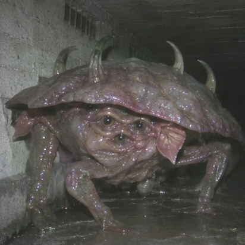
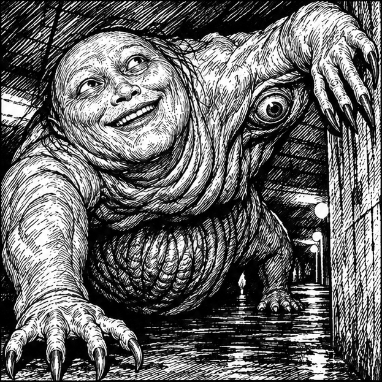
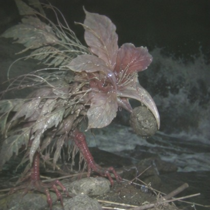
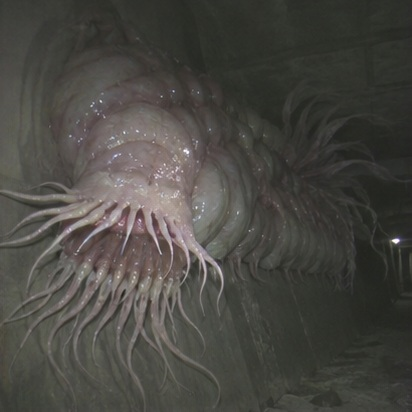
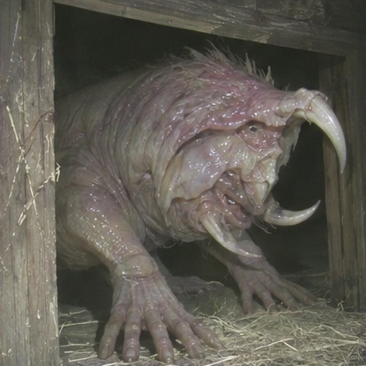
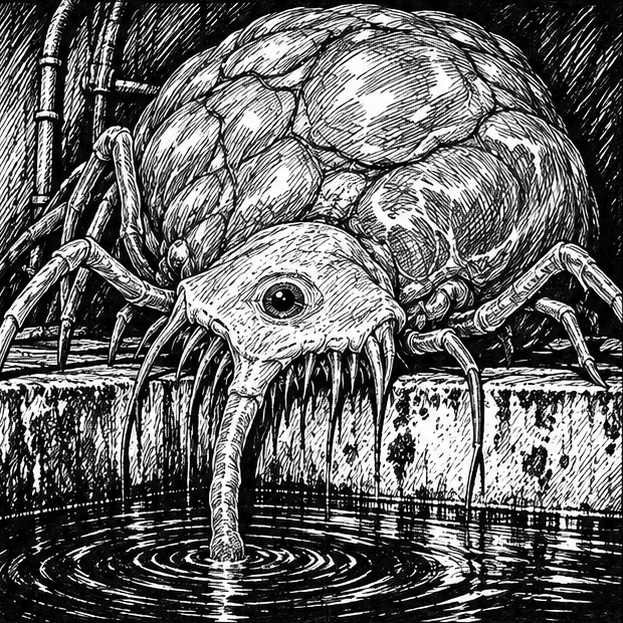

# 🏔️ 《山海經》純怪獸與妖怪圖鑑・卷 03～04〈北山經・東山經〉

[👹 妖怪篇總綱](../00-妖怪篇總綱與圖鑑分級.md) ｜ [📖 山海經總錄](./00-山海經怪獸妖怪總錄.md) ｜ [⬅️ 卷02](./02-卷02_西山經.md) ｜ [➡️ 卷05 中山經](./04-卷05_中山經.md)

> **編纂規格（2026-11-21 定案）**：本卷嚴格收錄《山海經》卷三〈北山經〉（北次一經～北次三經）與卷四〈東山經〉（東次一經～東次四經）全篇所有**怪獸、異鳥、異魚、怪蛇與怨靈異化體**，共計 **92 條**（卷 03 共 59 條、卷 04 共 33 條），配圖 **6 張**。  
> **純怪獸剔除原則**：原典各經結尾之純祭祀山神名單（北次一經人面蛇身神、北次二經蛇身人面神、北次三經馬身人面／彘身載玉／彘身八足蛇尾諸神、東次一經人身龍首神、東次二經獸身人面載𧤛神、東次三經人身羊角神等）已全數剔除，不予收錄。  
> **非怪獸要物備忘（供道具劇情使用，不另立怪物條目）**：北次一經灌題之山「磁石」、北次三經咸山條菅之水「器酸」（三歲一成，食之已瘻）、東次一經竹山激水「茈羸」、東次二經嶧皋之山「蜃珧」、東次四經北號之山不瘧棗木與東始之山血汁「芑木」。

---

## 🗺️ 卷 03～04 地理脈絡與黑暗地牢世界觀導覽

- **卷 03〈北山經〉（北嶺寒脈・共八十八山）**：自單狐之山起，經求如、帶山、譙明、少咸、鉤吾、太行、發鳩一路抵北海之濱的錞于毋逢之山。北山系靈脈陰寒濕冷、長年凍霧與滲水不斷，在本作世界觀中對應台灣北部與東北角終年陰雨的山區涵洞、基隆港潮濕廢棄防空洞、淡水河系地下排水箱涵，以及老舊停電國宅地下室。此脈怪獸最顯著的兩大特徵，一是**「多頭多身／無定形環節寄生體」**（如何羅魚、儵魚、酸與、肥遺），二是**「極致恐怖谷食人偽人」**（如諸犍、竦斯、窫窳、山𤟤、鉤吾山狍鴞／饕餮）。
- **卷 04〈東山經〉（東海疫脈・共四十六山）**：自樕𧐐之山起，歷栒狀、空桑、葛山、鳧麗、尸胡、北號、欽山、剡山直至太山，多瀕臨大海、流沙與湧澤。在現代都市中沿著港口貨櫃區、漁港腐臭水溝、沿岸消波塊暗穴與工業區廢水排放口滲透蔓延。東山系妖物普遍與**「大旱、大水、蝗災、大疫」**掛鉤，本作將其全面重構為**攜帶寄生蟲卵囊、蝗蟲幼蟲、瘟疫腐膿與重甲幾丁質外殼的災厄級生物恐怖怪獸**（如從從、珠蟞魚、蠪侄、當康、合窳、太山疫獸「蜚」）。

---

## 📋 本卷速查表

### 卷 03〈北山經〉全怪獸速查（59 條）

| 編號 | 名稱 | 山系・出處 | 造型路線 | 稀有度 | 配圖 |
| :--- | :--- | :--- | :---: | :---: | :---: |
| `SHJ03-001` | 滑魚 | 北次一經・求如之山（滑水） | `非人生物恐怖型` | `★` | 待補 |
| `SHJ03-002` | 水馬 | 北次一經・求如之山（滑水） | `非人生物恐怖型` | `★` | 待補 |
| `SHJ03-003` | 䑏疏 | 北次一經・帶山 | `非人生物恐怖型` | `★★` | 待補 |
| `SHJ03-004` | 鵸䳜（帶山怪鳥） | 北次一經・帶山 | `非人生物恐怖型` | `★★` | 待補 |
| `SHJ03-005` | 儵魚 | 北次一經・帶山（彭水） | `非人生物恐怖型` | `★★` | 待補 |
| `SHJ03-006` | **何羅魚** | 北次一經・譙明之山（譙水） | `非人生物恐怖型` | `★★★` | 待補 |
| `SHJ03-007` | 孟槐 | 北次一經・譙明之山 | `非人生物恐怖型` | `★★` | 待補 |
| `SHJ03-008` | 鰼鰼魚 | 北次一經・涿光之山（嚻水） | `非人生物恐怖型` | `★★` | 待補 |
| `SHJ03-009` | 寓 | 北次一經・虢山 | `非人生物恐怖型` | `★` | 待補 |
| `SHJ03-010` | 耳鼠 | 北次一經・丹熏之山 | `非人生物恐怖型` | `★★` | 待補 |
| `SHJ03-011` | 孟極 | 北次一經・石者之山 | `非人生物恐怖型` | `★★` | 待補 |
| `SHJ03-012` | 幽鴳 | 北次一經・邊春之山 | `類人偽人型` | `★★` | 待補 |
| `SHJ03-013` | 足訾 | 北次一經・蔓聯之山 | `類人偽人型` | `★★` | 待補 |
| `SHJ03-014` | 鵁 | 北次一經・蔓聯之山 | `非人生物恐怖型` | `★` | 待補 |
| `SHJ03-015` | **諸犍** | 北次一經・單張之山 | `類人偽人型` | `★★★` | 待補 |
| `SHJ03-016` | 白鵺 | 北次一經・單張之山 | `非人生物恐怖型` | `★` | 待補 |
| `SHJ03-017` | 那父 | 北次一經・灌題之山 | `非人生物恐怖型` | `★` | 待補 |
| `SHJ03-018` | **竦斯** | 北次一經・灌題之山 | `類人偽人型` | `★★` | 待補 |
| `SHJ03-019` | 旄牛（四節毛牛怪） | 北次一經・潘侯之山 | `非人生物恐怖型` | `★★` | 待補 |
| `SHJ03-020` | 長蛇 | 北次一經・大咸之山 | `非人生物恐怖型` | `★★★` | 待補 |
| `SHJ03-021` | 赤鮭 | 北次一經・敦薨之山（敦薨之水） | `非人生物恐怖型` | `★` | 待補 |
| `SHJ03-022` | **窫窳（少咸山版）** | 北次一經・少咸之山 | `類人偽人型` | `★★★★` | 待補 |
| `SHJ03-023` | 䰽䰽之魚 | 北次一經・少咸之山（敦水） | `非人生物恐怖型` | `★★` | 待補 |
| `SHJ03-024` | 䱻魚（䲃魚） | 北次一經・獄法之山（瀤澤之水） | `非人生物恐怖型` | `★` | 待補 |
| `SHJ03-025` | **山𤟤（山揮）** | 北次一經・獄法之山 | `類人偽人型` | `★★★` | 待補 |
| `SHJ03-026` | **諸懷** | 北次一經・北嶽之山 | `非人生物恐怖型` | `★★★` | ✅ |
| `SHJ03-027` | 鮨魚 | 北次一經・北嶽之山（諸懷之水） | `非人生物恐怖型` | `★★` | 待補 |
| `SHJ03-028` | **肥遺（北山雙身蛇）** | 北次一經・渾夕之山（彭毗山複見） | `非人生物恐怖型` | `★★★` | 待補 |
| `SHJ03-029` | 狕 | 北次一經・隄山 | `非人生物恐怖型` | `★★` | 待補 |
| `SHJ03-030` | 龍龜 | 北次一經・隄山（隄水） | `非人生物恐怖型` | `★★` | 待補 |
| `SHJ03-031` | 鮆魚 | 北次二經・縣雍之山（晉水） | `非人生物恐怖型` | `★` | 待補 |
| `SHJ03-032` | 𩣡馬（孛馬） | 北次二經・敦頭之山（旄水） | `非人生物恐怖型` | `★★` | 待補 |
| `SHJ03-033` | **狍鴞（鉤吾山饕餮）** | 北次二經・鉤吾之山 | `類人偽人型` | `★★★★` | ✅ |
| `SHJ03-034` | 獨㺜（獨𤞞） | 北次二經・北囂之山 | `非人生物恐怖型` | `★★` | 待補 |
| `SHJ03-035` | 𪄀𪃑（𩿆𩠐） | 北次二經・北囂之山 | `類人偽人型` | `★★` | 待補 |
| `SHJ03-036` | 居暨 | 北次二經・梁渠之山（脩水） | `非人生物恐怖型` | `★` | 待補 |
| `SHJ03-037` | 囂 | 北次二經・梁渠之山 | `非人生物恐怖型` | `★★` | 待補 |
| `SHJ03-038` | 湖灌䱇 | 北次二經・湖灌之山（湖灌之水） | `非人生物恐怖型` | `★` | 待補 |
| `SHJ03-039` | 洹山怪蛇群 | 北次二經・洹山 | `非人生物恐怖型` | `★★` | 待補 |
| `SHJ03-040` | 䮝（驒） | 北次三經・太行之山（歸山） | `非人生物恐怖型` | `★★` | 待補 |
| `SHJ03-041` | 䴅（鴜） | 北次三經・太行之山（歸山） | `非人生物恐怖型` | `★` | 待補 |
| `SHJ03-042` | **人魚（四足嬰啼魚）** | 北次三經・龍侯之山（決決之水） | `類人偽人型` | `★★` | 待補 |
| `SHJ03-043` | 天馬 | 北次三經・馬成之山 | `非人生物恐怖型` | `★★` | 待補 |
| `SHJ03-044` | 鶌鶋 | 北次三經・馬成之山 | `非人生物恐怖型` | `★` | 待補 |
| `SHJ03-045` | 飛鼠 | 北次三經・天池之山 | `非人生物恐怖型` | `★` | 待補 |
| `SHJ03-046` | 領胡 | 北次三經・陽山 | `非人生物恐怖型` | `★★` | 待補 |
| `SHJ03-047` | 象蛇 | 北次三經・陽山 | `非人生物恐怖型` | `★★` | 待補 |
| `SHJ03-048` | 䱱父之魚（䱤父魚） | 北次三經・陽山（留水） | `非人生物恐怖型` | `★` | 待補 |
| `SHJ03-049` | **酸與** | 北次三經・景山 | `非人生物恐怖型` | `★★★` | 待補 |
| `SHJ03-050` | 鴣鴶 | 北次三經・小侯之山 | `非人生物恐怖型` | `★` | 待補 |
| `SHJ03-051` | 黃鳥（軒轅怪梟） | 北次三經・軒轅之山 | `非人生物恐怖型` | `★★` | 待補 |
| `SHJ03-052` | 神囷白蛇與飛蟲 | 北次三經・神囷之山 | `非人生物恐怖型` | `★★` | 待補 |
| `SHJ03-053` | **精衛** | 北次三經・發鳩之山 | `類人偽人型` | `★★★` | ✅ |
| `SHJ03-054` | 䍶䍶（辣辣） | 北次三經・泰戲之山 | `非人生物恐怖型` | `★★` | 待補 |
| `SHJ03-055` | 師魚 | 北次三經・饒山（歷虢之水） | `非人生物恐怖型` | `★★` | 待補 |
| `SHJ03-056` | 獂（豲） | 北次三經・乾山 | `非人生物恐怖型` | `★★` | 待補 |
| `SHJ03-057` | 羆九 | 北次三經・倫山 | `非人生物恐怖型` | `★★` | 待補 |
| `SHJ03-058` | 蒲夷之魚 | 北次三經・碣石之山（繩水） | `非人生物恐怖型` | `★` | 待補 |
| `SHJ03-059` | 錞于毋逢赤首大蛇 | 北次三經・錞于毋逢之山 | `非人生物恐怖型` | `★★★` | 待補 |

### 卷 04〈東山經〉全怪獸速查（33 條）

| 編號 | 名稱 | 山系・出處 | 造型路線 | 稀有度 | 配圖 |
| :--- | :--- | :--- | :---: | :---: | :---: |
| `SHJ04-001` | 鱅鱅之魚 | 東次一經・樕𧐐之山（食水） | `非人生物恐怖型` | `★★` | 待補 |
| `SHJ04-002` | 活師（異形蝌蚪群） | 東次一經・藟山（湖水） | `非人生物恐怖型` | `★` | 待補 |
| `SHJ04-003` | **從從** | 東次一經・栒狀之山 | `非人生物恐怖型` | `★★` | 待補 |
| `SHJ04-004` | 𧐐鼠（䖪鼠） | 東次一經・栒狀之山 | `非人生物恐怖型` | `★★` | 待補 |
| `SHJ04-005` | 箴魚 | 東次一經・栒狀之山（𣲵水） | `非人生物恐怖型` | `★` | 待補 |
| `SHJ04-006` | 鱤魚（食肉怪魚） | 東次一經・番條／姑兒之山 | `非人生物恐怖型` | `★` | 待補 |
| `SHJ04-007` | 堪㐨之魚 | 東次一經・豺山 | `非人生物恐怖型` | `★` | 待補 |
| `SHJ04-008` | 豺山彘毛夸父獸 | 東次一經・豺山 | `類人偽人型` | `★★★` | 待補 |
| `SHJ04-009` | 䖺䗤（脩䗤・條庸） | 東次一經・獨山（末塗之水） | `非人生物恐怖型` | `★★` | 待補 |
| `SHJ04-010` | 狪狪 | 東次一經・泰山 | `非人生物恐怖型` | `★★` | 待補 |
| `SHJ04-011` | 軨軨 | 東次二經・空桑之山 | `非人生物恐怖型` | `★★★` | 待補 |
| `SHJ04-012` | **珠蟞魚** | 東次二經・葛山之首（澧水） | `非人生物恐怖型` | `★★` | 待補 |
| `SHJ04-013` | 犰狳 | 東次二經・餘峨之山 | `非人生物恐怖型` | `★★★` | 待補 |
| `SHJ04-014` | 朱獳 | 東次二經・耿山 | `非人生物恐怖型` | `★★` | 待補 |
| `SHJ04-015` | 鵹鶘 | 東次二經・盧其之山（沙水） | `非人生物恐怖型` | `★★` | 待補 |
| `SHJ04-016` | 獙獙 | 東次二經・姑逢之山 | `非人生物恐怖型` | `★★★` | 待補 |
| `SHJ04-017` | **蠪侄（蠪蚳）** | 東次二經・鳧麗之山 | `非人生物恐怖型` | `★★★★` | ✅ |
| `SHJ04-018` | 峳峳 | 東次二經・䃌山 | `非人生物恐怖型` | `★★` | 待補 |
| `SHJ04-019` | 絜鉤 | 東次二經・䃌山 | `非人生物恐怖型` | `★★★` | 待補 |
| `SHJ04-020` | 妴胡 | 東次三經・尸胡之山 | `非人生物恐怖型` | `★★` | 待補 |
| `SHJ04-021` | 寐魚 | 東次三經・諸鉤之山 | `非人生物恐怖型` | `★` | 待補 |
| `SHJ04-022` | 跂踵大蛇與蠵龜 | 東次三經・跂踵之山（深澤） | `非人生物恐怖型` | `★★` | 待補 |
| `SHJ04-023` | 鮯鮯之魚 | 東次三經・跂踵之山（深澤） | `非人生物恐怖型` | `★★` | 待補 |
| `SHJ04-024` | 精精 | 東次三經・踇隅之山 | `非人生物恐怖型` | `★★` | 待補 |
| `SHJ04-025` | **獦狚（猲狙）** | 東次四經・北號之山 | `類人偽人型` | `★★★` | 待補 |
| `SHJ04-026` | 鬿雀 | 東次四經・北號之山 | `非人生物恐怖型` | `★★★` | 待補 |
| `SHJ04-027` | 鱃魚 | 東次四經・旄山（欽山／太山複見） | `非人生物恐怖型` | `★` | 待補 |
| `SHJ04-028` | 茈魚 | 東次四經・東始之山（泚水） | `非人生物恐怖型` | `★★` | 待補 |
| `SHJ04-029` | 薄魚 | 東次四經・女烝之山（石膏水） | `非人生物恐怖型` | `★★` | 待補 |
| `SHJ04-030` | **當康** | 東次四經・欽山 | `非人生物恐怖型` | `★★★` | ✅ |
| `SHJ04-031` | 䱻魚（子桐發光飛魚） | 東次四經・子桐之山（子桐之水） | `非人生物恐怖型` | `★★` | 待補 |
| `SHJ04-032` | **合窳** | 東次四經・剡山 | `類人偽人型` | `★★★★` | 待補 |
| `SHJ04-033` | **蜚** | 東次四經・太山 | `非人生物恐怖型` | `★★★` | ✅ |

---

# ❄️ 卷 03〈北山經〉（純怪獸與妖怪全錄）

## 🕳️ 一、北次一經（自單狐之山至隄山・共 30 條）

### [SHJ03-001] 滑魚（赤背怪鱓／滑水黏液蛭魚）
- **出處順序**：卷 03〈北山經〉・北次一經・求如之山（滑水）
- **類別與造型路線**：`【非人生物恐怖型】`｜環節水蛭與盲鱔寄生異變體
- **物種／唯一性**：`物種（群體）`｜原典明言「其中多滑魚」，為群聚於寒水淤泥中的底棲寄生怪魚。
- **稀有度與道行對照**：`★ 凡級（N）`｜模糊道行：數年～十餘年陰水成怪｜本作階位：未入流～三流
- **外貌與黑暗地牢／恐怖谷視覺改寫**：
  - <!-- 圖位預留：待補繪 -->
  - 【原典外貌】「滑水出焉，而西流注於諸毗之水。其中多滑魚，其狀如鱓，赤背，其音如梧，食之已疣。」——形似無鱗黃鱔，背脊赤紅，叫聲如木枝相擊或人支撐低吟。
  - 【本作克蘇魯／昆蟲寄生／偽人重構】長逾兩公尺、無眼無鰭的巨型環節水蛭怪魚，通體滲出拉絲的灰白冷黏液。原典「赤背」改寫為沿背脊一路裂開的血紅肉縫，縫內密排數十枚環形細齒吸盤與不斷開闔的寄生口器；游動時整條軀幹會像軟骨被抽離般折疊蠕動，腹側嵌滿曾吸食過的人類指甲與指骨碎屑。黑白墨線以極細的橫向環節線配大面積高光黏液留白，凸顯潮濕發滑的噁心觸感。
- **特性**：
  - 【原典記載】食之可治皮膚疣贅（已疣）。
  - 【本作衍生】其背脊赤縫分泌的強酸消化黏液會主動溶解附著在宿主皮膚上的肉瘤與角質，黑市庸醫將其活體製成「除疣膏」；但凡沾染超過三分鐘，皮下就會鑽入微米級幼蛭，三日內從毛孔吐出暗紅黏絲。
- **弱點**：
  - 【原典記載】原典未載。
  - 【本作衍生】表皮無鱗且完全仰賴水膜呼吸，以高濃度粗鹽水、生石灰或高熱噴燈瞬間脫水即可令環節爆裂；除妖師亦可用乾燥符紙包裹艾草灰封住其背脊赤縫。
- **習性**：
  - 【原典記載】棲於求如之山滑水，西流注於諸毗之水。
  - 【本作衍生】盤據台灣老舊國宅的地下蓄水池、洗車場油水分離槽與長滿青苔的雨水箱涵，豪雨夜會順著浴室排水孔緩緩探出無眼血口。
- **喜好**：
  - 【原典記載】原典未載。
  - 【本作衍生】嗜好人類皮膚表面帶有汗脂、癬塊或化膿傷口的部位，特別容易被醫院廢水與長照機構浴室氣味吸引。
- **擅長的招式／異能**：
  - 【原典記載】其音如梧（低頻喉鳴）。
  - 【本作衍生】「滑膜脫身」：受攻擊時瞬間蛻下一層含強酸的黏液皮囊逃逸；「赤脊環吸」：捲纏目標小腿後張開背縫所有吸盤同步吸血並注入麻痺唾液。

### [SHJ03-002] 水馬（求如水黽巨怪）
- **出處順序**：卷 03〈北山經〉・北次一經・求如之山（滑水）
- **類別與造型路線**：`【非人生物恐怖型】`｜涉水巨型節肢水黽與吸血寄生馬獸
- **物種／唯一性**：`物種（群體）`｜原典「其中多水馬」，於深潭冷水中成群出沒。
- **稀有度與道行對照**：`★ 凡級（N）`｜模糊道行：十數年～數十年水煞異獸｜本作階位：三流
- **外貌與黑暗地牢／恐怖谷視覺改寫**：
  - <!-- 圖位預留：待補繪 -->
  - 【原典外貌】「其中多水馬，其狀如馬，文臂牛尾，其音如呼。」——形如馬，前肢帶有斑紋，拖著牛尾，叫聲像人在遠處大喊。
  - 【本作克蘇魯／昆蟲寄生／偽人重構】徹底剝除馬的毛皮與駿馬姿態，重構為一頭兩公尺高、依靠六節反折細長步足踩在水面張力上滑行的巨型黑亮水黽蟲怪。所謂「文臂」是前兩對如螳螂鐮肢般密布慘白甲殼斑紋與倒鉤鋸齒的捕食肢；「牛尾」實為一條末端分叉成吸盤觸鬚的腐爛環節長尾；馬頭輪廓全由拼接的灰黑幾丁質骨片構成，無眼瞼的漆黑複眼下方垂出半公尺長的吸血口針，發聲時胸腔氣孔會震動出極似溺水者「喂——救我——」的人類呼喊。
- **特性**：
  - 【原典記載】生於水中，其音如人呼。
  - 【本作衍生】能以氣孔模擬溺水者的呼救聲誘騙路人靠近水岸；鐮肢刺穿獵物後會直接注入消化酶，將內臟液化後以長口針吸乾，只留下空殼浮屍。
- **弱點**：
  - 【原典記載】原典未載。
  - 【本作衍生】界面活性劑（洗碗精、肥皂水）或重油倒入水面會瞬間破壞其水面滑行張力，使其節肢沉陷溺水；離水乾燥後關節甲殼極易脆裂，懼怕爆裂火符。
- **習性**：
  - 【原典記載】棲於求如之山滑水。
  - 【本作衍生】潛伏於暴雨後的地下道積水、基隆河夜間霧面、郊區蓄洪池與無人看管的工地深積水坑，總在凌晨兩點後發出含糊人聲呼喊。
- **喜好**：
  - 【原典記載】原典未載。
  - 【本作衍生】喜好陰冷無風、水質混濁發臭的死水潭，偏愛吸食剛溺斃不久的溫熱屍體與落水流浪犬。
- **擅長的招式／異能**：
  - 【原典記載】其音如呼。
  - 【本作衍生】「溺者偽呼」：高擬真聲波誘餌；「水黽急掠」：於積水表面以時速六十公里無聲貼水突刺，以鋸齒文臂將人拖入暗流。

### [SHJ03-003] 䑏疏（獨角鑽殼甲蟲怪獸）
- **出處順序**：卷 03〈北山經〉・北次一經・帶山
- **類別與造型路線**：`【非人生物恐怖型】`｜巨型獨角仙重甲與寄生吸火蟲怪
- **物種／唯一性**：`物種（群體）`｜原典「有獸焉……可以辟火」，為棲於玉石礦脈中的群體異獸。
- **稀有度與道行對照**：`★★ 稀級（R）`｜模糊道行：數十年～百年金石成怪｜本作階位：二流
- **外貌與黑暗地牢／恐怖谷視覺改寫**：
  - <!-- 圖位預留：待補繪 -->
  - 【原典外貌】「有獸焉，其狀如馬，一角有錯，其名曰䑏疏，可以辟火。」——形如馬，額頭長有一支表面帶有錯落紋理的獨角。
  - 【本作克蘇魯／昆蟲寄生／偽人重構】將馬身徹底甲蟲化：是一頭車廂大小、覆蓋濕冷暗黑幾丁質重甲的巨型腐食獨角仙畸變體。馬臉拉長變形為上下咬合的鋸齒大顎，額頂那根「一角有錯」的獨角長達一公尺，表面佈滿螺旋狀鑽紋與密密麻麻的滲液毛孔，會隨呼吸不斷噴吐冰冷的阻燃白霧。甲殼背縫微微掀開，露出底下擠滿如白蟻般蠕動發光的共生滅火幼蟲，六條多節步足踩過柏油路時會留下一串滲出黑油的孔洞。
- **特性**：
  - 【原典記載】「可以辟火」，能防禦或壓制火災。
  - 【本作衍生】體內共生蟲群以「熱能與氧氣」為食，䑏疏所在半徑二十公尺內一切明火、雷火符咒與槍械火藥都會莫名熄滅，同時周遭氣溫驟降至攝氏零度以下；黑市消防承包商曾試圖圈養其幼蟲卻釀成整棟倉儲缺氧窒息慘案。
- **弱點**：
  - 【原典記載】原典未載。
  - 【本作衍生】因火系法術與燃燒彈對它完全無效（反成補品），必須改用「重鈍物理破甲」、「高壓純氧吹散其阻燃黏霧」或「金系貫穿針符」直刺其鞘翅背縫下軟爛的蟲巢腹部。
- **習性**：
  - 【原典記載】棲於帶山（其上多玉，其下多青碧）。
  - 【本作衍生】喜藏於廢棄玉石加工廠、火災後的焦黑鐵皮屋殘骸與地鐵變電站機房，專門吸食電線走火與餘燼熱氣維生。
- **喜好**：
  - 【原典記載】原典未載。
  - 【本作衍生】嗜吞未熄的焦炭、過熱變壓器機油與剛發高燒的人類病患（常出現在醫院急診室通風管道）。
- **擅長的招式／異能**：
  - 【原典記載】辟火。
  - 【本作衍生】「寂火吸氧領域」：釋放螺旋獨角白霧，瞬間抽乾密閉空間氧氣令除妖師火符全廢且陷入窒息；「螺旋錯角衝撞」：以高速旋轉獨角鑽穿防爆門。

### [SHJ03-004] 鵸䳜（鵸鵌・帶山自體產卵蛾鳥）
- **出處順序**：卷 03〈北山經〉・北次一經・帶山
- **類別與造型路線**：`【非人生物恐怖型】`｜雌雄同體寄生毒蛾與腐屍烏鴉合體怪
- **物種／唯一性**：`物種（群體）`｜原典明載「是自為牝牡」，具備無性／自體交配快速擴散的族群特性。
- **稀有度與道行對照**：`★★ 稀級（R）`｜模糊道行：數十年妖禽成群｜本作階位：二流
- **外貌與黑暗地牢／恐怖谷視覺改寫**：
  - <!-- 圖位預留：待補繪 -->
  - 【原典外貌】「有鳥焉，其狀如烏，五采而赤文，名曰鵸䳜，是自為牝牡，食之不疽。」——像烏鴉，羽色五彩且帶紅紋，雌雄同體，吃牠的肉不生惡性癰疽。
  - 【本作克蘇魯／昆蟲寄生／偽人重構】拋棄華麗五彩羽鳥形象：牠的外殼像一隻濕漉漉、翅膀佈滿發臭鱗粉的巨型人面天蛾與腐爛烏鴉嫁接體。所謂「五采赤文」是羽翼鱗膜上因長期吸食膿血而浮現的油汙虹彩與血紅靜脈網紋；最駭人的是其「自為牝牡」的生殖器官——鳥腹從胸骨至尾端縱裂，左半垂著不斷搏動的乳白輸精囊，右半伸出三根暗紅尖銳的幾丁質產卵管，飛行時兩側器官會在半空中自行交纏滴落黏液。
- **特性**：
  - 【原典記載】自為牝牡，食之不疽（不生深層膿瘡）。
  - 【本作衍生】牠並非治癒膿瘡，而是以產卵管精準刺入人類化膿傷口，把潰爛死肉吃得乾乾淨淨並填入自己的寄生蟲卵；表面傷口看似瞬間癒合，七日後卻會從皮膚底下爆出整群幼蟲蛾鳥。
- **弱點**：
  - 【原典記載】原典未載。
  - 【本作衍生】翅膀鱗粉極易吸濕結塊並可燃，強風機配火焰噴射或高壓水霧即可令其墜地；其縱裂腹部毫無甲殼防護，是致命破口。
- **習性**：
  - 【原典記載】棲於帶山。
  - 【本作衍生】成群倒掛於醫院醫療廢棄物焚化爐屋簷、老舊社區地下污水槽天花板，深夜會循著傷口腐臭味鑽進紗窗縫隙。
- **喜好**：
  - 【原典記載】原典未載。
  - 【本作衍生】迷戀糖尿病潰瘍、褥瘡與戰後傷口的膿血腥味，也喜歡啃食丟棄在垃圾場的染血紗布。
- **擅長的招式／異能**：
  - 【原典記載】自為牝牡（單體高速繁殖）。
  - 【本作衍生】「赤紋鱗粉瘴」：拍翅灑出會鑽入毛孔引發潰爛的毒鱗粉；「膿瘡產卵」：趁目標昏睡時無痛注入數十枚透明寄生卵。

### [SHJ03-005] 儵魚（彭水四首六足寄生怪魚）
- **出處順序**：卷 03〈北山經〉・北次一經・帶山（彭水）
- **類別與造型路線**：`【非人生物恐怖型】`｜多首節肢寄生蟲魚合體怪
- **物種／唯一性**：`物種（群體）`｜原典「其中多儵魚」，群居於暗河流域。
- **稀有度與道行對照**：`★★ 稀級（R）`｜模糊道行：數十年～百年水異怪魚｜本作階位：三流～二流
- **外貌與黑暗地牢／恐怖谷視覺改寫**：
  - <!-- 圖位預留：待補繪 -->
  - 【原典外貌】「彭水出焉，而西流注於芘湖之水，其中多儵魚，其狀如雞而赤毛，三尾、六足、四首，其音如鵲，食之可以已憂。」——形似紅毛雞的怪魚，長著三尾、六足、四顆頭，鳴聲如喜鵲，吃了可以消除憂愁。
  - 【本作克蘇魯／昆蟲寄生／偽人重構】一團泡發腫脹、濕亮反光的畸形水生節肢怪魚。所謂「赤毛」其實是覆蓋整個軟囊軀幹、在水中不斷飄搖呼吸的血紅色腮絲與寄生剛毛；六條細足全是半透明甲殼蝦腳與蜘蛛步足結構，能在濕滑涵洞壁面高速側爬；四顆畸形鳥魚頭顱擠在同一截頸肉上，各自擁有獨立的蒼蠅複眼與鋸齒喙口，彼此不時互相啃咬又同時發出「嘎嘎嘎」的機械喜鵲噪鳴；身後三條鞭狀環節尾不斷噴出含致幻麻藥的黑色體液。
- **特性**：
  - 【原典記載】「食之可以已憂」。
  - 【本作衍生】體內黏液富含強效神經鈍化毒素，誤食其肉或吸入其尾霧的人會瞬間失去恐懼、悲傷與痛覺——臉上掛著僵硬傻笑，眼睜睜看著儵魚用六足爬上胸口啃食自己也毫無反抗意識。黑市毒販曾提煉其腮絲作為地下迷幻藥「忘憂散」。
- **弱點**：
  - 【原典記載】原典未載。
  - 【本作衍生】四顆頭顱的神經中樞各自搶奪控制權，以閃光彈或爆音符干擾其中兩顆頭，便會引發四首互相撕咬而自亂陣腳；極懼高鹽與烈陽暴曬。
- **習性**：
  - 【原典記載】居彭水，西流注於芘湖之水。
  - 【本作衍生】藏匿在河濱公園暗渠出水口、廢棄養殖場發臭水池，暴雨漲潮時會用六足爬上人行道埋伏夜歸失意者。
- **喜好**：
  - 【原典記載】原典未載。
  - 【本作衍生】對人類極度憂鬱、絕望時散發的皮質醇汗味異常敏銳，常聚集在自殺熱點橋墩與老舊公寓頂樓水塔。
- **擅長的招式／異能**：
  - 【原典記載】四首六足、已憂之效。
  - 【本作衍生】「已憂麻痺霧」：三尾甩出致幻神經霧令獵物傻笑失能；「四首輪噬」：四張鋸齒喙口無縫銜接咬切，防不勝防。

### [SHJ03-006] 何羅魚（十身環節水蛭深水巨怪）
- **出處順序**：卷 03〈北山經〉・北次一經・譙明之山（譙水）
- **類別與造型路線**：`【非人生物恐怖型】`｜一首十身環節水蛭合體深水怪獸
- **物種／唯一性**：`物種（群體）`｜原典「其中多何羅之魚」，然成體體型龐大、極為罕見，現代都市中每條大河下僅潛伏數隻母體。
- **稀有度與道行對照**：`★★★ 珍級（SR）`｜模糊道行：數百年深水巨妖｜本作階位：二流頂～一流
- **外貌與黑暗地牢／恐怖谷視覺改寫**：
  - <!-- 圖位預留：待補繪 -->
  - 【原典外貌】「譙水出焉，西流注於河。其中多何羅之魚，一首而十身，其音如吠犬，食之已癰。」——一顆頭卻拖著十條身軀的怪魚，叫聲如犬吠，食之可治癰腫。
  - 【本作克蘇魯／昆蟲寄生／偽人重構】**本作北山經標誌性黑暗地牢深水巨怪！**徹底捨棄普通魚類造型，重構為**十條粗如成人腰圍、漆黑濕滑的巨型環節水蛭身軀，在前端血肉融合成同一顆巨大無眼單頭的克蘇魯式水怪**。那顆唯一頭顱沒有魚眼，整張臉就是一個向外翻捲、層層嵌套三百枚倒鉤骨齒的環形深淵口器，口器深處像犬吠般發出濕黏而狂暴的「汪——喀——」氣管爆裂聲。身後十條水蛭身軀全數長滿搏動吸盤與細密剛毛，彼此獨立扭動、纏捲、交錯攀爬在積水地牢的拱頂與柱壁上；十條身軀末端各自裂開一個滲出腐膿的產卵排泄口，黑白墨線以極濃的實黑背景襯托出十條反光黏液肉管的壓迫構圖，猶如深水觸手地獄。
- **特性**：
  - 【原典記載】一首十身，其音如吠犬，食之已癰。
  - 【本作衍生】十條身軀各自擁有獨立的備用循環腔與消化囊，斬斷其中一兩條根本無法殺死本體，斷口反而會噴出高壓腐血與數百條幼蛭。其體液確有強效吞噬壞死組織（已癰）之藥性，卻會同時在宿主血管壁留下寄生蛭卵。
- **弱點**：
  - 【原典記載】原典未載（線索：十身共用「一首」，單頭為唯一神經總樞）。
  - 【本作衍生】斬斷分身毫無意義，必須以高壓雷符、貫穿銅釘或離火彈直接轟碎或釘死那顆唯一的環形齒狀主頭；此外對濃鹽、生石灰與高頻水下聲波震盪極為敏感，會令十條水蛭身軀同時劇烈痙攣打結。
- **習性**：
  - 【原典記載】生於譙水，流注於黃河。
  - 【本作衍生】盤踞於台灣都會區最深層的大型雨水滯洪池、捷運過河隧道積水檢修坑與老舊運河底層涵洞。平時將十條身軀各自鑽進十個不同方向的排水管監聽腳步聲，一旦鎖定獵物便從四面八方的水孔同時爆出合圍。
- **喜好**：
  - 【原典記載】原典未載。
  - 【本作衍生】嗜愛絕對漆黑、充滿鐵鏽與腐肉味的靜止深水，以及群聚在排水道內的野狗與流浪貓（其犬吠叫聲即模仿遭吞噬野狗的臨死哀嚎）。
- **擅長的招式／異能**：
  - 【原典記載】一首十身、其音如吠犬。
  - 【本作衍生】「十蛭絞殺陣」：十條環節水蛭軀幹分從不同水孔鑽出，同步纏絞獵物四肢拖向主頭口器；「深喉犬吠震波」：主頭口器噴吐水下聲波，震破近距離目標耳膜並使其在暗水中迷失方向；「斷尾散蛭」：主動自斷一條身軀化作漫天吸血幼蛭掩護撤退。

### [SHJ03-007] 孟槐（赤豪腐食蛛貆怪）
- **出處順序**：卷 03〈北山經〉・北次一經・譙明之山
- **類別與造型路線**：`【非人生物恐怖型】`｜赤紅剛毛巨型腐食蛛與甲殼貆獸異變體
- **物種／唯一性**：`物種（群體）`｜原典「有獸焉……可以禦凶」，為群棲山石隙縫的凶猛怪獸。
- **稀有度與道行對照**：`★★ 稀級（R）`｜模糊道行：數十年～百年山怪｜本作階位：二流
- **外貌與黑暗地牢／恐怖谷視覺改寫**：
  - <!-- 圖位預留：待補繪 -->
  - 【原典外貌】「有獸焉，其狀如貆而赤豪，其音如榴榴，名曰孟槐，可以禦凶。」——形如豪豬或貉，身披赤紅硬毛，叫聲如「榴榴」，可抵禦凶邪。
  - 【本作克蘇魯／昆蟲寄生／偽人重構】捨棄哺乳動物皮毛，重構為一頭伏低爬行、背甲裂滿縫隙的巨型紅螯捕鳥蛛與埋葬蟲合體怪。原典「赤豪」化作數百根插在暗黑甲殼縫中、末端滴著橘紅腐蝕毒液的中空剛毛（極似捕鳥蛛踢毛與毒蜂螫針的放大版）；口部為上下開闔的四瓣黑亮大顎，不斷摩擦發出「溜溜——喀喀——」的甲殼刮擦聲；背部甲片下層層堆疊著遭牠吞食的其他低階妖物碎骨。
- **特性**：
  - 【原典記載】「可以禦凶」。
  - 【本作衍生】孟槐「禦凶」的真相其實是以「其他妖魔與怨靈」為食的食妖蟲獸——牠會主動獵殺附近更弱小的鬼怪與陰煞，因此其棲息地反倒不見尋常游魂，被無知風水師誤當成鎮宅吉獸引回屋內，結果屋主全家成為下一批活體口糧。
- **弱點**：
  - 【原典記載】原典未載。
  - 【本作衍生】體表赤色毒剛毛富含油脂極易引燃，一點火苗即可令其陷入火海；腹部甲片較薄，翻轉後以利器貫穿即可斃命。
- **習性**：
  - 【原典記載】棲於譙明之山（無草木，多青雄黃）。
  - 【本作衍生】藏匿於台北與新北郊山多凶宅傳聞的廢棄社區地下室、老舊納骨塔陰暗機房，以吞食當地聚集的雜煞陰氣壯大。
- **喜好**：
  - 【原典記載】原典未載（所居多青雄黃，或耐硫磺礦氣）。
  - 【本作衍生】極耐雄黃與一般硫磺毒氣（尋常驅蟲藥無效），嗜食鬼魅殘魂與帶有陰煞氣的古董陪葬品。
- **擅長的招式／異能**：
  - 【原典記載】禦凶（吞煞壓邪）。
  - 【本作衍生】「赤豪散射」：震動背甲向四周噴射帶腐蝕性毒液的血紅剛毛針雨；「噬煞護甲」：吞噬低階靈體後在體表凝結一層免疫低階符咒的黑紅黏殼。

### [SHJ03-008] 鰼鰼魚（十翼飛蝗寄生魚）
- **出處順序**：卷 03〈北山經〉・北次一經・涿光之山（嚻水）
- **類別與造型路線**：`【非人生物恐怖型】`｜十翼蝗蟲膜翅與濕滑寄生怪魚合體
- **物種／唯一性**：`物種（群體）`｜原典「其中多鰼鰼之魚」，常以數十隻為群貼水滑翔。
- **稀有度與道行對照**：`★★ 稀級（R）`｜模糊道行：數十年水飛怪蟲魚｜本作階位：三流～二流
- **外貌與黑暗地牢／恐怖谷視覺改寫**：
  - <!-- 圖位預留：待補繪 -->
  - 【原典外貌】「嚻水出焉，而西流注於河。其中多鰼鰼之魚，其狀如鵲而十翼，鱗皆在羽端，其音如鵲，可以禦火，食之不癉。」——形如喜鵲卻有十隻翅膀，魚鱗全生在羽翼尖端，能防禦火災，食之不患黃疸病。
  - 【本作克蘇魯／昆蟲寄生／偽人重構】一條乾癟灰黑的死魚胴體兩側，對稱裂出五對共十片半透明、佈滿蟲脈血管的巨型飛蝗膜翅。每一片膜翅邊緣密排一排鋒利如剃刀片、滴著冰冷黏液的鈣化魚鱗（「鱗皆在羽端」），十翅高速交錯振顫時會刮出宛如大批蝗蟲與喜鵲混雜的尖銳嘶鳴。魚嘴退化為圓筒狀吸血吸盤，腹下垂著無數隨風晃動的白色線蟲觸鬚。
- **特性**：
  - 【原典記載】可以禦火，食之不癉。
  - 【本作衍生】十對膜翅高速扇動時會灑出冰冷阻燃黏霧，瞬間澆熄火勢；鱗端刀片極為鋒利，集群掠過可將目標皮膚切成數百道細血痕，再由線蟲觸鬚滲入吸血。
- **弱點**：
  - 【原典記載】原典未載。
  - 【本作衍生】十片膜翅極度脆弱且怕纏繞，以細密漁網、高壓水柱或強力黏膠彈即可令十翼絞成一團墜地；懼怕冰凍與雷擊（潮濕鱗端極易導電）。
- **習性**：
  - 【原典記載】棲於涿光之山嚻水。
  - 【本作衍生】白日沉在工業區冷卻水塔與廢棄魚池底層，入夜後破水而出，在河濱高架橋底的潮濕路燈下成群盤旋。
- **喜好**：
  - 【原典記載】原典未載。
  - 【本作衍生】被夜間高溫火源、工廠煙囪餘熱與露營營火吸引，會集體俯衝撲滅火堆並掠食現場人類。
- **擅長的招式／異能**：
  - 【原典記載】十翼飛行、禦火。
  - 【本作衍生】「十翼鱗刃亂舞」：十片帶刀鱗的膜翅貼身掠切，造成大面積放血傷口；「濕霧滅火」：灑下冷臭黏液封鎖一切火系法術。

### [SHJ03-009] 寓（鼠軀飛蛾吸血怪鳥）
- **出處順序**：卷 03〈北山經〉・北次一經・虢山
- **類別與造型路線**：`【非人生物恐怖型】`｜鼠形吸血蚊蟲與膜翼蛾鳥異變體
- **物種／唯一性**：`物種（群體）`｜原典「其鳥多寓」，以龐大集群盤踞暗洞。
- **稀有度與道行對照**：`★ 凡級（N）`｜模糊道行：數年～十餘年妖蟲群｜本作階位：未入流（群體襲擊可達三流）
- **外貌與黑暗地牢／恐怖谷視覺改寫**：
  - <!-- 圖位預留：待補繪 -->
  - 【原典外貌】「其鳥多寓，狀如鼠而鳥翼，其音如羊，可以禦兵。」——身體像老鼠卻長著鳥翼，叫聲如羊，可防禦刀兵之禍。
  - 【本作克蘇魯／昆蟲寄生／偽人重構】絕非可愛飛鼠或普通蝙蝠，而是剝皮腐鼠般的濕紅寄生軟軀，背脊兩側生出一對骨膜外露、佈滿寄生羽蝨與硬甲倒鉤的破爛飛蛾怪翼。鼠吻被一根不斷伸長抽動的針狀蚊喙取代，兩隻膨脹複眼占據整個頭骨側面；集群起飛時會發出極度詭異、宛如屠宰場待宰羊群齊鳴的「咩——咩——」顫音。
- **特性**：
  - 【原典記載】「可以禦兵」。
  - 【本作衍生】其硬化的甲殼翼膜能分泌瞬間凝結的鈣化骨膠，古代方士塗於皮甲可防冷兵器劈砍（禦兵）；活體遇襲時會把數百隻同類黏合成一面血肉蠕動的盾牆擋住刀劍子彈。
- **弱點**：
  - 【原典記載】原典未載。
  - 【本作衍生】骨膠盾牆怕強酸與烈焰高溫，且群體對超聲波驅鼠器與銅鈴高頻聲波毫無抵抗力，一響即四散潰逃。
- **習性**：
  - 【原典記載】棲於虢山（多漆、多桐椐、多玉鐵）。
  - 【本作衍生】密密麻麻倒掛於台灣老舊地下停車場通風管、廢棄防空洞與軍事營區廢棄彈藥庫內。
- **喜好**：
  - 【原典記載】原典未載。
  - 【本作衍生】喜愛鐵鏽味、槍油味與傷口凝血腥味，常追蹤剛發生過械鬥或車禍的現場。
- **擅長的招式／異能**：
  - 【原典記載】禦兵、其音如羊。
  - 【本作衍生】「蟲甲禦兵牆」：群體抱團噴膠硬化成防彈肉盾；「針吻群吸」：數十隻同時扎入目標頸背抽血。

### [SHJ03-010] 耳鼠（毒尾滑翔節肢鼠怪）
- **出處順序**：卷 03〈北山經〉・北次一經・丹熏之山
- **類別與造型路線**：`【非人生物恐怖型】`｜毒尾滑翔寄生節肢鼠蟲怪
- **物種／唯一性**：`物種（群體）`｜原典「有獸焉……食之不䐆，又可以禦百毒」。
- **稀有度與道行對照**：`★★ 稀級（R）`｜模糊道行：數十年百毒淬鍊妖獸｜本作階位：二流
- **外貌與黑暗地牢／恐怖谷視覺改寫**：
  - <!-- 圖位預留：待補繪 -->
  - 【原典外貌】「有獸焉，其狀如鼠，而菟首麋身，其音如獆犬，以其尾飛，名曰耳鼠，食之不䐆，又可以禦百毒。」——形如鼠，兔頭麋身，叫聲似狂吠之犬，靠尾巴飛行，食之不生腹脹大腹病，並能抵禦百毒。
  - 【本作克蘇魯／昆蟲寄生／偽人重構】一頭體長近一公尺、通體覆蓋灰白幾丁質薄甲的畸形鼠蟲怪。兔首唇裂三瓣，內藏四根可彈射的毒蠍螫針；兩隻巨大耳朵實為兩片半透明、脈絡充血的毒囊膜；最獵奇的是牠「以其尾飛」的構造——尾椎無限拉長並向兩側展開成兩對如蜻蜓與蜈蚣結合的巨大硬翅膜尾，每節尾骨上都掛著一串紫黑色毒腺膿包，滑翔時發出犬吠般的狂躁嘶叫，尾端不斷滴落能中和百毒卻能腐蝕活人血肉的墨綠毒汁。
- **特性**：
  - 【原典記載】以其尾飛，食之不䐆，可禦百毒。
  - 【本作衍生】專以天下劇毒蟲蛇、化工廢液與重金屬汙泥為食，體內毒囊累積出極端恐怖的「以毒攻毒」抗體，尋常毒霧與毒符對牠毫無作用，反會被牠大口吸食增強體力。
- **弱點**：
  - 【原典記載】原典未載（線索：仰賴尾巴飛行）。
  - 【本作衍生】切斷或以冰霜符凍僵其長尾膜翅即完全喪失機動能力；免疫毒系攻擊，須以純粹物理斬擊、雷擊或淨化金光符破殼。
- **習性**：
  - 【原典記載】棲於丹熏之山（多丹雘、樗柏）。
  - 【本作衍生】潛伏於化工廠排水溝、廢棄染整廠、重金屬汙染河岸與醫院化學實驗室排氣井，入夜從高樓管線頂端展尾無聲滑翔獵食。
- **喜好**：
  - 【原典記載】原典未載。
  - 【本作衍生】狂愛吞食農藥殘液、腐屍屍毒、雄黃粉與各種毒蜘蛛毒蜈蚣。
- **擅長的招式／異能**：
  - 【原典記載】尾翼飛行、禦百毒。
  - 【本作衍生】「百毒尾霧」：滑翔俯衝時擠爆尾節毒囊，潑灑同時帶有麻痺與腐蝕效果的混合毒雨；「唇針突刺」：三瓣裂唇驟張射出毒針。

### [SHJ03-011] 孟極（白殼文題陷阱蛛豹）
- **出處順序**：卷 03〈北山經〉・北次一經・石者之山
- **類別與造型路線**：`【非人生物恐怖型】`｜慘白甲殼伏擊型巨型陷阱門蜘蛛豹
- **物種／唯一性**：`物種（群體）`｜原典「有獸焉……是善伏」，為極擅潛伏偷襲的獨行掠食種。
- **稀有度與道行對照**：`★★ 稀級（R）`｜模糊道行：百年伏擊妖獸｜本作階位：二流
- **外貌與黑暗地牢／恐怖谷視覺改寫**：
  - <!-- 圖位預留：待補繪 -->
  - 【原典外貌】「有獸焉，其狀如豹，而文題白身，名曰孟極，是善伏，其鳴自呼。」——形似豹子，額頭有詭異花紋、通體雪白，極擅隱藏埋伏，叫聲像自呼其名。
  - 【本作克蘇魯／昆蟲寄生／偽人重構】拋棄雪豹毛皮，重構為一頭身長兩公尺半、通體覆蓋蒼白濕滑骨白甲殼的巨型陷阱門蜘蛛與豹骨融合體。四條主肢反折如螳螂與蜘蛛步足，體側另藏兩對收折於肋甲內的短捕食鉤肢；額頭的「文題」其實是一片由八顆漆黑單眼與無數凹凸甲紋排成的擬態死人臉假面——當牠將扁平白身緊貼在老舊公寓潮濕剝落的白牆或磁磚地板上時，整頭怪獸與牆壁幾近完美融為一體，只露出一塊彷彿壁癌水漬般的額紋，直到獵物經過才瞬間彈出滿口倒刺大顎。
- **特性**：
  - 【原典記載】「是善伏」，極擅藏匿伏擊。
  - 【本作衍生】白甲表層能隨牆面壁癌、水泥斑駁微調濕度與反光，幾乎免疫肉眼與紅外線偵測；埋伏期間可連續七十二小時停止心跳與呼吸氣息。
- **弱點**：
  - 【原典記載】原典未載。
  - 【本作衍生】正面搏殺能力遠不如偷襲，一旦被除妖師以撒麵粉、硃砂粉或靈視鏡提前識破偽裝，其薄脆白甲在強光與爆裂雷符下極易碎裂。
- **習性**：
  - 【原典記載】棲於石者之山（無草木，多瑤碧）。
  - 【本作衍生】常貼伏於老舊無電梯公寓的慘白樓梯轉角天花板、停電地下停車場白色支柱上，以及廢棄醫院病房壁癌牆面，靜待夜歸獨行者踏入兩公尺射程。
- **喜好**：
  - 【原典記載】原典未載。
  - 【本作衍生】偏愛潮濕發霉的白色水泥牆與石材表面，喜歡將獵物拖進天花板輕鋼架夾層裡慢慢吸乾。
- **擅長的招式／異能**：
  - 【原典記載】善伏、其鳴自呼。
  - 【本作衍生】「壁癌擬態」：緊貼牆面完全消弭視覺與妖氣輪廓；「死角裂顎突撲」：從頭頂天花板零聲響垂直撲落，以肋下鉤肢瞬間鎖喉。

### [SHJ03-012] 幽鴳（善笑僵臥偽人猿蟲怪）
- **出處順序**：卷 03〈北山經〉・北次一經・邊春之山
- **類別與造型路線**：`【類人偽人型】`｜極致恐怖谷偽人皮囊＋皮下寄生蟲囊
- **物種／唯一性**：`物種（群體）`｜原典「有獸焉……善笑，見人則臥」，為擅以假死／裝病誘殺人類的偽人族群。
- **稀有度與道行對照**：`★★ 稀級（R）`｜模糊道行：數十年～百年偽人精怪｜本作階位：二流
- **外貌與黑暗地牢／恐怖谷視覺改寫**：
  - <!-- 圖位預留：待補繪 -->
  - 【原典外貌】「有獸焉，其狀如禺而文身，善笑，見人則臥，名曰幽鴳，其鳴自呼。」——形似獼猴而全身佈滿花紋，愛笑，一看到人就立刻躺倒在地裝睡。
  - 【本作克蘇魯／昆蟲寄生／偽人重構】**典型恐怖谷偽人（Mimic）！**遠看像一名全身刺滿青黑詭異圖騰、瘦得皮包骨的怪異街友或失智老人；靠近才會驚覺那些「文身」根本不是刺青，而是皮膚底下密密麻麻爬動、把薄皮撐成網狀浮雕的青黑色寄生線蟲與節肢甲殼接縫！牠的臉過度接近人類，雙眼卻沒有瞳孔對焦，嘴角永遠拉扯出僵硬不對稱的咧嘴假笑。最令人頭皮發麻的是「見人則臥」的行為——只要與人類對到眼，牠會像被抽掉骨架般「啪」一聲僵直倒臥在濕冷地上裝昏迷或裝路倒，但眼珠仍透過未閉緊的眼縫死死盯著過來查看的好心人，待人彎腰觸碰的瞬間，整張臉從笑紋處直接裂開成六瓣昆蟲抓握口器！
- **特性**：
  - 【原典記載】善笑，見人則臥。
  - 【本作衍生】專攻人類的「惻隱之心與報警查看本能」，倒臥時會主動散發微弱酒氣或低血糖汗味偽裝成路倒民眾，胸腹底下卻已悄悄伸出數十條半透明產卵管預備刺入靠近者的手腕。
- **弱點**：
  - 【原典記載】原典未載（線索：見人則臥的本能反應）。
  - 【本作衍生】「見人則臥」其實是牠無法克服的強制神經反射——只要遭到兩人以上同時以強光手電筒正照雙眼並持續凝視，牠就會僵直臥地無法起身反擊，此時以鎮屍符封嘴再以桃木釘或烈火即可處決。
- **習性**：
  - 【原典記載】棲於邊春之山（多蔥、葵、韭、桃、李）。
  - 【本作衍生】深夜出沒於台北地下街偏僻出入口、老舊公園濕滑長椅旁、無人騎樓與醫院後巷，專門偽裝成倒地昏迷的路人誘捕熱心路人與值夜保全。
- **喜好**：
  - 【原典記載】原典未載（所居多蔥韭桃李）。
  - 【本作衍生】嗜好深夜獨自伸出援手的好心人，以及散發蔥蒜酒菜味的夜市後巷殘羹。
- **擅長的招式／異能**：
  - 【原典記載】善笑、見人則臥。
  - 【本作衍生】「路倒詐死」：零破綻模擬人類路倒呼吸與體溫，誘敵貼近；「笑紋裂顎」：零距離將人臉沿嘴角裂開，噴出寄生線蟲團灌入口鼻。

### [SHJ03-013] 足訾（長鬣文臂偽人呼喚怪）
- **出處順序**：卷 03〈北山經〉・北次一經・蔓聯之山
- **類別與造型路線**：`【類人偽人型】`｜偽人長鬣皮囊＋節肢多節長臂與馬蹄骨節怪
- **物種／唯一性**：`物種（群體）`｜原典「有獸焉……見人則呼」。
- **稀有度與道行對照**：`★★ 稀級（R）`｜模糊道行：數十年～百年山怪｜本作階位：二流
- **外貌與黑暗地牢／恐怖谷視覺改寫**：
  - <!-- 圖位預留：待補繪 -->
  - 【原典外貌】「有獸焉，其狀如禺而有鬛，牛尾、文臂、馬蹏，見人則呼，名曰足訾，其鳴自呼。」——似猴卻生有長鬣、牛尾、斑紋手臂與馬蹄，看見人就會大聲呼喊。
  - 【本作克蘇魯／昆蟲寄生／偽人重構】身高逾兩公尺、披頭散髮般垂掛著大把濕黏黑硬蟲鬚（「有鬛」）的畸形偽人怪物。臉龐扁平灰白，像被水泡漲的無眉人面，雙頰皮下藏著兩排微凸的甲殼齒縫；雙臂長得拖曳至地面，表面佈滿環狀幾丁質甲殼斑紋（「文臂」），每條手臂多出兩個可逆向反折的節肢關節；下肢末端沒有腳掌，而是硬化沾泥的腐蝕骨質馬蹄（「馬蹏」），背後拖著一條尖端長有吸血吸盤的細長肉尾。只要望見活人，牠就會歪折脖子張大滲出黑水的嘴巴，用極度扭曲的偽人腔調瘋狂連喊「ㄗˇ——ㄗˇ——過來——」。
- **特性**：
  - 【原典記載】見人則呼，其鳴自呼。
  - 【本作衍生】牠的呼喚帶有「聲波定位標記」效果：凡是回頭答腔或與牠對罵的人，耳道內會立刻滋生微小的聽覺寄生蟲，從此無論逃到哪棟大樓，耳邊都會不斷迴響足訾逼近的馬蹄「喀、喀」聲。
- **弱點**：
  - 【原典記載】原典未載。
  - 【本作衍生】絕不可對牠的呼喊做出任何語言回應（不回頭、不搭腔即無法觸發寄生標記）；其細長骨蹄在平滑積水磁磚上極易打滑，擊斷反折膝關節即可使其癱倒。
- **習性**：
  - 【原典記載】棲於蔓聯之山（無草木）。
  - 【本作衍生】藏身於夜間無人的高架橋下涵洞、廢棄多層立體停車場與郊山未開燈的隧道口，站在暗處朝經過的騎士與路人揮舞長臂大喊。
- **喜好**：
  - 【原典記載】原典未載。
  - 【本作衍生】對愛回頭張望、喜歡在暗巷裡「問是誰」的獨行者異常執著，亦愛啃食死馬與生豬蹄筋。
- **擅長的招式／異能**：
  - 【原典記載】見人則呼。
  - 【本作衍生】「應聲寄生呼喚」：引誘目標回話以植入追蹤耳蟲；「文臂反折絞殺」：以多出兩節關節的硬殼長臂繞過掩體直接抓住獵物頭顱。

### [SHJ03-014] 鵁（群居朋飛寄生毒蜂鳥）
- **出處順序**：卷 03〈北山經〉・北次一經・蔓聯之山
- **類別與造型路線**：`【非人生物恐怖型】`｜群居蜂巢寄生與腐爛雌雉合體怪鳥
- **物種／唯一性**：`物種（群體）`｜原典明言「群居而朋飛」，為極端密集的集群妖禽。
- **稀有度與道行對照**：`★ 凡級（N）`｜模糊道行：單體數年／整群可抵百年妖煞｜本作階位：單體未入流，群湧時達二流
- **外貌與黑暗地牢／恐怖谷視覺改寫**：
  - <!-- 圖位預留：待補繪 -->
  - 【原典外貌】「有鳥焉，群居而朋飛，其毛如雌雉，名曰鵁，其鳴自呼，食之已風。」——成群棲居、結伴齊飛，羽毛斑駁如母野雞，吃了可治中風或風疾。
  - 【本作克蘇魯／昆蟲寄生／偽人重構】每一隻鵁都像是被寄生蜂徹底掏空的腐爛野雞軀殼：褐灰斑駁的羽毛間開滿數十個六角形蜂巢狀血孔，巢孔裡密密麻麻探出振翅的毒蜂頭與白色幼蟲；雙目化作暗黃多面複眼，鳥喙裂成上下兩枚中空毒針。數百隻鵁從廢墟天井同時傾巢而出時，如同一團發出低頻嗡鳴與怪鳥叫聲的黑色活體烏雲，灑落漫天腐羽與毒針。
- **特性**：
  - 【原典記載】群居朋飛，食之已風（治風邪癱瘓）。
  - 【本作衍生】其蜂巢毒液具備強烈刺激神經末梢的痙攣反應，微量使用確實能讓麻痺肢體暫時抽動（被誤傳為已風）；但被群體螫咬者會因神經持續高頻放電而全身痙攣撕裂肌肉。
- **弱點**：
  - 【原典記載】原典未載。
  - 【本作衍生】單體極脆弱，最懼濃煙、殺蟲火霧與大範圍火符；只要鎖定並燒毀整群共同依附的「母巢屍窩」，其餘鵁鳥便會立刻失去協調墜地死亡。
- **習性**：
  - 【原典記載】棲於蔓聯之山。
  - 【本作衍生】築巢於荒廢大廈的中庭天井、高架橋空心水泥箱樑與舊穀倉屋頂，陰天起風前會整群低飛掃街。
- **喜好**：
  - 【原典記載】原典未載。
  - 【本作衍生】偏好高濕悶熱的暴風雨前夕氣壓，喜歡在大型冷氣冷卻塔與廢棄電梯井裡堆築血肉蜂巢。
- **擅長的招式／異能**：
  - 【原典記載】群居朋飛。
  - 【本作衍生】「朋飛蟲雲覆壓」：數百隻同步俯衝，以蜂巢毒針與腐羽遮蔽除妖師視線並注入痙攣神經毒。

### [SHJ03-015] 諸犍（人面牛耳一目豹軀偽人巨怪）
- **出處順序**：卷 03〈北山經〉・北次一經・單張之山
- **類別與造型路線**：`【類人偽人型】`｜極致恐怖谷人面偽人巨怪 × 節肢寄生巨豹軀
- **物種／唯一性**：`物種（群體）`｜原典「有獸焉……善吒，行則銜其尾，居則蟠其尾」，屬北山高危掠食大妖族系，每隻均為雄踞一方的獨行惡煞。
- **稀有度與道行對照**：`★★★ 珍級（SR）`｜模糊道行：數百年凶煞大妖｜本作階位：二流頂～一流
- **外貌與黑暗地牢／恐怖谷視覺改寫**：
  - <!-- 圖位預留：待補繪 -->
  - 【原典外貌】「有獸焉，其狀如豹而長尾，人首而牛耳，一目，名曰諸犍，善吒，行則銜其尾，居則蟠其尾。」——豹身、長尾、人類的頭顱卻長著牛耳，額心只有一隻獨眼，善於發出震耳咆哮，行走時嘴裡咬著自己的長尾，停歇時將長尾盤繞在身周。
  - 【本作克蘇魯／昆蟲寄生／偽人重構】**北山經最具壓迫感的極致恐怖谷偽人巨怪！**牠的軀體絕非毛絨獵豹，而是長達四公尺、覆滿濕冷暗黑幾丁質骨甲與關節倒鉤的瘦長節肢巨獸；頭顱卻是一顆放大三倍、慘白浮腫、五官逼真到令人作嘔的**中年男子人首**——左右原應長眼的眼窩是一片平滑無縫的死白皮膚，唯獨眉心正中縱向裂開一顆直徑十五公分的巨型**單眼**，眼球內部竟層層嵌套著六角形蒼蠅複眼反光！頭側垂著兩隻佈滿耳蟎蟲孔、不斷抽動的巨大腐爛牛耳。牠那條長達五公尺、長滿環節吸盤與寄生骨刺的巨尾其實是牠的**外置產卵管與吞嚥喉管**——行走時牠必須把那條滲血肉尾死死含進人類嘴唇裡（「行則銜其尾」），從嘴角不斷滴下白沫與黑血，發怒咆哮（「善吒」）吐出長尾的瞬間，整張人臉下顎會脫臼撕裂至鎖骨，露出滿口螺旋倒鉤蟲齒！
- **特性**：
  - 【原典記載】善吒（極擅怒吼），行則銜其尾，居則蟠其尾。
  - 【本作衍生】「銜尾」是在壓抑並儲蓄喉管內的音爆毒瘴；一旦鬆口吐尾怒吼，會釋放足以震碎玻璃與耳膜的「人面咆哮」，同時把長尾如毒蠍尾針般揮出刺殺。盤尾靜坐時，尾節吸盤會牢牢吸附地面並將整條走廊佈滿無形寄生絲線。
- **弱點**：
  - 【原典記載】原典未載（線索：行動時必須口銜長尾，雙口與尾端存在連動制約）。
  - 【本作衍生】諸犍在「銜尾奔行」時無法施展聲波咆哮與咬擊，是除妖師搶先襲擊的黃金窗口；此外那顆眉心巨型複眼無眼瞼保護，強光雷閃符、高濃度辣椒素或硃砂鹽彈直擊獨眼可令其劇痛狂亂、反咬斷自己的長尾。
- **習性**：
  - 【原典記載】棲於單張之山（無草木）。
  - 【本作衍生】盤踞於台灣北部廢棄大型隧道、停工爛尾商業大樓的地下四樓空曠大廳與深夜無人貨櫃場，經常靜靜盤尾坐在柱影裡，露出半張含著肉尾的慘白人臉凝視闖入者。
- **喜好**：
  - 【原典記載】原典未載。
  - 【本作衍生】極度厭惡嘈雜引擎與工地鑽孔聲（會誘發牠暴怒嘶吼），嗜好活吞單獨巡邏的夜班警衛與探險者，並將受害者頭骨嵌進尾節吸盤中。
- **擅長的招式／異能**：
  - 【原典記載】善吒、銜尾行進、蟠尾盤踞。
  - 【本作衍生】「裂顎善吒音爆」：吐出肉尾後釋放混合人聲哀號與次聲波的恐怖怒吼，直接震暈三流以下除妖師並造成內耳出血；「蟠尾毒刺鞭」：五公尺長環節吸盤尾高速抽擊與纏頸；「獨目複眼鎖定」：毫無死角的動態熱感捕捉。

### [SHJ03-016] 白鵺（黴斑寄生蛾禽）
- **出處順序**：卷 03〈北山經〉・北次一經・單張之山
- **類別與造型路線**：`【非人生物恐怖型】`｜慘白真菌孢子與寄生蛾翼怪雉
- **物種／唯一性**：`物種（群體）`｜原典「有鳥焉……食之已嗌痛，可以已痸」。
- **稀有度與道行對照**：`★ 凡級（N）`｜模糊道行：數年～數十年毒禽小妖｜本作階位：未入流～三流
- **外貌與黑暗地牢／恐怖谷視覺改寫**：
  - <!-- 圖位預留：待補繪 -->
  - 【原典外貌】「有鳥焉，其狀如雉，而文首、白翼、黃足，名曰白鵺，食之已嗌痛，可以已痸。」——像野雞，頭有花紋，白翅黃爪，食之可治咽喉痛與狂躁癡病。
  - 【本作克蘇魯／昆蟲寄生／偽人重構】一隻渾身覆蓋厚重濕白黴菌絨毛的僵硬蛾鳥：展開的「白翼」其實是爬滿白色寄生粉蚧與真菌絲膜的病態雙翅，拍動時飄落如雪片般的致麻孢子；「文首」佈滿寄生蟲鑽蝕出的暗紅蟲道花紋；一雙畸形細長的「黃足」流淌著發臭的黃色膿液，爪尖如蚊針般細長銳利。
- **特性**：
  - 【原典記載】食之已嗌痛（治喉痛），可以已痸（治狂躁瘋病）。
  - 【本作衍生】其白翼孢子能麻痺人類咽喉與大腦情緒中樞——吸入少量會瞬間止住喉痛與焦躁，吸入過量則會令聲帶永久石化並讓大腦變成無情緒的活死人空殼，供牠在氣管內產卵。
- **弱點**：
  - 【原典記載】原典未載。
  - 【本作衍生】極度怕高溫乾燥與漂白水／烈火消毒，一張引火符即可將整片白黴翅膀燒成飛灰；佩戴防毒面具或捏閉氣訣即可免疫孢子。
- **習性**：
  - 【原典記載】棲於單張之山（與諸犍同山）。
  - 【本作衍生】常與諸犍形成腐食共生，棲息於諸犍洞穴外圍或發霉漏水的地下室冷氣風管，專門啄食被大妖棄置的咽喉殘肉。
- **喜好**：
  - 【原典記載】原典未載。
  - 【本作衍生】喜潮濕發霉的陰暗角落，特別容易被咳嗽聲與喉嚨發炎的氣味吸引。
- **擅長的招式／異能**：
  - 【原典記載】已嗌痛、已痸（麻痺聲帶與神經）。
  - 【本作衍生】「白黴鎖喉瘴」：撲翅灑出白色麻痺孢子令除妖師無法唸誦咒訣；「黃膿毒爪」：劃破皮膚注入致瘋細菌。

### [SHJ03-017] 那父（白尾腐食重甲牛蟲）
- **出處順序**：卷 03〈北山經〉・北次一經・灌題之山
- **類別與造型路線**：`【非人生物恐怖型】`｜腐食重甲鍬形蟲與白尾蛆囊牛獸
- **物種／唯一性**：`物種（群體）`｜原典「有獸焉……名曰那父」。
- **稀有度與道行對照**：`★ 凡級（N）`｜模糊道行：數十年山野重甲獸怪｜本作階位：三流
- **外貌與黑暗地牢／恐怖谷視覺改寫**：
  - <!-- 圖位預留：待補繪 -->
  - 【原典外貌】「有獸焉，其狀如牛而白尾，其音如訆，名曰那父。」——形如牛而拖著一條雪白長尾，叫聲像人在高聲呼叫。
  - 【本作克蘇魯／昆蟲寄生／偽人重構】一頭渾身包覆漆黑龜裂重甲、關節流淌鐵鏽色體液的巨型步行蟲牛怪。沒有牛角，頭前伸出一對鋸齒鉗狀大顎；身後那條顯眼的「白尾」，近看竟是由上百條緊密纏捲、不斷蠕動膨脹的慘白寄生大蛆交織而成的活體尾束！牠行進時白尾在泥濘中拖出一條發臭的卵跡，腹腔氣孔會像人高聲呼救般發出尖銳「叫——」聲。
- **特性**：
  - 【原典記載】其音如訆。
  - 【本作衍生】遭遇威脅時會主動甩落白尾上的蛆蟲塊作為誘餌與腐蝕陷阱，蛆蟲落地遇濕即迅速孵化鑽進鞋底啃噬足部。
- **弱點**：
  - 【原典記載】原典未載。
  - 【本作衍生】背甲極厚但行動遲緩笨重，且白尾蛆束是其最大能源囊，以燃燒瓶或離火符燒毀白尾即可令其喪失再生與加速能力。
- **習性**：
  - 【原典記載】棲於灌題之山（下多流沙、磁石）。
  - 【本作衍生】盤據台灣郊區廢棄養牛場、垃圾掩埋場周邊排水溝與砂石場廢棄涵管，常於黃昏起霧時低頭啃食腐肉。
- **喜好**：
  - 【原典記載】原典未載。
  - 【本作衍生】偏好發酵腐爛的動物內臟與帶著磁鐵礦粉的潮濕黑泥。
- **擅長的招式／異能**：
  - 【原典記載】其音如訆。
  - 【本作衍生】「白蛆尾鞭」：甩尾拋出成團腐蝕蛆蟲；「重甲蠻衝」：低頭以鋸齒大顎撞毀木門與輕隔間。

### [SHJ03-018] 竦斯（雌雉人面跳躍偽人怪鳥）
- **出處順序**：卷 03〈北山經〉・北次一經・灌題之山
- **類別與造型路線**：`【類人偽人型】`｜雌雉寄生鳥軀 × 恐怖谷人面偽人怪鳥
- **物種／唯一性**：`物種（群體）`｜原典「有鳥焉……見人則躍，名曰竦斯」，為群體棲息於暗處的偽人怪禽。
- **稀有度與道行對照**：`★★ 稀級（R）`｜模糊道行：數十年～百年偽人怪鳥｜本作階位：二流
- **外貌與黑暗地牢／恐怖谷視覺改寫**：
  - <!-- 圖位預留：待補繪 -->
  - 【原典外貌】「有鳥焉，其狀如雌雉而人面，見人則躍，名曰竦斯，其鳴自呼也。」——身體像母野雞卻長著一張人臉，一看到人就會怪異地跳躍，叫聲像自喊其名。
  - 【本作克蘇魯／昆蟲寄生／偽人重構】**極致恐怖谷偽人怪鳥！**軀幹是一隻羽毛濕結脫落、露出一節節暗褐幾丁質蟲腹與兩對細長蝗蟲跳躍後腿的畸形野雞怪，但脖頸上頂著的卻是一顆與活人無異、面色鐵青、嘴唇乾裂的**年輕女子頭顱**！眼睛瞳孔呈現微弱的昆蟲複眼裂光，頭髮與殘破雞羽糾結在一起。最駭人的是牠的移動方式——牠幾乎不飛，一看到人類就會歪著那張毫無表情的人臉，用反折的蝗蟲後腿「咚、咚、咚」地像僵硬壞掉的彈簧人偶般筆直朝人狂跳逼近（「見人則躍」），每跳一步脖子就發出骨節錯位的「喀啦」聲，從微張的人嘴裡吐出嘶啞的「聳——斯——」，嘴縫深處則探出細長分叉的寄生吸管。
- **特性**：
  - 【原典記載】雌雉身、人面，見人則躍，其鳴自呼。
  - 【本作衍生】極擅利用人臉在昏暗樓梯間製造「有人蹲在地上」的錯覺；一旦目標愣神的瞬間便以蝗蟲後腿爆發三公尺高的垂直躍擊，直接撲向臉部以吸管刺穿眼球吸食腦漿。
- **弱點**：
  - 【原典記載】原典未載（線索：見人則躍的反射性行為）。
  - 【本作衍生】跳躍軌跡呈固定拋物線且起跳前蝗蟲後腿會明顯後蓄一拍，熟練除妖師可預判落點張開浸過硃砂的細鋼絲網或撒下鐵蒺藜廢掉其雙腿；灌題之山同產磁石，高強磁場亦會干擾其複眼平衡感。
- **習性**：
  - 【原典記載】棲於灌題之山（其水多磁石）。
  - 【本作衍生】潛伏於老舊公寓無燈走廊、深夜空蕩的國小操場角落與醫院太平間後方暗巷，最愛蹲在垃圾桶旁露出半顆人頭等人靠近。
- **喜好**：
  - 【原典記載】原典未載。
  - 【本作衍生】極度迷戀人類驚恐尖叫的聲音，聽到尖叫會跳得更快更高；亦愛啄食新鮮眼球與腦髓。
- **擅長的招式／異能**：
  - 【原典記載】見人則躍、其鳴自呼。
  - 【本作衍生】「恐怖谷躍撲」：零助跑垂直彈跳三公尺撲臉奪目；「人面假泣」：偶爾模仿受困女子的微弱呼聲誘敵轉角。

### [SHJ03-019] 旄牛（潘侯山四節菌絲毛牛蟲）
- **出處順序**：卷 03〈北山經〉・北次一經・潘侯之山
- **類別與造型路線**：`【非人生物恐怖型】`｜四節關節長滿寄生菌絲剛毛之重甲蟲牛
- **物種／唯一性**：`物種（群體）`｜原典專條立傳「有獸焉，其狀如牛，而四節生毛，名曰旄牛」（敦薨之山亦見同種）。
- **稀有度與道行對照**：`★★ 稀級（R）`｜模糊道行：數十年～百年山谷蟲獸｜本作階位：二流
- **外貌與黑暗地牢／恐怖谷視覺改寫**：
  - <!-- 圖位預留：待補繪 -->
  - 【原典外貌】「有獸焉，其狀如牛，而四節生毛，名曰旄牛。」——形如牛，唯獨四肢關節（或膝、尾、背、膊四處節位）垂生極長的黑毛。
  - 【本作克蘇魯／昆蟲寄生／偽人重構】拋棄高原氂牛溫馴意象，重構為一頭被寄生鐵線蟲與腐食黑菌徹底接管的巨大無眼重甲牛蟲。軀體呈青灰死肉與龜裂甲殼拼接，原典「四節生毛」改寫為四肢所有關節縫隙裡炸裂垂曳而出的數千條濕滑黑亮**活體鐵線蟲束**！每踏出一步，四節關節裡的長毛蟲束便如水草般瘋狂甩動掃地，將沿途小動物與落單者纏住拉進腳底碾碎，再由牛腹底端裂開的縱向口器緩緩吞食。
- **特性**：
  - 【原典記載】四節生毛。
  - 【本作衍生】四節蟲毛遇水即瘋長十倍，能在積水地面鋪開一張半徑五公尺的黑色寄生髮網，纏住獵物腳踝後順著褲管鑽入皮膚。
- **弱點**：
  - 【原典記載】原典未載。
  - 【本作衍生】所有進食與移動動力皆仰賴四肢關節內的寄生蟲叢，以火油噴燒或高溫雷符直接焦化四節關節即可令其轟然跪倒。
- **習性**：
  - 【原典記載】棲於潘侯之山（多松柏榛楛、玉鐵）。
  - 【本作衍生】盤據潮濕起霧的郊山古道、廢棄鐵道隧道與林區排水溝，雨夜中遠看像一頭拖著大片黑藻的畸形巨牛。
- **喜好**：
  - 【原典記載】原典未載。
  - 【本作衍生】極愛陰雨連綿的濕冷松林與生鏽鐵軌旁的積水窪。
- **擅長的招式／異能**：
  - 【原典記載】四節生毛。
  - 【本作衍生】「四節蟲毛纏足」：踏地瞬間激射數百條鐵線蟲束鎖死敵人下盤；「重殼踐踏」：以數噸重甲碾壓目標。

### [SHJ03-020] 長蛇（大咸山彘豪擊柝巨百足蛇）
- **出處順序**：卷 03〈北山經〉・北次一經・大咸之山
- **類別與造型路線**：`【非人生物恐怖型】`｜彘豪毒刺與擊柝甲殼之巨型百足蜈蚣蛇
- **物種／唯一性**：`物種特異個體`｜原典記大咸之山「四方，不可以上。有蛇名曰長蛇」，常為盤踞整個禁區的單體巨災怪獸。
- **稀有度與道行對照**：`★★★ 珍級（SR）`｜模糊道行：數百年禁地毒妖｜本作階位：二流頂～一流
- **外貌與黑暗地牢／恐怖谷視覺改寫**：
  - <!-- 圖位預留：待補繪 -->
  - 【原典外貌】「是山也，四方，不可以上。有蛇名曰長蛇，其毛如彘豪，其音如鼓柝。」——盤踞於四方峭壁禁山上的巨蛇，全身長著如豬鬃般粗硬的剛毛，發出的聲音宛如巡夜打更的木柝敲擊聲。
  - 【本作克蘇魯／昆蟲寄生／偽人重構】體長超過二十公尺、沒有蛇鱗的恐怖巨型蜈蚣與寄生巨蛇混種！整條黑濕肉軀由上百個幾丁質重甲環節相扣而成，每道環節縫隙間都密密麻麻倒插著數十根粗如鋼針、沾滿黑色神經毒素的**豬鬃狀中空硬毛（「其毛如彘豪」）**；環節兩側長出密密麻麻退化成骨鉤的細足，能在垂直九十度的大樓外牆與絕壁上無聲倒爬。最令人毛骨悚然的是牠的發聲機制——並無聲帶，而是靠上百片重甲與硬顎在漆黑雨夜裡有節奏地互相撞擊，發出「叩、叩、叩……」宛如更夫敲打木柝的詭異回音（「其音如鼓柝」），一聽見節奏就代表獵物已被牠繞圈封死在禁區內！
- **特性**：
  - 【原典記載】大咸之山四方不可上；毛如彘豪，音如鼓柝。
  - 【本作衍生】「鼓柝聲」實為帶有催眠與空間迷向效果的節奏音律，凡是數過其敲擊次數超過九下的人，都會在建築或山谷中鬼打牆般走回牠張開的環形巨口前；體表剛毛一碰即斷裂倒刺入肉。
- **弱點**：
  - 【原典記載】原典未載（線索：大咸之山「不可以上」，其領地具有明顯物理邊界）。
  - 【本作衍生】體型過長導致在狹窄直角轉彎處極為遲鈍；鼓柝音律可藉由佩戴降噪耳塞或以不規則銅鈸亂敲打斷；最致命破口在於其上百個環節之間裸露的濕紅軟肉膜，以高溫燃燒彈或連環雷釘集中轟擊同一節位即可將其攔腰炸斷。
- **習性**：
  - 【原典記載】盤踞大咸之山（無草木，四方不可上）。
  - 【本作衍生】盤繞於台灣封閉多年的廢棄高層商辦大樓天井、停業旋轉餐廳建築外牆，或已坍方封鎖的深山礦坑垂直豎井，把整棟四方建築變成「不可上」的絕命獵場。
- **喜好**：
  - 【原典記載】原典未載。
  - 【本作衍生】偏好四面陡峭、垂直封閉的水泥井與大樓天井，喜歡在深夜整點時分敲響甲殼「打更」戲耍獵物。
- **擅長的招式／異能**：
  - 【原典記載】彘豪遍身、其音如鼓柝。
  - 【本作衍生】「更柝迷心律」：以規律甲殼敲擊聲誘發迷途與心律不整；「彘豪鋼針絞纏」：瞬間收緊巨軀，以數千根含毒剛毛把獵物扎成篩子並榨乾體液。

### [SHJ03-021] 赤鮭（敦薨毒膨蛭河豚）
- **出處順序**：卷 03〈北山經〉・北次一經・敦薨之山（敦薨之水）
- **類別與造型路線**：`【非人生物恐怖型】`｜膨脹赤毒囊與吸血水蛭河豚怪
- **物種／唯一性**：`物種（群體）`｜原典「其中多赤鮭」，成群聚居於寒潭河源底層。
- **稀有度與道行對照**：`★ 凡級（N）`｜模糊道行：數年～數十年劇毒水怪｜本作階位：未入流～三流
- **外貌與黑暗地牢／恐怖谷視覺改寫**：
  - <!-- 圖位預留：待補繪 -->
  - 【原典外貌】「敦薨之水出焉，而西流注於泑澤……其中多赤鮭。」郭璞注：「今名鯸鮐為鮭魚。」即赤紅劇毒河豚類。
  - 【本作克蘇魯／昆蟲寄生／偽人重構】一顆直徑半公尺、沒有魚鰭的腫脹血紅肉球怪魚。表皮半透明，清晰可見內部蠕動翻滾的暗紅毒血與寄生線蟲團；每當受驚膨脹時，球體表面會密密麻麻彈出上百根中空吸血蚊針與細小環形吸盤，整顆肉球在污水裡一邊旋轉一邊噴出粉紅色的河豚神經毒霧，口部裂成三瓣帶細齒的腐蝕吸嘴。
- **特性**：
  - 【原典記載】原典僅記名類；郭注為鯸鮐（劇毒河豚）。
  - 【本作衍生】血液與黏液含有濃縮百倍的河豚毒素與寄生蟲卵，微滲入破皮傷口即可在三分鐘內造成橫膈膜麻痺窒息；黑市常冒充高檔海魚混入地下日料店暗殺仇家。
- **弱點**：
  - 【原典記載】原典未載。
  - 【本作衍生】膨脹至極限時表皮極薄，遠距離以長矛、氣槍或飛針符刺破即可使其在劇烈自爆中死去（切記不可近身刺破，以免淋到劇毒濺液）。
- **習性**：
  - 【原典記載】棲於敦薨之水（河源冷澤）。
  - 【本作衍生】潛伏於漁港廢棄冰庫排水槽、舊魚市場地下化油池與高污染河川出海口，常偽裝成漂浮的破紅塑膠袋誘使人伸手撈取。
- **喜好**：
  - 【原典記載】原典未載。
  - 【本作衍生】嗜食腐敗魚內臟與落水的死鼠，喜歡聚集在水流迴旋的陰暗水閘邊。
- **擅長的招式／異能**：
  - 【原典記載】原典未載。
  - 【本作衍生】「赤囊毒爆」：主動撐爆部分表皮囊泡噴射神經毒液霧；「針球滾撞」：在淺水溝中翻滾彈跳以蚊針扎人。

### [SHJ03-022] 窫窳（少咸山版・赤身人面馬足食人偽人巨怪）
- **出處順序**：卷 03〈北山經〉・北次一經・少咸之山
- **類別與造型路線**：`【類人偽人型】`｜極致恐怖谷食人偽人巨怪 × 剝皮赤肉寄生節肢牛馬軀
- **物種／唯一性**：`物種特異個體`｜原典於〈北山經〉記為牛身赤身人面馬足之食人巨獸，後於〈海內西經〉〈海內南經〉另記其「本為蛇身人面天神，遭貳負危殺害復活異化為龍首食人惡獸」；本作將少咸山版定為其**「復活墮落初期・偽人肉軀暴走態」**（與卷 10 龍首態為同源異相）。
- **稀有度與道行對照**：`★★★★ 絕級（SSR）`｜模糊道行：千年上古墮落食人魔獸｜本作階位：一流頂～巔峰
- **外貌與黑暗地牢／恐怖谷視覺改寫**：
  - <!-- 圖位預留：待補繪 -->
  - 【原典外貌】「有獸焉，其狀如牛，而赤身、人面、馬足，名曰窫窳，其音如嬰兒，是食人。」——體型壯碩如牛，通體赤紅，長著一張人類臉孔與四隻馬蹄，叫聲像啼哭的嬰兒，專門吃人。
  - 【本作克蘇魯／昆蟲寄生／偽人重構】**極具衝擊力的黑暗地牢血肉偽人魔獸！**所謂「赤身」並非紅色毛皮，而是**整頭巨獸彷彿遭活生生剝去全皮，濕亮鮮紅、肌肉纖維與粗大黑血管裸露在冷空氣中不斷抽搐滲血**，皮膚底下竟清晰可見數十條節肢甲殼骨架與不斷鑽動呼吸的乳白屍蟲卵囊！四肢末端硬化成踐踏著腐血的漆黑骨質馬蹄（「馬足」），每一蹄關節都卡著受害者的人骨殘骸。最令人理智崩裂的是牠脖頸前端那張**過度精緻卻僵冷死白的人類臉孔**——沒有眉毛與睫毛，雙眼佈滿細密複眼裂紋，嘴唇緊閉成詭異微笑，唯獨從喉管深處爆發出極度逼真、在整棟廢棄建築中迴盪的新生兒啼哭聲（「其音如嬰兒」）；當牠撲倒受害者時，整張人面會像花瓣般從鼻樑與嘴角四向裂開，翻出滿佈環形齒狀吸盤與鐮刀口器的深紅食道生吞活人！
- **特性**：
  - 【原典記載】其音如嬰兒，是食人。
  - 【本作衍生】身為遭不死藥強行拉回陽間的異化食人怪獸，牠擁有極端恐怖的「血肉吞噬再生」能力——只要能不斷吃下活人血肉，被斬斷的四肢與碎裂內臟都會在數十秒內被皮下寄生蟲絲重新拉扯縫合；嬰兒哭聲則能精準擊潰成年人（尤其是父母與救難人員）的戒心。
- **弱點**：
  - 【原典記載】原典未載（參照〈海內西經〉線索，牠本曾被「疏屬之山」反縛桎梏，對束縛類封印與切斷再生源有宿命性破口）。
  - 【本作衍生】表層無皮裸肉對高濃度鹽酸、強鹼石灰與純陽雷火異常敏感（劇痛會短暫中斷其蟲絲縫合再生）；必須以「鎮煞鎖魂鐵鏈」或刻有疏屬封紋的青銅釘貫穿其馬足跟腱與人面眉心，先鎖死行動再以烈焰徹底焚化其赤肉寄生核心，絕不可留下一塊殘肉。
- **習性**：
  - 【原典記載】棲於少咸之山（無草木，多青碧）。
  - 【本作衍生】盤踞於停業婦產科舊址、荒廢育幼院地下防空避難室與山區廢棄屠宰場，深夜常故意躲在無燈嬰兒室或樓梯轉角發出撕心裂肺的嬰兒哭聲，誘導巡警、外送員與探險者隻身靠近。
- **喜好**：
  - 【原典記載】「是食人」。
  - 【本作衍生】偏愛吞食活體溫熱血肉，特別執著於聽覺敏銳、急於尋聲救人的年輕人與懷孕婦女。
- **擅長的招式／異能**：
  - 【原典記載】嬰啼誘敵、食人蠻力。
  - 【本作衍生】「幽嬰索命啼」：穿透牆體的立體迴聲嬰啼，能干擾除妖師心神並製造多個假聲源誤導定位；「剝皮赤肉暴衝」：四隻骨馬蹄爆發重型卡車般的衝撞力，瞬間撞穿磚牆；「四瓣人面活吞」：人臉縱橫裂開伸出環形吸盤食道，直接將獵物上半身吸入攪碎。

### [SHJ03-023] 䰽䰽之魚（敦水劇毒腐酸怪魚）
- **出處順序**：卷 03〈北山經〉・北次一經・少咸之山（敦水）
- **類別與造型路線**：`【非人生物恐怖型】`｜腐酸毒囊與寄生魚骨怪魚
- **物種／唯一性**：`物種（群體）`｜原典「其中多䰽䰽之魚，食之殺人」，成群滋生於窫窳盤踞山腳的死水流域。
- **稀有度與道行對照**：`★★ 稀級（R）`｜模糊道行：數十年劇毒屍魚怪｜本作階位：三流～二流
- **外貌與黑暗地牢／恐怖谷視覺改寫**：
  - <!-- 圖位預留：待補繪 -->
  - 【原典外貌】「敦水出焉，東流注於鴈門之水，其中多䰽䰽之魚，食之殺人。」原典僅載其名與劇毒致命性（古音讀如「沛」或「䱻」之近音）。
  - 【本作克蘇魯／昆蟲寄生／偽人重構】一條彷彿在水裡腐爛多日、皮肉半融的慘白無鱗大魚，腹腔徹底鏤空，露出一排排彎曲如鐵鉤的發黑肋骨，肋骨腔內塞滿亮綠色、不斷冒出腐蝕酸泡的寄生毒蟲群！每隻䰽䰽魚的魚頭上並無魚眼，而是密布十幾個冒著黑水的氣孔，能像蒼蠅吐酸般從魚口噴出半公尺遠的腐肉強酸。
- **特性**：
  - 【原典記載】「食之殺人」。
  - 【本作衍生】其肉即使經過高溫油炸或燉煮，其中的蟲卵毒蛋白也不會分解；誤食者會在兩小時內五臟液化腐穿，死後屍體裡爬出新一群幼魚。黑幫偶爾將其絞成魚丸混入仇家宴席。
- **弱點**：
  - 【原典記載】原典未載。
  - 【本作衍生】怕強鹼（小蘇打水、生石灰水可瞬間中和其酸泡毒液）與純陽火符；離水後三分鐘內肋腔毒蟲會因乾燥而迅速萎縮死亡。
- **習性**：
  - 【原典記載】棲於少咸之山敦水。
  - 【本作衍生】藏匿在工業區偷排強酸廢水的溝渠、少咸系靈脈滲漏的廢棄魚塭，以吞食窫窳吃剩丟入水中的腐屍殘肢為生。
- **喜好**：
  - 【原典記載】原典未載。
  - 【本作衍生】嗜愛強酸污水與發綠膨脹的浮屍。
- **擅長的招式／異能**：
  - 【原典記載】食之殺人（致命劇毒）。
  - 【本作衍生】「吐酸腐骨液」：從爛魚口噴吐能瞬間融穿雨鞋與防護服的綠黑色腐蝕毒液；「肋骨夾咬」：躍出水面用外露彎曲肋骨鉗住目標小腿。

### [SHJ03-024] 䱻魚（䲃魚・獄法雞足爬行蟲鯉）
- **出處順序**：卷 03〈北山經〉・北次一經・獄法之山（瀤澤之水）
- **類別與造型路線**：`【非人生物恐怖型】`｜節肢雞足兩棲爬行寄生怪鯉
- **物種／唯一性**：`物種（群體）`｜原典「其中多䲃魚（亦作䱻魚），其狀如鯉而雞足，食之已疣」。
- **稀有度與道行對照**：`★ 凡級（N）`｜模糊道行：數年～數十年兩棲怪魚｜本作階位：未入流～三流
- **外貌與黑暗地牢／恐怖谷視覺改寫**：
  - <!-- 圖位預留：待補繪 -->
  - 【原典外貌】「瀤澤之水出焉，而東北流注於泰澤。其中多䲃魚（古本亦作䱻魚），其狀如鯉而雞足，食之已疣。」——長得像鯉魚卻生有雞腳，食之可治皮膚疣塊。
  - 【本作克蘇魯／昆蟲寄生／偽人重構】一條灰黑發脹、鱗片翻捲如枯死甲殼的怪鯉，腹鰭與胸鰭的位置卻畸形地穿出四條乾枯纖細、佈滿節肢骨刺與蒼白角質關節的**多節雞爪（「雞足」）**！這些節肢雞足像盲蛛腿般能撐起濕滑魚身在潮濕泥地與牆壁上高速「喀噠喀噠」狂奔；魚口無鬚，張開後是一枚能伸縮的細長吸血口器，魚鰓兩側密密麻麻爬滿細小的寄生水蟎。
- **特性**：
  - 【原典記載】如鯉而雞足，食之已疣。
  - 【本作衍生】能脫離水面在陰濕室內長時間奔跑爬行，專靠雞爪劃破獵物腳踝後以水蟎與吸盤啃食皮下組織；其體液含特殊溶角質酶（已疣），卻會導致健康表皮同時大面積剝落潰爛。
- **弱點**：
  - 【原典記載】原典未載。
  - 【本作衍生】四條節肢雞足極細脆，撒下碎玻璃、生石灰或以鋼鞋踩踏即可折斷；極怕乾燥熱風與強光。
- **習性**：
  - 【原典記載】棲於獄法之山瀤澤之水。
  - 【本作衍生】潛伏於老舊菜市場活魚攤底下的發黑排水溝、公園景觀鯉魚池泥底與老大樓漏水地下室，深夜會成群爬上陸地像蟑螂一樣在潮濕磁磚上疾走。
- **喜好**：
  - 【原典記載】原典未載。
  - 【本作衍生】喜愛魚腥臭水、生肉血水與人類腳底脫落的厚死皮與香港腳癬皮。
- **擅長的招式／異能**：
  - 【原典記載】雞足陸行。
  - 【本作衍生】「節肢壁走」：四隻骨雞爪緊抓濕牆高速撲面；「鰓蟎噴散」：張開腫脹魚鰓噴出大量鑽肉水蟎。

### [SHJ03-025] 山𤟤（山揮・人面善投狂笑偽人風怪）
- **出處順序**：卷 03〈北山經〉・北次一經・獄法之山
- **類別與造型路線**：`【類人偽人型】`｜極致恐怖谷犬身人面偽人狂笑怪 × 氣囊噴風蟲獸
- **物種／唯一性**：`物種（群體）`｜原典「有獸焉……見則天下大風」，為能引動都市怪風的凶險偽人災怪。
- **稀有度與道行對照**：`★★★ 珍級（SR）`｜模糊道行：數百年御風大妖｜本作階位：二流頂～一流
- **外貌與黑暗地牢／恐怖谷視覺改寫**：
  - <!-- 圖位預留：待補繪 -->
  - 【原典外貌】「有獸焉，其狀如犬而人面，善投，見人則笑，其名山𤟤，其行如風，見則天下大風。」——犬身人面，極擅投擲石塊，看見人就會發笑，行動快如疾風，出現便會引發天下大風。
  - 【本作克蘇魯／昆蟲寄生／偽人重構】**極具惡意與恐怖谷違和感的偽人狂風怪獸！**四足奔馳的軀幹看似瘦長黑犬，實則背部與肋骨全由層層疊疊、隨呼吸劇烈鼓脹收縮的**灰黑色昆蟲氣囊與硬質甲殼接縫**組成，四肢關節多出一節反折螳螂節肢，能像投石機般以極致離心力甩出重物（「善投」）。最毛骨悚然的是牠脖子前端緊貼著一張**五官極度逼真、始終保持狂熱大笑神情的青白年輕男人臉孔（「見人則笑」）**——笑到嘴角撕裂出兩道滴著黑涎的豁口，牙齦裡卻長滿細密雙排毒蜂針牙，雙眼因極度亢奮而撐裂眼眶、閃著複眼銀光。只要牠開口大笑，胸腔氣囊便會同步噴出刺骨狂暴的亂流黑風！
- **特性**：
  - 【原典記載】善投，見人則笑，其行如風，見則天下大風。
  - 【本作衍生】能從腹部氣孔高速吸入並壓縮空氣，在都會大樓間的「風切死角」製造出時速破百公里的異常陣風（「見則天下大風」），並趁狂風捲起碎石、招牌鐵皮與玻璃時，用反折前肢精準高速投擲出宛如狙擊步槍子彈的致命飛石與水泥塊。
- **弱點**：
  - 【原典記載】原典未載（線索：見人則笑且行動靠狂風推進）。
  - 【本作衍生】牠只要看見人類就無法克制「咧嘴狂笑」的生理反射，笑時嘴部與背部氣囊必然大張吸氣——除妖師可趁其吸氣空檔投擲濃煙彈、辣椒粉彈或雷爆符直接吸進其氣囊肺腔內引爆，瞬間瓦解其御風機能；在完全密閉無風的狹窄空間內，其速度優勢亦會大幅折損。
- **習性**：
  - 【原典記載】棲於獄法之山。
  - 【本作衍生】出沒於颱風夜或東北季風狂吹的高樓中庭風口、廢棄工地頂樓鷹架與跨河大橋橋墩暗處，最愛站在高處對落單行人咧嘴狂笑，再投擲磚塊與鋼筋將人活活砸死。
- **喜好**：
  - 【原典記載】原典未載。
  - 【本作衍生】極度享受高空砸物與聽見目標被風吹倒慘叫的瞬間，巢穴裡堆滿各式大小勻稱的鵝卵石、磚塊與生鏽鐵釘。
- **擅長的招式／異能**：
  - 【原典記載】善投、見人則笑、其行如風、引動大風。
  - 【本作衍生】「狂笑氣囊暴風」：笑聲觸發周遭氣壓驟變，瞬間掀起捲碎招牌與遮斷視線的狂亂黑風；「節肢音速投擲」：以反折螳螂臂將磚石或碎玻璃以接近音速擲出穿胸；「疾風折返步」：於狂風中化作模糊殘影高速繞背。

### [SHJ03-026] 諸懷（北嶽四角人目彘耳食人巨怪）
- **出處順序**：卷 03〈北山經〉・北次一經・北嶽之山
- **類別與造型路線**：`【非人生物恐怖型】`｜四角重甲節肢食人巨怪 × 局部恐怖谷人目
- **物種／唯一性**：`物種（群體）`｜原典「有獸焉……是食人」，為北嶽寒脈最具代表性的重裝食人凶獸族群。
- **稀有度與道行對照**：`★★★ 珍級（SR）`｜模糊道行：數百年食人凶獸｜本作階位：二流頂～一流
- **外貌與黑暗地牢／恐怖谷視覺改寫**：
  - 
  - 【原典外貌】「有獸焉，其狀如牛，而四角、人目、彘耳，其名曰諸懷，其音如鳴鴈，是食人。」——體型碩大如牛，頭頂生有四支巨角，長著一雙人類的眼睛與豬的耳朵，叫聲像大雁哀鳴，生性食人。
  - 【本作克蘇魯／昆蟲寄生／偽人重構】**融合黑暗地牢重裝蟲獸與局部恐怖谷的食人巨怪！**通體絕非溫厚牛毛，而是由數十片濕黑腐蝕、佈滿寄生藤壺孔洞的厚重幾丁質甲殼拼裝而成的三公尺巨獸；四支扭曲分叉的巨角如同巨大鍬形蟲的角狀大顎般從頭骨爆裂伸出，角縫裡垂掛著遭挑穿風乾的受害者衣物與骨片。頭顱兩側掛著佈滿剛毛與腐膿的肥大豬耳（「彘耳」）；最令人不寒而栗的是鑲嵌在厚黑重甲眼眶裡的一雙**清澈、濕潤、帶著眼白與細微血絲、彷彿隨時都在流淚凝視你的人類雙眼（「人目」）**！那雙過於哀傷的人眼與下方裂至肩部、不斷流淌黑綠腐酸的鋸齒食人巨口形成致命反差，腹甲下更藏著六條專抓活人送入口器的節肢鉤足。黑白墨線以厚重塗黑壓出如鐵甲般的沉重體量，唯獨將那一雙人眼留白細描，帶來極致心理壓迫。
- **特性**：
  - 【原典記載】其音如鳴鴈，是食人。
  - 【本作衍生】那雙「人目」其實是寄生並保存了上一位被牠吞食者神經意識的「活體誘餌眼」——牠能用無比哀傷無助的眼神凝視目標，並從喉管發出宛如秋夜孤雁悽厲悲鳴的長嚎，讓除妖師在電光火石間產生「牠曾是受困人類」的短暫猶豫，隨即被四支巨角直接釘穿胸腹！
- **弱點**：
  - 【原典記載】原典未載。
  - 【本作衍生】正面重甲極難擊穿，但那雙裸露的「人目」是毫無甲殼防護的脆弱神經弱點；此外四支巨角重量驚人導致轉向慣性極大，在狹窄走廊或柱陣間靈活繞側、以穿甲雷符或灼熱火槍直擊其豬耳耳道與人目眼眶即可令其徹底狂亂失明。
- **習性**：
  - 【原典記載】棲於北嶽之山（多枳棘剛木）。
  - 【本作衍生】潛伏於台灣北部荒廢山區大型水庫洩洪道、廢棄重工業鋼鐵廠廠房與郊區荊棘叢生的荒廢軍營，秋冬季濃霧夜常徘徊於郊山產業道路，對經過的夜車亮出滲血的雙目。
- **喜好**：
  - 【原典記載】「是食人」。
  - 【本作衍生】嗜食鮮活成年人類，且特別喜歡在吞食前先將獵物用四角挑在半空「對視」數秒，彷彿在篩選下一雙合適的新人眼。
- **擅長的招式／異能**：
  - 【原典記載】四角衝撞、鳴鴈怪音、食人。
  - 【本作衍生】「四角絞釘衝鋒」：低頭加速以四支分叉蟲角將目標與掩體一併貫穿撕裂；「人目悲視」：發動短暫精神遲滯凝視，令心志不堅者手軟三秒；「鳴鴈震魂嚎」：發出極高分貝的悽厲雁鳴，引動周遭玻璃震碎與獵物耳鳴失衡。

### [SHJ03-027] 鮨魚（犬首嬰啼吸血水蛭魚）
- **出處順序**：卷 03〈北山經〉・北次一經・北嶽之山（諸懷之水）
- **類別與造型路線**：`【非人生物恐怖型】`｜魚身犬首環節水蛭吸血怪
- **物種／唯一性**：`物種（群體）`｜原典「其中多鮨魚，魚身而犬首，其音如嬰兒，食之已狂」。
- **稀有度與道行對照**：`★★ 稀級（R）`｜模糊道行：數十年～百年水妖｜本作階位：二流
- **外貌與黑暗地牢／恐怖谷視覺改寫**：
  - <!-- 圖位預留：待補繪 -->
  - 【原典外貌】「諸懷之水出焉，而西流注於囂水，其中多鮨魚，魚身而犬首，其音如嬰兒，食之已狂。」——魚的身軀長著狗的頭，叫聲如嬰兒啼哭，吃了能治瘋狂病。
  - 【本作克蘇魯／昆蟲寄生／偽人重構】一條兩公尺長、無鱗濕黑、由數十節搏動水蛭肉環串聯而成的巨型怪魚，前端竟突兀地接上一顆剝去半邊臉皮、裸露白骨與黑亮複眼的**溺死腐犬頭顱**！犬吻拉長裂開，內部沒有狗舌，而是一整圈旋轉伸縮的七鰓鰻吸盤與細長吸血口針，從犬喉深處不斷發出令人毛骨悚然的新生兒「哇——哇——」哭聲。
- **特性**：
  - 【原典記載】魚身犬首，其音如嬰兒，食之已狂。
  - 【本作衍生】唾液中含有強效鎮靜與額葉抑制毒素，被咬傷或誤食其肉者確實會瞬間停止一切躁狂與焦慮（已狂），但代價是終生變成眼神呆滯、只會聽從水流聲走向河邊投水的活傀儡。
- **弱點**：
  - 【原典記載】原典未載。
  - 【本作衍生】頭重尾輕且離開水域十分鐘後犬首氣孔便會黏結窒息；以強鹼石灰灑入水面或用雷電符電擊其所處水窪即可全數麻痺。
- **習性**：
  - 【原典記載】棲於北嶽之山諸懷之水。
  - 【本作衍生】與諸懷形成水域陸地聯動，現代潛伏於老舊抽水站進水池、棄犬氾濫的河濱暗渠與廢棄游泳池積水中，深夜學嬰兒哭聲騙人探頭張望水面。
- **喜好**：
  - 【原典記載】原典未載。
  - 【本作衍生】嗜好啃咬探頭俯瞰水面的落單路人臉部，以及落水溺斃的家犬與幼童鞋襪。
- **擅長的招式／異能**：
  - 【原典記載】嬰兒啼音。
  - 【本作衍生】「水底嬰啼誘殺」：在混濁水面下製造嬰兒落水啼哭的幻覺；「犬吻吸盤鎖喉」：猛然竄出水面咬住獵物下巴拖入水底窒息。

### [SHJ03-028] 肥遺（北山一首兩身大旱環節蛇怪）
- **出處順序**：卷 03〈北山經〉・北次一經・渾夕之山（囂水）〔*註：卷 03 北次三經・彭毗之山肥水亦複見「其中多肥遺之蛇」，同種併錄於此*〕
- **類別與造型路線**：`【非人生物恐怖型】`｜一首雙軀枯竭寄生環節蛇怪
- **物種／唯一性**：`物種（群體）`｜原典於渾夕之山與彭毗之山兩度明載（有別於西山經太華山之「六足四翼肥遺蛇」，此為北山系「一首兩身」型），皆為引發區域乾旱的災厄蛇種。
- **稀有度與道行對照**：`★★★ 珍級（SR）`｜模糊道行：數百年旱災妖蛇｜本作階位：二流頂～一流
- **外貌與黑暗地牢／恐怖谷視覺改寫**：
  - <!-- 圖位預留：待補繪 -->
  - 【原典外貌】「有蛇一首兩身，名曰肥遺，見則其國大旱。」——長著一顆蛇頭卻分岔出兩條獨立蛇身，出現則該國爆發大旱。
  - 【本作克蘇魯／昆蟲寄生／偽人重構】體長逾六公尺、通體呈現焦裂乾泥與暗黑硬甲交錯質感的恐怖雙身節肢巨蛇！頸後脊椎像被利斧從中劈開般向左右分岔成**兩條粗壯獨立的環節蟲蛇身軀**，兩條身軀上密密麻麻開滿像蜂巢又像枯井般的**吸濕氣孔**，不斷發出「嘶——呼——」的劇烈抽吸聲，把空氣、土壤與活人體內的水分瘋狂抽乾！那顆唯一頭顱沒有雙眼，取而代之的是一整片焦黑裂縫與四瓣像蠍子鉗般可向外翻張的吸吮口器，喉間卡著無數被吸成乾屍的鼠鳥白骨。黑白墨線以大量碎裂網紋與純白高溫蒸氣留白，表現出周遭寸草焦枯、空氣扭曲的絕望乾渴感。
- **特性**：
  - 【原典記載】一首兩身，見則其國大旱。
  - 【本作衍生】兩條身軀形成「雙管虹吸生物泵」——左身狂吸周遭三公里內的地下水、濕氣與活體水分，右身則將濃縮後的滾燙毒蒸氣與高鹽晶體排出體外。凡牠盤踞一週以上的區域，水塔莫名乾涸、樹木一夜枯死、附近居民集體出現嚴重脫水與鼻腔龜裂出血。
- **弱點**：
  - 【原典記載】原典未載（線索：單頭控制雙身，分岔頸結為核心要害）。
  - 【本作衍生】雖極擅抽乾普通水量，但若以「高壓液態氮」、「極寒冰霜符」瞬間凍結其吸濕氣孔，或直接用重火力與利刃斬斷「一首分雙身」正後方的**Y字形神經分岔結**，兩條身軀便會立刻失去協調互相絞死。
- **習性**：
  - 【原典記載】棲於渾夕之山囂水、彭毗之山肥水（無草木，多銅玉）。
  - 【本作衍生】現代專門鑽入城市自來水幹管檢修井、乾涸水庫壩底裂縫與大型大樓頂樓蓄水池底部，靜靜將整棟建築的水源吸得滴水不剩。
- **喜好**：
  - 【原典記載】原典未載。
  - 【本作衍生】嗜吸一切活體血液水分與地下暗河水源，極度厭惡強冷氣團與暴雨雷電。
- **擅長的招式／異能**：
  - 【原典記載】見則其國大旱。
  - 【本作衍生】「雙身枯竭虹吸」：雙軀展開抽濕氣孔，十秒內令近距離敵人口唇龜裂、眼球乾澀流血、法師畫符硃砂瞬間乾涸失效；「雙尾剪絞」：兩條乾硬重甲蛇身左右夾擊將目標活活擠乾水分成木乃伊。

### [SHJ03-029] 狕（文首潛伏蠍豹怪）
- **出處順序**：卷 03〈北山經〉・北次一經・隄山
- **類別與造型路線**：`【非人生物恐怖型】`｜文首硬殼與毒蠍尾刺豹骨怪
- **物種／唯一性**：`物種（群體）`｜原典「有獸焉，其狀如豹而文首，名曰狕」。
- **稀有度與道行對照**：`★★ 稀級（R）`｜模糊道行：數十年山野毒豹怪｜本作階位：二流
- **外貌與黑暗地牢／恐怖谷視覺改寫**：
  - <!-- 圖位預留：待補繪 -->
  - 【原典外貌】「有獸焉，其狀如豹而文首，名曰狕。」——形似豹，頭部帶有繁複花紋。
  - 【本作克蘇魯／昆蟲寄生／偽人重構】瘦骨嶙峋、背脊隆起如刀鋸的漆黑幾丁質蠍豹異獸。整個頭骨表面並非毛皮花紋，而是由數十條乳白寄生甲蟲在黑色頭甲下蝕刻出的**迷宮狀人臉幾何骨紋（「文首」）**，紋路裂縫中藏有六對細小蜘蛛單眼；修長尾巴實為十二節反捲過背的巨型毒蠍尾針，行走時四隻肉墊退化成可無聲摳進柏油路的細銳骨爪。
- **特性**：
  - 【原典記載】狀如豹而文首。
  - 【本作衍生】頭甲上扭曲的白色蟲蝕花紋在昏暗燈光下具強烈視覺眩暈效應，盯視超過兩秒便會產生空間錯位感，趁獵物失神瞬間以蠍尾刺穿後頸注入溶解神經毒。
- **弱點**：
  - 【原典記載】原典未載。
  - 【本作衍生】避免直視其頭部白紋（可透過反光鏡或靈視墨鏡削弱干擾）；尾節連接背脊處甲殼脆弱，斬斷蠍尾即失去八成威脅。
- **習性**：
  - 【原典記載】棲於隄山（多馬）。
  - 【本作衍生】出沒於深夜無人的工業區巷道、老舊鐵道旁草叢與廢棄馬場，極擅貼地無聲尾隨落單機車騎士。
- **喜好**：
  - 【原典記載】原典未載（同山多馬，或喜獵食大型牲畜）。
  - 【本作衍生】喜在潮濕暗影裡伏擊奔跑中的溫血獵物，愛吸食脊髓液。
- **擅長的招式／異能**：
  - 【原典記載】原典未載。
  - 【本作衍生】「文首暈視」：頭部白紋高速震顫誘發目標噁心暈眩；「倒鉤蠍尾刺」：自頭頂上方高速劈刺目標頸椎。

### [SHJ03-030] 龍龜（隄水百足蟲巢甲龜）
- **出處順序**：卷 03〈北山經〉・北次一經・隄山（隄水）
- **類別與造型路線**：`【非人生物恐怖型】`｜巨殼寄宿百足蟲巢與濕腐龍首甲龜怪
- **物種／唯一性**：`物種（群體）`｜原典「隄水出焉，而東流注於泰澤，其中多龍龜」。
- **稀有度與道行對照**：`★★ 稀級（R）`｜模糊道行：百年沉水重甲怪龜｜本作階位：二流
- **外貌與黑暗地牢／恐怖谷視覺改寫**：
  - <!-- 圖位預留：待補繪 -->
  - 【原典外貌】「隄水出焉，而東流注於泰澤，其中多龍龜。」原典僅載其名，後世多附會為祥瑞龍首龜身，實則原典乃寒水異獸。
  - 【本作克蘇魯／昆蟲寄生／偽人重構】**徹底撕碎風水招財瑞獸的吉祥濾鏡！**本作的龍龜是一隻直徑兩公尺半、背甲佈滿青黑龜裂與濕滑腐苔的巨型深水食肉甲龜；所謂「龍首」是從腐爛龜頸裡伸出的一條長滿寄生鬚蟲、無眼而顎骨外翻如巨型水蠆捕食面具的猙獰蛇蟲頭顱！更駭人的是牠厚重背甲的每一塊六角盾片底下都是空心蟲巢，一旦受驚，數十條粗大濕亮的百足水蜈蚣便會從背甲裂縫中傾巢湧出護主。
- **特性**：
  - 【原典記載】居於隄水、泰澤。
  - 【本作衍生】龜殼本身就是移動的黑暗地牢水蟲堡壘，水下咬合力足以咬斷潛水員氣瓶與鋼索；民間被黑心法師賣去當「鎮財龍龜」的幼體一旦吸飽濕氣便會破缸食主。
- **弱點**：
  - 【原典記載】原典未載。
  - 【本作衍生】背甲防禦極高但腹甲與伸出的長頸毫無防備；翻轉其龜身或以強電流／雄黃滾水灌入背甲盾片裂縫，即可把巢內百足蟲與龜本體一舉逼殺。
- **習性**：
  - 【原典記載】棲於隄山隄水。
  - 【本作衍生】長期沉睡於水庫底層淤泥、大型景觀湖底與廢棄寺廟放生池最深處，偽裝成一塊長滿水草的大青石，靜待涉水者踏上龜背。
- **喜好**：
  - 【原典記載】原典未載。
  - 【本作衍生】喜愛冰冷深泥與含鐵鏽味的水底廢鐵，也喜歡啃食沉入水中的骨骸與銅錢。
- **擅長的招式／異能**：
  - 【原典記載】原典未載。
  - 【本作衍生】「水蠆彈射咬」：長頸如彈簧瞬間暴伸一公尺半咬碎腳踝；「甲縫百足湧」：震開背甲裂縫放出大批咬人水蜈蚣包圍目標。

---

## 🕳️ 二、北次二經（自管涔之山至敦題之山・共 9 條）

### [SHJ03-031] 鮆魚（晉水赤鱗叱聲寄生魚）
- **出處順序**：卷 03〈北山經〉・北次二經・縣雍之山（晉水）
- **類別與造型路線**：`【非人生物恐怖型】`｜赤鱗魚蝨合體與叱聲寄生怪魚
- **物種／唯一性**：`物種（群體）`｜原典「其中多鮆魚，其狀如儵而赤鱗，其音如叱，食之不騷（或作不驕）」。
- **稀有度與道行對照**：`★ 凡級（N）`｜模糊道行：數年～數十年水溝寄生魚怪｜本作階位：未入流～三流
- **外貌與黑暗地牢／恐怖谷視覺改寫**：
  - <!-- 圖位預留：待補繪 -->
  - 【原典外貌】「晉水出焉，而東南流注於汾水。其中多鮆魚，其狀如儵而赤鱗，其音如叱，食之不騷。」——體型修長如白鰷，滿身赤紅魚鱗，叫聲像人在嚴厲呵斥，食之可除腋臭（不騷）或焦躁。
  - 【本作克蘇魯／昆蟲寄生／偽人重構】一條看似細長赤鱗白鰷的怪魚，細看才會毛骨悚然地發現——牠身上每一片「赤鱗」其實都是一隻緊緊吸住魚肉、背甲血紅的**活體寄生魚蝨**！整條魚本體早已被吸乾成蒼白僵屍，完全靠數百隻血紅魚蝨齊聲震動甲殼與抽搐肌肉來驅動游動，並從腐爛魚鰓裡發出彷彿嚴厲斥罵般的「嘖！叱！」氣爆聲。
- **特性**：
  - 【原典記載】其音如叱，食之不騷（除體臭）。
  - 【本作衍生】血紅寄生魚蝨專門啃食汗腺與頂漿腺，若附著於人類腋下或腹股溝，會瞬間將整個汗腺組織吃空並止住體味，但同時會在皮下留下密密麻麻的發癢蟲道。
- **弱點**：
  - 【原典記載】原典未載。
  - 【本作衍生】以殺蟲噴霧、濃鹽水或烈火直接灼燒，魚蝨群一旦脫落，魚屍本體立刻沉底腐解。
- **習性**：
  - 【原典記載】棲於縣雍之山晉水。
  - 【本作衍生】潛伏於老舊溫泉排水渠、公共澡堂下水道與夜市海鮮攤後方暗溝。
- **喜好**：
  - 【原典記載】原典未載。
  - 【本作衍生】極度迷戀人類濃厚汗臭與腐爛魚血氣味。
- **擅長的招式／異能**：
  - 【原典記載】其音如叱。
  - 【本作衍生】「赤鱗散蝨」：臨死前全身數百片赤鱗瞬間解體，化作滿天飛躍的吸血紅蝨撲向四周活體。

### [SHJ03-032] 𩣡馬（孛馬・白殼獨角水棲蟲馬）
- **出處順序**：卷 03〈北山經〉・北次二經・敦頭之山（旄水）
- **類別與造型路線**：`【非人生物恐怖型】`｜慘白外骨骼獨角水棲巨型水甲蟲馬
- **物種／唯一性**：`物種（群體）`｜原典「其中多𩣡馬，牛尾而白身，一角，其音如呼」。
- **稀有度與道行對照**：`★★ 稀級（R）`｜模糊道行：數十年～百年水甲怪獸｜本作階位：二流
- **外貌與黑暗地牢／恐怖谷視覺改寫**：
  - <!-- 圖位預留：待補繪 -->
  - 【原典外貌】「旄水出焉，而東流注於印澤。其中多𩣡馬，牛尾而白身，一角，其音如呼。」——牛尾白身、額生獨角，鳴聲似人呼喊的水棲異獸。
  - 【本作克蘇魯／昆蟲寄生／偽人重構】絕非優雅白獨角獸！是一頭終生泡在暗黑冰水裡、全身退化成死屍般灰白半透明幾丁質甲殼的巨型水棲蟲馬。背脊透明甲皮下可見暗黑內臟與不斷蠕動的寄生水蛭；額前那根「一角」是中空銳利、能像水蠍呼吸管般伸出水面換氣並噴射高壓毒水柱的骨質長針；身後一條濕黏分叉的腐肉牛尾滿布倒鉤，發聲時從水下獨角氣孔吹出如遠方溺水者呼喊的淒厲「呼——」聲。
- **特性**：
  - 【原典記載】生於水中，一角，其音如呼。
  - 【本作衍生】平時潛伏水下僅露出一根看似白色枯枝或PVC管子的獨角誘敵，待路人靠近河岸即破水突刺並將獵物釘死在水底淤泥中。
- **弱點**：
  - 【原典記載】原典未載。
  - 【本作衍生】白化透明甲殼極度畏懼強烈紫外線與烈日直曬（白晝離水三分鐘即龜裂滲血）；獨角呼吸管遭塞堵或斬斷會瞬間窒息浮上水面。
- **習性**：
  - 【原典記載】棲於敦頭之山旄水。
  - 【本作衍生】藏匿於深山無燈水潭、廢棄蓄水池與高壓電塔旁的沼澤滯洪區，夜間將白色獨角偽裝成浮標探出水面。
- **喜好**：
  - 【原典記載】原典未載。
  - 【本作衍生】喜冰冷死水與夜間垂釣者的魚餌血腥味。
- **擅長的招式／異能**：
  - 【原典記載】一角、其音如呼。
  - 【本作衍生】「獨角高壓毒水箭」：從中空骨角激射夾帶水蛭卵的高壓水柱；「水下呼聲誘溺」：藉獨角共鳴出逼真人聲呼救。

### [SHJ03-033] 狍鴞（鉤吾山饕餮・偽人臉腋下複眼吸盤寄生巨怪）
- **出處順序**：卷 03〈北山經〉・北次二經・鉤吾之山
- **類別與造型路線**：`【類人偽人型】`｜極致恐怖谷偽人臉 × 腋下複眼吸盤 × 永恆飢餓寄生肉囊食人魔獸
- **物種／唯一性**：`獨一無二`｜原典明載「鉤吾之山……有獸焉，其狀如羊身人面，其目在腋下，虎齒人爪，其音如嬰兒，名曰狍鴞，是食人」，郭璞注引《呂氏春秋》明確指認其即上古四凶之一「饕餮」，本作定案為**獨一無二之上古吞噬魔體（其分裂出的寄生肉囊則可衍生無數低階貪食蟲煞）**。
- **稀有度與道行對照**：`★★★★ 絕級（SSR）`｜模糊道行：上古四凶・數千年吞噬魔獸｜本作階位：一流頂～巔峰
- **外貌與黑暗地牢／恐怖谷視覺改寫**：
  - 
  - 【原典外貌】「鉤吾之山，其上多玉，其下多銅。有獸焉，其狀如羊身人面，其目在腋下，虎齒人爪，其音如嬰兒，名曰狍鴞，是食人。」——羊身人面，雙眼竟長在兩側腋窩之下，滿口虎齒、四肢生有人類利爪，啼聲如嬰兒，生性食人。
  - 【本作克蘇魯／昆蟲寄生／偽人重構】**全卷最巔峰的黑暗地牢 × 恐怖谷偽人食人魔獸重構！**徹底揚棄青銅鼎上威嚴對稱的獸面圖騰，還原並極端化其令人作嘔的生物恐怖本質：
    - **偽人臉（人面＋虎齒）**：脖頸前端是一張異常巨大、蒼白浮腫、眉眼完全封死融化成平整死皮的**無眼恐怖谷人臉**！那張臉沒有眼睛，唯獨那張寬闊人嘴裡層層疊疊擠滿三排濕滑慘白、宛如巨虎與大白鯊混合的鋸齒獠牙（「虎齒」），從喉嚨裡不斷吐出詭異甜膩的新生兒啼哭聲（「其音如嬰兒」）。
    - **腋下複眼吸盤（「其目在腋下」）**：雙臂與肩甲高高抬起時，兩側潮濕發黑的腋窩肉縫猛地向外翻張——左右腋下各鑲嵌著一顆籃球大小、由上百枚暗紅六角形**蒼蠅複眼**拼成的巨大濕潤球面眼球！更駭人的是複眼外圍密密麻麻環繞著一圈不斷開闔蠕動的**環形齒狀水蛭吸盤**，既負責全向鎖定獵物，又在牠抱住受害者時直接張開腋下吸盤把活人連衣帶皮吸乾絞碎！
    - **羊身寄生肉囊與人爪**：軀幹不再是毛茸茸的綿羊，而是形似畸形巨羊骨架、表面卻覆滿數十顆半透明腫脹搏動、裡面擠滿人類斷骨、腐蝕胃酸與無數蠕動寄生蟲的**活體腐膿肉囊**；四肢末端赫然是五指修長、指甲翻黑帶血、關節處卡滿碎骨與幾丁質甲殼的**慘白巨型人爪（「人爪」）**！黑白墨線以極度密集的腐肉褶皺與純黑濃墨深淵，將其化作一場無法直視的暴食噩夢。
- **特性**：
  - 【原典記載】目在腋下、虎齒人爪、其音如嬰兒、是食人；後世《呂氏春秋》補述「有首無身，食人未咽，害及其身」（永無止境的貪食反噬）。
  - 【本作衍生】「無底吞噬肉囊」：牠的消化系統本身就是一個活體寄生蟲胃獄，吞噬的任何血肉、符咒、法器甚至低階妖怪都會被腋下吸盤與體表肉囊瞬間消化成牠的體量與魔力；但牠同時承受著永恆的「自噬飢餓」——只要超過七十二小時未能吞噬活物，體表寄生肉囊便會反過來啃食牠自己的骨肉，令牠陷入見物便吞的瘋狂暴走。
- **弱點**：
  - 【原典記載】原典未載（參照《呂氏春秋》線索「食人未咽，害及其身」——貪食過量或吞下劇毒／自噬之物會反害自身）。
  - 【本作衍生】① **腋下複眼吸盤是唯一視覺與鎖定中樞**：牠抬臂撲擊時正是腋下複眼完全裸露的瞬間，以強閃雷光符、高熱燒夷彈或特調「鎮魂腐蝕毒餌」直擊兩側腋窩，可瞬間令其失明並引發劇烈痙攣；② **「以貪誘斃」戰術**：利用牠來者不拒的暴食本能，將封印著高階連環爆雷符、生石灰包或自燃火藥的假肉囊誘使其吞入腹中，從內部炸毀其寄生胃囊核心，方可將這頭絕級災厄重創或重新封鎮。
- **習性**：
  - 【原典記載】棲於鉤吾之山（上多玉，下多銅）。
  - 【本作衍生】長年沉睡於台灣老舊都會核心地底深處的廢棄防空指揮所、大型倒閉百貨公司地下五樓美食街廢墟，或地底老舊銅礦／污水幹線交會的龐大黑暗地牢空間。覺醒前會先放出細小「貪食肉蟲」滲入附近餐廳與夜市，讓當地人莫名爆發暴食症，隨後再循著暴食者的氣味破牆現身活吞整棟建築。
- **喜好**：
  - 【原典記載】「是食人」。
  - 【本作衍生】對所有活體血肉、高靈力除妖師與一切蘊含靈氣的玉石銅器懷抱病態飢渴，唯獨最嗜食剛吃飽喝足、胃部膨脹的人類。
- **擅長的招式／異能**：
  - 【原典記載】嬰兒啼音誘殺、虎齒人爪撕裂、無盡食人。
  - 【本作衍生】「無眼人面嬰啼」：以極具穿透力的偽嬰哭聲癱瘓目標心理防線；「雙腋複眼吸盤抱殺」：張開巨型人爪將獵物死死按進兩側腋窩，由腋下複眼外圍的齒狀吸盤瞬間吸乾血液與靈力；「貪食肉囊裂爆」：主動甩出體表膨脹的寄生肉囊，落地炸開成滿地狂噬一切的幼蟲饕餮群；「吞符化煞」：直接張開虎齒人嘴生吞敵方射來的法術與符火，轉化為下一次撲擊的蠻力。

### [SHJ03-034] 獨㺜（獨𤞞・白殼犬首彘鬣巨蠍虎）
- **出處順序**：卷 03〈北山經〉・北次二經・北囂之山
- **類別與造型路線**：`【非人生物恐怖型】`｜白化重甲犬首與彘鬣腐食巨蠍虎
- **物種／唯一性**：`物種（群體）`｜原典「有獸焉，其狀如虎，而白身犬首，馬尾彘鬣，名曰獨𤞞（俗作獨㺜）」。
- **稀有度與道行對照**：`★★ 稀級（R）`｜模糊道行：百年猛獸異怪｜本作階位：二流
- **外貌與黑暗地牢／恐怖谷視覺改寫**：
  - <!-- 圖位預留：待補繪 -->
  - 【原典外貌】「有獸焉，其狀如虎，而白身犬首，馬尾彘鬣，名曰獨㺜。」——身形如虎卻通體雪白，長著狗頭、馬尾與如豬鬃般粗硬的頸鬣。
  - 【本作克蘇魯／昆蟲寄生／偽人重構】一頭身長三公尺、骨骸外翻成慘白濕亮幾丁質裝甲的畸形巨虎蟲獸。白身甲殼上佈滿被寄生蟲鑽出的細黑氣孔；頸背整排粗硬「彘鬣」是一根根沾滿麻痺體液、隨呼吸倒豎震顫的漆黑毒針剛毛；頭顱呈瘦長剝皮惡犬狀，嘴裂至耳根露出雙排鋸齒捕食大顎；背後長長的「馬尾」實為一束末端滿是骨鉤的鞭狀寄生觸絲。
- **特性**：
  - 【原典記載】白身犬首，馬尾彘鬣。
  - 【本作衍生】極擅於無石泥地（原典北囂之山「無石」）掘穴埋伏，頸背豬鬃剛毛受撞擊時會自動折斷並像豪豬刺般深扎敵人血肉，釋放令肌肉僵硬的腐屍毒素。
- **弱點**：
  - 【原典記載】原典未載。
  - 【本作衍生】犬首嗅覺過度靈敏，高濃度辣椒水、氨水或點燃的硫磺煙餅即可令其嗅覺麻痺、陷入原地狂抓口鼻的混亂狀態；白甲關節怕火焚。
- **習性**：
  - 【原典記載】棲於北囂之山（無石，其陽多碧，其陰多玉）。
  - 【本作衍生】藏身於郊區未鋪柏油的荒廢重劃區泥地、垃圾山邊緣土坡與荒廢公墓土洞，夜間成單獨行獵食流浪犬群與慢跑者。
- **喜好**：
  - 【原典記載】原典未載。
  - 【本作衍生】嗜食犬科動物與新鮮骨髓，巢穴中常堆滿咬碎的狗骨。
- **擅長的招式／異能**：
  - 【原典記載】原典未載。
  - 【本作衍生】「彘鬣毒針震擊」：猛甩頸項向扇形範圍激射麻痺剛毛；「鞭尾纏骨」：馬尾觸絲瞬間捆住腳踝拉倒後以犬顎咬碎喉管。

### [SHJ03-035] 𪄀𪃑（𩿆𩠐・夜行偽人面怪烏）
- **出處順序**：卷 03〈北山經〉・北次二經・北囂之山
- **類別與造型路線**：`【類人偽人型】`｜烏鴉腐軀 × 夜行恐怖谷偽人面怪鳥
- **物種／唯一性**：`物種（群體）`｜原典「有鳥焉，其狀如烏，人面，名曰𪄀𪃑，宵飛而晝伏，食之已暍」。
- **稀有度與道行對照**：`★★ 稀級（R）`｜模糊道行：數十年～百年夜行偽人鳥妖｜本作階位：二流
- **外貌與黑暗地牢／恐怖谷視覺改寫**：
  - <!-- 圖位預留：待補繪 -->
  - 【原典外貌】「有鳥焉，其狀如烏，人面，名曰𪄀𪃑，宵飛而晝伏，食之已暍。」——形如烏鴉卻長著一張人臉，夜裡飛行、白天潛伏，食之可治中暑（暍）。
  - 【本作克蘇魯／昆蟲寄生／偽人重構】**極致深夜恐怖谷偽人怪禽！**白日倒掛在陰冷排水管與大樓陽台暗角時，緊縮雙翼遠看就像一顆吊在半空中的發黑乾癟人頭；入夜展開漆黑油亮、佈滿寄生羽蝨與硬殼骨節的烏鴉巨翼後，脖頸前端赫然嵌著一張**臉色死白、眼皮半垂、帶著詭異睏倦神情的無聲老人人面**！飛行時翅膀完全不發出風聲，卻會貼著高樓玻璃窗外緩緩飄過，用冰冷蒼白的額頭輕輕「叩、叩、叩」撞擊窗面，一旦有人開窗查看，其人面嘴部即縱向裂出三根吸熱蚊針直刺太陽穴！
- **特性**：
  - 【原典記載】宵飛而晝伏，食之已暍（治中暑熱病）。
  - 【本作衍生】天生以「吸取活體體溫」維生——被牠貼近吸食的受害者體溫會在數十秒內從三十七度驟降至三十度以下，中暑發燒瞬間「退燒」，卻緊接著因嚴重失溫與內臟結霜而斃命。
- **弱點**：
  - 【原典記載】原典明載「宵飛而晝伏」——極度畏光。
  - 【本作衍生】白日處於僵直休眠狀態毫無反抗力，夜間亦極懼高流明強光手電筒、閃光燈與正陽火符；照射強光超過三秒即會尖叫抽搐墜地。
- **習性**：
  - 【原典記載】棲於北囂之山，宵飛而晝伏。
  - 【本作衍生】白日藏身台灣老舊集合住宅冷氣室外機後方陰影、大樓電梯井頂端；入夜後沿著高樓外牆逐層貼窗盤旋，專找未拉窗簾或開冷氣睡覺的住戶。
- **喜好**：
  - 【原典記載】原典未載。
  - 【本作衍生】對發高燒的病人與悶熱夏夜未關窗的臥室有極強趨熱感應。
- **擅長的招式／異能**：
  - 【原典記載】宵飛晝伏、已暍（奪熱）。
  - 【本作衍生】「吸溫冰吻」：人面裂嘴刺入吸熱針，瞬間抽乾目標體溫引發失溫休克；「無聲叩窗凝視」：利用高樓窗外懸浮人臉誘發極度恐慌，令受害者失足墜樓。

### [SHJ03-036] 居暨（赤毛尖刺滾球馬陸刺蝟怪）
- **出處順序**：卷 03〈北山經〉・北次二經・梁渠之山（脩水）
- **類別與造型路線**：`【非人生物恐怖型】`｜赤毛剛刺滾球馬陸與腐食刺蝟合體怪
- **物種／唯一性**：`物種（群體）`｜原典「其獸多居暨，其狀如彙而赤毛，其音如豚」。
- **稀有度與道行對照**：`★ 凡級（N）`｜模糊道行：數年～數十年群居刺怪｜本作階位：未入流～三流
- **外貌與黑暗地牢／恐怖谷視覺改寫**：
  - <!-- 圖位預留：待補繪 -->
  - 【原典外貌】「其獸多居暨，其狀如彙而赤毛，其音如豚。」——形狀像刺蝟（彙）而滿身赤紅粗毛，叫聲像小豬。
  - 【本作克蘇魯／昆蟲寄生／偽人重構】一團籃球大小、能瞬間捲縮成圓球高速滾動的暗黑巨型球馬陸與刺蝟異變體！甲節縫隙裡炸出上千根濕黏鮮紅、末端帶倒鉤的剛毛毒刺（「赤毛」），腹下隱藏著三十二對細碎快速划動的白色節肢步足；受刺激滾動時，環節間會擠出刺鼻的腐豬臭氣與如豬崽慘叫的氣孔嘶鳴（「其音如豚」）。
- **特性**：
  - 【原典記載】狀如彙而赤毛，其音如豚。
  - 【本作衍生】受驚即捲成帶刺毒球沿斜坡或樓梯瘋狂衝撞，赤刺斷在肉裡會不斷朝心臟方向蠕動移行。
- **弱點**：
  - 【原典記載】原典未載。
  - 【本作衍生】捲球時完全失去視力，僅靠震動滾動；鋪設厚鐵絲網、以烈火灼燒赤毛或用重鐵撬翻開其柔軟無刺的腹部即可輕易滅殺。
- **習性**：
  - 【原典記載】棲於梁渠之山脩水一帶（無草木，多金玉）。
  - 【本作衍生】成群窩藏於地下停車場車道斜坡排水溝、捷運地下通道通風井與廢棄菜市場角落，常偽裝成一團染血破拖把頭。
- **喜好**：
  - 【原典記載】原典未載。
  - 【本作衍生】嗜食潮濕腐敗的廚餘、死蟑螂與生豬血水。
- **擅長的招式／異能**：
  - 【原典記載】原典未載。
  - 【本作衍生】「赤刺毒球滾衝」：成群結隊從樓梯與坡道傾瀉滾下，割爛目標雙腿並注入移形毒刺。

### [SHJ03-037] 囂（四翼一目犬尾寄生蒼蠅巨禽）
- **出處順序**：卷 03〈北山經〉・北次二經・梁渠之山
- **類別與造型路線**：`【非人生物恐怖型】`｜四翼蒼蠅膜翅 × 單顆巨大複眼 × 犬尾產卵巨禽
- **物種／唯一性**：`物種（群體）`｜原典「有鳥焉，其狀如夸父，四翼、一目、犬尾，名曰囂，其音如鵲，食之已腹痛，可以止衕」。
- **稀有度與道行對照**：`★★ 稀級（R）`｜模糊道行：數十年～百年腐食怪鳥｜本作階位：二流
- **外貌與黑暗地牢／恐怖谷視覺改寫**：
  - <!-- 圖位預留：待補繪 -->
  - 【原典外貌】「有鳥焉，其狀如夸父，四翼、一目、犬尾，名曰囂，其音如鵲，食之已腹痛，可以止衕。」——體格畸形壯大如夸父（或作如獼猴巨怪），長有四隻翅膀、一隻獨眼與狗尾，叫聲像喜鵲，食之可治腹痛與嚴重下痢（止衕）。
  - 【本作克蘇魯／昆蟲寄生／偽人重構】一頭翼展三公尺、令人頭皮發炸的巨型食腐綠頭蒼蠅與畸形猿鳥混種！頭部毫無五官，整張臉被**一顆直徑二十公分、血紅凸出的巨大蜂巢複眼（「一目」）**徹底占滿，複眼底下垂出一根不停舔拭腐液的肉質蒼蠅吐酸口器；背甲裂開長出兩對共四片沾滿糞膿與黑脈紋的半透明粗膜巨翅（「四翼」），高速振翅時發出震耳欲聾的喜鵲嘎鳴與嗡嗡共振；尾端拖著一條乾瘦脫毛、不斷滴落白蛆的爛狗尾（「犬尾」），實則是牠的伸縮產卵管。
- **特性**：
  - 【原典記載】四翼一目犬尾，食之已腹痛、止衕（止瀉）。
  - 【本作衍生】牠的「止衕」機制極為駭人——牠會將產卵犬尾探入腹瀉病患的消化道內，幼蟲瞬間把所有致病菌與腸道黏膜全數吃光並分泌強效收斂黏膠把腸道直接封死，表面上立刻不再拉肚子，七天後腹部卻會炸出整窩四翼幼囂。
- **弱點**：
  - 【原典記載】原典未載。
  - 【本作衍生】巨大單顆複眼極度懼怕強烈閃光與胡椒噴霧；四片膜翅雖能懸停急轉，但遇高黏度蛛網符、消防泡沫或噴燈火焰即刻黏結失速墜毀。
- **習性**：
  - 【原典記載】棲於梁渠之山。
  - 【本作衍生】盤旋於大型老舊公廁化糞池排氣管、醫院腸胃科病房外牆冷氣架與垃圾轉運站上空，專門鎖定腹痛虛弱者。
- **喜好**：
  - 【原典記載】原典未載。
  - 【本作衍生】極度迷戀腹瀉糞便臭味、腐爛肉汁與發酸嘔吐物。
- **擅長的招式／異能**：
  - 【原典記載】四翼高速飛行、其音如鵲。
  - 【本作衍生】「吐酸腐液雨」：四翼低空懸停，從口器噴吐大範圍消化強酸融化獵物外衣與皮膚；「犬尾倒刺產卵」：俯衝掠過瞬間甩尾將幼蛆注入傷口。

### [SHJ03-038] 湖灌䱇（湖灌吸血環節怪鱔群）
- **出處順序**：卷 03〈北山經〉・北次二經・湖灌之山（湖灌之水）
- **類別與造型路線**：`【非人生物恐怖型】`｜深水無眼吸血環節巨鱔群
- **物種／唯一性**：`物種（群體）`｜原典「湖灌之水出焉，而東流注於海，其中多䱇」。
- **稀有度與道行對照**：`★ 凡級（N）`｜模糊道行：數年～十餘年暗水群怪｜本作階位：未入流～三流
- **外貌與黑暗地牢／恐怖谷視覺改寫**：
  - <!-- 圖位預留：待補繪 -->
  - 【原典外貌】「湖灌之水出焉，而東流注於海，其中多䱇。」（䱇，古通鱓，巨型暗水鱔怪。）
  - 【本作克蘇魯／昆蟲寄生／偽人重構】成百上千條糾纏成巨大「蛇球肉團」的漆黑無眼巨鱔，每條體表皆佈滿如水蛭般的環狀吸盤與細密氣孔，張嘴時喉骨向外翻出三根倒刺吸血骨鉤。群體在海口潮汐暗渠裡翻滾時，宛如一團沒有固定形狀的黑色黏液軟泥正在緩緩爬行。
- **特性**：
  - 【原典記載】群居湖灌入海之水。
  - 【本作衍生】能適應淡水與高鹽海水交界，受驚時整團肉球會瞬間解體成數百條滑膩毒鱔四散鑽入排水孔與褲管。
- **弱點**：
  - 【原典記載】原典未載。
  - 【本作衍生】畏懼高壓電擊與強效漂白水／生石灰投入水域，一網打盡最佳時機為其緊抱成團休眠之際。
- **習性**：
  - 【原典記載】棲於湖灌之水入海處。
  - 【本作衍生】聚集於港口防波堤消波塊底縫、出海口大排閘門與老舊漁船船底壓艙水箱內。
- **喜好**：
  - 【原典記載】原典未載。
  - 【本作衍生】嗜食落海腐魚與夜間在消波塊上失足落水的釣客。
- **擅長的招式／異能**：
  - 【原典記載】原典未載。
  - 【本作衍生】「千鱔纏溺」：數十條同時捲住落水者四肢與口鼻，直接拖入暗礁深處吸血。

### [SHJ03-039] 洹山怪蛇群（無定形寄生蟲巢怪蛇集群）
- **出處順序**：卷 03〈北山經〉・北次二經・洹山
- **類別與造型路線**：`【非人生物恐怖型】`｜無定形軟體蟲蛇集群與寄生肉巢
- **物種／唯一性**：`物種（群體）`｜原典「至於洹山……三桑生之，其樹皆無枝，其高百仞。百果樹生之。其下多怪蛇」，未個別命名，乃盤據整片異木林底的複合怪蛇災群。
- **稀有度與道行對照**：`★★ 稀級（R）`｜模糊道行：單體數年／整片林域達數百年妖巢｜本作階位：個體三流，集群可達一流
- **外貌與黑暗地牢／恐怖谷視覺改寫**：
  - <!-- 圖位預留：待補繪 -->
  - 【原典外貌】「其下多怪蛇。」原典特意不限單一形態，以「怪蛇」統稱盤踞於無枝巨桑（三桑）與百果樹下的詭異蛇群。
  - 【本作克蘇魯／昆蟲寄生／偽人重構】整片潮濕腐葉底下翻湧著數百條長得徹底違背生物結構的寄生畸形怪蛇——有的蛇身中間長滿十幾對蒼白人指狀短足，有的雙頭倒長、尾部則是開闔著的複眼蜂巢，更有的蛇皮半透明、內部宛如變形蟲般隨時融合成一條五公尺粗的巨大黏液活體肉管！牠們會順著筆直無枝的高塔電桿與廢棄煙囪垂直攀爬，把整棟高樓包成蠕動滴水的黑色蛇繭。
- **特性**：
  - 【原典記載】群居洹山三桑、百果樹下。
  - 【本作衍生】蛇群共享「聚合共生」體質：任意兩條怪蛇接觸傷口就會當場血肉融合，傷口越大反而融合成更龐大畸形的克蘇魯多頭蟲蛇。
- **弱點**：
  - 【原典記載】原典未載。
  - 【本作衍生】切忌單純用冷兵器逐條砍殺（碎肉會加速融合異變）；必須以大範圍燃燒汽油彈、生石灰撒陣或高溫純陽火符將整片怪蛇群徹底碳化，徹底阻斷肉塊重組。
- **習性**：
  - 【原典記載】盤踞洹山林下。
  - 【本作衍生】寄生於台灣高壓電塔基座、廢棄化工業煙囪底部雜草叢與荒廢果園陰濕地窖。
- **喜好**：
  - 【原典記載】原典未載（所居有百果樹、三桑）。
  - 【本作衍生】偏好腐爛發酵的落果氣味與高壓電纜散發的微弱電磁嗡鳴。
- **擅長的招式／異能**：
  - 【原典記載】原典未載。
  - 【本作衍生】「千蛇融肉」：遇強敵時數十條怪蛇瞬間融合成巨型多首軟泥蛇柱撲壓；「怪肢纏拖」：以畸形節肢短足死扣牆面將獵物拖入地縫。

---

## 🕳️ 三、北次三經（自太行之山至錞于毋逢之山・共 20 條）

### [SHJ03-040] 䮝（驒・四角有距迴旋鍬形蟲羊獸）
- **出處順序**：卷 03〈北山經〉・北次三經・太行之山（歸山）
- **類別與造型路線**：`【非人生物恐怖型】`｜四角鍬形重甲與利距旋殺節肢羊怪
- **物種／唯一性**：`物種（群體）`｜原典「有獸焉，其狀如麢羊而四角，馬尾而有距，其名曰䮝（俗本亦作驒），善還，其名自訆」。
- **稀有度與道行對照**：`★★ 稀級（R）`｜模糊道行：數十年～百年山脈蟲獸｜本作階位：二流
- **外貌與黑暗地牢／恐怖谷視覺改寫**：
  - <!-- 圖位預留：待補繪 -->
  - 【原典外貌】「其狀如麢羊而四角，馬尾而有距，其名曰䮝，善還，其名自訆。」——形似羚羊而長著四支角、馬尾與如雄雞腳爪般的鋒利骨距，極擅快速迴旋盤舞。
  - 【本作克蘇魯／昆蟲寄生／偽人重構】摒棄羚羊優雅體態，重構為一頭被深黑濕亮幾丁質重甲全副包覆的巨型鍬形蟲羊怪。頭頂向四面爆出四支內側帶鋸齒的漆黑鍬角；四條反折細長節肢的踝部各突出一根長達二十公分、猶如螳螂鐮刀與雞距結合的慘白骨刃（「有距」）；馬尾實為一束硬質毛刺鞭。牠移動時從不走直線，而是將四條帶距利足像圓規般高速旋轉打轉（「善還」），整頭怪獸宛如一台噴濺黑油與碎肉的活體血肉絞肉陀螺，邊旋轉邊從腹甲氣孔發出「輝——輝——」的刺耳摩擦嘯聲。
- **特性**：
  - 【原典記載】善還（極擅迴旋打轉），有距，其鳴自訆。
  - 【本作衍生】高速迴旋時能產生小型離心氣渦，將飛來的紙符與輕兵器彈飛，並以四肢骨距在周身三公尺畫出密不透風的斷筋斬殺圈。
- **弱點**：
  - 【原典記載】原典未載。
  - 【本作衍生】極度依賴平坦硬地支撐旋轉軸心；只要撒下大量鋼珠、廢機油或以厚重鎖鏈／長棍突然插進其旋轉步足之間，高速離心力會讓牠瞬間反折摔斷自己的四條節肢。
- **習性**：
  - 【原典記載】棲於太行之山首山歸山（上有金玉，下有碧）。
  - 【本作衍生】盤據於大型立體停車場迴旋車道、荒廢圓環地下道與停產重機械廠房，深夜會沿著螺旋坡道無止盡高速盤旋狩獵。
- **喜好**：
  - 【原典記載】原典未載。
  - 【本作衍生】對旋轉中的風扇、車輪與發電機轉軸有病態執著，常衝撞深夜經過圓環的車輛。
- **擅長的招式／異能**：
  - 【原典記載】善還、骨距突刺。
  - 【本作衍生】「四距迴旋絞殺」：原地高速自轉推進，瞬間將逼近者的雙腿筋腱切斷；「鍬角鉗首」：停止旋轉的剎那以四角鎖住目標頭骨剪斷。

### [SHJ03-041] 䴅（鴜・六足白身赤尾節肢怪鵲）
- **出處順序**：卷 03〈北山經〉・北次三經・太行之山（歸山）
- **類別與造型路線**：`【非人生物恐怖型】`｜六足蛛腳寄生怪鵲
- **物種／唯一性**：`物種（群體）`｜原典「有鳥焉，其狀如鵲，白身、赤尾、六足，其名曰䴅，是善驚，其鳴自詨」。
- **稀有度與道行對照**：`★ 凡級（N）`｜模糊道行：數年～數十年群棲異鳥｜本作階位：未入流～三流
- **外貌與黑暗地牢／恐怖谷視覺改寫**：
  - <!-- 圖位預留：待補繪 -->
  - 【原典外貌】「有鳥焉，其狀如鵲，白身、赤尾、六足，其名曰䴅，是善驚，其鳴自詨。」——像喜鵲，白身紅尾，生有六條足，生性極易受驚並發出高亢怪叫。
  - 【本作克蘇魯／昆蟲寄生／偽人重構】一隻通體慘白如死蛆、腹部膨大裂出**三對共六條漆黑細長蜘蛛步足（「六足」）**的畸形寄生鳥怪。所謂「赤尾」是一條充血腫脹、隨時會向外爆裂噴出紅黑色驚恐費洛蒙毒霧的軟肉尾囊；牠極度神經質，一感受到風吹草動便用六條蜘蛛足在天花板與牆面瘋狂逃竄，並發出刺破耳膜的「凡——凡——」尖叫。
- **特性**：
  - 【原典記載】「是善驚」，極易受驚躁動。
  - 【本作衍生】牠其實是北山妖巢的「活體生物警報器」——只要誤闖者驚動一隻䴅，牠爆裂赤尾灑出的費洛蒙與尖叫聲會在十秒內喚醒整棟建築裡所有沉睡的兇獸（特別是同山的䮝）。
- **弱點**：
  - 【原典記載】原典未載。
  - 【本作衍生】體質極脆弱，但絕對不可正面強攻使其受驚尖叫；必須以「無聲禁音符」先封住空間聲音，再以麻醉煙霧或一擊斃命的吹箭秒殺。
- **習性**：
  - 【原典記載】棲於歸山，與䮝同山。
  - 【本作衍生】倒掛於廢墟入口門樑、舊礦坑口與地下室鐵捲門內側，成群充當大型妖獸的警戒前哨。
- **喜好**：
  - 【原典記載】原典未載。
  - 【本作衍生】喜陰冷通風口與高頻金屬敲擊聲，常啄食蜘蛛與屍蟲。
- **擅長的招式／異能**：
  - 【原典記載】善驚、其鳴自詨。
  - 【本作衍生】「赤尾警瘴」：受驚時爆尾釋放讓周遭百公尺內所有妖物陷入狂暴鎖定的血紅費洛蒙。

### [SHJ03-042] 人魚（決決之水四足嬰啼偽人魚）
- **出處順序**：卷 03〈北山經〉・北次三經・龍侯之山（決決之水）
- **類別與造型路線**：`【類人偽人型】`｜極致恐怖谷四足大鯢軟皮偽人水怪
- **物種／唯一性**：`物種（群體）`｜原典明言「其中多人魚，其狀如䱱魚，四足，其音如嬰兒，食之無癡疾」。
- **稀有度與道行對照**：`★★ 稀級（R）`｜模糊道行：數十年～百年陰水偽人怪｜本作階位：二流
- **外貌與黑暗地牢／恐怖谷視覺改寫**：
  - <!-- 圖位預留：待補繪 -->
  - 【原典外貌】「決決之水出焉，而東流注於河。其中多人魚，其狀如䱱魚，四足，其音如嬰兒，食之無癡疾。」——體形如巨型大鯢（娃娃魚），生有四足，叫聲像嬰兒哭泣，吃了不患癡呆病。
  - 【本作克蘇魯／昆蟲寄生／偽人重構】**徹底粉碎浪漫美人魚幻想，回歸《山海經》最原始潮濕的恐怖谷畸胎怪物！**體長近兩公尺，通體覆蓋慘白起皺、宛如泡水三週浮腫屍體般的濕滑無鱗黏膜；四肢末端赫然長著**與人類嬰幼兒幾乎一模一樣、卻生著黑色連蹼與尖甲的五指軟手軟腳**（「四足」）。頭部扁平寬闊，表面五官浮腫地擠成一張正在大哭的**畸形巨嬰人臉**，兩顆眼珠沒有虹膜、全黑如漆，鼻孔裡不斷往外爬出細小水蛭；張嘴啼哭時，咽喉深處卻是一圈能生吞成年人頭顱的倒刺黏液吸口！黑白墨線以大量泡水起皺的線條與反光水漬，描繪牠四肢著地從淹水地下室樓梯緩緩爬上來的窒息壓迫感。
- **特性**：
  - 【原典記載】四足，其音如嬰兒，食之無癡疾。
  - 【本作衍生】其腦垂腺分泌的黏液能瞬間強制重啟並過載人類大腦皮層（黑市高價收購製成「醒腦神藥」治失智症）；但服用者三個月後會開始長出皮膚褶皺、喪失語言能力，最終只會在浴室排水孔邊學嬰兒啼哭。
- **弱點**：
  - 【原典記載】原典未載。
  - 【本作衍生】皮膚完全沒有防護甲殼且極度怕鹽、漂白水與乾燥熱風；撒下粗鹽與生石灰可令其表皮瞬間起泡潰爛失去行動力，亦懼強光直照雙眼。
- **習性**：
  - 【原典記載】棲於龍侯之山決決之水。
  - 【本作衍生】潛伏於老舊社區淹水地下室、廢棄醫院水療復健池、深山溪谷涵洞與捷運積水暗溝，總在雨夜爬上乾地，蜷縮在毛毯或垃圾袋裡發出嬰兒啼哭誘殺靠近查看的人類。
- **喜好**：
  - 【原典記載】原典未載。
  - 【本作衍生】極愛浸泡於微溫發臭的積水中，偏愛吞食落水孩童、幼貓與被哭聲引來的母性獵物。
- **擅長的招式／異能**：
  - 【原典記載】四足爬行、嬰兒啼音。
  - 【本作衍生】「棄嬰擬態哭聲」：極度逼真的嬰兒哭泣引誘獵物靠近；「浮屍黏液絞抱」：四隻類人手足死死抱住目標拖入齊腰深的暗水中窒息，同時以倒刺喉口啃噬頭骨。

### [SHJ03-043] 天馬（白犬黑頭飛蛾寄生怪獸）
- **出處順序**：卷 03〈北山經〉・北次三經・馬成之山
- **類別與造型路線**：`【非人生物恐怖型】`｜白軀黑頭寄生毒蛾膜翼犬形怪
- **物種／唯一性**：`物種（群體）`｜原典「有獸焉，其狀如白犬而黑頭，見人則飛，其名曰天馬，其鳴自訆」。
- **稀有度與道行對照**：`★★ 稀級（R）`｜模糊道行：數十年～百年夜襲怪獸｜本作階位：二流
- **外貌與黑暗地牢／恐怖谷視覺改寫**：
  - <!-- 圖位預留：待補繪 -->
  - 【原典外貌】「有獸焉，其狀如白犬而黑頭，見人則飛，其名曰天馬，其鳴自訆。」——並不是長翅膀的白駿馬，而是像一頭白色狗卻長著全黑頭顱，一看見人就騰空飛起。
  - 【本作克蘇魯／昆蟲寄生／偽人重構】一頭瘦骨如柴、全身覆滿蒼白屍蠟般硬甲的畸形犬骨怪獸，唯獨整顆頭顱呈現焦黑發亮、佈滿蜂巢複眼與咬合鋸齒大顎的**巨大黑頭食肉蟻／虎甲蟲頭顱**（「白犬而黑頭」）。平時四足伏在樓頂陰影中宛如一條死白野狗，但只要與人類視線對上（「見人則飛」），背脊兩側白甲便「喀啦」一聲血肉撕裂向外翻開，爆出一對沾滿濕黏黑毛與劇毒鱗粉的**巨型暗黑飛蛾翅翼**，悄無聲息地從半空撲下撕咬頭頸！
- **特性**：
  - 【原典記載】見人則飛，其鳴自訆。
  - 【本作衍生】背甲展開飛蛾翅的瞬間會灑落大量能引發視網膜灼痛的焦黑鱗粉，並利用「白身黑頭」在夜空中的視覺殘像，讓目標在昏暗街燈下誤以為只是一團漂浮的塑膠袋或無頭死狗。
- **弱點**：
  - 【原典記載】原典未載。
  - 【本作衍生】背甲裂開出翼時，裸露出的脊椎紅肉完全沒有防禦力；強光探照燈與點火驅蟲噴霧能瞬間燒毀其濕黏蛾翅，令其高空墜地摔碎白甲。
- **習性**：
  - 【原典記載】棲於馬成之山（上多文石，陰多金玉）。
  - 【本作衍生】蹲踞在老舊國宅頂樓女兒牆、廢棄高架橋照明燈柱與河濱球場鐵絲網頂端，專門鎖定深夜仰頭看手機的落單路人俯衝襲擊。
- **喜好**：
  - 【原典記載】原典未載。
  - 【本作衍生】喜高空冷風與路燈下聚集的飛蛾群，嗜食活人頭皮與耳鼻軟骨。
- **擅長的招式／異能**：
  - 【原典記載】見人則飛。
  - 【本作衍生】「裂背蛾翼俯衝」：零聲響從高空滑翔斬首式撲擊；「黑頭酸顎咬」：漆黑巨型蟲顎咬住頭顱後注入麻痺酸液。

### [SHJ03-044] 鶌鶋（白首青身腐食食屍鳥蟲）
- **出處順序**：卷 03〈北山經〉・北次三經・馬成之山
- **類別與造型路線**：`【非人生物恐怖型】`｜白骨光頭與青腐甲殼食屍鳥蟲
- **物種／唯一性**：`物種（群體）`｜原典「有鳥焉，其狀如烏，首白而身青、足黃，是名曰鶌鶋，其鳴自詨，食之不飢，可以已寓」。
- **稀有度與道行對照**：`★ 凡級（N）`｜模糊道行：數年～數十年食腐妖禽｜本作階位：未入流～三流
- **外貌與黑暗地牢／恐怖谷視覺改寫**：
  - <!-- 圖位預留：待補繪 -->
  - 【原典外貌】「其狀如烏，首白而身青、足黃，是名曰鶌鶋，其鳴自詨，食之不飢，可以已寓。」——形似烏鴉，白頭、青身、黃爪，吃了能耐飢餓，並能治癒「寓」（即寄宿體內的蠱毒／寄生病或眼睛翳膜）。
  - 【本作克蘇魯／昆蟲寄生／偽人重構】一隻渾身泛著屍斑青黑色油亮甲殼光澤（「身青」）的腐食禿頭巨烏鴉：所謂「首白」其實是整顆頭顱皮膚潰爛脫盡、裸露出滲著黏液的**慘白鈣化鳥骷髏**；雙爪「足黃」則是沾滿化膿黃脂與腐屍油的節肢骨爪。鳥腹開裂處不斷有細小食屍埋葬蟲爬進爬出，發聲時骷髏喙叩擊出「屈——居——」的空洞骨響。
- **特性**：
  - 【原典記載】食之不飢，可以已寓。
  - 【本作衍生】牠體內的食屍埋葬蟲專門吞噬其他寄生蟲（已寓），且其肉含有強效代謝抑制酶，吃下後人體進入半冬眠低代謝狀態數週不覺飢餓（食之不飢），代價是體溫冰冷、皮膚轉青如活屍。
- **弱點**：
  - 【原典記載】原典未載。
  - 【本作衍生】白骨頭顱極脆，一擊敲碎即死；畏懼烈火與純陽鎮煞銅鈴。
- **習性**：
  - 【原典記載】棲於馬成之山，常隨天馬行動。
  - 【本作衍生】聚集於無人認領屍體的荒山野嶺、廢棄殯儀館冰櫃後方與垃圾掩埋場，專吃天馬獵殺後殘留的腐屍。
- **喜好**：
  - 【原典記載】原典未載。
  - 【本作衍生】偏愛已經長蛆發青的腐爛肉塊與寄生蟲滿滿的死獸內臟。
- **擅長的招式／異能**：
  - 【原典記載】已寓、耐飢。
  - 【本作衍生】「屍蟲吐啄」：從白骨喉管噴出成團食屍埋葬蟲鑽咬目標傷口；「青腐毒爪」：劃傷後引發嚴重敗血症。

### [SHJ03-045] 飛鼠（天池背膜吸血蚊鼠怪）
- **出處順序**：卷 03〈北山經〉・北次三經・天池之山
- **類別與造型路線**：`【非人生物恐怖型】`｜背膜裂翅與吸血蚊喙節肢鼠怪
- **物種／唯一性**：`物種（群體）`｜原典「有獸焉，其狀如兔而鼠首，以其背飛，其名曰飛鼠」。
- **稀有度與道行對照**：`★ 凡級（N）`｜模糊道行：數年～數十年群棲吸血小怪｜本作階位：未入流～三流
- **外貌與黑暗地牢／恐怖谷視覺改寫**：
  - <!-- 圖位預留：待補繪 -->
  - 【原典外貌】「有獸焉，其狀如兔而鼠首，以其背飛，其名曰飛鼠。」——身形似兔卻長著老鼠的頭，靠背部生出的膜翼飛翔。
  - 【本作克蘇魯／昆蟲寄生／偽人重構】絕非呆萌鼯鼠！這是一隻剝去毛皮般通體暗紅、滿佈血管與跳蚤孔洞的畸形兔軀鼠首怪獸：牠的「以其背飛」是**從脊椎正中將整張背皮左右活生生撕開翻捲成兩片沾血透明蚊翼薄膜**，飛行時血紅脊椎骨與搏動肺葉整個暴露在空中！鼠嘴伸出一根長達十公分的彈簧蚊針，四肢長滿倒鉤攀爬細爪，落地時背皮膜「啪」一聲重新合攏偽裝成一隻腫脹死兔。
- **特性**：
  - 【原典記載】以其背飛。
  - 【本作衍生】滑翔時完全無聲，專瞄準人類後頸動脈降落，以倒鉤爪扣緊衣領、瞬間刺入蚊針狂吸鮮血，直到自己背膜脹成透明血氣球才鬆口飛走。
- **弱點**：
  - 【原典記載】原典未載。
  - 【本作衍生】吸飽血後背膜腫重完全飛不動，是最佳滅殺時機；此外暴露在背部的鮮紅內臟對強酸、鹽水與火焰毫無防禦力。
- **習性**：
  - 【原典記載】棲於天池之山（無草木，多文石，澠水潛其下多黃堊）。
  - 【本作衍生】藏身於老舊戲院天花板布幕夾層、荒廢教堂鐘樓與停業KTV包廂隔音棉後方，關燈後成群從暗處無聲滑翔而下。
- **喜好**：
  - 【原典記載】原典未載。
  - 【本作衍生】極度偏愛溫熱動脈鮮血與熟睡者散發的二氧化碳氣息。
- **擅長的招式／異能**：
  - 【原典記載】背膜飛行。
  - 【本作衍生】「無聲背翼吸血」：從視覺死角無聲降落於後頸抽血並注入抗凝血麻藥；「血囊爆遁」：遇襲時主動壓爆背膜噴血糊住敵人雙眼逃脫。

### [SHJ03-046] 領胡（頸掛寄生搏動肉囊之赤尾蟲牛）
- **出處順序**：卷 03〈北山經〉・北次三經・陽山
- **類別與造型路線**：`【非人生物恐怖型】`｜頸懸巨型寄生卵囊（勾瞿狀𦜜）之赤尾重甲蟲牛
- **物種／唯一性**：`物種（群體）`｜原典「有獸焉，其狀如牛而赤尾，其頸𦜜，其狀如勾瞿，其名曰領胡，其鳴自詨，食之已狂」。
- **稀有度與道行對照**：`★★ 稀級（R）`｜模糊道行：數十年～百年寄生蟲獸｜本作階位：二流
- **外貌與黑暗地牢／恐怖谷視覺改寫**：
  - <!-- 圖位預留：待補繪 -->
  - 【原典外貌】「有獸焉，其狀如牛而赤尾，其頸𦜜，其狀如勾瞿，其名曰領胡，其鳴自詨，食之已狂。」——形似牛而赤尾，頸項下方垂掛著一顆像「勾瞿」（古時彎曲叉狀盛物具或牛頸下垂瘤）般的巨大肉瘤，食之可治瘋狂。
  - 【本作克蘇魯／昆蟲寄生／偽人重構】一頭通體包覆濕滑黑褐幾丁質甲殼、拖著一條沾血肉刺長尾（「赤尾」）的畸形重甲牛怪。最令人生理反胃的是牠喉嚨下方垂掛著一顆**直徑超過一公尺、分岔成勾爪形狀、半透明薄膜裡密密麻麻翻湧著數千顆發亮黃白蟲卵與跳動血管的巨型寄生肉囊（「其頸𦜜，其狀如勾瞿」）**！每次低吼「領——胡——」，那顆沉重肉囊就劇烈鼓脹收縮並噴出一股帶有鎮靜毒素的甜腥膿霧。
- **特性**：
  - 【原典記載】頸有勾瞿狀大瘤，食之已狂。
  - 【本作衍生】頸下寄生囊分泌的「抑狂膿霧」能強行壓抑生物的腎上腺素與恐懼反應——吸入者不僅不再瘋狂，甚至會喪失所有求生鬥志，乖乖原地跪下任由領胡用勾狀肉囊張開吸口套住頭顱產卵。
- **弱點**：
  - 【原典記載】原典未載（線索：頸下巨瘤外露）。
  - 【本作衍生】那顆龐大脆弱的頸下肉囊正是牠的能源與致命要害——遠距離以貫穿箭矢、火彈或雷符直接打穿肉囊，囊內強酸膿液反而會倒灌灼穿牠自己的氣管令其暴斃。
- **習性**：
  - 【原典記載】棲於陽山（上多玉，下多金銅）。
  - 【本作衍生】潛伏於廢棄精神病院地下室、老舊養殖場屠宰區與山區廢棄銅礦坑道，經常拖著沉重頸囊在潮濕地面留下長長一條半凝固黏液痕跡。
- **喜好**：
  - 【原典記載】原典未載。
  - 【本作衍生】被極端焦慮、歇斯底里或躁鬱發作的人類氣味強烈吸引。
- **擅長的招式／異能**：
  - 【原典記載】已狂（抑制狂躁）。
  - 【本作衍生】「勾瞿膿霧鎮魂」：頸囊壓縮噴出甜腥鎮靜毒氣令敵人呆滯棄械；「肉囊甩砸」：擺動沉重頸囊如流星錘般橫掃並沾黏腐蝕卵液。

### [SHJ03-047] 象蛇（五采自為牝牡寄生毒蛾禽）
- **出處順序**：卷 03〈北山經〉・北次三經・陽山
- **類別與造型路線**：`【非人生物恐怖型】`｜五彩油汙斑毒蛾與自體產卵怪雉合體
- **物種／唯一性**：`物種（群體）`｜原典「有鳥焉，其狀如雌雉，而五采以文，是自為牝牡，名曰象蛇，其鳴自詨」。
- **稀有度與道行對照**：`★★ 稀級（R）`｜模糊道行：數十年～百年無性繁殖妖禽｜本作階位：二流
- **外貌與黑暗地牢／恐怖谷視覺改寫**：
  - <!-- 圖位預留：待補繪 -->
  - 【原典外貌】「有鳥焉，其狀如雌雉，而五采以文，是自為牝牡，名曰象蛇，其鳴自詨。」——名為「象蛇」卻是鳥類，形似母野雞而滿身五彩斑紋，雌雄同體。
  - 【本作克蘇魯／昆蟲寄生／偽人重構】雖屬鳥類，頸部與尾羽卻拉長異化成**兩條濕滑扭動、滿佈五彩油汙毒斑的擬態毒蛇身軀**（這正是「象蛇」之名的恐怖實態）！整隻怪禽就像一條雙頭彩斑蛇被強行縫在一對佈滿寄生粉蛾鱗片的雌雉翼膀中間；其「自為牝牡」表現為蛇頸與蛇尾能互相纏繞交尾，交合處裂開分泌出螢光黏液，當場產下數十枚落在潮濕地面即刻破殼爬行的長喙幼蟲鳥。
- **特性**：
  - 【原典記載】狀如雌雉，五采以文，自為牝牡。
  - 【本作衍生】只要單獨一隻逃進都市污水系統，七十二小時內便能透過首尾自交繁殖出整棟公寓的毒蛾禽災群；羽翼上的五彩油斑具強烈神經致幻毒素。
- **弱點**：
  - 【原典記載】原典未載。
  - 【本作衍生】自交產卵期間雙蛇首尾相連無法展翅逃跑，是集中焚毀的黃金時機；極畏烈火與生石灰（必須將周遭所有螢光蟲卵一併燒盡，漏掉一顆就會捲土重來）。
- **習性**：
  - 【原典記載】棲於陽山，與領胡同山。
  - 【本作衍生】盤據老舊戲院空調冷卻室、廢棄溫室與潮濕的廢棄紡織廠倉庫，常倒掛在管線上扭動蛇頸自交。
- **喜好**：
  - 【原典記載】原典未載。
  - 【本作衍生】喜高溫高濕、富含化學染劑與油汙味的廢棄工廠環境。
- **擅長的招式／異能**：
  - 【原典記載】自為牝牡。
  - 【本作衍生】「雙蛇擬態咬」：偽裝成花布或靜止野雞，猛然伸出蛇頸與蛇尾雙向毒咬；「五彩油粉致幻」：振翅灑下油汙毒粉令敵人眼花嘔吐。

### [SHJ03-048] 䱱父之魚（䱤父魚・魚首彘身寄生水腫怪）
- **出處順序**：卷 03〈北山經〉・北次三經・陽山（留水）
- **類別與造型路線**：`【非人生物恐怖型】`｜魚首豬軀膨脹寄生水蟲怪
- **物種／唯一性**：`物種（群體）`｜原典「留水出焉，而南流注於河。其中有䱱父之魚（亦作䱤父），其狀如鮒魚，魚首而彘身，食之已嘔」。
- **稀有度與道行對照**：`★ 凡級（N）`｜模糊道行：數年～數十年水溝畸形怪｜本作階位：未入流～三流
- **外貌與黑暗地牢／恐怖谷視覺改寫**：
  - <!-- 圖位預留：待補繪 -->
  - 【原典外貌】「其中有䱱父之魚，其狀如鮒魚，魚首而彘身，食之已嘔。」——整體似鯽魚，卻長著魚頭與腫脹的豬身，食之可止嘔吐。
  - 【本作克蘇魯／昆蟲寄生／偽人重構】一團泡水發脹到表皮繃裂、長滿粗硬黑剛毛與四隻退化畸形短豬蹄的**腐臭死豬肉身**，脖頸前端卻詭異地焊著一顆不斷急促張合魚鰓、雙眼渾濁凸出的**巨型死鯽魚頭**！豬腹底側開滿十幾個不斷往外吐出酸臭白沫與寄生水蟲的潰爛肉孔，在暗溝積水裡一浮一沉，散發令人作嘔的豬屍腐水腥氣。
- **特性**：
  - 【原典記載】魚首彘身，食之已嘔。
  - 【本作衍生】其肉含有強效麻痺延腦嘔吐中樞的生物鹼，吃下確實能讓人徹底失去嘔吐反射（「已嘔」）——代價是當牠的幼蟲順著食道鑽進胃裡大啖內臟時，受害者想吐都吐不出來。
- **弱點**：
  - 【原典記載】原典未載。
  - 【本作衍生】體型臃腫笨重，離水即無法高速逃遁；以長矛刺穿腫脹豬腹放氣或投入高溫火符即可令其翻肚斃命。
- **習性**：
  - 【原典記載】棲於陽山留水。
  - 【本作衍生】盤據傳統肉品市場後方化糞池、廢棄屠宰場沉澱池與豬血水排放暗溝。
- **喜好**：
  - 【原典記載】原典未載。
  - 【本作衍生】嗜食屠宰場廢棄內臟、油垢塊與腐敗廚餘。
- **擅長的招式／異能**：
  - 【原典記載】已嘔（神經止吐麻痺）。
  - 【本作衍生】「豬腹腐氣噴射」：擠壓膨脹豬身噴出使人眼鼻劇痛卻吐不出來的酸臭毒沫；「魚口吸吞」：把落水小動物整隻吸進腫脹腹腔內溶解。

### [SHJ03-049] 酸與（四翼六目三足寄生恐慌怪禽）
- **出處順序**：卷 03〈北山經〉・北次三經・景山
- **類別與造型路線**：`【非人生物恐怖型】`｜蛇軀四翼六目三足克蘇魯寄生怪禽
- **物種／唯一性**：`物種（群體）`｜原典「有鳥焉，其狀如蛇，而四翼、六目、三足，名曰酸與，其鳴自詨，見則其邑有恐」，屬引發整座城鎮無端集體恐慌的災厄寄生禽種。
- **稀有度與道行對照**：`★★★ 珍級（SR）`｜模糊道行：數百年災厄大妖禽｜本作階位：二流頂～一流
- **外貌與黑暗地牢／恐怖谷視覺改寫**：
  - <!-- 圖位預留：待補繪 -->
  - 【原典外貌】「有鳥焉，其狀如蛇，而四翼、六目、三足，名曰酸與，其鳴自詨，見則其邑有恐。」——雖歸為鳥類卻長著蛇身，擁有四片翅膀、六隻眼睛與三隻足，只要現身，整座城邑就會爆發大恐慌。
  - 【本作克蘇魯／昆蟲寄生／偽人重構】**北山經最具克蘇魯不可名狀壓迫感的寄生怪禽！**牠的軀幹是一條長逾三公尺、濕滑黑亮且不斷節節蠕動的**環節巨蛇肉體**，沒有羽毛，背脊上像剖開的肋骨般硬生生裂出兩對共**四片半透明、脈絡滲著酸黃膿液的巨型螳螂與蝗蟲膜翼（「四翼」）**；腹部底下畸形地垂掛著**三條長短不一、各長五節關節且爪尖嵌滿人齒碎骨的乾枯禽爪（「三足」）**，抓地時發出極不協調的三拍拖行聲。最令人精神崩潰的是那顆狹長無顎的蛇首——左右兩側整齊鑲嵌著**三對共六顆大小不一、彼此獨立轉動焦距、佈滿血絲與蒼蠅複眼裂紋的濕潤眼球（「六目」）**，口中不斷噴吐令人心悸作嘔的酸腐氣味與低頻「酸——與——」次聲波嘶鳴！黑白墨線以扭曲的不對稱三足構圖與大面積細密排線陰影，營造出「只是看一眼就會呼吸困難」的純粹生理恐懼。
- **特性**：
  - 【原典記載】見則其邑有恐（現身即引發整座城邑莫名驚恐大亂）。
  - 【本作衍生】「六目次聲波恐慌場」：酸與四翼高速交錯振動會釋放出人類聽不見卻直擊大腦杏仁核的 `18.9Hz` 恐懼次聲波，同時灑下微不可見的「恐慌寄生孢子」——半徑數百公尺內的社區居民會在毫無緣由下集體爆發極度迫害妄想、心悸尖叫、互相攻擊甚至失足跳樓，而酸與則悄然躲在暗處以吸食群體恐慌激素與鮮血維生。
- **弱點**：
  - 【原典記載】原典未載。
  - 【本作衍生】① 佩戴隔音降噪耳罩或貼上「定心清靜符」可大幅削弱其恐懼次聲波干擾；② 四片膜翼極度仰賴高頻同步振動才能維持恐慌場，以強勁風壓、漁網砲或火符燒毀其中哪怕一片膜翼，整個恐慌領域就會瞬間潰散；③ 六目全無眼瞼保護，閃光爆震彈與正陽雷光符能讓牠六目齊盲、三足亂踩跌落地面。
- **習性**：
  - 【原典記載】棲於景山（南望鹽販之澤，北望少澤，多草藷藇、秦椒）。
  - 【本作衍生】盤踞於都會區大型老舊醫院頂樓水塔、停業百貨公司挑高中庭與深夜地鐵轉運站深層通風井。平時將蛇身緊纏在冰冷鋼樑上，僅從黑暗中睜開六顆閃爍異光的眼球俯視人群，一旦挑起群體踩踏或集體恐慌事件便趁亂俯衝獵殺落單者。
- **喜好**：
  - 【原典記載】原典未載（所居多秦椒，或耐辛辣氣味，辣椒水對其效果減半）。
  - 【本作衍生】極度迷戀人類集體陷入恐慌、互相踩踏推擠時散發的腎上腺素氣味與尖叫聲；注意因原典景山多秦椒，尋常辣椒噴霧對牠幾乎無效，必須改用強光與烈火。
- **擅長的招式／異能**：
  - 【原典記載】見則其邑有恐、四翼六目三足。
  - 【本作衍生】「百里生恐震域」：四翼共振次聲波令周遭所有人陷入極端驚悸與幻視；「六目精神直視」：六顆異眼同時鎖定單一除妖師，直接誘發強烈心跳驟停感與雙腿發軟；「三足酸爪絞殺」：三隻畸形節肢禽爪輪番撕扯並從爪縫注入溶解酸液。

### [SHJ03-050] 鴣鴶（白文粉蛾寄生怪烏）
- **出處順序**：卷 03〈北山經〉・北次三經・小侯之山
- **類別與造型路線**：`【非人生物恐怖型】`｜白紋腐羽與寄生粉蛾合體怪烏
- **物種／唯一性**：`物種（群體）`｜原典「有鳥焉，其狀如烏而白文，名曰鴣鴶，食之不灂」。
- **稀有度與道行對照**：`★ 凡級（N）`｜模糊道行：數年～數十年山溝小妖鳥｜本作階位：未入流～三流
- **外貌與黑暗地牢／恐怖谷視覺改寫**：
  - <!-- 圖位預留：待補繪 -->
  - 【原典外貌】「有鳥焉，其狀如烏而白文，名曰鴣鴶，食之不灂。」——形如烏鴉而身上帶有白色斑紋，食之不患眼疾（不灂：目不昏暗或無眵目病）。
  - 【本作克蘇魯／昆蟲寄生／偽人重構】一隻漆黑乾枯如炭的怪烏鴉，翼羽與背甲上卻爬滿數十道慘白粉狀斑紋——近看竟是大量緊貼羽根啃食羽毛的**白色寄生粉蛾幼蟲與卵塊**（「白文」）！鳥眼呈灰白濁霧狀，嘴喙細長彎曲如眼科縫合彎針，專門趁人熟睡時悄悄停在床頭，用細喙挑食人類眼角分泌物並順勢把蟲卵產進淚腺裡。
- **特性**：
  - 【原典記載】食之不灂（治目疾）。
  - 【本作衍生】其幼蟲會把人類眼角膜與結膜上的病變濁物吃光，甚至暫時令近視與白內障患者視力暴增（不灂），但十日後淚腺內的卵塊孵化，白色幼蟲便會從眼眶裡密密麻麻鑽出來。
- **弱點**：
  - 【原典記載】原典未載。
  - 【本作衍生】體質極弱，遇酒精噴霧、烈火或強紫外線燈立刻焦黑斃命。
- **習性**：
  - 【原典記載】棲於小侯之山（明漳之水出焉）。
  - 【本作衍生】出沒於老舊眼科診所後方防火巷、長照中心未裝紗窗的窗台與陰暗頂樓鴿舍。
- **喜好**：
  - 【原典記載】原典未載。
  - 【本作衍生】嗜啄人類眼屎、淚液與病變眼球表面。
- **擅長的招式／異能**：
  - 【原典記載】原典未載。
  - 【本作衍生】「白粉盲眼瘴」：拍翅灑出成團白色粉蛾卵塵直襲雙眼；「針喙挑睛」：高速俯衝精準啄向眼角。

### [SHJ03-051] 黃鳥（軒轅山白首食腦怪梟）
- **出處順序**：卷 03〈北山經〉・北次三經・軒轅之山
- **類別與造型路線**：`【非人生物恐怖型】`｜白首寄生食腦貓頭鷹蟲怪
- **物種／唯一性**：`物種（群體）`｜原典「有鳥焉，其狀如梟而白首，其名曰黃鳥，其鳴自詨，食之不妒」。
- **稀有度與道行對照**：`★★ 稀級（R）`｜模糊道行：數十年～百年怪梟妖｜本作階位：二流
- **外貌與黑暗地牢／恐怖谷視覺改寫**：
  - <!-- 圖位預留：待補繪 -->
  - 【原典外貌】「有鳥焉，其狀如梟而白首，其名曰黃鳥，其鳴自詨，食之不妒。」——形似貓頭鷹而長著雪白的頭顱，名卻叫黃鳥，吃了使人不生嫉妒之心。
  - 【本作克蘇魯／昆蟲寄生／偽人重構】雖名「黃鳥」，實則是渾身滲出焦黃腐膿（「黃」）的巨型貓頭鷹節肢怪：牠那顆異常碩大的「白首」沒有羽毛，而是一整顆彷彿膨脹過度的**慘白發亮腦髓囊袋**，兩隻巨大暗黃複眼緊貼在腦膜兩側，頭顱能無聲旋轉三百六十度發出骨節磨擦聲；羽翼內側藏滿如毒蜂尾刺般的黃色中空針羽，飛行零聲響。
- **特性**：
  - 【原典記載】食之不妒。
  - 【本作衍生】專以「嫉妒與怨懟的腦波情緒」為食——牠會以白首細口針無痛鑽入人類前額葉吸食情緒神經遞質，讓受害者徹底變成毫無嫉妒、憤怒與自我主張的溫順行屍走肉。
- **弱點**：
  - 【原典記載】原典未載。
  - 【本作衍生】那顆膨脹慘白的裸露腦首毫無甲殼防禦，遠距射擊或雷符直擊頭部即一擊爆漿；懼怕強烈銅鑼噪音震盪其脆弱腦囊。
- **習性**：
  - 【原典記載】棲於軒轅之山（多銅、多竹）。
  - 【本作衍生】藏匿在都會區豪宅後巷竹叢、婚外情頻傳的摩鐵頂樓招牌與老舊宿舍冷氣槽內，深夜靜靜盯著爭吵情侶的窗戶。
- **喜好**：
  - 【原典記載】原典未載。
  - 【本作衍生】最愛跟蹤情緒極度忌妒、爭風吃醋的人類，視其為最甜美飽滿的腦汁大餐。
- **擅長的招式／異能**：
  - 【原典記載】不妒（抽離情緒）。
  - 【本作衍生】「無聲旋首吸腦」：從背後無聲撲落，以中空彎喙刺入後腦吸走情感與戰意；「黃膿針羽散射」：抖落帶麻痺毒素的黃色刺羽。

### [SHJ03-052] 神囷白蛇與飛蟲（白化盲蛇與吸血飛蟲共生群）
- **出處順序**：卷 03〈北山經〉・北次三經・神囷之山
- **類別與造型路線**：`【非人生物恐怖型】`｜白化盲蛇與寄生吸血飛蟲群共生巢體
- **物種／唯一性**：`物種（群體）`｜原典「神囷之山，其上有文石，其下有白蛇，有飛蟲」，兩者於同山底層互為共生災群。
- **稀有度與道行對照**：`★★ 稀級（R）`｜模糊道行：數十年共生蟲蛇巢｜本作階位：二流
- **外貌與黑暗地牢／恐怖谷視覺改寫**：
  - <!-- 圖位預留：待補繪 -->
  - 【原典外貌】「其上有文石，其下有白蛇，有飛蟲。」——山下棲居著無數白蛇與詭異飛蟲。
  - 【本作克蘇魯／昆蟲寄生／偽人重構】成群盤踞於地底暗穴、體表半透明如死屍軟管的**無眼白化巨蛇**，每一條白蛇的背部鱗縫裡竟然都密密麻麻開著數十個黑色蜂巢孔洞——洞內共棲著成千上萬隻身長三公分、長著赤紅吸血長喙的**漆黑吸血飛蟲**！白蛇本身完全失明，完全依靠飛蟲群外出偵測體溫與血腥味後回巢震翅指引方向，飛蟲吸飽的鮮血亦反哺白蛇，形成密不可分的黑暗地牢複合寄生生態。
- **特性**：
  - 【原典記載】白蛇與飛蟲並居神囷山下。
  - 【本作衍生】飛蟲群負責高空索敵、遮蔽除妖師視線並注入防凝血毒液；白化盲蛇則循著飛蟲留下的血腥費洛蒙從陰暗地面發動致命絞殺。
- **弱點**：
  - 【原典記載】原典未載。
  - 【本作衍生】一旦以大範圍濃煙、殺蟲火霧或烈焰符先燒盡空中飛蟲群，白化盲蛇便徹底淪為無頭蒼蠅般的失明靶子；反之只殺蛇不除蟲，飛蟲會迅速轉而鑽入活人口鼻築巢。
- **習性**：
  - 【原典記載】棲於神囷之山下（黃水出焉）。
  - 【本作衍生】佔據郊區廢棄防空壕、老舊大樓無人開啟的地下蓄水閥門室與荒山廢棄廟宇地下室。
- **喜好**：
  - 【原典記載】原典未載。
  - 【本作衍生】喜終年不見陽光的潮濕石窟與高溫體血氣味。
- **擅長的招式／異能**：
  - 【原典記載】原典未載。
  - 【本作衍生】「飛蟲血標鎖定」：飛蟲咬傷目標並灑下追蹤血霧；「白蛇蜂巢湧襲」：白蛇翻身震顫，從背孔瞬間炸出遮天蔽日的吸血黑蟲雲。

### [SHJ03-053] 精衛（發鳩之山怨靈寄生銜石怪鳥）
- **出處順序**：卷 03〈北山經〉・北次三經・發鳩之山
- **類別與造型路線**：`【類人偽人型】`｜溺亡怨靈寄生腐鳥屍軀 × 局部恐怖谷人眼與執念銜石怪鳥
- **物種／唯一性**：`獨一無二`｜原典明載「是炎帝之少女，名曰女娃，女娃遊於東海，溺而不返，故為精衛，常銜西山之木石，以堙於東海」——非神明正神，而是**溺死怨念與怪鳥屍體異化融合而成的獨一無二執念妖怪**（*註：原典雖記其生前出身，但化為精衛後已徹底淪為無盡填海的怨靈怪禽，屬純妖怪範疇*）。
- **稀有度與道行對照**：`★★★ 珍級（SR）`｜模糊道行：數千年上古溺亡怨靈執念妖禽｜本作階位：二流頂～一流（執念不滅，極難徹底抹消）
- **外貌與黑暗地牢／恐怖谷視覺改寫**：
  - 
  - 【原典外貌】「有鳥焉，其狀如烏，文首、白喙、赤足，名曰精衛，其鳴自詨。是炎帝之少女，名曰女娃，女娃遊於東海，溺而不返，故為精衛，常銜西山之木石，以堙於東海。」——形似烏鴉，頭頂有花紋，白喙紅足，不停鳴叫「精衛」，終日銜取西山木石投向東海。
  - 【本作克蘇魯／昆蟲寄生／偽人重構】**打破「勵志堅毅小神鳥」的課本美談，徹底還原一場長達數千年的潮濕溺斃執念噩夢！**牠是一隻全身羽毛永遠像剛從深海淤泥裡撈出來般濕透滴水、黏結成縷的詭異怪烏鴉；「文首」其實是頭骨表層被海水鹽分蝕刻出的**蒼白少女溺死浮屍殘臉輪廓**，兩隻緊閉浮腫的死人眼皮微微裂開一條細縫，不斷湧出鹹腥海水與細小寄生海蝨；那張死白骨喙（「白喙」）因千年瘋狂咬碎巨石早已崩裂變形、卻被無數黑色怨念寄生絲強行捆縛維持咬合，嘴縫裡永遠死死咬著一塊沾血發黑的碎石或建築水泥塊；雙爪「赤足」則因長期抓扯碎石而血肉模糊、裸露赤紅白骨與節肢倒鉤。只要牠一開口鳴叫「精——衛——」，聲音聽起來就像一名正在深水裡猛烈嗆水窒息的少女咽喉咕嚕聲！
- **特性**：
  - 【原典記載】溺而不返、化鳥填海、永不休止。
  - 【本作衍生】「無盡填海怨念場」：凡是精衛飛過或盤旋的水域、港口、地下蓄水池甚至游泳池，都會莫名不斷從天花板或半空墜落憑空凝聚的濕重碎石與斷木（「銜石投水」），甚至把整棟大樓的排水管道用源源不絕的碎石活活堵死、引發倒灌淹死屋內所有人；任何試圖阻止牠或嘲笑牠的活人，都會立刻被視為「東海的一部分」，遭到鋪天蓋地的碎石雨活埋並拖入溺水幻覺。
- **弱點**：
  - 【原典記載】原典未載（線索：核心執念是「溺亡」與「填平東海」）。
  - 【本作衍生】物理斬殺牠的鳥軀毫無意義——只要怨靈執念未解，三日內牠又會在發鳩靈脈或海邊腐鳥屍體中重新寄生甦醒；除妖師唯有以「度亡安魂超度科儀」配合純陽離火符暫時驅散其溺水幻境，或用沾有乾燥黃土與陽火灰的「鎮怨石」塞入其白喙中（讓牠短暫誤以為「海已填平」），才能令其執念陷入短暫靜止並加以封印。
- **習性**：
  - 【原典記載】發鳩之山與東海之間永恆往返。
  - 【本作衍生】現代常在颱風逼近前夕或陰雨深夜，往返於台灣東部海岸消波塊、基隆港防波堤、山區土石流崩塌地與都市大型水庫之間，每晚無聲地將一塊塊沾血碎石丟進海港或城市下水道。
- **喜好**：
  - 【原典記載】執念於銜西山之木石填東海。
  - 【本作衍生】對所有碎石、老屋瓦片、枯枝與帶有溺水死亡氣息的深色水域懷有絕對偏執，極度憎惡波濤聲與戲水笑聲。
- **擅長的招式／異能**：
  - 【原典記載】銜木石堙海、其鳴自詨。
  - 【本作衍生】「填海碎石暴雨」：振翅將儲存在體內怨念空間的數百塊高密度浸水碎石如霰彈般轟落砸人；「女娃溺嗆共鳴」：發出溺水少女般的精衛嘶鳴，讓聽者肺部瞬間產生大量積水幻覺、當場乾嘔窒息倒地；「寄生濕羽換軀」：鳥屍被毀後怨念黑水瞬間鑽入附近其他鳥類或水蟲體內借屍再生。

### [SHJ03-054] 䍶䍶（辣辣・獨角耳後單目重甲蟲羊）
- **出處順序**：卷 03〈北山經〉・北次三經・泰戲之山
- **類別與造型路線**：`【非人生物恐怖型】`｜獨角耳後單目寄生重甲蟲羊
- **物種／唯一性**：`物種（群體）`｜原典「有獸焉，其狀如羊，一角一目，目在耳後，其名曰䍶䍶（音辣辣），其鳴自訆」。
- **稀有度與道行對照**：`★★ 稀級（R）`｜模糊道行：數十年～百年詭異山怪｜本作階位：二流
- **外貌與黑暗地牢／恐怖谷視覺改寫**：
  - <!-- 圖位預留：待補繪 -->
  - 【原典外貌】「有獸焉，其狀如羊，一角一目，目在耳後，其名曰䍶䍶，其鳴自訆。」——形似羊，頭頂一支獨角，全身只有一隻眼睛，且那隻眼睛詭異地長在耳朵後方。
  - 【本作克蘇魯／昆蟲寄生／偽人重構】一頭臉部完全沒有五官、整張臉只是一塊平滑慘白死骨甲板的恐怖羊形蟲獸！骨甲額頂爆出一根向後反彎、鋸齒遍布的漆黑蟲角；最違背人體工學的噩夢設計在於「目在耳後」——兩隻巨大腐爛的漏斗狀耳廓後方，左側耳根皮肉翻捲，長出一顆可以像蝸牛觸角般伸長轉動、血絲密布的**唯一巨大單眼**！為了看見前方目標，牠必須把整個脖子以極度扭曲的九十度「喀啦」折彎斜貼著地面側行，一邊發出「辣——辣——」的喉骨乾磨聲。
- **特性**：
  - 【原典記載】一角一目，目在耳後。
  - 【本作衍生】正前方其實是牠的視覺盲區，但牠故意用空白臉朝向獵物假裝看不見，誘使敵人繞到牠「身後偷襲」——殊不知耳後那顆獨眼正死死鎖定所有從側面與後方逼近的偷襲者，反彎獨角瞬間向後猛甩穿胸！
- **弱點**：
  - 【原典記載】原典未載（線索：單眼獨生於一側耳後，另一側完全盲區）。
  - 【本作衍生】徹底反制傳統偷襲直覺——千萬不可繞背，反而要直攻牠沒長眼睛的「右側耳後方盲區」，並以強光爆閃直襲左耳後伸出的裸露單眼。
- **習性**：
  - 【原典記載】棲於泰戲之山（無草木，多金玉）。
  - 【本作衍生】出沒於老舊工廠迷宮般的機台通道、無燈地鐵維修隧道與地下停車場盲區轉角，最愛「背對」著走廊裝作靜止雕塑等路人經過。
- **喜好**：
  - 【原典記載】原典未載。
  - 【本作衍生】嗜好偷襲試圖從背後悄悄繞過牠的謹慎行人。
- **擅長的招式／異能**：
  - 【原典記載】耳後獨目警戒、獨角反刺。
  - 【本作衍生】「背身反角絕殺」：誘敵繞背後以反彎骨角閃電後劈；「九十度折頸衝撞」：歪著白骨無面臉側身狂衝。

### [SHJ03-055] 師魚（歷虢劇毒腐酸怪魚）
- **出處順序**：卷 03〈北山經〉・北次三經・饒山（歷虢之水）
- **類別與造型路線**：`【非人生物恐怖型】`｜劇毒溶血寄生怪魚
- **物種／唯一性**：`物種（群體）`｜原典「歷虢之水出焉，而東流注於河，其中有師魚，食之殺人」。
- **稀有度與道行對照**：`★★ 稀級（R）`｜模糊道行：數十年劇毒水妖魚｜本作階位：三流～二流
- **外貌與黑暗地牢／恐怖谷視覺改寫**：
  - <!-- 圖位預留：待補繪 -->
  - 【原典外貌】「歷虢之水出焉，而東流注於河，其中有師魚，食之殺人。」郭璞注或稱其形似鯢（四足無鱗），一說大魚，要之極毒殺人。
  - 【本作克蘇魯／昆蟲寄生／偽人重構】一條渾身生滿暗紫腫脹毒疣、沒有鱗片卻爬滿透明寄生扁蟲的陰冷怪魚。腹鰭異化成兩對能刮破水底石頭的骨鉤，魚唇外翻長著兩圈滲出紫黑神經毒汁的細密毒針齒；每當遭切割破皮，魚肉立刻會滲出大量接觸空氣即轉為墨綠色的劇毒溶血蛋白液。
- **特性**：
  - 【原典記載】「食之殺人」。
  - 【本作衍生】其肌肉內含大量熱穩定溶血神經毒與耐高溫寄生孢子，煮熟吃下十分鐘內即七孔流血暴斃，屍體內還會長出紫黑菌絲。
- **弱點**：
  - 【原典記載】原典未載。
  - 【本作衍生】不可直接裸手接觸其體表毒疣黏液；以高溫純陽火符焚毀屍身或倒入濃漂白水／強氧化劑方可徹底破壞其劇毒蛋白。
- **習性**：
  - 【原典記載】棲於饒山歷虢之水。
  - 【本作衍生】潛伏於無人垂釣的工業區黑水溝與廢棄養殖池，常刻意咬鉤被黑心釣客釣起流入非法魚攤。
- **喜好**：
  - 【原典記載】原典未載。
  - 【本作衍生】嗜食水底發臭重金屬沉積物與毒蛙毒蟲。
- **擅長的招式／異能**：
  - 【原典記載】食之殺人（致命劇毒）。
  - 【本作衍生】「紫疣毒液噴濺」：受重擊時擠爆體表毒疣，朝四周噴灑接觸皮膚即劇痛溶血的紫黑毒漿。

### [SHJ03-056] 獂（豲・乾山三足重甲甲蟲牛獸）
- **出處順序**：卷 03〈北山經〉・北次三經・乾山
- **類別與造型路線**：`【非人生物恐怖型】`｜三足不對稱重甲甲蟲牛怪
- **物種／唯一性**：`物種（群體）`｜原典「有獸焉，其狀如牛而三足，其名曰獂（或作豲），其鳴自訆」。
- **稀有度與道行對照**：`★★ 稀級（R）`｜模糊道行：數十年～百年無水荒山蟲獸｜本作階位：二流
- **外貌與黑暗地牢／恐怖谷視覺改寫**：
  - <!-- 圖位預留：待補繪 -->
  - 【原典外貌】「乾山，無草木，其陽有金玉，其陰有鐵而無水。有獸焉，其狀如牛而三足，其名曰獂，其鳴自訆。」——棲於無水之山，形如牛卻只有三隻腳。
  - 【本作克蘇魯／昆蟲寄生／偽人重構】一頭極具畸形失衡壓迫感的重裝乾燥甲蟲牛獸！通體包覆著乾裂如生鏽生鐵板（「其陰有鐵」）的黑紅厚重外骨骼；身體前方兩條粗壯如鐵柱的節肢前足撐著沉重頭甲，後半身雙腿竟然融合成**一條粗大無比、佈滿鐵鏽倒刺的單根巨型中央後足（「三足」）**！奔跑時如同巨型獨腳鐵錘般「咚——咚——咚——」地跳躍猛砸地面，震得整條地底隧道落灰崩裂，喉間震出「環——環——」的生鐵摩擦咆哮。
- **特性**：
  - 【原典記載】狀如牛而三足，居於無水鐵礦之山。
  - 【本作衍生】以吞食廢鐵、生鏽鋼筋與乾燥礦砂強化外骨骼，三足蓄力單點爆發跳躍力極為恐怖，體表完全不含水分，幾乎免疫乾燥與脫水系術法。
- **弱點**：
  - 【原典記載】原典未載（線索：居「無水」之乾山，體質極乾）。
  - 【本作衍生】生鐵化外骨骼極度怕「強水壓、濃酸鏽蝕與雷電導電」——澆潑大量強酸或積水後補上一記掌心雷，會讓牠整副鐵甲瞬間過載短路、關節鏽死動彈不得；斬斷那根唯一的中央後足即可令其徹底翻覆。
- **習性**：
  - 【原典記載】棲於乾山（無草木，無水，多鐵金玉）。
  - 【本作衍生】藏匿於荒廢鋼鐵廠熔爐區、廢棄建築工地鋼筋堆與久旱龜裂的廢棄隧道內。
- **喜好**：
  - 【原典記載】原典未載。
  - 【本作衍生】嗜咬生鏽鋼管、廢棄機車車架與富含鐵質的活體鮮血。
- **擅長的招式／異能**：
  - 【原典記載】三足跳躍衝撞。
  - 【本作衍生】「獨足鐵錘震地」：中央後足蓄力高躍重砸地面，震裂水泥板並震倒周遭除妖師；「鏽甲碾壓」：低頭以生鐵頭甲撞穿牆壁。

### [SHJ03-057] 羆九（倫山尾端產卵孔異變寄生鹿怪）
- **出處順序**：卷 03〈北山經〉・北次三經・倫山
- **類別與造型路線**：`【非人生物恐怖型】`｜尾端排泄產卵器官倒置畸變之寄生鹿怪
- **物種／唯一性**：`物種（群體）`｜原典「有獸焉，其狀如麋，其川在尾上，其名曰羆九」（川，郭璞注：「竅也」，即肛門／排泄生殖孔長在尾巴上面）。
- **稀有度與道行對照**：`★★ 稀級（R）`｜模糊道行：數十年～百年畸形寄生妖獸｜本作階位：二流
- **外貌與黑暗地牢／恐怖谷視覺改寫**：
  - <!-- 圖位預留：待補繪 -->
  - 【原典外貌】「有獸焉，其狀如麋，其川在尾上，其名曰羆九。」——形如麋鹿，體內的排泄竅孔（川）竟然畸形地長在尾巴頂端。
  - 【本作克蘇魯／昆蟲寄生／偽人重構】一頭瘦骨凸出、皮毛盡脫的蒼白畸形巨鹿蟲怪，鹿角異化成兩簇沾滿黏液的骨質蟲觸角。全身上最令人生理劇烈不適的異變正是原典「其川在尾上」——牠背後那條粗長濕腫、高高翹起如毒蠍尾巴的肉尾末端，赫然裂開一張**花瓣般不斷開闔抽搐、滿佈環形肉褶與細牙的巨大肛門產卵孔**！每當遇見獵物，牠就會調轉屁股高舉肉尾，從尾端巨孔裡噴射出高壓酸臭腐膿與成團扭動鑽肉的白色寄生幼蟲砲彈！
- **特性**：
  - 【原典記載】其川在尾上。
  - 【本作衍生】尾端巨孔兼具「高壓毒膿砲管」與「遠距產卵管」雙重機能，能在十公尺外精準朝除妖師臉部噴射含寄生卵的惡臭黏液，一旦沾上眼口就會在數小時內引發劇烈潰爛寄生。
- **弱點**：
  - 【原典記載】原典未載。
  - 【本作衍生】發射前尾端巨孔會明顯充血脹大兩秒；遠距離以火符或爆燃彈直接灌進張開的尾端巨孔，即可沿著直腸一路炸毀牠的整個腹腔內臟。
- **習性**：
  - 【原典記載】棲於倫山（倫水出焉）。
  - 【本作衍生】潛伏於老舊都會大型污水處理廠曝氣池周邊、廢棄畜牧場沼氣槽與郊山惡臭垃圾溝。
- **喜好**：
  - 【原典記載】原典未載。
  - 【本作衍生】喜沼氣、排泄物與潮濕發酵污泥，常把獵物拖進污水池裡用尾孔直接灌卵。
- **擅長的招式／異能**：
  - 【原典記載】尾端巨竅異構。
  - 【本作衍生】「尾竅高壓蟲砲」：翹尾噴射具強烈腐蝕與寄生蟲卵的酸臭黏漿；「沼氣臭瘴」：放屁般釋放可燃且致人窒息的高濃度硫化氫毒氣（若此時除妖師不小心用明火，還會引發狹窄空間氣爆）。

### [SHJ03-058] 蒲夷之魚（碣石繩水無定形黏液魚怪）
- **出處順序**：卷 03〈北山經〉・北次三經・碣石之山（繩水）
- **類別與造型路線**：`【非人生物恐怖型】`｜深水變形蟲狀無定形寄生黏液魚怪
- **物種／唯一性**：`物種（群體）`｜原典「碣石之山。繩水出焉，而東流注於河，其中多蒲夷之魚」。
- **稀有度與道行對照**：`★ 凡級（N）`｜模糊道行：數年～數十年底棲異魚｜本作階位：未入流～三流
- **外貌與黑暗地牢／恐怖谷視覺改寫**：
  - <!-- 圖位預留：待補繪 -->
  - 【原典外貌】「繩水出焉，而東流注於河，其中多蒲夷之魚。」原典僅載其名與產地，未描其形。
  - 【本作克蘇魯／昆蟲寄生／偽人重構】呼應「繩水」之名，本作將蒲夷之魚重構為**一團由數十根長短不一的蒼白細繩狀軟體肉絲糾結而成的無定形變形蟲魚怪**！沒有固定魚首或魚骨，整體如同一團漂浮在陰冷暗水裡、半透明灰白、隨時能伸長成麻繩狀觸手纏繞石縫的黏液水螅群體；觸手中央懸浮著幾顆漆黑閃光的寄生蟲眼囊，只要碰觸到溫血獵物，整團肉繩便瞬間像膠水般糊滿四肢將人拖下水底。
- **特性**：
  - 【原典記載】生於碣石山繩水。
  - 【本作衍生】極擅像水草或廢棄漁網繩般漂浮在混濁暗流中偽裝；肉繩表面滿布微米級倒刺水螅刺絲胞，一旦纏上越掙扎勒得越緊。
- **弱點**：
  - 【原典記載】原典未載。
  - 【本作衍生】無骨無甲，怕強鹼肥皂水、高溫沸水與雷電水擊；被纏住時切忌硬扯，須以利刃配火符切斷核心眼囊團即可令全部肉繩瞬間融化成死水。
- **習性**：
  - 【原典記載】棲於碣石之山繩水。
  - 【本作衍生】藏匿於河口攔汙索、廢棄碼頭纜繩堆與深水抽水井底部。
- **喜好**：
  - 【原典記載】原典未載。
  - 【本作衍生】喜愛纏繞水底廢棄麻繩、漁網與涉水者的腳踝。
- **擅長的招式／異能**：
  - 【原典記載】原典未載。
  - 【本作衍生】「繩水活網纏」：瞬間舒展數公尺長黏液肉繩將落水者捆成蠶繭窒息。

### [SHJ03-059] 錞于毋逢赤首大蛇（北海終境赤首牛鳴大旱巨蛇）
- **出處順序**：卷 03〈北山經〉・北次三經・錞于毋逢之山（北山經終點之山）
- **類別與造型路線**：`【非人生物恐怖型】`｜赤首白身牛鳴大旱巨型環節寄生蛇怪
- **物種／唯一性**：`物種特異個體`｜原典「是有大蛇，赤首白身，其音如牛，見則其邑大旱」，為鎮守北山三經極北盡頭之災厄巨蛇。
- **稀有度與道行對照**：`★★★ 珍級（SR）`｜模糊道行：數百年極北旱災巨妖蛇｜本作階位：二流頂～一流
- **外貌與黑暗地牢／恐怖谷視覺改寫**：
  - <!-- 圖位預留：待補繪 -->
  - 【原典外貌】「又北五百里，曰錞于毋逢之山，北望雞號之山，其風如䬅。西望幽都之山，浴水出焉。是有大蛇，赤首白身，其音如牛，見則其邑大旱。」——體長龐大，血紅蛇頭、慘白蛇身，叫聲宛如巨牛低吼，現身即引發大旱。
  - 【本作克蘇魯／昆蟲寄生／偽人重構】盤踞於極寒乾風盡頭的十五公尺長恐怖白化巨型環節蠕蟲蛇！整個「白身」如同遭鹽鹼與乾風徹底漂白脫水的數百節慘白乾燥幾丁質骨環，環縫間不斷撒落細白鹽粉與乾裂蛇皮屑；唯有那顆寬逾一公尺的**「赤首」呈現鮮血淋漓的剝皮暗紅肉塊質感**，表層佈滿數十條如蜈蚣觸鬚般瘋狂抽動的赤紅吸濕感溫鬚，下顎裂開深達三公尺的紅黑深淵口器，從腹腔發出震動地層的沉悶巨牛低吼（「其音如牛」），所過之處地磚龜裂、水氣蒸發殆盡！
- **特性**：
  - 【原典記載】赤首白身，其音如牛，見則其邑大旱。
  - 【本作衍生】赤首感溫吸濕鬚能於一公里內精準吸乾一切地下水與空氣濕氣，並藉由低頻牛吼引發地面共振龜裂，將整座城市地下管網震斷成乾涸廢墟。
- **弱點**：
  - 【原典記載】原典未載。
  - 【本作衍生】白身骨環雖乾硬抗火，卻因過度脫水而極度脆化——以強冰寒符驟降溫差再配合重鈍破甲術（或高壓冷水水砲衝擊赤首高熱裸肉），會讓其白化骨環如乾瓷般片片崩裂。
- **習性**：
  - 【原典記載】盤踞錞于毋逢之山（北山經極北終山，大風狂烈、西望幽都）。
  - 【本作衍生】潛伏於長期乾旱裂縫的北部大型水庫集水區底層暗洞、廢棄地熱發電廠乾枯管井與大型工業區地下乾燥冷風道。
- **喜好**：
  - 【原典記載】原典未載。
  - 【本作衍生】嗜吸滾燙溫泉蒸氣、地熱與乾旱地區活體動物殘存的最後一滴體液。
- **擅長的招式／異能**：
  - 【原典記載】其音如牛、見則其邑大旱。
  - 【本作衍生】「幽都旱風牛吼」：釋放低頻震波伴隨高熱乾風，瞬間抽乾空氣濕度並震碎周遭水管；「赤首裂顎吞壓」：張開赤紅剝皮巨口連人帶掩體一併碾碎吸乾。

---

# 🌊 卷 04〈東山經〉（純怪獸與妖怪全錄）

## 🦠 一、東次一經（自樕𧐐之山至竹山・共 10 條）

### [SHJ04-001] 鱅鱅之魚（鱅鱅魚・犂牛彘鳴吸血吸盤巨魚）
- **出處順序**：卷 04〈東山經〉・東次一經・樕𧐐之山（食水）
- **類別與造型路線**：`【非人生物恐怖型】`｜巨型水生吸盤腐肉魚牛怪
- **物種／唯一性**：`物種（群體）`｜原典「食水出焉，而東北流注於海。其中多鱅鱅之魚，其狀如犂牛，其音如彘鳴」。
- **稀有度與道行對照**：`★★ 稀級（R）`｜模糊道行：百年入海口巨魚怪｜本作階位：二流
- **外貌與黑暗地牢／恐怖谷視覺改寫**：
  - <!-- 圖位預留：待補繪 -->
  - 【原典外貌】「其中多鱅鱅之魚，其狀如犂牛，其音如彘鳴。」——體型壯碩斑駁如耕田的犂牛，叫聲卻像豬嚎。
  - 【本作克蘇魯／昆蟲寄生／偽人重構】一頭長逾四公尺、背甲呈斑駁灰黑與白癬爛塊交錯（「如犂牛」）的深海濕滑巨魚！無眼無角，牛頭輪廓下方是向腹側徹底裂開的**巨型環形吸盤肉口**，密密麻麻排滿四圈倒刺軟骨牙；兩側魚鰓膨脹如豬肺，每次換氣都會發出屠宰場老豬瀕死般的「嗚——嗷——」尖銳嚎叫（「其音如彘鳴」），胸鰭異化成兩對佈滿寄生藤壺與骨鉤的粗短爬行肢，能拖著龐大肉軀在港口潮濕泥灘上緩慢蠕動。
- **特性**：
  - 【原典記載】狀如犂牛，其音如彘鳴。
  - 【本作衍生】以「食水」為名，天生具備誇張的暴食胃液——牠貼在漁船船底或碼頭柱基上吸吮時，強酸唾液甚至能把鏽蝕鐵板與防蝕漆一併蝕穿，將船艙裡熟睡的漁工整排吸進海裡。
- **弱點**：
  - 【原典記載】原典未載。
  - 【本作衍生】陸地移動極度遲緩且無法抬頭防護正上方；若在淺水遭遇，以強電流、魚叉貫穿其膨脹魚鰓或投擲生石灰粉堵塞其環形吸口即可令其迅速窒息。
- **習性**：
  - 【原典記載】棲於樕𧐐之山食水，流注於海。
  - 【本作衍生】潛伏於基隆、高雄、蘇澳等漁港淤泥深處與濱海養豬場偷排廢水的出海口，深夜漲潮時會發出豬嚎聲吸引岸邊流浪狗與夜釣客。
- **喜好**：
  - 【原典記載】原典未載。
  - 【本作衍生】嗜食屠宰廢料、發酵豬血與漁港丟棄的腐臭下雜魚。
- **擅長的招式／異能**：
  - 【原典記載】其音如彘鳴。
  - 【本作衍生】「環口強酸吸咬」：緊貼船底或獵物軀幹發動高壓負壓抽吸並噴吐胃酸；「豬嚎震水」：水下低頻嚎叫震暈周遭魚群與潛水者。

### [SHJ04-002] 活師（藟山異形無眼寄生蝌蚪群）
- **出處順序**：卷 04〈東山經〉・東次一經・藟山（湖水）
- **類別與造型路線**：`【非人生物恐怖型】`｜群聚無眼吸血水蛭蝌蚪群
- **物種／唯一性**：`物種（群體）`｜原典「湖水出焉，東流注於食水，其中多活師」（活師即科斗／蝌蚪，然專記於山海異水之中）。
- **稀有度與道行對照**：`★ 凡級（N）`｜模糊道行：數年成群水蟲妖｜本作階位：單體未入流，萬隻群湧可達三流
- **外貌與黑暗地牢／恐怖谷視覺改寫**：
  - <!-- 圖位預留：待補繪 -->
  - 【原典外貌】「湖水出焉，東流注於食水，其中多活師。」
  - 【本作克蘇魯／昆蟲寄生／偽人重構】絕非池塘裡可愛的小黑蝌蚪，而是**成千上萬隻拳頭大小、通體灰黑半透明、沒有眼睛卻在圓球頭前裂開三瓣鋸齒吸盤的巨型食肉蝌蚪群**！半透明肉肚裡清晰可見一團團盤捲的暗紅細寄生蟲，細長尾巴像水蛭般高速扭動。整片污水面被牠們密密麻麻擠滿時，就像一鍋正在沸騰蠕動的黑色黏稠腐粥。
- **特性**：
  - 【原典記載】群居藟山湖水。
  - 【本作衍生】永遠不會變態成青蛙，而是靠不斷鑽進活物傷口與耳鼻七竅吞噬血肉來分裂倍增；只要落入充滿活師的水窪超過三十秒，雙腿便會被啃到見骨。
- **弱點**：
  - 【原典記載】原典未載。
  - 【本作衍生】極怕濃漂白水、食鹽、生石灰與高溫滾水，一旦脫離積水三十秒即融化成腥臭黑汁。
- **習性**：
  - 【原典記載】棲於藟山湖水。
  - 【本作衍生】孳生於廢棄學校荒廢的生態池、工地長年未抽乾的積水地下室與颱風後阻塞的公園滯洪溝。
- **喜好**：
  - 【原典記載】原典未載。
  - 【本作衍生】對極微量的血腥味與涉水腳步震動異常敏感。
- **擅長的招式／異能**：
  - 【原典記載】原典未載。
  - 【本作衍生】「沸粥啃骨潮」：萬隻齊湧攀附涉水者小腿，以鋸齒吸口瞬間咬穿雨鞋與皮膚鑽入皮下。

### [SHJ04-003] 從從（栒狀六足犬形多足節肢怪）
- **出處順序**：卷 04〈東山經〉・東次一經・栒狀之山
- **類別與造型路線**：`【非人生物恐怖型】`｜六足犬形多節幾丁質捕食節肢怪
- **物種／唯一性**：`物種（群體）`｜原典「有獸焉，其狀如犬，六足，其名曰從從，其鳴自詨」，為群體圍獵的節肢犬蟲怪。
- **稀有度與道行對照**：`★★ 稀級（R）`｜模糊道行：數十年～百年多足妖獸｜本作階位：二流
- **外貌與黑暗地牢／恐怖谷視覺改寫**：
  - <!-- 圖位預留：待補繪 -->
  - 【原典外貌】「有獸焉，其狀如犬，六足，其名曰從從，其鳴自詨。」——形狀像狗，卻長著六條足，叫聲似自呼「從從」。
  - 【本作克蘇魯／昆蟲寄生／偽人重構】**徹底昆蟲節肢化的黑暗地牢獵犬！**修長瘦削的漆黑身軀分為頭、胸、腹三段明確的幾丁質外骨骼甲節，腹側對稱伸出**三對共六條細長反折、關節長滿倒刺剛毛與人指骨碎塊的蜘蛛／獵椿象步足（「六足」）**！前端犬首完全沒有毛皮與鼻肉，而是一顆密佈六顆黑亮單眼、下顎從中間左右對開成螳螂鋸齒大顎的狹長蟲骨頭顱。奔跑時六條步足錯落交疊敲擊潮濕水泥地，發出極度規律且令人神經錯亂的「從、從、從、從……」多拍金屬敲擊聲（「其鳴自詨」），甚至能倒吊在潮濕地下道頂部無聲狂奔追獵！
- **特性**：
  - 【原典記載】如犬六足，其鳴自詨。
  - 【本作衍生】六足給予牠超越任何哺乳動物的立體牆面機動性與急停變向能力；且牠們天生有「跟隨（從）」的集體狩獵本能——一隻盯上目標後會不斷在目標背後十步距離內保持同步節奏尾隨，直到引來整群從從將獵物逼進無路可退的死巷。
- **弱點**：
  - 【原典記載】原典未載。
  - 【本作衍生】三對細長節肢關節一旦有一條遭重創打斷，六足協調平衡便會瞬間錯亂摔翻；懼怕黏鼠板般的強力黏膠陣、高壓雷符（甲殼濕潤極易導電）與刺激氣味的雄黃硫磺煙。
- **習性**：
  - 【原典記載】棲於栒狀之山（多金玉、青碧石）。
  - 【本作衍生】盤據於都會區老舊地下街打烊後的長廊、高架橋底陰濕停車場與廢棄醫院病房走道，深夜常在獨行者身後牆壁與天花板上同步「六足跟隨」。
- **喜好**：
  - 【原典記載】原典未載。
  - 【本作衍生】嗜好戲耍並尾隨發現被跟蹤後慌張狂奔的獵物，極愛啃食跟腱與小腿肌肉。
- **擅長的招式／異能**：
  - 【原典記載】六足疾走、其鳴自詨。
  - 【本作衍生】「六足壁行包抄」：三對步足沿兩側牆壁與天花板高速越過獵物頭頂封鎖退路；「對開犬顎鎖喉」：左右裂開的鋸齒大顎瞬間夾斷氣管並注入麻痺唾液。

### [SHJ04-004] 𧐐鼠（䖪鼠・雞軀鼠毛大旱寄生蝗鼠鳥）
- **出處順序**：卷 04〈東山經〉・東次一經・栒狀之山
- **類別與造型路線**：`【非人生物恐怖型】`｜雞形鼠毛寄生蝗蟲與乾旱腐鳥合體
- **物種／唯一性**：`物種（群體）`｜原典「有鳥焉，其狀如雞而鼠毛，其名曰𧐐鼠（亦作䖪鼠），見則其邑大旱」。
- **稀有度與道行對照**：`★★ 稀級（R）`｜模糊道行：數十年～百年旱災怪禽｜本作階位：二流
- **外貌與黑暗地牢／恐怖谷視覺改寫**：
  - <!-- 圖位預留：待補繪 -->
  - 【原典外貌】「有鳥焉，其狀如雞而鼠毛，其名曰𧐐鼠，見則其邑大旱。」——形似雞卻沒有羽毛，全身覆滿灰暗鼠毛，現身則城邑大旱。
  - 【本作克蘇魯／昆蟲寄生／偽人重構】一隻皮膚乾枯發皺、沾滿骯髒油膩灰鼠毛與密密麻麻寄生跳蚤的畸形無羽禿雞怪！雙翅早已退化成兩片長滿蝗蟲鋸齒刺的乾裂骨膜，雞喙異化成兩根不斷啃咬木頭與電線的黃褐老鼠大門牙；每當牠張開胸腹呼吸，鼠毛底下便會露出數百隻乾癟發熱、隨時準備起飛的焦黃幼蝗蟲，周身散發乾燥高溫的火爐惡臭。
- **特性**：
  - 【原典記載】見則其邑大旱。
  - 【本作衍生】能大幅抽取周遭空氣與土壤水分供養體內蝗卵，盤踞於農地或郊區山林一週即可令井水見底、農作焦枯並誘發山林野火。
- **弱點**：
  - 【原典記載】原典未載。
  - 【本作衍生】鼠毛與乾燥蟲體極怕高壓水砲、極寒冰水符與浸濕後纏裹（一旦全身淋濕透，體內吸熱機制立刻崩潰窒息）。
- **習性**：
  - 【原典記載】棲於栒狀之山，與從從同山。
  - 【本作衍生】藏匿於乾旱期的鄉間廢棄雞舍、穀倉通風槽與都會區老舊乾燥地下配電室。
- **喜好**：
  - 【原典記載】原典未載。
  - 【本作衍生】嗜咬乾燥糧食、絕緣電線皮（常引發老建築無名電線走火）與高溫乾燥環境。
- **擅長的招式／異能**：
  - 【原典記載】見則其邑大旱。
  - 【本作衍生】「焦土蒸濕場」：抖動油膩鼠毛釋放吸濕熱風，令除妖師眼乾喉裂、水系術法失效；「鼠喙囓鐵」：連鐵絲網與木門皆可瞬間啃穿。

### [SHJ04-005] 箴魚（長針蚊喙寄生水蟲魚）
- **出處順序**：卷 04〈東山經〉・東次一經・栒狀之山（𣲵水）
- **類別與造型路線**：`【非人生物恐怖型】`｜長針蚊喙與寄生水蟲合體怪魚
- **物種／唯一性**：`物種（群體）`｜原典「𣲵水出焉，而北流注於湖水。其中多箴魚，其狀如儵，其喙如箴，食之無疫疾」。
- **稀有度與道行對照**：`★ 凡級（N）`｜模糊道行：數年～數十年群居毒針魚｜本作階位：未入流～三流
- **外貌與黑暗地牢／恐怖谷視覺改寫**：
  - <!-- 圖位預留：待補繪 -->
  - 【原典外貌】「其中多箴魚，其狀如儵，其喙如箴，食之無疫疾。」——體型細長如白鰷，嘴喙尖細如縫衣鋼針，食之不生瘟疫。
  - 【本作克蘇魯／昆蟲寄生／偽人重構】一條半透明泛藍、體長約四十公分的細長水生吸血巨蚊魚！魚嘴前端延伸出一根長逾二十公分、寒光閃爍的中空骨質**巨型蚊子口針（「其喙如箴」）**，針尖內藏六根微細鋸齒刺針；半透明魚腹裡可看見發亮的抗體寄生線蟲與不斷抽吸的血囊。群體出擊時如同數十枚水下暗箭，無聲無息地從暗溝水面彈射出來直刺目標靜脈！
- **特性**：
  - 【原典記載】其喙如箴，食之無疫疾。
  - 【本作衍生】其體內抗體寄生蟲能瘋狂吞噬任何入侵宿主血液的病毒與疫菌（無疫疾），因此被地下生技黑市秘密獵捕；但遭活體針喙刺中者，血液會被寄生蟲逐步取代，全身靜脈浮現發藍的細針狀硬化血栓。
- **弱點**：
  - 【原典記載】原典未載。
  - 【本作衍生】針喙細長但極脆，穿著厚防刺靴或以金屬盾板格擋即可震斷其長喙，斷喙後即無法進食迅速死亡。
- **習性**：
  - 【原典記載】棲於栒狀之山𣲵水。
  - 【本作衍生】成群藏匿於醫院排水總管、老舊積水地下道與夜市水溝格柵底下，見人腳踝經過便破水飛針突刺。
- **喜好**：
  - 【原典記載】原典未載。
  - 【本作衍生】偏好帶有發燒病毒或細菌感染的病人鮮血，對醫院周邊水流有強烈趨性。
- **擅長的招式／異能**：
  - 【原典記載】喙如箴（針刺）、無疫疾。
  - 【本作衍生】「水下飛針齊射」：數十條箴魚從水面同步彈躍刺向小腿靜脈抽血。

### [SHJ04-006] 鱤魚（番條・姑兒鋸齒食肉水蛭怪魚）
- **出處順序**：卷 04〈東山經〉・東次一經・番條之山（減水）〔*註：同經・姑兒之山姑兒之水複見「其中多鱤魚」，同種併錄*〕
- **類別與造型路線**：`【非人生物恐怖型】`｜鋸齒大顎與環節吸血水蛭合體惡魚
- **物種／唯一性**：`物種（群體）`｜原典於減水與姑兒之水兩度記載「其中多鱤魚」（鱤即水虎／極凶猛食肉大魚）。
- **稀有度與道行對照**：`★ 凡級（N）`｜模糊道行：數年～數十年凶猛食肉水怪｜本作階位：三流
- **外貌與黑暗地牢／恐怖谷視覺改寫**：
  - <!-- 圖位預留：待補繪 -->
  - 【原典外貌】「減水出焉，北流注於海，其中多鱤魚。」「姑兒之水出焉，北流注於海，其中多鱤魚。」
  - 【本作克蘇魯／昆蟲寄生／偽人重構】體長超過兩公尺半、通體瘦長如鐵棍的暗黑深水食肉怪魚！魚頭裂口一直延伸到魚鰓後方，上下顎鑲滿三排向外暴凸、沾滿腐肉絲的透明幾丁質鋸齒；背脊與側線爬滿成排細小環形吸血吸盤，只要水裡有一滴血腥味，整群鱤魚就會像失控的電鋸魚雷般互相啃咬並撲向任何會動的活物。
- **特性**：
  - 【原典記載】群居流入東海之大水，生性極凶（古稱水虎）。
  - 【本作衍生】具備近乎瘋狂的「噬血狂熱」——只要聞到血味便完全無視痛覺，即使魚腹被剖開仍會繼續撕咬直到目標被分屍。
- **弱點**：
  - 【原典記載】原典未載。
  - 【本作衍生】視力極差全靠血腥與震動鎖敵，以沾血假餌內藏雷符誘咬即可一舉炸碎魚首。
- **習性**：
  - 【原典記載】棲於減水、姑兒之水入海流域。
  - 【本作衍生】潛伏於濱海沙岸防風林大排、廢棄養魚池與河海交界處的混濁暗流。
- **喜好**：
  - 【原典記載】原典未載。
  - 【本作衍生】狂熱嗜血，無論活人、野狗還是同類的傷口都照吃不誤。
- **擅長的招式／異能**：
  - 【原典記載】原典未載。
  - 【本作衍生】「水虎電鋸分屍」：咬住四肢後高速軸向翻滾扯斷整條手臂。

### [SHJ04-007] 堪㐨之魚（豺山暗水寄生水蟲魚）
- **出處順序**：卷 04〈東山經〉・東次一經・豺山
- **類別與造型路線**：`【非人生物恐怖型】`｜暗水多足寄生水蟲魚怪
- **物種／唯一性**：`物種（群體）`｜原典「豺山，其上無草木，其下多水，其中多堪㐨之魚」。
- **稀有度與道行對照**：`★ 凡級（N）`｜模糊道行：數年～數十年底層暗水魚怪｜本作階位：未入流～三流
- **外貌與黑暗地牢／恐怖谷視覺改寫**：
  - <!-- 圖位預留：待補繪 -->
  - 【原典外貌】「其下多水，其中多堪㐨之魚。」原典僅載其名與產地。
  - 【本作克蘇魯／昆蟲寄生／偽人重構】呼應「堪㐨（古通紆曲、盤結）」與豺山大水異象，重構為一種體型扁平如巨型水鱉與深水鰩魚混合的暗褐寄生怪魚！腹下長滿十二對細小抓握節肢與黏液吸盤，尾部捲曲成螺旋狀鑽頭，專門鑽進水底溺屍或水獸的胸腔裡盤結寄生、吃空內臟後頂著屍體繼續游動。
- **特性**：
  - 【原典記載】生於豺山下多水之處。
  - 【本作衍生】能操控遭其掏空胸腔的浮屍或死魚充當偽裝外殼，接近岸邊活人時才突然從死屍破肚裡彈射撲咬。
- **弱點**：
  - 【原典記載】原典未載。
  - 【本作衍生】離水後極畏高溫與鹽鹼，火符直接焚燒其寄生屍殼即可一網打盡。
- **習性**：
  - 【原典記載】棲於豺山之下水域。
  - 【本作衍生】潛伏於淹水災區地下停車場積水層與河道死水灣的浮屍垃圾堆中。
- **喜好**：
  - 【原典記載】原典未載。
  - 【本作衍生】喜愛冰冷死水與泡漲腐爛的動物軀殼。
- **擅長的招式／異能**：
  - 【原典記載】原典未載。
  - 【本作衍生】「浮屍破肚突襲」：躲藏於漂浮腐屍內誘敵打撈，零距離躍出吸附面門。

### [SHJ04-008] 豺山彘毛夸父獸（大水偽人彘毛巨怪）
- **出處順序**：卷 04〈東山經〉・東次一經・豺山
- **類別與造型路線**：`【類人偽人型】`｜極致恐怖谷無名類人巨怪（狀如夸父）× 彘毛剛刺大水偽人
- **物種／唯一性**：`物種（群體）`｜原典「有獸焉，其狀如夸父而彘毛，其音如呼，見則天下大水」——原典刻意未予命名，僅以「狀如夸父而彘毛」形容這頭極為駭人的類人巨妖。
- **稀有度與道行對照**：`★★★ 珍級（SR）`｜模糊道行：數百年大水災妖｜本作階位：二流頂～一流
- **外貌與黑暗地牢／恐怖谷視覺改寫**：
  - <!-- 圖位預留：待補繪 -->
  - 【原典外貌】「有獸焉，其狀如夸父而彘毛，其音如呼，見則天下大水。」——形體似巨猿或夸父般的畸形類人巨怪，全身披著粗硬豬鬃毛，鳴聲似人呼喊，現身則引發天下大水。
  - 【本作克蘇魯／昆蟲寄生／偽人重構】**令人毛骨悚然的無名溺水巨型偽人！**身高超過三公尺半，輪廓宛如一名佝僂消瘦、四肢過長拖地的赤裸溺斃巨人，蒼白起皺的濕冷人皮底下凸出粗大畸形的節肢骨節；毛孔裡並非人類體毛，而是密密麻麻扎出數千根粗硬黑亮、滴淌著腥臭洪水的**中空豬鬃剛毛（「彘毛」）**！臉部五官模糊塌陷如泡水過久的腐屍面容，唯獨一張過大的漆黑人嘴不斷張開噴出渾濁泥水，並發出低沉哀淒、宛如數十名受困水災民眾齊聲求救的「呼——救命——」迴聲（「其音如呼」）。牠每踏出一步，腳印裡便咕嘟咕嘟湧出源源不絕的漆黑地下水！
- **特性**：
  - 【原典記載】狀如夸父而彘毛，其音如呼，見則天下大水。
  - 【本作衍生】體內連通東海大水靈脈的異常空腔，現身處氣壓驟降、暴雨傾盆，周遭所有排水孔與地下管道會瞬間發生猛烈倒灌，把整片街區淹成齊胸深的黑色暗水地牢。
- **弱點**：
  - 【原典記載】原典未載。
  - 【本作衍生】其湧水能力高度依賴全身中空「彘毛」的虹吸排氣結構；以重油潑灑後點燃高溫離火符，或用大量乾燥生石灰與土系鎮水符封死其腳下湧水眼，可瞬間切斷牠的水脈補給並令其龐大肉身迅速乾癟萎縮。
- **習性**：
  - 【原典記載】棲於豺山（上無草木，下多水）。
  - 【本作衍生】專門在颱風登陸或豪雨特報深夜現身於低窪淹水社區、老舊地下道與堤防抽水站旁，偽裝成涉水受困的高大身影呼喊求救，把前去救援的警消與熱心民眾拖進倒灌暗流裡。
- **喜好**：
  - 【原典記載】原典未載。
  - 【本作衍生】嗜愛暴雨淹水後的渾濁黑泥水與被洪水圍困者的絕望恐慌氣味。
- **擅長的招式／異能**：
  - 【原典記載】其音如呼、見則天下大水。
  - 【本作衍生】「百孔倒灌洪災」：雙腳重踏引動周遭全數下水道逆噴黑水淹沒戰場；「彘毛剛刺絞抱」：長臂抱住目標，全身豬鬃剛毛瞬間刺入血肉同時灌水入肺。

### [SHJ04-009] 䖺䗤（脩䗤・條庸・發光魚翼大旱螢蛇怪）
- **出處順序**：卷 04〈東山經〉・東次一經・獨山（末塗之水）
- **類別與造型路線**：`【非人生物恐怖型】`｜黃蛇魚翼與生物螢光大旱寄生蛇怪
- **物種／唯一性**：`物種（群體）`｜原典「末塗之水出焉，而東南流注於沔，其中多䖺䗤（亦作脩䗤、條庸），其狀如黃蛇，魚翼，出入有光，見則其邑大旱」。
- **稀有度與道行對照**：`★★ 稀級（R）`｜模糊道行：數十年～百年發光旱災妖蛇｜本作階位：二流
- **外貌與黑暗地牢／恐怖谷視覺改寫**：
  - <!-- 圖位預留：待補繪 -->
  - 【原典外貌】「其中多䖺䗤，其狀如黃蛇，魚翼，出入有光，見則其邑大旱。」——形似黃蛇卻生有魚鰭般的翅膀，出沒時周身綻放詭異光芒，出現便令當地大旱。
  - 【本作克蘇魯／昆蟲寄生／偽人重構】一條三公尺長、表皮呈現病態硫磺焦黃色（「黃蛇」）的半透明環節巨蛇蟲！體側生出兩排如深海飛魚與枯骨翅膜融合的發光硬鰭（「魚翼」），體腔內密密麻麻寄生著無數高熱化學發光細菌與炙熱毒蟲——每當牠在漆黑地下水道或荒溪中滑翔掠過時，整條蛇軀會爆出刺眼慘白的化學磷火冷光（「出入有光」），光芒照過之處水分瞬間蒸發、水面滋滋作響！黑白墨線以純白極細反白蛇影切割大片漆黑死水背景，宛如一道燒灼視網膜的病態慘白閃電。
- **特性**：
  - 【原典記載】出入有光，見則其邑大旱。
  - 【本作衍生】體表強光其實是極高溫的生物磷火輻射，直視超過兩秒即會造成視網膜灼傷短暫失明；盤據一處水源數日便可把整條溪流與附近農田蒸成焦裂泥板。
- **弱點**：
  - 【原典記載】原典未載。
  - 【本作衍生】發光狀態下極度醒目無法隱蔽，且磷火器官遇大量濕泥沙、二氧化碳滅火器或厚重黑布覆蓋即刻隔氧熄滅，隨即失去飛行與蒸濕能力。
- **習性**：
  - 【原典記載】棲於獨山末塗之水。
  - 【本作衍生】藏匿在乾旱見底的水庫引水涵洞、廢棄變電所積水溝與夜間無人的乾涸河床，常被夜間行車者誤認為靈異鬼火球。
- **喜好**：
  - 【原典記載】原典未載。
  - 【本作衍生】嗜吸高溫地熱、含磷化學廢水與夜間追光靠近的蟲鳥及人類。
- **擅長的招式／異能**：
  - 【原典記載】出入有光、見則大旱。
  - 【本作衍生】「磷光致盲掠襲」：瞬間爆開刺目白光令除妖師雙目劇痛失明，趁隙以焦黃蛇吻注入高熱溶血毒；「焦翼蒸水」：振開魚翼撒下高溫磷粉點燃枯草與衣物。

### [SHJ04-010] 狪狪（泰山豚身藏珠寄生蟲卵豬怪）
- **出處順序**：卷 04〈東山經〉・東次一經・泰山（*此為東山經之泰山*）
- **類別與造型路線**：`【非人生物恐怖型】`｜重甲蟲豬 × 皮下鈣化寄生卵珠囊怪獸
- **物種／唯一性**：`物種（群體）`｜原典「有獸焉，其狀如豚而有珠，名曰狪狪，其名自訆」。
- **稀有度與道行對照**：`★★ 稀級（R）`｜模糊道行：數十年～百年寄生蟲豬怪｜本作階位：二流
- **外貌與黑暗地牢／恐怖谷視覺改寫**：
  - <!-- 圖位預留：待補繪 -->
  - 【原典外貌】「有獸焉，其狀如豚而有珠，名曰狪狪，其名自訆。」——形似豬崽，體內或皮表藏有發亮珍珠。
  - 【本作克蘇魯／昆蟲寄生／偽人重構】絕非招財金豬！是一頭通體覆蓋灰黑龜裂重甲、鼻吻裂開成四瓣圓形掘土大顎的畸形甲蟲野豬怪。原典令人覬覦的「有珠」，在本作重構為**整片背脊與腹側血肉裡密密麻麻嵌生著上百顆乳白發亮、表面滲著透明黏液的「鈣化寄生蟲卵珍珠」**！遠看宛如一顆顆價值連城的天然明珠，實則每一顆「珠子」裡都捲縮著一隻待機孵化的吸血蟲豬幼體！走路時背甲珍珠互相磕碰發出清脆「咚咚——狪狪——」聲響，吸引貪財者上前挖取。
- **特性**：
  - 【原典記載】狀如豚而有珠，其鳴自訆。
  - 【本作衍生】背上卵珠一旦遭人摳下帶回家中遇體溫或濕氣，二十四小時內便會「啪」一聲裂開鑽出細小寄生幼蟲，順著皮膚毛孔鑽進貪財者的脊椎裡慢慢把人改造成下一頭狪狪！黑市珠寶商曾誤收一批「東山夜明珠」釀成整條銀樓街爆疫。
- **弱點**：
  - 【原典記載】原典未載。
  - 【本作衍生】絕對不可徒手觸碰或收藏其掉落的卵珠；整片背脊卵珠最怕高溫烈火與濃鹽酸腐蝕，直接以噴燈或離火符將其連珠帶肉一併燒成焦炭方可徹底滅絕。
- **習性**：
  - 【原典記載】棲於泰山（上多玉，下多金，環水多水玉）。
  - 【本作衍生】潛伏於廢棄珠寶玉石批發市場地下室、老舊當舖暗倉與山區古墓盜洞中，常故意在暗巷裡滾落一兩顆發光卵珠當誘餌。
- **喜好**：
  - 【原典記載】原典未載。
  - 【本作衍生】喜吞食礦石石灰質以包裹卵珠外殼，以及貪婪撿拾珠寶的人類血肉。
- **擅長的招式／異能**：
  - 【原典記載】有珠、其鳴自訆。
  - 【本作衍生】「卵珠霰彈震射」：猛烈震動背甲將數十顆鈣化卵珠如子彈般噴向四周，落地碎裂立刻爬滿吸血幼蟲；「豚甲衝撞」：以掘土四瓣大顎咬碎腳踝。

---

## 🦠 二、東次二經（自空桑之山至䃌山・共 9 條）

### [SHJ04-011] 軨軨（空桑虎文重甲毒蜂大水牛怪）
- **出處順序**：卷 04〈東山經〉・東次二經・空桑之山
- **類別與造型路線**：`【非人生物恐怖型】`｜虎紋毒蜂重甲與淹水災厄牛蟲巨獸
- **物種／唯一性**：`物種（群體）`｜原典「有獸焉，其狀如牛而虎文，其音如欽，其名曰軨軨，其鳴自訆，見則天下大水」。
- **稀有度與道行對照**：`★★★ 珍級（SR）`｜模糊道行：數百年大水災厄巨怪｜本作階位：二流頂～一流
- **外貌與黑暗地牢／恐怖谷視覺改寫**：
  - <!-- 圖位預留：待補繪 -->
  - 【原典外貌】「有獸焉，其狀如牛而虎文，其音如欽，其名曰軨軨，其鳴自訆，見則天下大水。」——牛身虎紋，鳴聲如人呻吟（欽），現身即引發天下大水。
  - 【本作克蘇魯／昆蟲寄生／偽人重構】一頭體長四公尺、徹底摒棄皮毛的巨型**虎頭蜂條紋重甲水牛蟲怪**！原典「虎文」改寫為一環黑、一環病態焦黃的濕亮幾丁質蜂腹甲紋，甲節縫隙間不斷滲出冰冷腥臭的暴雨濁水與成群嗡鳴的水棲毒蜂；頭部沒有牛鼻，而是兩顆巨大漆黑複眼與不斷滲水低吟的環形氣孔（「其音如欽」，宛如無數溺水者喉嚨灌水時的痛苦呻吟）；尾端則是一根長達一公尺半、可像水泵般吸吐狂暴水柱的蜂刺產卵管！
- **特性**：
  - 【原典記載】見則天下大水，其音如欽。
  - 【本作衍生】天生能引發劇烈局部低氣壓與暴雨潰堤，並操控洪水裡的寄生水毒蜂群封鎖逃生高地；牠發出的「欽——軨——」呻吟聲能誘發強烈溺水恐慌。
- **弱點**：
  - 【原典記載】原典未載。
  - 【本作衍生】龐大蜂腹甲紋全由極易導電的潮濕重水膜包覆，高階「五雷正法」或高壓電網在暴雨環境下反而能對牠造成雙倍貫穿焦傷；擊毀尾端水泵蜂刺即可中止局部暴雨擴散。
- **習性**：
  - 【原典記載】棲於空桑之山（北臨食水，東望沮吳）。
  - 【本作衍生】盤據大型水庫洩洪閘門底洞、沿海工業區滯洪抽水站與低窪老城區百年老舊排水箱涵，每逢梅雨季與秋颱來襲前夕便會甦醒上岸。
- **喜好**：
  - 【原典記載】原典未載。
  - 【本作衍生】極愛強降雨低氣壓、混濁黃泥洪水與雷鳴閃電前的悶濕空氣。
- **擅長的招式／異能**：
  - 【原典記載】見則天下大水、其音如欽。
  - 【本作衍生】「洪蜂傾巢」：震開黃黑甲縫放出漫天於暴雨中仍能高速螫人的毒水蜂群；「尾針高壓水切割」：從尾刺噴射足以切斷水泥護欄的渾濁水刃；「大水引脈」：強制引爆周遭地下水管與河堤潰口。

### [SHJ04-012] 珠蟞魚（葛山如肺有目六足巨型寄生水蟲怪）
- **出處順序**：卷 04〈東山經〉・東次二經・葛山之首（澧水）
- **類別與造型路線**：`【非人生物恐怖型】`｜肺囊肉塊 × 多目六足藏珠之巨型寄生水蟲怪
- **物種／唯一性**：`物種（群體）`｜原典「澧水出焉，東流注於余澤，其中多珠蟞魚，其狀如肺而有目，六足有珠，其味酸甘，食之無癘」。
- **稀有度與道行對照**：`★★ 稀級（R）`｜模糊道行：數十年～百年深澤肉囊蟲怪｜本作階位：二流
- **外貌與黑暗地牢／恐怖谷視覺改寫**：
  - <!-- 圖位預留：待補繪 -->
  - 【原典外貌】「其中多珠蟞魚，其狀如肺而有目，六足有珠，其味酸甘，食之無癘。」——外形像一對暗紅浮腫的動物肺葉卻長著眼睛，生有六條腳且體內藏有珍珠，味道酸甜，食之可防瘟疫癘氣。
  - 【本作克蘇魯／昆蟲寄生／偽人重構】**原典文字本身就已極度克蘇魯的黑暗地牢巨型寄生水蟲怪！**外觀徹底沒有魚類輪廓，是一團直徑一公尺半、濕漉漉不斷劇烈起伏呼吸的**暗紫發黑巨型腐爛活肺肉囊（「其狀如肺」）**！肺葉表面無序鑲嵌著十幾顆濕亮抽動、大小不一的深水寄生蟲黑眼珠（「而有目」），肉囊底部像寄居蟹與巨型水蝨般長出**三對共六條帶關節倒鉤的蒼白細長節肢步足（「六足」）**，能撐著沉重跳動的肺囊在濕滑地牢天花板與污水壁面上快速爬行！當牠張開肺葉正中那道縱向裂縫時，裡頭竟密密麻麻卡滿數百顆泡在酸甜腐液裡、隨時會爆裂釋放寄生幼蟲的**血紅與乳白珍珠狀囊腫（「有珠」）**！黑白墨線以極度立體的氣泡肉膜與細密血管網紋，呈現令人生理劇烈作嘔的內臟爬行怪獸。
- **特性**：
  - 【原典記載】如肺有目、六足有珠，味酸甘，食之無癘。
  - 【本作衍生】牠的活肺肉囊是一個會主動過濾並吸食周遭空氣與水域中瘟疫毒菌（癘氣）的生物濾器——所有致命疫菌都被壓縮包裹成一顆顆酸甜多汁的「疫珠」；黑市貪食者生吞其珠雖能短暫對百病免疫，三個月後肺部卻會長出同樣的六條節肢破胸而出！
- **弱點**：
  - 【原典記載】原典未載。
  - 【本作衍生】整團肺囊外露毫無硬甲防護，但絕對不可用鈍器硬砸（否則肺葉炸裂會噴出高濃度濃縮疫珠毒液感染全場）；標準除妖處置是以純陽火符或高溫火焰噴槍直接高溫碳化整團肺囊，徹底燒死內藏疫菌與寄生珠。
- **習性**：
  - 【原典記載】棲於葛山之首澧水，流注於余澤。
  - 【本作衍生】藏匿於大型醫院傳染病負壓病房的廢水沉澱槽、老舊地下蓄水池頂蓋內側與陰暗潮濕的廢棄防空洞積水牆面，隨呼吸發出濕重「呼嗤——呼嗤——」的破肺喘息聲。
- **喜好**：
  - 【原典記載】原典未載。
  - 【本作衍生】極度偏愛高傳染性病毒廢水、痰液膿血與陰冷不見光的潮濕牆角。
- **擅長的招式／異能**：
  - 【原典記載】肺囊呼吸、六足行動、孕珠抗癘。
  - 【本作衍生】「酸甘疫珠噴射」：猛烈收縮肺葉，從裂縫噴出數十顆酸甜誘人卻沾皮即爆的寄生濃縮疫珠；「六足撲面罩窒」：從天花板墜落，以六條節肢死鎖獵物後腦，把整個濕黏肺囊壓在目標口鼻上灌入寄生黏液。

### [SHJ04-013] 犰狳（餘峨鳥喙蛇尾裝死蝗災甲蟲怪）
- **出處順序**：卷 04〈東山經〉・東次二經・餘峨之山
- **類別與造型路線**：`【非人生物恐怖型】`｜鳥喙鴟目蛇尾裝死寄生蝗巢甲蟲怪
- **物種／唯一性**：`物種（群體）`｜原典「有獸焉，其狀如菟而鳥喙，鴟目蛇尾，見人則眠，名曰犰狳，其鳴自訆，見則螽蝗為敗」。
- **稀有度與道行對照**：`★★★ 珍級（SR）`｜模糊道行：數百年蝗災母蟲怪｜本作階位：二流頂～一流
- **外貌與黑暗地牢／恐怖谷視覺改寫**：
  - <!-- 圖位預留：待補繪 -->
  - 【原典外貌】「有獸焉，其狀如菟而鳥喙，鴟目蛇尾，見人則眠，名曰犰狳，其鳴自訆，見則螽蝗為敗。」——體形似兔卻長著彎曲鳥喙、貓頭鷹眼與長蛇尾，看見人就立刻裝死入眠，出現便會爆發遮天蔽日的蝗蟲大災。
  - 【本作克蘇魯／昆蟲寄生／偽人重構】**絕非美洲可愛小穿山甲！**本作將原典「犰狳」重構為一頭身長兩公尺、背覆十二片層層疊合焦黑硬甲的**移動活體蝗蟲母巢怪獸**！兔形拱背硬甲下藏著數萬枚不停震動待孵的寄生蝗卵；頭部從甲縫探出一張宛如腐爛猛禽彎刀的漆黑鋸齒鳥喙與兩顆死瞪無神、泛著黃光的巨大貓頭鷹複眼（「鳥喙、鴟目」）；身後一條三公尺長的環節毒蛇尾（「蛇尾」）隨時隨地都在向泥土裡產卵。最陰險的是「見人則眠」——一旦發現人類，牠會瞬間將重甲縮緊裝死休眠，假裝成一塊不起眼的焦黑大石頭或廢棄輪胎，待目標放鬆戒心靠近的瞬間，十二片背甲猛然炸開，湧出遮天蔽日的噬肉紅眼狂蝗！
- **特性**：
  - 【原典記載】見人則眠，見則螽蝗為敗（引發滅絕級蝗災）。
  - 【本作衍生】「裝死假眠」其實是在快速將體內高溫孵化壓力推向臨界點——每一次裝死醒來，背甲縫隙都會噴湧出數以萬計不僅啃食農作、更啃食活人皮膚與電線塑膠的變異惡蝗。
- **弱點**：
  - 【原典記載】原典未載（線索：見人則眠的固定習性）。
  - 【本作衍生】「見人則眠」這三至五秒的強制假眠前搖正是唯一絕殺窗口！除妖師切不可輕易走近檢查，而應在遠距一眼辨識出牠的焦黑疊甲與蛇尾，趁牠縮甲裝死之際直接投擲凝固汽油彈、高溫離火符或殺蟲毒煙罐將母體連同未孵化蝗卵一鍋焚毀。
- **習性**：
  - 【原典記載】棲於餘峨之山（雜余之水出焉）。
  - 【本作衍生】潛伏於休耕農田邊的乾枯灌溉溝渠、大型糧倉防潮夾層與郊區廢棄溫室，常偽裝成一塊滿是泥巴的黑色岩石靜伏不動。
- **喜好**：
  - 【原典記載】原典未載。
  - 【本作衍生】嗜食穀物、乾草與大量昆蟲蛋白質，喜歡在悶熱乾燥的夏末秋初大規模產卵。
- **擅長的招式／異能**：
  - 【原典記載】見人則眠、見則螽蝗為敗。
  - 【本作衍生】「詐眠爆巢蝗潮」：誘敵靠近後驟然掀開十二片重甲，釋放能於三十秒內啃光一頭牛的噬肉蝗蟲龍捲；「蛇尾絞刺」：利用隱藏在腳邊的長蛇尾偷襲絆倒逃跑者。

### [SHJ04-014] 朱獳（耿山魚翼狐骨恐慌飛蟲獸）
- **出處順序**：卷 04〈東山經〉・東次二經・耿山（*註：耿山與同經碧山亦記「多大蛇」，屬伴生大蛇群*）
- **類別與造型路線**：`【非人生物恐怖型】`｜剝皮狐骨 × 魚鰭膜翼寄生恐慌怪獸
- **物種／唯一性**：`物種（群體）`｜原典「有獸焉，其狀如狐而魚翼，其名曰朱獳，其鳴自訆，見則其國有恐」。
- **稀有度與道行對照**：`★★ 稀級（R）`｜模糊道行：百年恐慌災怪｜本作階位：二流
- **外貌與黑暗地牢／恐怖谷視覺改寫**：
  - <!-- 圖位預留：待補繪 -->
  - 【原典外貌】「有獸焉，其狀如狐而魚翼，其名曰朱獳，其鳴自訆，見則其國有恐。」——體形如狐卻長著魚鰭般的翅膀，現身則舉國恐慌。
  - 【本作克蘇魯／昆蟲寄生／偽人重構】拋棄赤狐毛皮，重構為一頭渾身血紅濕滑（「朱」）、宛如剛被剝皮泡在福馬林裡的瘦長寄生狐骨蟲怪！背脊肋骨向外撐出兩片半透明、滿佈血紅棘刺與黏液氣囊的**巨型獅子魚毒鰭巨翼（「魚翼」）**；狹長狐吻兩側裂出四條不斷顫動探測的赤紅蜈蚣觸鬚，高速滑翔過潮濕暗巷時，魚翼上的中空毒棘會吹出尖銳刺耳、直接觸發人類深層集體焦慮的「朱——獳——」鬼嘯聲。
- **特性**：
  - 【原典記載】見則其國有恐。
  - 【本作衍生】魚翼棘刺分泌的「驚懼費洛蒙」能隨空調管道與下水道風流快速擴散整棟辦公大樓或社區，誘發居民集體恐慌、胡亂報警與暴力衝突，再於混亂中獵食落單者。
- **弱點**：
  - 【原典記載】原典未載。
  - 【本作衍生】魚翼毒鰭極薄且佈滿神經血管，高壓水柱、烈火或銅鈴清心音皆可打斷其共振嘯聲；切忌裸手觸碰其鮮紅鰭棘。
- **習性**：
  - 【原典記載】棲於耿山（無草木，多水碧，多大蛇）。
  - 【本作衍生】盤據於大型社區中央空調機房、老舊大樓地下停車場排風井與荒廢魚市場冰庫，經常與同山脈竄出的大蛇群共棲獵場。
- **喜好**：
  - 【原典記載】原典未載。
  - 【本作衍生】偏愛潮濕陰暗的通風管道與人群爆發衝突時的恐慌汗味。
- **擅長的招式／異能**：
  - 【原典記載】見則其國有恐。
  - 【本作衍生】「魚翼毒棘嘯」：滑翔振鰭吹出引發心悸恐慌的毒氣嘯音；「棘刺劃掠」：擦身掠過注入劇痛神經毒素。

### [SHJ04-015] 鵹鶘（盧其人足鴛鴦軀掘土寄生怪禽）
- **出處順序**：卷 04〈東山經〉・東次二經・盧其之山（沙水）
- **類別與造型路線**：`【非人生物恐怖型】`｜鴛鴦腐軀 × 畸形慘白人足掘土寄生怪鳥
- **物種／唯一性**：`物種（群體）`｜原典「沙水出焉，南流注於涔水，其中多鵹鶘，其狀如鴛鴦而人足，其鳴自訆，見則其國多土功」。
- **稀有度與道行對照**：`★★ 稀級（R）`｜模糊道行：數十年～百年地陷怪禽｜本作階位：二流
- **外貌與黑暗地牢／恐怖谷視覺改寫**：
  - <!-- 圖位預留：待補繪 -->
  - 【原典外貌】「其中多鵹鶘，其狀如鴛鴦而人足，其鳴自訆，見則其國多土功。」——身軀像彩羽鴛鴦，底下卻突兀地長著一雙人類的雙腳，現身則該國大興土木或頻發土建災變。
  - 【本作克蘇魯／昆蟲寄生／偽人重構】**局部恐怖谷與節肢寄生結合的詭異掘土怪禽！**上身是一隻體型如火雞大小、羽毛沾滿黑泥與寄生水蟲的腐爛畸形鴛鴦怪鳥，扁平鴨喙內部卻密排細密鋸齒；最令目擊者頭皮發麻的是牠濕爛鳥腹底下長出的**一雙比例過大、慘白浮腫、五趾齊全卻指甲翻黑如挖掘鋼鏟的真實人類赤腳（「人足」）**！牠從不游泳，總在半夜用那雙冰冷慘白的人腳在工地爛泥裡「啪嗒、啪嗒」狂奔踩踏，每踩一步都像巨型螻蛄般瘋狂掏空地底泥沙！
- **特性**：
  - 【原典記載】見則其國多土功（大興土木、地基動盪）。
  - 【本作衍生】「多土功」在本作對應現代都市的**「天坑地層下陷與連續壁崩塌」**！成群鵹鶘會利用畸形人腳與體內吐出的溶土強酸，在深夜悄無聲息地掏空捷運工地、老舊大樓地基與地下管線周圍土層，迫使城市不斷開挖搶修、讓牠們趁著塌陷事故大啖遭活埋的工人與路人。
- **弱點**：
  - 【原典記載】原典未載。
  - 【本作衍生】極度依賴鬆軟泥沙與地下水活動，一旦被誘入堅硬純水泥封閉空間即無法鑽土逃遁；那雙慘白人足極怕鐵蒺藜、滾燙瀝青與鎮土符陣。
- **習性**：
  - 【原典記載】棲於盧其之山沙水（無草木，多沙石）。
  - 【本作衍生】潛伏於重大捷運地下開挖工地、砂石場積水池與老舊社區地層下陷裂縫中，深夜常在泥地留下成串詭異的赤腳人類腳印。
- **喜好**：
  - 【原典記載】原典未載。
  - 【本作衍生】痴迷於打樁機震動聲、濕軟流沙與剛灌漿未乾的水泥氣味。
- **擅長的招式／異能**：
  - 【原典記載】人足掘沙、多土功。
  - 【本作衍生】「流沙陷坑」：成群在敵人腳下高速掘空土層，瞬間製造三公尺深的致命流沙天坑活埋除妖師；「人足飛踹」：以異常強壯的畸形人腳踹斷膝蓋骨。

### [SHJ04-016] 獙獙（姑逢飛翼大旱寄生吸血蛾獸）
- **出處順序**：卷 04〈東山經〉・東次二經・姑逢之山
- **類別與造型路線**：`【非人生物恐怖型】`｜狐骨巨蛾雙翼大旱吸血怪獸
- **物種／唯一性**：`物種（群體）`｜原典「有獸焉，其狀如狐而有翼，其音如鴻鴈，其名曰獙獙，見則天下大旱」。
- **稀有度與道行對照**：`★★★ 珍級（SR）`｜模糊道行：數百年旱災飛妖｜本作階位：二流頂～一流
- **外貌與黑暗地牢／恐怖谷視覺改寫**：
  - <!-- 圖位預留：待補繪 -->
  - 【原典外貌】「有獸焉，其狀如狐而有翼，其音如鴻鴈，其名曰獙獙，見則天下大旱。」——形似狐狸卻生有雙翼，叫聲如大雁，現身便引發天下大旱。
  - 【本作克蘇魯／昆蟲寄生／偽人重構】一頭通體焦黑乾裂如木炭、肋骨外凸的巨型無毛狐骨怪獸，肩胛骨兩側撐開一對翼展達四公尺、覆滿焦黃炙熱毒鱗粉的**巨型枯葉天蛾肉膜翅翼（「有翼」）**！狹長狐吻內並無舌頭，而是一條捲曲收納、展開長達一公尺半的暗紅**吸濕吸血長口針**；夜間在高空盤旋時會發出淒厲枯乾的「嗷——嘎——」鴻雁長鳴，雙翅灑下的高熱鱗粉落地即把植物與水窪烘成龜裂焦土！
- **特性**：
  - 【原典記載】如狐有翼，音如鴻鴈，見則天下大旱。
  - 【本作衍生】體內擁有極高溫的乾燥寄生熱囊，每吸乾一名活人的全部水分與血液，牠周遭的旱災輻射半徑就擴大一倍；其焦黃毒鱗粉吸入肺部會引發致命的乾燥性肺出血。
- **弱點**：
  - 【原典記載】原典未載。
  - 【本作衍生】寬大蛾翼對狂風暴雨、消防高壓水砲與極寒冰霜符毫無抵抗力——一旦蛾翼鱗粉被冷水徹底打濕結塊，整頭巨怪就會如石塊般墜地，失去制空優勢。
- **習性**：
  - 【原典記載】棲於姑逢之山（無草木，多金玉）。
  - 【本作衍生】盤據於炎夏久旱無雨的都會區最高爛尾大樓頂樓鋼架、大型電廠冷卻煙囪頂端，深夜俯衝襲擊頂樓乘涼者或落單行人。
- **喜好**：
  - 【原典記載】原典未載。
  - 【本作衍生】極度偏愛酷暑熱島效應最嚴重的柏油高架橋上空與高溫炙熱的鐵皮屋頂。
- **擅長的招式／異能**：
  - 【原典記載】飛翼凌空、鴻雁鳴聲、見則大旱。
  - 【本作衍生】「焦粉旱雲」：高空振翅灑下遮天蔽日的灼熱吸濕鱗粉，讓地面溫度驟升十度並引燃枯物；「長針俯衝抽乾」：無聲俯衝以長口針瞬間扎穿後背抽乾體液。

### [SHJ04-017] 蠪侄（蠪蚳・鳧麗九首九尾虎爪嬰啼食人蜈蚣巨怪）
- **出處順序**：卷 04〈東山經〉・東次二經・鳧麗之山
- **類別與造型路線**：`【非人生物恐怖型】`｜九首九尾虎爪嬰啼食人巨型百足蜈蚣狐骨魔怪
- **物種／唯一性**：`物種特異個體`｜原典「有獸焉，其狀如狐，而九尾、九首、虎爪，名曰蠪侄（古本或作蠪蚳），其音如嬰兒，是食人」——原典中比尋常九尾狐更猙獰恐怖十倍的**「九頭＋九尾＋虎爪＋嬰啼食人」**頂級掠食凶獸！
- **稀有度與道行對照**：`★★★★ 絕級（SSR）`｜模糊道行：千年上古九首食人妖王｜本作階位：一流頂～巔峰
- **外貌與黑暗地牢／恐怖谷視覺改寫**：
  - 
  - 【原典外貌】「鳧麗之山，其上多金玉，其下多箴石。有獸焉，其狀如狐，而九尾、九首、虎爪，名曰蠪侄，其音如嬰兒，是食人。」——體形如狐，卻同時長著九顆頭顱、九條尾巴與利如猛虎的巨爪，叫聲宛如嬰兒啼哭，生性食人。
  - 【本作克蘇魯／昆蟲寄生／偽人重構】**徹底碾碎一切妖豔狐妖幻想的九首九尾黑暗地牢節肢食人夢魘！**牠的中央主幹是一具長逾五公尺、包覆著暗黑濕亮幾丁質重甲與外露白骨的巨型腐食巨狐蟲軀，但前後兩端徹底呈現克蘇魯式的瘋狂增生：
    - **九首結構**：肩頸處並非對稱排列，而是像九條瘋狂扭動的巨型百足蜈蚣般爆裂伸出**九顆佈滿複眼、顎骨縱裂成螳螂與惡狐混合利齒的猙獰血首**，九張嘴裡各自不斷滴淌黑綠溶肉毒液，更同時用九種高低交錯的淒厲新生兒啼哭聲合唱（「其音如嬰兒」），光是聽見那片立體重疊的嬰哭合唱就足以讓凡人當場精神崩潰！
    - **九尾與虎爪**：身後炸開的**九條巨尾**根本不是蓬鬆狐尾，而是九條長滿環形齒狀水蛭吸盤、節肢骨刺與搏動產卵管的濕滑黑紅觸手；四肢末端則是嵌入數十塊人骨殘骸、利如彎刀的重甲**虎爪**，輕輕一揮便能將鋼骨水泥柱抓出五道深溝！黑白墨線以極其繁複糾纏的九頭九尾濃墨線條塞滿整個畫格，帶來近乎窒息的視覺壓迫。
- **特性**：
  - 【原典記載】九尾九首、虎爪、音如嬰兒、是食人。
  - 【本作衍生】「九首獨立意識與疊音嬰啼」：九顆頭顱各自擁有獨立的視覺、嗅覺與進食能力，睡覺時總有至少三顆頭保持清醒警戒，完全不存在視覺死角；九條吸盤尾則能像毒蛇群般從不同角度偷襲並把活人直接送進九張血口分屍吞食。
- **弱點**：
  - 【原典記載】原典未載（線索：所居鳧麗之山「其下多箴石」——古代醫用尖銳砭石，暗示以極端鋒利貫穿物直刺其多頭匯聚的脊髓中樞乃破防之法）。
  - 【本作衍生】九首雖多，但全數仰賴胸骨正中那顆拳頭大小、被九條神經動脈匯聚纏繞的**「母蟲心核」**同步供血；只要除妖師能扛住九重嬰啼精神衝擊（以靜心銅鈴或封耳符自保），刻意斬傷其中一兩顆頭引誘其餘頭顱因搶食同類血肉而短暫內訌，趁胸甲裂開的剎那以刻有破煞銘文的「箴石貫穿針／雷火重矛」直刺心核，方有一線絕殺之機。
- **習性**：
  - 【原典記載】棲於鳧麗之山（上多金玉，下多箴石）。
  - 【本作衍生】盤據於荒廢多年的大型地下百貨商場中庭、停工廢棄的深層地鐵轉乘大廳或深山大型廢棄療養院地下室。獵殺前常躲在黑暗盡頭讓九顆頭輪流發出此起彼落的嬰兒哭聲，把整層樓變成令人絕望的「嬰哭迷宮」。
- **喜好**：
  - 【原典記載】「是食人」。
  - 【本作衍生】極度享受九顆頭顱彼此爭奪撕扯同一名活人的血腥快感，亦喜愛在巢穴內蒐集受害者的嬰兒車、童鞋與金飾玉器。
- **擅長的招式／異能**：
  - 【原典記載】九首九尾、虎爪裂肉、嬰兒啼音、食人。
  - 【本作衍生】「九嬰疊啼攝魂陣」：九顆頭顱以不同頻率齊聲嬰啼，引發聽者嚴重幻聽、嘔吐與意識分裂；「九首輪噬與九尾吸絞」：九條吸盤尾先從四面八方鎖死獵物肢體，再由九顆蟲狐首分頭同時撕扯分屍；「虎爪碎甲裂地」：雙前爪暴撲橫掃，瞬間撕裂防彈盾牌與防爆門。

### [SHJ04-018] 峳峳（䃌山四角牛尾狡客寄生蟲馬）
- **出處順序**：卷 04〈東山經〉・東次二經・䃌山
- **類別與造型路線**：`【非人生物恐怖型】`｜四角羊目重甲蟲馬 × 寄生腦蟲誘騙怪獸
- **物種／唯一性**：`物種（群體）`｜原典「有獸焉，其狀如馬，而羊目、四角、牛尾，其音如獋狗，其名曰峳峳，見則其國多狡客」。
- **稀有度與道行對照**：`★★ 稀級（R）`｜模糊道行：數十年～百年詭智妖獸｜本作階位：二流
- **外貌與黑暗地牢／恐怖谷視覺改寫**：
  - <!-- 圖位預留：待補繪 -->
  - 【原典外貌】「有獸焉，其狀如馬，而羊目、四角、牛尾，其音如獋狗，其名曰峳峳，見則其國多狡客。」——形似馬，長著橫瞳山羊眼、四支角與牛尾，叫聲似狂吠惡犬，現身則國內充滿奸詐狡猾之徒（狡客）。
  - 【本作克蘇魯／昆蟲寄生／偽人重構】一頭通體覆蓋灰黑龜裂甲殼、四肢反折如巨型馬陸硬足的畸形蟲馬！頭頂生出四支交叉扭曲如枯樹枝的空心蟲角，角洞裡不斷飄散出微不可見的粉紅寄生孢子；最令人不安的是牠那一對**慘黃腫脹、瞳孔呈僵硬黑色水平橫槓的巨大山羊複眼（「羊目」）**，盯著人看時透出一股極度精明且充滿戲謔的邪惡智性；尾巴如腐爛牛尾般甩出細絲黏液，並發出低沉惡犬狂吠（「其音如獋狗」）。
- **特性**：
  - 【原典記載】見則其國多狡客（引發詐欺、背叛與奸詐之風）。
  - 【本作衍生】牠的四角孢子是一種專門感染人類前額葉道德中樞的「狡詐寄生腦蟲」——被感染者會瞬間喪失同理心與罪惡感，變得極度擅長說謊、詐騙、背叛親友與設局害人！現代都會中突然爆發的大型詐騙集團園區、親友互害慘案，背後往往就躲著一頭在地下室吸食「欺騙與猜忌怨氣」的峳峳。
- **弱點**：
  - 【原典記載】原典未載。
  - 【本作衍生】正面搏殺能力中等，擅長挑撥除妖師團隊內部互相猜忌內鬥；只要全隊事前貼好「守心清神符」或佩戴防毒面具阻隔四角孢子，並以火符直接燒斷牠的四支空心蟲角，牠便會立刻失去操控人心的手段而露出脆弱真身。
- **習性**：
  - 【原典記載】棲於䃌山（南臨䃌水，東望湖澤）。
  - 【本作衍生】潛伏於地下博弈機房、非法詐騙機房所在的荒廢商辦地下室與老舊旅館儲藏室。
- **喜好**：
  - 【原典記載】原典未載。
  - 【本作衍生】嗜愛聆聽人類口吐謊言、互相出賣陷害時散發的陰冷腦波。
- **擅長的招式／異能**：
  - 【原典記載】見則多狡客、其音如獋狗。
  - 【本作衍生】「狡客腦蟲霧」：四角噴吐讓人瞬間懷疑隊友、互相拔刀相向的致幻寄生孢子；「惡犬狂吠震嚇」：趁隊伍內亂時撲出以四角釘殺落單者。

### [SHJ04-019] 絜鉤（䃌山鳧軀鼠尾登木散疫怪鳥）
- **出處順序**：卷 04〈東山經〉・東次二經・䃌山
- **類別與造型路線**：`【非人生物恐怖型】`｜鳧軀鼠尾節肢攀爬散疫寄生鳥蟲
- **物種／唯一性**：`物種（群體）`｜原典「有鳥焉，其狀如鳧而鼠尾，善登木，其名曰絜鉤，見則其國多疫」。
- **稀有度與道行對照**：`★★★ 珍級（SR）`｜模糊道行：數百年瘟疫怪禽｜本作階位：二流頂～一流
- **外貌與黑暗地牢／恐怖谷視覺改寫**：
  - <!-- 圖位預留：待補繪 -->
  - 【原典外貌】「有鳥焉，其狀如鳧而鼠尾，善登木，其名曰絜鉤，見則其國多疫。」——形似野鴨卻拖著一條光禿長鼠尾，極擅攀爬樹木，現身則該國瘟疫大作。
  - 【本作克蘇魯／昆蟲寄生／偽人重構】一隻渾身濕爛發臭、羽毛黏結著發黃膿痂的畸形野鴨蟲怪！鴨蹼被**兩對長滿倒鉤攀爬硬爪的節肢鼠爪與蒼蠅抓墊**取代，能無聲倒掛垂直爬上大樹、電線桿與大樓外牆水管（「善登木」）；身後拖著一條長逾一公尺、佈滿潰爛膿包與跳蚤孔洞的**粗大無毛爛鼠尾（「鼠尾」）**，所爬過之處都會留下一道沾滿鼠疫桿菌與寄生蟲卵的黏濕黑痕！鴨喙尖端倒彎成銳利鉤針（「絜鉤」），張嘴不斷滴落墨綠色疫病口涎。
- **特性**：
  - 【原典記載】善登木，見則其國多疫。
  - 【本作衍生】牠是都會區「高空散疫源」——擅長沿著公寓外牆雨水排水管與大樹枝幹悄悄爬上大樓頂樓，把沾滿疫病的爛鼠尾泡進整棟住宅的共用**頂樓蓄水塔**裡攪動排卵，短短三天就讓整棟大樓住戶集體爆發不明高燒與血痢瘟疫！
- **弱點**：
  - 【原典記載】原典未載。
  - 【本作衍生】飛行能力極差，幾乎完全仰賴攀爬移動；極度懼怕烈火、高濃度含氯漂白水與純陽驅疫符水（切記擊殺後必須原地焚化並以石灰徹底消毒，絕不可任其屍血流入排水溝）。
- **習性**：
  - 【原典記載】棲於䃌山，與峳峳同山。
  - 【本作衍生】藏匿於老舊住宅頂樓未上鎖的水塔蓋縫隙、行道樹濃密樹冠與夜市後方發黑電纜線束上，深夜沿著外牆管線無聲攀爬散疫。
- **喜好**：
  - 【原典記載】原典未載。
  - 【本作衍生】極度偏愛儲水塔的靜止微溫水源、下水道溝鼠與染疫發燒的虛弱病人。
- **擅長的招式／異能**：
  - 【原典記載】善登木、見則其國多疫。
  - 【本作衍生】「鼠尾染疫鞭」：揮動滿是膿包的長鼠尾高速抽擊，沾染皮膚即引發急性高燒敗血；「鉤喙跳蚤雨」：居高臨下從樹冠或水管撲落，灑下大批攜帶鼠疫的寄生黑蚤。

---

## 🦠 三、東次三經（自尸胡之山至無皋之山・共 5 條）

### [SHJ04-020] 妴胡（尸胡麋軀魚目寄生水蟲鹿怪）
- **出處順序**：卷 04〈東山經〉・東次三經・尸胡之山
- **類別與造型路線**：`【非人生物恐怖型】`｜麋鹿重甲骨軀 × 膨脹死魚眼寄生水蟲怪
- **物種／唯一性**：`物種（群體）`｜原典「有獸焉，其狀如麋而魚目，名曰妴胡，其鳴自訆」。
- **稀有度與道行對照**：`★★ 稀級（R）`｜模糊道行：數十年～百年水澤蟲鹿怪｜本作階位：二流
- **外貌與黑暗地牢／恐怖谷視覺改寫**：
  - <!-- 圖位預留：待補繪 -->
  - 【原典外貌】「尸胡之山……其上多金玉，其下多棘。有獸焉，其狀如麋而魚目，名曰妴胡，其鳴自訆。」——體形如麋鹿，卻長著一對無眼瞼的死魚眼。
  - 【本作克蘇魯／昆蟲寄生／偽人重構】一頭瘦長陰濕、渾身佈滿水漬青黑甲殼與細密寄生水螅觸鬚的畸形麋鹿蟲獸！鹿角早已腐朽空心，洞裡不斷滴落腥臭鹹水；最令人反胃的是牠狹長頭顱兩側那對拳頭大小、永遠不會眨動、表面覆蓋著一層乳白混濁黏膜與無數微小氣泡的**巨大死魚凸眼（「魚目」）**！眼珠後方竟能像水蛭口器般向外擠出透明黏絲，在霧茫茫的荊棘海岸暗處，那對死白魚眼宛如兩盞浸在福馬林裡的鬼燈，同時從裂開的鹿吻裡發出空洞潮濕的「怨——胡——」嘶喊。
- **特性**：
  - 【原典記載】如麋而魚目，其鳴自訆。
  - 【本作衍生】巨大魚目具備「全水下與濃霧透視力」，能在伸手不見五指的濃霧與暴雨中三百公尺外鎖定目標；其眼表黏膜滲出的「魚目盲涕」一旦濺到活人臉上，會立刻讓對方的眼角膜霧化白濁暫時失明。
- **弱點**：
  - 【原典記載】原典未載。
  - 【本作衍生】巨大無眼瞼魚目完全無法防禦乾燥高溫、強光與粗鹽——朝其雙眼潑撒鹽水或引爆強光雷符即可令兩顆死魚眼瞬間乾裂爆漿，喪失所有定位能力。
- **習性**：
  - 【原典記載】棲於尸胡之山（下多棘，濱海）。
  - 【本作衍生】藏匿於台灣沿海雜草荊棘叢生的荒廢軍用海防哨所、起霧的河口紅樹林泥灘與廢棄鹽田蓄水溝。
- **喜好**：
  - 【原典記載】原典未載。
  - 【本作衍生】偏愛鹹濕濃海霧、腐爛水草與在霧夜迷失方向的釣客與登山客。
- **擅長的招式／異能**：
  - 【原典記載】魚目視霧、其鳴自訆。
  - 【本作衍生】「魚目白濁吐涕」：從眼窩腺體噴出使目標瞬間白內障般失明的黏稠眼液；「空角毒水衝刺」：低頭以滴毒空心鹿角穿刺胸膛。

### [SHJ04-021] 寐魚（諸鉤嗜眠毒腺寄生黏液魚怪）
- **出處順序**：卷 04〈東山經〉・東次三經・諸鉤之山
- **類別與造型路線**：`【非人生物恐怖型】`｜嗜眠神經毒腺與環節寄生黏液魚怪
- **物種／唯一性**：`物種（群體）`｜原典「諸鉤之山，無草木，多沙石。是山也，廣員百里，多寐魚」。
- **稀有度與道行對照**：`★ 凡級（N）`｜模糊道行：數年～數十年催眠異魚｜本作階位：未入流～三流
- **外貌與黑暗地牢／恐怖谷視覺改寫**：
  - <!-- 圖位預留：待補繪 -->
  - 【原典外貌】「是山也，廣員百里，多寐魚。」郭璞注：「即䱱魚，似鮎，四腳。」原典取其「寐（嗜睡昏迷）」為名。
  - 【本作克蘇魯／昆蟲寄生／偽人重構】一條灰紫腫脹、永遠雙眼緊閉似處於昏睡狀態的無鱗黏液巨鮎蟲怪，腹側拖著四條軟爛水蛭狀短爬足。魚頭兩側鰓蓋裂開十幾個不停冒出細微粉白氣泡的**嗜眠毒腺孔**——牠白日永遠癱死般側臥在沙石積水窪中打呼，卻會持續散發無色無味的強效麻醉瘴氣，讓路過附近的人類毫無防備地眼皮沉重倒地昏睡，隨即再緩緩張開佈滿環形細牙的巨口，把昏迷者的腳掌一點一點含進喉嚨裡慢慢消化！
- **特性**：
  - 【原典記載】群居諸鉤之山（名曰「寐魚」）。
  - 【本作衍生】能釋放媲美高濃度乙醚與神經麻痺劑的無味「沉寐水瘴」，中毒者會陷入極度甜美的沉睡幻覺，就算小腿正被魚嘴消化酶溶解也不會痛醒。
- **弱點**：
  - 【原典記載】原典未載。
  - 【本作衍生】本身動作極度緩慢遲鈍；佩戴防毒面具或先含一顆辛辣清神丹（或咬破舌尖保持劇痛清醒），即可輕易繞過瘴氣以長兵器直接刺穿其軟爛魚腦。
- **習性**：
  - 【原典記載】棲於諸鉤之山（無草木，多沙石）。
  - 【本作衍生】潛伏於老舊地下室漏水砂石堆、偏僻公車站積水陰溝與長途貨車司機常停靠打盹的荒僻海濱停車場排水溝中。
- **喜好**：
  - 【原典記載】原典未載。
  - 【本作衍生】極度偏愛疲憊嗜睡、熬夜過度或酒醉昏迷的落單人類。
- **擅長的招式／異能**：
  - 【原典記載】原典未載（名寓「寐」性）。
  - 【本作衍生】「無味沉寐氣泡」：從魚鰓持續噴出致人強制昏睡的麻醉水霧；「慢溶活吞」：趁獵物熟睡時分泌無痛麻醉胃酸緩慢吞食四肢。

### [SHJ04-022] 跂踵大蛇與蠵龜（深澤巨蛇與湧澤毒甲龜寄生共棲體）
- **出處順序**：卷 04〈東山經〉・東次三經・跂踵之山（深澤）
- **類別與造型路線**：`【非人生物恐怖型】`｜環節巨蛇與重甲巨型毒蠵龜共生巢體
- **物種／唯一性**：`物種（群體）`｜原典「跂踵之山，廣員二百里，無草木，有大蛇，其上多玉。有水焉，廣員四十里，皆涌，其名曰深澤，其中多蠵龜」。
- **稀有度與道行對照**：`★★ 稀級（R）`｜模糊道行：百年湧澤雙妖共生｜本作階位：二流
- **外貌與黑暗地牢／恐怖谷視覺改寫**：
  - <!-- 圖位預留：待補繪 -->
  - 【原典外貌】「無草木，有大蛇……有水焉，廣員四十里，皆涌，其名曰深澤，其中多蠵龜。」——山上有巨蛇盤踞，湧沸不止的深澤中滿是巨型蠵龜。
  - 【本作克蘇魯／昆蟲寄生／偽人重構】湧沸冒泡的熱毒泥沼裡，浮出一隻背甲寬逾三公尺、盾片邊緣如鋸齒鐵片般向外翻捲的**深澤重甲巨蠵龜**，更駭人的是龜甲裂縫裡並非青苔，而是**一條長達十二公尺、渾身佈滿湧泉氣泡膿包與環節骨刺的暗黑大蛇死死寄生纏繞在龜甲上**！大蛇後半身直接長進龜甲血管裡共享高壓熱血，龜行蛇攻——巨龜以堅不可摧的沸泥甲殼撞碎防線，大蛇則從龜背暴竄而出從高空咬殺獵物！
- **特性**：
  - 【原典記載】深澤之水皆湧，大蛇與蠵龜同踞此山。
  - 【本作衍生】巨龜腹腔會不停把地底高溫泥沼壓縮噴湧（「皆涌」），大蛇則吞噬遭滾燙泥漿燙傷癱瘓的獵物，兩者形成絕難單獨突破的移動攻防堡壘。
- **弱點**：
  - 【原典記載】原典未載。
  - 【本作衍生】大蛇與蠵龜的血液循環直接相連——只要先用強效寒冰符或貫穿毒針重創裸露的巨蛇蛇身，毒素與低溫會瞬間回流灌入蠵龜重甲內部，令這座血肉堡壘從內向外同時瓦解。
- **習性**：
  - 【原典記載】盤踞跂踵之山與深澤。
  - 【本作衍生】潛伏於溫泉泥火山周邊廢棄沼澤、沿海工業區溫排水口淤泥池與地層湧沙工地深坑。
- **喜好**：
  - 【原典記載】原典未載。
  - 【本作衍生】喜高溫湧動的泥水與溫泉硫磺淤泥。
- **擅長的招式／異能**：
  - 【原典記載】深澤皆湧。
  - 【本作衍生】「沸澤泥泉噴湧」：巨龜猛跺澤底噴出滾燙泥柱燙傷目標；「龜背巨蛇突襲」：大蛇借巨龜掩護從沸泥煙霧中暴竄絞殺。

### [SHJ04-023] 鮯鮯之魚（跂踵六足鳥尾節肢水蟲魚）
- **出處順序**：卷 04〈東山經〉・東次三經・跂踵之山（深澤）
- **類別與造型路線**：`【非人生物恐怖型】`｜鯉軀六足節肢 × 鳥骨尾翼寄生水蟲怪
- **物種／唯一性**：`物種（群體）`｜原典「有魚焉，其狀如鯉，而六足鳥尾，名曰鮯鮯之魚，其鳴自叫」。
- **稀有度與道行對照**：`★★ 稀級（R）`｜模糊道行：數十年～百年六足水蟲魚｜本作階位：三流～二流
- **外貌與黑暗地牢／恐怖谷視覺改寫**：
  - <!-- 圖位預留：待補繪 -->
  - 【原典外貌】「有魚焉，其狀如鯉，而六足鳥尾，名曰鮯鮯之魚，其鳴自叫。」——體形似鯉魚，長有六條腳與鳥類尾羽，叫聲像自喊「鮯鮯」。
  - 【本作克蘇魯／昆蟲寄生／偽人重構】一條渾身鱗片硬化成暗褐甲蟲背殼的巨型水生畸形鯉魚：腹部兩側對稱伸出**三對共六條細長多節、沾滿沸澤泥漿的龍蝦與蜘蛛步足（「六足」）**，能像水底巨蟑螂般四處疾爬；尾鰭則異化成一把慘白骨扇狀、佈滿濕滑倒鉤毒刺的**畸形腐爛鳥尾（「鳥尾」）**，在湧動的黑泥水面扇動時能帶動牠如飛蝗般貼水彈跳十公尺，喉間發出「格——格——」如齒輪卡死般的怪響！
- **特性**：
  - 【原典記載】如鯉、六足鳥尾、其鳴自叫。
  - 【本作衍生】能藉鳥骨尾扇出高速泥漿氣浪短距滑躍，六條節肢步足則能在滑膩泥壁上如履平地，常成群圍攻跌進深澤或淹水涵洞的獵物。
- **弱點**：
  - 【原典記載】原典未載。
  - 【本作衍生】鳥尾毒羽扇一遇強火即刻碳化燃燒，失去尾翼平衡後牠便再也無法跳躍，六條細長節肢在乾燥柏油路上亦極易折斷。
- **習性**：
  - 【原典記載】棲於跂踵之山深澤（與大蛇、蠵龜共域）。
  - 【本作衍生】成群棲息在海濱紅樹林泥沼、廢棄魚塭淤泥層與河口大型抽水站底池，漲潮或湧水時躍上堤岸覓食。
- **喜好**：
  - 【原典記載】原典未載。
  - 【本作衍生】嗜食泥灘蟹類、腐爛海魚與誤陷泥沼的小型動物。
- **擅長的招式／異能**：
  - 【原典記載】六足鳥尾。
  - 【本作衍生】「鳥尾泥刃彈躍」：猛甩骨質鳥尾激射銳利毒羽刺並高速彈撲目標胸腹；「六足泥地圍獵」：成群圍繞陷足目標以細足割裂皮膚。

### [SHJ04-024] 精精（踇隅牛軀馬尾重甲寄生甲蟲怪）
- **出處順序**：卷 04〈東山經〉・東次三經・踇隅之山
- **類別與造型路線**：`【非人生物恐怖型】`｜牛軀重甲與鞭狀寄生馬尾蟲怪
- **物種／唯一性**：`物種（群體）`｜原典「有獸焉，其狀如牛而馬尾，名曰精精，其鳴自叫」。
- **稀有度與道行對照**：`★★ 稀級（R）`｜模糊道行：數十年～百年山怪蟲獸｜本作階位：二流
- **外貌與黑暗地牢／恐怖谷視覺改寫**：
  - <!-- 圖位預留：待補繪 -->
  - 【原典外貌】「踇隅之山，其上有草木，多金玉，多赭。有獸焉，其狀如牛而馬尾，名曰精精，其鳴自叫。」——形如牛而長著馬的長尾，叫聲像「精精」。
  - 【本作克蘇魯／昆蟲寄生／偽人重構】一頭渾身沾滿赤紅赭土（「多赭」）的漆黑重甲巨型步行蟲牛怪！厚重頭甲沒有雙眼，只靠頭頂兩根長而敏銳的觸角狀骨角探測震動；背後那條異常濃密拖地的「馬尾」，細看竟然是由上千條彼此交錯擰結、表層泛著鐵鏽血光的**活體馬鬃鐵線蟲束**組成！每次甩動馬尾，數百根細長寄生蟲絲便像帶倒刺的鋼絲刷般呼嘯抽擊，嘴部幾丁質大顎則發出尖銳金屬碰撞般的「精——精——」鳴響。
- **特性**：
  - 【原典記載】如牛而馬尾，其鳴自叫。
  - 【本作衍生】以「精」字為鳴，牠的馬尾鐵線蟲束刺入活體血管後會瘋狂抽取對方的體力與靈氣（吸精），被抽中數鞭者瞬間形容枯槁、雙腿癱軟。
- **弱點**：
  - 【原典記載】原典未載。
  - 【本作衍生】無眼全靠地面震動鎖敵，除妖師可藉由拋擲石塊製造假腳步聲干擾方向，或貼上「輕身踏影符」繞至側面，以火油火符直接燒盡牠背後那束馬尾鐵線蟲即可令其狂亂失控。
- **習性**：
  - 【原典記載】棲於踇隅之山（多金玉、赭土）。
  - 【本作衍生】盤據台灣紅土台地荒廢紅磚窯廠、廢棄採礦坑道與老舊山區工地隧道。
- **喜好**：
  - 【原典記載】原典未載。
  - 【本作衍生】喜紅泥潮濕坑洞與富有靈氣的高階除妖師精血。
- **擅長的招式／異能**：
  - 【原典記載】馬尾掃擊、其鳴自叫。
  - 【本作衍生】「馬鬃蟲絲吸精鞭」：三公尺長寄生蟲尾高速橫掃，鉤破皮膚瞬間抽走大量體力與陽氣；「盲牛重甲衝撞」：循聲狂奔撞碎掩體。

---

## 🦠 四、東次四經（自北號之山至太山・共 9 條）

### [SHJ04-025] 獦狚（猲狙・北號剝皮赤首鼠目偽人食人怪獸）
- **出處順序**：卷 04〈東山經〉・東次四經・北號之山
- **類別與造型路線**：`【類人偽人型】`｜剝皮赤首恐怖谷偽人臉 × 鼠目彘音食人寄生狼蟲怪
- **物種／唯一性**：`物種（群體）`｜原典「有獸焉，其狀如狼，赤首鼠目，其音如豚，名曰猲狙（古本亦作獦狚），是食人」，屬北海絕境最兇殘的群棲食人偽人惡獸。
- **稀有度與道行對照**：`★★★ 珍級（SR）`｜模糊道行：數百年食人偽人凶獸｜本作階位：二流頂～一流
- **外貌與黑暗地牢／恐怖谷視覺改寫**：
  - <!-- 圖位預留：待補繪 -->
  - 【原典外貌】「北號之山，臨於北海……有獸焉，其狀如狼，赤首鼠目，其音如豚，名曰猲狙（亦作獦狚），是食人。」——體形如惡狼，長著血紅的頭顱與細小狡詐的老鼠眼睛，叫聲如豬，專門吃人。
  - 【本作克蘇魯／昆蟲寄生／偽人重構】**令人極度反胃的剝皮赤臉偽人食人怪！**牠的軀體雖呈瘦長四足惡狼輪廓，卻覆滿濕滑黑褐幾丁質節肢關節與黏膩硬刺，更駭人的是那顆「赤首」——宛如一顆**遭活生生剝去整張臉皮、血肉鮮紅外翻、卻詭異地拼湊出人類五官輪廓的畸形恐怖谷血肉偽人臉**！皮下肌肉纖維不斷像寄生蟲般抽搐蠕動，眼眶裡卻嵌著一對與龐大血頭極不成比例、漆黑如黑豆且閃著極致惡意精光的**細小老鼠複眼（「鼠目」）**！每當牠四肢直立起來披著受害者血衣在暗巷偽裝成重傷流血的路人時，喉嚨裡會漏出宛如屠宰場豬隻喘氣般的「呼嚕——呃——」悶嚎（「其音如豚」），待好心人靠近扶起牠的瞬間，血肉人臉直接縱裂至耳根生啃咽喉！
- **特性**：
  - 【原典記載】赤首鼠目，其音如豚，是食人。
  - 【本作衍生】極擅「血人詐傷誘殺」——利用剝皮赤首的恐怖外觀，在昏暗光線下偽裝成車禍或遭砍傷滿臉鮮血的求救傷患，令警消、醫護與夜歸騎士瞬間卸下防備上前施救，隨即撲殺分食，並將受害者衣帽套在身上加強下一次偽裝。
- **弱點**：
  - 【原典記載】原典未載。
  - 【本作衍生】剝皮赤首表層完全沒有毛皮與角質防護，對**高濃度酒精、辣椒水、粗鹽水與烈火**異常劇痛敏感！一旦以粗鹽水或高壓滅火乾粉直噴那張血淋淋的偽人赤臉，牠會瞬間雙手抓臉發出慘厲豬嚎滿地翻滾，露出脆弱頸椎破口。
- **習性**：
  - 【原典記載】棲於北號之山（臨於北海，與鬿雀同山食人）。
  - 【本作衍生】潛伏於濱海省道無人夜間事故熱點、荒廢醫院急診室外暗巷與偏僻港口卡車休息區，常與同山食人怪禽「鬿雀」聯手伏擊過往路人。
- **喜好**：
  - 【原典記載】「是食人」。
  - 【本作衍生】嗜食新鮮人臉皮肉與溫熱血漿，每次進食後都會把受害者的臉皮短暫貼在自己的赤首上把玩。
- **擅長的招式／異能**：
  - 【原典記載】豬鳴怪音、食人撲殺。
  - 【本作衍生】「重傷血人擬態」：直立佝僂披上血衣發出微弱豬喘呻吟，誘發人類救援本能；「赤首裂顎啃面」：近身瞬間整張血臉橫向張開一百八十度，以雙排狼蟲毒齒直接咬碎頭顱。

### [SHJ04-026] 鬿雀（北號白首鼠足虎爪食人腐屍怪禽）
- **出處順序**：卷 04〈東山經〉・東次四經・北號之山
- **類別與造型路線**：`【非人生物恐怖型】`｜白骨光首 × 鼠足虎爪寄生腐屍食人巨禽
- **物種／唯一性**：`物種（群體）`｜原典「有鳥焉，其狀如雞而白首，鼠足而虎爪，其名曰鬿雀，亦食人」。
- **稀有度與道行對照**：`★★★ 珍級（SR）`｜模糊道行：數百年食人凶禽｜本作階位：二流頂～一流
- **外貌與黑暗地牢／恐怖谷視覺改寫**：
  - <!-- 圖位預留：待補繪 -->
  - 【原典外貌】「有鳥焉，其狀如雞而白首，鼠足而虎爪，其名曰鬿雀，亦食人。」——形似巨雞，白頭，長著老鼠的腳掌卻鑲著猛虎般的利爪，同樣生性食人。
  - 【本作克蘇魯／昆蟲寄生／偽人重構】一頭高達兩公尺、徹底放棄飛翔而特化為陸空雙棲撕裂機器的黑暗地牢巨型寄生禿雞怪！那顆「白首」是一顆覆滿慘白屍蠟斑、兩頰裂開數道腐爛氣孔與蒼蠅複眼的巨型食腐骨顱，鳥喙進化成能剪斷股骨的鋸齒厚剪；腹下兩條粗壯光禿、佈滿粉紅鱗紋與瘤狀肉墊的**巨型溝鼠腿足（「鼠足」）**末端，竟殘忍地爆長出十根長逾二十公分、沾滿黑血人肉絲的**彎刀狀猛虎骨爪（「虎爪」）**！牠翅膀雖短小殘破，卻佈滿會噴出腐屍蛆霧的氣囊孔，與獦狚一上一下配合圍殺活人。
- **特性**：
  - 【原典記載】鼠足虎爪，亦食人。
  - 【本作衍生】鼠足賦予牠在垃圾山、廢墟瓦礫與狹窄排水管道間極致靈活的鑽爬能力，虎爪則能一擊扯開汽車車門鐵皮把受困駕駛硬拽出來撕碎吞食；與同山「獦狚」為天生的食人獵殺搭檔。
- **弱點**：
  - 【原典記載】原典未載。
  - 【本作衍生】體型重心高、雙翼無法長時間拉升逃脫；只要利用絆索或鋼絲網纏住牠那對多毛肉瘤的巨鼠腿令其倒地，並以火符或重擊砸碎那顆無羽白首即可絕殺。
- **習性**：
  - 【原典記載】棲於北號之山，與獦狚同棲。
  - 【本作衍生】盤據濱海廢棄冷凍倉儲、老舊港口垃圾處理場與無人夜間高架橋底，常等獦狚誘騙目標停下後，從貨櫃頂端猛然撲落開膛破肚。
- **喜好**：
  - 【原典記載】「亦食人」。
  - 【本作衍生】嗜啄人類胸腹溫熱內臟，特別愛把受害者胃袋撕開後將體內未消化的肉塊一併吞下。
- **擅長的招式／異能**：
  - 【原典記載】虎爪裂肉、食人。
  - 【本作衍生】「鼠躍虎爪剖腹」：借鼠足瞬間爆發五公尺低空撲躍，十根巨型虎爪齊落將目標連防具帶胸骨一併剖開；「腐羽蛆囊噴吐」：殘翼猛拍灑出大團食肉腐蛆干擾除妖師結印。

### [SHJ04-027] 鱃魚（旄山・欽山・太山巨首畸形瘤寄生怪鯉）
- **出處順序**：卷 04〈東山經〉・東次四經・旄山（蒼體之水）〔*註：同經欽山師水、太山鉤水亦複見「其中多鱃魚」，同種併錄於此*〕
- **類別與造型路線**：`【非人生物恐怖型】`｜巨首畸形肉瘤與寄生蟲巢怪鯉
- **物種／唯一性**：`物種（群體）`｜原典於東次四經三度明載「其中多鱃魚，其狀如鯉而大首，食者不疣」。
- **稀有度與道行對照**：`★ 凡級（N）`｜模糊道行：數年～數十年畸形水魚｜本作階位：未入流～三流
- **外貌與黑暗地牢／恐怖谷視覺改寫**：
  - <!-- 圖位預留：待補繪 -->
  - 【原典外貌】「蒼體之水出焉，而西流注於展水。其中多鱃魚，其狀如鯉而大首，食者不疣。」——形似鯉魚卻長著一顆比例極端誇張的巨大頭顱，食之不生肉疣。
  - 【本作克蘇魯／昆蟲寄生／偽人重構】一條身軀乾癟瘦小如枯柴、頭部卻腫脹膨大到佔據全身三分之二體積的**畸形巨首怪鯉**！那顆比籃球還大的慘白魚頭表面密密麻麻長滿凹凸不平、如水泡又如腦瘤般的寄生肉疣，魚鰓早已退化成數十個不斷噴吐細小白色魚卵與微蟲的濾孔；牠游動時完全靠巨大頭顱像氣球般在黑水中詭異懸浮漂動，張開血盆巨口直接將經過腳邊的一切連泥帶石一口悶吞！
- **特性**：
  - 【原典記載】如鯉而大首，食者不疣。
  - 【本作衍生】牠其實是把周遭水域內所有生物的增生組織與病變細胞（疣）全部吸收轉移到自己那顆腫脹巨首上——生吃其魚身確可消除體表肉瘤，但若誤觸牠那顆佈滿寄生膿瘤的大頭，所有惡性增生組織便會反過來迅速爬滿整張臉。
- **弱點**：
  - 【原典記載】原典未載。
  - 【本作衍生】頭重身輕、行動極慢且毫無外甲保護；遠距離以尖銳魚叉或離火符刺破腫脹巨首即可令其原地潰爆斃命（切忌近距離沾染頭顱爆出的瘤漿）。
- **習性**：
  - 【原典記載】棲於旄山蒼體之水、欽山師水、太山鉤水（與當康、蜚同脈水域）。
  - 【本作衍生】漂浮於老舊工業區冷卻廢水溝、醫院病理廢水沉澱池與荒廢景觀滯洪池，常被誤認為漂在水面上的蒼白溺屍頭顱。
- **喜好**：
  - 【原典記載】原典未載。
  - 【本作衍生】嗜食水底腐敗病變屍塊與腫瘤廢棄醫療垃圾。
- **擅長的招式／異能**：
  - 【原典記載】大首吞吸。
  - 【本作衍生】「巨首腫瘤爆濺」：受壓迫時主動擠爆頭部囊腫噴射致疣寄生黏液；「沉水巨口悶吞」：從泥底猛然張開巨頭吞咬涉水者整隻腳掌。

### [SHJ04-028] 茈魚（東始一首十身異香環節水蛭合體魚）
- **出處順序**：卷 04〈東山經〉・東次四經・東始之山（泚水）
- **類別與造型路線**：`【非人生物恐怖型】`｜一首十身香臭幻覺環節水蛭合體魚（與北山「何羅魚」構成東西鏡像雙生水怪）
- **物種／唯一性**：`物種（群體）`｜原典「泚水出焉，而東北流注於海，其中多美貝，多茈魚，其狀如鮒，一首而十身，其臭如蘪蕪，食之不䊧」。
- **稀有度與道行對照**：`★★ 稀級（R）`｜模糊道行：百年異香十身水妖｜本作階位：二流
- **外貌與黑暗地牢／恐怖谷視覺改寫**：
  - <!-- 圖位預留：待補繪 -->
  - 【原典外貌】「其中多茈魚，其狀如鮒，一首而十身，其臭如蘪蕪，食之不䊧。」——形如鯽魚卻是一顆頭連著十條身軀，體表散發如芳草蘪蕪（芎藭嫩葉）般的濃烈異香，吃了不放屁／不患腹脹氣逆（不䊧）。
  - 【本作克蘇魯／昆蟲寄生／偽人重構】與卷 03 北山經暴力嗜血的「何羅魚」互為恐怖鏡像——茈魚同樣是**十條紫黑色（「茈」）、濕滑半透明的環節水蛭魚身在前端血肉融合成一顆無眼畸形鯽魚單頭**！不同於何羅魚的腥臭血氣，茈魚十條身軀表面密布數百個紫色分泌腺，會持續散發出濃郁到令人頭暈目眩、甜膩似高檔中藥香草與廉價香水混合的**病態異香（「其臭如蘪蕪」）**！十條紫黑肉身在暗溝積水裡如十條開屏毒花般緩慢擺動，靠奇異香氣將受害者活生生誘惑走進齊胸深的黑水裡，再由十條身軀同時貼附全身密密麻麻開出吸盤無痛抽乾精血！
- **特性**：
  - 【原典記載】一首十身，臭如蘪蕪，食之不䊧。
  - 【本作衍生】「蘪蕪迷魂香」是一種能徹底蓋過腐屍臭與下水道惡臭的致幻神經香毒——當你在極度骯髒臭穢的地下道或漁港暗渠裡，突然聞到一股清新幽雅的草藥花香時，就代表腳下水溝裡正盤伏著一窩茈魚！其肉汁會麻痺腸道蠕動（不䊧），令中毒者腹內積滿毒氣與幼蛭直至撐爆。
- **弱點**：
  - 【原典記載】原典未載（線索：十身同源於唯一魚首）。
  - 【本作衍生】只要發現不合常理的清香氣味立刻掩鼻捏閉氣訣，並以刺鼻臭氣（硫磺煙、雄黃燒煙或氨水）瞬間壓過其蘪蕪香霧即可破除迷魂；直擊十身匯聚的那顆唯一紫黑魚頭即可令全數十身瞬間失能萎縮。
- **習性**：
  - 【原典記載】棲於東始之山泚水，東北流入海。
  - 【本作衍生】潛伏於濱海觀光漁市排水明溝、高級溫泉飯店汙水池與老舊香鋪後方暗渠，專以甜膩草香吸引愛聞香或循味探查的路人。
- **喜好**：
  - 【原典記載】原典未載。
  - 【本作衍生】喜鹹淡水交界的潮汐汙水與濃烈草藥精油氣味。
- **擅長的招式／異能**：
  - 【原典記載】一首十身、蘪蕪異香。
  - 【本作衍生】「蘪蕪甜香迷陷」：散播覆蓋惡臭的清香毒霧，令目標產生身處花田的幻覺自行走入深水；「十身紫蛭無痛抽吸」：十條紫黑環節身同時纏吸四肢並注入無痛麻醉涎。

### [SHJ04-029] 薄魚（女烝獨目嘔吐音大旱白化泥鰍怪）
- **出處順序**：卷 04〈東山經〉・東次四經・女烝之山（石膏水）
- **類別與造型路線**：`【非人生物恐怖型】`｜獨目白化石膏殼與嘔吐怪音大旱泥鰍怪
- **物種／唯一性**：`物種（群體）`｜原典「石膏水出焉，而西注於鬲水，其中多薄魚，其狀如鱣魚而一目，其音如歐，見則天下大旱」。
- **稀有度與道行對照**：`★★ 稀級（R）`｜模糊道行：數十年～百年旱災異魚｜本作階位：二流
- **外貌與黑暗地牢／恐怖谷視覺改寫**：
  - <!-- 圖位預留：待補繪 -->
  - 【原典外貌】「石膏水出焉，而西注於鬲水，其中多薄魚，其狀如鱣魚而一目，其音如歐，見則天下大旱。」——形似大型黃鱔／鱣魚卻只有一隻獨眼，發出的聲音像人劇烈嘔吐（「如歐」），現身則引發天下大旱。
  - 【本作克蘇魯／昆蟲寄生／偽人重構】呼應「石膏水」與「薄魚（乾扁如紙）」原典意象，重構為一條長逾三公尺、通體薄如曬乾紙板、表層結滿慘白龜裂石膏鹼殼的**扁平白化寄生大泥鰍怪**！扁平頭部正上方只嵌著**一顆佈滿乾裂血絲、沒有眼皮的巨大單眼（「一目」）**；魚肚貼地處裂開一道縱向排酸口，每當牠在乾涸水泥管道裡扭動爬行時，體內就會反覆劇烈抽搐、發出極度逼真且令人聞之瞬間跟著反胃的**「嘔——哇——嘎——」人類狂吐聲（「其音如歐」）**，同時從魚口噴出大量接觸水分即瞬間吸乾凝結成堅硬石膏塊的慘白粉漿！
- **特性**：
  - 【原典記載】如鱣一目，其音如歐，見則天下大旱。
  - 【本作衍生】牠嘔吐出的慘白石膏粉漿能瞬間固化整條水道與活人體液（把敵人的雙腿甚至口腔直接灌漿硬化成石膏雕像），同時引動周遭三公里內的強烈乾旱蒸發效應；噁心逼真的嘔吐聲波更會誘發近距離除妖師的條件反射性乾嘔，直接打斷唸咒！
- **弱點**：
  - 【原典記載】原典未載。
  - 【本作衍生】薄如紙板的石膏殼身軀防禦極脆，只要戴上耳塞屏蔽其催吐聲波，趁牠停下嘔吐粉漿的硬直瞬間以重鈍兵器或爆震雷符攔腰震擊，整條薄魚便會像乾脆石膏板般碎裂成數截。
- **習性**：
  - 【原典記載】棲於女烝之山石膏水。
  - 【本作衍生】藏匿於荒廢水泥廠儲灰槽、乾涸見底的水泥大排與建築工地棄置石膏板堆下的暗隙裡，常發出詭異嘔吐聲嚇阻或引誘夜班保全前來查看。
- **喜好**：
  - 【原典記載】原典未載。
  - 【本作衍生】嗜吞石灰粉、水泥灰與人類胃酸嘔吐物。
- **擅長的招式／異能**：
  - 【原典記載】其音如歐、見則天下大旱。
  - 【本作衍生】「催吐共鳴音」：高擬真嘔吐聲波誘發敵方神經性乾嘔失衡、無法開口唸訣；「石膏速凝吐漿」：噴出大量慘白吸濕漿液瞬間將目標四肢封死於硬殼內脫水窒息。

### [SHJ04-030] 當康（欽山重甲巨牙大穰蟲獸）
- **出處順序**：卷 04〈東山經〉・東次四經・欽山
- **類別與造型路線**：`【非人生物恐怖型】`｜重裝甲殼巨牙鍬形蟲豬怪 × 腐殖豐穰寄生巨獸
- **物種／唯一性**：`物種（群體）`｜原典「有獸焉，其狀如豚而有牙，其名曰當康，其鳴自叫，見則天下大穰」，雖古稱豐年瑞獸，在本作黑暗地牢規格下徹底還原其**「以腐屍與狂暴寄生菌催熟畸形豐收」**的生物恐怖實態。
- **稀有度與道行對照**：`★★★ 珍級（SR）`｜模糊道行：數百年山野重甲巨妖｜本作階位：二流頂～一流
- **外貌與黑暗地牢／恐怖谷視覺改寫**：
  - 
  - 【原典外貌】「欽山，多金玉而無石……有獸焉，其狀如豚而有牙，其名曰當康，其鳴自叫，見則天下大穰。」——形似豬而嘴側伸出猙獰巨型獠牙，邊走邊喊「當康」，現身即預示天下大豐收（大穰）。
  - 【本作克蘇魯／昆蟲寄生／偽人重構】**徹底撕去福泰萌豬畫風，重構為一頭三公尺長、壓迫感十足的黑暗地牢重裝巨牙甲蟲野豬怪！**通體絕無柔軟豬皮，而是層層疊疊、漆黑濕亮且佈滿青銅鏽斑紋理與腐殖泥塊的**厚重巨型獨角仙／推糞金龜幾丁質重甲**；嘴角兩側向上炸裂捲出四根長逾一公尺、佈滿鋸齒蟲蝕凹槽與寄生苔蘚的**慘白巨型骨質獠牙（「有牙」）**；最令人毛骨悚然的是牠背甲縫隙裡密密麻麻長出無數瘋狂抽芽、滴落濃稠營養黏液的**畸形稻穗與血紅寄生菌絲**！每當牠低頭用巨牙犁翻泥土、胸腔發出沉悶厚重的「當——康——」重鼓鳴響時，所經過的泥地會於三分鐘內憑空爆長出比人還高、葉緣如剃刀般鋒利且根系纏滿屍骨的恐怖狂暴植物林！
- **特性**：
  - 【原典記載】如豚而有牙，其鳴自叫，見則天下大穰（大豐收）。
  - 【本作衍生】「狂暴畸形大穰」：當康體內分泌的「豐穰腐殖寄生孢子」能瞬間將周遭泥土、柏油縫甚至**活人傷口裡**的有機物催生成失控的巨型畸變植物與真菌！農田遇之確實穀粒爆長十倍（大穰），但吃下這些被寄生孢子催熟的巨型農作後，人體腸道內也會開始長出同樣的蒼白根鬚！黑市不肖農企曾私下捕捉幼體提煉非法生長激素，最終整個溫室連員工全化作巨型血肉菌林。
- **弱點**：
  - 【原典記載】原典未載。
  - 【本作衍生】正面重甲防禦堪比裝甲車，幾乎免疫輕兵器與尋常符箭；但牠背甲下瘋長寄生菌絲的縫隙極度懼怕**高溫烈焰焚燒**與**濃鹽水／除草強鹼毒劑**，且因頭重腳輕、獠牙過長，只要誘使牠衝撞堅固鋼樑將巨牙卡死在牆體內，即可從側腹薄甲軟縫灌入離火雷符一舉重創。
- **習性**：
  - 【原典記載】棲於欽山（多金玉而無石）。
  - 【本作衍生】平時深眠於休耕多年卻雜草異常茂密如熱帶雨林的郊區荒田、廢棄農會大型穀倉地下室與深山腐殖質極厚的原始泥沼中，夜晚現身用巨牙翻拱泥土播散豐穰寄生菌。
- **喜好**：
  - 【原典記載】原典未載。
  - 【本作衍生】嗜食腐爛植物、大型動物屍體（將其消化成超濃縮有機肥料）與富含養分的黑土。
- **擅長的招式／異能**：
  - 【原典記載】巨牙拱擊、鳴聲大穰。
  - 【本作衍生】「巨牙犁地裂衝」：低頭以四根鋸齒獠牙連柏油帶護欄一併鏟起衝撞；「大穰孢子爆長」：咆哮震開背甲撒出濃縮菌絲孢子，十秒內從戰場水泥裂縫爆出漫天帶刺藤蔓鎖死敵人行動，沾到開放性傷口更會直接從皮下抽芽吸血！

### [SHJ04-031] 䱻魚（子桐發光鳥翼大旱飛蟲魚）
- **出處順序**：卷 04〈東山經〉・東次四經・子桐之山（子桐之水）
- **類別與造型路線**：`【非人生物恐怖型】`｜魚身鳥骨發光膜翼大旱飛蟲魚（與卷 03 獄法山雞足「䱻魚／䲃魚」為同名異種）
- **物種／唯一性**：`物種（群體）`｜原典「子桐之水出焉，而西流注於餘如之澤。其中多䱻魚，其狀如魚而鳥翼，出入有光，其音如鴛鴦，見則天下大旱」。
- **稀有度與道行對照**：`★★ 稀級（R）`｜模糊道行：數十年～百年發光飛魚妖｜本作階位：二流
- **外貌與黑暗地牢／恐怖谷視覺改寫**：
  - <!-- 圖位預留：待補繪 -->
  - 【原典外貌】「其中多䱻魚，其狀如魚而鳥翼，出入有光，其音如鴛鴦，見則天下大旱。」——魚的身軀長著鳥的雙翼，進出水面時散發光芒，叫聲像鴛鴦鳴唱，現身即天下大旱。
  - 【本作克蘇魯／昆蟲寄生／偽人重構】一條渾身乾硬如焦炭魚乾、肋骨向外撐出兩片半透明骨質發光巨蛾翼（「鳥翼」）的恐怖發光飛魚怪！魚眼退化成兩顆散發慘白灼熱冷光的發光腺體（「出入有光」），整群從暗黑水庫或大排衝出水面低空掠過時，宛如成百上千盞在夜空裡急速穿梭、發出淒美詭異鴛鴦啼鳴的慘白鬼燈！魚翼劃過之處空氣焦乾發燙，魚腹下更拖著細長吸濕細絲，專門勾住高壓電線與行人臉龐。
- **特性**：
  - 【原典記載】魚身鳥翼，出入有光，音如鴛鴦，見則天下大旱。
  - 【本作衍生】群體發光時會釋放高強度乾燥紫外線輻射，短時間內即能讓水庫水位驟降並把目擊者皮膚曬傷脫皮；鴛鴦般的悅耳啼聲常引誘夜間河畔情侶駐足觀賞，隨即集體俯衝割喉吸乾水分。
- **弱點**：
  - 【原典記載】原典未載。
  - 【本作衍生】鳥翼薄膜極度怕高壓冷水霧與細網捕纏；發光體質在完全黑暗中極易暴露位置，以大範圍冰霜水符澆熄其體表發光腺即可令整群當場墜地枯死。
- **習性**：
  - 【原典記載】棲於子桐之山子桐之水，西流入餘如之澤。
  - 【本作衍生】潛伏於乾旱期水位下降的大型河濱湖泊與郊區水庫洩洪潭，酷暑深夜成群破水發光盤旋。
- **喜好**：
  - 【原典記載】原典未載。
  - 【本作衍生】嗜吸酷熱月光水氣與河畔約會情侶的溫熱體液。
- **擅長的招式／異能**：
  - 【原典記載】鳥翼飛行、出入有光、見則大旱。
  - 【本作衍生】「鴛鴦鬼燈誘殺」：發光低飛並發出悠揚鴛鴦叫聲迷惑視聽；「乾光輻射俯衝」：群體高速貼面掠過，同時以焦熱強光灼傷雙眼並以銳利魚翼切開頸動脈。

### [SHJ04-032] 合窳（剡山豬身人面嬰啼食人極致恐怖谷偽人豬蟲怪）
- **出處順序**：卷 04〈東山經〉・東次四經・剡山
- **類別與造型路線**：`【類人偽人型】`｜極致恐怖谷人面偽人豬蟲怪 × 黃膿寄生肉軀 × 嬰啼食人食蟲蛇魔獸
- **物種／唯一性**：`物種（群體）`｜原典「有獸焉，其狀如彘而人面，黃身而赤尾，其名曰合窳，其音如嬰兒。是獸也，食人，亦食蟲蛇，見則天下大水」——集**「人面、豬身、嬰兒啼哭、無差別活吞人類與百蟲毒蛇、引動大水」**於一身的東山經頂級恐怖谷災厄偽人魔怪！
- **稀有度與道行對照**：`★★★★ 絕級（SSR）`｜模糊道行：千年上古大水食人惡獸｜本作階位：一流頂～巔峰
- **外貌與黑暗地牢／恐怖谷視覺改寫**：
  - <!-- 圖位預留：待補繪 -->
  - 【原典外貌】「剡山，多金玉。有獸焉，其狀如彘而人面，黃身而赤尾，其名曰合窳，其音如嬰兒。是獸也，食人，亦食蟲蛇，見則天下大水。」——豬的身軀卻長著一張人臉，通體發黃、拖著一條鮮紅尾巴，啼聲宛如嬰兒，既吃人也狂吃一切蟲蛇，現身便引發天下大水。
  - 【本作克蘇魯／昆蟲寄生／偽人重構】**全卷最令人胃液翻湧、理智崩潰的極致恐怖谷偽人豬蟲魔怪！**
    - **恐怖谷偽人臉（人面＋嬰啼）**：巨大肥腫的豬頭位置，竟毫無縫隙地長著一張**寬闊油膩、毛孔粗大、雙頰泛著死人蠟黃光澤、五官逼真到像極了某個熟識中年人卻又帶著詭異嬰兒笑意的恐怖谷人臉**！那雙人類眼珠濕潤轉動，眼白下卻密密麻麻爬著細小黑色線蟲；當牠咧開厚軟人唇發出尖細刺耳的新生兒「哇——哇——」哭啼時，喉嚨深處猛然外翻出無數圈濕黏赤紅的**水蛭牙環與腐蝕毒蛇頭**，把整張人面徹底撐成吞噬深淵！
    - **黃身豬蟲肉軀與赤尾**：龐大如貨車的「黃身」並非豬皮，而是**半透明滲著濃稠硫黃屍脂與化膿黃液的巨型無毛大蛆與肥豬融合體**，黃皮底下清晰可見成百上千條被牠生吞卻尚未死透、仍在皮下不斷鑽動撞擊肚皮的**毒蛇、巨蜈蚣、黑蜘蛛與人類受害者的半張臉龐輪廓**（「食人，亦食蟲蛇」）！身後拖著一條長逾四公尺、鮮血淋漓如剝皮巨腸、尾端長滿搏動吸盤與產卵管的**「赤尾」**，四條粗短豬腿關節裡則卡滿一圈圈斷裂的人指骨與節肢硬刺！黑白墨線以極致肥膩反光的腫脹曲線與皮下隱現的蟲蛇陰影，勾勒出毫無尊嚴與神性、純粹令人作嘔的洪災暴食噩夢。
- **特性**：
  - 【原典記載】食人，亦食蟲蛇，其音如嬰兒，見則天下大水。
  - 【本作衍生】「百蟲萬毒儲胃與大水倒灌」：合窳生吞萬千毒蟲毒蛇後並非單純消化，而是將牠們全部活生生儲存在自己半透明黃膿腹腔裡當成**「活體生物彈藥庫」**！牠不僅對天下百毒與蟲蠱幾乎完全免疫，現身時更會引動整座城市劇烈暴雨與地下汙水逆流，讓無數隨洪水浮出的溝鼠、毒蛇、蟑螂自動游向牠張開的人面巨口補充戰力，再把活人連同百蟲一併吞噬！
- **弱點**：
  - 【原典記載】原典未載。
  - 【本作衍生】① **絕對不可使用毒符、蟲蠱或水系法術攻擊**（全會被牠直接吃掉補血）；② 龐大臃腫的黃脂豬蟲軀幹極度富含可燃腐油脂，在洪水環境下必須改以**能於水面燃燒的凝固汽油火油彈／純陽三昧真火符**或**高壓五雷正法**直接點燃其體內黃脂，讓牠連同腹腔裡數百條活蟲毒蛇一起在劇烈油脂爆炸中活活燒死；③ 斬斷那條用來引動水脈與平衡軀體的「赤尾」可瞬間中止局部大水擴散。
- **習性**：
  - 【原典記載】棲於剡山（多金玉）。
  - 【本作衍生】長年蟄伏於城市最深層的百年廢棄大型雨汙合流總箱涵、老舊肉品批發市場地下腐臭化糞池與大型淹水廢棄地下街。颱風豪雨淹水之夜，會順著暴漲黑水一路上浮，張著那張蠟黃恐怖谷人臉在及胸深的渾水裡邊發出嬰兒啼哭邊無差別吞噬所有受困路人與漂浮蟲蛇。
- **喜好**：
  - 【原典記載】「食人，亦食蟲蛇」。
  - 【本作衍生】對所有會蠕動掙扎的活物（活人、毒蛇、巨蜈蚣、肥老鼠）來者不拒，特別喜歡在淹水的停電地下室裡一網打盡無處可逃的獵物。
- **擅長的招式／異能**：
  - 【原典記載】嬰兒啼音、食人食蟲蛇、見則天下大水。
  - 【本作衍生】「偽人嬰啼誘溺」：在漆黑淹水通道裡露出半張漂浮人臉發出慘厲嬰啼，誘騙救難人員涉水逼近；「黃腹百蟲狂吐」：人面裂顎張至極限，把腹中尚未消化的數百條浸滿強酸胃液的活毒蛇、巨蜈蚣與腐骨如海嘯般狂吐噴向除妖師；「赤尾掀洪絞殺」：四公尺長血紅肉腸尾橫掃積水掀起三公尺黑浪，將獵物捲入水底活吞；「萬毒免疫脂甲」：厚重黃脂完全吸收鈍擊與所有毒咒傷害。

### [SHJ04-033] 蜚（太山行水則竭・行草則死・腐膿卵囊疫病巨獸）
- **出處順序**：卷 04〈東山經〉・東次四經・太山（卷 04〈東山經〉終點壓軸大災厄怪獸）
- **類別與造型路線**：`【非人生物恐怖型】`｜背負腐膿卵囊與寄生瘟蟲之黑暗地牢終極疫病巨獸
- **物種／唯一性**：`獨一無二`（*註：原典記於東山經終山「太山」，係上古最惡名昭彰之瘟疫災體，在本作設定中為極罕見之獨尊級疫病母體，其散落之腐膿卵囊則可衍生無數疫病蟲煞*）
- **稀有度與道行對照**：`★★★ 珍級（SR）`（*註：依總綱分級表列為珍級SR核心標竿；若於人口密集都會區吸足屍氣爆發完全體「天下大疫」，其封城毀滅威脅可直逼 `★★★★ 絕級（SSR）`～`★★★★★ 神級災厄（UR）`*）｜模糊道行：數百年～千年上古瘟疫魔體｜本作階位：一流（完全體疫域可達巔峰災厄級）
- **外貌與黑暗地牢／恐怖谷視覺改寫**：
  - 
  - 【原典外貌】「又東北二百里，曰太山，上多金玉、楨木。有獸焉，其狀如牛而白首，一目而蛇尾，其名曰蜚，行水則竭，行草則死，見則天下大疫。」——體型碩大如牛，長著雪白的頭顱、臉上唯有一隻獨眼、背後拖著一條長蛇尾；涉過河流河水立刻乾涸，踏過草木草木瞬間枯死，只要現身，天下便爆發滅頂大瘟疫。
  - 【本作克蘇魯／昆蟲寄生／偽人重構】**本作黑暗地牢生物恐怖美學的終極代表之一！**徹底剝除傳統神話猛牛的威武光環，將「蜚」重構為一座緩慢移動、滴淌著黑色屍水與腐敗瘟霧的**血肉寄生瘟疫堡壘**：
    - **白首獨目（「白首，一目」）**：頭顱是一顆毫無皮毛、彷彿被高濃度瘟疫屍毒漂白腐蝕的**慘白巨型死牛頭骨**，原應長著雙眼的眼窩早已潰爛癒合成死洞，唯獨額骨正中裂開一道巨大縫隙，嵌著一顆直徑三十公分、眼白泛黃、血絲密布且瞳孔內部不斷有細小寄生瘟蟲游動反光的**巨大腫脹單眼（「一目」）**；白骨下顎不斷滴落黑綠色腐蝕膿涎，每喘一口氣都噴出帶著強烈惡臭屍腐味的灰白疫霧。
    - **背負腐膿卵囊與寄生瘟蟲的重甲牛軀**：龐大逾四公尺的牛身由龜裂腐黑的濕爛幾丁質甲板與潰瘍死肉構成，**整個背脊與肋側高高鼓起數十顆宛如巨大蜂巢與潰爛膿瘡融合、半透明不斷劇烈搏動的暗黃「腐膿疫病卵囊」**！每個卵囊表面開滿細密氣孔，成千上萬隻泛著病態金屬綠光的寄生瘟蠅、吸血黑蚤與鑽肉白蛆在卵囊與重甲縫隙裡密密麻麻爬進爬出、嗡鳴震天！牠的四隻巨蹄每踏過一處積水或草地，蹄底裂孔便噴出強酸枯竭菌絲，水窪瞬間冒出白煙蒸乾（「行水則竭」），雜草樹木三秒內發黑脆化倒伏（「行草則死」）！
    - **活體毒蛇產卵尾（「蛇尾」）**：身後拖著一條長逾五公尺、獨立擁有生命與環形齒狀口器的**漆黑腐爛巨蛇長尾**，蛇尾不斷擺動將高濃度瘟疫膿漿與寄生卵液均勻噴灑在途經的每一條巷弄與水管上！黑白墨線以極度壓迫的濃墨黑霧、層層堆疊的密集囊泡線條與飛散黑點蟲群，打造出令人窒息的純粹絕望疫病末日感。
- **特性**：
  - 【原典記載】行水則竭，行草則死，見則天下大疫。
  - 【本作衍生】「三重絕滅生態場」：
    1. **行水則竭**：體表寄生吸濕瘟菌能以驚人速度將半徑五十公尺內的積水、地下水管、甚至活人體內的血液水分吸收轉化為孵育卵囊的腐膿，導致戰場水源斷絕、除妖師嚴重脫水。
    2. **行草則死**：散發的枯死疫瘴會瞬間殺死所有植物、木質法器（桃木劍接觸其疫霧會迅速發黑脆斷！）與藥草符紙。
    3. **天下大疫**：背上腐膿卵囊每隔十分鐘就會主動破裂一顆，釋放隨都會風向與捷運氣流高速傳播的「太山黑瘟寄生孢子與飛蟲群」，感染者會在六小時內高燒嘔黑血、全身爆出與蜚相似的小型腐膿蟲包，若不及時封鎖擊殺，短短七日便足以讓整座百萬人口大都會化作無人生還的瘟疫死城！
- **弱點**：
  - 【原典記載】原典未載（線索：桃木與水系皆受其「行草則死、行水則竭」壓制，反證必須使用**非草木、非水系**之純陽金石、雷火與極高溫淨化手段）。
  - 【本作衍生】① **絕對禁用桃木劍、草藥陣與普通水符**（觸之即枯竭失效，反替牠助長疫氣）；② 必須全員穿著全密閉生化防護等級避瘴裝備並貼上高階「辟瘟鎮煞金符」，先以**高熱工業火焰噴槍、白磷燒夷彈或純陽三昧離火雷陣**遠距離焚燒牠背脊上的腐膿卵囊——唯有在卵囊成熟炸開前以超高溫將寄生瘟蟲與腐膿徹底碳化，才能阻斷瘟疫擴散；③ 額心那顆巨大的「白首單眼」與蛇尾連接尾椎的軟肉節是唯二無重甲防護的致命死穴，擊盲獨目並斬斷蛇尾後，再以純金石所鑄的青銅雷釘釘死頭骨，最後用大量生石灰與烈火將整具屍體徹底焚毀滅菌，連一滴屍血都不可滲入地下土壤！
- **習性**：
  - 【原典記載】棲於太山（東山經極境終山，多金玉、楨木）。
  - 【本作衍生】平時陷入數十年的深層假死休眠，蟄伏於荒廢數十年的日治時期舊傳染病隔離醫院地底焚化室、封閉已久的城市最底層老舊汙水總幹管交會處，或深山廢棄礦坑積屍深潭。每逢都市衛生系統因大地震、大淹水或戰爭崩潰、屍氣與絕望匯聚至臨界點時，這頭背負腐膿卵囊的疫病巨獸便會緩緩爬出黑暗地牢，一步步走向人口最稠密的車站與醫院。
- **喜好**：
  - 【原典記載】原典未載。
  - 【本作衍生】嗜吸擁擠密閉空間內億萬人類混雜的汗臭、病氣、恐懼與腐敗血水，對所有生機勃勃的綠色植物與潔淨流水抱持本能的毀滅厭惡。
- **擅長的招式／異能**：
  - 【原典記載】行水則竭、行草則死、見則天下大疫、白首獨目、蛇尾襲擊。
  - 【本作衍生】「腐膿卵囊連環爆破」：震顫巨軀同時引爆背脊數顆成熟卵囊，朝半徑三十公尺潑灑漫天強酸膿雨與噬肉寄生瘟蠅雲；「行水竭血・行草枯木」：重蹄踐踏展開枯竭死域，瞬間抽乾除妖師體表水分並令其手持桃木法劍當場枯朽碎裂；「太山黑瘟獨目凝視」：額心腫脹單眼睜至極限射出高濃度靈性疫波，令直視者當場嘔吐黑血、全身起泡潰爛；「蛇尾毒管貫刺」：五公尺長獨立蛇尾閃電突刺，破開防護服直接把滾燙瘟蟲卵漿灌入胸腔。

---

> **📌 卷 03～04 編纂結語**：本卷已依《山海經》卷三〈北山經〉（北次一經～北次三經）與卷四〈東山經〉（東次一經～東次四經）原典逐山順序，完整收錄全兩卷 **92 條**純怪獸與妖怪（剔除一切純祭祀山神），並依 2026-11-21 定案標準全面完成黑暗地牢生物恐怖與恐怖谷偽人重構，嵌入磁碟既有實景插圖 **6 張**（諸懷、狍鴞／饕餮、精衛、蠪侄／蠪蚳、當康、蜚）。

[👹 妖怪篇總綱](../00-妖怪篇總綱與圖鑑分級.md) ｜ [📖 山海經總錄](./00-山海經怪獸妖怪總錄.md) ｜ [⬅️ 卷02](./02-卷02_西山經.md) ｜ [➡️ 卷05 中山經](./04-卷05_中山經.md)
