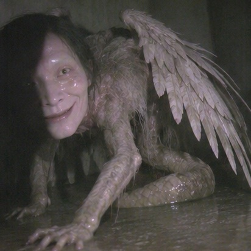
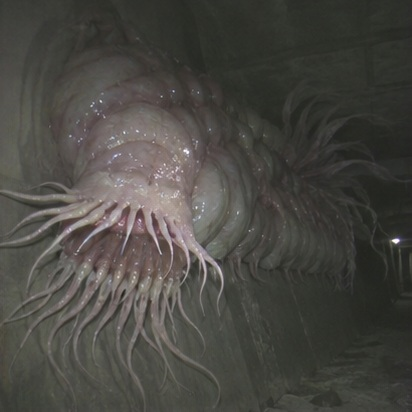

# 🏔️ 《山海經》純怪獸與妖怪圖鑑・卷 05〈中山經〉

[👹 妖怪篇總綱](../00-妖怪篇總綱與圖鑑分級.md) ｜ [📖 山海經總錄](./00-山海經怪獸妖怪總錄.md) ｜ [⬅️ 卷03～04](./03-卷03至04_北山經與東山經.md) ｜ [➡️ 海外四經](./05-卷06至09_海外四經.md)

---

## 🗺️ 本卷導覽與收錄界線（純怪獸・蟲怪・偽人專卷）

〈中山經〉為《五藏山經》篇幅最龐大的一卷，涵蓋**中次一經至中次十二經**共十二條山脈、一百九十七座山川，貫穿中原伊洛、荊楚江漢、巴蜀岷江至瀟湘洞庭。在本作現代都市靈異世界觀中，中原靈脈被道門暗稱為「**中州濕窟系譜**」——此系妖物極度依附地下水網、石灰岩溶洞、古墓積水與潮濕地層，當靈脈沿斷層遷徙至台灣後，最常盤踞於都市箱涵、捷運廢棄聯絡道、山區滲水隧道、老舊醫院地下室與河岸淤泥中。

> [!IMPORTANT]
> **純妖怪收錄鐵律（2026-11-21 定案）**：本卷**嚴格剔除**原典中一切純神祇、帝女、天帝使者與十二山經篇末之純祭祀山神，包括：**神熏池**（敖岸山）、**神武羅**（青要山）、**吉神泰逢**（和山）、**帝臺**（休與山・鼓鐘山）、**帝女女尸**（姑媱山）、**神𧕛圍**（驕山）、**神計蒙**（光山）、**神涉𧕛**（岐山）、**熊穴神人**（熊山）、**神耕父**（豐山）、**神于兒**（夫夫山）、**帝之二女**（洞庭山）、**洞庭載蛇怪神**，以及各經末總敘之祭祀山神群。  
> **例外考訂說明**：平逢山「**驕蟲**」（實乃二首群蜂毒蟲母巢）與堵山「**天愚**」（盤踞怪風雨之盲目腐蝕魔體）雖於原典遭古人敬畏泛稱「神」，實質為純粹毒蟲母體與災厄魔怪，依規收錄；另於卷末增設〈卷末補遺・中原異傳與跨卷關聯怪獸〉，收錄與本卷「蠪／狙／孤狐／厄鳥」血脈緊密交織之**蠪姪、傲因、鴸、狙、九尾狐系（中原支脈）**，並誠實標明其跨卷原典出處。

> **本卷統計**：正文收錄十二山經純怪獸與妖怪 **57 種**＋卷末跨卷關聯補遺 **5 種**，合計 **62 條**；已嵌入真實圖檔 **2 張**（`SHX05-化蛇.jpg`、`SHX08-蠪侄.jpg`），其餘 60 條預留補繪圖位。

---

## 📋 本卷怪獸與妖怪速查表（全 62 條）

| 編號 | 名稱 | 所屬山經・出處 | 造型路線 | 稀有度 | 配圖 |
| :---: | :--- | :--- | :---: | :---: | :---: |
| `SHJ05-001` | 㔮（文題𤠢鼠） | 中次一經・甘棗之山 | `非人生物恐怖型` | `★ 凡級（N）` | 待補繪 |
| `SHJ05-002` | 豪魚 | 中次一經・渠豬之山 | `非人生物恐怖型` | `★ 凡級（N）` | 待補繪 |
| `SHJ05-003` | 飛魚（勞水株） | 中次一經・牛首之山 | `非人生物恐怖型` | `★ 凡級（N）` | 待補繪 |
| `SHJ05-004` | 朏朏 | 中次一經・霍山 | `非人生物恐怖型` | `★★ 稀級（R）` | 待補繪 |
| `SHJ05-005` | 鳴蛇 | 中次二經・鮮山（兼中次十一經帝囷山） | `非人生物恐怖型` | `★★★★ 絕級（SSR）` | 待補繪 |
| `SHJ05-006` | **化蛇** | 中次二經・陽山 | `類人偽人型` | `★★★★ 絕級（SSR）` | ✅ 已收錄 |
| `SHJ05-007` | 蠪蚳 | 中次二經・昆吾之山 | `非人生物恐怖型` | `★★ 稀級（R）` | 待補繪 |
| `SHJ05-008` | **馬腹** | 中次二經・蔓渠之山 | `類人偽人型` | `★★★ 珍級（SR）` | 待補繪 |
| `SHJ05-009` | **夫諸** | 中次三經・敖岸之山 | `非人生物恐怖型` | `★★★ 珍級（SR）` | 待補繪 |
| `SHJ05-010` | 駕鳥 | 中次三經・青要之山 | `非人生物恐怖型` | `★ 凡級（N）` | 待補繪 |
| `SHJ05-011` | 僕纍與蒲盧 | 中次三經・青要之山（墠渚） | `非人生物恐怖型` | `★★ 稀級（R）` | 待補繪 |
| `SHJ05-012` | 鴢 | 中次三經・青要之山（畛水） | `非人生物恐怖型` | `★★ 稀級（R）` | 待補繪 |
| `SHJ05-013` | 赤文飛魚（正回株） | 中次三經・騩山 | `非人生物恐怖型` | `★★ 稀級（R）` | 待補繪 |
| `SHJ05-014` | 䴦 | 中次四經・扶豬之山 | `類人偽人型` | `★★ 稀級（R）` | 待補繪 |
| `SHJ05-015` | 犀渠 | 中次四經・釐山 | `非人生物恐怖型` | `★★★ 珍級（SR）` | 待補繪 |
| `SHJ05-016` | 虪 | 中次四經・釐山（滽滽之水） | `非人生物恐怖型` | `★★ 稀級（R）` | 待補繪 |
| `SHJ05-017` | 浮濠人魚 | 中次四經・熊耳之山（兼傅山／陽華／朝歌／葴山） | `類人偽人型` | `★★ 稀級（R）` | 待補繪 |
| `SHJ05-018` | 羬羊與赤鷩 | 中次四經・柄山／牡山 | `非人生物恐怖型` | `★ 凡級（N）` | 待補繪 |
| `SHJ05-019` | 䲦鳥 | 中次五經・首山（機谷） | `非人生物恐怖型` | `★★ 稀級（R）` | 待補繪 |
| `SHJ05-020` | **驕蟲** | 中次六經・平逢之山 | `類人偽人型` | `★★★★ 絕級（SSR）` | 待補繪 |
| `SHJ05-021` | 鴒䳭 | 中次六經・廆山（雚谷） | `非人生物恐怖型` | `★★ 稀級（R）` | 待補繪 |
| `SHJ05-022` | 旋龜（豪水株） | 中次六經・密山（豪水） | `非人生物恐怖型` | `★★ 稀級（R）` | 待補繪 |
| `SHJ05-023` | 脩辟魚 | 中次六經・橐山（橐水） | `非人生物恐怖型` | `★ 凡級（N）` | 待補繪 |
| `SHJ05-024` | **山膏** | 中次七經・苦山 | `非人生物恐怖型` | `★★ 稀級（R）` | 待補繪 |
| `SHJ05-025` | 天愚 | 中次七經・堵山 | `非人生物恐怖型` | `★★★★ 絕級（SSR）` | 待補繪 |
| `SHJ05-026` | 文文 | 中次七經・放皋之山 | `非人生物恐怖型` | `★★ 稀級（R）` | 待補繪 |
| `SHJ05-027` | 三足龜 | 中次七經・大苦之山（狂水） | `非人生物恐怖型` | `★★ 稀級（R）` | 待補繪 |
| `SHJ05-028` | 鯩魚 | 中次七經・半石之山（來需之水） | `非人生物恐怖型` | `★ 凡級（N）` | 待補繪 |
| `SHJ05-029` | 鰧魚（䲀魚） | 中次七經・半石之山（合水） | `非人生物恐怖型` | `★ 凡級（N）` | 待補繪 |
| `SHJ05-030` | 䱱魚 | 中次七經・少室之山（休水） | `非人生物恐怖型` | `★★ 稀級（R）` | 待補繪 |
| `SHJ05-031` | 文魚 | 中次八經・景山（雎水） | `非人生物恐怖型` | `★ 凡級（N）` | 待補繪 |
| `SHJ05-032` | 鮫魚 | 中次八經・荊山（漳水） | `非人生物恐怖型` | `★★★ 珍級（SR）` | 待補繪 |
| `SHJ05-033` | **鴆鳥** | 中次八經・女几山／琴鼓山（兼玉山・瑤碧山） | `非人生物恐怖型` | `★★★ 珍級（SR）` | 待補繪 |
| `SHJ05-034` | 犳 | 中次八經・銅山 | `非人生物恐怖型` | `★★ 稀級（R）` | 待補繪 |
| `SHJ05-035` | 夔牛 | 中次九經・岷山／崌山 | `非人生物恐怖型` | `★★★★ 絕級（SSR）` | 待補繪 |
| `SHJ05-036` | 崌山怪蛇與䲀魚 | 中次九經・崌山（江水） | `非人生物恐怖型` | `★★ 稀級（R）` | 待補繪 |
| `SHJ05-037` | 竊脂 | 中次九經・崌山 | `非人生物恐怖型` | `★★ 稀級（R）` | 待補繪 |
| `SHJ05-038` | 𤜣狼 | 中次九經・蛇山 | `非人生物恐怖型` | `★★★ 珍級（SR）` | 待補繪 |
| `SHJ05-039` | **跂踵** | 中次十經・復州之山 | `非人生物恐怖型` | `★★★★ 絕級（SSR）` | 待補繪 |
| `SHJ05-040` | 翼望・畢山・宣山之蛟 | 中次十一經・翼望／畢山／葴山／宣山 | `非人生物恐怖型` | `★★★ 珍級（SR）` | 待補繪 |
| `SHJ05-041` | 雍和 | 中次十一經・豐山 | `類人偽人型` | `★★★ 珍級（SR）` | 待補繪 |
| `SHJ05-042` | 嬰勺 | 中次十一經・支離之山 | `非人生物恐怖型` | `★★ 稀級（R）` | 待補繪 |
| `SHJ05-043` | 青耕 | 中次十一經・堇理之山 | `非人生物恐怖型` | `★★ 稀級（R）` | 待補繪 |
| `SHJ05-044` | 獜 | 中次十一經・依軲之山 | `非人生物恐怖型` | `★★ 稀級（R）` | 待補繪 |
| `SHJ05-045` | 三足鱉 | 中次十一經・從山（從水） | `非人生物恐怖型` | `★★ 稀級（R）` | 待補繪 |
| `SHJ05-046` | 𤟑（音戾） | 中次十一經・樂馬之山 | `非人生物恐怖型` | `★★★ 珍級（SR）` | 待補繪 |
| `SHJ05-047` | 頡 | 中次十一經・葴山（視水） | `非人生物恐怖型` | `★★ 稀級（R）` | 待補繪 |
| `SHJ05-048` | 狙如 | 中次十一經・倚帝之山 | `非人生物恐怖型` | `★★★ 珍級（SR）` | 待補繪 |
| `SHJ05-049` | 移即 | 中次十一經・鮮山 | `非人生物恐怖型` | `★★★ 珍級（SR）` | 待補繪 |
| `SHJ05-050` | 梁渠 | 中次十一經・歷石之山 | `非人生物恐怖型` | `★★★ 珍級（SR）` | 待補繪 |
| `SHJ05-051` | 䳅鵌（𩢢餘） | 中次十一經・丑陽之山 | `非人生物恐怖型` | `★★ 稀級（R）` | 待補繪 |
| `SHJ05-052` | 聞獜 | 中次十一經・几山 | `非人生物恐怖型` | `★★★ 珍級（SR）` | 待補繪 |
| `SHJ05-053` | 洞庭怪鳥 | 中次十二經・洞庭之山 | `非人生物恐怖型` | `★★ 稀級（R）` | 待補繪 |
| `SHJ05-054` | 䱔與就 | 中次十二經・暴山 | `非人生物恐怖型` | `★★ 稀級（R）` | 待補繪 |
| `SHJ05-055` | 蛫 | 中次十二經・即公之山 | `非人生物恐怖型` | `★★ 稀級（R）` | 待補繪 |
| `SHJ05-056` | 白蛇與飛蛇 | 中次十二經・柴桑之山 | `非人生物恐怖型` | `★★★ 珍級（SR）` | 待補繪 |
| `SHJ05-057` | 榮余怪蛇與怪蟲 | 中次十二經・榮余之山 | `非人生物恐怖型` | `★★★★ 絕級（SSR）` | 待補繪 |
| `SHJ05-A01` | **蠪姪** | 卷末補遺（原典東次二經・鳧麗之山） | `非人生物恐怖型` | `★★★★ 絕級（SSR）` | ✅ 已收錄 |
| `SHJ05-A02` | 傲因（獓𤝱） | 卷末補遺（原典西次三經三危山／《神異經》） | `類人偽人型` | `★★★★ 絕級（SSR）` | 待補繪 |
| `SHJ05-A03` | 鴸 | 卷末補遺（原典南次二經・櫃山） | `類人偽人型` | `★★★ 珍級（SR）` | 待補繪 |
| `SHJ05-A04` | 狙 | 卷末補遺（中次九／十一經狙屬跨考） | `類人偽人型` | `★★ 稀級（R）` | 待補繪 |
| `SHJ05-A05` | 九尾狐系（中原支脈） | 卷末補遺（青丘入中原變異株） | `類人偽人型` | `★★★★ 絕級（SSR）` | 待補繪 |

---

## 🕳️ 一、中次一經（薄山之首：甘棗之山 → 鼓鐙之山，凡 15 山）

### [SHJ05-001] 㔮（文題𤠢鼠／甘棗額紋鼠蟲怪）
- **出處順序**：卷05〈中山經〉・中次一經・甘棗之山
- **類別與造型路線**：`【非人生物恐怖型】`｜腐食甲蟲化寄生鼠怪
- **物種／唯一性**：`物種（群體）`｜原典明言可捕食入藥，屬成群繁衍於濕穴的地底怪鼠種群。
- **稀有度與道行對照**：`★ 凡級（N）`｜數年至十餘年淺妖氣、底層寄生妖蟲層級｜本作階位：未入流～三流
- **外貌與黑暗地牢／恐怖谷視覺改寫**：
  - <!-- 圖位預留：待補繪 -->
  - 【原典外貌】「有獸焉，其狀如𤠢鼠而文題，其名曰㔮，食之已癭。」形體宛如瘦小毒鼠，額頭生有奇異花紋。
  - 【本作克蘇魯／昆蟲寄生／偽人重構】徹底剝離毛絨鼠類觀感，軀幹包覆濕亮黑褐色幾丁質甲片，背脊層疊如腐食埋葬蟲般可張合的鞘翅縫隙。額頭所謂「文題」並非毛色，而是嵌在顱骨表面、不斷收縮搏動的環形齒狀吸盤與甲蟲複眼排紋；口吻向前延伸為三瓣縱裂的蚊蟲式吸血口針，四肢關節反折如馬陸步足，趾爪沾滿發酵膿液。黑白墨線以高反差留白強調濕黏甲殼反光與額面同心吸盤紋。
- **特性**：
  - 【原典記載】食其肉可治「癭」（頸部腫瘤與甲狀腺腫大）。
  - 【本作衍生】㔮體內分泌高濃度「溶瘤消化酶」，黑市常活抓剖腹取腺體製成偏方；然其血肉藏有休眠蟲卵，凡吞食未經陽火炙透之㔮肉者，三日後頸部雖消腫，氣管壁卻會鑽出成排乳白色幼蟲反噬宿主。
- **弱點**：
  - 【原典記載】原典未載。
  - 【本作衍生】額面吸盤為神經中樞所在，畏懼強乾燥熱氣與生石灰；以「炙陽符」點燃酒精噴霧可令其幾丁質甲殼爆裂碳化。
- **習性**：
  - 【原典記載】棲於甘棗之山，臨近共水，與藥草「籜」共生於陰坡。
  - 【本作衍生】現代潛伏於老舊市場魚肉攤下的暗溝、醫院醫療廢棄物暫存間與滲水地下室，深夜成群沿冷氣排水管爬入熟睡者臥室，專以口針刺入人類頸部血管與囊腫吸食淋巴液。
- **喜好**：
  - 【原典記載】原典未載。
  - 【本作衍生】極度偏好腐敗蛋白質、腫瘤組織液與發霉的堅果殘渣，對碘味與濃重中藥苦味有強烈趨性。
- **擅長的招式／異能**：
  - 【原典記載】原典未載。
  - 【本作衍生】「額盤嚙吸」：躍上獵物咽喉以額頭齒狀吸盤死鎖氣管，同步釋放麻醉酶；「鞘縫吐卵」：瀕死時震開背甲噴射沾黏蟲卵的酸臭黏液。

### [SHJ05-002] 豪魚（赤喙赤羽鮪怪）
- **出處順序**：卷05〈中山經〉・中次一經・渠豬之山（渠豬之水）
- **類別與造型路線**：`【非人生物恐怖型】`｜毒針甲殼環節水怪
- **物種／唯一性**：`物種（群體）`｜原文稱「其中是多豪魚」，為河道群聚型水生蟲魚怪。
- **稀有度與道行對照**：`★ 凡級（N）`｜淺妖氣河溝妖魚｜本作階位：未入流～三流
- **外貌與黑暗地牢／恐怖谷視覺改寫**：
  - <!-- 圖位預留：待補繪 -->
  - 【原典外貌】「其中是多豪魚，狀如鮪，赤喙尾赤羽，可以已白癬。」身形如大型鮪魚，卻長著猩紅鳥喙，尾鰭與體側披覆血紅色硬羽。
  - 【本作克蘇魯／昆蟲寄生／偽人重構】無魚鱗，取而代之的是節節相扣的濕滑環節肉軀與發黑甲殼，體側與尾部的「赤羽」實為密密麻麻、中空充血的毒刺管與毛刺狀剛毛，在黑水中如海葵觸手與水蛭般無序擺動。吻部裂開為角質硬化的血紅鳥喙，喙內排滿七層向內倒鉤的七鰓鰻式環形牙齒，鰓裂間不斷滲出暗紅鐵鏽狀寄生黏液。
- **特性**：
  - 【原典記載】食之可治癒頑固「白癬」（皮膚真菌病變與白斑）。
  - 【本作衍生】其赤羽毒刺能啃食表皮角質與真菌，卻會同步把「血線幼蟲」注入微血管；受寄生者患處表皮異常光潔，皮下卻隱約可見紅線游走。
- **弱點**：
  - 【原典記載】原典未載。
  - 【本作衍生】離水超過十分鐘即因剛毛缺水乾縮而喪失推進力；對銅離子與高壓電擊極度敏感，都市除妖師常以蓄電池改裝電魚桿配鎮水符清剿。
- **習性**：
  - 【原典記載】棲息於渠豬之水，隨河水南流注於黃河。
  - 【本作衍生】群聚於都會區抽水站沉砂池、廢棄泳池積水與工業區黑水溝，喜於暴雨淹水夜順著排水孔鑽入地下停車場噬咬涉水行人腳踝。
- **喜好**：
  - 【原典記載】原典未載。
  - 【本作衍生】嗜食腐敗皮屑、溺水動物屍體與帶有皮膚病潰爛氣味的活體血液。
- **擅長的招式／異能**：
  - 【原典記載】原典未載。
  - 【本作衍生】「赤刺旋絞」：捲動環節尾軀在水中捲出旋渦，以充血中空剛毛割裂獵物小腿；「倒喙鎖咬」：咬住皮肉後閉合角質喙並反向旋轉扯下整塊血肉。

### [SHJ05-003] 飛魚（勞水鮒形翼魚怪）
- **出處順序**：卷05〈中山經〉・中次一經・牛首之山（勞水）
- **類別與造型路線**：`【非人生物恐怖型】`｜蚊蠅膜翅集群寄生魚怪
- **物種／唯一性**：`物種（群體）`｜原文稱「是多飛魚」，以數百隻為單位成群滑翔獵食。
- **稀有度與道行對照**：`★ 凡級（N）`｜底層群聚飛蟲化妖魚｜本作階位：未入流（集群可威脅三流）
- **外貌與黑暗地牢／恐怖谷視覺改寫**：
  - <!-- 圖位預留：待補繪 -->
  - 【原典外貌】「勞水出焉，而西流注于潏水。是多飛魚，其狀如鮒魚，食之已痔衕。」外型似鯽魚而能躍水飛翔。
  - 【本作克蘇魯／昆蟲寄生／偽人重構】形體雖如巴掌大的扁平鯽魚，兩側胸鰭卻異化為兩對佈滿黑脈的半透明蒼蠅膜翅，振翅時發出令人牙酸的高頻蚊蚋嗡鳴。魚眼完全替換成隆起發白的灰黑複眼，魚嘴張開後伸出細長可彎折的產卵吸管，腹鰭下垂數條半透明水螅觸絲，滴落腐臭污水。整群在黑暗涵洞中掠過時宛如一片會反光的濕爛飛蝗群。
- **特性**：
  - 【原典記載】食用可治「痔衕」（痔瘡與下痢腸疾）。
  - 【本作衍生】飛魚能從濕潤黏膜處鑽入大型動物腸道寄生，靠吞噬腸壁靜脈叢維生，古人誤以為生吞其乾屍能「以蟲噬痔」，實則極易引發致命的腹腔穿孔。
- **弱點**：
  - 【原典記載】原典未載。
  - 【本作衍生】膜翅極薄，遇細密防蚊網、高溫蒸氣或強效除蟲菊煙霧即成片墜落抽搐；強光閃光燈可瞬間癱瘓其複眼導航。
- **習性**：
  - 【原典記載】群居於牛首山勞水與潏水交匯處，鄰近生長「鬼草」。
  - 【本作衍生】盤據老舊社區化糞池通氣孔、捷運地下機房積水區與夜釣黑水潭，逢悶熱夏夜成群衝出水面撲向發熱活體。
- **喜好**：
  - 【原典記載】原典未載。
  - 【本作衍生】偏愛沼氣、糞水發酵味與人體排泄孔散發的濕熱體溫。
- **擅長的招式／異能**：
  - 【原典記載】躍水飛翔。
  - 【本作衍生】「複眼蜂湧」：數十隻同步高速俯衝撞擊目標口鼻眼耳；「黏膜鑽刺」：以細長吸管刺破軟組織注入麻痺唾液並產下微卵。

### [SHJ05-004] 朏朏（霍山白尾鬣狸寄生怪）
- **出處順序**：卷05〈中山經〉・中次一經・霍山
- **類別與造型路線**：`【非人生物恐怖型】`｜神經寄生毛絲蟲獸
- **物種／唯一性**：`物種（群體）`｜原文云「養之可以已憂」，暗示此物曾被人為捕獲豢養，屬可繁衍物種。
- **稀有度與道行對照**：`★★ 稀級（R）`｜數十年成精之精神寄生妖獸｜本作階位：二流
- **外貌與黑暗地牢／恐怖谷視覺改寫**：
  - <!-- 圖位預留：待補繪 -->
  - 【原典外貌】「有獸焉，其狀如狸，而白尾有鬛，名曰朏朏，養之可以已憂。」形似野貓狸獸，拖著一條慘白長尾，頸背披著一圈鬣毛。
  - 【本作克蘇魯／昆蟲寄生／偽人重構】絕非傳說中的療癒萌寵！外殼呈瘦骨嶙峋的無毛灰紫狸軀，體表覆滿濕亮黏膜與細小呼吸氣孔；頸項那圈「鬣毛」實為上百條微微蠕動的蒼白細長線蟲觸鬚，而身後膨大垂墜的「白尾」則是一條半透明、內部清晰可見成千上萬枚米粒狀幼蟲翻湧的巨型產卵囊！當牠蹭近人類小腿撒嬌時，肋骨間會裂開多對蜘蛛狀細足死緊鉤住布料，眼窩裡沒有貓瞳，只有兩顆不斷滲出乳白致幻黏液的複眼肉球。
- **特性**：
  - 【原典記載】飼養在身邊可以消除人的憂愁與煩惱。
  - 【本作衍生】「已憂」的殘酷真相是**神經毒素致幻寄生**：朏朏透過細蟲鬚將微量致幻神經肽滲入飼主皮膚，徹底麻痺大腦的恐懼與悲傷迴路，使飼主陷入永恆呆滯的傻笑，甚至在自己胸腹被朏朏的白尾產卵囊蛀空時仍面帶幸福微笑撫摸牠。
- **弱點**：
  - 【原典記載】原典未載。
  - 【本作衍生】神經毒素需靠潮濕接觸傳導，配戴「清心醒神符」或以濃烈薄荷、艾草煙燻可切斷致幻氣味；只要一刀斬斷其背後膨大的白色產卵尾囊，本體便會劇烈痙攣失能。
- **習性**：
  - 【原典記載】棲息於多穀木的霍山林間。
  - 【本作衍生】極善鎖定孤獨、重度憂鬱的都市獨居者，常蜷縮在老舊套房門口、深夜寵物收容所外巷或天橋陰影下發出微弱貓叫，誘使人心軟抱回家中「收編」。
- **喜好**：
  - 【原典記載】原典未載。
  - 【本作衍生】極度沉迷人類絕望與孤獨時散發的皮質醇汗味，喜歡舔舐飼主淚痕與手腕舊傷口。
- **擅長的招式／異能**：
  - 【原典記載】養之已憂。
  - 【本作衍生】「極樂毒鬚」：甩動頸部線蟲鬣毛噴灑無色致幻霧氣，令目標放下武器原地發呆；「白囊寄巢」：將白色產卵尾尖插進昏迷者耳道或肚臍直接注卵。

---

## 🐍 二、中次二經（濟山之首：煇諸之山 → 蔓渠之山，凡 9 山）

### [SHJ05-005] 鳴蛇（四翼旱災巨蛇）
- **出處順序**：卷05〈中山經〉・中次二經・鮮山（鮮水；另複見於中次十一經・帝囷之山）
- **類別與造型路線**：`【非人生物恐怖型】`｜四翅蝗蟲甲殼旱災巨蜈蛇
- **物種／唯一性**：`物種（群體）`｜鮮水與帝囷水皆記「其中多鳴蛇」，屬災厄級上古群居巨怪。
- **稀有度與道行對照**：`★★★★ 絕級（SSR）`｜千年大妖災體、可令一城赤地千里｜本作階位：一流頂～巔峰
- **外貌與黑暗地牢／恐怖谷視覺改寫**：
  - <!-- 圖位預留：待補繪 -->
  - 【原典外貌】「其中多鳴蛇，其狀如蛇而四翼，其音如磬，見則其邑大旱。」身如巨蛇卻背生兩對四翼，鳴叫聲清脆震耳宛如古玉磐石相擊，一現身便會引發大旱。
  - 【本作克蘇魯／昆蟲寄生／偽人重構】徹底拋棄傳統龍蛇鱗片，改以長逾十公尺、由數百節乾裂黑褐幾丁質構成的巨型蜈蚣與腐殖水蛭混合軀幹為主體；背脊前後裂開四片長滿焦黑脈紋、如巨型蝗蟲與乾枯蜻蜓般的硬質角膜翼，振翅摩擦甲殼時發出金屬敲擊石磬般的刺耳「錚——錚——」高頻共振。蛇首沒有下顎，而是裂開成四瓣佈滿倒刺的乾渴吸盤口器，每一節腹甲縫隙都長出細密乾縮氣管，瘋狂抽乾周遭數公里內的水汽與活體體液。
- **特性**：
  - 【原典記載】鳴聲如敲石磬，所現之地必降大旱。
  - 【本作衍生】體內具備極端強化的「吸濕甲殼器官」，每逢振翅便引發局部高壓熱風與劇烈脫水，凡暴露於其磬音範圍內的人類，五分鐘內眼球乾裂、喉管纖維化，最後化為蜷縮的乾屍標本。
- **弱點**：
  - 【原典記載】原典未載。
  - 【本作衍生】四片硬質蟲翼為其抽濕與共鳴的關鍵引擎，最畏極寒液態水柱與高壓水砲灌注其腹甲氣孔；以「玄冥鎮水陣」配乾冰霧封鎖音域，可迫使其因過熱甲殼自爆。
- **習性**：
  - 【原典記載】潛伏於無草木、多金玉之鮮山鮮水，以及上出下潛的帝囷之水。
  - 【本作衍生】枯水期時盤踞在乾涸水庫底層淤泥裂縫、地下大型電纜共同管道與發電廠高溫排風井內冬眠，逢台灣中南部酷暑缺水時破土飛出。
- **喜好**：
  - 【原典記載】原典未載。
  - 【本作衍生】偏愛酷熱、強靜電與高壓變電所的焦灼臭氧味，嗜吸乾渴瀕死活物的最後一口脊髓液。
- **擅長的招式／異能**：
  - 【原典記載】其音如磬，見則大旱。
  - 【本作衍生】「磬鳴奪水」：四翼高速對撞發出超低頻與高頻混合石磬震波，瞬間蒸發半徑百公尺內一切水分與血漿；「焦殼俯衝」：收攏四翼化作灼熱甲殼鑽頭撞穿混凝土掩體。

### [SHJ05-006] 化蛇（陽山水災偽人翼蛇怪）
- **出處順序**：卷05〈中山經〉・中次二經・陽山（陽水）
- **類別與造型路線**：`【類人偽人型】`｜偽人面孔・水蛭翼蛇災厄體
- **物種／唯一性**：`物種（群體）`｜原文稱「其中多化蛇」，與鳴蛇一旱一澇互為表裡災厄族群。
- **稀有度與道行對照**：`★★★★ 絕級（SSR）`｜千年水災大妖、單體足以令都會淹沒淪陷｜本作階位：一流頂～巔峰
- **外貌與黑暗地牢／恐怖谷視覺改寫**：
  - 
  - 【原典外貌】「其中多化蛇，其狀如人面而豺身，鳥翼而蛇行，其音如叱呼，見則其邑大水。」長著一張人臉、瘦長如豺狗的軀體、背生鳥翼卻貼地如蛇扭動前行，叫聲似人嚴厲叱喝，現身則必發大水。
  - 【本作克蘇魯／昆蟲寄生／偽人重構】極致**恐怖谷偽人 × 濕爛軟體寄生怪**的巔峰造物！牠的臉龐極像溺水浮腫三日卻仍睜大雙眼的無表情中年人臉，皮膚慘白泡爛，雙眼無睫毛卻透出蒼蠅般的細密複眼微光，嘴角永遠微微下垂並僵硬張合模仿人類怒斥聲。臉皮頸緣以下猛然撕裂，露出一具如脫毛腐豺般肋骨外凸、佈滿濕亮黑水蛭環節與幾丁質關節的畸形長軀；背部生出一對羽毛稀疏脫落、全由濕軟皮膜與寄生藤壺黏附的腐蝕羽翼，四肢嚴重萎縮反折，只靠胸腹下成排沾滿黑泥的環形吸盤與多足剛毛在積水地面「蛇行」蠕動，所過處留下一道腥臭黑油與漲勢洶洶的暴雨積水。
- **特性**：
  - 【原典記載】音如叱呼，現身則其邑大水氾濫。
  - 【本作衍生】化蛇能模仿失蹤親人或防災人員的急促「叱呼」聲（「快下來！這邊安全！」），將受困豪雨的民眾誘入淹水地下室或堤防缺口；其皮下水囊可無限引動地下水脈倒灌，並釋放大量噬肉水蛭幼蟲。
- **弱點**：
  - 【原典記載】原典未載。
  - 【本作衍生】偽人臉皮是牠唯一的發聲與控水器官，只要以陽火符或炙熱鐵器灼毀人面皮囊，其暴雨領域會瞬間崩潰；極度畏懼大量食鹽、高溫石灰與「九陽鎮洪符」。
- **習性**：
  - 【原典記載】棲於多石無草木之陽山陽水，隨水流注入伊水。
  - 【本作衍生】颱風豪雨夜沿基隆河、淡水河與都會區雨水下水道逆流潛入，最愛潛伏在地下三樓淹水車道與立體停車場的黑暗角落，僅將浮腫蒼白的「人臉」露出渾濁水面朝路人厲聲呼喊。
- **喜好**：
  - 【原典記載】原典未載。
  - 【本作衍生】酷愛陰雨連綿的極端低氣壓、溺死者肺部排出的最後一口氣泡，以及受驚人類慌亂逃竄時濺起的水花聲。
- **擅長的招式／異能**：
  - 【原典記載】鳥翼蛇行、音如叱呼、見則大水。
  - 【本作衍生】「叱呼誘溺」：人面裂開至耳根發出具精神威壓的偽人怒吼，強迫聽者雙腿失控步入深水；「濁浪蛇湧」：展開腐爛皮翼掀起夾帶大量水蛭的黑色洪峰沖垮地基與結界。

### [SHJ05-007] 蠪蚳（昆吾角彘蟲獸）
- **出處順序**：卷05〈中山經〉・中次二經・昆吾之山
- **類別與造型路線**：`【非人生物恐怖型】`｜獨角兜蟲化腐食豬怪
- **物種／唯一性**：`物種（群體）`｜原典明言「食之不眯」，屬棲息礦山之群居蟲獸。
- **稀有度與道行對照**：`★★ 稀級（R）`｜數十年成精之重甲礦坑妖蟲｜本作階位：二流
- **外貌與黑暗地牢／恐怖谷視覺改寫**：
  - <!-- 圖位預留：待補繪 -->
  - 【原典外貌】「有獸焉，其狀如彘而有角，其音如號，名曰蠪蚳，食之不眯。」體型似野豬而頭生硬角，叫聲宛如人放聲哀號。
  - 【本作克蘇魯／昆蟲寄生／偽人重構】「蠪」字從虫、「蚳」為蟻卵——本作將其徹底還原為巨型腐食兜蟲與白蟻后腹囊的恐怖結合體！原本豬軀被厚重、生滿青銅綠鏽斑點的黑甲殼取代，頭頂裂出一根分叉帶鋸齒的漆黑鍬形大顎角；腹部下垂膨脹如半透明白蟻后，肉膜內翻湧著密密麻麻的發亮蟲卵。牠沒有聲帶，所謂「其音如號」是透過背甲磨擦銅礦粉與腹部氣門強行擠出的悽厲哭號，彷彿被活埋礦工的最後哀鳴。
- **特性**：
  - 【原典記載】吃牠的肉可令人「不眯」（不做噩夢、免遭鬼壓床與魘魅侵擾）。
  - 【本作衍生】蠪蚳腦腺分泌能徹底抹除快速動眼期的抑夢神經素，黑市將其乾燥卵囊磨粉當作「無夢鎮定劑」販賣；但長期服用者雖不再做夢，大腦卻會被蠪蚳幼蟲慢慢吃空成為行屍走肉。
- **弱點**：
  - 【原典記載】原典未載。
  - 【本作衍生】重甲僅護背脊，膨大垂地的半透明白蟻腹囊毫無防禦力；翻轉其身體後以純鋼銳器或雷符猛刺軟腹即可一擊斃命。
- **習性**：
  - 【原典記載】盤據盛產赤銅的昆吾之山，善挖地洞。
  - 【本作衍生】潛伏於金瓜石、九份廢棄銅礦坑與都會區地下捷運施工廢棄豎井，喜吞食含銅電纜線與生鏽金屬管，夜間發出酷似受困礦工的悽厲嚎叫吸引搜救者深入礦道。
- **喜好**：
  - 【原典記載】棲於多赤銅之山，與銅礦息息相關。
  - 【本作衍生】極愛啃咬高純度紅銅電線、生鏽銅錢與帶有恐懼情緒的活體骨髓。
- **擅長的招式／異能**：
  - 【原典記載】其音如號。
  - 【本作衍生】「掘地哀號」：藉礦坑回音放大哭號聲震散除妖師心神，製造失足墜坑的幻覺；「銅角衝撞」：以滿佈銅鏽的鋸齒巨角發動裝甲車般的狹道突刺。

### [SHJ05-008] 馬腹（蔓渠嬰啼偽人虎怪）
- **出處順序**：卷05〈中山經〉・中次二經・蔓渠之山（伊水之源）
- **類別與造型路線**：`【類人偽人型】`｜恐怖谷偽人面・皮下節肢虎軀怪
- **物種／唯一性**：`物種（群體）`｜蔓渠山與伊水流域之致命食人怪獸族群。
- **稀有度與道行對照**：`★★★ 珍級（SR）`｜數百年道行、將整片流域或社區化為獵場的食人妖王｜本作階位：二流頂～一流
- **外貌與黑暗地牢／恐怖谷視覺改寫**：
  - <!-- 圖位預留：待補繪 -->
  - 【原典外貌】「有獸焉，其名曰馬腹，其狀如人面虎身，其音如嬰兒，是食人。」長著人類的臉龐、猛虎般的身軀，鳴聲酷似嬰兒哭啼，專以人類為食。
  - 【本作克蘇魯／昆蟲寄生／偽人重構】極具壓迫感的**偽人虎蟲捕食者**！牠的臉是一張蒼白無血色、五官過於對稱的「人類面孔」，額頭與兩頰緊繃著一層蠟質死皮，雙眼幾乎不眨，眼角微微抽搐並泛出暗紅複眼點陣；當牠開口發出「哇——哇——」如初生嬰兒般的尖銳哭啼時，整張人臉會從鼻樑正中縱向裂開，露出一圈螳螂與七鰓鰻混合的鋸齒顎骨與滴酸長舌！人頭之下的「虎身」絕非柔順皮毛，而是由粗壯暗黑幾丁質板塊拼接成的節肢掠食軀，背脊條紋是一道道深裂滲出黑油的甲殼縫隙，縫隙中藏有數十隻抓握細肢；四足末端為反折的巨型螳螂鐮刀前肢，趾關節間還卡著未消化完的受害者鎖骨與人指殘骸。
- **特性**：
  - 【原典記載】聲如嬰兒啼哭，專事食人。
  - 【本作衍生】馬腹能完美複製剛出生的嬰兒哭聲甚至產婦的微弱求救聲，誘使抱持母性或善意的路人靠近暗處；其口腔唾液含強效麻痺蛋白酶，被舔到一滴即四肢僵直，清醒目睹自己被從腹部剖開進食。
- **弱點**：
  - 【原典記載】原典未載。
  - 【本作衍生】因過度依賴聽覺與偽聲誘捕，最懼高分貝震盪音波（如法器銅鑼、閃光震撼彈）；臉部縱裂發動咬擊瞬間，其內部柔軟粉紅的偽聲氣囊會完全裸露，為唯一一擊必殺破口。
- **習性**：
  - 【原典記載】出沒於蔓渠之山與伊水發源地的竹箭叢中。
  - 【本作衍生】在台灣常潛伏於老舊婦產科廢棄大樓、深夜河堤竹林、山區無人公廁與昏暗地下道，趴伏於排水管陰影裡發出嬰兒啼哭，待善心人俯身查看時暴起以鐮肢攔腰截斷。
- **喜好**：
  - 【原典記載】是食人（嗜食人肉）。
  - 【本作衍生】特別偏愛深夜落單女性與醫護人員身上的消毒水混血腥味，會將吞剩的嬰兒衣物或人偶堆在巢穴當作「誘餌陳列品」。
- **擅長的招式／異能**：
  - 【原典記載】其音如嬰兒，是食人。
  - 【本作衍生】「泣嬰偽聲」：精準模擬 300 公尺內令人焦慮的嬰兒啼哭，並能利用牆面回聲誤導音源方向；「裂面鐮斬」：人面縱裂吐出腐蝕胃液封鎖視線，雙前肢螳螂骨鐮交叉絞殺獵物。

---

## 🦌 三、中次三經（萯山之首：敖岸之山 → 和山，凡 5 山）

> *本經純神祇剔除紀錄：神熏池（敖岸之山）、神武羅（青要之山）、吉神泰逢（和山）均依鐵律剔除不錄。*

### [SHJ05-009] 夫諸（敖岸四角白鹿寄生怪）
- **出處順序**：卷05〈中山經〉・中次三經・敖岸之山
- **類別與造型路線**：`【非人生物恐怖型】`｜冬蟲夏草菌絲寄生蒼白骨鹿怪
- **物種／唯一性**：`物種（群體）`｜原典以「有獸焉」泛稱，屬隨洪水靈脈遷徙之水災異獸種群。
- **稀有度與道行對照**：`★★★ 珍級（SR）`｜數百年道行水災凶獸、所經處暴雨決堤｜本作階位：二流頂～一流
- **外貌與黑暗地牢／恐怖谷視覺改寫**：
  - <!-- 圖位預留：待補繪 -->
  - 【原典外貌】「有獸焉，其狀如白鹿而四角，名曰夫諸，見則其邑大水。」形似白鹿，頭頂長著四支鹿角，現身則必發大水。
  - 【本作克蘇魯／昆蟲寄生／偽人重構】徹底粉碎「仙氣白鹿」幻想！牠實為一具被太古水生寄生蟲與白色肉質菌絲徹底奪舍掏空的畸形鹿形骨骸——慘白皮膚薄如浸水濕紙，緊貼肋骨與外露脊椎，皮下清晰可見無數乳白鐵線蟲糾纏蠕動。頭頂四支「鹿角」實為四條不斷分叉、滴落渾濁黏液、表面佈滿寄生吸盤與孢子孔的蒼白水螅觸手骨角！原本鹿眼已被兩叢狂長爆裂的白色寄生眼蟲頂破，四蹄裂開成多趾水蜘蛛涉水長肢，行走於積水街巷時毫無足音，只傳來潮濕肉囊擠水的「噗滋、噗滋」聲。
- **特性**：
  - 【原典記載】情性看似溫雅卻為水災凶兆，現身則其邑大水。
  - 【本作衍生】夫諸四角不斷向空氣釋放「凝雨寄生孢子」，孢子隨上升氣流催化暴雨雲層，同時令淋到雨的活物皮膚潰爛、體內滋生水生線蟲；牠並非「預告」洪水，牠本身就是引發生物水患的活體溫床。
- **弱點**：
  - 【原典記載】原典未載。
  - 【本作衍生】寄生菌絲與水生線蟲極度懼怕高濃度硫磺煙霧與乾燥明火；一旦斬斷或燒焦頭頂四支孢子骨角，降雨效應將立刻瓦解，白皮軀體會迅速腐解成一灘黑水。
- **習性**：
  - 【原典記載】出沒於敖岸之山，北望河林。
  - 【本作衍生】每逢梅雨滯留鋒面或颱風前夕，會無聲佇立於台灣山區土石流警戒河床、老舊水庫溢洪道或積水斑馬線正中央，靜靜仰頭撐開四支白角迎接豪雨。
- **喜好**：
  - 【原典記載】原典未載。
  - 【本作衍生】極度愛好暴雨沖刷後的腐木泥沼、水窪倒影，以及被雨水浸透發脹的動物屍體。
- **擅長的招式／異能**：
  - 【原典記載】見則其邑大水。
  - 【本作衍生】「四角喚澇」：四支水螅觸手角同步震顫噴發百萬凝雲孢子，十分鐘內引發局部致災性強降雨；「白絲穿骨」：從裂開的胸腔彈射數十條白色寄生線蟲鎖死目標關節。

### [SHJ05-010] 駕鳥（青要密都怪禽）
- **出處順序**：卷05〈中山經〉・中次三經・青要之山
- **類別與造型路線**：`【非人生物恐怖型】`｜群聚甲殼食腐怪禽
- **物種／唯一性**：`物種（群體）`｜原文稱「是多駕鳥」，成百上千盤據峭壁的怪鳥群。
- **稀有度與道行對照**：`★ 凡級（N）`｜淺妖氣異鳥群｜本作階位：未入流～三流
- **外貌與黑暗地牢／恐怖谷視覺改寫**：
  - <!-- 圖位預留：待補繪 -->
  - 【原典外貌】「又東十里，曰青要之山……是多駕鳥。」原典與郭璞注皆未詳其確切形貌，僅知為盤據禁山之異鳥。
  - 【本作克蘇魯／昆蟲寄生／偽人重構】以「失焦的腐食甲蟲鳥」詮釋原典之「未詳」：全身無柔羽，雙翼由重疊的漆黑硬質甲蟲鞘翅拼接，振翅時發出馬車鐵輪碾過碎石般的「咯啦、咯啦」刺耳軋聲（即「駕」音之源）。頭部長著極窄的蒼蠅複眼帶與鐮刀狀倒鉤鳥喙，尾端卻拖曳著一根如馬尾蜂般不斷抖動的產卵細針，擅於空中集體俯衝將卵扎進大型動物背脊。
- **特性**：
  - 【原典記載】群居於青要之山。
  - 【本作衍生】駕鳥群具有嚴密蜂群式集體意識，一旦有人闖入巢域，整群會以「車輪陣」輪番俯衝切割目標頸動脈，並將屍體吊掛於高壓電塔或枯樹枝頭作為幼蟲糧倉。
- **弱點**：
  - 【原典記載】原典未載。
  - 【本作衍生】硬殼鞘翅懼怕網具纏繞與雷擊放電；擊殺體型最大、雙翅帶白斑的領頭「車軸母鳥」可令整群失控互撞。
- **習性**：
  - 【原典記載】棲於青要之山高崖。
  - 【本作衍生】現代築巢於廢棄高架橋伸縮縫、山區隧道通風口與荒廢工廠鋼樑，黃昏時盤旋在郊區垃圾掩埋場上空。
- **喜好**：
  - 【原典記載】原典未載。
  - 【本作衍生】偏好金屬摩擦高頻音、死禽腐肉與發亮鋁箔反光物。
- **擅長的招式／異能**：
  - 【原典記載】原典未載。
  - 【本作衍生】「輪輻俯衝」：數十隻結陣高速俯衝以硬甲翼刃削切獵物；「空投產卵針」：低空掠過同時將尾針刺入獵物後頸。

### [SHJ05-011] 僕纍與蒲盧（墠渚寄生螺蜂共生群）
- **出處順序**：卷05〈中山經〉・中次三經・青要之山（墠渚）
- **類別與造型路線**：`【非人生物恐怖型】`｜巨型吸血寄生螺 × 細腰寄卵毒蜂共生群
- **物種／唯一性**：`物種（群體）`｜原文稱「是多僕纍、蒲盧」，為濕地大量繁衍的共生蟲螺族群。
- **稀有度與道行對照**：`★★ 稀級（R）`｜數十年異變毒蟲共生群落｜本作階位：二流
- **外貌與黑暗地牢／恐怖谷視覺改寫**：
  - <!-- 圖位預留：待補繪 -->
  - 【原典外貌】「南望墠渚，禹父之所化，是多僕纍、蒲盧。」郭璞注：「僕纍，蝸牛也；蒲盧，細腰蜂也。」
  - 【本作克蘇魯／昆蟲寄生／偽人重構】將兩種令人本能生理厭惡的軟體與昆蟲融合成極致「黑暗地牢共生陷阱」：**僕纍**是臉盆大小、螺殼長滿腐骨瘤刺的巨型吸血蝸牛，軟爛灰黑的腹足遍佈齒狀吸盤與眼柄寄生蟲（如彩蚴吸蟲般劇烈脈動閃爍）；**蒲盧**則是體長如成指、腰節細如髮絲的漆黑細腰土蜂，直接將蜂巢築在巨螺殼的腐孔裡！當獵物踩入泥濘遭僕纍的黏液黏住腳踝時，螺殼孔洞立刻湧出上百隻蒲盧狂螫，將活體麻痺後拖入螺腹消化液中充當雙方共同的育卵溫床。
- **特性**：
  - 【原典記載】繁生於大禹之父鯀化身的濕地墠渚。
  - 【本作衍生】螺液含強力溶膚鹼性黏膠，蒲盧毒針含阻斷神經傳導的麻痺毒，兩者互利共生，能把誤闖濕地的壯漢在三分鐘內變成活體蜂螺溫床。
- **弱點**：
  - 【原典記載】原典未載。
  - 【本作衍生】粗鹽撒布可瞬間令僕纍劇烈脫水縮殼、暴露出所有蜂孔；以煙燻或噴火槍封堵螺殼開口即可將蒲盧一網打盡。
- **習性**：
  - 【原典記載】成群盤據潮濕沙洲墠渚。
  - 【本作衍生】常潛伏於台灣雨季潮濕的廢棄溫室、河濱荒廢菜園、滯洪池雜草叢與滲水地窖牆角。
- **喜好**：
  - 【原典記載】原典未載。
  - 【本作衍生】酷愛積水腐葉、高濕度陰暗角落與溫熱活體的鮮血體液。
- **擅長的招式／異能**：
  - 【原典記載】原典未載。
  - 【本作衍生】「脈動眼柄催眠」：僕纍膨脹雙眼柄如寄生幼蟲般節律閃動，干擾目標專注力；「螺巢蜂爆」：受驚時螺殼噴出數十隻細腰蒲盧發動自殺式麻痺螫刺。

### [SHJ05-012] 鴢（畛水朱目赤尾水鳥怪）
- **出處順序**：卷05〈中山經〉・中次三經・青要之山（畛水）
- **類別與造型路線**：`【非人生物恐怖型】`｜水蛭吸盤擬鴨寄生怪鳥
- **物種／唯一性**：`物種（群體）`｜原典記「食之宜子」，屬水濱可被獵捕的群居異禽。
- **稀有度與道行對照**：`★★ 稀級（R）`｜數十年水怪妖禽｜本作階位：二流
- **外貌與黑暗地牢／恐怖谷視覺改寫**：
  - <!-- 圖位預留：待補繪 -->
  - 【原典外貌】「畛水出焉，而北流注于河。其中有鳥焉，名曰鴢，其狀如鳧，青身而朱目赤尾，食之宜子。」形如野鴨，青色身軀、赤紅雙眼與猩紅尾巴。
  - 【本作克蘇魯／昆蟲寄生／偽人重構】遠看像漂浮在黑水上的病態青黴野鴨，近看全身根本沒有鴨羽，而是覆蓋著滑膩發青的兩棲蛙皮與水蛭環節！那雙「朱目」實為兩顆爆裂外凸、佈滿血絲的複合腫瘤眼，扁平鴨喙內部卻密佈三排環形吸血細齒；最駭人的是牠拖曳水面的「赤尾」，實由十幾條猩紅充血的軟管產卵器捆綁而成，不斷在水面下如水螅觸手般搜尋哺乳動物的氣味。
- **特性**：
  - 【原典記載】食用其肉可使人「宜子」（多子多孫、助孕）。
  - 【本作衍生】台灣地下黑市將鴢鳥肉偽裝成「古法助孕補湯」高價售予求子夫妻；但吞食者子宮內孕育的絕非人類胎兒，而是會在妊娠第五個月撐破母腹鑽出的多足血紅幼蟲群。
- **弱點**：
  - 【原典記載】原典未載。
  - 【本作衍生】極怕高溫烈火與乾燥艾煙；斬斷其水面下拖曳的猩紅產卵管尾，本體便會因失血過多翻白肚死亡。
- **習性**：
  - 【原典記載】棲於青要之山畛水，與「荀草」比鄰。
  - 【本作衍生】混跡於公園生態滯洪池、郊區荒廢鴨寮與廟宇放生池中，白天縮起赤尾假裝普通水鴨，入夜後爬上岸潛往附近婦產科診所或孕婦住家排水口。
- **喜好**：
  - 【原典記載】原典未載。
  - 【本作衍生】對女性經血、羊水與哺乳期荷爾蒙氣味擁有跨越數百公尺的變態嗅覺。
- **擅長的招式／異能**：
  - 【原典記載】食之宜子。
  - 【本作衍生】「赤尾暗索」：自渾濁水面下伸出猩紅產卵軟管纏繞岸邊活物腳踝拖入水底；「荷爾蒙偽啼」：發出宛如溫馴水鴨的呱鳴麻痺獵物戒心。

### [SHJ05-013] 赤文飛魚（正回株／豚形赤紋翼魚怪）
- **出處順序**：卷05〈中山經〉・中次三經・騩山（正回之水）
- **類別與造型路線**：`【非人生物恐怖型】`｜硬殼甲蟲化赤紋飛豚魚怪
- **物種／唯一性**：`物種（群體）`｜原文稱「其中多飛魚」，與中次一經勞水鮒形飛魚為不同亞種，屬重裝水空兩棲群怪。
- **稀有度與道行對照**：`★★ 稀級（R）`｜數十年～百年硬甲妖魚｜本作階位：二流
- **外貌與黑暗地牢／恐怖谷視覺改寫**：
  - <!-- 圖位預留：待補繪 -->
  - 【原典外貌】「正回之水出焉，而北流注于河。其中多飛魚，其狀如豚而赤文，服之不畏雷，可以禦兵。」體型肥碩如小豬，遍體赤紅花紋，善飛翔。
  - 【本作克蘇魯／昆蟲寄生／偽人重構】體積碩大如腐脹乳豬，外殼卻是極端厚實的漆黑甲蟲重甲，上面龜裂出暗紅色如熔岩與血管般搏動的「赤文」縫隙！豬吻處裂開為六瓣角質齒器，背甲兩側彈出兩對厚重帶硬刺的獨角仙式鞘翅與血紅膜翼，能頂著狂風雷電低空高速衝撞。體表覆滿絕緣蠟質黏液，飛行時在空中拖曳出刺鼻的腐魚與臭氧混味。
- **特性**：
  - 【原典記載】佩戴或食用可「不畏雷，可以禦兵」（免受雷擊與刀兵創傷）。
  - 【本作衍生】其幾丁質重甲含有罕見的高絕緣生物陶瓷層，既能導開雷電又能偏折子彈與刀鋒；幫派與邪修常獵殺牠剝取背甲縫進防彈背心，但背甲內側的活體寄生微蟲會持續啃食穿戴者背部皮肉換取養分。
- **弱點**：
  - 【原典記載】原典未載。
  - 【本作衍生】雖免疫雷法與常規冷兵器斬擊，但飛行轉彎極度笨拙且腹底絕緣層極薄；以鈍器震盪內臟或趁牠張開鞘翅起飛時往背甲縫隙灌入強酸／火符即可重創。
- **習性**：
  - 【原典記載】棲於騩山正回之水，北流注於黃河。
  - 【本作衍生】雷雨交加之夜常成群衝出河口與電廠溫排水渠，追逐高壓電塔與避雷針吸收電場能量，偶爾撞破高樓落地窗衝進室內獵食。
- **喜好**：
  - 【原典記載】原典未載。
  - 【本作衍生】極度偏愛雷暴前的強靜電、高壓變壓器嗡鳴聲與富含鐵質的新鮮內臟。
- **擅長的招式／異能**：
  - 【原典記載】不畏雷、禦兵。
  - 【本作衍生】「絕緣甲衝」：無視掌心雷與槍彈直衝而來，如砲彈般撞碎目標胸骨；「赤縫噴膠」：自背甲赤紋縫隙噴灑高溫黏稠血蠟固化敵人雙足。

---

## 🐂 四、中次四經（釐山之首：鹿蹄之山 → 嶓冢之山，凡 9 山）

### [SHJ05-014] 䴦（扶豬人目貉怪）
- **出處順序**：卷05〈中山經〉・中次四經・扶豬之山
- **類別與造型路線**：`【類人偽人型】`｜偽人人眼・腐食甲蟲貉怪
- **物種／唯一性**：`物種（群體）`｜原典以「有獸焉」泛稱，屬棲於陰冷石穴之偽人視線怪獸族群。
- **稀有度與道行對照**：`★★ 稀級（R）`｜數十年～百年精魅層級｜本作階位：二流
- **外貌與黑暗地牢／恐怖谷視覺改寫**：
  - <!-- 圖位預留：待補繪 -->
  - 【原典外貌】「有獸焉，其狀如貉而人目，其名曰䴦。」體態如狸貉，眼窩中卻嵌著一對與人類毫無二致的雙眼。
  - 【本作克蘇魯／昆蟲寄生／偽人重構】體型如瘦長無毛的灰黑貉獸，脊背覆蓋著滿佈微細氣孔的腐蝕硬殼，四肢末端長著蜘蛛般反折的攀牆細爪。牠最令人毛骨悚然的不是獠牙，而是那張被強行撐開的腫脹眼眶——裡面嵌著一對**濕潤清澈、眼白分明、甚至會像人類般流淚與緩慢眨動的活人眼球**！仔細凝視瞳孔深處，會赫然發現那是數百枚寄生眼蟲排布而成的偽人光圈，眼皮內側還藏著一圈吸血水蛭般的細齒，專靠偽裝成「躲在暗處偷看你的人」引誘獵物走近。
- **特性**：
  - 【原典記載】狀如貉而具人目，棲於多礝石之扶豬山。
  - 【本作衍生】䴦的雙眼會記錄最後一名死在牠手裡的人類眼神，與牠四目相交超過三秒者會產生劇烈的「被熟人盯梢」錯覺與莫名愧疚感，令防備心瞬間潰散。
- **弱點**：
  - 【原典記載】原典未載。
  - 【本作衍生】強光手電筒或閃光彈直射其裸露人目，會引發眼眶內寄生眼蟲集體暴走反噬其大腦；切忌與牠對視，全程低頭盯著牠四肢關節即可破解精神干擾。
- **習性**：
  - 【原典記載】出沒於扶豬之山石窟與虢水沿岸。
  - 【本作衍生】偏好潛伏在老舊公寓防火巷垃圾桶後方、地下停車場柱子死角與電梯門縫暗處，只露出一雙宛如活人的眼睛直勾勾盯著夜歸路人，待人忍不住靠近詢問「請問你在找東西嗎？」便撲面挖取眼球。
- **喜好**：
  - 【原典記載】原典未載。
  - 【本作衍生】極度迷戀蒐集新鮮人類眼球與隱形眼鏡，巢穴深處常像蟻巢般整齊嵌滿數十對仍微濕的眼珠。
- **擅長的招式／異能**：
  - 【原典記載】人目凝視。
  - 【本作衍生】「熟人錯視」：眼眶寄生蟲調整虹膜色澤模擬目標最愧疚之人的眼神，令目標僵立原地；「眼窩嚙突」：瞬間撐裂口鼻將頭顱張大至兩倍，咬碎獵物顱面搶奪雙眼。

### [SHJ05-015] 犀渠（釐山嬰啼食人牛怪）
- **出處順序**：卷05〈中山經〉・中次四經・釐山
- **類別與造型路線**：`【非人生物恐怖型】`｜腐食重甲牛軀・寄生囊啼食人怪
- **物種／唯一性**：`物種（群體）`｜原典以「有獸焉……是食人」記之，屬中州大型掠食怪獸種群。
- **稀有度與道行對照**：`★★★ 珍級（SR）`｜數百年道行食人凶獸、重甲猛攻型區域霸主｜本作階位：二流頂～一流
- **外貌與黑暗地牢／恐怖谷視覺改寫**：
  - <!-- 圖位預留：待補繪 -->
  - 【原典外貌】「有獸焉，其狀如牛，蒼身，其音如嬰兒，是食人，其名曰犀渠。」身形龐大如蒼黑色水牛，鳴聲竟如嬰兒啼哭，生性嗜食人肉。
  - 【本作克蘇魯／昆蟲寄生／偽人重構】拋棄傳統蠻牛外觀，改以一頭體長四公尺、披掛層層濕爛青黑色**巨型獨角仙與水棲蠍蝽幾丁質板甲**的無目重裝魔獸呈現！牠的「蒼身」表面不斷滲出墨綠腐蝕黏液，甲縫裡塞滿膨脹蠕動的乳白吸血水蛭；原本牛首的位置是一座巨大、朝前敞開的縱裂肉質鐘口，喉腔深處懸吊著一團酷似人類嬰兒聲帶的粉紅肉膜共振囊，每次震動都會噴出濃重屍臭並響起毛骨悚然的「啊——哇——」嬰兒哭號。四蹄實為八根粗壯節肢抓鉤，踏碎柏油路面時伴隨沉重甲殼撞擊聲。
- **特性**：
  - 【原典記載】其音如嬰兒，是食人。
  - 【本作衍生】雖具裝甲車般的龐大身軀，卻懂得將自己半埋進泥濘水溝或施工圍籬後，收攏節肢僅留喉部聲囊模仿棄嬰哭聲，將好奇靠近的成群路人一次吞嚥。
- **弱點**：
  - 【原典記載】原典未載。
  - 【本作衍生】青黑背甲能硬扛霰彈槍與低階符劍，但其喉腔內部的粉紅偽聲肉囊極其脆弱；趁牠張口發出嬰啼瞬間投擲雷爆符或穿甲鋼釘直貫咽喉，可令其整個消化腔爆裂。
- **習性**：
  - 【原典記載】盤踞釐山山麓與滽滽之水濕地。
  - 【本作衍生】潛伏於都市大型防洪滯洪池、廢棄屠宰場冷庫與河堤高草區，專挑濃霧深夜或停電暴雨夜在郊區道路邊緣鳴啼誘食。
- **喜好**：
  - 【原典記載】是食人（嗜食活人）。
  - 【本作衍生】酷愛高溫潮濕的腐肉淤泥，特別喜歡將獵物連骨帶衣吞入腹中慢慢用強酸甲殼消化液溶解。
- **擅長的招式／異能**：
  - 【原典記載】其音如嬰兒，是食人。
  - 【本作衍生】「荒野嬰號」：偽聲氣囊發出超高穿透力的立體嬰啼，干擾耳膜平衡令獵物誤判方位；「蒼甲碾殺」：縮起頭腔化作重甲攻城錘高速衝撞，瞬間撞垮磚牆與防禦法陣。

### [SHJ05-016] 虪（釐山鱗甲豬鬣犬怪）
- **出處順序**：卷05〈中山經〉・中次四經・釐山（滽滽之水）
- **類別與造型路線**：`【非人生物恐怖型】`｜穿山甲毒棘・馬陸鬣刺犬形蟲獸
- **物種／唯一性**：`物種（群體）`｜原典稱「有獸焉，名曰虪」，為棲息河谷的成群掠食異獸。
- **稀有度與道行對照**：`★★ 稀級（R）`｜數十年～百年道行鱗甲惡妖｜本作階位：二流
- **外貌與黑暗地牢／恐怖谷視覺改寫**：
  - <!-- 圖位預留：待補繪 -->
  - 【原典外貌】「有獸焉，名曰虪，其狀如獳犬而有鱗，其毛如彘鬛。」形似凶猛獵犬，全身覆滿硬鱗，背毛粗硬宛如野豬鬃毛。
  - 【本作克蘇魯／昆蟲寄生／偽人重構】四肢細長反折如大型盲蛛，軀幹覆蓋著一片片濕亮帶倒刺的漆黑蜈蚣背板與腐魚硬鱗；背脊與頸側豎立的「豬鬣」實為上百根中空硬化、沾滿神經毒素的毒針剛毛，受刺激時全數炸開發出枯竹摩擦般的「沙沙」聲。犬吻縱向裂開成四瓣，沒有眼球，靠吻端六根不斷抽動的觸鬚鎖定獵物熱源與心跳。
- **特性**：
  - 【原典記載】如獳犬而有鱗、毛如彘鬣，與犀渠同棲釐山。
  - 【本作衍生】常成群充當犀渠的「外圍清道夫」，憑著滿身毒鬣在狹窄水溝裡狂奔追擊逃跑的倖存者，鱗片縫隙間不斷滴落會讓皮膚起泡潰爛的酸液。
- **弱點**：
  - 【原典記載】原典未載。
  - 【本作衍生】無眼全靠熱感與震動追蹤，以冷卻滅火器噴霧或靜音結界可瞬間使其失去目標；鱗片逆向掀起處極脆弱，逆鱗下刀即可破防。
- **習性**：
  - 【原典記載】活動於釐山滽滽之水河畔。
  - 【本作衍生】成群盤據廢棄工廠排水溝、高架橋底流浪狗群聚處（經常混雜在黑狗群中悄悄替換捕食野狗），夜間沿堤外便道高速奔襲。
- **喜好**：
  - 【原典記載】原典未載。
  - 【本作衍生】喜啃食腐敗鐵鏽、動物骨髓與血腥味濃重的濕泥。
- **擅長的招式／異能**：
  - 【原典記載】鱗甲護身、硬鬣傷敵。
  - 【本作衍生】「毒鬣齊射」：劇烈抖動脊背將數十根中空麻痺剛毛如箭雨般彈射而出；「翻鱗絞咬」：咬住四肢後翻滾身體以全身倒刺硬鱗刮爛獵物肌腱。

### [SHJ05-017] 浮濠人魚（中州赤鯢偽聲水怪）
- **出處順序**：卷05〈中山經〉・中次四經・熊耳之山（浮濠之水；另見中次六經傅山／陽華山、中次十一經朝歌山／葴山）
- **類別與造型路線**：`【類人偽人型】`｜偽人嬰臉・四足腐殖水蛭鯢怪
- **物種／唯一性**：`物種（群體）`｜中山經五處水域皆記「其中多人魚」，為中原最普遍也最陰毒的水生偽人族群。
- **稀有度與道行對照**：`★★ 稀級（R）`｜數十年～百年水底食腐精怪｜本作階位：二流
- **外貌與黑暗地牢／恐怖谷視覺改寫**：
  - <!-- 圖位預留：待補繪 -->
  - 【原典外貌】「浮濠之水出焉……其中多水玉、人魚。」郭璞注及《北山經》互考：人魚即赤鯢之類，四足如大鯢（娃娃魚），聲音酷似小兒啼哭。
  - 【本作克蘇魯／昆蟲寄生／偽人重構】絕非童話裡的美人魚！牠是一條長逾兩公尺、渾身裹滿滑膩半透明灰白屍蠟黏液的無鱗巨型兩棲環節鯢怪；最令人背脊發涼的是頭部前端——浮腫扁平的顱面上長著一張**極像泡水膨脹的嬰兒臉龐**，沒有耳廓，嘴唇慘白開合間吐出嘶啞嬰啼，眼皮底下一對細小無白的黑豆眼直視獵物。四條矮短前肢末端生著五根酷似人類孩童手指、卻覆滿水蛭吸盤的肉指，拖著發爛肉尾爬出下水道鐵蓋時，會在濕地留下成串宛如嬰兒手印的黏液掌紋。
- **特性**：
  - 【原典記載】生於浮濠、厭染、楊水、潕水、視水諸河，多與水玉、毒草「葶藶」「莽草」並見。
  - 【本作衍生】體表黏液具極強局部麻醉與致滑作用，遭其幼童般的吸盤手掌抓住腳踝者幾乎無法掙脫；其啼哭聲會引起人類強烈的聽覺幻覺，誤以為有孩童墜溝急忙翻開水溝蓋。
- **弱點**：
  - 【原典記載】熊耳山「葶藶」、朝歌山「莽草」皆載「可以毒魚」，為原典天然剋星！
  - 【本作衍生】生石灰、草木灰與乾燥漂白粉可瞬間吸乾其屍蠟黏膜令牠痛極翻滾；現代除妖師常以市售「莽草提取液」或高濃度工業鹽潑灑下水道口逼牠現形。
- **習性**：
  - 【原典記載】盤據中原諸山幽暗溪谷與地下潛流。
  - 【本作衍生】極易棲息在台北、高雄老市區暴雨後的陰暗地下箱涵、廢棄遊樂園人工湖與山區荒廢溫泉蓄水池中，常將兩隻「童手」伸出排水孔邊緣輕輕招手。
- **喜好**：
  - 【原典記載】原典未載。
  - 【本作衍生】偏愛腐敗水草、溺亡動物浮屍與小孩落水時的尖叫震動頻率。
- **擅長的招式／異能**：
  - 【原典記載】音如小兒啼。
  - 【本作衍生】「溝底嬰啼」：藉水泥管線共鳴放大幼童求救聲誘騙路人探頭；「吸盤拖溺」：四隻類人童手死扣獵物腳踝與下顎，配合全身黏液將人硬生生拖進狹窄污水管。

### [SHJ05-018] 羬羊與赤鷩（柄山・牡山多節角獸與血甲禽）
- **出處順序**：卷05〈中山經〉・中次四經・柄山／牡山（羬羊另見中次六經夸父之山、中次十一經支離之山）
- **類別與造型路線**：`【非人生物恐怖型】`｜骨節蟲角寄生羊怪 × 血鏽甲殼毒雉怪
- **物種／唯一性**：`物種（群體）`｜原典皆稱「其中多羬羊」「鳥多赤鷩」，屬中州山林常見低階群居異獸異禽。
- **稀有度與道行對照**：`★ 凡級（N）`｜數年至數十年底層妖獸群｜本作階位：未入流～三流
- **外貌與黑暗地牢／恐怖谷視覺改寫**：
  - <!-- 圖位預留：待補繪 -->
  - 【原典外貌】柄山「其中多羬羊」（參西山經：狀如羊而馬尾，其脂可以已臘）；牡山「鳥多赤鷩」（鮮紅如血之山雉異鳥）。
  - 【本作克蘇魯／昆蟲寄生／偽人重構】**羬羊（中原濕窟變異株）**皮毛脫盡、骨架乾瘦如腐朽枯木，頭頂彎角由數十節互相咬合的灰白蠍尾骨節組成，拖著一條不斷分泌惡臭黃膿油脂的肉鞭馬尾，皮下擠滿膨脹的牛虻幼蟲；**赤鷩**則宛如全身沾滿乾涸黑血的甲殼巨雉，尾羽化作七根鋸齒狀紅褐螳螂鐮刀，棲息在羬羊背上專啄食羊皮鑽出的寄生蟲，受驚時兩者同步發動衝鋒。
- **特性**：
  - 【原典記載】羬羊脂可治皮膚乾裂（已臘）；赤鷩羽色赤紅耀眼。
  - 【本作衍生】羬羊分泌的腐脂雖具驚人的急速癒合細胞能力，卻會讓傷口長出角質硬鱗；赤鷩血甲尾羽劇毒腐蝕，能瞬間劃破防刺衣。
- **弱點**：
  - 【原典記載】原典未載。
  - 【本作衍生】羬羊極度懼怕明火（全身滲滿易燃腐脂，一張低階火符即可將整群引燃成火球）；赤鷩落地奔跑時平衡極差，以長網或強風符吹翻即可制服。
- **習性**：
  - 【原典記載】共生於柄山、牡山竹林與山谷水畔。
  - 【本作衍生】現代常成群躲藏於荒廢山坡養羊場、崩塌產業道路竹叢與無人公墓雜草坡，夜間眼眸透出病態渾濁黃光盯視經過車輛。
- **喜好**：
  - 【原典記載】原典未載。
  - 【本作衍生】羬羊喜舔岩鹽與鐵鏽水，赤鷩則嗜食寄生在大型腐屍上的肥大蛆蟲。
- **擅長的招式／異能**：
  - 【原典記載】原典未載。
  - 【本作衍生】「腐脂甩鞭」：羬羊甩動滲膿肉尾潑灑惡臭高黏度油脂封住目標視野；「血鐮低掠」：赤鷩貼地滑翔以七根鋸齒紅尾羽割斷獵物阿基里斯腱。

---

## 🦉 五、中次五經（薄山之首：苟牀之山 → 陽虛之山，凡 16 山）

### [SHJ05-019] 䲦鳥（機谷三目有耳鴞怪）
- **出處順序**：卷05〈中山經〉・中次五經・首山（機谷）
- **類別與造型路線**：`【非人生物恐怖型】`｜三複眼・寄生耳孔食腐鴞蟲怪
- **物種／唯一性**：`物種（群體）`｜原文記「機谷，多䲦鳥」，屬盤據深谷陰坡之群居異鳥。
- **稀有度與道行對照**：`★★ 稀級（R）`｜數十年～百年陰濕谷底怪禽｜本作階位：二流
- **外貌與黑暗地牢／恐怖谷視覺改寫**：
  - <!-- 圖位預留：待補繪 -->
  - 【原典外貌】「其陰有谷，曰機谷，多䲦鳥，其狀如梟而三目，有耳，其音如錄，食之已墊。」形體宛如貓頭鷹，額頭正中卻多出一隻第三眼，頭側長出明顯外耳，叫聲奇異如「錄」音（郭注：未詳，一說似鹿鳴或金屬軋響）。
  - 【本作克蘇魯／昆蟲寄生／偽人重構】將傳統貓頭鷹徹底改造成「無聲暗夜蟲禽」：渾身覆滿濕漉漉、滲出腐油的灰黑蛾翅鱗粉，而非柔軟羽毛；頭顱可三百六十度無聲反轉，額頭裂開的**第三隻巨目是一顆不斷轉動的蒼蠅球形複眼**，左右兩側的「有耳」則是兩片酷似人類腐爛耳廓的軟骨肉瓣，耳洞深處盤捲著聽聲辨位的微細觸鬚！鳥喙下顎分叉如剪刀，發出的「錄——錄——」聲彷彿生鏽齒輪在人顱骨裡轉動。
- **特性**：
  - 【原典記載】食其肉可「已墊」（治癒因深陷潮濕陰氣所致的腳氣濕痹、關節腫脹與癱瘓）。
  - 【本作衍生】䲦鳥天生能大量吞吸地底陰濕毒氣轉化為體內「乾髓腺液」，因此盤據之地反而呈現詭異的吸濕結霜感；誤食其生肉雖能一時消腫，卻會讓全身關節長出蛾鱗般的灰斑並喪失痛覺。
- **弱點**：
  - 【原典記載】原典未載。
  - 【本作衍生】對極高頻超聲波與刺鼻樟腦味極度過敏；雙側類人耳廓一旦遭噪音震破出血，其夜間無聲飛行導航即徹底失靈墜地。
- **習性**：
  - 【原典記載】成群棲息於首山北側終年不見天日的機谷。
  - 【本作衍生】盤踞於台灣山區潮濕廢棄隧道頂壁、老舊國宅頂樓陰暗水塔下與廢棄變電所橫樑，夜間毫無羽聲地滑翔至路人頭頂上方十公分處死盯後腦。
- **喜好**：
  - 【原典記載】原典未載。
  - 【本作衍生】極愛陰冷滲水石壁、生鏽鐵鎖與罹患嚴重濕氣關節炎老人的沉重腳步聲。
- **擅長的招式／異能**：
  - 【原典記載】其音如錄。
  - 【本作衍生】「齒輪顱鳴」：發出令內耳前庭嚴重失衡的「錄錄」次聲波，使目標劇烈眩暈嘔吐；「三目死鎖」：三顆複眼疊合鎖定神經盲區，俯衝以剪刀喙直接剪斷頸椎。

---

## 🐝 六、中次六經（縞羝山之首：平逢之山 → 陽華之山，凡 14 山）

### [SHJ05-020] 驕蟲（平逢二首毒蜂母巢）
- **出處順序**：卷05〈中山經〉・中次六經・平逢之山
- **類別與造型路線**：`【類人偽人型】`｜二首偽人外殼・黑暗地牢巨型毒蜂母巢
- **物種／唯一性**：`獨一無二`｜平逢山天下螫蟲之總母體（原典稱「是為螫蟲，實惟蜂蜜之廬」），為全卷最具代表性的蜂巢寄生魔體。
- **稀有度與道行對照**：`★★★★ 絕級（SSR）`｜千年毒蟲霸主、單體即是一座能吞沒整座都會區的活體蜂巢災厄｜本作階位：一流頂～巔峰
- **外貌與黑暗地牢／恐怖谷視覺改寫**：
  - <!-- 圖位預留：待補繪 -->
  - 【原典外貌】「有神焉，其狀如人而二首，名曰驕蟲，是為螫蟲，實惟蜂蜜之廬。其祠之：用一雄雞，穰而勿殺。」外形如人卻並肩長著兩顆頭顱，是一切毒蜂螫蟲的總長與蜜蜂歸巢之處。（註：原典古人畏其蜂災而稱「神」並活雞禳災，本作定性為純粹上古毒蟲母體妖魔，非正神。）
  - 【本作克蘇魯／昆蟲寄生／偽人重構】極致令人頭皮發麻的**「恐怖谷雙頭偽人 × 密集孔洞活體蜂巢」**！第一眼望去，黑暗廊道盡頭站著一個身披破爛焦黃長袍的高大瘦削人影，肩上並排頂著兩顆五官慘白、神情永遠帶著僵硬微笑的蒼白人頭——左首微張嘴唇不停滴落暗紅黏稠血蜜，右首眼眶深陷卻不停鑽出成串漆黑胡蜂！一旦外袍敞開，其胸腔與腹背已完全蜂巢化：密密麻麻數百個濕亮六角形肉質蜂室在肋骨間搏動張合，成千上萬隻身長如指節的劇毒黑腰殺人蜂正不斷爬進爬出；兩顆人頭的頸骨其實由數條粗大甲蟲產卵管扭結撐起，整具身軀就是一座會直立行走、散發腐甜蜂蜜腥氣的黑暗地牢毒蟲母巢。
- **特性**：
  - 【原典記載】乃天下一切帶毒刺螫蟲之長，所有毒蜂皆以牠的身軀為巢廬；古人畏懼到祭祀時只能用活雄雞祈禳而不敢殺牲見血。
  - 【本作衍生】驕蟲釋放的費洛蒙能號令方圓十公里內所有虎頭蜂、馬蜂、紅火蟻與隱翅蟲瞬間暴走集結；牠左首滴落的「腐甜黑蜜」具有極強致癮性，凡舔食者身體毛孔會於七日內逐一擴張成六角蜂房，徹底轉化為驕蟲的行走分巢。
- **弱點**：
  - 【原典記載】原典祭法「用一雄雞，穰而勿殺」（暗喻見血必激怒群蜂狂襲，而活雞陽氣與羽音可暫時分散蜂群注意力）。
  - 【本作衍生】切忌在牠巢域內見血或使用銳器猛砍（血腥味會令群蜂進入無差別狂暴狀態）；唯一實戰破口是高濃度除蟲煙霧配合「烈火焚巢符」，以及精準同時斬斷牠那兩顆互相同步呼吸的偽人頭顱——若只砍一顆，另一顆會立刻吐出蜂王漿令斷頸在十秒內再生。
- **習性**：
  - 【原典記載】盤據無草木、無水、多沙石之平逢山乾涸岩穴。
  - 【本作衍生】現代極常將廢棄大賣場、停業飯店中庭或山區廢棄防空洞改造成滴滿黑蜜的立體蜂巢迷宮，白天縮成兩顆貼牆靜止的「微笑人形雕像」，入夜後緩緩站起在黑暗建築內巡視獵物。
- **喜好**：
  - 【原典記載】原典未載；作為「蜂蜜之廬」，與蜜糖、花粉及群蜂不可分離。
  - 【本作衍生】迷戀極致濃甜的發酵糖漿、屍體腫脹滲出的甜膩屍水，以及獵物遭千蜂狂螫時喉嚨發出的窒息悶哼。
- **擅長的招式／異能**：
  - 【原典記載】統領天下螫蟲群蜂。
  - 【本作衍生】「雙首偽語」：兩顆人頭一左一右以半拍落差低聲複誦獵物名字，誘導對方轉頭露出後頸；「萬蜂崩巢」：胸腹六角肉房全面張開噴湧遮天蔽日的劇毒殺人蜂龍捲；「血蜜蝕骨」：左首噴射高溫強酸黑蜜，沾附皮膚即瞬間固化鎖死關節並吸引群蜂狂鑽。

### [SHJ05-021] 鴒䳭（雚谷丹火青喙長尾禽怪）
- **出處順序**：卷05〈中山經〉・中次六經・廆山（雚谷）
- **類別與造型路線**：`【非人生物恐怖型】`｜赤毒甲殼・青銅螯喙長尾蟲禽
- **物種／唯一性**：`物種（群體）`｜原典記「服之不眯」，屬可捕食之谷地群居異禽。
- **稀有度與道行對照**：`★★ 稀級（R）`｜數十年異鳥精怪｜本作階位：二流
- **外貌與黑暗地牢／恐怖谷視覺改寫**：
  - <!-- 圖位預留：待補繪 -->
  - 【原典外貌】「其中有鳥焉，狀如山雞而長尾，赤如丹火而青喙，名曰鴒䳭，其鳴自呼，服之不眯。」形如長尾山雞，通體赤紅宛如燒紅丹火，卻生著一對青色鳥喙，叫聲自呼其名。
  - 【本作克蘇魯／昆蟲寄生／偽人重構】雙翅與身軀不是美麗紅羽，而是彷彿剝去外皮後暴露在空氣中的血紅濕亮肌肉纖維與赤褐巨型蟑螂背甲！頭端生著一對發青泛綠、猶如銅鏽氧化的螳螂咬合鉗喙；拖在身後長達兩公尺的「長尾」，實為一條佈滿赤紅毒腺氣泡、末端分叉如蜈蚣尾鉗的環節鞭尾，在陰濕地牢石壁上拖行時擦出刺鼻硫磺焦味與「靈——要——」的淒厲喉哨聲。
- **特性**：
  - 【原典記載】其鳴自呼，佩戴或食用可「不眯」（免遭魘夢與幻術迷心）。
  - 【本作衍生】鴒䳭的青喙腺體分泌一種強效「破幻膽鹼毒」，能強制喚醒沉睡大腦並撕碎精神結界；然活體鴒䳭會反過來用這種毒性令人陷入持續七十二小時無法閉眼的劇烈躁狂直至心臟衰竭。
- **弱點**：
  - 【原典記載】原典未載。
  - 【本作衍生】長達兩公尺的環節毒尾極易卡在狹窄管道或鐵絲網中；只要壓制其赤尾並以濕麻布蒙住其發青複眼，牠便會陷入恐慌失能。
- **習性**：
  - 【原典記載】棲息於廆山西側多柳楮之雚谷。
  - 【本作衍生】潛伏於老舊火車站廢棄倉庫、山坡竹林與高架橋下枯樹叢，深夜常在失眠者窗外發出酷似生鏽鐵門推開的「靈要」尖叫。
- **喜好**：
  - 【原典記載】原典未載。
  - 【本作衍生】嗜食毒蜈蚣、赤紅椿象與閃爍紅光的警示燈泡（常啄碎工地夜間紅燈）。
- **擅長的招式／異能**：
  - 【原典記載】其鳴自呼、禦眯。
  - 【本作衍生】「赤尾鞭抽」：甩動兩公尺環節毒尾高速抽擊，鞭梢毒泡炸裂灼傷皮膚；「破夢尖嘯」：發出強行剝奪睡眠與專注力的尖銳鳴音震散法師唸咒節奏。

### [SHJ05-022] 旋龜（豪水株／鳥首鼈尾判木怪龜）
- **出處順序**：卷05〈中山經〉・中次六經・密山（豪水）
- **類別與造型路線**：`【非人生物恐怖型】`｜腐蝕龜甲・猛禽骨喙・軟甲鱉尾蟲龜怪
- **物種／唯一性**：`物種（群體）`｜原文稱「其中多旋龜」，乃中原密山豪水支脈（鳥首「鼈尾」），與卷01南山經杻陽山之「虺尾」株為不同演化變體。
- **稀有度與道行對照**：`★★ 稀級（R）`｜百年以上重甲水底龜妖｜本作階位：二流
- **外貌與黑暗地牢／恐怖谷視覺改寫**：
  - <!-- 圖位預留：待補繪 -->
  - 【原典外貌】「豪水出焉，而南流注於洛，其中多旋龜，其狀鳥首而鼈尾，其音如判木。」形體如巨龜，卻長著猛禽鳥頭與柔軟扁平的甲魚尾，叫聲宛如巨斧劈開硬木。
  - 【本作克蘇魯／昆蟲寄生／偽人重構】與南山經蛇尾株不同，中原豪水旋龜更像一隻被藤壺、腐木菌絲與幾丁質骨板徹底蝕爛的水棲巨型寄居甲蟲！漆黑背甲刻滿扭曲螺旋裂縫，每條裂縫都在緩慢滲出黑褐色腥臭沼液；從龜殼前端探出的「鳥首」早已無毛，露出慘白裸骨與禿鷲般的鋸齒骨喙，頸部一圈全由濕滑環節肉褶堆疊；身後拖曳的「鼈尾」則是肥厚軟爛、邊緣長滿吸附水蛭吸盤的灰黑肉裙，猛然拍擊水面時發出「喀嚓——！」宛如大樹被雷劈裂般的爆震音。
- **特性**：
  - 【原典記載】鳴聲如劈木（判木）；南山經同屬並載「佩之不聾，可以為底」。
  - 【本作衍生】中原株因長年浸泡在含鐵量極高的密山豪水中，龜甲混雜大量黑鐵礦質，不僅能硬抗刀槍，其「判木之音」更是能直接震碎建築承重木樑與現代玻璃帷幕的物理音波武器。
- **弱點**：
  - 【原典記載】原典未載。
  - 【本作衍生】沉重含鐵龜甲令牠一旦四腳朝天便極難翻身；柔軟滲液的「鼈尾」肉裙是牠毫無護甲的唯一要害，斬斷肉裙即徹底喪失水下推進與音波共鳴能力。
- **習性**：
  - 【原典記載】棲於無草木、多玉多鐵之密山豪水。
  - 【本作衍生】藏匿於水庫閘門底層、老舊木造古蹟池塘與淡水河淤泥深處，偽裝成一塊長滿螺旋青苔的生鏽廢鐵塊，待人靠近水面即伸長蛇狀鳥頸猛啄膝蓋。
- **喜好**：
  - 【原典記載】原典未載。
  - 【本作衍生】酷愛啃咬泡水發黑的百年檜木、沉船殘骸與沉在水底的生鏽鐵鍊。
- **擅長的招式／異能**：
  - 【原典記載】其音如判木。
  - 【本作衍生】「判木震音」：骨喙劇烈開合發出劈木爆震波，直接震裂百公尺內門窗與法器木劍；「縮甲碾壓」：在斜坡上收攏四肢化作帶刺螺旋鐵輪滾落碾碎敵陣。

### [SHJ05-023] 脩辟魚（橐水白喙鴟鳴蛙魚怪）
- **出處順序**：卷05〈中山經〉・中次六經・橐山（橐水）
- **類別與造型路線**：`【非人生物恐怖型】`｜巨黽肉囊・白骨鳥喙鳴叫怪魚
- **物種／唯一性**：`物種（群體）`｜原文稱「其中多脩辟之魚」，屬水底群居兩棲怪魚。
- **稀有度與道行對照**：`★ 凡級（N）`｜數年至數十年底層水塘妖魚｜本作階位：未入流～三流
- **外貌與黑暗地牢／恐怖谷視覺改寫**：
  - <!-- 圖位預留：待補繪 -->
  - 【原典外貌】「其中多脩辟之魚，狀如黽而白喙，其音如鴟，食之已白癬。」身形臃腫酷似大青蛙（黽），吻部卻突出慘白鳥喙，叫聲如兇猛鷂鷹（鴟）。
  - 【本作克蘇魯／昆蟲寄生／偽人重構】肥大扁平如浸爛腐蛙，表皮沒有鱗片而佈滿密集爆漿的灰白毒膿疣粒，每顆疣粒都張著細小氣孔噴吐腥白泡沫！兩側蛙腿演變成多節水生螳螂泳肢，吻部硬生生嵌出一張慘白如人骨的彎鉤鷹喙，膨脹的半透明喉囊內部清晰可見成團寄生的白色線蟲隨之震動，每鳴叫一次便發出刺耳如夜鷹嘶號的「嘶嘎——」尖叫。
- **特性**：
  - 【原典記載】食之可治「白癬」。
  - 【本作衍生】其灰白疣粒分泌的強酸性黏液能瞬間腐蝕真菌與表皮角質，連同健康真皮層一併溶成白爛膿漿；誤碰其背漿者皮膚會如白紙般成片剝落。
- **弱點**：
  - 【原典記載】原典未載。
  - 【本作衍生】喉囊極度薄弱且畏懼乾燥強鹼（如小蘇打粉或肥皂水），潑灑高鹼溶液可令其表皮強酸中和起泡劇痛翻肚。
- **習性**：
  - 【原典記載】成群盤據橐山橐水，北流注於黃河。
  - 【本作衍生】潛伏於廢棄農田灌溉溝渠、無人管理的大樓景觀水池與地下室滲水井，悶熱雨夜成群發出尖銳鷹鳴般的嘶叫，令人誤以為屋頂盤旋猛禽。
- **喜好**：
  - 【原典記載】原典未載。
  - 【本作衍生】嗜食水溝死鼠、腐敗青苔與落水的飛蛾昆蟲。
- **擅長的招式／異能**：
  - 【原典記載】其音如鴟。
  - 【本作衍生】「鴟鳴鼓囊」：成群同步鼓脹寄生喉囊發出高頻刺耳嘶叫，震傷獵物耳膜；「酸疣噴漿」：受壓時擠破背部白疣噴射具強腐蝕性的乳白黏液。

---

## 🔥 七、中次七經（苦山之首：休與之山 → 大騩之山，凡 19 山）

> *本經純神祇剔除紀錄：帝臺（休與山・鼓鐘山）、帝女女尸（姑媱山）、十六豕身人面山神、苦山／少室／泰室三首山神，均依鐵律剔除不錄。*

### [SHJ05-024] 山膏（苦山丹火善詈豬蟲怪）
- **出處順序**：卷05〈中山經〉・中次七經・苦山
- **類別與造型路線**：`【非人生物恐怖型】`｜剝皮焦紅肉豬・口器偽聲罵街蟲怪
- **物種／唯一性**：`物種（群體）`｜原典以「有獸焉，名曰山膏」泛稱，屬山林陰濕穴居之惡口毒怪族群。
- **稀有度與道行對照**：`★★ 稀級（R）`｜數十年～百年精怪、擅精神挑釁與詛咒污言｜本作階位：二流
- **外貌與黑暗地牢／恐怖谷視覺改寫**：
  - <!-- 圖位預留：待補繪 -->
  - 【原典外貌】「有獸焉，名曰山膏，其狀如逐（通「豚」，小豬），赤若丹火，善詈。」體型像小豬，通體鮮紅宛如燃燒丹火，最古怪的是天生極擅辱罵人類（善詈）。
  - 【本作克蘇魯／昆蟲寄生／偽人重構】絕非可愛紅毛小豬！牠的外貌宛如一頭剛被活剝外皮、通體滲出滾燙猩紅膿血與暗紅幾丁質肉瘤的畸形豬軀蟲獸；背脊裂開一道從頭頂延伸到屁股的濕爛血縫，裡面擠滿像蛆蟲與人類舌頭般不停翻捲抖動的肉瓣！牠的口吻沒有豬鼻，而是裂成一具不斷吐出腐酸唾沫的蒼蠅式吸吮口器與多排碎牙——每次張嘴便以數十種台灣街頭最骯髒、最精準戳中受害者創傷隱私的嘶啞人聲瘋狂咒罵（「你媽早就不要你了」「跳下去啦廢物」），每罵一句，皮下就爆出焦紅火星與惡臭肉油。
- **特性**：
  - 【原典記載】赤若丹火，善詈（郭璞注：「好罵人」）。
  - 【本作衍生】山膏的辱罵並非單純噪音，而是夾帶「惡念寄生孢子」的精神汙染——牠能讀出獵物潛意識最深的自卑與秘密並大聲公審辱罵，令目標在五分鐘內理智崩潰、陷入暴怒或自殘衝動，趁對方失去章法撲殺奪食。
- **弱點**：
  - 【原典記載】原典未載。
  - 【本作衍生】對完全無視牠、戴上降噪耳塞或反過來冷靜誦經沉默應對的獵物束手無策；一旦情緒挑釁失敗，牠體內積聚的「怒氣焦油」會倒灌燒傷自身肉縫，趁其抽搐吐黑煙時以冰水符灌口即斃。
- **習性**：
  - 【原典記載】棲息於苦山「黃棘」與「無條草」叢中。
  - 【本作衍生】極度適應現代台灣高壓都市，最愛潛伏在深夜老舊出租套房隔間夾層、網路霸凌死者曾居住的空屋、醫院急診室外暗巷與捷運地下街通風管道裡，貼牆對著獨行或崩潰的都市人低聲辱罵。
- **喜好**：
  - 【原典記載】善詈（樂於罵人）。
  - 【本作衍生】沉迷人類勃然大怒、歇斯底里對罵或崩潰痛哭時散發的腎上腺素與熱汗氣味。
- **擅長的招式／異能**：
  - 【原典記載】善詈（惡口罵人）。
  - 【本作衍生】「揭瘡惡詈」：精準擷取獵物最痛苦的記憶片段化為連珠砲髒話，造成強制暴怒與結界失控；「丹火油爆」：遭逼近時從背脊血縫噴出高溫燃燒腐油燙毀敵人雙目。

### [SHJ05-025] 天愚（堵山怪風雨盲目腐蝕魔體）
- **出處順序**：卷05〈中山經〉・中次七經・堵山
- **類別與造型路線**：`【非人生物恐怖型】`｜無目多足氣囊・克蘇魯怪風雨腐蝕魔體
- **物種／唯一性**：`獨一無二`｜原典稱「堵山，神天愚居之，是多怪風雨」，為盤踞堵山絕域之唯一巨型氣象災厄魔怪。（註：原典因懼其怪風雨而強稱之「神」，無任何祭祀儀軌，本作考訂為毫無理智之盲目太古腐蝕魔獸，非神明。）
- **稀有度與道行對照**：`★★★★ 絕級（SSR）`｜千年太古無智災厄魔體、甦醒即令整片山城陷於劇毒酸雨龍捲｜本作階位：一流頂～巔峰
- **外貌與黑暗地牢／恐怖谷視覺改寫**：
  - <!-- 圖位預留：待補繪 -->
  - 【原典外貌】「又東二十七里，曰堵山，神天愚居之，是多怪風雨。」原典完全不載其具體形貌，僅以「愚」（蒙昧無知、不可溝通之混沌）與「多怪風雨」點出其極度異常與危險。
  - 【本作克蘇魯／昆蟲寄生／偽人重構】呼應「天愚」二字的極致克蘇魯不可名狀感：牠是一團高達十餘公尺、毫無五官與大腦的**盲目無定形軟體多足腐蝕肉山**！表面覆蓋著數百顆不斷鼓脹炸裂的灰黑肺泡氣囊與密密麻麻的馬陸步足、水螅觸手，氣囊每一次劇烈收縮都在吞吐倒旋的黑色腥風與夾雜腐肉碎屑、死青蛙與蟲卵的「怪雨」；軀體中央唯一可見的結構是一圈深不見底、不斷研磨碎石的同心齒輪吸盤，完全無法用人類語言溝通或講理，只憑原始氣壓本能將周遭一切建築與生靈捲入泥沼絞碎消化。
- **特性**：
  - 【原典記載】盤據堵山，所在之處常生詭異狂風暴雨。
  - 【本作衍生】天愚周邊三公里內的物理氣象會徹底失常——雨水逆流向上飄浮、室內天花板憑空落下腥臭黑雨與大量活蚯蚓、氣壓瞬間驟降令常人耳膜爆血；任何試圖對牠施展精神魅惑或讀心術的法師都會反遭其「絕對愚昧混沌」衝擊成癡呆。
- **弱點**：
  - 【原典記載】原典未載。
  - 【本作衍生】因完全無智無目，極度容易被高熱低壓源（如人工引爆的燃料空氣炸藥或「九宮引火陣」）誤導風眼方向；必須集中火力撕裂牠體表最大的主氣壓肉囊，迫使內部失壓塌縮，再以雷火封死。
- **習性**：
  - 【原典記載】長年蟄伏堵山深處。
  - 【本作衍生】平時化為一團厚重發臭的地下積水暗雲，藏身於廢棄跨山公路長隧道、封閉防空洞群與山谷垃圾場地底，每逢梅雨鋒面滯留或異常怪雨天便浮出地表緩緩拖行。
- **喜好**：
  - 【原典記載】原典未載。
  - 【本作衍生】無理性喜好，僅本能追逐潮濕低氣壓漩渦、淹水斷電的死寂城區與大量腐敗有機質。
- **擅長的招式／異能**：
  - 【原典記載】興起怪風雨。
  - 【本作衍生】「逆雨蟲暴」：氣囊全面爆噴將酸腐黑水與數十萬寄生幼蟲捲成龍捲風覆蓋整個街區；「愚鈍精神壓」：散發令所有思考陷入停滯與空白的混沌低頻震波，使法師忘記咒訣與手印。

### [SHJ05-026] 文文（放皋枝尾反舌蜂獸怪）
- **出處順序**：卷05〈中山經〉・中次七經・放皋之山
- **類別與造型路線**：`【非人生物恐怖型】`｜巨蜂軀殼・分叉螯尾・倒捲反舌蟲獸
- **物種／唯一性**：`物種（群體）`｜原典以「有獸焉……其名曰文文」記之，屬成群棲於水岸密林之擬聲蟲獸。
- **稀有度與道行對照**：`★★ 稀級（R）`｜數十年～百年道行擬聲毒蟲獸｜本作階位：二流
- **外貌與黑暗地牢／恐怖谷視覺改寫**：
  - <!-- 圖位預留：待補繪 -->
  - 【原典外貌】「有獸焉，其狀如蜂，枝尾而反舌，善呼，其名曰文文。」原典直白稱「其狀如蜂」，形似巨型胡蜂，尾巴分叉如樹枝，舌頭倒捲向喉內（反舌），擅長高聲呼喊。
  - 【本作克蘇魯／昆蟲寄生／偽人重構】原典便已具備極致黑暗地牢昆蟲骨架！體大如野狗，全副黃黑相間、沾滿濕潤黏液的巨型虎頭蜂幾丁質胸腹甲，六條長滿倒鉤硬毛的節肢在石牆上疾走如飛；腹部末端長出一條如枯樹根般分裂成五叉的骨質毒針「枝尾」，每根分叉皆可獨立注毒與產卵。最怪異的是牠那顆倒掛的頭顱——嘴裡伸出一條長逾一尺、根部朝前舌尖倒捲回咽喉深處的猩紅「反舌」，透過倒舌高速震顫氣流，能發出極其逼真、宛如失蹤親友在樓梯間呼救的「善呼」人聲！
- **特性**：
  - 【原典記載】狀如蜂、枝尾反舌、善於呼喊，同山生有解惑之「蒙木」。
  - 【本作衍生】文文能精準記憶並回放三日內聽過的人類呼喊聲（「救命啊！我在地下室！」），再配合放皋山系靈氣散發輕微致惑毒粉，誘使除妖師或救難隊主動踏入牠布滿毒絲與幼蟲的狹窄死角。
- **弱點**：
  - 【原典記載】同山生有「蒙木，服之不惑」，暗示文文的呼聲具迷惑心智之效，解惑草木可破其局。
  - 【本作衍生】其倒捲「反舌」在發出高聲呼救瞬間必須完全探出下顎之外，若能以彈弓、鋼針或破邪符矢瞬間射穿反舌，牠便會徹底失聲並因氣管逆流窒息；亦極怕濃重除蟲菊煙霧。
- **習性**：
  - 【原典記載】盤據放皋之山明水沿岸林間。
  - 【本作衍生】常倒掛在廢棄醫院電梯井頂端、山區無人步道的涼亭橫樑與老舊工廠天花板鋼架上，以模仿落難登山客或走失孩童的呼喊聲釣人上鉤。
- **喜好**：
  - 【原典記載】原典未載。
  - 【本作衍生】偏愛在回聲強烈的封閉水泥空間（如停車場、廢棄體育館）反覆練習模仿不同人類的尖叫與呼喚聲。
- **擅長的招式／異能**：
  - 【原典記載】枝尾、反舌、善呼。
  - 【本作衍生】「反舌偽呼」：無縫複製剛被害者的聲音引誘同伴前來救援；「五叉毒針鎖」：五條分叉尾針如張開的骨手般同時刺穿目標四肢與脊椎，注入溶肉蜂毒。

### [SHJ05-027] 三足龜（狂水三足六眼寄生龜怪）
- **出處順序**：卷05〈中山經〉・中次七經・大苦之山（大𩇵之山・狂水）
- **類別與造型路線**：`【非人生物恐怖型】`｜三足鼎立・六複眼肉瘤巨龜怪
- **物種／唯一性**：`物種（群體）`｜原文稱「其中多三足龜」，為狂水流域之群聚畸形水怪。
- **稀有度與道行對照**：`★★ 稀級（R）`｜數十年～百年水底毒甲異龜｜本作階位：二流
- **外貌與黑暗地牢／恐怖谷視覺改寫**：
  - <!-- 圖位預留：待補繪 -->
  - 【原典外貌】「其陽狂水出焉，西南流注于伊水，其中多三足龜，食者無大疾，可以已腫。」郭璞注補記：「水中有三足六眼龜。」
  - 【本作克蘇魯／昆蟲寄生／偽人重構】打破普通畸形烏龜印象！牠的漆黑龜甲歪斜隆起如發酵腫瘤，背甲上密佈蜂窩狀滲膿孔洞；胸腹下只長出三條異常粗大、關節佈滿蟹螯倒刺與人骨殘片的畸形節肢，呈三角形詭異支撐起整座硬殼，以極不自然的「旋轉三步跳」方式在泥濘中高速移動！龜首浮腫慘白，左右兩側共擠生出**六顆大小不一、互相獨立轉動的蒼白複眼與水蛭吸盤嘴**，凝視時令人強烈暈眩作嘔。
- **特性**：
  - 【原典記載】食其肉可免罹重病（無大疾），並可消除水腫瘤瘡（已腫）。
  - 【本作衍生】三足龜體內寄生著極度貪婪的「噬腫微蟲」，能將宿主身上的一切水腫、癌瘤與發炎組織連根吃乾淨——但若吞食者未能即時逼出微蟲，數週後牠們會把宿主全身肌肉與內臟視作「腫塊」一併吞噬殆盡。
- **弱點**：
  - 【原典記載】原典未載。
  - 【本作衍生】三足結構雖便於原地急轉，但只要打斷其中任意一條節肢，整具重殼就會徹底傾覆無法復位；六顆外凸眼球極怕強酸辣椒水與石灰粉。
- **習性**：
  - 【原典記載】群居於大苦山南側奔騰渾濁的「狂水」中。
  - 【本作衍生】常混跡於都市寺廟過度擁擠的惡臭放生池、河岸廢水排放口與淹水涵洞深處，藉著三足旋轉捲動淤泥將自己偽裝成發黑腐岩。
- **喜好**：
  - 【原典記載】原典未載。
  - 【本作衍生】嗜食水底腐爛動物腫脹內臟、浮油垃圾與散發病氣膿味的活體血肉。
- **擅長的招式／異能**：
  - 【原典記載】原典未載。
  - 【本作衍生】「三足旋絞」：三條蟹刺節肢在泥水中高速原地打轉形成吸血漩渦，把涉水獵物雙腿捲入泥坑；「六目齊視」：六眼無死角鎖定偷襲角度，自口器噴射含噬腫微蟲的黑膿水箭。

### [SHJ05-028] 鯩魚（來需黑文不睡鮒怪）
- **出處順序**：卷05〈中山經〉・中次七經・半石之山（來需之水）
- **類別與造型路線**：`【非人生物恐怖型】`｜黑紋甲殼・神經亢奮吸血鮒怪
- **物種／唯一性**：`物種（群體）`｜原文記「其中多鯩魚」，屬溪澗群聚型寄生妖魚。
- **稀有度與道行對照**：`★ 凡級（N）`｜淺妖氣底層怪魚群｜本作階位：未入流～三流
- **外貌與黑暗地牢／恐怖谷視覺改寫**：
  - <!-- 圖位預留：待補繪 -->
  - 【原典外貌】「來需之水出于其陽，而西流注于伊水，其中多鯩魚，黑文，其狀如鮒，食者不睡。」形如鯽魚，通體佈滿奇異黑色紋路，食用後使人長久不眠。
  - 【本作克蘇魯／昆蟲寄生／偽人重構】外型雖似巴掌大的扁魚，體表卻覆蓋著如黑脈斑蚊與水蠆般的黑亮甲片，一道道深黑「黑文」實為在半透明皮下高速鑽動穿梭的黑色髮絲狀寄生線蟲！一對沒有眼瞼的慘白魚眼永遠瞪大凸出，魚唇裂開露出一排極細蚊針式口器，在漆黑水箱裡永不休眠、二十四小時瘋狂撞擊玻璃壁發出「叩、叩、叩」的規律輕敲聲。
- **特性**：
  - 【原典記載】食之令人「不睡」（長久清醒無睡意）。
  - 【本作衍生】鯩魚體內的黑紋線蟲能持續向神經突觸分泌過量興奮毒素，黑市暗地將其製成「不眠神藥」高價賣給考前學生、輪班過勞族與地下賭客；服藥者連續十天亢奮不睡，直到第十一天雙眼充血爆裂，黑色髮絲線蟲從眼角爬出尋找下一個宿主。
- **弱點**：
  - 【原典記載】原典未載。
  - 【本作衍生】極度畏懼低溫冰凍與深度催眠鎮靜符（如「安魂定神符」），溫度低於攝氏五度時體內黑紋線蟲便會集體僵死。
- **習性**：
  - 【原典記載】棲息於半石山南側來需之水。
  - 【本作衍生】潛伏於老舊辦公大樓蓄水塔（導致整棟樓住戶集體嚴重失眠幻聽）、夜市撈魚攤混入的黑水盆與潮濕地下排水道。
- **喜好**：
  - 【原典記載】原典未載。
  - 【本作衍生】對咖啡因、高糖提神飲料氣味與熬夜過勞者散發的疲憊汗酸極度敏感。
- **擅長的招式／異能**：
  - 【原典記載】食者不睡。
  - 【本作衍生】「躍水針刺」：成群躍出蓄水池以蚊針魚嘴刺入目標手腕注入亢奮線蟲卵；「永眠剝奪」：群體高速敲擊水管產生令人整夜神經衰弱的詭異共振噪音。

### [SHJ05-029] 鰧魚（䲀魚／合水居逵赤尾鱖怪）
- **出處順序**：卷05〈中山經〉・中次七經・半石之山（合水）
- **類別與造型路線**：`【非人生物恐怖型】`｜水底隧道穴居・蒼甲赤尾水蛭鱖怪
- **物種／唯一性**：`物種（群體）`｜原文稱「多鰧魚（或作䲀魚）」，為盤據水底錯綜洞穴（逵）之群居異魚。
- **稀有度與道行對照**：`★ 凡級（N）`｜數年至數十年底層穴居妖魚｜本作階位：未入流～三流
- **外貌與黑暗地牢／恐怖谷視覺改寫**：
  - <!-- 圖位預留：待補繪 -->
  - 【原典外貌】「合水出于其陰，而北流注于洛，多鰧魚，狀如鱖，居逵，蒼文赤尾，食者不癰，可以為瘻。」形如兇猛鱖魚，慣於藏身水底四通八達的地下穴道（逵），體表蒼青花紋、拖著血紅尾巴。
  - 【本作克蘇魯／昆蟲寄生／偽人重構】體型肥厚陰沉，蒼青色硬甲上滿佈如下水道青苔與發霉水垢般的斑駁花紋，背鰭全由一排中空注毒的蠍尾骨刺取代；寬大鱖魚嘴裡長著水蛭般層層倒鉤的環形利齒，尾部則裂開成一束宛如剝皮血肉絲條的鮮紅觸手尾，專靠纏住洞穴岩縫固定身軀、靜待獵物經過管口瞬間暴起吞噬。
- **特性**：
  - 【原典記載】慣居水下交通洞穴（居逵），食其肉可免生惡瘡毒癰、治癒瘻管膿疾。
  - 【本作衍生】鰧魚能靠口腔分泌的強效清創腐蝕酶舔食潰爛腐肉，但同時會把深藏水底的「穿管腐菌」植入傷口，令建築混凝土與人體血肉像牠所居的「逵」洞一樣被蛀出四通八達的流膿孔道。
- **弱點**：
  - 【原典記載】原典未載。
  - 【本作衍生】一旦被迫離開狹窄洞穴進入開闊明亮水域便極易慌亂暴露腹部；以高壓水柱或爆裂火符直接灌爆其藏身管口最為有效。
- **習性**：
  - 【原典記載】盤據半石山北側合水水底交錯暗洞。
  - 【本作衍生】最愛鑽進老舊建築地下室化糞池連通管、河堤暗渠交錯點與廢棄自來水主幹管，在四通八達的管網中神出鬼沒。
- **喜好**：
  - 【原典記載】居逵（酷愛狹窄相通的黑暗水下通道）。
  - 【本作衍生】嗜食管壁肥厚的油垢腐塊、落水老鼠與卡在柵欄上的動物屍體。
- **擅長的招式／異能**：
  - 【原典記載】居逵伏擊。
  - 【本作衍生】「暗逵伏咬」：隱身管口陰影中瞬間彈出三倍體長的伸縮咽顎咬斷目標手足；「赤尾絞縛」：以血紅多股觸手尾纏死水中潛水員或檢修工的氧氣管。

### [SHJ05-030] 䱱魚（休水長距白足兩棲蟲魚怪）
- **出處順序**：卷05〈中山經〉・中次七經・少室之山（休水）
- **類別與造型路線**：`【非人生物恐怖型】`｜長刺白骨蟹足・甲殼爬行蟲魚怪
- **物種／唯一性**：`物種（群體）`｜原文稱「其中多䱱魚」，屬水陸兩棲之重距妖魚族群。
- **稀有度與道行對照**：`★★ 稀級（R）`｜數十年～百年水陸兩棲凶魚｜本作階位：二流
- **外貌與黑暗地牢／恐怖谷視覺改寫**：
  - <!-- 圖位預留：待補繪 -->
  - 【原典外貌】「休水出焉，而北流注于洛，其中多䱱魚，狀如𥂕蜼而長距，足白而對，食者無蠱疾，可以御兵。」外型奇異（古注一說似大鯢、一說似長尾猿猴狀怪魚），長著極長而銳利的利距（雞爪般骨刺），且擁有一雙慘白對生的怪異雙足。
  - 【本作克蘇魯／昆蟲寄生／偽人重構】極具黑暗地牢驚悚衝擊力的**「水生節肢魚軀 × 慘白人骨對足」**！渾身覆蓋深灰滑膩的厚甲與寄生藤壺，沒有魚鰭，反而在胸腹左右對稱長出四條慘白無血色、關節嵌著殘缺人指骨的蜘蛛螳螂長足；每條白足腳踝後方更突生一根長達三十公分、亮如白骨匕首的鋸齒「長距」！牠能在漆黑水面下無聲疾走，更能直接沿著潮濕地下室垂直磚牆倒掛爬行，口部開闔時漏出大量如白蟻幼蟲般的腐臭白沫。
- **特性**：
  - 【原典記載】食用可免中蠱毒之疾（無蠱疾），且能抵禦刀兵傷害（御兵）。
  - 【本作衍生】䱱魚以各種陰濕蠱蟲為主食，體內累積了極強的「百蠱免疫抗體」與堅硬骨質外甲；然而其白骨長距沾滿濃縮的蠱屍劇毒，凡被劃傷者傷口雖不流血，皮肉卻會像泡過福馬林般迅速發白硬化。
- **弱點**：
  - 【原典記載】原典未載。
  - 【本作衍生】雖披堅甲能禦尋常刀劍，但四條慘白對足的關節接縫異常脆弱；以鐵鍊、絆索絞斷白足長距，失去機動力的䱱魚便會癱軟於地任人宰割。
- **習性**：
  - 【原典記載】棲息於少室山休水，北流入洛水。
  - 【本作衍生】潛伏於老舊廢棄醫院地下太平間積水處、山區滲水涵洞與廟宇荒廢水池，雨夜常沿排水牆爬上二樓陽台獵食寵物與落單居民。
- **喜好**：
  - 【原典記載】能剋蠱疾，暗示喜食各類毒蟲蠱物。
  - 【本作衍生】對邪法師煉製的蠱罐氣味具有獵犬般的嗅覺，常循味破門吞吃蠱蟲並順帶獵殺飼主。
- **擅長的招式／異能**：
  - 【原典記載】長距利足、禦兵抗蠱。
  - 【本作衍生】「白距交剪」：自天花板猛然撲落，四條慘白長距交叉剪向目標頭頸；「蠱沫噴蝕」：噴出高濃度消化腐蝕白沫瞬間融化低階符籙與木質兵器。

---

## ☠️ 八、中次八經（荊山之首：景山 → 琴鼓之山，凡 23 山）

> *本經純神祇剔除紀錄：神𧕛圍（驕山）、神計蒙（光山）、神涉𧕛（岐山）以及二十三山鳥身人面祭祀山神群，均依鐵律剔除不錄。*

### [SHJ05-031] 文魚（雎水紋甲食腐怪魚）
- **出處順序**：卷05〈中山經〉・中次八經・景山（雎水）
- **類別與造型路線**：`【非人生物恐怖型】`｜蟲蝕符紋硬殼・寄生肉鬚怪魚
- **物種／唯一性**：`物種（群體）`｜原文稱「其中多文魚」，為長江上游支流群居異魚。
- **稀有度與道行對照**：`★ 凡級（N）`｜淺妖氣底層水怪群｜本作階位：未入流～三流
- **外貌與黑暗地牢／恐怖谷視覺改寫**：
  - <!-- 圖位預留：待補繪 -->
  - 【原典外貌】「雎水出焉，東南流注於江，其中多丹粟，多文魚。」（古注：體表生有奇異斑駁花紋之異魚，或謂具翅能飛。）
  - 【本作克蘇魯／昆蟲寄生／偽人重構】體表絕非賞心悅目的彩紋，而是由無數扭曲發黑、宛如古墓碑文與**白蟻蛀道**般深蝕進魚甲的寄生蟲隧道拼出的詭異「文」理！半透明幾丁質胸鰭內側密布吸血蚊蟲口針，魚鰓開闔時滲出大量猩紅丹砂狀腐膿（呼應同水之丹粟），成群在漆黑涵洞水面下如浮屍碎布般靜止懸浮。
- **特性**：
  - 【原典記載】與丹粟共生於雎水。
  - 【本作衍生】其體表蛀道花紋會隨光線折射出干擾視覺的殘影，令凝視水面者誤以為看見水底浮現人臉或文字，失足落水即遭成群啃食至見骨。
- **弱點**：
  - 【原典記載】原典未載。
  - 【本作衍生】極度懼怕強鹼漂白水與高頻聲波震盪；單體攻擊力低，只要不落入深水並用鐵網打撈離水，幾分鐘內便會乾裂散架。
- **習性**：
  - 【原典記載】棲息於景山雎水，順流匯入長江。
  - 【本作衍生】盤據老舊公園發綠景觀河、山區荒廢攔砂壩潭底與工廠冷卻水池，愛在霧夜貼近水面排列出酷似人類文字的詭異幾何陣形。
- **喜好**：
  - 【原典記載】原典未載。
  - 【本作衍生】偏好含重金屬硃砂廢水的工業河段與落水腐敗屍骨。
- **擅長的招式／異能**：
  - 【原典記載】原典未載。
  - 【本作衍生】「水面蟲文」：數十條列陣折射月光形成蠱惑錯覺誘人俯身；「丹膿齊噴」：同時自鰓裂噴射含砷汞劇毒的紅褐腐水灼傷眼睛。

### [SHJ05-032] 鮫魚（漳水鋸齒甲殼惡鮫）
- **出處順序**：卷05〈中山經〉・中次八經・荊山（漳水）
- **類別與造型路線**：`【非人生物恐怖型】`｜珍珠毒疣重甲・巨型蠍尾鋸齒怪鮫
- **物種／唯一性**：`物種（群體）`｜原文稱「其中多黃金，多鮫魚」，為中原大川極具殺傷力的重甲巨型惡魚族群。
- **稀有度與道行對照**：`★★★ 珍級（SR）`｜數百年道行川河凶獸、可吞噬整艘渡船｜本作階位：二流頂～一流
- **外貌與黑暗地牢／恐怖谷視覺改寫**：
  - <!-- 圖位預留：待補繪 -->
  - 【原典外貌】「漳水出焉，而東南流注於雎，其中多黃金，多鮫魚。」郭璞注：「鮫，鮒魚類也，皮有珠文而堅，尾長三四尺，末有毒，可以飾劍口。」
  - 【本作克蘇魯／昆蟲寄生／偽人重構】體長超過五公尺的黑暗地牢水棲裝甲噩夢！原本鮫皮上堅硬的「珠文」，被徹底重構成數千顆密密麻麻嵌在黑鐵色幾丁質表皮上的**灰白寄生藤壺與珍珠狀爆膿毒囊**——任何刀鋒劈砍上去都會擦出火星並震破毒囊濺射劇毒！頭部無鰓蓋，僅裂開一張如深淵圓盤般的七鰓鰻多排鋸齒顎，而身後那條長逾四尺的「毒尾」，實為一條節節扣合、末端倒彎著雙叉墨綠毒針的**巨型水蠍尾鞭**，在黑河底拖行時甚至能鑿碎橋墩水泥。
- **特性**：
  - 【原典記載】皮堅如鐵且具珠紋可飾劍柄，尾長三四尺且末端蘊含致命劇毒。
  - 【本作衍生】其珠囊毒液具有「血肉鈣化」效果，被尾針劃破者傷口周圍肌肉會在一小時內硬化成宛如鮫皮般的灰白粗粒死肉，最終因心臟鈣化停跳而死。
- **弱點**：
  - 【原典記載】原典未載。
  - 【本作衍生】背皮與側皮防禦極高，然腹面正中沿排泄孔至喉部是一條柔軟無甲的暗紅軟體肉帶；且牠無法在極淺水域擺動巨型蠍尾，引誘其擱淺於淺灘或以水雷符從水底自下而上引爆即可轟破軟腹。
- **習性**：
  - 【原典記載】潛伏於荊山漳水深潭。
  - 【本作衍生】現代沿河口潮汐潛入大型防洪抽水站地下渠道、跨河大橋沉箱暗流與廢棄造船廠乾塢積水區，專伏擊夜間涉水釣客與水下清淤潛水員。
- **喜好**：
  - 【原典記載】棲於多黃金之漳水。
  - 【本作衍生】對水底金屬反光（如手錶、金項鍊、船底螺旋槳）與落水活物的心跳震動有極端攻擊慾。
- **擅長的招式／異能**：
  - 【原典記載】堅皮護體、毒尾刺擊。
  - 【本作衍生】「水蠍貫刺」：長尾突刺如長矛般破水而出，精準洞穿岸上目標胸腹注入鈣化神經毒；「珠甲碎浪」：高速翻滾身軀以滿身藤壺毒珠將水中獵物磨成碎肉。

### [SHJ05-033] 鴆鳥（劇毒腐羽食蜚蟲禽）
- **出處順序**：卷05〈中山經〉・中次八經・女几之山／琴鼓之山（另見中次九經玉山、中次十一經瑤碧之山）
- **類別與造型路線**：`【非人生物恐怖型】`｜劇毒腐羽蟲禽・噬毒甲蟲寄生怪鳥
- **物種／唯一性**：`物種（群體）`｜中山經四座名山均反覆記載「其鳥多鴆」「名曰鴆」，為中原最惡名昭彰的劇毒妖禽族群。
- **稀有度與道行對照**：`★★★ 珍級（SR）`｜數百年積毒妖禽、單片落羽足以毒殺整棟大樓水源｜本作階位：二流頂～一流
- **外貌與黑暗地牢／恐怖谷視覺改寫**：
  - <!-- 圖位預留：待補繪 -->
  - 【原典外貌】中次十一經瑤碧之山明載：「有鳥焉，其狀如雉，恒食蜚，名曰鴆。」郭璞注：「鴆大如鵰，紫綠色，長頸赤喙，食蝮蛇頭，雄名運日，雌名陰諧。」羽瀝酒中，飲之立死。
  - 【本作克蘇魯／昆蟲寄生／偽人重構】絕非優雅紫綠神禽！牠是一頭長頸彎折如絞繩、體表不斷滲出**墨綠與紫黑腐蝕膽汁**的畸形濕爛巨雉蟲禽！所謂紫綠羽毛全由層層疊疊、中空灌滿劇毒墨綠液體的**腐羽管與巨型臭蟲鞘翅**構成，羽縫間甚至爬滿靠毒血維生的蒼白吸血蟎蟲與未消化完的蜚蟲（臭蟲／毒蛇）殘肢；那根異常細長的鳥頸佈滿環節褶皺，末端是一張不斷滴落強酸黑涎的猩紅蚊針式撕裂長喙，雙爪宛如生滿倒刺的漆黑毒蠍螯肢。牠每一次抖動濕黏腐羽，空氣中就會飄散令人肺泡出血的紫黑毒粉。
- **特性**：
  - 【原典記載】常年專以劇毒「蜚」蟲（惡臭毒蟲／蝮蛇）為食，一身羽肉皆含見血封喉之致命鴆毒。
  - 【本作衍生】鴆鳥消化道是一座活體生物毒爐，能將吞食的百蟲、腐屍與現代工業農藥濃縮為「腐骨鴆液」儲存在羽管中；僅須一根落羽掉進社區水塔，三小時內整棟公寓住戶便會口吐黑血、內臟液化慘死。
- **弱點**：
  - 【原典記載】原典未載；歷代本草與古傳皆記「犀角」能解鴆毒。
  - 【本作衍生】鴆鳥極度懼怕高溫焚化與生石灰覆蓋（切忌近身斬殺濺血，否則毒血會瞬間溶穿防護衣）；實戰必須在遠距離以「烈焰封毒符」將其連同散落毒羽一併高溫燒成焦炭，現場立即撒布雄黃、活性炭與解毒靈水。
- **習性**：
  - 【原典記載】盤據女几、琴鼓、玉山、瑤碧諸山密林，日夜獵食毒蛇惡蟲。
  - 【本作衍生】在台灣常棲息於化工區廢棄冷卻塔頂、醫療垃圾場周邊老樹與大樓老舊頂樓水塔旁，深夜將長頸探進未鎖緊的水塔蓋喝水洗羽，無聲釀成都市集體中毒慘案。
- **喜好**：
  - 【原典記載】恒食蜚（嗜食毒蟲毒蛇）。
  - 【本作衍生】對百步蛇、蜈蚣、隱翅蟲以及發酵腐敗的化學農藥廢液有近乎成癮的偏好。
- **擅長的招式／異能**：
  - 【原典記載】腐羽含劇毒、食毒蓄毒。
  - 【本作衍生】「鴆羽毒雨」：低空盤旋劇烈振翅抖落上百片中空灌毒腐羽，羽管落地炸裂形成劇毒腐蝕毒霧；「長頸毒啄」：將環節長頸如毒蛇彈出兩公尺，以滴酸赤喙直貫目標眼窩與咽喉。

### [SHJ05-034] 犳（銅山豹紋多足腐食怪獸）
- **出處順序**：卷05〈中山經〉・中次八經・銅山
- **類別與造型路線**：`【非人生物恐怖型】`｜銅鏽斑點甲殼・多足蜘蛛狸怪
- **物種／唯一性**：`物種（群體）`｜原文稱「其獸多犳」，屬盤據金屬礦脈之群居掠食怪獸。
- **稀有度與道行對照**：`★★ 稀級（R）`｜數十年～百年礦穴群居妖獸｜本作階位：二流
- **外貌與黑暗地牢／恐怖谷視覺改寫**：
  - <!-- 圖位預留：待補繪 -->
  - 【原典外貌】「又東百三十里，曰銅山，其上多金銀鐵……其獸多犳。」郭璞注：「似狸而有豹文。」
  - 【本作克蘇魯／昆蟲寄生／偽人重構】瘦長扁平如濕地掠食巨蜘蛛與剝皮野狸的畸形融合體！體表沒有柔順皮毛，而是泛著暗黃與青綠氧化銅鏽的硬質幾丁質皮殼，一塊塊「豹紋」實為皮下微微凸起、沾滿金屬毒粉的圓形吸盤肉斑；肋側除了原本四條細長倒鉤獸腿，還密生出三對可像壁虎與蜘蛛般無聲貼附金屬天花板的節肢副足，口吻短寬而佈滿剪鐵般的雙層鋸齒顎。
- **特性**：
  - 【原典記載】棲息於富含金銀鐵礦的銅山。
  - 【本作衍生】犳長年啃食重金屬礦脈，血液呈詭異藍綠色（高濃度銅離子毒血），咬傷獵物後會迅速引發急性重金屬溶血與神經抽搐，同時能感應金屬法器與槍械的微弱磁場。
- **弱點**：
  - 【原典記載】原典未載。
  - 【本作衍生】因體內金屬離子極高，對雷電法術與電擊武器具備致命導電性！一道低階掌心雷就能讓整群犳在潮濕金屬管道裡瞬間焦黑暴斃。
- **習性**：
  - 【原典記載】成群出沒於銅山林礦之間。
  - 【本作衍生】極易盤據廢棄五金電鍍工廠、捷運地下電纜通道與高壓機房天花板，深夜倒掛於鐵架上無聲躍落鎖喉。
- **喜好**：
  - 【原典記載】原典未載。
  - 【本作衍生】嗜舔生鏽銅管、報廢鉛酸電池滲液與攜帶金屬飾品的活人。
- **擅長的招式／異能**：
  - 【原典記載】原典未載。
  - 【本作衍生】「銅鏽撲殺」：八肢齊張從鐵樑天花板無聲墜落壓制獵物；「藍血毒噬」：撕咬同時吐出藍綠色強氧化銅毒唾液腐蝕法器與血肉。

---

## 🐃 九、中次九經（岷山之首：女几之山 → 賈超之山，凡 16 山）

> *本經純神祇剔除紀錄：熊山「熊穴神人」與十六山馬身龍首祭祀山神群，均依鐵律剔除不錄。*

### [SHJ05-035] 夔牛（岷山・崌山重甲巨牛蟲獸）
- **出處順序**：卷05〈中山經〉・中次九經・岷山／崌山
- **類別與造型路線**：`【非人生物恐怖型】`｜數千斤腐朽重甲・多節獨角甲蟲巨牛怪
- **物種／唯一性**：`物種（群體）`｜岷山、崌山皆稱「其獸多夔牛」，乃巴蜀大江流域實存體型最恐怖的巨型重裝蟲獸族群（不同於《大荒東經》獨一無二的一足雷獸「夔」）。
- **稀有度與道行對照**：`★★★★ 絕級（SSR）`｜千年山林巨妖霸主、橫衝直撞可碾平山城｜本作階位：一流頂～巔峰
- **外貌與黑暗地牢／恐怖谷視覺改寫**：
  - <!-- 圖位預留：待補繪 -->
  - 【原典外貌】岷山「其獸多犀象，多夔牛」；崌山「其獸多夔牛麢㚟犀兕」。郭璞注：「今蜀山中有大牛，重數千斤，名為夔牛。」
  - 【本作克蘇魯／昆蟲寄生／偽人重構】一頭重逾數噸、宛如移動地下墓窟般的**「腐蝕重甲巨兜蟲 × 太古多足巨牛」**！牠的身軀不是厚實牛皮，而是由層層疊疊如朽木與玄武岩般龜裂的黑褐幾丁質巨甲堆砌而成，甲縫裡長滿垂墜滴水的濕滑黑鬚水蛭與大型寄生馬陸，走路時成排附生蟲體如瀑布般簌簌墜落。原本牛頭裂開為三瓣巨型大鍬形鉗顎，胸前拖著一團直徑逾兩公尺、不斷轟鳴搏動的半透明腐氣囊，每一次呼吸都如山崩低吼般震裂地底管線；四肢寬大如橋墩，蹄部卻分裂成密密麻麻抓地蠕動的粗壯節肢抓足。
- **特性**：
  - 【原典記載】體重數千斤，盤據江源險峻山林，與犀象爭霸。
  - 【本作衍生】夔牛體內積聚大量沼氣與腐蝕酸霧，每踏出一步便會引發小型局部震動，且身上附生的數百隻寄生馬陸與吸血水蛭會在牠衝鋒時漫天飛散，對周遭防禦陣線造成次生蟲災。
- **弱點**：
  - 【原典記載】原典未載。
  - 【本作衍生】背甲與頭鉗厚到連穿甲彈與高階飛劍都難以貫穿，但牠胸前垂墜的那顆半透明「腐氣搏動囊」卻既軟又充滿高度易燃沼氣！只需以穿刺符箭引燃胸前沼氣囊，就能引發由內而外的毀滅性連鎖爆裂。
- **習性**：
  - 【原典記載】盤踞岷山、崌山之長江源頭原始森林與江畔絕壁。
  - 【本作衍生】在現代台灣極罕見，唯有深山大型廢棄採石場隧道、崩塌跨山鐵路舊隧道與水庫泄洪洞深處才容得下牠數噸重的蟲軀，通常沉睡數十年，唯有地震震裂山腹時才會甦醒暴走。
- **喜好**：
  - 【原典記載】原典未載。
  - 【本作衍生】嗜啃整株腐爛巨木、山壁硫磺泥層以及連車帶人衝入隧道的活物。
- **擅長的招式／異能**：
  - 【原典記載】數千斤重軀橫行山澤。
  - 【本作衍生】「重甲崩山衝」：收攏三瓣巨鉗低頭猛撞，憑藉數噸硬甲直接撞碎隧道支撐柱與高階防禦壁壘；「蟲瀑甩震」：劇烈抖動龜裂甲殼，將體表數百隻劇毒吸血水蛭與大馬陸如霰彈般四向拋灑。

### [SHJ05-036] 崌山怪蛇與䲀魚（大江斷層寄生蛇魚群）
- **出處順序**：卷05〈中山經〉・中次九經・崌山（江水）
- **類別與造型路線**：`【非人生物恐怖型】`｜無定形環節怪蛇 × 蛀穴寄生䲀魚群
- **物種／唯一性**：`物種（群體）`｜原文稱「其中多怪蛇，多䲀魚」，屬長江源流斷層水域之不可名狀混合蟲蛇魚群。
- **稀有度與道行對照**：`★★ 稀級（R）`｜數十年～百年斷層水域混合群妖｜本作階位：二流
- **外貌與黑暗地牢／恐怖谷視覺改寫**：
  - <!-- 圖位預留：待補繪 -->
  - 【原典外貌】「江水出焉，東流注於大江，其中多怪蛇，多䲀魚。」原典刻意以「怪蛇」統稱其不可名狀之畸形蛇群，並與穴居兇魚「䲀魚」並記。
  - 【本作克蘇魯／昆蟲寄生／偽人重構】**崌山怪蛇**徹底捨棄正常蛇類輪廓，呈現宛如成團巨大腸道、濕滑吸血水蛭與蜈蚣步足隨機縫合的「多節無頭怪蛇」——身軀首尾無分，兩端皆生著向外翻捲的齒狀吸盤與密佈小眼，甚至能分裂重組纏成一個直徑兩公尺的蠕動蛇球！**崌山䲀魚**則是與其共生的巨口寄生怪魚，魚吻裂開至腹底，體內常藏匿數條怪蛇幼體，一旦張嘴吞咬目標，怪蛇便順著魚喉直接鑽入受害者傷口。
- **特性**：
  - 【原典記載】盤據崌山江水急流中。
  - 【本作衍生】兩者形成「魚載蛇、蛇護魚」的恐怖水下巢群：䲀魚負責撞翻小船與撕開傷口，怪蛇則鑽入傷口與船艙縫隙吞噬血肉並堵死一切逃生孔道。
- **弱點**：
  - 【原典記載】原典未載。
  - 【本作衍生】水下震盪爆破（震波符／水下爆彈）可同時震碎䲀魚魚鰾與怪蛇軟骨神經節；撒入大量生石灰與漂白劑亦可令整片水域的無鱗怪蛇瞬間潰爛溶解。
- **習性**：
  - 【原典記載】生於崌山江水，隨洪流沖入大江。
  - 【本作衍生】潛伏於水庫深層取水口、老舊港口沉船艙底與河堤暗渠淤泥裡，極易在枯水期轉暴雨期時成團湧入都市排水總管。
- **喜好**：
  - 【原典記載】原典未載。
  - 【本作衍生】偏愛湍急渾濁的洪水漩渦與翻船溺水者的血腥氣。
- **擅長的招式／異能**：
  - 【原典記載】原典未載。
  - 【本作衍生】「魚喉吐蛇」：䲀魚撲咬瞬間猛然張嘴，由喉道噴射出三條吸盤怪蛇纏死獵物口鼻；「環節球滾」：數十條怪蛇糾結成濕亮肉球順水流衝撞潰散水中陣型。

### [SHJ05-037] 竊脂（崌山赤身白首禦火鴞怪）
- **出處順序**：卷05〈中山經〉・中次九經・崌山
- **類別與造型路線**：`【非人生物恐怖型】`｜剝皮血紅蟲軀・白蠟腐脂怪鴞
- **物種／唯一性**：`物種（群體）`｜原典記「有鳥焉……可以禦火」，屬能分泌阻燃蠟脂的群居怪禽。
- **稀有度與道行對照**：`★★ 稀級（R）`｜數十年～百年阻燃妖禽｜本作階位：二流
- **外貌與黑暗地牢／恐怖谷視覺改寫**：
  - <!-- 圖位預留：待補繪 -->
  - 【原典外貌】「有鳥焉，狀如鴞而赤身白首，其名曰竊脂，可以禦火。」形如貓頭鷹，赤紅身軀而長著一顆慘白頭顱；古名「竊脂」本意即盜食膏脂（油脂）之鳥。
  - 【本作克蘇魯／昆蟲寄生／偽人重構】字面上的「竊脂」化作最毛骨悚然的生物恐怖！牠那顆慘白「白首」並非白色羽毛，而是厚厚一層由**凝固人體屍蠟與乳白蟲脂**層層包裹而成的無羽頭顱，蠟質臉盤上嵌著兩顆深陷無白的黑洞複眼與一根如吸管般尖銳的蚊蟲長喙！白首之下是完全剝去外皮、裸露鮮紅濕亮肌肉與甲蟲翅膜的「赤身」，雙翅沾滿厚重耐高溫的灰白黏稠冷脂，飛行時滴落的黏蠟落到明火上竟能瞬間窒息熄滅烈焰！
- **特性**：
  - 【原典記載】飼養或佩戴可「禦火」（防火避災）。
  - 【本作衍生】竊脂專以活體或屍體的「皮下脂肪」為食——牠能將蚊針般的長喙刺入熟睡人類肚腹無痛抽吸脂肪，轉化為覆蓋頭頸的阻燃冷屍蠟；因此牠天生免疫一切陽火與現代噴火槍，甚至能反過來撲滅法師施展的火符。
- **弱點**：
  - 【原典記載】原典未載。
  - 【本作衍生】雖徹底免疫火焰，但其厚重阻燃冷蠟在極低溫冷凍下會瞬間硬化龜裂（如液態氮、冰霜符），或遇強效有機溶劑（去漬油、高濃度酒精配合強鹼清潔劑）立刻乳化剝落，暴露出極度脆弱的赤紅無皮軀體。
- **習性**：
  - 【原典記載】棲息於崌山密林陰崖。
  - 【本作衍生】極愛盤據醫美抽脂診所醫療廢棄物間、老舊殯儀館冰櫃通風口與火災燒毀後的廢墟高樑，深夜會靜靜停在肥胖熟睡者床尾伸長白蠟頭顱「抽脂」。
- **喜好**：
  - 【原典記載】名為「竊脂」，嗜食一切動物膏脂。
  - 【本作衍生】對冷卻凝固的動物油脂、油煙機廢油與人體皮下脂肪有著偏執狂熱。
- **擅長的招式／異能**：
  - 【原典記載】可以禦火。
  - 【本作衍生】「屍蠟滅炎」：劇烈甩動白首與雙翼灑出大片阻燃冷脂霧，瞬間撲滅周圍所有火源並使火系符法失效；「無痛抽脂針」：注入局部麻醉酶後將尖喙刺入腹部狂吸內臟脂肪與體液。

### [SHJ05-038] 𤜣狼（蛇山白尾長耳兵災狐怪）
- **出處順序**：卷05〈中山經〉・中次九經・蛇山
- **類別與造型路線**：`【非人生物恐怖型】`｜長耳聽聲節肢・白骨分節尾狐狼怪
- **物種／唯一性**：`物種（群體）`｜原典以「有獸焉……見則國內有兵」記之，乃〈中山經〉正文中唯一的狐屬兵災異獸，與中原九尾狐變異系淵源深厚。
- **稀有度與道行對照**：`★★★ 珍級（SR）`｜數百年道行兵戈災厄凶獸、所現處人心殺意暴漲｜本作階位：二流頂～一流
- **外貌與黑暗地牢／恐怖谷視覺改寫**：
  - <!-- 圖位預留：待補繪 -->
  - 【原典外貌】「有獸焉，其狀如狐，而白尾長耳，名𤜣狼，見則國內有兵。」形體如狡狐，拖著一條慘白長尾，生著一對異乎尋常的細長大耳，現身則國內必起兵戈戰亂。
  - 【本作克蘇魯／昆蟲寄生／偽人重構】絕非優雅白尾雪狐！牠瘦長僵硬如乾屍豺狐，毛皮早已被一層灰黑濕亮、像巨型食蟲虻般的帶刺甲殼取代；兩隻高達半公尺、過分細長的「長耳」宛如枯萎人手與蝙蝠肉膜撐起的高靈敏雷達觸角，耳殼裡密佈無數微細震動剛毛，能聽見三公里外人類胸腔裡的一絲殺機。最令人作嘔的是那條異常膨大慘白的「白尾」——竟由數十節互相咬合、不斷流膿脫落、末端裂成環形咬口的**巨型絛蟲節片**構成！每當牠搖動白尾，便有活生生的白色節片脫落鑽進戰場或街頭人群鞋縫，透過皮膚向人體釋放引發極端猜忌與狂暴殺意的神經寄生毒。
- **特性**：
  - 【原典記載】現身則國內發生戰亂兵災（國內有兵）。
  - 【本作衍生】𤜣狼會沿著社會衝突最緊繃的邊緣潛伏，利用白尾脫落的絛蟲寄生節片感染群眾，令原本微不足道的口角瞬間升級成持械街頭血鬥或大規模暴動，牠則躲在暗處痛飲血霧並收割恐慌靈氣。
- **弱點**：
  - 【原典記載】原典未載。
  - 【本作衍生】兩隻過長靈敏的觸角大耳極怕超高分貝尖銳噪音（如警笛全開、道門九雷鈸齊鳴），音波一旦震破耳膜觸毛便會痛極打滾；此外白尾絛蟲極懼高濃度鹽水與「清心定亂符」。
- **習性**：
  - 【原典記載】棲息於盛產黃金、嘉榮草之蛇山。
  - 【本作衍生】現代常於深夜出沒於幫派火拚現場周邊、大型陳抗衝突暗巷、廢棄軍營彈藥庫與屠宰場外圍，豎起那對過長詭異的耳朵偷聽人類的怒吼與殺心。
- **喜好**：
  - 【原典記載】原典未載。
  - 【本作衍生】極度沉迷火藥硝煙味、新鮮動脈噴血的鐵鏽味，以及人類互毆時歇斯底里的咒罵聲。
- **擅長的招式／異能**：
  - 【原典記載】見則國內有兵。
  - 【本作衍生】「白節播亂」：甩尾彈射出數十枚慘白活體絛蟲節片附著目標後頸，五分鐘內誘發嚴重妄想與無差別攻擊衝動；「長耳獵殺」：藉超距聽覺精準預判除妖師的拔劍軌跡與心跳破綻實施高速側撲。

---

## ☣️ 十、中次十經（首陽山之首：首陽之山 → 丙山，凡 9 山）

> *本經純神祇剔除紀錄：九山龍身人面祭祀山神群，依鐵律剔除不錄。*

### [SHJ05-039] 跂踵（復州一足豬尾大疫怪鳥）
- **出處順序**：卷05〈中山經〉・中次十經・復州之山
- **類別與造型路線**：`【非人生物恐怖型】`｜單足潰爛肉柱・豬尾產卵管瘟疫蟲禽
- **物種／唯一性**：`物種（群體）`｜原典記「有鳥焉……見則其國大疫」，為全書最令人聞風喪膽的瘟疫傳播級大凶妖鳥。
- **稀有度與道行對照**：`★★★★ 絕級（SSR）`｜千年大疫災體、降臨一城便足令全城陷於封鎖級血肉瘟疫｜本作階位：一流頂～巔峰
- **外貌與黑暗地牢／恐怖谷視覺改寫**：
  - <!-- 圖位預留：待補繪 -->
  - 【原典外貌】「有鳥焉，其狀如鴞，而一足彘尾，其名曰跂踵，見則其國大疫。」形似貓頭鷹，卻只生有一隻腳（足踵著地跛跳，故名跂踵），身後拖曳一條豬尾巴，所現之國必爆大瘟疫。
  - 【本作克蘇魯／昆蟲寄生／偽人重構】極致令人作嘔的**黑暗地牢行走瘟疫溫床**！牠沒有可愛鴞羽，整個肥胖扭曲的鳥軀像一顆掛在枯枝上的發黑腐爛腫瘤，表皮佈滿不斷破口流黃膿的**鼠疫腺體黑泡**，翼膜早被腐食蒼蠅幼蟲啃得千瘡百孔。支撐整具沉重軀體的唯一那條「一足」，是一根腫脹發紫、表面滿是潰爛傷口與蒼白人骨碎刺的畸形肉柱，行走時只以赤裸滲血的腳跟（踵）反覆重重跺地「咚——噗滋——咚——」，每跺一下就擠出大量含劇毒病菌的膿水與成群吸血跳蚤！屁股後方拖曳的那條捲曲光禿「豬尾」，實為一條肥碩粉白、頂端裂口不斷搏動噴射黑霧孢子與疫蟲卵的**巨型寄生產卵軟管**。
- **特性**：
  - 【原典記載】一足彘尾，現身則其國爆發大瘟疫（其國大疫）。
  - 【本作衍生】跂踵本身就是一座飛行的活體生化災難庫：凡沾染牠腳踵踩過之膿印、或吸入牠豬尾噴吐之微細孢子者，十二小時內便會爆發高燒、腋下與腹股溝鼓起發黑膿包，三日內全身內臟化膿潰爛並化為新疫源。
- **弱點**：
  - 【原典記載】原典未載；然中次十一經堇理山「青耕」明載「可以御疫」，為中原靈脈之天然對應剋星。
  - 【本作衍生】高溫烈焰與極高濃度消毒強氧化劑（漂白水霧／生石灰火陣）是唯一徹底消滅其疫源的方法；切忌用刀劍把牠劈成兩半（會令腹內積壓的膿液與疫蟲瞬間引爆覆蓋整條街），必須先以「封瘟金光罩」隔絕空氣，再由內點燃高溫烈陽焚化符將其連膿帶骨燒為白灰。
- **習性**：
  - 【原典記載】棲於復州之山檀木林中。
  - 【本作衍生】極度偏好人口密集卻潮濕老舊的都會區——常於深夜單足跳行在老醫院頂樓排氣管道旁、傳統市場陰暗排水溝與大型垃圾轉運站，將捲曲的豬尾產卵管插進中央空調進風口吐灑瘟疫孢子。
- **喜好**：
  - 【原典記載】原典未載。
  - 【本作衍生】酷愛發臭的死鼠堆、醫院隔離病房的消毒水混腐血味，以及高燒病人微弱急促的喘息聲。
- **擅長的招式／異能**：
  - 【原典記載】見則其國大疫。
  - 【本作衍生】「踵踏播瘟」：單足肉柱重踏地面震破體表數十顆黑膿泡，將混合吸血跳蚤的劇毒瘟血波及半徑五十公尺；「彘尾噴疫」：捲曲豬尾產卵管高壓噴射墨綠色致盲腐蝕疫霧，瞬間癱瘓無防護者的呼吸系統。

---

## 🕸️ 十一、中次十一經（荊山之首：翼望之山 → 几山，凡 48 山）

> *本經純神祇剔除紀錄：神耕父（豐山）與四十八山彘身人首祭祀山神群，均依鐵律剔除不錄。另帝囷之山「鳴蛇」詳見 `SHJ05-005`，朝歌山／葴山「人魚」詳見 `SHJ05-017`，瑤碧之山「鴆」詳見 `SHJ05-033`，本節依原典順序完整補齊其餘 13 種獨立怪獸！*

### [SHJ05-040] 翼望・畢山・宣山之蛟（中原水脈寄生巨蛟）
- **出處順序**：卷05〈中山經〉・中次十一經・翼望之山（貺水）／畢山（帝苑之水）／葴山（視水）／宣山（淪水）
- **類別與造型路線**：`【非人生物恐怖型】`｜環節巨蛭・四足鋸齒水棲惡蛟
- **物種／唯一性**：`物種（群體）`｜中次十一經四處深水皆記「其中多蛟」，為貫穿江漢水系的群居水底巨怪。
- **稀有度與道行對照**：`★★★ 珍級（SR）`｜數百年水澤妖王、能捲動山洪沖垮堤防｜本作階位：二流頂～一流
- **外貌與黑暗地牢／恐怖谷視覺改寫**：
  - <!-- 圖位預留：待補繪 -->
  - 【原典外貌】四處水域皆云「其中多蛟」。郭璞注：「似蛇而四腳，小頭細頸，頸有白嬰，大者十數圍，卵如一二石甕，能吞人。」
  - 【本作克蘇魯／昆蟲寄生／偽人重構】徹底剝除傳統龍類威嚴！牠是一條長逾十二公尺、酷似**深海巨型吸血水蛭與多節濕爛盲蜈蚣**融合的水棲怪物：頭顱異常狹小扁平、幾乎無眼，頸部那一圈「白嬰」實為一圈腫脹發白、不斷分泌強酸黏液並鼓滿巨卵的**環狀寄生殖帶**！軀幹粗達數人合抱，表皮覆滿濕滑黑藻與環形吸盤，四條矮小畸形的前後肢上生滿螳螂般的倒鉤人骨鐮爪；每次產下的「甕大巨卵」實為半透明膠質蟲囊，裡頭清晰可見數條紅黑幼蛟互相啃食。
- **特性**：
  - 【原典記載】能吞活人，善伏深潭，卵大如石甕。
  - 【本作衍生】中原蛟群善於集體製造「走蛟」山洪——牠們用膨大的身體堵死地下暗河出水口蓄積數萬噸水壓，再猛然鬆身順著暴雨泥流衝破城市地下道，沿途將一切落單活物連皮帶骨吞進狹長消化道。
- **弱點**：
  - 【原典記載】原典未載；古傳蛟極畏「鐵器」「楝葉」與「五色絲」。
  - 【本作衍生】頸部那圈慘白腫脹的「白嬰」生殖環帶毫無鱗甲防護且密佈主動脈，以蘸滿黑狗血與鐵鏽粉的鎮水鋼矛猛刺白嬰即可令牠失血暴斃；極度懼怕含鐵高溫熔渣。
- **習性**：
  - 【原典記載】盤據貺水、帝苑水、視水、淪水四條深流。
  - 【本作衍生】現代蟄伏於大型水庫底層死水區、貫穿山脈的地下輸水涵洞與長年未清淤的跨市大排水幹線，靜候豪雨颱風夜順流「出關」。
- **喜好**：
  - 【原典記載】能吞人。
  - 【本作衍生】偏愛溫熱活體血肉、沉沒橋墩下陰暗急流與腥臭腐殖淤泥。
- **擅長的招式／異能**：
  - 【原典記載】吞人、走水成洪。
  - 【本作衍生】「白嬰毒霧」：收縮頸部白環向水中釋放強烈溶氧毒黏液令水域生物窒息上浮；「狹首絞吞」：極小的蛇頭瞬間脫臼撐張至三倍寬，將整個人連同防身裝備一口吞入。

### [SHJ05-041] 雍和（豐山赤目黃身大恐猿怪）
- **出處順序**：卷05〈中山經〉・中次十一經・豐山
- **類別與造型路線**：`【類人偽人型】`｜恐怖谷無皮蠟黃猿臉・皮下蟲群恐慌散播者
- **物種／唯一性**：`物種（群體）`｜原典稱「有獸焉……見則國有大恐」，屬引發大規模群體恐慌之恐怖谷偽猿怪。
- **稀有度與道行對照**：`★★★ 珍級（SR）`｜數百年道行精神災厄妖王、現身即令全城陷於集體歇斯底里恐慌｜本作階位：二流頂～一流
- **外貌與黑暗地牢／恐怖谷視覺改寫**：
  - <!-- 圖位預留：待補繪 -->
  - 【原典外貌】「有獸焉，其狀如猨，赤目、赤喙、黃身，名曰雍和，見則國有大恐。」體型似猿猴，雙眼血紅、唇吻猩紅，全身泛著刺目黃色，現身則舉國爆發大恐慌。
  - 【本作克蘇魯／昆蟲寄生／偽人重構】極度壓迫的**「恐怖谷蠟黃類人猿軀 × 皮下甲蟲集群」**！第一眼宛如一名重度黃疸、瘦骨嶙峋且手臂垂地過膝的赤裸病態老人；但牠沒有人類瞳孔——眼眶裡塞滿兩團充血爆裂的赤紅複眼肉瘤，嘴唇撕裂般猩紅並永遠維持著一種令人本能想拔腿狂奔的「驚恐尖叫」定格表情！更恐怖的是那層泛黃發亮的「黃身」皮膚底下，無數黃蜂幼蟲與金色腐食甲蟲正在緊繃表皮下瘋狂爬動，使整具軀體不斷浮現凹凸不平的動態人臉與節肢紋路，周圍伴隨宛如地震前兆般的低頻心悸轟鳴。
- **特性**：
  - 【原典記載】見則國有大恐（現身即引發舉國上下的極端恐慌與騷亂）。
  - 【本作衍生】雍和本身會持續輻射無聲「次聲波恐懼場」與皮下揮發性恐懼費洛蒙——凡身處其方圓一公里內者，會毫無緣由地陷入瀕死焦慮、幻覺身邊親友即將殺害自己，進而引發捷運踩踏、搶購暴動與集體跳樓潮。
- **弱點**：
  - 【原典記載】原典未載；然同山有「九鍾，是知霜鳴」，清越鐘磬金石之音恰能壓制其恐慌次聲波。
  - 【本作衍生】配戴主動降噪隔音裝備並以廟宇銅鐘、道門帝鐘或清心咒打斷其低頻共振即可免疫恐慌；一旦恐懼場被破，牠薄脆發黃的皮囊根本承受不住常規物理打擊，破皮即爆出一地焦黃蟲屍。
- **習性**：
  - 【原典記載】棲於多金與九鍾之豐山。
  - 【本作衍生】專挑現代社會最容易引發恐慌踩踏的密閉人潮節點——台北車站地下連通道、跨年散場捷運月台、老舊地下商場逃生梯與股市崩盤時的交易大廳外巷，蹲在天花板管線上無聲俯視驚慌逃竄的人群。
- **喜好**：
  - 【原典記載】原典未載。
  - 【本作衍生】以人類極度恐慌時飆升的冷汗味、急促心跳與盲目奔逃的尖叫聲為精神食糧。
- **擅長的招式／異能**：
  - 【原典記載】見則國有大恐。
  - 【本作衍生】「大恐次聲場」：張開赤紅裂嘴無聲震動喉腔發出 18Hz 恐懼次聲波，令視線內所有凡人當場理智崩潰四散踩踏；「黃皮蟲潰」：受創時自行撕開黃皮釋放大量分泌恐懼毒氣的黃甲毒蟲。

### [SHJ05-042] 嬰勺（支離赤目勺尾自呼怪鳥）
- **出處順序**：卷05〈中山經〉・中次十一經・支離之山
- **類別與造型路線**：`【非人生物恐怖型】`｜骨勺舀血尾・赤複眼蒼白腐骨怪鵲
- **物種／唯一性**：`物種（群體）`｜原典稱「有鳥焉，其名曰嬰勺」，屬水澤山谷群聚型噬血怪禽。
- **稀有度與道行對照**：`★★ 稀級（R）`｜數十年～百年妖禽｜本作階位：二流
- **外貌與黑暗地牢／恐怖谷視覺改寫**：
  - <!-- 圖位預留：待補繪 -->
  - 【原典外貌】「有鳥焉，其名曰嬰勺，其狀如鵲，赤目、赤喙、白身，其尾若勺，其鳴自呼。」形體如喜鵲，血紅雙眼、赤紅鳥喙、慘白身軀，尾巴形狀酷似舀水的長柄勺子，叫聲自呼「嬰勺」。
  - 【本作克蘇魯／昆蟲寄生／偽人重構】慘白鳥身其實覆蓋著浸水脫毛的腐爛雞皮與白黴菌絲，肋骨透出暗紅血管；雙眼與長喙充血腫脹如剛從屍堆鑽出的血紅寄生蜱蟲。牠最駭人的器官是身後那根硬化的「勺尾」——由數節反折尾椎骨與半片凹陷的**人類頭蓋骨狀鈣化骨勺**融合而成！獵殺時牠會先用赤紅鋸齒喙啄破獵物眼窩或天靈蓋，再敏捷倒轉身軀，用尾巴那把血淋淋的骨勺像舀湯般從顱腔裡把溫熱腦漿與鮮血一勺勺舀起來倒進嘴裡！
- **特性**：
  - 【原典記載】其尾若勺，其鳴自呼。
  - 【本作衍生】叫聲「嬰——勺——」在寂靜夜裡極似幼兒含糊呼喚「喝湯」或「媽咪」，吸引獨行者回頭瞬間便成群撲面專攻眼球與太陽穴。
- **弱點**：
  - 【原典記載】原典未載。
  - 【本作衍生】沉重鈣化骨勺尾令牠起飛與急轉極度笨拙；只要以長棍或法繩格擋砸碎其尾端骨勺，牠便會徹底失去飛行平衡墜地任人處置。
- **習性**：
  - 【原典記載】棲於支離之山濟水之源。
  - 【本作衍生】常成群停駐在老舊公墓涼亭欄杆、無主骨灰塔屋簷與廢棄醫院病房窗框，深夜反覆發出「嬰勺、嬰勺」的尖細怪鳴並用骨尾敲擊鐵窗。
- **喜好**：
  - 【原典記載】原典未載。
  - 【本作衍生】偏愛溫熱腦髓、骨髓液與金屬湯匙碰撞瓷碗的脆響。
- **擅長的招式／異能**：
  - 【原典記載】其尾若勺、其鳴自呼。
  - 【本作衍生】「骨勺舀顱」：倒飛俯衝以堅硬鋸齒骨勺猛力砸裂目標額骨並舀取血肉；「自呼索魂」：十餘隻交錯啼鳴製造立體幻聽干擾判斷。

### [SHJ05-043] 青耕（堇理青身白喙禦疫怪禽）
- **出處順序**：卷05〈中山經〉・中次十一經・堇理之山
- **類別與造型路線**：`【非人生物恐怖型】`｜青黴甲殼・白骨濾毒喙食疫蟲禽
- **物種／唯一性**：`物種（群體）`｜原典記「名曰青耕，可以御疫」，屬以瘟疫毒蟲與病灶為食之異形清道夫妖鳥。
- **稀有度與道行對照**：`★★ 稀級（R）`｜數十年～百年食疫異禽（對瘟疫系大妖具備特殊剋制權重）｜本作階位：二流
- **外貌與黑暗地牢／恐怖谷視覺改寫**：
  - <!-- 圖位預留：待補繪 -->
  - 【原典外貌】「有鳥焉，其狀如鵲，青身白喙，白目白尾，名曰青耕，可以御疫，其鳴自叫。」形如喜鵲，青色身軀卻生著慘白鳥喙、全白雙眼與純白長尾，能抵禦瘟疫，鳴聲自呼其名。
  - 【本作克蘇魯／昆蟲寄生／偽人重構】別被「御疫」誤導成聖潔神鳥！在黑暗地牢世界觀裡，青耕之所以能「禦疫」，是因為牠本身就是一頭**靠活生生啄食病人潰爛病灶與瘟疫蟲卵維生的恐怖清創蟲禽**！整個鳥軀披覆泛著青黴菌絲光澤的硬質青銅綠甲蟲殼，散發刺鼻如青黴素發酵與腐屍消毒水混雜的怪味；眼眶中是一對全無黑瞳、死白渾濁的濾毒複眼，慘白鳥喙宛如鳥嘴醫生面具般又長又彎且佈滿細微濾氣孔，純白尾羽則是一束沾滿白色抗生素黴粉的乾燥菌絲條！一旦發現染疫者，牠會無情地把白喙直接插進傷口裡把腐肉連同活體器官一塊撕扯下來吃光——「沒有病患，就沒有瘟疫」。
- **特性**：
  - 【原典記載】可以禦疫（飼養或現身處可抵禦瘟疫），其鳴自叫。
  - 【本作衍生】青耕體表青黴甲殼持續釋放天然強效殺菌抑蟲孢子，能徹底淨化「跂踵」「𤟑」等瘟疫系怪獸的毒霧；然對活人而言，只要身上有一絲發炎感冒或破皮傷口，就會被青耕判定為「疫體」遭到瘋狂啄食清創。
- **弱點**：
  - 【原典記載】原典未載。
  - 【本作衍生】天生不攻擊完全健康、體表無任何傷口與發炎症狀者；亦懼怕高溫無菌乾熱環境與濃重艾火煙燻（會瞬間殺死牠體表賴以維生的青黴菌層）。
- **習性**：
  - 【原典記載】棲息於多松柏美梓與丹雘的堇理之山。
  - 【本作衍生】每逢台灣流感高峰、登革熱疫區或發生「跂踵」靈異疫災前夕，會成群無聲降落在醫院急診室外牆雨遮、隔離病房窗台與停屍間冷氣室外機上，發出冰冷乾澀的「青耕——青耕——」叫聲。
- **喜好**：
  - 【原典記載】可以御疫（專噬疫源）。
  - 【本作衍生】嗜食發膿黑血、鼠疫跳蚤、登革熱病媒蚊與各種腐爛病變組織。
- **擅長的招式／異能**：
  - 【原典記載】可以禦疫、其鳴自叫。
  - 【本作衍生】「青黴滅疫粉」：振翅撒落漫天青白色強效滅菌黴塵，瞬間瓦解瘟疫系妖魔的毒瘴與寄生幼蟲；「白喙活清創」：將彎鉤白喙高速鑽入目標傷口深處瘋狂撕扯血肉。

### [SHJ05-044] 獜（依軲虎爪鱗甲犬怪）
- **出處順序**：卷05〈中山經〉・中次十一經・依軲之山
- **類別與造型路線**：`【非人生物恐怖型】`｜穿山甲重鱗・虎爪鐮刀疾奔蟲犬
- **物種／唯一性**：`物種（群體）`｜原典記「食者不風」，屬高速奔襲型裝甲妖獸族群。
- **稀有度與道行對照**：`★★ 稀級（R）`｜數十年～百年疾速重甲妖犬｜本作階位：二流
- **外貌與黑暗地牢／恐怖谷視覺改寫**：
  - <!-- 圖位預留：待補繪 -->
  - 【原典外貌】「有獸焉，其狀如犬，虎爪有甲，其名曰獜，善駚，食者不風。」形如獵犬，長著猛虎利爪、遍身披甲，奔躍迅捷如駿馬驚馳（善駚）。
  - 【本作克蘇魯／昆蟲寄生／偽人重構】體型如瘦長兇狠的無毛軍犬，全身緊密鎖合著一層層濕亮黑灰色的**大王具足蟲式重疊幾丁質裝甲板**，甲縫間滲出潤滑關節的黑油黏液；四肢末端異化為四把誇張粗大、嵌帶猛虎骨刺與螳螂倒鉤的彎月鐮爪，狂奔於水泥巷弄時甲片碰撞與鐵爪刮地迸出陣陣火星與刺耳尖嘯！口部裂開至耳後，露出滿嘴細針齒與四根快速抖動的感風觸鬚。
- **特性**：
  - 【原典記載】虎爪披甲、善於疾奔（善駚）；食其肉可「不風」（免受中風偏癱與陰邪風疾）。
  - 【本作衍生】獜能在時速近百公里的狂奔中於垂直牆壁連續折返跳躍，憑藉厚甲硬撞與鐮爪瞬間肢解目標；其脊髓神經液雖被地下黑市拿來治療中風癱瘓，注射者卻會逐漸喪失靜止能力，四肢不受控地持續狂奔直到肌肉撕裂而亡。
- **弱點**：
  - 【原典記載】原典未載。
  - 【本作衍生】極度依賴高速慣性衝鋒，狹窄布滿雜物或塗滿重油、強黏膠的地面會讓牠的鐮爪徹底打滑翻滾；腹部軟甲於跳躍空中瞬間完全暴露。
- **習性**：
  - 【原典記載】盤據多杻橿之依軲山林。
  - 【本作衍生】深夜出沒於高架快速道路隔音牆頂端、長距離山區公路隧道與廢棄賽車場，最愛追逐深夜獨行的機車騎士並從側面躍起抓扯後座。
- **喜好**：
  - 【原典記載】原典未載。
  - 【本作衍生】酷愛追逐高速移動的物體（汽機車尾燈、狂奔逃命的人類）與溫熱斷筋肌腱。
- **擅長的招式／異能**：
  - 【原典記載】虎爪有甲、善駚。
  - 【本作衍生】「甲輪折壁衝」：藉巷道兩側牆壁高速Z字反彈加速，以全身重疊硬甲與虎爪化作絞肉飛輪；「斷風撕扯」：高速掠過瞬間精準劃斷目標四肢肌腱令其無法逃離。

### [SHJ05-045] 三足鱉（從山枝尾三足水鱉怪）
- **出處順序**：卷05〈中山經〉・中次十一經・從山（從水）
- **類別與造型路線**：`【非人生物恐怖型】`｜軟爛黑皮三足・樹枝觸手尾水怪
- **物種／唯一性**：`物種（群體）`｜原文稱「其中多三足鱉，枝尾」，為伏流地下河群聚之畸形軟甲水怪。
- **稀有度與道行對照**：`★★ 稀級（R）`｜數十年～百年陰河食蠱怪鱉｜本作階位：二流
- **外貌與黑暗地牢／恐怖谷視覺改寫**：
  - <!-- 圖位預留：待補繪 -->
  - 【原典外貌】「從水出于其上，潛於其下。其中多三足鱉，枝尾，食之無蠱疫。」形似巨型甲魚（鱉），卻只長著三條腿，尾巴像枯樹枝般層層分叉。
  - 【本作克蘇魯／昆蟲寄生／偽人重構】與大苦山硬甲「三足龜」截然不同，三足鱉的外殼是一片**軟爛浮腫、宛如發霉泡水屍皮**般的深灰黑革質肉盤，邊緣垂掛著大量抖動吸吮的肉質肉裙與吸血水蛭！腹下三條畸形足末端生滿酷似人指骨節的抓鉤；最毛骨悚然的是那條「枝尾」——竟像一根神經質瘋長的水螅樹狀觸手束，分裂成數十條細長分叉的灰白毒刺觸鬚，在水底盲目揮舞編織成一張無形的地下暗河羅網，凡觸及者瞬間被毒刺捲進長脖子咬合口器裡。
- **特性**：
  - 【原典記載】食之可免罹「蠱疫」（百蠱與疫癘之病）。
  - 【本作衍生】三足鱉終年吞食地下伏流裡沖積腐爛的毒蟲屍水與蠱卵，軟皮裙邊分泌能中和蠱毒的強效腐蝕蛋白酶；但牠的樹枝觸手尾本身佈滿微細麻醉毒刺，被纏住腳踝便會悄無聲息沉入泥底。
- **弱點**：
  - 【原典記載】原典未載。
  - 【本作衍生】軟質革皮極懼銳利火器穿刺與生石灰脫水；斬斷其分叉枝尾後，本體因缺乏感應器官會陷入原地轉圈盲咬。
- **習性**：
  - 【原典記載】生於從山山頂湧出、旋即潛入地底的暗河「從水」。
  - 【本作衍生】盤據都市地下防洪箱涵連通暗河、老舊社區化糞池滲水暗渠與山區伏流湧泉洞穴。
- **喜好**：
  - 【原典記載】原典未載。
  - 【本作衍生】極愛不見天日的地下伏流黑水、淹死的家畜屍體與各種跌落暗河的毒蟲。
- **擅長的招式／異能**：
  - 【原典記載】枝尾纏襲。
  - 【本作衍生】「枝尾暗網」：將分叉數十股的觸手尾鋪滿整條地下暗渠水面，無聲鎖死涉水者四肢；「伸縮咬頸」：從軟爛肉裙下猛然彈出長逾一公尺的環節肉頸撕咬目標大腿內側動脈。

### [SHJ05-046] 𤟑（音戾／樂馬丹火大疫刺蝟蟲怪）
- **出處順序**：卷05〈中山經〉・中次十一經・樂馬之山
- **類別與造型路線**：`【非人生物恐怖型】`｜焦紅針囊刺蝟・疫蟲毒刺滾球怪
- **物種／唯一性**：`物種（群體）`｜原典稱「有獸焉……見則其國大疫」，與復州山「跂踵」並列〈中山經〉兩大瘟疫級凶獸。
- **稀有度與道行對照**：`★★★ 珍級（SR）`｜數百年道行瘟疫毒刺妖獸、成群滾過便令城鎮疫病橫行｜本作階位：二流頂～一流
- **外貌與黑暗地牢／恐怖谷視覺改寫**：
  - <!-- 圖位預留：待補繪 -->
  - 【原典外貌】「有獸焉，其狀如彙（刺蝟），赤如丹火，其名曰𤟑，見則其國大疫。」體態圓滾如巨型刺蝟，全身赤紅宛如烈焰丹火，現身則必發大瘟疫。
  - 【本作克蘇魯／昆蟲寄生／偽人重構】絕非可愛小刺蝟！牠膨脹如一顆直徑超過一公尺、通體灼熱滲血的**活體暗紅毒囊蟲球**：全身數千根赤紅「硬刺」實為一根根中空半透明、內部清晰可見高溫發炎膿血與密密麻麻血紅疫蟎在湧動的**巨型蚊式吸血注射針**！腹部沒有臉孔，只在正中裂開一道環形鋸齒吸盤與十二條短小焦黑馬陸步足；當牠受到驚嚇或發動攻擊時，會蜷縮成一顆冒著滾燙血霧的刺球高速翻滾，沿途把數百根染疫紅針扎進牆壁、管線與人類皮肉中引爆致命出血熱瘟疫！
- **特性**：
  - 【原典記載】狀如刺蝟、赤如丹火，見則其國爆發大瘟疫。
  - 【本作衍生】𤟑體溫常年高達攝氏六十度，藉高熱將體內寄生疫原體不斷變異增殖；凡被牠赤紅針刺劃破哪怕一公釐表皮者，三小時內便會全身毛孔滲血、高燒抽搐並透過飛沫迅速傳染整間急診室。
- **弱點**：
  - 【原典記載】原典未載。
  - 【本作衍生】因自身體溫過高且依賴血壓撐起數千根注射針，極度畏懼極寒冰凍法術或液態二氧化碳滅火器猛噴——驟冷會令牠體內赤紅針囊瞬間凝固脆化，整顆刺球當場碎裂失能。
- **習性**：
  - 【原典記載】棲於樂馬之山陰濕洞穴。
  - 【本作衍生】現代常捲縮成一顆看似生鏽發紅的廢棄暖爐或紅布包，躲藏在老舊住宅地下室鍋爐房、夜市暗巷熱水排水口與火車站廢棄行李間。
- **喜好**：
  - 【原典記載】原典未載。
  - 【本作衍生】偏愛潮濕悶熱的機房熱源、發臭血水溝與密集封閉的通風管線。
- **擅長的招式／異能**：
  - 【原典記載】見則其國大疫。
  - 【本作衍生】「丹針疫爆」：猛然收縮肌肉將背上數百根充血毒針如子彈般向三百六十度齊射；「熱血滾碾」：蜷縮成高速旋轉的灼熱毒針球，碾碎前方掩體並留下大片沸騰染疫血跡。

### [SHJ05-047] 頡（葴山視水青狗水怪）
- **出處順序**：卷05〈中山經〉・中次十一經・葴山（視水）
- **類別與造型路線**：`【非人生物恐怖型】`｜青苔腐皮・水蛭觸鬚獵犬水怪
- **物種／唯一性**：`物種（群體）`｜原文稱「其中多人魚，多蛟，多頡」，為與人魚、巨蛟共生於陰河的群居水犬妖。
- **稀有度與道行對照**：`★★ 稀級（R）`｜數十年～百年水澤食腐妖犬｜本作階位：二流
- **外貌與黑暗地牢／恐怖谷視覺改寫**：
  - <!-- 圖位預留：待補繪 -->
  - 【原典外貌】「葴山，視水出焉，東南流注于汝水，其中多人魚，多蛟，多頡。」郭璞注：「頡如青狗，水怪也。」
  - 【本作克蘇魯／昆蟲寄生／偽人重構】一頭渾身泡爛發青、皮膚滑膩透明到能直視蒼白肋骨與腫脹黑肺的**兩棲水棲無毛惡犬**！皮表覆滿濕亮墨綠藻泥與層層水蛭環紋，四肢指間生出佈滿倒鉤的灰青蛙蹼與蟹節硬刺；沒有外耳與鼻肉，只剩兩道像深海魚鰓般劇烈開合滲水的側裂縫，張開長吻時會彈出兩條青灰色帶齒水螅肉鬚死捲獵物脖頸拖入水底。
- **特性**：
  - 【原典記載】與人魚、蛟龍共棲於視水。
  - 【本作衍生】頡是水域獵食鏈的無聲斥候，常與浮濠人魚聯手——人魚以嬰啼誘人低頭，藏於水面正下方的青狗「頡」便瞬間撲出咬穿喉嚨，兩者分食屍體。
- **弱點**：
  - 【原典記載】原典未載。
  - 【本作衍生】離開水域後表皮黏膜迅速乾裂出血；對強光照射與大蒜、雄黃粉入水極度抗拒。
- **習性**：
  - 【原典記載】潛伏於葴山視水深處。
  - 【本作衍生】藏身台灣各地發臭溝渠、荒廢魚塭與橋墩積水陰影下，水淺時只露出一顆泛青腐爛的無皮狗頭漂浮在水草間，極易被誤認為泡水浮屍犬。
- **喜好**：
  - 【原典記載】原典未載。
  - 【本作衍生】嗜食溺水腐屍與夜間河邊落單流浪犬、夜跑民眾。
- **擅長的招式／異能**：
  - 【原典記載】水下伏擊。
  - 【本作衍生】「青鬚鎖咽」：水下無聲靠近後彈射兩條齒鬚勒緊目標氣管拖往深潭；「鰓裂毒浪」：兩側魚鰓猛噴惡臭墨綠腐水致盲。

### [SHJ05-048] 狙如（倚帝白耳白喙兵災鼠怪）
- **出處順序**：卷05〈中山經〉・中次十一經・倚帝之山
- **類別與造型路線**：`【非人生物恐怖型】`｜慘白耳喙甲蟲鼠・集群啃骨兵災蟲獸
- **物種／唯一性**：`物種（群體）`｜原典稱「有獸焉……見則其國有大兵」，屬群居啃噬型兵災妖鼠族群。
- **稀有度與道行對照**：`★★★ 珍級（SR）`｜數百年道行災兆鼠蟲群、單隻為二流而群湧成災足可顛覆城防｜本作階位：二流頂～一流（集群威脅）
- **外貌與黑暗地牢／恐怖谷視覺改寫**：
  - <!-- 圖位預留：待補繪 -->
  - 【原典外貌】「有獸焉，其狀如鼣鼠，白耳白喙，名曰狙如，見則其國有大兵。」形如巨大倉鼠或鼬鼠（鼣鼠），長著慘白雙耳與慘白嘴吻，現身則必起大戰。
  - 【本作克蘇魯／昆蟲寄生／偽人重構】體大如肥壯野狗，軀殼並非毛茸鼠皮，而是緊密貼附、不斷脫落灰黑皮屑的**巨型白蟻兵蟻甲殼與硬質腐鼠皮囊**！頭側矗立著一對寬大薄脆、宛如泡水慘白人耳被生生釘上顱骨的畸形白耳，而整個嘴吻（「白喙」）已徹底鈣化成一具慘白如象牙骨、能輕易剪斷鋼筋水泥的**四瓣昆蟲大顎咬切器**！成百上千隻狙如從地底湧出時，白色大顎集體開合發出宛如戰場千軍萬馬拔刀磨刃的「喀嚓、喀嚓」恐怖齊鳴。
- **特性**：
  - 【原典記載】現身則其國爆發大戰（有大兵）。
  - 【本作衍生】狙如群能循著地下軍火庫、變電所與指揮中心光纖電纜一路啃食掘進，同時分泌強烈「好戰費洛蒙」令城內軍警與武裝人員陷入過度神經緊繃、擦槍走火；牠們更是戰場最貪婪的收屍蟲群。
- **弱點**：
  - 【原典記載】原典未載。
  - 【本作衍生】白耳聽覺過度銳利，高分貝低頻爆音或超音波驅鼠強化法陣可令整個狙如群方向錯亂互相啃食；火攻封鎖地下管口亦可斷絕鼠潮。
- **習性**：
  - 【原典記載】棲於多玉多金之倚帝山岩縫。
  - 【本作衍生】現代極常鑽入軍事防空坑道、都市地下共同管溝與捷運電力機房咬斷通訊線路，導致整座城市陷入斷訊與恐慌猜疑。
- **喜好**：
  - 【原典記載】原典未載。
  - 【本作衍生】酷愛咬嚼電纜絕緣橡膠、火藥硝石殘留與新鮮人指骨。
- **擅長的招式／異能**：
  - 【原典記載】見則其國有大兵。
  - 【本作衍生】「白顎剪鋼」：慘白四瓣大顎瞬間剪碎鐵柵欄、護甲與獵物腳筋；「兵戈鼠潮」：數百隻同步共振發出酷似金鐵交鳴的顎響，令守軍精神崩潰產生幻敵誤射。

### [SHJ05-049] 移即（鮮山赤喙白尾火災貘蟲怪）
- **出處順序**：卷05〈中山經〉・中次十一經・鮮山
- **類別與造型路線**：`【非人生物恐怖型】`｜焦炭重甲貘軀・白磷粉尾縱火蟲獸
- **物種／唯一性**：`物種（群體）`｜原典稱「見則其邑有火，名曰移即」，屬縱火型災害怪獸族群。
- **稀有度與道行對照**：`★★★ 珍級（SR）`｜數百年道行火災凶獸、所經社區連環起火｜本作階位：二流頂～一流
- **外貌與黑暗地牢／恐怖谷視覺改寫**：
  - <!-- 圖位預留：待補繪 -->
  - 【原典外貌】「有獸焉，其狀如膜大（古本考作「貘」，形似熊豬而長鼻），赤喙、赤目、白尾，見則其邑有火，名曰移即。」形體敦厚如貘獸，長著赤紅長吻與赤紅雙眼，拖曳一條慘白尾巴，所現之城邑必遭祝融大火。
  - 【本作克蘇魯／昆蟲寄生／偽人重構】一頭渾身覆蓋焦黑龜裂、宛如被大火燒焦又不斷滲出松節油般易燃樹脂的**巨型放屁甲蟲 × 腐爛無毛貘怪**！牠那條延長扭動的猩紅「赤喙」實為一根不斷滴落強氧化過氧化物、燒得通紅的肉質噴火軟管，眼眶裡是一對滾燙炭火般的赤紅複眼；身後那條慘白蓬鬆的「白尾」，則是一大團塞滿**自燃白磷結晶粉與乾燥蜘蛛絲**的白色蟲囊！只要牠搖動白尾摩擦地面或被赤喙分泌液沾染，整條巷弄便會轟然炸起難以撲滅的詭異白焰大火！
- **特性**：
  - 【原典記載】現身則其邑必生大火（其邑有火）。
  - 【本作衍生】移即體內雙腺體分別製造過氧化氫（赤喙）與高濃度自燃生物白磷（白尾），只要兩者於空氣中相遇即爆發攝氏千度以上、遇水反燃的毒煙烈焰；牠專喜躲在人群密集處引發連環縱火並吞食燒焦的碳化屍塊。
- **弱點**：
  - 【原典記載】原典未載。
  - 【本作衍生】切忌用普通水柱撲打牠白尾甩出的白磷火焰（反而會助長濺射燃燒）！唯一解法是以大量乾燥濕砂土、泡沫滅火毯或道門「厚土鎮火符」窒息隔絕氧氣，再斬斷其分泌氧化劑的猩紅軟管吻。
- **習性**：
  - 【原典記載】盤據多金鐵與杻木之鮮山。
  - 【本作衍生】潛伏於老舊木造連棟違建巷弄、深夜夜市瓦斯桶堆置點與荒廢油漆化學倉庫，逢乾燥強風夜沿電線桿陰影徘徊甩撒磷粉。
- **喜好**：
  - 【原典記載】原典未載。
  - 【本作衍生】嗜食剛烤焦的焦黑炭木、高壓變壓器漏出的絕緣油與火災現場的焦糊屍脂。
- **擅長的招式／異能**：
  - 【原典記載】見則其邑有火。
  - 【本作衍生】「白磷塵爆」：劇烈甩動慘白蟲尾讓細密自燃磷粉瀰漫整間地下室，赤喙一點火星即引爆毀滅性粉塵轟燃；「焦甲撞突」：頂著烈焰渾身燃火如火球般碾撞除妖師防線。

### [SHJ05-050] 梁渠（歷石白首虎爪兵災狸怪）
- **出處順序**：卷05〈中山經〉・中次十一經・歷石之山
- **類別與造型路線**：`【非人生物恐怖型】`｜白骨骷髏狸首・虎爪螳螂殺戮蟲獸
- **物種／唯一性**：`物種（群體）`｜原典記「見則其國有大兵」，為與狙如、𤜣狼齊名之中原第三大兵災凶獸。
- **稀有度與道行對照**：`★★★ 珍級（SR）`｜數百年道行嗜殺妖王、單體近戰絞殺力極強｜本作階位：二流頂～一流
- **外貌與黑暗地牢／恐怖谷視覺改寫**：
  - <!-- 圖位預留：待補繪 -->
  - 【原典外貌】「有獸焉，其狀如狸，而白首虎爪，名曰梁渠，見則其國有大兵。」形如野貓狸獸，頭顱雪白卻長著一雙與體型極不相稱的巨大猛虎利爪，現身主國有大戰。
  - 【本作克蘇魯／昆蟲寄生／偽人重構】瘦削矯健如深淵夜行掠食巨蛛與剝皮狸怪的恐怖融合：整個「白首」已無任何皮肉毛髮，是一顆裸露慘白、滿佈細密昆蟲啃痕且眼眶深黑反光的**鈣化白骨頭顱**，下顎卻掛著無數條不斷滴落黑血的猩紅肉鬚！纖細的幾丁質暗黑軀體前端，畸形膨大長出一對重達數十公斤、外覆甲殼倒刺與慘白猛虎巨爪的**巨型螳螂鐮刀巨臂**，拖地行走時把柏油路面刮出一道道深不見底的血紅刮痕。
- **特性**：
  - 【原典記載】白首虎爪，現身則其國有大兵。
  - 【本作衍生】梁渠對「流血殺伐」有近乎瘋狂的嗅覺與催化能力：牠能將爪縫裡積存的陳年古戰場怨血氣息散播至空氣中，令周圍所有攜帶武器者產生強烈嗜血幻覺，彼此瘋狂互斬。
- **弱點**：
  - 【原典記載】原典未載。
  - 【本作衍生】雙前肢巨型虎爪過於沉重導致轉身與背後防禦存有明顯死角；且牠的慘白鈣化頭骨內部中空脆弱，誘使其雙巨爪深插水泥柱卡住瞬間，從後方重擊白骨後腦即可震碎其中樞神經。
- **習性**：
  - 【原典記載】棲於多荊芑、黃金與磨刀石（砥石）之歷石之山。
  - 【本作衍生】常於深夜在廢棄屠宰場、高架橋底暗巷與曾發生重大凶殺案的廢棄鐵皮屋頂磨利雙爪，刺耳的「吱嘎——吱嘎——」金屬磨石聲往往是牠現身的前兆。
- **喜好**：
  - 【原典記載】棲於多「砥石」（磨刀石）之山，天性喜磨利爪。
  - 【本作衍生】迷戀剛開鋒的刀刃鐵腥味、砥石磨刀聲與溫熱噴湧的動脈血。
- **擅長的招式／異能**：
  - 【原典記載】白首虎爪、主大兵。
  - 【本作衍生】「雙鐮十字斬」：以超乎體型的爆發力揮舞巨型虎爪，一擊將防彈車門與人體連腰斬成四段；「砥石殺音」：互磨雙爪發出激起人類嗜血狂躁的精神尖嘯。

### [SHJ05-051] 䳅鵌（𩢢餘／丑陽赤足禦火怪烏）
- **出處順序**：卷05〈中山經〉・中次十一經・丑陽之山
- **類別與造型路線**：`【非人生物恐怖型】`｜焦炭黑甲烏鴉・赤紅腐足吞火蟲禽
- **物種／唯一性**：`物種（群體）`｜原典記「可以禦火」，為與崌山「竊脂」互為呼應之另一支中原防火怪鳥族群。
- **稀有度與道行對照**：`★★ 稀級（R）`｜數十年～百年吞火怪烏｜本作階位：二流
- **外貌與黑暗地牢／恐怖谷視覺改寫**：
  - <!-- 圖位預留：待補繪 -->
  - 【原典外貌】「有鳥焉，其狀如烏而赤足，名曰䳅鵌（古本亦作𩢢餘），可以禦火。」形體如烏鴉，長著一雙鮮紅如血的赤足，可抵禦火災。
  - 【本作克蘇魯／昆蟲寄生／偽人重構】體大如禿鷲的畸形漆黑腐食甲蟲鴉！全身覆蓋層層耐千度高溫的黑曜石般硬質焦黑鞘翅，鳥嘴裂開如金屬鉗，體腔內沒有正常血肉，而是一座不斷抽吸周圍氧氣與高溫熱量的**黑色多孔炭化蜂巢囊**；底下一雙「赤足」實為兩對不斷滲出滾燙暗紅耐熱黏液、關節倒生火蟻鉗刺的猩紅節肢鳥爪，踩踏在燃燒炭火上竟如履平地並能一口口把明火「吃」進喉嚨！
- **特性**：
  - 【原典記載】可禦火（防範火災）。
  - 【本作衍生】䳅鵌能大口吞噬方圓二十公尺內的明火與氧氣，令敵方一切火系符法、噴火器與爆燃彈瞬間啞火，同時會讓周圍人類因急劇缺氧窒息暈厥，成為牠黑甲鉗喙下的無助糧食。
- **弱點**：
  - 【原典記載】原典未載。
  - 【本作衍生】極度免疫火攻與高溫，卻極畏強力水流沖刷與雷電法術（其多孔炭化甲殼一旦吸水浸濕便會驟重十倍無法起飛，且高導電碳殼遇雷即炸）。
- **習性**：
  - 【原典記載】成群棲息於多椆椐木的丑陽之山。
  - 【本作衍生】常於火葬場煙囪頂端、焚化爐周邊枯樹與老舊鐵皮廠房火災現場上空盤旋，專趁火場濃煙瀰漫時俯衝吞吸火舌並襲擊吸入濃煙倒地的受困者。
- **喜好**：
  - 【原典記載】原典未載。
  - 【本作衍生】嗜吞燃燒中的火星炭灰、缺氧窒息者的冷汗與焦味燻黑的內臟。
- **擅長的招式／異能**：
  - 【原典記載】可以禦火。
  - 【本作衍生】「吞炎窒息場」：張開炭化多孔喉囊猛吸空氣，瞬間熄滅周遭火源並製造局部真空缺氧區令除妖師喘不過氣；「赤爪燙鉗」：將剛吞下的高熱導向雙赤足，以攝氏數百度的紅熱節肢利爪抓焦獵物面門。

### [SHJ05-052] 聞獜（几山黃身白首大風豬怪）
- **出處順序**：卷05〈中山經〉・中次十一經・几山
- **類別與造型路線**：`【非人生物恐怖型】`｜腫脹風囊黃豬・白骨氣孔大風蟲獸
- **物種／唯一性**：`物種（群體）`｜原典稱「見則天下大風」，為中次十一經壓軸登場的氣象災厄型怪獸族群。
- **稀有度與道行對照**：`★★★ 珍級（SR）`｜數百年道行狂風災獸、現身即掀起斷樹掀屋的怪風｜本作階位：二流頂～一流
- **外貌與黑暗地牢／恐怖谷視覺改寫**：
  - <!-- 圖位預留：待補繪 -->
  - 【原典外貌】「有獸焉，其狀如彘，黃身、白頭、白尾，名曰聞獜，見則天下大風。」形體如野豬，土黃色身軀卻生著慘白頭顱與白色尾巴，一現身便會引發天下狂風。
  - 【本作克蘇魯／昆蟲寄生／偽人重構】一頭膨脹扭曲如發臭巨大氣球般的**「氣囊寄生腐豬 × 多孔風笛蟲軀」**！那具發黃的「黃身」根本不是豬皮，而是一層半透明焦黃、隨時瀕臨爆裂的**巨型雙層蟲膜風囊**，體側密密麻麻排滿數百個隨呼吸急劇張合的圓形氣門孔洞！前方的「白頭」與後方的「白尾」均已高度鈣化失血，呈森白骷髏與骨刺狀，鼻吻與尾端各開有一座巨大的螺旋吸排風口——每一次深吸便把街道上的汽車與行人猛力拽向自己，緊接著尾端與體側百孔狂噴夾帶大量腐黃幼蟲與碎玻璃的十級罡風！
- **特性**：
  - 【原典記載】見則天下大風（現身即引發劇烈狂風災變）。
  - 【本作衍生】聞獜能透過體側氣孔精準操控局部風切變，令都會區大樓間形成瞬間掀翻貨櫃與削斷行道樹的恐怖「狹管妖風」，並在狂風中順勢把數以萬計的寄生蟲卵吹入整座社區的窗戶縫隙。
- **弱點**：
  - 【原典記載】原典未載。
  - 【本作衍生】體表龐大的焦黃雙層風囊雖能靠氣流偏折遠距箭矢，卻極怕細長重型鋼矛或「定風重鉛符」從逆風死角硬生生刺穿氣囊！一旦風囊破口失壓，體內高壓氣流會把牠整個軀體像爆胎般撕扯碎裂。
- **習性**：
  - 【原典記載】盤據多檟檀香草的几山高脊風口。
  - 【本作衍生】極愛棲息在台灣冬季九降風強勁的濱海廢棄防風林、高樓林立的強風中庭、跨海大橋橋塔維修室與大型地下停車場抽風機房。
- **喜好**：
  - 【原典記載】原典未載。
  - 【本作衍生】偏愛氣流呼嘯聲、被強風吹散的垃圾腐味與高壓通風管道。
- **擅長的招式／異能**：
  - 【原典記載】見則天下大風。
  - 【本作衍生】「百孔旋刃風」：體側數百氣門同時高壓噴射夾雜砂石與碎骨的切割狂風；「白首吸噬」：蒼白骷髏口器瞬間製造強力負壓，將十公尺內的獵物與法器硬生生吸入口中絞碎。

---

## 🪱 十二、中次十二經（洞庭山之首：篇遇之山 → 榮余之山，凡 15 山）

> *本經純神祇剔除紀錄：神于兒（夫夫之山）、帝之二女（洞庭之山）、洞庭載蛇操蛇怪神，以及十五山鳥身龍首祭祀山神群，均依鐵律剔除不錄。另註：雲山、丙山所產「桂竹／筀竹，甚毒，傷人必死」屬植物毒物，供劇情陷阱道具引用，不另佔妖怪條目。*

### [SHJ05-053] 洞庭怪鳥（瀟湘狂風異禽群）
- **出處順序**：卷05〈中山經〉・中次十二經・洞庭之山
- **類別與造型路線**：`【非人生物恐怖型】`｜潮濕腐羽・寄生水蛭翼膜雜交怪禽群
- **物種／唯一性**：`物種（群體）`｜原文稱「多怪鳥」，與暴風驟雨共生於大湖迷霧中的無定形畸形怪禽集群。
- **稀有度與道行對照**：`★★ 稀級（R）`｜數十年～百年水澤惡鳥集群｜本作階位：二流（整群圍襲可達一流威脅）
- **外貌與黑暗地牢／恐怖谷視覺改寫**：
  - <!-- 圖位預留：待補繪 -->
  - 【原典外貌】「又東南一百二十里，曰洞庭之山……多怪鳥。」原典特意不限單一形態，以「怪鳥」統括盤旋於大湖暴雨上空的異形禽群。
  - 【本作克蘇魯／昆蟲寄生／偽人重構】每一隻洞庭怪鳥都宛如被濕爛水生寄生蟲胡亂縫合的畸形飛行怪物：有的三翼無首只在胸口裂開一張吸血環齒嘴，有的長著蒼蠅複眼與濕漉漉的腐爛鴉軀、翼下垂吊數條細長滴水的吸血水蛭觸鬚，有的則把兩隻互相連體的腐鳥以腸道糾纏在一起在黑雨中怪異翻飛。成百上千隻在暴雨烏雲下盤旋時，落下令人作嘔的腥臭血毛與破碎蟲肢。
- **特性**：
  - 【原典記載】盤踞洞庭之山與瀟湘煙霧深處。
  - 【本作衍生】群體極善藉狂風暴雨遮蔽視覺與雷達，專挑停電大霧夜襲擊渡輪甲板、橋面熄火車輛與孤立堤防，用濕冷腐爪將人扯上高空後鬆手摔死再俯衝分食。
- **弱點**：
  - 【原典記載】原典未載。
  - 【本作衍生】單體骨質疏鬆脆弱，最懼大面積範圍電網、閃光火球或高頻驅鳥聲砲；只要天晴雲散受烈日直射，濕爛翼膜便迅速乾縮脆裂。
- **習性**：
  - 【原典記載】隨瀟湘大風暴雨出沒於洞庭湖山之間。
  - 【本作衍生】現代盤據台灣北部多雨山區水庫周邊枯木林、廢棄濱海燈塔與霧氣終年不散的跨湖廢橋下方。
- **喜好**：
  - 【原典記載】原典未載。
  - 【本作衍生】酷愛濃霧暴雨、雷聲轟鳴與墜落湖中的新鮮腐屍。
- **擅長的招式／異能**：
  - 【原典記載】原典未載。
  - 【本作衍生】「黑羽蔽空陣」：數百隻畸形怪鳥結成黑潮遮死視野並撕扯防護裝備；「水蛭空投」：低空掠過時抖落翼下吸血水蛭寄生體覆蓋目標臉部。

### [SHJ05-054] 䱔與就（暴山腐殖雙怪獸禽）
- **出處順序**：卷05〈中山經〉・中次十二經・暴山
- **類別與造型路線**：`【非人生物恐怖型】`｜沼澤多足食腐獸（䱔）× 焦黑骨翅巨雕蟲禽（就）
- **物種／唯一性**：`物種（群體）`｜原文稱「其獸多麋鹿、䱔、就」，為暴山沼林中相伴獵食的異獸與惡禽族群。
- **稀有度與道行對照**：`★★ 稀級（R）`｜數十年～百年山澤雙生惡妖｜本作階位：二流
- **外貌與黑暗地牢／恐怖谷視覺改寫**：
  - <!-- 圖位預留：待補繪 -->
  - 【原典外貌】「又東南一百八十里，曰暴山……其獸多麋鹿、䱔、就。」郭璞注：「就，雕也，見廣雅」；䱔（古本或作𪊨／臹），為出沒險山惡澤的奇異猛獸。
  - 【本作克蘇魯／昆蟲寄生／偽人重構】**䱔**是伏行於黑泥中的重殼腐殖四足蟲獸，外皮如腐敗魚腸與漆黑濕亮甲殼交織，胸口生著吸盤狀撕肉顎；**就**則是體長兩公尺的畸形腐骨巨雕，雙翼羽毛脫盡只剩漆黑帶倒鉤的巨型昆蟲翅骨與破爛屍皮翼膜，雙爪如鐵鉤般嵌滿未消化的碎骨。兩者在暴山靈脈下形成「空地協同腐獵」——就自高空俯衝啄瞎獵物雙眼，埋伏泥中的䱔隨即破土將其雙腿咬碎拖入暗溝。
- **特性**：
  - 【原典記載】共棲於多竹箭與文石鐵礦的暴山。
  - 【本作衍生】䱔與就的血液彼此互帶共振費洛蒙，殺死其中一隻會立刻招來方圓兩公里內所有另一種怪物瘋狂圍殺復仇。
- **弱點**：
  - 【原典記載】原典未載。
  - 【本作衍生】必須以「隔味封煞陣」切斷兩者血腥費洛蒙聯繫，並優先用散彈或網具打落空中的「就」，失去制空視野的「䱔」在地面極易被火攻困殺。
- **習性**：
  - 【原典記載】棲息於暴山峻嶺與竹林濕澤。
  - 【本作衍生】常盤據郊山廢棄垃圾掩埋場、無人養殖場泥塘與深山廢棄採礦區，白天「就」蹲伏於枯樹與吊臂頂端放哨，夜裡雙雙出動狩獵誤入者。
- **喜好**：
  - 【原典記載】原典未載。
  - 【本作衍生】嗜食腐爛七日以上、長滿蛆蟲的發脹屍肉。
- **擅長的招式／異能**：
  - 【原典記載】原典未載。
  - 【本作衍生】「雙煞合圍」：就高空撒下腐羽干擾視野、䱔同步鑽破地面突襲腳踝；「骨翼割喉」：就以鋸齒化翅骨低空橫掃斬斷目標氣管。

### [SHJ05-055] 蛫（即公白身赤首禦火龜怪）
- **出處順序**：卷05〈中山經〉・中次十二經・即公之山
- **類別與造型路線**：`【非人生物恐怖型】`｜慘白石灰硬甲・猩紅肉瘤寄生龜怪
- **物種／唯一性**：`物種（群體）`｜原典稱「有獸焉……是可以禦火」，屬能分泌冷卻白漿的阻燃甲殼妖龜族群。
- **稀有度與道行對照**：`★★ 稀級（R）`｜數十年～百年阻燃異龜｜本作階位：二流
- **外貌與黑暗地牢／恐怖谷視覺改寫**：
  - <!-- 圖位預留：待補繪 -->
  - 【原典外貌】「有獸焉，其狀如龜，而白身赤首，名曰蛫，是可以禦火。」形體似烏龜，通體慘白卻長著一顆猩紅赤首，能抵禦火災。
  - 【本作克蘇魯／昆蟲寄生／偽人重構】「蛫」字從虫，在本作徹底顯露其**白化寄生硬殼蟲龜**本色！牠那片慘白「白身」龜甲毫無正常龜紋，而是由厚實冰冷、佈滿細小滲液孔的**灰白石棉狀石灰菌甲**構成，觸之如摸停屍間冷硬石碑般刺骨冰寒；從白甲前端探出的「赤首」則是一顆剝去表皮、血肉淋漓且不斷搏動的鮮紅水蛭吸盤肉頭，脖頸四周擠滿密密麻麻的紅白相間寄生蠕蟲！每逢靠近火源，白甲小孔便瘋狂噴出冰冷腥臭的乳白阻燃泡沫，瞬間窒息烈焰。
- **特性**：
  - 【原典記載】可以禦火（佩之或養之可防大火）。
  - 【本作衍生】蛫體內能將吸食的地底陰寒水脈轉化為高壓「寒蝕白漿」，不僅令周遭一切明火與火系道法徹底失效，更會把被白漿濺到的活人皮膚凍傷潰爛並迅速長出堅硬白石棉痂塊。
- **弱點**：
  - 【原典記載】原典未載。
  - 【本作衍生】極度免疫火攻，但其慘白石灰菌甲遇強酸（如濃鹽酸、腐蝕符水）會劇烈冒泡溶解；血淋淋的「赤首」完全沒有甲殼保護，只需在牠探頭吸血瞬間以純物理重錘砸碎即可。
- **習性**：
  - 【原典記載】棲於即公之山陰濕岩穴。
  - 【本作衍生】常潛伏於老舊地下室消防蓄水池底、廢棄防空洞石牆縫與潮濕老戲院冷氣水盤下方，靜止時宛如一塊發白發霉的水泥碎塊。
- **喜好**：
  - 【原典記載】原典未載。
  - 【本作衍生】酷愛極寒陰濕環境、建築石棉廢料與火場撲滅後的焦灰濕泥。
- **擅長的招式／異能**：
  - 【原典記載】可以禦火。
  - 【本作衍生】「寒漿滅火幕」：白甲百孔瞬間噴發漫天冰冷白泡封殺所有火系法術並凍傷敵人四肢；「赤首毒嚙」：猩紅肉頭猛然伸縮咬住獵物手腕注入致幻寒毒。

### [SHJ05-056] 白蛇與飛蛇（柴桑雙態毒蛇群）
- **出處順序**：卷05〈中山經〉・中次十二經・柴桑之山
- **類別與造型路線**：`【非人生物恐怖型】`｜白化盲目環節毒蛇 × 膜翼滑翔寄生騰蛇群
- **物種／唯一性**：`物種（群體）`｜原文稱「多白蛇、飛蛇」，為柴桑山系雙生毒蛇大族群（郭璞注：「飛蛇，即騰蛇，乘霧而飛者」）。
- **稀有度與道行對照**：`★★★ 珍級（SR）`｜數百年道行毒蛇集群、雙態聯動能將整座濕冷山城化為蛇窟｜本作階位：二流頂～一流
- **外貌與黑暗地牢／恐怖谷視覺改寫**：
  - <!-- 圖位預留：待補繪 -->
  - 【原典外貌】「又南九十里，曰柴桑之山……多白蛇、飛蛇。」山中繁衍大量通體慘白之毒蛇，以及能乘雲霧御風飛行的「飛蛇（騰蛇）」。
  - 【本作克蘇魯／昆蟲寄生／偽人重構】**柴桑白蛇**絕非傳說中端莊素雅的白素貞，而是長期生活在漆黑濕窟、雙眼徹底退化萎縮成兩道血縫的**半透明白化巨型線蟲毒蛇**！慘白無鱗的蛇皮下清晰可見搏動的暗黑血管與滿腹翻騰的寄生幼蛇，口吻裂成三瓣長滿針狀注毒牙；**柴桑飛蛇（騰蛇）**則體側沿每一節肋骨撐開兩排沾滿濕冷黏液的**半透明腐爛蝙蝠膜與螳螂翅膜**，能藉霧氣與陰風無聲滑翔百公尺，腹下更垂掛著數條如水母觸手般的神經毒絲，凡在夜霧中抬頭者迎面即遭飛蛇貼臉包裹窒息！
- **特性**：
  - 【原典記載】白蛇伏行、飛蛇乘霧而飛，同踞柴桑。
  - 【本作衍生】兩者共享同一個陰濕母巢：白蛇封鎖地面所有逃生管線與階梯，飛蛇盤踞天花板與大霧高空進行立體絞殺；雙蛇毒素一為溶血（白蛇）、一為神經麻痺（飛蛇），交疊中招者十秒內即全身液化卻保持清醒。
- **弱點**：
  - 【原典記載】原典未載。
  - 【本作衍生】白蛇畏懼強烈紫外線與高濃度雄黃硫磺煙；飛蛇的濕黏滑翔膜極度怕乾燥強風與高溫灼烤，以「乾陽烈風符」吹散水霧即可令整群飛蛇從空中成片墜落。
- **習性**：
  - 【原典記載】棲於多銀多碧之柴桑山冷霧峭壁。
  - 【本作衍生】現代極常盤據北部終年多霧山區的廢棄溫泉飯店、潮濕公墓納骨塔長廊與陰暗山洞公路，霧濃之夜成群沿電線桿滑翔獵食。
- **喜好**：
  - 【原典記載】原典未載。
  - 【本作衍生】極度愛好濃重山霧、冰冷滲水水泥壁與活人溫熱的頸動脈氣息。
- **擅長的招式／異能**：
  - 【原典記載】飛蛇乘霧而飛。
  - 【本作衍生】「霧翔貼面絞」：飛蛇在霧中無聲滑翔直接覆蓋目標口鼻眼目，以側膜倒刺緊鎖臉皮；「白蛇湧管」：數十條半透明白蛇從馬桶、排水孔與冷氣孔同步鑽出封死密室。

### [SHJ05-057] 榮余怪蛇與怪蟲（中經末山克蘇魯蟲巢）
- **出處順序**：卷05〈中山經〉・中次十二經・榮余之山（全卷〈中山經〉壓軸終點之山）
- **類別與造型路線**：`【非人生物恐怖型】`｜無定形萬蟲寄生聚合體・黑暗地牢百足怪蛇總巢
- **物種／唯一性**：`物種（群體）`｜原文稱「其蟲多怪蛇、怪蟲」，為整卷〈中山經〉一百九十七座山川所有陰濕毒蟲與怪蛇靈脈最終匯流沉積的「不可名狀蟲淵」。
- **稀有度與道行對照**：`★★★★ 絕級（SSR）`｜千年毒蟲總巢級災體、足以在數日內把整座老城區改造成活體蟲窟｜本作階位：一流頂～巔峰
- **外貌與黑暗地牢／恐怖谷視覺改寫**：
  - <!-- 圖位預留：待補繪 -->
  - 【原典外貌】「又東二百三十里，曰榮余之山，其上多銅，其下多銀……其蟲多怪蛇、怪蟲。」原典在整部〈五藏山經〉最後一座山的終章，竟沒有詳繪形態，只留下令人不寒而慄的四個字：「**怪蛇、怪蟲**」。
  - 【本作克蘇魯／昆蟲寄生／偽人重構】呼應「整個〈五藏山經〉最深沉的壓軸禁區」，本作將榮余怪蛇與怪蟲設計為**「克蘇魯無定形潮濕蟲巢聚合體」**！這不是單一品種，而是數以萬計多足蜈蚣、吸血水蛭、盲目腐食甲蟲、巨型產卵管寄生蜂與無頭環節怪蛇緊密纏結、彼此吞噬又瞬間拼裝而成的活體黑色泥流！牠們能在潮濕黑暗地牢裡隨意融合成十公尺高、長滿數百張開合口器與人骨殘留的蠕動怪蛇巨柱，也能在被劈砍瞬間轟然炸散成鋪天蓋地、無孔不入的濕亮黑蟲潮，凡光線照去只見整面牆壁與天花板都在沸騰滑動，令人僅是直視便理智崩潰乾嘔。
- **特性**：
  - 【原典記載】盤據全〈中山經〉末山榮余之山，無法以常理名狀。
  - 【本作衍生】榮余蟲巢擁有驚人的「生物同化改寫」能力：任何被蟲潮吞沒的死屍或弱小妖物，都會在十分鐘內被寄生蟲群重新拼接成帶節肢與蛇頸的新怪蟲加入總巢，越戰越龐大。
- **弱點**：
  - 【原典記載】原典未載。
  - 【本作衍生】純物理刀劍斬殺只會把蟲群劈成更多獨立威脅！唯有以大範圍高溫焚化（燃燒彈／道門「三昧火獄陣」）、工業級強效殺蟲毒氣與「雷火淨壇法」同時鎖死整個地下空間的所有孔道，不留一隻蟲卵外逃，方能徹底殲滅。
- **習性**：
  - 【原典記載】盤踞盛產銅銀礦脈的榮余山深處洞窟。
  - 【本作衍生】現代蟄伏於都會區最深層、早已被政府遺忘封閉數十年的舊防空總指揮地下城、深層廢棄礦脈與大型地下汙水總匯井，靜靜等待都市地下管線老化破裂便湧出吞噬地面。
- **喜好**：
  - 【原典記載】原典未載。
  - 【本作衍生】無差別吞噬一切有機活體、腐肉、其他低階妖怪，以及滲水潮濕的腐朽金屬管線。
- **擅長的招式／異能**：
  - 【原典記載】怪蛇怪蟲聚嘯成災。
  - 【本作衍生】「萬蟲重組巨蛇」：數萬隻怪蟲於兩秒內糾纏硬結成一條貫穿樓板的百足巨蛇發動絞殺；「地牢淹沒蟲潮」：潰散為覆蓋所有牆面、地面與天花板的窒息黑潮，從目標口鼻耳目全面鑽入內臟產卵。

---

## 📜 十三、卷末補遺：中原異傳與跨卷關聯怪獸（必收核心 5 怪）

> [!NOTE]
> **嚴謹原典考據聲明**：以下五種著名妖怪與怪獸在古今民間傳承中常與〈中山經〉靈脈（如「蠪」字系蟲獸、中原食人偽人獸、荊楚厄鳥、蛇山狐怪與倚帝山狙屬）深度交錯，為確保讀者與劇情查閱零遺漏並對應已繪圖檔，特設本卷末補遺收錄，並於每條**誠實標明其跨卷原典確切出處**。

### [SHJ05-A01] 蠪姪（九尾九首虎爪嬰啼寄生群怪）
- **出處順序**：卷04〈東山經〉・東次二經・鳧麗之山〔本卷跨卷補遺：與中次二經昆吾山「蠪蚳」同為「蠪」系上古寄生毒獸，中原水陸靈脈共通〕
- **類別與造型路線**：`【非人生物恐怖型】`｜九首多頭寄生蟲群・九條環節毒尾食人巨怪
- **物種／唯一性**：`物種特異個體`｜原典雖以「有獸焉」記之，然九首九尾且能食人之極端畸變結構，在本作屬吞噬無數同類蟲體後方能聚合而成的稀世寄生群怪母體。
- **稀有度與道行對照**：`★★★★ 絕級（SSR）`｜千年太古食人巨妖、九首九尾皆可獨立獵殺｜本作階位：一流頂～巔峰
- **外貌與黑暗地牢／恐怖谷視覺改寫**：
  - 
  - 【原典外貌】「鳧麗之山……有獸焉，其狀如狐，而九尾、九首、虎爪，名曰蠪姪，其音如嬰兒，是食人。」形體如巨狐，卻生著九顆頭顱、九條長尾與四隻猛虎巨爪，啼聲如嬰兒，生性專食活人。
  - 【本作克蘇魯／昆蟲寄生／偽人重構】徹底撕碎「九尾萌狐」的美型濾鏡——「蠪」「姪（蛭）」二字皆從虫，原典本就是**「九頭九尾巨型吸血寄生蟲獸」**！整個軀幹宛如一具被黑亮幾丁質甲片與濕滑水蛭肉節包裹的扭曲骨狐巨軀，四肢末端生滿沾黏碎骨與血肉的粗壯猛虎倒鉤鐮爪。前端脖頸分裂成**九根互相糾纏嘶鳴的濕亮軟肉長頸**，九顆蒼白脫毛、五官扭曲的獸蟲頭顱同步張開佈滿環形齒列的吸盤口器，齊聲發出令人耳膜流血、宛如九名嬰兒在地下室同時尖嘯哭喊的恐怖重唱！身後拖曳的「九尾」，實為**九條長逾三公尺、由數十節滲毒環節與搏動產卵管構成的巨型蜈蚣水蛭毒尾**，每一條尾端都張著帶刺吸血嘴，在積水地牢地面瘋狂抽打蠕動，彷彿九條各自擁有獨立嗜血意識的巨型寄生蟲！
- **特性**：
  - 【原典記載】九尾、九首、虎爪，其音如嬰兒，是食人。
  - 【本作衍生】蠪姪的九顆頭顱與九條環節毒尾實為共生寄生集群——即便斬落其中數顆頭或數條尾，斷肢仍能在積水裡獨立彈跳噬咬並鑽入傷者體內產卵，而本體只要吞食活人血肉便能於一夜間重新長出新首新尾。
- **弱點**：
  - 【原典記載】原典未載。
  - 【本作衍生】九首九尾雖皆有獨立神經節，然全數受控於胸腔正中那顆緊藏在九頸交匯處的「主心寄生蟲核」；切忌逐一砍頭（只會讓戰場多出九條活斷頸狂咬），必須以強光閃瞎九首複眼，再由高階除妖師硬頂毒尾直刺胸口主核，並立即以烈陽雷火將所有碎肉高溫碳化以免再生。
- **習性**：
  - 【原典記載】原典棲於多金玉與箴石（砭石）之鳧麗之山；本作隨「蠪」系靈脈滲入中州與台灣濕暗山谷。
  - 【本作衍生】常盤據深山廢棄礦道最深處、老舊荒廢孤兒院地下室與終年積水的巨型防空地下通道，以九首交錯發出宛如數十名受困孩童集體痛哭的偽聲，將整支搜救隊引入多尾絞殺死局。
- **喜好**：
  - 【原典記載】是食人（極度嗜食活人）。
  - 【本作衍生】特別沉迷於潮濕回聲濃重的密閉積水空間，喜歡先用九條環節毒尾把獵物四肢捆綁吊在半空，讓九顆頭顱輪流像嬰兒吮乳般吸乾受害者鮮血與腦漿。
- **擅長的招式／異能**：
  - 【原典記載】九尾九首、虎爪、音如嬰兒、食人。
  - 【本作衍生】「九嬰啼魂重唱」：九首以錯開零點三秒的詭異輪唱發出高穿透嬰啼，瞬間擊穿人體理智防線並引發劇烈幻聽與耳道滲血；「九尾環節絞獄」：九條蜈蚣水蛭毒尾化作九道暗黑血鞭全面封鎖退路，尾端吸盤強行刺穿防護甲注入溶血寄生卵；「虎鐮斷骨」：四足巨型鐮爪在黑暗中無聲突襲撕碎掩體。

### [SHJ05-A02] 傲因（獓𤝱／百結衣長舌食腦偽人怪）
- **出處順序**：卷02〈西山經〉・西次三經・三危之山「獓𤝱」×《神異經・西荒經》食腦「傲因」〔本卷跨卷補遺：中原荒嶺異傳合流之食腦偽人魔怪〕
- **類別與造型路線**：`【類人偽人型】`｜百結爛衣偽人老乞・丈餘巨舌食腦虎爪魔
- **物種／唯一性**：`物種特異個體`｜原典三危山「獓𤝱」為如牛四角食人巨獸，後世《神異經》演變為「長短如人、著百結敗衣、手虎爪、舌出盤地丈餘食人腦」的極致偽人食腦魔怪；本作將兩者合流為高階擬態變異體。
- **稀有度與道行對照**：`★★★★ 絕級（SSR）`｜千年食腦大妖、專獵獨行旅人與除妖師｜本作階位：一流頂～巔峰
- **外貌與黑暗地牢／恐怖谷視覺改寫**：
  - <!-- 圖位預留：待補繪 -->
  - 【原典外貌】《西山經》：「其狀如牛，白身四角，其毫如披蓑，其名曰獓𤝱，是食人。」；《神異經》：「長短如人，著百結敗衣，手虎爪，名曰傲因，伺人獨行，輒食人腦，或舌出盤地丈餘。」
  - 【本作克蘇魯／昆蟲寄生／偽人重構】結合兩重典籍的極致**「恐怖谷街友偽人 × 破衣下四角色蟲甲殼」**！在深夜騎樓或山路轉角遠看，牠宛如一名佝僂僵硬、裹著層層發臭黑爛「百結敗衣」的瘦高流浪漢；走近才驚覺那堆破布其實是如披蓑般垂掛的乾枯蒼白甲殼硬毛（呼應西山經「其毫如披蓑」），斗笠與亂髮下露出四根刺破頭皮的蒼白小骨角與一張僵冷無神、嘴唇異常肥厚泛紫的死人臉！袖口伸出的是一對關節反折、長滿漆黑剛毛與倒鉤巨爪的「虎爪節肢手」；一旦獨行者與牠擦肩而過，牠的下顎便「喀啦」脫臼垂至胸口，噴出一條長達三公尺、表皮密佈倒刺吸盤與滾燙溶骨酸涎、宛如巨型粉紅吸血水蛭般盤踞地面的**丈餘食腦長舌**，瞬間捆住目標頭顱鑽入耳鼻吸乾溫熱腦漿！
- **特性**：
  - 【原典記載】伺人獨行輒食人腦；善於吐出長逾一丈的巨舌盤伏於地。
  - 【本作衍生】傲因極擅偽裝成深夜捷運地下道、偏僻車站與老舊公園裡低頭睡覺的破衣街友，完全不散發張揚妖氣；唯有等獵物落單背對牠時，才無聲展開三公尺長舌進行秒殺食腦，吃過哪個人的腦漿還能短暫模仿死者的語氣與習慣。
- **弱點**：
  - 【原典記載】《神異經》明載絕殺破口：「人先聞其聲，燒大石以投其舌，乃氣絕而死！」
  - 【本作衍生】那條長達丈餘、滿佈神經與血管的「盤地食腦巨舌」正是牠全身最致命的要害！一旦引誘牠吐舌撲襲，立刻以燒紅的「烈陽炙石符」或高溫鋁熱燃燒塊猛砸其濕黏巨舌，劇烈高溫會瞬間令整條肉舌焦縮黏死並沿神經把高熱灌回牠的大腦令其當場氣絕暴斃。
- **習性**：
  - 【原典記載】原居西荒三危山，後隨商隊與陰脈流竄中原與都市暗角。
  - 【本作衍生】盤據深夜荒涼地下道、高架橋底帳篷區邊緣、偏遠登山口公廁與老舊車站候車陰影，絕不在多人結伴時現身，只耐心等待徹底落單的獵物。
- **喜好**：
  - 【原典記載】專食人腦。
  - 【本作衍生】對智商高、思慮繁重者（如法師、醫師、工程師）的溫熱腦髓有著變態般的美食執念，反而嫌棄醉漢充滿酒精味的腦漿。
- **擅長的招式／異能**：
  - 【原典記載】吐舌盤地丈餘、虎爪搏殺、食人腦。
  - 【本作衍生】「百結偽形」：蜷縮於暗角完美偽裝成普通街友騙過肉眼與監視器；「丈舌鑽腦」：長逾三公尺的倒刺肉舌如閃電般貼地蛇行繞至獵物身後，捲死口鼻並以舌尖角質鑽頭鑽穿太陽穴狂吸腦髓。

### [SHJ05-A03] 鴸（人手怪鴟・放士厄鳥）
- **出處順序**：卷01〈南山經〉・南次二經・櫃山〔本卷跨卷補遺：中原異傳併入中州災厄怪鳥譜，與中次十／十一經諸疫鳥同脈〕
- **類別與造型路線**：`【類人偽人型】`｜畸形十指人手・人面紋怪鴟偽鳥
- **物種／唯一性**：`物種（群體）`｜原典稱「有鳥焉……其名曰鴸，見則其縣多放士」（古傳為堯之子丹朱所化厄鳥族群）。
- **稀有度與道行對照**：`★★★ 珍級（SR）`｜數百年厄運怪禽、所棲之處人心離散眾叛親離｜本作階位：二流頂～一流
- **外貌與黑暗地牢／恐怖谷視覺改寫**：
  - <!-- 圖位預留：待補繪 -->
  - 【原典外貌】「有鳥焉，其狀如鴟而人手，其音如痺，其名曰鴸，其名自號也，見則其縣多放士。」形體像貓頭鷹（鴟），卻沒有鳥爪，取而代之的是一雙活生生的人類手掌，叫聲低沉沙啞如痺病呻吟並自呼「鴸」，現身則當地多有賢士遭到流放驅逐。
  - 【本作克蘇魯／昆蟲寄生／偽人重構】極致令人反胃的**「鳥軀嵌生人類雙手 × 恐怖谷死人臉羽盤」**！原本鴟鳥臉盤上的灰白羽毛排布扭曲成一張極度神似失意老人的憂鬱人臉，眼眶卻是兩顆無神濕亮的漆黑蒼蠅複眼；最讓目擊者瞬間理智斷裂的是牠胸腹下方——那裡根本沒有鳥腿，而是硬生生倒長出一對慘白浮腫、五指修長、指甲縫裡塞滿黑泥與寄生蟲卵的**活生生人類手掌**！牠不是靠鳥爪抓枝，而是像溺水之人攀牆般用兩隻蒼白人手死死扣住大樓窗框、陽台欄杆與枯樹幹，十根指節反折攀爬時發出乾澀的「喀、喀」關節響，嘴裡發出沙啞斷續如病危老人喉痰般的「鴸——鴸——」呻吟。
- **特性**：
  - 【原典記載】其狀如鴟而人手，見則其縣多放士（釀成貶謫、流放、冤案與眾叛親離之災）。
  - 【本作衍生】鴸的雙手會分泌無色「離間汗毒」，凡抓握過的大門把手、公文卷宗或公司會議室桌緣，觸碰者皆會陷入無名猜忌、內鬥排擠與冤屈纏身，令原本團結的家庭或除妖小隊一夜之間互相出賣分崩離析。
- **弱點**：
  - 【原典記載】原典未載。
  - 【本作衍生】那對蒼白人手雖然靈活卻異常怕燙與畏懼陽剛紅繩縛綁；只要以「紅線捆仙索」或鐵絲網纏住牠那十根修長人指，失去抓握力的鴸便會因頭重腳輕失衡墜地，毫無近身肉搏抗打能力。
- **習性**：
  - 【原典記載】原棲櫃山，後隨官場怨氣與都會職場傾軋流竄中原與各大都會。
  - 【本作衍生】極度偏好盤踞於法院、監獄外牆鐵絲網、大型企業頂樓天台與鬧出裁員醜聞的商辦大樓冷氣室外機上，深夜伸出那對蒼白人手輕輕拍打加班族的玻璃窗。
- **喜好**：
  - 【原典記載】原典未載。
  - 【本作衍生】迷戀遭排擠者絕望離職時的怨嘆聲、撕碎的合約紙屑，以及人與人之間互相背叛瞬間散發的惡毒情緒。
- **擅長的招式／異能**：
  - 【原典記載】其音如痺、見則多放士。
  - 【本作衍生】「十指攀窗攫」：無聲自高空墜落以冰冷十指死掐目標喉結與雙眼，指尖同時注入令人產生「同伴要背叛自己」的強烈妄想毒；「放士厄鳴」：沙啞自呼引動小隊內部猜忌令合擊陣法自亂陣腳。

### [SHJ05-A04] 狙（山林偽聲食腐怪猿群）
- **出處順序**：卷05〈中山經〉・中次九經鬲山「猨蜼」× 中次十一經倚帝山「狙如」× 先秦典籍山林狙屬古妖跨考〔本卷跨卷補遺〕
- **類別與造型路線**：`【類人偽人型】`｜過長類人四肢・裂面複眼食腐偽猿群
- **物種／唯一性**：`物種（群體）`｜中州山嶺與荒廢老屋中最常見的狡猾群聚型低中階偽人猿怪。
- **稀有度與道行對照**：`★★ 稀級（R）`｜數十年～百年狡猾山林猿怪族群｜本作階位：二流
- **外貌與黑暗地牢／恐怖谷視覺改寫**：
  - <!-- 圖位預留：待補繪 -->
  - 【原典外貌】古稱「狙」為狡黠善伺機偷襲之獼猴／犬猿類怪獸（《莊子》狙公與《山海經》中原諸山猨蜼、狙如一脈，體瘦善攀、機敏狡詐且伺隙襲人）。
  - 【本作克蘇魯／昆蟲寄生／偽人重構】完全去毛絨猿猴化！每隻狙都像一具營養不良、四肢比例詭異拉長、皮膚呈現潮濕死灰的**無毛佝僂童屍偽人**！牠們的臉部五官極度逼近沉默盯著你看的人類孩童，但皮膚底下隱約透出節肢甲蟲的橫向分節骨環；一旦開始露出微笑，嘴角便直接裂至耳後露出兩排蚊蟲口針般的吸血細牙，修長指節多出一節並能像蜘蛛一樣貼著濕滑天花板倒爬！成群結隊時會像活人般手牽手站在昏暗走廊盡頭一動不動，極易讓人誤以為遇見迷路孩童。
- **特性**：
  - 【原典記載】生性多疑狡猾，極善潛伏暗處窺探並伺機伏擊（「狙擊」一詞之本源）。
  - 【本作衍生】狙群具有極高群體戰術智商，懂得利用假裝受傷哭泣的「誘餌狙」把獵物引進廢棄大樓狹窄梯間，其餘十幾隻則從上方天井與電梯井同步撲落群咬，專挑跟腱與眼球下手。
- **弱點**：
  - 【原典記載】《莊子》「朝三暮四」喻其雖狡黠卻極易因貪婪分贓不均而內鬨受騙。
  - 【本作衍生】極度畏懼強光爆閃與突如其來的巨響（鞭炮／震爆符）；若往牠們面前拋撒浸過麻藥或火藥的血肉誘餌，整個狙群往往會瞬間陷入搶食互咬的混亂，正是反殺良機。
- **習性**：
  - 【原典記載】盤踞中州深山密林與岩洞高樹之間。
  - 【本作衍生】在台灣常佔據荒廢已久的山區樂園、棄置老校舍走廊與都市更新停工的爛尾樓，白天蜷縮在電梯機房暗處，入夜後成群模仿學生嬉鬧聲或敲牆聲吸引探險者。
- **喜好**：
  - 【原典記載】《莊子》記狙好食橡實（芧）。
  - 【本作衍生】嗜食發霉發酵的腐果、甜膩腐屍血水，並極愛搶奪受害者的眼鏡、手機與發光手電筒把玩。
- **擅長的招式／異能**：
  - 【原典記載】伺隙狙襲。
  - 【本作衍生】「連手偽童陣」：五六隻並排牽手佇立於昏暗通道遠端偽裝成迷路小孩瓦解戒心；「天井倒撲」：自天花板倒掛無聲滑落，以多節指爪瞬間鎖死目標後頸與眼窩。

### [SHJ05-A05] 九尾狐系・中原支脈（偽人皮下節肢尾寄生母株）
- **出處順序**：卷01〈南山經〉・青丘之山「狀如狐而九尾，其音如嬰兒，能食人」〔本卷跨卷補遺：青丘九尾狐流入中原後，與中次九經蛇山「𤜣狼」及中次二經「馬腹／蠪」陰濕靈脈雜交異化之中原寄生偽人支脈〕
- **類別與造型路線**：`【類人偽人型】`｜極致恐怖谷僵冷美人偽人・皮下裂出九條節肢毒尾與產卵管母株
- **物種／唯一性**：`物種（群體）`｜不同於獨一無二的軒轅墳妲己本尊，本條目收錄自青丘流散並長期盤踞中原與台灣都會暗影的「中原九尾狐亞種寄生族群」（依總綱標竿規格重構）。
- **稀有度與道行對照**：`★★★★ 絕級（SSR）`｜千年級偽人寄生妖魅、單體足以掏空整棟豪宅或整間夜店｜本作階位：一流頂～巔峰
- **外貌與黑暗地牢／恐怖谷視覺改寫**：
  - <!-- 圖位預留：待補繪 -->
  - 【原典外貌】《山海經》原典：「其狀如狐而九尾，其音如嬰兒，能食人，食者不蠱。」（原典本為嬰啼食人之凶殘怪獸，毫無後世美型柔媚妖姬之說。）
  - 【本作克蘇魯／昆蟲寄生／偽人重構】**100% 嚴守本作五大標竿基準——徹底屏棄毛絨多尾狐狸美人與古裝妖豔寵妃！** 牠在都會裡呈現的「人皮」是一名身形纖細、面容蒼白精緻卻**神情異常僵冷、嘴角微笑弧度完全不動、眼珠始終沒有聚焦且暗藏昆蟲複眼微光**的極致恐怖谷偽人女子！仔細觀察會發現她脖頸與鎖骨皮膚下，隱約透出正在緩慢蠕動的細密黑色節肢骨縫；當她將獵物誘入潮濕暗室展開本體時，背後人皮會從脊椎正中發出濕爛撕裂聲縱向炸開，猛然鑽出**九條濕亮泛著幾丁質黑光、形如巨型蜈蚣與蠍尾拼接的節肢毒尾**，尾端並非毛球，而是九根不斷膨脹搏動、滴落腥臭透明黏液的**肉質寄生產卵管**！同時那張僵冷美人臉會從人中裂開，發出酷似《山海經》原典所述、毛骨悚然的尖銳嬰兒啼哭！
- **特性**：
  - 【原典記載】其音如嬰兒，能食人；食其肉可不蠱（暗示其自身乃百蠱之極致毒母）。
  - 【本作衍生】中原支脈九尾狐極擅運用「偽人情感詐騙 × 肉體寄生」：牠會在都會酒吧、老舊租屋處或交友軟體鎖定孤獨目標，以僵冷偽人面容貼近親吻時，趁對方迷醉直接從背後裂開節肢毒尾刺入脊椎，將九枚寄生蟲卵注入宿主管腔，七日內從內部吃空宿主並剝下新的人皮替換老化舊皮。
- **弱點**：
  - 【原典記載】原典未載。
  - 【本作衍生】偽人皮囊在極低溫冷氣、強紫外線燈照射或鏡面反射下會立刻顯露「皮下節肢黑紋」與「複眼冷光」破綻；戰鬥中一旦她背後裂出九條節肢尾與產卵管，脊椎裂口處裸露的粉紅蟲巢母囊便完全失防，以雷火符或塗抹雄黃烈酒的鎮妖劍直貫脊椎裂口即可令九尾同步痙攣癱瘓。
- **習性**：
  - 【原典記載】原出青丘，後隨中原商道與河洛濕脈深入人煙稠密之都城。
  - 【本作衍生】潛伏於台北林森北路陰暗舊商辦套房、霓虹閃爍的深夜地下酒吧、老舊汽車旅館滲水角落與獨居豪宅電梯間，平日穿著高領風衣遮掩鎖骨下的節肢縫隙與背後隆起的產卵囊。
- **喜好**：
  - 【原典記載】能食人（嗜食活人精血與血肉）。
  - 【本作衍生】極度偏愛氣血旺盛卻內心空虛的年輕男女，喜歡在動手前靜靜模仿人類的眨眼與微笑動作，甚至在暗室裡收藏數張泡在福馬林濕缸裡的前任受害者人皮。
- **擅長的招式／異能**：
  - 【原典記載】九尾、音如嬰兒、食人。
  - 【本作衍生】「僵顏偽人誘捕」：以細膩卻極度違和的偽人神態降低目標警覺並近身鎖死退路；「裂背九節穿刺」：背後人皮撕裂瞬間九條幾丁質節肢尾如長槍齊出，同時貫穿目標四肢與胸腹並啟動尾端產卵管注卵；「裂面嬰嘯」：美人臉皮縱裂發出直擊耳膜的《山海經》原典嬰啼音爆，令目標瞬間僵直失禁。

---

## 📊 本卷〈中山經〉總結統計

- **收錄範圍**：《山海經》卷 05〈中山經〉中次一經至中次十二經全十二山系（計 197 山）之全部純怪獸、異鳥、異魚、怪蛇、怪龜與毒蟲精怪，並附中原跨卷關聯補遺 5 種。
- **神明剔除原則**：已 100% 剔除神熏池、神武羅、吉神泰逢、帝臺、帝女女尸、神𧕛圍、神計蒙、神涉𧕛、熊穴神人、神耕父、神于兒、帝之二女、洞庭載蛇怪神，以及十二山經篇末一切純祭祀山神。
- **總條目數**：**62 條**（正文 57 條＋卷末跨卷補遺 5 條）。
  - `【類人偽人型】`：**10 條**（化蛇、馬腹、䴦、浮濠人魚、驕蟲、雍和、傲因、鴸、狙、九尾狐系・中原支脈）
  - `【非人生物恐怖型】`：**52 條**（全數採昆蟲、節肢、寄生生物、軟體／環節動物黑暗地牢規格重構）
- **已嵌入真實插圖**：**2 張**（`../圖片/山海經/SHX05-化蛇.jpg`、`../圖片/山海經/SHX08-蠪侄.jpg`），其餘 60 條均已預留 `<!-- 圖位預留：待補繪 -->`。
