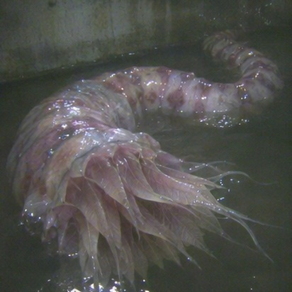
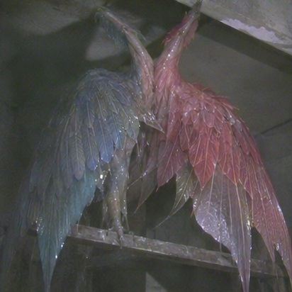
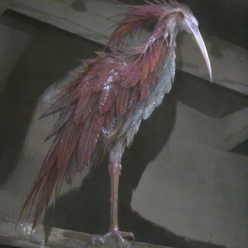
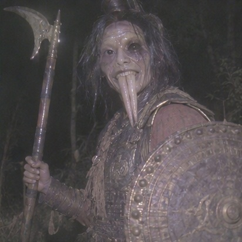
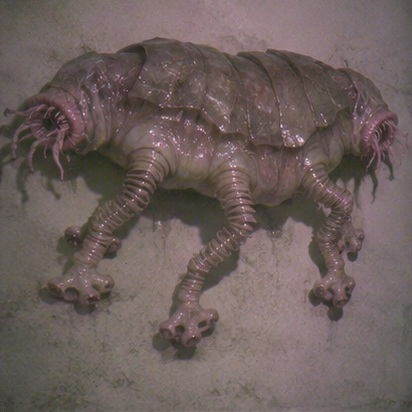
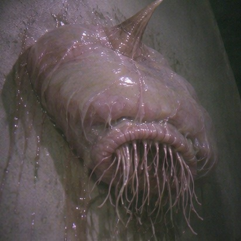
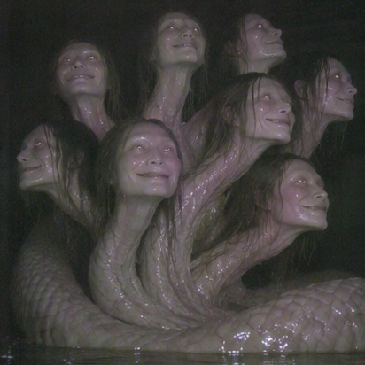
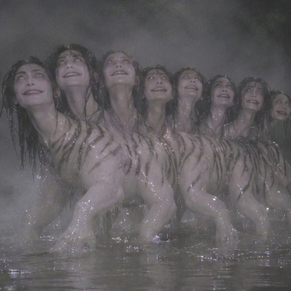
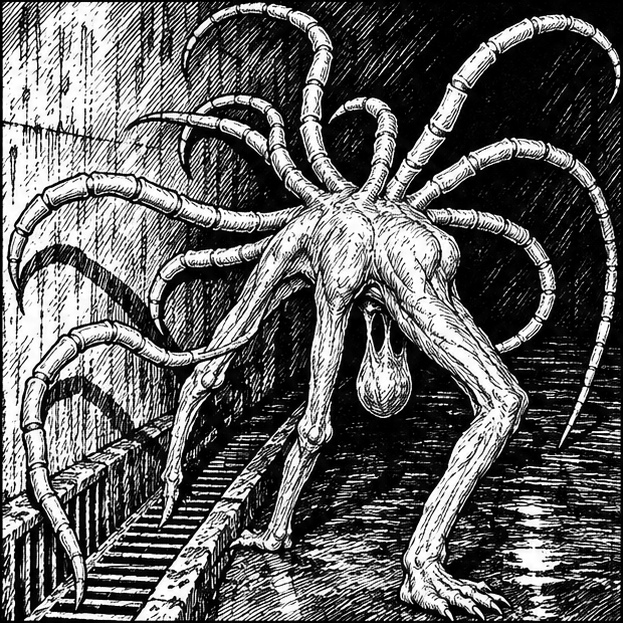

# 🏔️ 《山海經》純怪獸與妖怪圖鑑・卷 06～09〈海外四經〉

[👹 妖怪篇總綱](../00-妖怪篇總綱與圖鑑分級.md) ｜ [📖 山海經總錄](./00-山海經怪獸妖怪總錄.md) ｜ [⬅️ 卷05 中山經](./04-卷05_中山經.md) ｜ [➡️ 海內四經](./06-卷10至13_海內四經.md)

> **編纂規格（2026-11-21 定案・純怪獸零神明鐵律）**：本卷嚴格依原典四經繞行順序（卷六〈海外南經〉→ 卷七〈海外西經〉→ 卷八〈海外北經〉→ 卷九〈海外東經〉），從首頁至末頁逐條核校，完整收錄海外四經全數 **30 條**實體怪獸、妖鳥、異魚、怪蛇、異生物與腐屍異變怪（卷六 7 條、卷七 10 條、卷八 8 條、卷九 5 條）；嵌入磁碟實存黑白墨線圖檔 **9 張**，其餘 **21 條**預留補繪圖位。  
> **美術與生物恐怖重構鐵律**：全卷徹底捨棄傳統神話走獸、仙禽瑞獸與人族異邦奇觀，將所有海外怪獸全面重構為 **【昆蟲・節肢動物・寄生生物・軟體與環節動物】** 結合 **黑暗地牢（Darkest Dungeon）潮濕腐蝕壓迫感 × 克蘇魯不可名狀感 × 恐怖谷偽人（Mimic）** 雙路線，所有條目均嚴守 `【原典記載】` 與 `【本作衍生】` 雙軌考據。

---

## 🗺️ 本卷導覽、黑暗地牢界域與嚴格剔除清單

《山海經》自卷六起脫離《五藏山經》的群山脈絡，轉向四海之外的荒遠邊界，依序環繞**海外南（西南陬→東南陬）**、**海外西（西南陬→西北陬）**、**海外北（東北陬→西北陬）**與**海外東（東南陬→東北陬）**四方絕域。原典海外四經篇幅短促而密度極高，大量混雜古代奇民異國傳說、遠古帝王陵寢與四方正神，但在本作現代都市靈異世界觀中，唯有穿透海域斷層、隨黑潮冷湧與貨輪壓艙水滲入台灣的**純怪獸、寄生蟲怪、腐屍異變體與偽人掠食者**，才被台灣除妖界列為最高警戒的「**海外漂屍系譜**」。

此系怪物與中原山經妖物最大的差異在於**「極端環境適應性與反常生理構造」**：海外四經妖物不再安分於固定山穴，而是具備雙首進食（并封、𧈢𧈢、奇肱兩頭鳥）、無限割肉再生（視肉）、高溫碳化爬行（女丑之尸）、活蛇貫耳操屍（奢比之尸）、九首與八首深淵水蛭多足合體（相柳、天吳）等違背自然律的克蘇魯病態結構。牠們隨季風豪雨、港口排水涵洞、海埔新生地填海淤泥與廢棄冷凍貨櫃潛入台灣沿海與都會地下暗層，一旦形成產卵巢穴，往往直接誘發「所經國亡」「五穀不生」級別的封區災厄。

> [!IMPORTANT]
> **純妖怪怪獸收錄鐵律——本卷嚴格剔除之純人類異族部族與純神祇名單（逐卷透明核對）**：
> - **卷六〈海外南經〉剔除**：結匈國、羽民國、神人二八（為帝司夜之天帝屬神）、讙頭國（讙朱國）、厭火國、三苗國、𢦔國（臷國）、貫匈國、交脛國、不死民、歧舌國、羿（古神話射日英雄）、三首國、周饒國（焦僥國）、長臂國、狄山帝堯／帝嚳／文王祭祀譜系、**南方祝融**（純神祇）。
> - **卷七〈海外西經〉剔除**：**夏后啟**（大樂之野儛九代古帝）、三身國、一臂國人類（僅收其境內「虎文獨目獨手怪馬」）、奇肱之國人類（僅收其旁「赤黃兩頭鳥」與「文馬」）、**形天（刑天）**（純神祇）、女祭與女戚（祭祀神女）、丈夫國、巫咸國（登葆山群巫）、女子國、軒轅之國（人面蛇身異族）、白民之國人類（僅收其境內「乘黃」）、肅慎之國、長股之國、**西方蓐收**（純神祇）。
> - **卷八〈海外北經〉剔除**：無𦙍之國、**鍾山之神燭陰**（原典明定「鍾山之神」，司晝夜冬夏之純氣象神祇）、一目國、柔利國、共工氏（古水神爭霸譜系，僅收其屬下九首巨怪「相柳」與臺隅四虎蛇）、深目國、無腸之國、聶耳之國、**夸父**（逐日神話巨人）、博父國、拘纓之國、跂踵國（大踵人類異族，區別於卷五中山經怪鳥跂踵）、務隅之山帝顓頊與九嬪陵祀、**北方禺彊**（純神祇）。
> - **卷九〈海外東經〉剔除**：大人國、君子國、青丘國人類（僅收其「四足九尾狐」）、豎亥（帝命／禹令步地神使）、黑齒國、湯谷十日（太陽神話）、雨師妾（雨師屬神）、玄股之國、毛民之國、勞民國（教民）、**東方句芒**（純神祇）。
> - **例外收錄考訂說明**：卷九「**天吳**」原典雖因畏懼泛稱「神曰天吳，是為水伯」，然下文自註「**其為獸也，八首人面，八足八尾**」，實乃深淵巨型多足水怪；卷七「**女丑之尸**」與卷九「**奢比之尸**」則屬腐屍異變怪；卷八「**歐絲之野**」跪樹吐絲女子並非國族，實為單體蠶蛾異化偽人。以上四者皆嚴格合乎純怪獸／異變體收錄標準。

> **本卷非怪獸神木與地理要物備忘（供劇情道具與除妖法器參考，不另立怪獸條目）**：
> - **卷六**：三株樹（生赤水上，如柏、葉皆為珠，一曰若彗）、昆侖虛（海外南經方位座標）、范林（方三百里）。
> - **卷七**：大運山（高三百仞）、雄常樹（肅慎之國取衣之樹）、甘露（諸夭之野）。
> - **卷八**：鄧林（夸父棄杖所化二樹木）、禹所積石之山、尋木（長千里，生河上西北）、三桑無枝（長百仞）、遺玉・甘柤・甘華（平丘）。
> - **卷九**：遺玉・甘柤・甘華（𨲠丘）、薰華草（君子國，朝生夕死）、湯谷扶桑（居水中之巨木）。

---

## 📋 本卷海外四經純怪獸與妖怪速查表（全 30 條・配圖 9 張）

| 編號 | 名稱（別稱） | 所屬經卷・原典座標 | 造型路線 | 本作黑暗地牢／寄生／偽人重構原形 | 物種／唯一性 | 稀有度 | 本作階位 | 配圖 |
| :---: | :--- | :--- | :---: | :--- | :--- | :---: | :--- | :---: |
| `SHJ06-001` | **南山蛇魚異象**（蟲為蛇・蛇號為魚） | 卷六〈海外南經〉・南山 | `【非人生物恐怖型】` | 盲眼帶魚皮囊環節水蛭蛇蟲群・名實錯置認知寄生結界 | `物種（群體）` | `★★ 稀級（R）` | 未入流～二流 | 🖼️ |
| `SHJ06-002` | **比翼鳥（海外系）**（蠻蠻支脈） | 卷六〈海外南經〉・南山之東 | `【非人生物恐怖型】` | 青赤雙體側腹肉芽寄生縫合蟲禽・單目互啄命運鎖鏈怪 | `物種（群體）` | `★★ 稀級（R）` | 二流 | 🖼️ |
| `SHJ06-003` | **畢方鳥**（人面一腳譌火禽） | 卷六〈海外南經〉・青水西 | `【類人偽人型】` | 焦萎老者偽人面・單足節肢枯枝焦蛾火蟲・白磷毒火產卵禽 | `物種特異個體` | `★★★ 珍級（SR）` | 二流頂～一流 | 🖼️ |
| `SHJ06-004` | **鑿齒**（壽華之野突齒食人怪） | 卷六〈海外南經〉・壽華之野 | `【類人偽人型】` | 巨型裂唇突齒偽人食人怪・鍬形蟲骨鑿長牙・背甲盾與鐮肢戈 | `獨一無二` | `★★★★ 絕級（SSR）` | 一流頂～巔峰 | 🖼️ |
| `SHJ06-005` | **視肉（聚肉）**（雙眼活肉團） | 卷六〈海外南經〉・狄山 *(兼卷八／九)* | `【非人生物恐怖型】` | 狀如牛肝之克蘇魯變形蟲雙眼活肉團・割而復生無限分裂寄生體 | `物種（群體）` | `★★★ 珍級（SR）` | 二流頂～一流 | ⏳ |
| `SHJ06-006` | **離朱與𩿾久**（狄山守陵惡禽） | 卷六〈海外南經〉・狄山 *(兼卷八)* | `【非人生物恐怖型】` | 赤眼腐蠅寄生猛禽（離朱）與無聲毒蛾屍鴞（𩿾久）共生腐食群 | `物種（群體）` | `★★ 稀級（R）` | 二流 | ⏳ |
| `SHJ06-007` | **虖交與狄山守陵怪獸群**（蜼・文虎等） | 卷六〈海外南經〉・狄山范林 | `【非人生物恐怖型】` | 海蜈蚣毒尾虎蛟亞體（虖交）與仰鼻長蛭尾寄生猿（蜼）腐陵群 | `物種（群體）` | `★★ 稀級（R）` | 二流～二流頂 | ⏳ |
| `SHJ07-001` | **滅蒙鳥**（青身赤尾腐蛾禽） | 卷七〈海外西經〉・結匈國北 | `【非人生物恐怖型】` | 青黴鱗粉巨型鬼臉天蛾鳥・猩紅搏動毒蜂產卵長尾 | `物種（群體）` | `★★ 稀級（R）` | 二流 | ⏳ |
| `SHJ07-002` | **虎文獨目獨手怪馬**（一臂國畸變獸） | 卷七〈海外西經〉・一臂國境內 | `【非人生物恐怖型】` | 單側畸形虎斑馬陸重甲獸・額央蒼蠅巨複眼・前胸單柄螳螂捕食手 | `物種（群體）` | `★★ 稀級（R）` | 二流 | ⏳ |
| `SHJ07-003` | **奇肱赤黃兩頭鳥**（附奇肱文馬） | 卷七〈海外西經〉・奇肱之國旁 | `【非人生物恐怖型】` | 赤黃雙首互噬腐酸寄生蜂鳥・雙喉交替反芻幼蟲黏液 | `物種（群體）` | `★★ 稀級（R）` | 二流 | ⏳ |
| `SHJ07-004` | **𪀚鳥與𪇳鳥**（維鳥・亡國災禽） | 卷七〈海外西經〉・女祭之北 | `【類人偽人型】` | 慘白人面偽人腐禽（𪀚鳥）率青黃蝗疫寄生蟲禽群（𪇳鳥）滅城過境 | `物種（群體）` | `★★★★ 絕級（SSR）` | 一流頂 | ⏳ |
| `SHJ07-005` | **女丑之尸**（十日炙焦遮面屍怪） | 卷七〈海外西經〉・丈夫國北山 | `【類人偽人型】` | 十日炙烤碳化焦屍偽人・右手黏骨遮面爬行・裂皮湧出嗜熱寄生蛆群 | `獨一無二` | `★★★ 珍級（SR）` | 二流頂～一流 | ⏳ |
| `SHJ07-006` | **并封**（前後雙首黑豬怪） | 卷七〈海外西經〉・巫咸國之東 | `【非人生物恐怖型】` | 前後皆生巨頭之雙向進食寄生黑甲豬怪・雙端環形吸盤大顎無肛循環 | `物種（群體）` | `★★★ 珍級（SR）` | 二流頂～一流 | 🖼️ |
| `SHJ07-007` | **軒轅丘四蛇**（四向纏丘巨蛭蛇） | 卷七〈海外西經〉・軒轅之丘 | `【非人生物恐怖型】` | 首尾相銜環鎖四方之巨型環節吸血水蛭蛇・體側人骨倒刺活體禁陣 | `物種特異個體` | `★★★ 珍級（SR）` | 一流 | ⏳ |
| `SHJ07-008` | **諸夭鸞鳥與惑神卵禽群**（海外支脈） | 卷七〈海外西經〉・諸夭之野 | `【非人生物恐怖型】` | 鳴蟬共鳴腔彩甲寄生蜂禽・以甘露屍蜜與活蟲卵操縱宿主行屍導引 | `物種（群體）` | `★★★ 珍級（SR）` | 二流頂～一流 | ⏳ |
| `SHJ07-009` | **龍魚**（鼈魚・陵居有翼魚蟲怪） | 卷七〈海外西經〉・諸夭之野北 | `【非人生物恐怖型】` | 陸棲巨型龍蝨田鱉鯉甲怪・背裂濕膜蟲翼・九對水蜈蚣步足與吸血口針 | `物種（群體）` | `★★★ 珍級（SR）` | 二流頂～一流 | ⏳ |
| `SHJ07-010` | **乘黃**（茲白・背生寄生雙角異獸） | 卷七〈海外西經〉・白民之國境內 | `【非人生物恐怖型】` | 脫毛濕皮巨型寄生蟲狐體・背脊破皮刺出空心兜蟲雙角倒鉤注射吊命毒液 | `物種特異個體` | `★★★★ 絕級（SSR）` | 一流～一流頂 | 🖼️ |
| `SHJ08-001` | **相柳（相柳氏）**（九首食九山巨怪） | 卷八〈海外北經〉・昆侖北柔利東 | `【類人偽人型】` | 九首青黑偽人面×九條巨型吸血腐毒水蛭合體巨怪・毒血腐地生惡臭澤溪 | `獨一無二` | `★★★★★ 神級災厄（UR）` | 巔峰～規格外 | 🖼️ |
| `SHJ08-002` | **共工臺四隅虎色巨蛇**（衝南毒蛇） | 卷八〈海外北經〉・共工之臺 | `【非人生物恐怖型】` | 虎斑幾丁質巨蜈蚣環節毒蛇・四隅聯動首衝南方噴吐腐泥血酸 | `物種特異個體` | `★★★ 珍級（SR）` | 一流 | ⏳ |
| `SHJ08-003` | **歐絲之野吐絲怪**（歐絲女偽人蛾） | 卷八〈海外北經〉・歐絲之野 | `【類人偽人型】` | 跪樹反折腿偽人女子・皮下家蠶肥大環節蠕動・脫臼巨口無盡嘔吐寄生濕絲 | `獨一無二` | `★★★ 珍級（SR）` | 二流頂～一流 | ⏳ |
| `SHJ08-004` | **平丘青鳥**（腐果肉丘翠蠅禽） | 卷八〈海外北經〉・平丘 | `【非人生物恐怖型】` | 金屬青綠金蠅複眼腐食鳥群・與視肉共生於發酵果腐泥池散播蟲卵 | `物種（群體）` | `★★ 稀級（R）` | 二流 | ⏳ |
| `SHJ08-005` | **騊駼**（北海四怪獸・寒甲蟲馬） | 卷八〈海外北經〉・北海內 | `【非人生物恐怖型】` | 寒帶重甲巨龍蝨馬形節肢怪・螳螂鋸刺長肢・馬蠅切割吸血吻器 | `物種（群體）` | `★★ 稀級（R）` | 二流 | ⏳ |
| `SHJ08-006` | **駮**（北海四怪獸・鋸牙噬虎怪） | 卷八〈海外北經〉・北海內 *(兼卷二)* | `【非人生物恐怖型】` | 慘白外骨骼巨型虎甲蟲馬怪・鏈鋸幾丁質巨顎專噬他妖・背嵌獵物殘骨 | `物種（群體）` | `★★★ 珍級（SR）` | 二流頂～一流 | ⏳ |
| `SHJ08-007` | **蛩蛩**（北海四怪獸・白骨寄生馬） | 卷八〈海外北經〉・北海內 | `【非人生物恐怖型】` | 死白腐蠟色無毛寄生馬陸獸・腹下密布骨鉤吸盤強行扣鎖活體背脊代步 | `物種（群體）` | `★★ 稀級（R）` | 二流 | ⏳ |
| `SHJ08-008` | **羅羅（北海青虎型）**（北海四怪獸） | 卷八〈海外北經〉・北海內 *(別於萊山鳥)* | `【非人生物恐怖型】` | 深青霉斑幾丁質巨蠍虎怪・雙柄鋸齒螳螂螯爪・尾拖毒針產卵囊 | `物種（群體）` | `★★★ 珍級（SR）` | 二流頂～一流 | ⏳ |
| `SHJ09-001` | **𨲠丘青馬**（嗟丘腐果青甲怪） | 卷九〈海外東經〉・𨲠丘（嗟丘） | `【非人生物恐怖型】` | 泛青金屬光澤腐食金龜馬怪・腹垂水螅觸手吸食腐果泥與視肉汁液 | `物種（群體）` | `★★ 稀級（R）` | 二流 | ⏳ |
| `SHJ09-002` | **奢比之尸**（肝榆之尸・珥蛇焦腐怪） | 卷九〈海外東經〉・大人國之北 | `【類人偽人型】` | 浮腫人面獸化腐屍偽人・腫大雙耳遭兩條活體青水蛭巨蛇穿耳操腦控屍 | `獨一無二` | `★★★★ 絕級（SSR）` | 一流～一流頂 | ⏳ |
| `SHJ09-003` | **𧈢𧈢**（音虹・兩首虹彩巨蛭怪） | 卷九〈海外東經〉・君子國之北 | `【非人生物恐怖型】` | 體表浮現病態柴油虹彩黏液之巨型雙首吸血水蛭・兩端環形齒吸盤同步抽血 | `物種（群體）` | `★★★ 珍級（SR）` | 二流頂～一流 | ⏳ |
| `SHJ09-004` | **天吳**（朝陽水伯・八首八足寄生巨怪） | 卷九〈海外東經〉・朝陽之谷 | `【類人偽人型】` | 八首青黃浮腫溺屍偽人面×深淵巨型八足海蜈蚣甲殼×八條水蛭產卵長尾 | `獨一無二` | `★★★★★ 神級災厄（UR）` | 巔峰～規格外 | 🖼️ |
| `SHJ09-005` | **青丘九尾狐（海外補檔）**（四足九尾） | 卷九〈海外東經〉・青丘國 *(兼卷一)* | `【類人偽人型】` | 冷豔都會偽人皮囊・微弱複眼冷光・脊裂九條幾丁質蜈蚣蠍尾與搏動產卵管 | `物種（群體）` | `★★★★ 絕級（SSR）` | 一流～一流頂 | 🖼️ |

---

## 🌋 卷六〈海外南經〉（海外自西南陬至東南陬者｜全 7 條）

> **本經純怪獸掃描軌跡**：結匈國 *(剔)* → **`SHJ06-001` 南山蛇魚異象** → **`SHJ06-002` 比翼鳥（海外系）** → 羽民國 *(剔)* → 神人二八 *(剔)* → **`SHJ06-003` 畢方鳥** → 讙頭國 *(剔)* → 厭火國 *(剔)* → 三株樹 *(木)* → 三苗・𢦔・貫匈・交脛・不死・歧舌 *(剔)* → 昆侖虛 → **`SHJ06-004` 鑿齒** → 三首・周饒・長臂 *(剔)* → 狄山（**`SHJ06-005` 視肉**、**`SHJ06-006` 離朱與𩿾久**、**`SHJ06-007` 虖交與狄山守陵怪獸群**）→ 南方祝融 *(剔)*。

### [SHJ06-001] 南山蛇魚異象（蟲為蛇・蛇號為魚／名實錯置環節怪群）
- **出處順序**：卷 06〈海外南經〉・南山（結匈國東南）
- **類別與造型路線**：`【非人生物恐怖型】`｜盲眼帶魚皮囊環節水蛭蛇蟲集群
- **物種／唯一性**：`物種（群體）`｜原典記載整座南山以南所有「蟲—蛇—魚」名實顛倒之異化生態集群，屬可隨潮濕水脈大批孳生的集體性軟體環節妖蟲。
- **稀有度與道行對照**：`★★ 稀級（R）`｜單體僅數年淺妖氣，然成群聚結形成名實領域可達百年妖障｜本作階位：未入流～三流（群體結界二流）
- **外貌與黑暗地牢／恐怖谷視覺改寫**：
  - 
  - 【原典外貌】「南山在其東南。自此山來，蟲為蛇，蛇號為魚。一曰南山在結匈東南。」郭璞注指此地名物錯置，稱一切蟲豸為蛇、稱長蛇為魚。
  - 【本作克蘇魯／昆蟲寄生／偽人重構】徹底將「方言錯置」具象化為令人反胃的**活體跨界畸變集群**！初看像是傳統魚攤冰櫃上銀白發亮的帶魚或鰻魚，湊近卻發現整排魚屍沒有眼球，眼窩裡是濕黑蠕動的環節水蛭口器；銀亮魚鱗縫隙下伸出密密麻麻如馬陸般半透明的細短步足，鰓裂處往外滲出混著魚腥與發酵膿臭的濃稠黏液。一旦被人類開口叫成「魚」或「蛇」，牠們的背鰭便當場撕裂成多毛海蜈蚣般的毒剛毛，以扭曲的蛇行與水蛭伸縮姿態成群爬出冰櫃、順著滲水磁磚牆面爬上天花板。黑白墨線以高光留白突顯濕冷銀鱗與暗溝黑黏液的反差，刻意安排第一眼誤認成市場魚貨、下一格集體反折斷頸扭頭的視覺錯愕。
- **特性**：
  - 【原典記載】自南山以降，蟲化為蛇、蛇稱為魚，名實互相傾軋倒錯。
  - 【本作衍生】具備「**認知名實寄生場**」——凡踏入其潮濕黏液散發範圍之活人，大腦語言中樞會被空氣中飄散的微小水蛭孢子干擾，不自覺將所見生物叫錯名字；而被誤稱的南山怪蟲便會即時啟動變形蟲般的重塑機制，朝向受害者口中吐出的詞彙瘋狂畸變增生。
- **弱點**：
  - 【原典記載】原典未載。
  - 【本作衍生】極度仰賴潮濕高鹽環境維持表皮水膜，遇大量粗鹽、生石灰或高濃度漂白水會迅速脫水捲曲溶解；道門實戰破解其認知結界的關鍵為「**正名硃砂印**」——法師須先塞耳閉口，以純陽硃砂於符紙手書生物真實科屬並以火符引燃，即可震碎錯置場域、令怪群縮回脆弱幼蛭原形。
- **習性**：
  - 【原典記載】盤踞南山之陰濕地帶，往東南延綿。
  - 【本作衍生】現代最常沿著高雄前鎮、台南安平或基隆崁仔頂等老舊魚市場排水溝、廢棄冷凍漁船艙底與沿海地下箱涵孳生；每逢梅雨季或深夜市場休市，成群「魚條」便沿著濕滑地板滑出保麗龍箱，專找打瞌睡的漁工與夜歸者下手。
- **喜好**：
  - 【原典記載】原典未載。
  - 【本作衍生】酷愛鹹腥腐敗魚內臟、高濕冷氣滴水口，以及人類在驚慌下語無倫次胡亂叫喊的聲頻。
- **擅長的招式／異能**：
  - 【原典記載】名物顛倒（「蟲為蛇，蛇號為魚」）。
  - 【本作衍生】「錯名鑽喉」：偽裝成冰凍漁獲或水溝蚯蚓，趁獵物彎腰查看時猛然彈射鑽入口腔，以環形細齒吸盤咬住舌根並分泌神經干擾液，使宿主說話時所有名詞徹底顛倒、最終喪失自我稱呼而陷入崩潰；「鱗腹湧潮」：數百條集體分泌滑膩酸液淹沒腳踝，將整條暗巷化為無法站穩的腐腥滑道。

### [SHJ06-002] 比翼鳥（海外系／蠻蠻支脈・青赤連體雙翼蟲禽）
- **出處順序**：卷 06〈海外南經〉・南山之東（跨卷關聯卷 02〈西山經・崇吾之山〉蠻蠻）
- **類別與造型路線**：`【非人生物恐怖型】`｜側腹寄生縫合・雙體共生甲殼蟲禽
- **物種／唯一性**：`物種（群體）`｜原典明言兩鳥成雙比翼而飛，海外南經所記乃瀕海遷徙的青赤兩色支脈種群。
- **稀有度與道行對照**：`★★ 稀級（R）`｜百年潮濕怨念與畸胎共生所化之成精妖禽｜本作階位：二流
- **外貌與黑暗地牢／恐怖谷視覺改寫**：
  - 
  - 【原典外貌】「比翼鳥在其東，其為鳥青、赤，兩鳥比翼。一曰在南山東。」一青一赤，兩鳥各僅生一目一翼，非並肩貼合無法起飛。
  - 【本作克蘇魯／昆蟲寄生／偽人重構】徹底粉碎文人筆下「恩愛夫妻」的浪漫濾鏡，改寫為極度病態的**「連體寄生縫合蟲禽」**：牠實質上是兩隻長著厚硬甲蟲鞘翅、軀殼呈發霉屍青色與生肉赤紅色的畸形盲禽，在側腹位置被一整排宛如巨型寄居蟹爪與暗紅蠕蟲菌絲的肉芽強行釘合縫死！交界縫線終日滲出混濁淋巴膿液，細短剛毛與倒生幾丁質羽管從潰爛縫線中刺出；左側鳥只剩左眼窩嵌著一顆膨大蒼蠅複眼、右側鳥只剩右眼窩閃爍紅光，兩根細長如蚊子吸血口針的彎喙時常無法控制地狠啄對方頸側以爭奪體內共享的血液與養分，振翅時發出的不是鳥鳴，而是甲殼摩擦與濕皮拉扯的「嘎吱」撕裂聲。黑白墨線以濃淡網點區分青、赤雙體，特寫側腹肉芽縫合處的極致生理厭惡感。
- **特性**：
  - 【原典記載】青赤兩鳥比翼，相得乃飛；同源〈西山經〉蠻蠻條記載「見則天下大水」。
  - 【本作衍生】本質並非愛情瑞鳥，而是**「強制連體共生寄生體」**——其體液中含有特殊的神經黏合孢子，只要將孢子分別灑在兩名活人身上，兩人的血脈與痛覺神經就會被無形菌絲「縫合」成一體，進而在城市局部誘發反常豪雨與淹水，藉潮濕水氣孵化新一批連體幼蟲。
- **弱點**：
  - 【原典記載】原典未載（原典結構暗含破口：單體無雙翼雙目，失伴即墜）。
  - 【本作衍生】側腹那條終日潰爛滲液的寄生縫合線是唯一致命破口！除妖師以「斷緣剪」、浸過純陽艾草汁的鋼線或火系符刃直斬中縫，將兩隻蟲禽硬生生劈離，雙方失去飛行平衡與循環供血後會在數十秒內互啃抽搐而亡。
- **習性**：
  - 【原典記載】棲居南山以東之海外濱海荒野。
  - 【本作衍生】台灣現代都市中專愛盤踞於婚紗攝影街、老舊月老廟屋簷陰暗角落、婚宴會館生鏽冷氣室外機架與情侶自殺高發的河濱橋墩下，趁夜色沿著霓虹燈管滴落黏液，鎖定爭執中或執念深重的伴侶下手。
- **喜好**：
  - 【原典記載】原典未載。
  - 【本作衍生】極度迷戀任何「成雙成對且帶有人體汗漬氣味」的物件——婚戒、情侶鞋、並排遺照與沾血紅線，常將這些戰利品以膿液黏貼在滲水巢穴內壁。
- **擅長的招式／異能**：
  - 【原典記載】合體飛翔；同源蠻蠻載「見則天下大水」。
  - 【本作衍生】「比翼縫命絲」：雙喙同時噴出暗紅寄生細絲黏附兩名目標，使其中一人承受的割傷、窒息與失血百分之百複製到另一人身上，許多離奇的「連帶被保險人同步猝死」案件背後皆有其黑影；「連翅召澇」：在高空盤旋撕咬彼此灑下腐血雨，令方圓三百公尺內排水孔倒灌黑水。

### [SHJ06-003] 畢方鳥（人面一腳譌火怪禽）
- **出處順序**：卷 06〈海外南經〉・青水西（二八神之東；跨卷關聯卷 02〈西山經・章莪之山〉畢方）
- **類別與造型路線**：`【類人偽人型】`｜焦萎老者偽人面・單足節肢枯枝焦蛾火蟲禽
- **物種／唯一性**：`物種特異個體`｜海外南經與西山經兩見，本作定性為極罕見的千年火煞異變特異母體，每逢都會老化火劫方才現身。
- **稀有度與道行對照**：`★★★ 珍級（SR）`｜數百年至千年火毒妖蟲成氣候之災厄禽王｜本作階位：二流頂～一流
- **外貌與黑暗地牢／恐怖谷視覺改寫**：
  - 
  - 【原典外貌】「畢方鳥在其東，青水西，其為鳥人面一腳。一曰在二八神東。」〈西山經〉補記其「狀如鶴，一足，赤文青質而白喙……見則其邑有譌火」。
  - 【本作克蘇魯／昆蟲寄生／偽人重構】牢牢緊扣卷六原文**「人面一腳」**的恐怖谷特質！牠遠看像隻棲於高壓電線上的枯瘦老鶴，走近卻見禽身前端長著一張被濃煙燻得皺縮發黑、神情呆板僵直的**蒼白老人偽人臉**——眼眶深陷，黑瞳深處浮現如腐食蒼蠅般的橘紅複眼點火冷光；人類雙唇向前畸形拉長、鈣化成一道森白開裂的蚊蟲式穿刺骨喙，唇縫間不斷冒出白磷臭煙。其軀幹根本不是溫潤鳥羽，而是數百片泛青焦黑、邊緣永遠像炭紙般陰燃掉灰的**硬質焦蛾鱗甲**，甲片縫隙藏著密密麻麻會自行點燃的橘紅產卵火星囊；唯一那隻細長反折的單腳宛如浸滿瀝青的巨型螳螂節肢，關節處嵌著細碎燒焦指骨，死死抓摳在老舊建築的電線外皮上，將絕緣橡膠融化成黑臭黏液滴落地面。
- **特性**：
  - 【原典記載】人面一腳；自呼其名「畢方」，所現之城邑必生「譌火」（查無起火點之妖異火災）。
  - 【本作衍生】體內擁有如「放屁步甲（炮蟲）」般的雙腔生物化學燃燒腺，能將過氧化氫與磷質毒液混入蟲卵內噴射至建築夾層；這些微米級「火星蟲卵」會靜默潛伏於電線管路與木質天花板中，待七日內累積足夠沼氣與靜電便同步爆燃，徹底毀滅火場證據，使消防火災鑑識永遠找不到起火源。
- **弱點**：
  - 【原典記載】原典未載（原典方位「青水西」暗寓以水界之）。
  - 【本作衍生】1. 單一節肢長足既是支撐點也是主要輸氣管，以銅絲索、鐵鍊符網纏斷其單腳，牠便會像翻肚巨蟲般失衡墜地，無法再起飛；2. 畏懼無氧泡沫與大量「青水（混入雄黃與井底寒泥的符水）」灌洗，忌用一般霧狀水柱硬噴，否則其體表白磷鱗粉會遇水霧引發二次閃燃爆炸。
- **習性**：
  - 【原典記載】棲於海外青水之西。
  - 【本作衍生】專愛潛伏於台灣違建林立的老舊公寓頂樓鐵皮屋、雜物塞滿樓梯間的住商混合大樓變電箱與傳統市場電線叢中；常於深夜兩點以極像老舊電器短路的「畢——方——」尖銳滋響在窗外單足跳行窺視，保險理賠部門最頭痛的「無火源連環縱火案」多半出自牠手。
- **喜好**：
  - 【原典記載】原典未載。
  - 【本作衍生】嗜食老化橡膠電線皮、凝固抽油煙機廢油垢與火場焦屍的碳化油脂；極度迷戀人類聽見警報聲時四處奔逃的尖叫頻率。
- **擅長的招式／異能**：
  - 【原典記載】見則其邑有譌火。
  - 【本作衍生】「無源譌火卵」：振動焦蛾鱗甲將數千枚不可見的磷毒火卵隨冷氣進風口播撒全棟建築，七日內同時自燃；「單足焦啄」：單腳彈跳俯衝，以慘白偽人口喙噴出攝氏千度高壓毒酸火線，直接燒穿防火門與低階防護符。

### [SHJ06-004] 鑿齒（壽華之野巨型突齒偽人食人怪）
- **出處順序**：卷 06〈海外南經〉・壽華之野（昆侖虛東）
- **類別與造型路線**：`【類人偽人型】`｜巨型裂唇突齒偽人・鍬形蟲骨顎與重甲食人魔怪
- **物種／唯一性**：`獨一無二`｜原典明載遭羿於壽華之野射殺之上古單體凶怪，本作中其深埋於地層腐泥的巨齒殘骸仍不斷分泌寄生骨芽，可奪舍巨漢屍身重組現世。
- **稀有度與道行對照**：`★★★★ 絕級（SSR）`｜數千年上古戰場怨毒食人魔怪｜本作階位：一流頂～巔峰
- **外貌與黑暗地牢／恐怖谷視覺改寫**：
  - 
  - 【原典外貌】「羿與鑿齒戰於壽華之野，羿射殺之。在昆侖虛東。羿持弓矢，鑿齒持盾。一曰戈。」郭璞注：「鑿齒亦人也，齒如鑿，長五六尺，因以名云。」
  - 【本作克蘇魯／昆蟲寄生／偽人重構】化為令人頭皮發麻的**「深淵重裝突齒偽人屠夫」**！身軀高逾三公尺，表面維持著筋肉扭曲、皮膚青灰起泡的畸形巨漢輪廓，但皮下層層疊疊浮現出如大型腐食甲蟲與鍬形蟲般的漆黑幾丁質骨板接縫。最駭人的是牠那張早已徹底潰爛的臉——沒有下顎，上唇從鼻孔直裂至耳根，一根長逾一公尺半、形如鐵匠大鑿又似巨型雄鍬形蟲漆黑大顎的**鈣化貫穿長齒**從上顎骨硬生生戳破下頷皮肉直垂至胸腹，齒面密布細密倒鉤吸槽與發黑血垢！牠左手舉起的「盾」並非兵器，而是從自己左肩增生撕裂出來、布滿人骨碎牙與密集氣孔的巨型甲蟲厚重鞘殼；右手拖曳的「戈」，實則是右臂關節反折畸變而成的巨大鋸齒螳螂捕食鐮肢，行走時刮擦水泥地板迸出冷白火星與濃烈腐肉腥臭。
- **特性**：
  - 【原典記載】齒長五六尺如鑿，持盾（或戈）與羿苦戰於壽華之野。
  - 【本作衍生】那根貫穿式巨型鑿齒既是長槍又是**活體吸髓管**——刺穿獵物胸腹的瞬間，齒內中空毛細管與環形吸盤會像巨型吸血蚊口針般在三秒內抽乾活人骨髓與內臟漿液；更恐怖的是，鑿齒殘骸只要保有一截斷牙落入潮濕土層，就能像寄生鐵線蟲般鑽入路過高大男性的上顎，在數月內將活生生的人類改造成下一尊「鑿齒偽人」。
- **弱點**：
  - 【原典記載】終為羿以弓矢射殺於壽華之野（示其重甲盾防雖厚，仍畏遠程高速破甲貫穿之擊）。
  - 【本作衍生】1. 巨齒本身與顱骨神經直接相連，一旦以大口徑穿甲震盪彈、特製雷擊弩箭或「破甲雷針」精準貫入上顎齒根處的潰爛肉縫，會引發全神經系統劇烈抽搐癱瘓；2. 左臂甲殼盾與龐大身軀導致轉向笨重，狹窄彎折的現代大樓逃生梯與多層防爆鋼柱能有效卡死其長齒刺擊路線。
- **習性**：
  - 【原典記載】盤踞壽華之野，好戰嗜殺。
  - 【本作衍生】現代極少現蹤，唯有在老舊屠宰場地基、重工廢棄鋼鐵廠地下冷卻池或古戰場改建的深開挖捷運工地，若誤挖出滲出黑血的遠古巨齒化石並遭活人割傷沾血，才會在深夜喚醒這尊高大沉默、雙眼閃爍複眼冷光的無聲殺戮機器。
- **喜好**：
  - 【原典記載】原典未載。
  - 【本作衍生】癡迷於反覆磨礪自己的巨齒——總在空無一人的深夜地下停車場，將長齒壓在水泥柱或生鏽鋼樑上緩慢來回刮擦，發出像骨鋸割肉般的低沉摩擦音；偏好壯碩成年男性的鮮血與完整骨骼。
- **擅長的招式／異能**：
  - 【原典記載】持盾（戈）力戰大羿。
  - 【本作衍生】「鑿骨穿髓」：以甲殼盾硬扛熱兵器與符咒轟擊後低頭突進，將丈長骨鑿貫穿防彈車門與人體，順勢抽吸鮮血補修復甲；「裂顎腐鳴」：震動長齒發出次聲波共鳴，使周遭十公尺內的人類牙齦集體出血、牙齒鬆動脫落，從而喪失唸誦道門真言的能力。

### [SHJ06-005] 視肉（聚肉／狄山雙眼割復變形蟲活肉團）
- **出處順序**：卷 06〈海外南經〉・狄山（跨經亦見卷 08〈海外北經〉務隅之山・平丘、卷 09〈海外東經〉𨲠丘）
- **類別與造型路線**：`【非人生物恐怖型】`｜克蘇魯變形蟲雙眼活肉團・無定形原生質寄生巨肝體
- **物種／唯一性**：`物種（群體）`｜原典於海外南、北、東三經之帝陵與果丘反覆記載，屬生於腐敗陰濕地脈、可無限切割分裂增殖的原生質異生物種群。
- **稀有度與道行對照**：`★★★ 珍級（SR）`｜天地陰濁腐氣與古陵屍脂凝結而成的無定形異物｜本作階位：二流頂～一流（單體非猛攻型，然具極端不死增殖與奪舍風險）
- **外貌與黑暗地牢／恐怖谷視覺改寫**：
  - <!-- 圖位預留：待補繪 -->
  - 【原典外貌】「狄山……爰有……視肉。」郭璞注：「聚肉形如牛肝，有兩目也。食之無盡，尋復更生如故。」
  - 【本作克蘇魯／昆蟲寄生／偽人重構】全書最純正、最不需修飾的**克蘇魯變形蟲雙眼活肉團**！外觀是一大坨重逾數十公斤、暗紅發紫、表面覆蓋一層半透明濕黏漿膜的巨大鮮活牛肝狀肉塊，在黑暗地牢積水地面上如巨型變形蟲與無殼蛞蝓般緩慢蠕動擴張。肉團頂端正中嵌著兩顆宛如剛從活人眼窩挖出、佈滿血絲且沒有眼皮的**慘白人類眼球**，無時無刻同步轉動死盯著來者；肉塊邊緣隨呼吸翻捲出數以百計微小的水螅觸手與環形吸盤孔洞，只要拿刀割下一片肉，切口不僅不流血，反而立刻「嘶嘶」冒泡、瘋狂噴吐嫩粉色幼蟲狀肉芽，在三秒內膨脹補平回原狀，而被割下的那塊離體肉片則會迅速長出兩顆針孔小眼，變成另一隻獨立蠕動的「視肉」幼體！黑白墨線著重極致濕亮高光留白、軟組織褶皺密集排線與兩顆詭異直視讀者的純黑瞳仁。
- **特性**：
  - 【原典記載】狀如牛肝生兩目，割而食之無窮盡，旋即復生如故。
  - 【本作衍生】本質是沒有固定細胞壁的**超大型寄生黏菌變形蟲集合體**。地下黑市與黑心無牌餐飲集團常將視肉囚禁於發臭的地下室蓄水池中，日復一日切肉冒充頂級和牛內臟或長生肉藥牟取暴利——凡吞食未徹底灰化之視肉碎塊者，其胃壁與肝臟會在十四日內遭原生質細胞反向同化，最終從腹腔長出雙眼，整個人淪為不斷被視肉替代的新母體！
- **弱點**：
  - 【原典記載】原典未載（反而強調割殺不盡、食之復生）。
  - 【本作衍生】物理斬擊、剁碎與子彈貫穿只會助其分裂繁殖，屬實戰大忌！唯一有效根除手段是**高溫強酸乾燥＋烈陽真火封絕**——先以濃鹽酸或生石灰粉覆蓋使其表皮水膜蛋白瞬間變性凝固，再以「焚屍陽火陣」或噴火器持續攝氏八百度以上燒成純白灰燼，並檢查現場有無任何米粒大小脫落肉渣殘留。
- **習性**：
  - 【原典記載】棲於狄山（堯・嚳葬處）、務隅之山（顓頊葬處）、平丘與𨲠丘，常伴隨腐果與古墓靈氣而生。
  - 【本作衍生】現代極常藏身於老舊菜市場地下肉品冷凍庫排水溝、荒廢殯儀館化糞池、無良黑心食品加工廠暗室與土石流掩埋的古墓滲水洞中；靜止時偽裝成一灘發黑凝血或腐敗豬肝，誘騙野狗、流浪漢或貪婪商販伸手觸碰。
- **喜好**：
  - 【原典記載】原典未載。
  - 【本作衍生】極度渴望活體動物溫熱的肝血、蛋白質廢水與潮濕發酵果泥，同時對「人類切割自己的刀鋒」表現出病態迎合——彷彿故意敞開肉體任人割食，只為藉由人類的餐桌完成指數級寄生擴散。
- **擅長的招式／異能**：
  - 【原典記載】割而復生，食之無盡。
  - 【本作衍生】「雙目凝滯」：兩顆濕亮眼球同步凝視目標，分泌讓人產生莫名強烈食慾的致幻費洛蒙，誘使餓極或理智薄弱者生啖其肉；「原生質包裹」：遭圍困時攤平化為數公尺寬的暗紅黏液毯覆蓋整個地下室地板，藉數百個微小吸盤將踏入者雙腳拖入肉漿緩慢消化，同時於體表浮現過往吞食者的扭曲五官。

### [SHJ06-006] 離朱與𩿾久（狄山守陵赤烏惡鴞蟲禽群）
- **出處順序**：卷 06〈海外南經〉・狄山（跨經亦見卷 08〈海外北經〉務隅之山）
- **類別與造型路線**：`【非人生物恐怖型】`｜赤眼腐蠅寄生猛禽（離朱）與無聲毒蛾屍鴞（𩿾久）共生食屍群
- **物種／唯一性**：`物種（群體）`｜原典並舉於諸帝葬陵之山，屬盤踞古墓林野、專啄腐屍與視肉的雙生怪鳥群。
- **稀有度與道行對照**：`★★ 稀級（R）`｜古墓陰煞滋養數十至百年的腐食妖禽群｜本作階位：二流
- **外貌與黑暗地牢／恐怖谷視覺改寫**：
  - <!-- 圖位預留：待補繪 -->
  - 【原典外貌】「狄山……爰有……離朱……一曰爰有……離朱、𩿾久、視肉、虖交。」郭璞注離朱「今圖作赤烏」（又通離俞，鷹屬猛禽），𩿾久即鴟久（怪鴞／惡鴟）。
  - 【本作克蘇魯／昆蟲寄生／偽人重構】將兩者設計為黑暗地牢陵墓區的**「晝夜雙班腐蠅毒蛾惡鳥群」**：**離朱**形如脫毛禿鷹，通體裹覆沾滿凝固屍血的暗紅幾丁質甲羽，頭部沒有正常鳥瞳，而是在眼窩裡擠出三對鮮紅發亮如巨型嗜血麗蠅般的球狀複眼，能看穿百公尺外活體皮下的血管脈動，尖喙實為交錯剪刃狀的腐食甲蟲大顎；**𩿾久**則如膨脹腐爛的灰白大貓頭鷹，全身長滿如枯葉蛾與毒毛蟲般一觸即脫落的帶毒鱗毛，胸腹裂開一道垂滿乳白屍蛆的寄生育兒囊，飛行時完全沒有任何風聲，唯有翅膀扇動飄落令人窒息的腐屍孢子塵。
- **特性**：
  - 【原典記載】與視肉、文虎、蜼豹等共棲於狄山、務隅之山等古帝陵寢之地。
  - 【本作衍生】兩鳥與「視肉」形成殘酷的共生食物鏈：白晝由視覺極端敏銳、能鎖定微弱靈氣波動的**離朱**高空偵查並吐酸腐蝕目標雙眼；入夜則由靜音滑翔的**𩿾久**將附著視肉微粒的腐蛆投入獵物鼻腔與耳道，將活生生的闖入者轉化為新的陵墓養分。
- **弱點**：
  - 【原典記載】原典未載。
  - 【本作衍生】離朱的三對巨型紅複眼對高流明爆閃強光與雷射極度敏感，強光照射即可令其視覺超載撞牆墜落；𩿾久的毒蛾鱗毛富含油脂，遇明火或高壓電擊網便會瞬間爆燃，同時暴露其腹下柔軟無甲的寄生育兒囊。
- **習性**：
  - 【原典記載】群棲狄山范林與務隅之山。
  - 【本作衍生】現代常聚居於台灣山區荒廢公墓納骨塔屋脊、土葬遷墓後的陰濕亂葬崗樹冠與廢棄屠宰場高架鐵樑上，日夜輪班俯瞰周遭登山步道與夜遊車輛。
- **喜好**：
  - 【原典記載】原典未載。
  - 【本作衍生】酷愛吞食視肉碎塊、腐敗眼珠與浸泡屍水的朽木蟲蛹；極度厭惡焚燒檀香與除濕機的乾燥氣流。
- **擅長的招式／異能**：
  - 【原典記載】原典未載（傳統「離朱」之名寓極致目力，𩿾久為夜鳴惡鳥）。
  - 【本作衍生】「赤瞳透血」：離朱能無視牆壁障眼法直接鎖定躲藏者心跳位置，發出尖銳蠅鳴標記獵物；「靜羽撒蛆」：𩿾久於無燈樓梯間無聲掠過頭頂，灑下沾滿神經麻痺液的毒蛾鱗粉與活體腐蛆雨。

### [SHJ06-007] 虖交與狄山守陵怪獸群（蜼・文虎・熊羆豹腐化變體）
- **出處順序**：卷 06〈海外南經〉・狄山范林（跨經亦見卷 08〈海外北經〉務隅之山）
- **類別與造型路線**：`【非人生物恐怖型】`｜海蜈蚣寄生虎蛟亞種（虖交）與仰鼻長蛭尾猿（蜼）等腐陵節肢獸群
- **物種／唯一性**：`物種（群體）`｜原典「爰有熊、羆、文虎、蜼、豹……虖交」並舉為狄山方三百里范林之守陵群獸，本作統攝為受古墓陰濕蟲脈侵蝕而全體節肢化的變異獸群。
- **稀有度與道行對照**：`★★ 稀級（R）`｜長期啃食視肉與古墓腐氣而異化的群居妖獸｜本作階位：二流（范林成群圍攻達二流頂）
- **外貌與黑暗地牢／恐怖谷視覺改寫**：
  - <!-- 圖位預留：待補繪 -->
  - 【原典外貌】「爰有熊、羆、文虎、蜼、豹……一曰爰有……虖交。其范林方三百里。」注家考「虖交」即虎蛟類異獸（魚身蛇尾或虎紋蛟怪），「蜼」為仰鼻長尾、遇雨以尾塞鼻之怪猿。
  - 【本作克蘇魯／昆蟲寄生／偽人重構】徹底剝除傳統森林猛獸皮毛！**虖交**呈現為體長逾三公尺、在爛泥池底拖行的**巨型虎斑海蜈蚣魚殼怪**，前半段披覆沾滿苔蘚的發黑幾丁質骨鱗，後半段則拖曳一條獨立運作、長滿環形倒鉤吸盤的猩紅吸血巨蛭尾；**蜼**完全喪失猿猴模樣，臉部萎縮成兩個朝天裂開、不斷噴吐黑黃黏泡的巨型鼻腔孔，身後拖曳一條長達體長三倍、表皮濕亮分節如巨型蚯蚓的寄生水蛭長尾——每逢大雨，牠不是「用尾遮雨」，而是將蠕動的分叉尾端直接塞入自己仰天鼻孔內進行體內換氣與蟲卵輸送！同林中的熊、羆、文虎與豹也全數淪為皮肉崩裂、關節嵌出甲蟲外骨骼與寄生菌絲的腐陵行屍甲獸。
- **特性**：
  - 【原典記載】群居於狄山帝陵外圍方三百里之范林，護守陵山。
  - 【本作衍生】牠們全體以定期啃食狄山「視肉」維生，體內因此積聚高濃度的變形蟲再生黏液，斷肢後會從傷口鑽出細密節肢步足強行接駁復原；彼此透過土壤中蔓延的寄生菌絲共享領地警報，踏斷一根枯枝便會引來整個林區的腐甲獸群合圍。
- **弱點**：
  - 【原典記載】原典未載（古注載蜼遇雨必以尾塞鼻，行動受制）。
  - 【本作衍生】蜼的鼻孔尾端一旦遭外力截斷或被強刺激性辣椒水、硫磺煙霧灌入，會立刻窒息劇烈痙攣；虖交及腐陵群獸離開潮濕淤泥地超過半小時便會甲殼乾裂龜縮，以高熱乾燥符火封阻水域可逐一殲滅。
- **習性**：
  - 【原典記載】棲息狄山范林與務隅之山。
  - 【本作衍生】現代多盤踞於台灣深山廢棄林道坍方處、長期積水的百年古墓區滯洪池與無管理員的荒廢動物園地下獸欄，平日半身埋於腐葉黑泥中靜止不動，直到暴雨傾盆之夜才集體甦醒狩獵。
- **喜好**：
  - 【原典記載】原典未載。
  - 【本作衍生】嗜食視肉碎塊、發酵腐爛山果與迷途登山客沾滿泥水的鞋襪肉塊。
- **擅長的招式／異能**：
  - 【原典記載】原典未載。
  - 【本作衍生】「范林菌網圍獵」：藉潮濕地底菌絲同步喚醒整片林區的蜼與腐甲猛獸無聲包抄；「虖交蛭尾絞殺」：虖交自泥潭暴起，以前端海蜈蚣毒顎死咬腳踝，再以吸盤巨尾纏繞頸部抽吸鮮血。

---

## 🏜️ 卷七〈海外西經〉（海外自西南陬至西北陬者｜全 10 條）

> **本經純怪獸掃描軌跡**：結匈國北 → **`SHJ07-001` 滅蒙鳥** → 大運山 *(山)* → 大樂之野・夏后啟 *(剔)* → 三身國 *(剔)* → 一臂國 *(剔，僅收境內 **`SHJ07-002` 虎文獨目獨手怪馬**)* → 奇肱之國 *(剔，僅收其旁 **`SHJ07-003` 奇肱赤黃兩頭鳥**)* → 形天 *(剔)* → 女祭・女戚 *(剔)* → **`SHJ07-004` 𪀚鳥與𪇳鳥** → 丈夫國 *(剔)* → **`SHJ07-005` 女丑之尸** → 巫咸國 *(剔)* → **`SHJ07-006` 并封** → 女子國 *(剔)* → 軒轅之國 *(剔)* → **`SHJ07-007` 軒轅丘四蛇** → **`SHJ07-008` 諸夭鸞鳥與惑神卵禽群** → **`SHJ07-009` 龍魚** → 白民之國 *(剔，僅收境內 **`SHJ07-010` 乘黃**)* → 肅慎之國・雄常樹 *(剔／木)* → 長股之國 *(剔)* → 西方蓐收 *(剔)*。

### [SHJ07-001] 滅蒙鳥（青身赤尾腐蛾禽・毒蜂產卵尾怪）
- **出處順序**：卷 07〈海外西經〉・結匈國之北
- **類別與造型路線**：`【非人生物恐怖型】`｜青黴鱗粉巨型鬼臉天蛾鳥・猩紅搏動毒蜂產卵長尾
- **物種／唯一性**：`物種（群體）`｜原典明載棲於結匈國北荒漠潮隙之青赤異禽，屬成群隨低氣壓陰霾遷徙的毒鱗寄蟲鳥種。
- **稀有度與道行對照**：`★★ 稀級（R）`｜陰濕腐林瘴氣孕化之百年毒蛾妖禽｜本作階位：二流
- **外貌與黑暗地牢／恐怖谷視覺改寫**：
  - <!-- 圖位預留：待補繪 -->
  - 【原典外貌】「滅蒙鳥在結匈國北，為鳥青，赤尾。」
  - 【本作克蘇魯／昆蟲寄生／偽人重構】將簡潔的「青身赤尾」化為黑暗地牢中最令人窒息的**「腐黴鬼臉天蛾寄蟲怪鳥」**：體型如成犬般龐大，雙翼完全沒有柔軟羽毛，而是兩片厚重泛青、表層覆滿潮濕黴菌斑紋與灰白骷髏紋路的巨型天蛾革翅，每次抖動皆飄落如腐爛青苔般的窒息毒鱗粉。牠的鳥頭萎縮成漆黑幾丁質甲殼，眼眶擠出數十顆細碎複眼，喙部裂為四瓣帶倒鉤的吸液口器；最觸目驚心的則是身後拖曳的那條「赤尾」——那根本不是尾羽，而是一根長逾兩公尺、表皮半透明呈猩紅充血狀、內部清晰可見成串乳白幼蟲蠕動搏動的**巨型寄生蜂產卵管長尾**，尾端滴落具有強腐蝕性的暗紅黏液，所經水泥地皆被蝕出蜂巢狀孔洞。
- **特性**：
  - 【原典記載】青身赤尾，居結匈國之北。
  - 【本作衍生】名中「滅蒙」在本作被除妖界解讀為「**滅目蒙神**」——其青黴翼粉含有神經致盲毒素與微小水螅孢子，吸入者會在三分鐘內眼角膜蒙上一層青灰菌翳、意識陷入如墜濃霧般的恍惚，任由牠從後方將猩紅產卵尾無痛刺入肩胛骨縫注射蟲卵。
- **弱點**：
  - 【原典記載】原典未載。
  - 【本作衍生】猩紅產卵長尾缺乏外骨骼護甲且充滿高壓體液，一旦遭利刃斬斷或火符點燃，整條尾管會如氣球般爆裂並引發母體神經休克；其青黴毒粉極畏強風排煙與高濃度臭氧、酒精火霧，燃燒時會迅速炭化失效。
- **習性**：
  - 【原典記載】棲居結匈國以北之荒遠高地。
  - 【本作衍生】台灣現代多匿藏於北部陰雨潮濕的山區廢棄隧道、長滿青苔的水庫洩洪道拱頂與停業多年的地下保齡球館通風管內；偏好在濃霧瀰漫或起大霧的深夜山路上空無聲低掠，鎖定停靠路肩擦拭起霧車窗的夜行駕駛。
- **喜好**：
  - 【原典記載】原典未載。
  - 【本作衍生】嗜食濕潤腐朽的木質真菌、受潮發霉的棉布，以及陷入深度迷茫或酒醉昏沉者的腦脊髓液。
- **擅長的招式／異能**：
  - 【原典記載】原典未載。
  - 【本作衍生】「青黴滅盲霧」：劇烈拍打革翅揚起直徑十公尺的濃綠黴粉雲，迅速覆蓋視野並使目標角膜灼痛潰爛、喪失方向感；「赤尾貫背卵」：趁獵物揉眼失神之際，猩紅長尾如鞭彈射刺入後頸，於皮下植入三枚會在七十二小時內孵化破背的噬骨蛾蛆。

### [SHJ07-002] 虎文獨目獨手怪馬（一臂國單側畸變節肢馬）
- **出處順序**：卷 07〈海外西經〉・一臂國境內
- **類別與造型路線**：`【非人生物恐怖型】`｜單側畸形虎斑馬陸重甲獸・額央蒼蠅巨複眼・前胸單柄螳螂捕食手
- **物種／唯一性**：`物種（群體）`｜原典明確區分於一臂國人類，單獨記載其境內特有之「黃馬虎文，一目而一手」畸變妖獸種群。
- **稀有度與道行對照**：`★★ 稀級（R）`｜空間斷層扭曲畸變而成的半體重甲妖獸｜本作階位：二流
- **外貌與黑暗地牢／恐怖谷視覺改寫**：
  - <!-- 圖位預留：待補繪 -->
  - 【原典外貌】「一臂國在其北……有黃馬虎文，一目而一手。」
  - 【本作克蘇魯／昆蟲寄生／偽人重構】徹底拋棄正常馬匹比例，改寫為宛如遭到空間刀刃沿中線剖切再強行縫合的**「單側半身虎甲螳螂畸變獸」**！軀體覆蓋發黃腐爛、印滿漆黑虎斑紋路的巨型馬陸重疊幾丁質背板，體側兩排氣孔終日噴吐硫磺味黑霧；整顆馬頭被橫向擠壓變形，正額中央嵌著一顆直徑如人頭大小、由上萬個六角晶體組成的**慘黃蒼蠅巨型複眼**，冷冷折射著地牢潮濕微光。最詭異的是牠的四肢構造——下盤以三隻畸形蟲蹄斜向側行，前胸正中卻只長出一條粗壯得不成比例、關節覆滿倒鉤鋸齒與腐爛人手殘指的**巨型單柄螳螂捕食手**，奔跑時將那隻獨手拖在積水地上刮出刺耳鐵聲，宛如失衡暴衝的惡夢攻城槌。
- **特性**：
  - 【原典記載】黃色虎紋馬形，僅生一目與一手。
  - 【本作衍生】因先天「半體缺損」的空間畸變體質，牠對所有「成雙成對、結構對稱」的活物懷有極端嫉妒與撕裂衝動；額央巨複眼雖欠缺立體景深，卻能以每秒三百幀的超高速捕捉微細動作，任何正面閃避在牠眼中都如慢動作般清晰。
- **弱點**：
  - 【原典記載】原典未載。
  - 【本作衍生】單側重心與獨眼視野存在致命盲區——牠無法同時兼顧自身背側與無肢側的貼身死角；此外，額央巨複眼沒有眼瞼防護，只要以強酸噴霧、硃砂煙霧彈或散彈碎鹽直轟複眼晶體，牠便會瞬間失明並瘋狂胡亂揮砍撞牆。
- **習性**：
  - 【原典記載】棲息於海外一臂國之荒野。
  - 【本作衍生】現代偶見於台灣西海岸廢棄的火力發電廠輸煤廊道、港區報廢貨櫃場與坍塌半毀的廢墟工廠中；常貼著單側牆壁以奇異螃蟹側步高速奔襲，專把巡夜警衛逼進狹窄單行死巷再以獨手活生生劈成兩半。
- **喜好**：
  - 【原典記載】原典未載。
  - 【本作衍生】癖好將獵物砍成嚴格的左右兩片後，僅吞食其中一側血肉，另一側則以腐黃黏液黏在牆面上風乾「展示」；偏愛含鐵鏽味的重工業機油積水。
- **擅長的招式／異能**：
  - 【原典記載】一目一手奔突搏擊。
  - 【本作衍生】「單臂鐮斷」：前胸單柄巨型螳螂手以爆發式液壓彈出，連人帶防彈盾牌一舉攔腰斬斷，切口同時殘留麻痺神經的黃色腐液；「虎甲側撞」：捲縮成半輪形馬陸重甲，以時速六十公里貼牆側滑碾壓通道內所有障礙。

### [SHJ07-003] 奇肱赤黃兩頭鳥（雙首互噬腐酸蜂鳥・附奇肱文馬）
- **出處順序**：卷 07〈海外西經〉・奇肱之國旁
- **類別與造型路線**：`【非人生物恐怖型】`｜赤黃雙首互噬腐酸寄生蜂鳥・雙喉交替反芻幼蟲黏液
- **物種／唯一性**：`物種（群體）`｜原典剔除奇肱國一臂三目人類後，單獨收錄其國旁棲居之「兩頭赤黃鳥」，並附記當地異化坐騎「文馬」。
- **稀有度與道行對照**：`★★ 稀級（R）`｜極端變異雙首共生腐食妖禽｜本作階位：二流
- **外貌與黑暗地牢／恐怖谷視覺改寫**：
  - <!-- 圖位預留：待補繪 -->
  - 【原典外貌】「奇肱之國在其北……乘文馬。有鳥焉，兩頭，赤黃色，在其旁。」
  - 【本作克蘇魯／昆蟲寄生／偽人重構】描繪成一對被迫共用單一膨大腫瘤軀幹的**「赤黃雙頭互噬胡蜂鳥怪」**！牠的軀幹如同長滿硬刺黑毛、脹得快要爆裂的巨大馬蜂腹囊，表皮交錯著令人焦慮的警告性鮮紅與腐黃幾丁質環帶，兩側長出四片高速震動如大虎頭蜂般半透明的焦黃膜翅。從腐爛胸腔處同時竄出兩根如巨型水蛭般無骨扭動的長頸——左側赤紅頭顱滿嘴滴落強酸性紅色消化液，右側硫黃頭顱則分泌劇毒鹼性黃漿，兩顆頭顱不僅沒有鳥類和諧，反而時刻處於極度躁狂狀態，彼此用倒鉤針喙狠狠撕咬對方頸肉，從潰爛雙喉交替嘔吐出冒著白煙的酸鹼混合幼蟲黏液！附記其旁「**奇肱文馬**」亦非凡駒，而是全身浮滿會自行移動重組之幾何蟲斑、靠啃食兩頭鳥嘔吐酸渣維生的寄生斑紋怪馬。
- **特性**：
  - 【原典記載】鳥生兩頭，通體赤黃；奇肱之旁另有文馬。
  - 【本作衍生】兩顆頭顱分別擁有獨立的神經節與強酸／強鹼腺體，單獨分泌時腐蝕力有限，但一旦雙頭互咬激怒、將紅黃兩種體液在空中交融噴出，便會立刻觸發劇烈的放熱化學反應，產生高溫毒霧並瞬間融穿鋼筋水泥與靈力護罩。
- **弱點**：
  - 【原典記載】原典未載。
  - 【本作衍生】雙頭彼此抱有本能殺意，除妖師只要以幻術符咒、強光雷射或生肉誘餌刻意只挑釁其中一顆頭顱，另一顆頭顱會誤以為同伴獨吞食物而暴怒反咬同伴氣管，引發兩頭當場互啄自爆、體內酸鹼液提前混合將自身從內部燒穿。
- **習性**：
  - 【原典記載】棲於奇肱之國荒原旁側。
  - 【本作衍生】現代台灣多出沒於化工廠區周邊荒廢的蓄水池、電子工廠廢酸排放暗渠與潮濕地下廢棄變電站，常成對懸停在天花板燈管周圍發出如高壓電弧般的蜂鳴，等待夜班檢修員踏入酸霧範圍。
- **喜好**：
  - 【原典記載】原典未載。
  - 【本作衍生】酷愛舔舐電瓶廢酸、鏽蝕銅綠與任何帶有刺鼻化學氣味的液體；極度迷戀強酸腐蝕活體皮膚時發出的滋滋焦響。
- **擅長的招式／異能**：
  - 【原典記載】雙頭並存（原典另記奇肱民善為飛車，本作衍生為兩頭鳥以高頻膜翅掀動腐蝕氣流）。
  - 【本作衍生】「赤黃交融酸雨」：兩顆頭顱同時朝空中交叉嘔吐紅酸與黃鹼，液滴在半空撞擊爆出滾燙毒煙，落地即刻將瀝青與血肉蝕成沸騰黑漿；「文馬蟲斑衝陣」：若身邊伴隨異化文馬，鳥群會先噴酸逼退敵人，由文馬背脊蟲斑裂開彈出寄生倒鉤將目標活捉拖走。

### [SHJ07-004] 𪀚鳥與𪇳鳥（維鳥・人面亡國蝗疫災禽）
- **出處順序**：卷 07〈海外西經〉・女祭之北（居山上）
- **類別與造型路線**：`【類人偽人型】`｜慘白人面偽人腐禽（𪀚鳥）率青黃蝗疫寄生蟲禽群（𪇳鳥）滅城過境
- **物種／唯一性**：`物種（群體）`｜原典明載「𪀚鳥、𪇳鳥，其色青黃，所經國亡……𪀚鳥人面」，屬由罕見偽人領主禽（𪀚鳥）統領成千上萬蝗蟲腐禽（𪇳鳥）的滅國級移動災群。
- **稀有度與道行對照**：`★★★★ 絕級（SSR）`｜足以在數日內令整座城鎮人口死絕、斷水斷糧的頂級瘟疫災禽｜本作階位：一流頂
- **外貌與黑暗地牢／恐怖谷視覺改寫**：
  - <!-- 圖位預留：待補繪 -->
  - 【原典外貌】「𪀚鳥、𪇳鳥，其色青黃，所經國亡。在女祭北。𪀚鳥人面，居山上。一曰維鳥，青鳥、黃鳥所集。」
  - 【本作克蘇魯／昆蟲寄生／偽人重構】極致恐怖谷的**「高空災疫偽人領主與蝗禽黑潮」**！領頭的**𪀚鳥**棲息於陰雲壓頂的高樓天台與廢棄電塔頂端，羽翼披滿青灰發黑與病黃交錯的腐敗幾丁質鱗羽，正前方卻硬生生嵌著一張蒼白浮腫、嘴角咧到耳際、臉頰皮膚半透明到能看清底下**密密麻麻黑褐節肢紋路**的人類屍面！牠的雙眼沒有眼白，取而代之的是兩枚在黑暗中閃爍屍綠冷光的**巨型蝗蟲複眼**；每當發出仿似人類集體啜泣的嘶鳴，那張偽人下巴便會沿著人中與下頷**四向縱裂張開**，露出滿嘴層層環套的漆黑咀嚼式口器與一根不斷伸縮抽搐的肉色**粗大產卵管**！緊隨其後的**𪇳鳥**群則數以萬計，體型如鴿卻渾身覆滿青黃色沙漠蝗蟲硬殼，腹底懸掛滴血水蛭吸盤，遮天蔽日掠過城市上空時宛如一張活體腐敗屍布將白晝徹底吞噬。
- **特性**：
  - 【原典記載】「其色青黃，所經國亡」——原典中極少數明文標註「經過即亡國」的毀滅級凶禽。
  - 【本作衍生】「所經國亡」的實質是**「複合生態滅絕級寄生蝗疫」**：𪀚鳥偽人口器所散播的低頻次聲波會強行摧毀人類的恐懼閥值與理智，令市民互相踐踏或呆立街頭；緊接而來的𪇳鳥黑潮不僅在十分鐘內啃光整座區域的農作、綠植與倉儲糧食，更會在水源、冷氣水塔與傷口中大量排入致死寄生蟲卵，若無特勤除妖部隊於七十二小時內斬首𪀚鳥母體，整座行政區將徹底淪為無人生還的死城。
- **弱點**：
  - 【原典記載】原典未載（原典明記「𪀚鳥人面，居山上」，點出領主停棲高處調度群鳥之核心結構）。
  - 【本作衍生】漫天𪇳鳥群幾乎殺不勝殺，唯一戰術是實施**「斬首狙殺」**：𪀚鳥在指揮蟲禽黑潮時必須棲息於制高點展開偽人裂口持續鳴叫，此時其裂開的頸部產卵囊毫無甲殼遮蔽；由狙擊手以破魔銀彈配合高階雷法鎖定高處人面母體一擊轟碎其頭腔，失去群體費洛蒙中樞的萬千𪇳鳥便會在數分鐘內失控互相吞噬墜亡。
- **習性**：
  - 【原典記載】居高山之巔，率青黃鳥群跨國遷徙。
  - 【本作衍生】平時沉睡於高海拔廢棄氣象雷達站或深山崩塌谷底的乾屍巢穴中，僅在極端聖嬰乾旱年、大規模戰亂流血或都市地脈嚴重敗壞前夕甦醒，先由單隻𪀚鳥化為高樓屋簷上的詭異人面黑影現身預警，三天後𪇳鳥群便黑壓壓壓境。
- **喜好**：
  - 【原典記載】原典未載。
  - 【本作衍生】極度迷戀人類繁華都市陷入停電死寂後的腐臭氣息、發黃枯萎的稻田，以及災難前夕人群在社群媒體與街頭蔓延的集體絕望恐慌。
- **擅長的招式／異能**：
  - 【原典記載】所經國亡。
  - 【本作衍生】「偽面亡國哭」：𪀚鳥將偽人臉裂開至九十度發出酷似數百名死難者同時哀嚎的聲波，直接震破大樓玻璃並使聽見者耳鼻滲血、內臟痙攣失能；「青黃滅境潮」：召喚數萬隻𪇳鳥化為絞肉龍捲風席捲街區，任何暴露在外的血肉與木材都會在三十秒內被啃剩白骨並塞滿蟲卵。

### [SHJ07-005] 女丑之尸（十日炙焦遮面爬行屍怪）
- **出處順序**：卷 07〈海外西經〉・丈夫國之北山頂（跨卷關聯卷 16〈大荒西經〉女丑之尸）
- **類別與造型路線**：`【類人偽人型】`｜十日炙烤碳化焦屍偽人・右手黏骨遮面爬行・裂皮湧出嗜熱寄生蛆群
- **物種／唯一性**：`獨一無二`｜原典記載遭十日同時炙殺於山頂之古代特異屍怪，因怨毒與日炙焦熱不散而化為單一不滅的焦腐異變體。
- **稀有度與道行對照**：`★★★ 珍級（SR）`｜承受極陽日毒炙烤千年而不化的罕見焦屍妖煞｜本作階位：二流頂～一流
- **外貌與黑暗地牢／恐怖谷視覺改寫**：
  - <!-- 圖位預留：待補繪 -->
  - 【原典外貌】「女丑之尸，生而十日炙殺之。在丈夫北。以右手障其面。十日居上，女丑居山之上。」（〈大荒西經〉補記其「衣青衣，以袖蔽面」）
  - 【本作克蘇魯／昆蟲寄生／偽人重構】將「以右手障其面」的經典神話畫面，重塑為極度扭曲的**「焦炭偽人遮面屍蟲怪」**！牠是一具被極端高溫活生生烤到全身皮膚龜裂碳化、緊裹在半融化青黑色屍衣裡的瘦長女子偽人軀體，關節極度僵硬卻能以四肢反折如蜘蛛般的速度貼地疾爬。牠的右手掌皮肉早已與右半邊焦黑臉皮**高溫融化黏死在一起**，五根碳化枯指硬生生嵌進眼窩與顴骨，彷彿永恆維持著痛苦遮臉的姿勢；然而一旦你繞到牠指縫間窺探，就會看見指縫底下根本沒有人類雙眼，而是一對反射著白熾熱光的**滾燙漆黑複眼**與不斷抽動的**焦紅節肢裂口**！隨著牠在陰暗處發出乾柴爆裂般的咯咯爬行聲，全身焦黑龜裂的碳皮縫隙裡不斷滴出沸騰的屍油，並像湧泉般鑽出成百上千條耐高溫、周身泛紅的**嗜熱食屍火蛆**，從袖口與腐爛腹腔垂落一根如炭化臍帶般的搏動產卵管。
- **特性**：
  - 【原典記載】生前為十日並出炙殺於山巔，死後屍身不腐，常以右手（或青袖）掩面。
  - 【本作衍生】身為在「極陽十日」下反覆烤煉誕生的怪胎，牠打破了所有低階殭屍畏懼陽光與凡火的常理——不僅完全免疫普通火焰與正午烈日，周身更時刻散發攝氏七十度以上、足以扭曲空氣的**「旱魃焦熱場」**，凡靠得太近的活人會瞬間出現脫水熱衰竭與皮膚起水泡灼傷。
- **弱點**：
  - 【原典記載】原典未載（然其本能以右手死遮臉面，顯示強烈畏懼直視某種強光或鏡映）。
  - 【本作衍生】1. 雖然免疫凡火與烈日，卻對**極寒液態氮、冰系玄陰符水與驟冷熱脹冷縮**毫無抗力——急速降溫會讓牠脆弱的碳化軀殼當場如焦炭般脆裂粉碎；2. 若以「八卦寒銅鏡」強行撬開牠黏死在臉上的右手並令其看見自己碳化扭曲的焦臉，牠會陷入失控尖嘯並停止行動十秒，露出胸口唯一尚未碳化的暗紅蟲巢核心。
- **習性**：
  - 【原典記載】孤身盤踞於丈夫國以北之禿山頂峰，長受烈日曝曬。
  - 【本作衍生】台灣現代多出沒於夏季酷熱難耐的頂樓加蓋焦屍命案現場、廢棄火葬場撿骨室煙囪下、或是發生嚴重森林大火後的焦黑枯木山脊；平時縮成一團宛如被燒焦的廢棄人體模型，每當夏日熱浪破紀錄高溫時便在無人樓頂遮著臉來回踱步。
- **喜好**：
  - 【原典記載】原典未載。
  - 【本作衍生】極度憎恨也極度渴望「陰涼與活人清涼的眼淚」——常將受害者拖入密閉無窗的酷熱鐵皮閣樓活活蒸烤至脫水，再撬開焦指以裂開口器吸乾獵物最後一滴汗液與眼珠水分。
- **擅長的招式／異能**：
  - 【原典記載】十日炙殺不滅，以手障面。
  - 【本作衍生】「障面掀指灼視」：猛然將黏在臉上的焦黑右手用力撕扯拉開半寸，露出皮肉撕裂的複眼直視目標，瞬間投射出如同十顆太陽聚焦放大鏡般的灼熱光束，燒穿衣物並引燃周遭可燃物；「焦皮火蛆浪」：用力抖動青黑屍衣，將數千條耐高溫紅蛆甩向四面八方，火蛆鑽入鞋襪後會分泌滾燙蟻酸活生生煮熟皮肉。

### [SHJ07-006] 并封（屏蓬・前後雙首無肛黑豬怪）
- **出處順序**：卷 07〈海外西經〉・巫咸國之東（跨卷關聯卷 11〈海內西經〉／卷 16〈大荒西經〉屏蓬）
- **類別與造型路線**：`【非人生物恐怖型】`｜前後皆生巨頭之雙向進食寄生黑甲豬怪・雙端環形吸盤大顎無肛循環
- **物種／唯一性**：`物種（群體）`｜海外西經與大荒西經皆有記載之奇詭雙頭無尾怪獸，屬罕見的雙向寄生深淵甲豬種群。
- **稀有度與道行對照**：`★★★ 珍級（SR）`｜違背自然消化律之千年畸變妖獸｜本作階位：二流頂～一流
- **外貌與黑暗地牢／恐怖谷視覺改寫**：
  - 
  - 【原典外貌】「并封在巫咸東，其狀如彘，前後皆有首，黑。」（〈大荒西經〉作「屏蓬，左右有首」）
  - 【本作克蘇魯／昆蟲寄生／偽人重構】將原典「前後皆有首，黑」具象化為黑暗地牢下水道裡最令人作嘔的**「無肛雙首黑甲巨彘寄生獸」**！通體如浸泡在陳年重油與黑汙泥裡的巨型野豬，但表皮沒有豬毛，而是由一節節如巨型鎧甲潮蟲（鼠婦）般濕冷反光的漆黑幾丁質硬甲拼合而成，甲縫裡長滿硬如鋼針的剛毛與不斷開合的呼吸氣門。最毛骨悚然的是牠**沒有臀部、沒有尾巴、也沒有排泄孔**——原本應該是屁股的位置，硬生生向外翻裂出第二顆一模一樣、滿臉潰爛黑疣的巨大豬頭！兩顆黑豬頭的吻部徹底異化為類似八目鰻與巨型水蛭的**多層環形倒鉤吸盤巨顎**，四周延伸出多對短小痙攣的蟲爪步足。當一端瘋狂啃咬吞噬獵物血肉時，另一端的大口便同步反芻吐出高壓黑臭酸漿與半消化的骨渣寄生蟲，形成一場永無止境的進食—排泄惡夢循環！
- **特性**：
  - 【原典記載】狀如黑豬，前後兩端皆生頭顱，無分前後進退。
  - 【本作衍生】雙頭設計賦予牠近乎零死角的全向感知與**「雙向反芻壓力砲」**結構——無論從哪一側偷襲，另一端的頭顱都能在零點一秒內無須轉身直接反衝撕咬；且兩顆大腦交替休眠，永遠不可能陷入睡眠偷襲，體內壓縮的雙向消化酸氣使其肌肉具備驚人的爆發衝撞力。
- **弱點**：
  - 【原典記載】原典未載。
  - 【本作衍生】因無肛門、雙口共連單一高壓消化囊，一旦雙首被同時激怒而朝相反方向拚命拉扯奔逃，其中段柔軟膨脹的腹部氣囊會承受不住反向撕力而外翻充血；除妖師實戰常以兩具滲血誘餌分別擲於前後兩端，誘使雙頭陷入搶食內訌拉扯，再以貫穿長槍或重型爆裂符直刺正中腹囊引發雙向酸爆。
- **習性**：
  - 【原典記載】活動於巫咸國以東之陰濕荒原。
  - 【本作衍生】現代極易藏身於台灣偏鄉廢棄養豬場化糞池、老舊都市兩頭貫通的地下雨水箱涵與大型屠宰場廚餘汙水渠道；因其無須調頭就能雙向高速衝刺，常在筆直狹窄的下水道中反覆來回碾壓迷途的管線維修員與探險客。
- **喜好**：
  - 【原典記載】原典未載。
  - 【本作衍生】對所有發酵餿水、腐敗動物屍體與堵塞下水道的油脂塊來者不拒，甚至對金屬管壁與塑膠廢料也能硬嚼研磨成渣再從另一張嘴吐出。
- **擅長的招式／異能**：
  - 【原典記載】前後雙首同體異向。
  - 【本作衍生】「雙向壓縮吐酸」：前端瘋狂吸入大量黑泥與穢水壓縮後，瞬間自後端巨顎如消防水柱般噴出高壓腐蝕泥砲，同時借強大後座力將前端豬頭化作撞城槌高速突刺；「環齒活絞」：一端咬住目標雙腳往腹腔猛吞，另一端則吐出纏滿水蛭吸盤的長舌繞回鎖喉，將活人當作雙向拉扯的肉繩生生撕斷。

### [SHJ07-007] 軒轅丘四蛇（四向纏丘巨蛭蛇禁陣）
- **出處順序**：卷 07〈海外西經〉・軒轅之丘（軒轅國之北）
- **類別與造型路線**：`【非人生物恐怖型】`｜首尾相銜環鎖四方之巨型環節吸血水蛭蛇・體側人骨倒刺活體禁陣
- **物種／唯一性**：`物種特異個體`｜原典記載方丘四面各有一巨蛇首尾相繞護丘，屬四體連動共生、不可拆分的上古環陣怪蛇組合。
- **稀有度與道行對照**：`★★★ 珍級（SR）`｜守護古丘陰穴數千年之四體合陣妖蛇｜本作階位：一流
- **外貌與黑暗地牢／恐怖谷視覺改寫**：
  - <!-- 圖位預留：待補繪 -->
  - 【原典外貌】「軒轅之丘，在軒轅國北，其丘方，四蛇相繞。」
  - 【本作克蘇魯／昆蟲寄生／偽人重構】顛覆傳統靈蛇護穴想像，化為陰森窒息的**「四方首尾咬合巨蛭屍環陣」**！這四條體長各逾十公尺、水桶般粗細的怪蛇沒有蛇鱗，軀體全由一圈圈膨脹發黑、滴落透明黏液的**巨型環節吸血水蛭肉環**構成，四條蛇分別以血盆吸盤大口死死咬住下一條蛇的尾部，彼此口腔與尾端透過共生血管融合在一起，將一整座方形古土丘（或廢棄方形水塔基地）死死箍成一座不斷搏動的肉牆圍欄。牠們體側每隔半尺便破皮刺出一排灰白鋒利、宛如歷代闖入者肋骨鈣化而成的**倒鉤骨刺**，腹底則長滿數千隻如巨型沙蠶般齊刷刷擺動的肉質疣足，爬行收縮時將整座建築壓得嘎吱作響，彷彿隨時要將裡頭的一切活活絞成肉泥。
- **特性**：
  - 【原典記載】軒轅之丘呈方形，四蛇首尾相繞環守不散。
  - 【本作衍生】四條巨蛭蛇首尾相銜形成封閉的**「活體循環血脈禁陣」**——只要四蛇連結未斷，任何砍在其中一條身上的創傷都會在五秒內由另三條輸送的高壓黑血迅速縫合再生，同時陣環內部會形成無法向外發送手機訊號、指南針瘋轉的「方丘迷鎖空間」。
- **弱點**：
  - 【原典記載】原典未載（然結構明示「四蛇相繞」之銜接節點乃成陣關鍵）。
  - 【本作衍生】四條蛇彼此「口咬尾」的四處血肉銜接點就是陣法死穴！唯有由四名除妖師或延時爆破符同時擊斷至少兩處首尾咬合口，並立刻灑入生石灰或高濃度粗鹽阻止接口重新吸合，四蛇的循環再生鏈便會瞬間崩潰，退化為各自畏痛翻滾的脆弱巨蛭。
- **習性**：
  - 【原典記載】盤繞於軒轅之丘四面邊界。
  - 【本作衍生】現代常於台灣郊區廢棄的方形軍用彈藥庫、大型農田方形水泥蓄水池或古墓方形封土周圍盤踞成環；平日體色與濕黑水泥苔蘚幾乎融為一體，靜候誤闖禁地的夜遊群眾踏入四蛇環圈中央後，再驟然收緊活體肉牆封鎖退路。
- **喜好**：
  - 【原典記載】原典未載。
  - 【本作衍生】極度執著於「四四方方的封閉邊界」與規律幾何結構，對任何試圖翻越或破壞其方形領地的生物展現出不死不休的絞殺本能。
- **擅長的招式／異能**：
  - 【原典記載】四蛇相繞封丘。
  - 【本作衍生】「方丘絞肉縮環」：四蛇同步收縮肌肉環節，使環內空間不斷向中心擠壓，體側倒鉤骨刺如四面移動的鐵處女釘牆將受困者活活壓穿放血；「首尾血脈轉嫁」：遭高階雷符重創的蛇段會立刻把燒焦壞死組織排入相鄰蛇口，瞬間換取新鮮血漿恢復全盛狀態。

### [SHJ07-008] 諸夭鸞鳥與惑神卵禽群（海外支脈・屍蜜操屍寄生蜂禽）
- **出處順序**：卷 07〈海外西經〉・諸夭之野（四蛇之北；跨卷關聯卷 02〈西山經〉女床山鸞鳥）
- **類別與造型路線**：`【非人生物恐怖型】`｜鳴蟬共鳴腔彩甲寄生蜂禽・以甘露屍蜜與活蟲卵操縱宿主行屍導引
- **物種／唯一性**：`物種（群體）`｜原典「鸞鳥自歌，鳳鳥自舞……其人兩手操卵食之，兩鳥居前導之」之反烏托邦異變解讀，屬成群棲息於腐蜜溫床的寄生操控禽群。
- **稀有度與道行對照**：`★★★ 珍級（SR）`｜操控整片聚落宿主神智的寄生幻歌妖禽群｜本作階位：二流頂～一流
- **外貌與黑暗地牢／恐怖谷視覺改寫**：
  - <!-- 圖位預留：待補繪 -->
  - 【原典外貌】「此諸夭之野，鸞鳥自歌，鳳鳥自舞；鳳皇卵，民食之；甘露，民飲之，所欲自從也。百獸相與群居。在四蛇北。其人兩手操卵食之，兩鳥居前導之。」
  - 【本作克蘇魯／昆蟲寄生／偽人重構】將看似祥和的「鳳舞鸞歌、人操卵食、兩鳥前導」，徹底反轉為令人毛骨悚然的**「冬蟲夏草式蜂禽養蠱行屍劇場」**！所謂海外支脈的鸞鳥與鳳鳥，實為披著炫目金屬藍綠與紫紅光澤（宛如腐屍綠頭蒼蠅與寶石蜂外殼）的**巨型幾丁質寄生甲禽**：牠們沒有發聲鳴管，胸腹裂開兩片如雄蟬般急速震顫的**透明共鳴鼓膜**，奏出詭異空靈、讓人大腦多巴胺失控分泌的催眠「自歌」音頻；尾羽則是數十根沾滿甜膩黏液、如孔雀開屏般抽搐擺動的**寄生蜂針與水螅觸絲**，配合肢體反常抖動構成致命「自舞」。而在牠們前方，是被其催眠操控的活人宿主——目光空洞、嘴角掛著詭異僵笑，兩手死死捧著從鳥腹剛產出、表皮半透明且裡頭有黑影蠕動的**溫熱「鳳卵」**大口吞嚼，飲下滴自鳥尾的屍蜜「甘露」，宛如提線木偶般排成一列，乖順跟在兩隻震翅領路的彩甲怪鳥背後走入地底育兒肉巢！
- **特性**：
  - 【原典記載】自歌自舞，使人操卵食之、飲甘露，兩鳥居前導引，百獸馴服群居。
  - 【本作衍生】牠們的「甘露」實為高致幻神經費洛蒙與胃酸抑制劑，「鳳卵」則是能順著食道直接鑽入腦幹與迷走神經的**微寄生鐵線蟲囊**！一旦活人喝下甘露並吃下蟲卵，大腦獎賞迴路會被永久劫持（「所欲自從」的幻覺），受害者會在極致幸福的幻夢中成為甘心為鳥群修築潮濕肉巢、甚至自願奉上內臟育幼的活體奴僕，連周遭野狗與山獸亦同遭寄生淪為無害家畜。
- **弱點**：
  - 【原典記載】原典未載。
  - 【本作衍生】其精神操控高度仰賴胸腹的**蟬鳴鼓膜**共振波——進入其領域前若配戴主動降噪耳塞並貼上道門「清心靜耳符」，即可免疫八成催眠幻歌；彩甲怪鳥本身的物理防禦並不高，只要直接震破或射穿牠們暴露在胸前的透明共鳴膜，整場詭異歌舞與奴僕導引隊伍便會瞬間失控中斷。
- **習性**：
  - 【原典記載】棲於四蛇以北之諸夭之野，聚百獸與食卵人於一處。
  - 【本作衍生】現代極易在深山封閉式「心靈療癒莊園」、山谷偏僻廢棄養蜂觀光園區與非法邪教集體居住聚落中構築溫床；受控信徒往往面帶詭異微笑在網路上瘋狂招攬親友前來「品嚐免費天賜甘露與靈卵」，成為台灣除妖界最棘手的群體失蹤案源頭。
- **喜好**：
  - 【原典記載】原典未載。
  - 【本作衍生】偏愛在溫室般悶熱潮濕、瀰漫腐熟水果甜香的環境築巢；迷戀精神空虛、渴求逃避現實痛苦的人類宿主。
- **擅長的招式／異能**：
  - 【原典記載】鸞歌鳳舞、操卵導引。
  - 【本作衍生】「諸夭幻樂園鳴」：數隻彩甲怪鳥齊震胸腔鼓膜，在百公尺內製造出鳥語花香、百憂全消的集體聽覺與嗅覺幻境，誘騙獵物自動卸下武器接過毒卵；「行屍前導陣」：雙鳥盤旋前方釋放追蹤費洛蒙，瞬間驅使數十名面帶僵笑、不畏痛楚的被寄生宿主與異化野犬結成人牆撲咬除妖師。

### [SHJ07-009] 龍魚（鼈魚・陵居有翼龍蝨田鱉怪）
- **出處順序**：卷 07〈海外西經〉・諸夭之野之北（跨典關聯《淮南子》與古注「有翼」「似貍／鯉／鰕」）
- **類別與造型路線**：`【非人生物恐怖型】`｜陸棲巨型龍蝨田鱉鯉甲怪・背裂濕膜蟲翼・九對水蜈蚣步足與吸血口針
- **物種／唯一性**：`物種（群體）`｜原典記載棲息於旱地丘陵之奇異魚怪，屬脫離水域仍能於濕泥陸地疾走低飛的兩棲節肢魚蟲種群。
- **稀有度與道行對照**：`★★★ 珍級（SR）`｜跨海越陸、神巫昔日嘗試馴服卻極易反噬的高危異蟲魚怪｜本作階位：二流頂～一流
- **外貌與黑暗地牢／恐怖谷視覺改寫**：
  - <!-- 圖位預留：待補繪 -->
  - 【原典外貌】「龍魚陵居在其北，狀如貍（一曰鰕）。一曰鼈魚在夭野北，其為魚也如鯉。」郭璞注及諸說補其「似鯉而有翼」「或曰神巫乘之以行九野」。
  - 【本作克蘇魯／昆蟲寄生／偽人重構】將「陸居、似鯉似蝦又有翼」的矛盾特徵，融合為黑暗地牢深井中最駭人的**「巨型陸棲龍蝨田鱉鯉甲怪」**！全長達四公尺，覆蓋一層深褐泛青、如發亮鯉魚鱗片又似巨型甲殼水生昆蟲（大田鱉與巨龍蝨）的厚重流線鞘殼，頭部前端突出一對如巨型螯蝦般瘋狂探動的腥臭長觸鬚與兩根能刺穿防彈背心的**粗壯吸血口針**。背脊正中縱向裂開一道濕黏甲縫，緊急時能彈出一對布滿黑脈血管、沾滿魚腥黏液的**半透明革質蟲翼**作低空滑翔突襲；翻開腹面更令人作嘔——那根本沒有魚腹，而是整齊排列著**九對覆滿倒鉤剛毛的水蜈蚣步足**，能在濕滑峭壁、泥沼陵地甚至大樓外牆上無聲飛竄！
- **特性**：
  - 【原典記載】名為魚卻「陵居」（棲息丘陵旱地）；古傳上古巫師曾欲乘其行於九野。
  - 【本作衍生】保留「大田鱉（負子蟲）」的極端掠食特性——刺穿目標後會立刻注入消化酵素將獵物內臟液化再吸食殆盡；其背部鞘殼夾縫還常背負上百枚緊密排列的暗黃色「**龍魚水蟲卵**」，在潮濕夜霧中會集體孵化躍下啃食周遭活物。歷史上曾有邪門陰陽巫師試圖以屍血豢養充當跨界坐騎，卻多半在靈力稍弱時被坐騎反口吸成乾癟空皮囊。
- **弱點**：
  - 【原典記載】原典未載。
  - 【本作衍生】雖然能離水陸行，但必須每隔數小時將腹下氣孔浸入汙泥或積水以補濕換氣；一旦遭引至高溫乾燥的柏油路或沙石空地並封鎖水源，其背甲蟲翼會迅速乾脆硬化、無法起飛，且腹面九對步足之間的軟膜沒有甲殼覆蓋，翻腹後即脆弱不堪。
- **習性**：
  - 【原典記載】陵居於諸夭之野以北丘陵地帶。
  - 【本作衍生】現代多棲息於台灣多雨山坡地的廢棄水土保持滯洪池、基隆與宜蘭一帶潮濕陰暗的廢棄礦坑坑口與老舊山坡社區地下蓄水箱，每逢颱風暴雨登陸前夕氣壓驟降，便沿著山區排水溝爬上公路伏擊夜歸騎士。
- **喜好**：
  - 【原典記載】原典未載。
  - 【本作衍生】酷愛大型兩棲動物、發臭魚屍與雨夜剛從暖氣房走出來的溫熱人體；對金屬防潮濕氣味異常敏感。
- **擅長的招式／異能**：
  - 【原典記載】陵居疾走，震翼跨行九野。
  - 【本作衍生】「田鱉液化穿刺」：前胸一對鐮狀螯足死死抱緊目標胸廓，兩根粗長吸血口針直捅鎖骨下動脈並灌入強效肉溶解酶，三十秒內即可將活人胸腹吸空；「陵空濕膜撲擊」：從高處山壁掀開鞘翅發出沉悶嗡鳴滑翔壓頂，同時抖落滿背孵化中的嗜血幼蟲覆蓋退路。

### [SHJ07-010] 乘黃（茲白・背生寄生兜蟲雙角吊命異獸）
- **出處順序**：卷 07〈海外西經〉・白民之國境內
- **類別與造型路線**：`【非人生物恐怖型】`｜脫毛濕皮巨型寄生蟲狐體・背脊破皮刺出空心兜蟲雙角倒鉤注射吊命毒液
- **物種／唯一性**：`物種特異個體`｜原典記載棲於白民之國的稀世神異怪獸，本作重構為世間極罕見的數隻上古寄生延命妖獸母體。
- **稀有度與道行對照**：`★★★★ 絕級（SSR）`｜令無數垂死權貴瘋狂尋覓、實則化人為千年活體肉傀儡的絕世魔獸｜本作階位：一流～一流頂
- **外貌與黑暗地牢／恐怖谷視覺改寫**：
  - 
  - 【原典外貌】「白民之國在龍魚北，白身被髮。有乘黃，其狀如狐，其背上有角，乘之壽二千歲。」（《逸周書》補記「似騏，背有兩角」，又名茲白、飛黃）
  - 【本作克蘇魯／昆蟲寄生／偽人重構】徹底粉碎「乘之長生兩千歲」的瑞獸幻夢，重構為黑暗地牢中最殘酷的**「寄生延命釘鞍蟲狐怪」**！身軀如一匹病態拉長、通體脫毛的灰黃色巨型濕皮妖狐，皮膚表面佈滿蠟黃死皮褶皺與皮下緩慢游移的條狀寄生蟲影，四肢反折細長如枯骨甲蟲步足，口鼻裂開露出無數細密倒齒與滴落白沫的長舌。全體最駭人的核心，是牠**沿著整條脊椎撕裂皮肉破體而出的兩根巨大漆黑「背角」**——那絕非供人扶握的仙獸角，而是兩根形如巨大雄獨角仙（兜蟲）與深海寄生鉤蟲般、表面密布倒生血肉倒鉤且**內部中空連通毒腺的骨質注射針角**！角根四周的潰爛背肉不斷蠕動滲出淡金色黏液，甚至偶爾還殘留著上一任「騎乘者」早已與背皮徹底長死融為一體的枯白盆骨與半截腐指。
- **特性**：
  - 【原典記載】「狀如狐，其背上有角，乘之壽二千歲。」
  - 【本作衍生】揭開「乘之壽二千歲」的毛骨悚然真相——凡騎上乘黃背部之人，那兩根中空背角會在瞬間如毒蛇毒牙般向上反彈，**硬生生貫穿騎乘者的雙腿內側動脈與脊椎神經叢**，將人牢牢釘死在牠背上無法掙脫！同時背角源源不絕往騎乘者體內泵入高濃度「寄生防腐吊命蟲漿」，強行凍結宿主全身細胞老化與器官衰竭，使人在保持清醒劇痛的狀態下活活維持「不死」長達兩千年，成為乘黃背上永恆供血、幫牠思考戰術的**活體人形肉瘤寄生鞍**！
- **弱點**：
  - 【原典記載】原典未載。
  - 【本作衍生】1. 乘黃高速奔行時必須靠背上雙角維持體內寄生液循環平衡，若以重型斷鋼剪、雷擊符斧或高溫鋁熱彈直接削斷其背脊雙角，牠體內的「長生防腐毒液」會瞬間倒流引發自體器官硬化崩潰；2. 對尚未與背角完全融合的「新騎乘者」，必須先以純陽解毒符切斷角孔內的寄生肉絲再拔離，切忌硬扯，否則倒鉤會將宿主脊椎整條抽出。
- **習性**：
  - 【原典記載】出沒於白民之國之荒遠原野。
  - 【本作衍生】現代極度罕見，通常只在壽元將盡的地下財閥密室、非法黑市續命拍賣場或海港隱密走私倉內被當作「終極長生秘寶」暗中供養；然而每一座迎入乘黃的豪宅最終都在一個月內陷入死寂，除妖師破門時只會看見滿屋腐臭金液與背著哀嚎老富豪在天花板飛簷走壁的脫毛巨狐。
- **喜好**：
  - 【原典記載】原典未載。
  - 【本作衍生】天生能嗅出百公尺外「極度恐懼死亡、執著貪生」的衰老氣味；比起直接咬死獵物，牠更享受在漫長歲月裡細細品嚐背上活人逐漸崩潰、求死不能的精神痛苦。
- **擅長的招式／異能**：
  - 【原典記載】乘之壽二千歲（極速奔馳與強行延壽寄生）。
  - 【本作衍生】「雙角釘鞍寄生」：高速貼身竄至敵人胯下猛然頂起，雙角倒鉤精準鎖死並刺入大腿根部注射石化神經毒，三秒內將強敵強行「騎乘化」作自身擋箭肉盾；「千年不腐金霧」：從背角中空管孔高壓噴射淡金色寄生防腐液霧，沾染者皮膚會瞬間蠟化僵硬、血流凝固如活體標本。

---

## ❄️ 卷八〈海外北經〉（海外自東北陬至西北陬者｜全 8 條）

> **本經純怪獸掃描軌跡**：無𦙍之國 *(剔)* → 鍾山之神燭陰 *(剔)* → 一目國 *(剔)* → 柔利國 *(剔)* → 共工臣 **`SHJ08-001` 相柳（相柳氏）** → 禹殺相柳・共工之臺 **`SHJ08-002` 共工臺四隅虎色巨蛇** → 深目・無腸・聶耳 *(剔)* → 夸父・鄧林 *(剔／木)* → 博父・拘纓・跂踵 *(剔)* → **`SHJ08-003` 歐絲之野吐絲怪** → 三桑無枝・范林 *(木)* → 務隅之山（帝顓頊陵・視肉／離朱／𩿾久／虖交等參見卷六）→ 平丘（遺玉・甘柤・甘華・視肉・**`SHJ08-004` 平丘青鳥**）→ 北海內四怪獸（**`SHJ08-005` 騊駼**、**`SHJ08-006` 駮**、**`SHJ08-007` 蛩蛩**、**`SHJ08-008` 羅羅（北海青虎型）**）→ 北方禺彊 *(剔)*。

### [SHJ08-001] 相柳（相柳氏／九首食九山腐毒水蛭偽人巨怪）
- **出處順序**：卷 08〈海外北經〉・昆侖之北・柔利之東（跨卷關聯卷 17〈大荒北經〉相繇）
- **類別與造型路線**：`【類人偽人型】`｜九首青黑偽人面×九條巨型吸血腐毒水蛭合體巨怪・毒血腐地生惡臭澤溪
- **物種／唯一性**：`獨一無二`｜原典記載為共工之臣、食於九山、遭大禹誅殺後屍血仍腐敗百里土壤之上古頂級單體巨災凶怪。
- **稀有度與道行對照**：`★★★★★ 神級災厄（UR）`｜跨越數千年洪荒汙穢毒血不散之滅域級遠古災厄體｜本作階位：巔峰～規格外
- **外貌與黑暗地牢／恐怖谷視覺改寫**：
  - 
  - 【原典外貌】「共工之臣曰相柳氏，九首，以食于九山。相柳之所抵，厥為澤溪。禹殺相柳，其血腥，不可以樹五穀種。禹厥之，三仞三沮，乃以為眾帝之臺。在昆侖之北，柔利之東。相柳者，九首人面，蛇身而青。」
  - 【本作克蘇魯／昆蟲寄生／偽人重構】將洪荒九頭蛇怪徹底推上克蘇魯黑暗地牢恐怖美學的巔峰！牠的軀幹如一座自泥沼升起、覆滿青黑色腐爛鱗甲與滲水膿泡的**深淵巨型環節吸血水蛭合體母體**，體長綿延數十公尺，由單一膨大到幾乎脹破的腐肉腹腔向上狂亂分岔出**九條各自獨立扭動的巨蛭肉頸**！而每條肉頸頂端，竟都硬生生鑲嵌著一張青灰浮腫、表情各自迥異（狂笑、哀號、死寂、翻白眼）的**巨型恐怖谷偽人臉龐**——九張臉的皮下清晰鼓動著如蜈蚣腿般的漆黑節肢紋路，深陷眼窩裡同時亮起九對冷冽死青的**多面複眼反光**！一旦準備吞噬山川與活物，九張偽人臉便同步從鼻梁至咽喉**縱向徹底裂開成花瓣狀寄生口器**，露出密密麻麻向內旋轉的環形吸盤利齒，喉管深處更垂吐出九根噴灑劇毒墨綠屍油與寄生蟲卵的**粗壯肉質產卵管**！牠所爬過的每寸土地都會瞬間軟化下陷成翻湧黑泡的腐毒澤溪，連鋼筋混泥土都會在數秒內爛成散發濃烈屍臭的泥漿。
- **特性**：
  - 【原典記載】九首人面、青色蛇身，能同時啃食九座山峰；凡所觸碰抵靠之處即化為積水澤溪；即使身死，其毒血滲入大地令五穀絕種、挖土填埋三次仍三次塌陷（三仞三沮）。
  - 【本作衍生】身為「**地脈汙染型規格外災厄**」，相柳最絕望之處在於**「殺死牠反而會引發更毀滅性的次生汙染」**——牠的九條水蛭肉頸實為超高壓劇毒汙泥與萬億寄生孢子的生物容器，當年大禹斬殺其肉身後仍被迫三度築臺鎮壓方免毒澤蔓延。本作現代若有邪教徒或地殼強震撕開古鎮壓結界，即便只甦醒一顆相柳分首，其滲出的腐血便足以在七天內徹底毀掉整座流域的地下水庫與農耕地，讓全縣淪為寸草不生的毒沼死區。
- **弱點**：
  - 【原典記載】曾為大禹所殺，並以土臺層層鎮壓其血澤（三仞三沮後成眾帝之臺）。
  - 【本作衍生】嚴禁使用大當量炸藥或常規斬首直接轟碎牠的肉身，否則四濺的青黑毒血會將方圓十公里永久死化！唯一正規處置流程須仿效大禹「**先封後煉、層臺鎮煞**」：先由九名以上一流頂除妖師以「五行鎖脈大陣」與超大型乾燥生石灰結界鎖死地底滲水通道，再用高溫電弧與純陽焚煞雷火將九張裂開的偽人口器逐一炭化封閉，使其體內毒血在完全蒸發淨化前絕不外洩一滴。
- **習性**：
  - 【原典記載】盤踞昆侖以北、柔利以東，九首並伸四方暴食山嶺林野。
  - 【本作衍生】本體早已被古鎮壓大陣深鎖於歐亞海溝地層之下，僅有極微量的「相柳殘血泥」偶爾隨遠洋海底火山噴發或深海鑽探工程滲出；若殘血汙染台灣沿海地層下陷區或重金屬廢水淤泥潭，便會在深夜泥沼中慢慢長出一至三顆青黑偽人分首，以無止境的飢餓吞噬周遭魚塭、農田與夜間巡堤人。
- **喜好**：
  - 【原典記載】食於九山，所抵成澤。
  - 【本作衍生】永遠處於深淵級的病態飢餓——吞食一切活物、草木、腐土與生機地脈，尤其癡迷將繁榮富饒的綠地與人類城市徹底拖入惡臭腐爛的黑水沼澤。
- **擅長的招式／異能**：
  - 【原典記載】九首食九山、所抵厥為澤溪、腥血滅五穀、三仞三沮。
  - 【本作衍生】「九首偽音滅智」：九張偽人臉以不同頻率同步發出哭嚎、低語與狂笑，疊加出直擊腦幹的克蘇魯精神污染潮，凡聽者雙耳流黑血並自殘跪拜；「三沮腐澤域」：九張裂口同時噴湧數百噸青黑血酸與寄生水蛭群，令任何堅固柏油地與建築地基在三分鐘內三次液化塌陷，將整支特勤小隊活活沉沒於吞噬生命的劇毒惡澤。

### [SHJ08-002] 共工臺四隅虎色巨蛇（臺隅衝南腐酸毒蜈蛇）
- **出處順序**：卷 08〈海外北經〉・共工之臺（相柳東側）
- **類別與造型路線**：`【非人生物恐怖型】`｜虎斑幾丁質巨蜈蚣環節毒蛇・四隅聯動首衝南方噴吐腐泥血酸
- **物種／唯一性**：`物種特異個體`｜原典記載盤踞共工之臺四個角落、全體蛇首一致朝向南方的四條專屬護臺巨怪，屬共工舊部殘留之四體守衛集群。
- **稀有度與道行對照**：`★★★ 珍級（SR）`｜浸染共工怨氣與相柳餘毒數千年的重甲鎮臺毒蛇｜本作階位：一流
- **外貌與黑暗地牢／恐怖谷視覺改寫**：
  - <!-- 圖位預留：待補繪 -->
  - 【原典外貌】「不敢北射，畏共工之臺。臺在其東。臺四方，隅有一蛇，虎色，首衝南方。」
  - 【本作克蘇魯／昆蟲寄生／偽人重構】將「臺四方，隅有一蛇，虎色，首衝南方」重構為四座活體砲台般的**「虎斑重甲巨蜈蚣環節毒蛇」**！牠們不像一般游蛇，而像是四條直徑達一公尺、通體披覆焦黃與漆黑虎斑紋路厚重幾丁質骨節的**超巨型多足毒蜈蛇**，尾部如腐根般深深扎進潮濕龜裂的石臺四角地基裡無法拔除，上半身則如巨型眼鏡蛇般僵直高聳，四顆三角扁平、長滿四對嗜血黑點複眼的巨大蛇首永遠維持著令人發寒的同步姿勢——**死死盯向正南方**！牠們的每節虎斑腹甲縫隙都伸出沾滿黑泥的尖銳毒步足不斷抓摳牆面，張口時沒有蛇信，而是彈出一根前端裂開如花灑噴嘴般的肉質酸囊管，不斷滴落冒著酸臭白煙的腐泥血酸。
- **特性**：
  - 【原典記載】盤踞方形高臺四隅，全體呈現虎紋毛色，頭顱一致對準南方警戒，威懾得連路過獵手都不敢朝北方拉弓放箭。
  - 【本作衍生】四條虎色巨蛇承載著共工敗亡後對南方中原王土的極端怨恨，體內自帶靈能鎖定場——**凡在牠們正南方三百公尺內掏出弓弩、槍械、飛劍或指向北方發動遠程攻擊者**，四隅巨蛇會同時張開複眼感應殺氣，於半秒內發動跨越地形的四點交叉腐酸轟擊，令偷襲者連還手機會都沒有便連人帶武器融成白骨。
- **弱點**：
  - 【原典記載】原典明載「首衝南方」「不敢北射」，反面亦透露其視角與火力全數鎖死南方、北背防禦極弱的結構特性。
  - 【本作衍生】1. 切忌從正南方強攻或開火觸發四蛇聯動反擊！最標準的除妖戰術是繞行至北側盲區，以近身靜音冷兵器直斬牠們深埋於四角地基的尾根神經節；2. 若切斷其與臺基陰濕水脈的連結，虎斑幾丁質外殼會因失水迅速龜裂脫落。
- **習性**：
  - 【原典記載】永恆盤守於共工之臺四隅。
  - 【本作衍生】現代極常附生於台灣山區廢棄的方形雷達站水泥平臺、荒廢高壓變電塔四腳基座或面南而建的廢棄大型納骨堂屋頂四角，平日宛如四條長滿黃黑苔蘚的巨型廢棄電纜捲盤，只待有人自南方舉起任何具攻擊指向性的器械便瞬間昂首暴起。
- **喜好**：
  - 【原典記載】原典未載。
  - 【本作衍生】偏愛浸潤相柳滲出的陰冷毒沼泥漿，以及向南方飛來的候鳥與誤觸禁忌的持械入侵者。
- **擅長的招式／異能**：
  - 【原典記載】四隅首衝南方，震懾北射者。
  - 【本作衍生】「禁北射反噬砲」：一旦感應到來自南方指向北側的遠程殺意，四條巨蛇在零點三秒內從口中酸囊交叉噴射四道高壓虎斑腐血酸柱，封死所有閃避空間；「四隅蜈足震地」：同步以數百對毒步足劇烈敲擊高臺石面，震出足以使人耳膜破裂、站立不穩的陰濁煞浪。

### [SHJ08-003] 歐絲之野吐絲怪（歐絲女偽人蠶蛾怪）
- **出處順序**：卷 08〈海外北經〉・歐絲之野（跂踵／大踵之東）
- **類別與造型路線**：`【類人偽人型】`｜跪樹反折腿偽人女子・皮下家蠶肥大環節蠕動・脫臼巨口無盡嘔吐寄生濕絲
- **物種／唯一性**：`獨一無二`｜原典明載「一女子跪據樹歐絲」之單體怪異存在，非國非族，本作定性為遭遠古巨蠶神蟲徹底奪舍改造成活體織絲工廠的單一偽人異怪。
- **稀有度與道行對照**：`★★★ 珍級（SR）`｜盤踞幽暗桑林與廢棄紡織廠百年的恐怖谷偽人蟲母｜本作階位：二流頂～一流
- **外貌與黑暗地牢／恐怖谷視覺改寫**：
  - <!-- 圖位預留：待補繪 -->
  - 【原典外貌】「歐絲之野在大踵東，一女子跪據樹歐絲。」郭璞注：「言噉桑而吐絲，蓋蠶類也。」
  - 【本作克蘇魯／昆蟲寄生／偽人重構】全卷最令人背脊發涼、靜態感極強的**「跪樹吐絲恐怖谷偽人女子」**！遠望昏暗廢棄桑園或老舊紡織工廠深處，有一名身穿發黃浸漬黏液長裙、身材異常豐腴僵白、長髮遮臉的女子雙膝反折跪抱在一棵巨大腐朽老桑樹幹前，發出規律如老式紡織機般的低沉乾嘔聲「嘔——噝——」。走近一看頓時魂飛魄散：她看似白皙飽滿的裸露肩頸與腹部皮囊下，根本沒有肋骨與內臟，而是清晰透出一節節如**巨型肥白家蠶般不斷收縮推進的蠕動環節與密密麻麻黑褐氣門斑點**！她的雙腿關節以昆蟲幼蟲腹足的方式向後反折死死扣住樹幹；當她緩緩抬起慘白呆滯的偽人臉回頭凝望來者時，雙眼閃爍著如蠶蛾般漆黑渾濁的**無神複眼冷光**，隨即下巴發出「喀啦」骨裂聲徹底脫臼垂落至胸口，口腔內沒有牙齒，而是橫向裂開兩片不斷刮擦的**幾丁質蠶蟲大顎**與一根粗如手腕、永遠搏動不休的**乳白色肉質吐絲產卵管**——源源不絕往外嘔吐出既黏韌又散發濃烈腐桑與人脂腥臭的溫熱寄生濕絲，將周遭整片建築裹成一座滲水發亮的巨大白繭迷宮！
- **特性**：
  - 【原典記載】跪據大樹，不斷自口中嘔吐蠶絲，無休無止。
  - 【本作衍生】她吐出的並非普通蠶絲，而是富含強麻痺神經毒素與極微細寄生蛾卵的**「活體屍繭絲」**！凡不慎碰觸到濕黏白絲的活人，絲線會像活水蛭般順著皮膚自動收緊攀爬，在十秒內將人裹成一顆動彈不得的懸吊白繭，同時絲線內部的微小吸孔會緩慢吸收受害者體液，將活人的皮膚軟化重組為她體內製造下一批絲線的蛋白質原料。
- **弱點**：
  - 【原典記載】原典未載（然其「跪據樹」姿勢顯露對主體寄生老樹的高度依賴）。
  - 【本作衍生】1. 她的產絲腺體與背後那棵（或建築主柱上纏繞的）腐木母根神經相連，極度畏懼**高溫純陽烈火與強鹼濃肥皂水**——一旦點燃高滲透性的油火，滿室富含油脂的濕絲會瞬間引爆成火海反燒母體；2. 她脫臼裂開的口腔咽喉處最為柔軟，趁其吐絲換氣間隙投入爆裂雷符或切斷反折抱樹的雙肘節肢，即可令她失去平衡滾落地面任人宰割。
- **習性**：
  - 【原典記載】獨自跪伏於歐絲之野老樹下日夜嘔絲。
  - 【本作衍生】台灣現代最常匿藏於苗栗大湖一帶荒廢的老舊蠶業改良場、彰化與雲林停業多年的廢棄成衣紡織廠地下倉庫，或是長滿野生老桑樹的荒涼墓地邊緣；深夜常有路人聽見裡頭傳出酷似女子掩面乾嘔哭泣的悲切聲響，上前關心查看便從此化為掛在鐵皮橫樑上的新鮮白繭。
- **喜好**：
  - 【原典記載】噉桑而吐絲。
  - 【本作衍生】酷愛嚼食腐爛發黑的桑葉與帶著溫熱體溫的長髮人皮——她常把受害者頭皮完整剝下，用濕絲縫補在自己日漸腐爛剝落的偽人面皮上。
- **擅長的招式／異能**：
  - 【原典記載】跪樹無盡歐絲。
  - 【本作衍生】「千絲活繭絞殺」：脫臼巨口高壓噴出十餘束帶有倒鉤黏液的粗白濕絲，如活體觸手般在黑暗廊道中自動追蹤體溫纏繞捆綁並拉回樹下；「屍蛾羽化爆繭」：當逼近絕境時，她會喚醒懸掛於天花板上的數十顆舊人繭，令繭殼同時爆裂湧出滿室吸血白蛾與失智蠶化行屍圍攻侵入者。

### [SHJ08-004] 平丘青鳥（腐果肉丘翠蠅禽）
- **出處順序**：卷 08〈海外北經〉・平丘（三桑之東，兩山夾上谷）
- **類別與造型路線**：`【非人生物恐怖型】`｜金屬青綠金蠅複眼腐食鳥群・與視肉共生於發酵果腐泥池散播蟲卵
- **物種／唯一性**：`物種（群體）`｜原典特指與視肉、百果共生於平丘之腐食青鳥集群（明確區別於西山經／海內北經為西王母取食之「三青鳥」）。
- **稀有度與道行對照**：`★★ 稀級（R）`｜寄生於腐熟百果與視肉肉泥中之群居屍蠅妖禽｜本作階位：二流
- **外貌與黑暗地牢／恐怖谷視覺改寫**：
  - <!-- 圖位預留：待補繪 -->
  - 【原典外貌】「平丘在三桑東，爰有遺玉、青鳥、視肉、楊柳、甘柤、甘華，百果所生。在兩山夾上谷，二大丘居中，名曰平丘。」
  - 【本作克蘇魯／昆蟲寄生／偽人重構】徹底洗去「青鳥信使」的優雅詩意，還原牠在平丘爛果堆與活體視肉之間啃食腐漿的真實噁心面貌——**「金屬翠綠巨金蠅腐食鳥群」**！體型如肥大烏鴉，卻完全沒有柔順藍羽，周身披滿泛著刺眼油膩金屬青綠與紫藍反光（宛如茅廁腐屍大綠頭金蠅外殼）的**硬質幾丁質鱗片**，翅膀實為兩對高速震動發出煩躁「嗡嗡」噪響的半透明煙燻蠅翅。牠的鳥頭兩側被兩顆碩大突出、佈滿血紅微網格的**金蠅巨複眼**佔去大半，鳥喙萎縮軟化成一根不斷伸縮膨脹、滴落發酵酸臭消化黏液的**海綿狀舐吸式蠅吻**！成群棲息在湧動蠕動的「視肉」活肉塊與腐爛落果泥漿上大快朵頤，腳爪則布滿沾黏寄生蟲卵與腐泥的黏墊肉球。
- **特性**：
  - 【原典記載】與視肉、甘柤、甘華、百果共居於兩山所夾之平丘谷地。
  - 【本作衍生】平丘青鳥是「視肉」最危險的**遠程孢子散播媒介**——牠們的舐吸吻器專舔視肉滲出的活體原生質漿液與腐敗果酒泥，將微小的視肉活性細胞與蠅蛆卵混合儲存在發酵嗉囊中；一旦飛入現代城市市場或夜市水果攤，只要在一籃水果或冷飲上停留半秒吐出一口翠綠黏液，三天內便會讓整條街爆發群體性的內臟肉芽寄生瘟疫。
- **弱點**：
  - 【原典記載】原典未載。
  - 【本作衍生】單體防禦脆弱且體表幾丁質膜翅極怕濃煙與乾燥高熱；使用傳統除蟲薰香配合雄黃艾草煙陣、高壓滅蚊雷網或大範圍火符掃蕩，即可令整群平丘青鳥翅膜捲縮墜落，並切記徹底焚燒其胃囊防止視肉微粒漏網再生。
- **習性**：
  - 【原典記載】成群盤踞平丘果林與視肉旁。
  - 【本作衍生】現代極易在盛夏台灣中南部山區荒廢果園、長期未清運的果菜批發市場廚餘堆肥場，以及滲出屍水的非法屠宰暗巷間成群孳生；遠聽彷彿數千隻大蒼蠅同時在耳邊嗡鳴，並伴隨濃重過熟鳳梨與腐肉混合的甜膩臭味。
- **喜好**：
  - 【原典記載】棲於百果、視肉、甘柤、甘華之間。
  - 【本作衍生】癡迷發酵出酒味的爛果泥、滲血活肉塊（尤其視肉）以及人類傷口化膿時散發的甜腐氣息。
- **擅長的招式／異能**：
  - 【原典記載】原典未載。
  - 【本作衍生】「腐果肉孢噴吐」：數十隻青鳥集體低空俯衝，自海綿吻器噴吐混有發酵酸液與視肉微細胞的翠綠嘔吐物，沾上裸露皮膚會劇烈起泡潰爛並長出微小肉眼芽苞；「金蠅盲嗡陣」：高頻振翅製造令人頭暈作嘔的強大嗡鳴聲場，干擾除妖師唸咒施法並趁機啃啄眼瞼與耳孔。

### [SHJ08-005] 騊駼（北海四怪獸・寒帶重甲巨龍蝨馬形怪）
- **出處順序**：卷 08〈海外北經〉・北海內（北海四怪獸之首）
- **類別與造型路線**：`【非人生物恐怖型】`｜寒帶重甲巨龍蝨馬形節肢怪・螳螂鋸刺長肢・馬蠅切割吸血吻器
- **物種／唯一性**：`物種（群體）`｜原典記載棲於極北寒海之奇異野馬形怪獸，屬群體奔襲於凍霧海灘的寒甲節肢掠食馬群。
- **稀有度與道行對照**：`★★ 稀級（R）`｜耐受極寒深海壓力的披甲節肢妖馬｜本作階位：二流
- **外貌與黑暗地牢／恐怖谷視覺改寫**：
  - <!-- 圖位預留：待補繪 -->
  - 【原典外貌】「北海內有獸，其狀如馬，名曰騊駼。」（《爾雅》亦載其為北海異野馬）
  - 【本作克蘇魯／昆蟲寄生／偽人重構】將冰冷荒原的「北海馬獸」，徹底改寫為如同從極地凍海冰縫裡爬出來的**「寒帶重甲巨龍蝨馬形節肢怪」**！外觀輪廓略似一匹頸長腿高的無毛灰青駿馬，但全身披滿由層層深藍發黑、凝結白霜與海鹽結晶的**流線型巨龍蝨重疊鞘甲**，關節處滲出抗凍的透明青藍血淋巴液。原本的馬嘴位置徹底潰縮成巨型嗜血馬蠅（牛虻）般的**刀片狀切割吸血口器**——上下兩排鋸齒骨刃如手術刀般飛速開合，能輕易劃破防寒厚革衣與皮肉再大口吮吸鮮血！四條長腿實為反折細長、密布倒鉤鋸刺的**巨型螳螂節肢長肢**，腳端沒有圓蹄，而是三枚專為扣抓滑冰與濕滑甲板而生的漆黑鉤爪，在寒夜柏油路上疾奔時發出如數十把剪刀刮過冰面的刺耳喀嗒聲。
- **特性**：
  - 【原典記載】生於北海之內，狀如駿馬。
  - 【本作衍生】體內流淌著高濃度天然抗凍血淋巴，不僅完全無視攝氏零下三十度極寒與強海風，更能於冰水與陸地間無縫切換高速奔襲；其切割吸血口器含有強效抗凝血唾液，凡遭咬傷者傷口血流如注、在數小時內極難止血結痂。
- **弱點**：
  - 【原典記載】原典未載。
  - 【本作衍生】高度適應極寒環境使其極度畏懼**高溫炙烤與乾燥燥熱**——在攝氏四十度以上火陣或高溫蒸汽噴射下，其抗凍血淋巴會迅速沸騰氣化，導致全身幾丁質關節卡死僵直；此外其細長節肢關節一旦遭重鐵鍊絆索纏繞極易折斷。
- **習性**：
  - 【原典記載】成群出沒於北海寒域。
  - 【本作衍生】現代偶隨往來白令海、鄂霍次克海的遠洋冷凍貨櫃船壓艙水或超低溫鮪魚冷凍櫃偷渡入港，最常潛伏於基隆港、高雄前鎮漁港大型超低溫急速冷凍庫與寒流侵襲時的東北角濱海廢棄公路，專挑清晨值班進入冷凍庫盤點貨物的工人下手。
- **喜好**：
  - 【原典記載】原典未載。
  - 【本作衍生】迷戀極地冷氣機吹出的白霧寒風，嗜飲高體溫哺乳動物（尤其是人體大動脈）滾燙的鮮血以維持在寒冬中繁殖產卵的熱量。
- **擅長的招式／異能**：
  - 【原典記載】原典未載（北荒疾走馬獸）。
  - 【本作衍生】「馬虻割脈啃襲」：以時速八十公里在濕滑冰面或冷凍庫地磚上貼地疾衝，擦身而過的瞬間以刀片狀切割吻器精準劃開目標頸動脈或大腿內側，再折返痛飲無法凝固的血泊；「寒霜鞘甲衝撞」：雙側背甲噴出超低溫青藍霧氣凍結地面，使對手滑倒後以鋸刺長肢反覆踏碎胸骨。

### [SHJ08-006] 駮（北海四怪獸・慘白外骨骼鋸牙噬虎怪）
- **出處順序**：卷 08〈海外北經〉・北海內（北海四怪獸之二；跨卷關聯卷 02〈西山經・中曲之山〉駮）
- **類別與造型路線**：`【非人生物恐怖型】`｜慘白外骨骼巨型虎甲蟲馬怪・鏈鋸幾丁質巨顎專噬他妖・背嵌獵物殘骨
- **物種／唯一性**：`物種（群體）`｜原典於海外北經與西山經兩見，明載「狀如白馬，鋸牙，食虎豹」，屬專以大型凶獸與同類妖怪為食的頂級獵食者種群。
- **稀有度與道行對照**：`★★★ 珍級（SR）`｜處於山海經妖獸食物鏈高階、連惡虎妖豹皆畏之如鬼的食妖魔馬｜本作階位：二流頂～一流
- **外貌與黑暗地牢／恐怖谷視覺改寫**：
  - <!-- 圖位預留：待補繪 -->
  - 【原典外貌】「有獸焉，其名曰駮，狀如白馬，鋸牙，食虎豹。」（〈西山經〉補記其「白身黑尾，一角，虎牙爪，音如鼓音」）
  - 【本作克蘇魯／昆蟲寄生／偽人重構】將「白馬、鋸牙、食虎豹」徹底狂暴化為黑暗地牢中最殘忍的**「慘白外骨骼虎甲鏈鋸食妖魔馬」**！體長超過三公尺半，全身覆蓋著死骨般慘白發亮、表面滿是咬痕與血污的**厚重巨型虎甲蟲外骨骼甲殼**，額間破骨刺出一根滿布螺旋血槽的漆黑骨角，身後甩動一條宛如發黑鞭蠍長尾的漆黑骨節鞭尾。最駭人的是牠那張從吻端一直裂至耳根的「鋸牙巨顎」——上下顎完全化為兩排交錯高速震顫的**幾丁質生物鏈鋸大顎**，咬合時發出震耳欲聾如戰鼓擂動與骨鋸斷骨般的轟鳴（「音如鼓音」），四蹄裂開如惡虎鐮爪並嵌滿細密倒鉤！更令人膽寒的是，牠慘白背脊的分泌黏膠上，竟刻意嵌滿了過往被牠活生生嚼碎的**妖虎頭骨、其他妖怪的殘肢甲殼與人類除妖師的碎裂法器**作為戰利品護甲！
- **特性**：
  - 【原典記載】狀如白馬，生鋸牙，專食虎豹猛獸。
  - 【本作衍生】駮是罕見的**「專噬妖氣掠食者」**——牠對普通無靈氣的人類肉體反而興趣缺缺，天生迷戀高妖氣、高靈力的目標（虎豹大妖、其他山海怪獸，乃至於身懷濃厚道行靈力的除妖師）！每吞噬一頭同階妖怪，牠的慘白外骨骼就會吸收對方殘餘妖力變得更加堅硬厚重，且能短暫在背甲骨骸上模擬被吞噬妖物的微弱煞氣。
- **弱點**：
  - 【原典記載】原典未載。
  - 【本作衍生】1. 嗜殺成性且極度容易被高純度妖氣吸引——經驗老道的除妖師會刻意設下「妖氣血肉誘餌陣」（以高階妖獸心頭血混入劇毒爆裂雷符或強效麻痺雄黃膏），趁駮瘋狂撕咬誘餌、幾丁質鏈鋸顎卡在特種鋼筋鎖鏈間無法閉合的數秒內，以重火符灌口從體內炸碎；2. 其咽喉正下方兩片白甲交界處有一道狹窄呼吸軟縫，是唯一不具外骨骼防護的死穴。
- **習性**：
  - 【原典記載】游獵於北海荒野（西山支脈則居於中曲之山）。
  - 【本作衍生】現代極少無故闖入尋常民宅，卻常神出鬼沒地追蹤其他高危妖怪的氣味——台灣除妖界多次在圍捕二流妖獸的深夜山林或廢棄工地現場，驚見目標已被啃剩半截背脊，而遠處濃霧裡赫然矗立著那尊通體慘白、雙顎滴血、背嵌無數枯骨的巨型食妖魔馬！
- **喜好**：
  - 【原典記載】食虎豹。
  - 【本作衍生】最愛咬碎大型猛獸與強大妖怪的頭骨吸吮高濃妖髓；對滿身靈力波動、身佩珍稀法器的高階除妖師亦視作極品美味。
- **擅長的招式／異能**：
  - 【原典記載】鋸牙撕噬虎豹、音如鼓音。
  - 【本作衍生】「鼓音骨鋸咬」：胸腔共鳴囊驟然轟出宛如悶雷巨鼓般的低頻震爆聲波震暈目標，緊接著以高頻震動的鏈鋸大顎直接咬碎防禦法陣與敵人盾牌；「噬妖白甲反震」：藉背脊鑲嵌的他妖殘骨釋放混雜怨煞，彈開低階五行符咒並將其吸收轉化為自體衝鋒蠻力。

### [SHJ08-007] 蛩蛩（北海四怪獸・死白腐蠟骨鉤寄生馬陸獸）
- **出處順序**：卷 08〈海外北經〉・北海內（北海四怪獸之三）
- **類別與造型路線**：`【非人生物恐怖型】`｜死白腐蠟色無毛寄生馬陸獸・腹下密布骨鉤吸盤強行扣鎖活體背脊代步
- **物種／唯一性**：`物種（群體）`｜原典明載「有素獸焉，狀如馬，名曰蛩蛩」，古傳與距虛互負而走，本作重構為強行扣鎖活體背脊寄生代步的恐怖寄生馬陸怪獸。
- **稀有度與道行對照**：`★★ 稀級（R）`｜喪失自主長距奔走能力、極端依賴強制寄生的死白妖馬｜本作階位：二流
- **外貌與黑暗地牢／恐怖谷視覺改寫**：
  - <!-- 圖位預留：待補繪 -->
  - 【原典外貌】「有素獸焉，狀如馬，名曰蛩蛩。」（古籍《爾雅》《呂氏春秋》並稱蛩蛩前足短而無法疾走，常仰賴「距虛」背負逃難，反過來為之咬採甘草）
  - 【本作克蘇魯／昆蟲寄生／偽人重構】將古籍中看似溫馨互助的「蛩蛩負走」寓言，扭曲成極具生理壓迫感的**「死白腐蠟寄生扣背馬陸怪」**！通體呈現如停屍間浸泡福馬林多時的**死白腐蠟色**，無皮無毛，身軀細長略似一匹前腿萎縮短小、無法正常奔跑的畸形瘦馬，脊背呈現半透明乳白、隱約透出體內像馬陸般層層疊疊的慘白骨節！牠的前肢萎縮成兩根枯乾短勾，然而一旦牠躍起露出腹面，那畫面足以讓人當場嘔吐——牠整個胸腹下方完全裂開，密密麻麻布滿了數十對宛如巨型寄居虱與八目鰻般的**倒刺骨鉤步足與血紅肉質吸盤**！當牠發現任何活體獸類或人類經過，便會如巨大白虱般猛撲扣死在受害者背脊上，所有骨鉤瞬間深深扎進宿主肩胛與脊椎肌肉裡將自己牢牢焊死，強行把活人變成牠的「活體坐騎距虛」！
- **特性**：
  - 【原典記載】素白色（純白），狀如馬，棲於北海（古傳前短不能自走，須伏於他獸背脊代步）。
  - 【本作衍生】本質是大型**「強制共生背脊寄生怪」**——一旦用腹下骨鉤與吸盤鎖定活體宿主，牠會立刻往宿主脊椎注入輕微麻痺與興奮神經毒素，一邊強迫精疲力竭的宿主替牠背負沉重死白身軀狂奔逃避天敵（如北海的駮），一邊以細長分叉口吻替宿主「強行餵食」混有致幻劑的腐爛甜草汁液（「咬甘草以飼」），讓宿主在極端亢奮與幻覺中一路背著這頭死白怪馬跑到心臟爆裂而死！
- **弱點**：
  - 【原典記載】前肢短促不便獨自奔逃（古注載其遇難必待負而走）。
  - 【本作衍生】一旦尚未找到宿主、孤身落單在空曠地面上時，牠的移動速度極慢且步態畸形笨拙；若已死扣在隊友背上，切忌硬生生向外拉扯（會扯碎宿主整條背脊肌肉），必須以**高濃度酒精火霧、強烈艾煙或針刺其死白馬頸正後方的神經節**，逼迫牠腹下骨鉤反射性鬆開脫落後再一舉斬殺。
- **習性**：
  - 【原典記載】棲於北海內寒原。
  - 【本作衍生】現代常潛伏於台灣深山偏僻古道濃霧樹冠上、廢棄登山山屋天花板樑柱間，或是夜間無人的自行車道橋洞正上方，靜靜蜷縮如一坨發白霉斑，只待單獨夜跑者、登山客或機車騎士從下方經過時無聲墜落扣背！許多登山客聲稱「背上突然重得像背了一具冰冷死屍、卻被一股詭異力氣催促著不斷往深山跑」的鬼壓背傳說，背後真兇正是蛩蛩。
- **喜好**：
  - 【原典記載】古傳嗜採甘草。
  - 【本作衍生】偏好體格強壯、耐力極佳的馬拉松跑者、山林背工與大型野豬作為坐騎宿主；嗜啃帶有甜味的腐爛根莖並咀嚼成毒糊強灌進宿主嘴裡。
- **擅長的招式／異能**：
  - 【原典記載】伏背借行（蛩蛩距虛相負）。
  - 【本作衍生】「死白骨鉤焊背」：自高處無聲撲落，腹下數十對骨鉤與吸盤在半秒內深深扣入目標背脊並切斷痛覺、接管腿部運動神經，令宿主被迫背著這具重達六十公斤的死白怪蟲發狂狂奔；「甘草毒糊強灌」：從宿主肩頭伸出蒼白扭曲的長頸，硬撬開目標下顎灌入致幻甜腐泥，短時間內榨乾宿主體能爆發超越極限的奔跑速度逃離包圍。

### [SHJ08-008] 羅羅（北海青虎型／深青黴斑巨蠍虎怪）
- **出處順序**：卷 08〈海外北經〉・北海內（北海四怪獸之末；明確別於卷 02〈西山經・萊山〉食人怪鳥羅羅）
- **類別與造型路線**：`【非人生物恐怖型】`｜深青黴斑幾丁質巨蠍虎怪・雙柄鋸齒螳螂螯爪・尾拖毒針產卵囊
- **物種／唯一性**：`物種（群體）`｜原典明載「有青獸焉，狀如虎，名曰羅羅」，雖與西山經萊山怪鳥同名，然一鳥一獸截然不同，屬北海寒域特有之深青甲虎妖獸種群。
- **稀有度與道行對照**：`★★★ 珍級（SR）`｜北海四怪獸中殺戮效率最高、專精伏擊與產卵虐殺的重甲青虎怪｜本作階位：二流頂～一流
- **外貌與黑暗地牢／恐怖谷視覺改寫**：
  - <!-- 圖位預留：待補繪 -->
  - 【原典外貌】「有青獸焉，狀如虎，名曰羅羅。」
  - 【本作克蘇魯／昆蟲寄生／偽人重構】為徹底區別於凡虎與萊山怪鳥，本作將「北海青虎羅羅」塑造成黑暗地牢深處最凶殘的**「深青黴斑巨蠍螳螂虎怪」**！牠保留大型猛虎低伏伏擊的壓迫輪廓，但通體完全沒有虎毛，而是披覆一層泛著陰冷深青色澤、長滿潮濕灰綠腐黴斑塊的**厚重巨蠍幾丁質裝甲**！虎頭裂化為扁平兇獰的節肢捕食面罩，額前嵌著八顆閃爍慘白冷光的蠍眼，雙顎向外張開成兩柄黑亮沾毒的鉗形大顎。牠原本的雙前掌徹底異化為一對厚重鋒利、內緣密布倒生鋸齒與吸血吸盤的**雙柄螳螂巨型螯爪**；身後拖曳的虎尾則變成九節高高翹起、尾端鼓脹著半透明深青毒液與無數扭動幼蠍卵囊的**巨型毒針產卵長尾**，每一次低伏潛行都伴隨著甲殼刮擦潮濕石地的沉重喀嚓聲。
- **特性**：
  - 【原典記載】青色，狀如猛虎，棲於北海之內。
  - 【本作衍生】在北海四怪獸的食物鏈裡，羅羅既是除駮之外的頂級殺手，更是擅長**「活體麻痺孵卵」**的陰險伏擊者——其尾針注射的深青神經毒液不會立即殺死獵物，而是將目標全身骨骼以外的肌肉徹底石化鎖死、唯獨保留神智與心跳，再將數十顆深青毒蠍卵注入胸腔，讓獵物在清醒絕望中成為孵化幼體羅羅的恆溫肉巢。
- **弱點**：
  - 【原典記載】原典未載。
  - 【本作衍生】背部幾丁質甲殼能輕易彈開一般步槍彈與低階刀劍，但其**腹部中線與尾端鼓脹的半透明毒針產卵囊**卻毫無硬甲保護！且牠對高頻金屬撞擊音極度敏感，以道門法鈴配合震盪爆閃彈干擾其八顆蠍眼與足底感震細毛，再伺機以破甲雷針直刺高翹的尾端毒囊，即可令其毒液回流瞬間麻痺全身。
- **習性**：
  - 【原典記載】潛伏於北海之內陰寒地帶。
  - 【本作衍生】現代極易藏身於台灣港口老舊貨輪廢船拆解場、潮濕陰冷的廢棄地下冷氣冰水主機房與荒廢大型地下購物中心積水樓層；深青黴斑外甲讓牠趴伏在發霉發青的潮濕水泥牆角時幾近隱形，總在侵入者背對牆角檢查手電筒時自暗影無聲揮螯鎖喉。
- **喜好**：
  - 【原典記載】原典未載。
  - 【本作衍生】偏好陰暗高濕、略帶海鹽鏽味的低溫廢墟；極愛捕獵北海同域的騊駼、蛩蛩以及單獨行動的健壯巡邏人員作為活體育兒孵卵器。
- **擅長的招式／異能**：
  - 【原典記載】原典未載。
  - 【本作衍生】「雙螯鋸鎖斬」：兩柄鋸齒螳螂巨螯瞬間交錯剪鎖目標雙肩與脖頸，藉強大握力直接壓斷鎖骨使之喪失反抗能力；「青蠍尾針注卵」：趁獵物遭雙螯死扣動彈不得之際，高翹的深青毒尾如閃電自頭頂前彎貫入胸口或眼眶，一秒注入神經僵直毒液與數十枚迅速萌芽的噬肉毒卵。

---

## 🌊 卷九〈海外東經〉（海外自東南陬至東北陬者｜全 5 條）

> **本經純怪獸掃描軌跡**：𨲠丘（**`SHJ09-001` 𨲠丘青馬**・視肉參見卷六）→ 大人國 *(剔)* → **`SHJ09-002` 奢比之尸** → 君子國・薰華草 *(剔／草)* → **`SHJ09-003` 𧈢𧈢** → **`SHJ09-004` 天吳** → 青丘國 *(剔，僅收境內 **`SHJ09-005` 青丘九尾狐（海外補檔）**)* → 豎亥 *(剔)* → 黑齒國 *(剔)* → 湯谷扶桑・十日 *(木／剔)* → 雨師妾 *(剔)* → 玄股國 *(剔)* → 毛民國 *(剔)* → 勞民國 *(剔)* → 東方句芒 *(剔)*。

### [SHJ09-001] 𨲠丘青馬（嗟丘腐果青甲金龜馬怪）
- **出處順序**：卷 09〈海外東經〉・𨲠丘（嗟丘，東海兩山夾丘，堯葬之東）
- **類別與造型路線**：`【非人生物恐怖型】`｜泛青金屬光澤腐食金龜馬怪・腹垂水螅觸手吸食腐果泥與視肉汁液
- **物種／唯一性**：`物種（群體）`｜原典記載棲息於東海𨲠丘果林、與視肉及發酵甘果共生之奇異青馬種群。
- **稀有度與道行對照**：`★★ 稀級（R）`｜長期吮吸視肉腐液與爛果漿而金屬甲殼化的濱海妖馬｜本作階位：二流
- **外貌與黑暗地牢／恐怖谷視覺改寫**：
  - <!-- 圖位預留：待補繪 -->
  - 【原典外貌】「𨲠丘，爰有遺玉、青馬、視肉、楊柳、甘柤、甘華、甘果所生。在東海兩山夾丘，上有樹木。一曰嗟丘。一曰百果所在，在堯葬東。」
  - 【本作克蘇魯／昆蟲寄生／偽人重構】將𨲠丘上與「視肉」並生的「青馬」，重構為散發濃郁爛酒酸臭的**「金屬青甲腐食金龜馬怪」**！軀體維持矮壯海馬般的畸形輪廓，通體卻披覆一層泛著病態孔雀青與油膩銅綠光澤的**巨大腐食花金龜圓隆硬甲**，背甲中央縱向裂縫偶爾嗡嗡震開露出沾滿黏滑果汁的紫黑膜翅。牠的馬頭沒有眼睛與牙齒，口鼻潰爛縮成兩片不斷攪動撈取腐泥的扁平甲蟲唇鬚；最駭人的是牠鬆垮垂落的腹底——密密麻麻懸掛著數百條如**深海半透明水螅觸手與毛細吸血吸盤**般的軟肉絲，每當踏過鋪滿發酵爛果與「視肉」碎塊的陰暗泥沼，整片腹部便如活體拖把般將腐敗果漿、蛆蟲與視肉細胞直接經由腹下觸手吸進體內發酵！
- **特性**：
  - 【原典記載】與視肉、楊柳、甘柤、甘華及百果共居於東海兩山所夾之𨲠丘。
  - 【本作衍生】𨲠丘青馬與平丘青鳥類似，皆是「視肉」生態鏈上的次級寄生運輸者——牠腹下水螅觸手吸收的發酵果酒與視肉肉漿會在胃囊裡混合釀造出高揮發性的**「迷醉腐果毒霧」**，一旦被活人吸入，神經系統會如同瞬間灌下數公升劣質假酒般重度暈眩嘔吐，隨即遭青馬傾倒沉重甲身直接壓在泥水中用腹下水螅觸手緩慢吸乾！
- **弱點**：
  - 【原典記載】原典未載。
  - 【本作衍生】體內高度發酵產生的乙醇沼氣既是毒霧來源也是致命破口——只要先將其引離積水泥沼，再朝牠張開的背甲縫隙或口器擲入一枚火花雷符或燃燒瓶，腹腔內的發酵酒氣便會立刻引發劇烈內爆，將這具金龜硬甲從內部炸成漫天碎殼。
- **習性**：
  - 【原典記載】棲息東海兩山夾丘、百果叢生之𨲠丘。
  - 【本作衍生】現代極常匿蹤於台灣東海岸（花蓮、台東一帶）荒廢多年且果實落地發酵腐爛的廢棄果園、無牌地下私釀水果酒作坊地窖，以及遭豪雨沖毀的濱海山谷排水淤泥溝中，深夜裡總散發出一股刺鼻又略帶甜膩的陳年爛水果酒臭。
- **喜好**：
  - 【原典記載】棲於甘柤、甘華、百果與視肉之旁。
  - 【本作衍生】狂熱迷戀高糖分腐熟爛果（釋迦、鳳梨、腐爛楊桃）、視肉滲出的腥甜血水，以及酩酊大醉、滿身酒氣的夜歸人類。
- **擅長的招式／異能**：
  - 【原典記載】原典未載。
  - 【本作衍生】「腐果醉霧噴壓」：自背甲氣孔噴出大量甜臭難當的酒精腐果霧，令十公尺內的目標在三十秒內視線重影、重心失控癱軟倒地；「腹螅壓頂吮吸」：高高躍起以數百公斤重的青金屬硬甲將倒地獵物死死壓進泥漿，腹下數百條水螅觸手穿透衣物同時刺入皮膚吸食體液並植入發酵黴孢。

### [SHJ09-002] 奢比之尸（肝榆之尸・雙青蛭蛇穿耳操腦偽人腐屍怪）
- **出處順序**：卷 09〈海外東經〉・大人國之北（跨卷關聯卷 14〈大荒東經〉奢比尸神）
- **類別與造型路線**：`【類人偽人型】`｜浮腫人面獸化腐屍偽人・腫大雙耳遭兩條活體青水蛭巨蛇穿耳操腦控屍
- **物種／唯一性**：`獨一無二`｜原典記載於大人國以北之古老單體異變腐屍（亦名肝榆之尸），屬遭兩條寄生青蛇貫穿雙耳、反向接管腦幹運作的極危單體控屍怪。
- **稀有度與道行對照**：`★★★★ 絕級（SSR）`｜雙寄生巨蛇與遠古獸化人面腐屍合體而成的頂級控屍災怪｜本作階位：一流～一流頂
- **外貌與黑暗地牢／恐怖谷視覺改寫**：
  - <!-- 圖位預留：待補繪 -->
  - 【原典外貌】「奢比之尸在其北，獸身、人面、大耳，珥兩青蛇。一曰肝榆之尸，在大人北。」
  - 【本作克蘇魯／昆蟲寄生／偽人重構】將「獸身、人面、大耳，珥兩青蛇」推向令人寒毛倒豎的**「寄生雙蛇穿耳提線操屍偽人」**！下半身是高達兩公尺半、毛髮脫落潰爛、露出漆黑甲蟲骨節與腐爛野獸巨爪的畸形腫脹獸屍；上方卻挺立著一顆慘白浮腫、皮囊像吸飽屍水般吹彈可破的**巨型恐怖谷偽人頭顱**——這張呆滯微笑的偽人臉上，皮膚底下清晰浮現如蛛網與蜈蚣足節般的發黑**皮下節肢紋路**，翻白的瞳孔深處不時折射出陰冷詭異的**雙層複眼反光**！最令人反胃的是牠那對畸形下垂、肥厚如腐肉扇葉的「大耳」，以及所謂的「珥兩青蛇」——那絕非耳飾，而是**兩條粗如小臂、體表濕滑泛著屍青黴光、布滿環節吸盤的活體劇毒水蛭巨蛇**，正從牠兩側潰爛發黑的耳洞裡硬生生**貫穿整個顱腔直鑽腦幹**，再從巨大耳垂裂孔中垂吊出前半截蛇身與滴毒蛇首！每當兩條青蛭蛇在顱內抽動收緊神經線，奢比之尸那張偽人嘴便會像扯破的布偶般**橫裂至雙耳根部**，露出滿口發黑的環形寄生吸齒，同時從喉管吐出一根長滿細刺、不斷滴落青黑腦髓屍水的**粗壯產卵管**！
- **特性**：
  - 【原典記載】獸身人面、生大耳，雙耳各貫穿懸掛一條青蛇，名為奢比之尸（或稱肝榆之尸）。
  - 【本作衍生】真正的意識主宰其實不是那具龐大的「奢比腐屍」，而是**盤踞貫穿其雙耳大腦內的兩條上古寄生青蛭蛇**！這兩條青蛇透過分泌強效屍體防腐毒液與電脈衝神經絲，強行把這具早已死亡千年的半人半獸古屍當作重裝載具驅使；即便把奢比之尸的胸腹打得稀爛、甚至砍斷牠的四肢，只要雙耳裡的兩條青蛇還沒死透，牠就能把斷肢當場用青蛇黏絲重新接回，甚至棄屍換殼鑽入現場陣亡強者的耳孔內重新「借屍還魂」！
- **弱點**：
  - 【原典記載】原典未載（然結構明言「大耳，珥兩青蛇」，點出寄生核心全繫於雙耳二蛇）。
  - 【本作衍生】攻打牠臃腫的獸屍軀幹幾乎徒勞無功，反會被濺出的劇毒屍水灼傷！除妖界鐵律明確規定：**「斬奢比必先誅雙耳蛇」**——唯有同時鎖定左右兩側巨大耳垂處探頭的兩條青蛭巨蛇，以高純度雷符、焚屍火線或破邪銀刃於五秒內將兩條寄生蛇同時斬斷並燒毀顱內蛇根，整具龐大的奢比之尸才會瞬間失去電訊驅動、化為一堆惡臭爛肉轟然癱塌。
- **習性**：
  - 【原典記載】徘徊於大人國以北之海外幽暗荒土。
  - 【本作衍生】現代極罕見，多半隨沿海古墓盜掘走私的無名千年古棺、或是停泊多年未曾清理船艙的幽靈廢棄遠洋漁船滲入台灣港區陰暗倉庫；深夜行走時頭顱歪斜劇烈抽搐、雙耳間兩條青蛇發出潮濕的「嘶嘶」滑動聲，專找耳力敏銳、精神力高強的除妖師作為下一代「人面新殼」。
- **喜好**：
  - 【原典記載】原典未載。
  - 【本作衍生】兩條寄生青蛇極度渴求新鮮且腦容量充沛的人類頭顱——每當原宿主腐屍過度腐爛難以支撐重量時，牠們便會將獵物雙手反綁、強行掰開對方耳朵，愉悅地把冰冷沾血的蛇吻慢慢擠進耳道深處。
- **擅長的招式／異能**：
  - 【原典記載】獸身蠻力與雙耳青蛇協同作戰。
  - 【本作衍生】「雙耳青蛭奪腦」：兩條青蛇驟然自巨耳裂孔彈射拉長至六公尺，如毒鞭交叉纏鎖目標太陽穴，試圖直接鑽入耳孔吞噬大腦接管肉身；「裂口肝榆屍毒浪」：奢比之尸扯裂偽人巨口，由咽喉產卵管高壓噴吐混雜腐爛內臟漿液與微細青蛇幼蛭的劇毒酸霧，所到之處連防毒面具濾芯都會被快速塞死腐穿。

### [SHJ09-003] 𧈢𧈢（音虹・柴油虹彩雙首吸血巨蛭怪）
- **出處順序**：卷 09〈海外東經〉・君子國之北
- **類別與造型路線**：`【非人生物恐怖型】`｜體表浮現病態柴油虹彩黏液之巨型雙首吸血水蛭・兩端環形齒吸盤同步抽血
- **物種／唯一性**：`物種（群體）`｜原典「𧈢𧈢在其北，各有兩首」，古人以「虹」為天地淫氣所結雙頭飲水之蟲怪，本作實化為成雙成群出沒於暴雨汙水溝的雙首巨蛭物種。
- **稀有度與道行對照**：`★★★ 珍級（SR）`｜伴隨毒雨汙水與化學油膜孳生的雙端吸血妖蛭｜本作階位：二流頂～一流
- **外貌與黑暗地牢／恐怖谷視覺改寫**：
  - <!-- 圖位預留：待補繪 -->
  - 【原典外貌】「𧈢𧈢在其北，各有兩首。一曰在君子國北。」（郭璞注：「𧈢𧈢，虹蜺也。」古字「虹」從虫，意象為雨後跨空兩端俯身汲水之雙首大蟲）
  - 【本作克蘇魯／昆蟲寄生／偽人重構】徹底撕碎「雨後彩虹」的童話浪漫，將古文字「虹（雙首飲水大蟲）」還原為極度令人反胃的**「柴油油膜虹彩雙首巨型吸血水蛭」**！體長可從兩公尺暴漲伸縮至十餘公尺，拱起如一座濕淋淋蠕動的血肉拱橋，渾身沒有骨骼，表皮分泌著一層像暴雨過後積水馬路上浮著廢棄機油與柴油般的**病態七彩腐敗反光黏液**——紅紫青綠的油膜隨著肥大環節肌肉的每一次波浪收縮詭異閃爍！牠的首尾兩端完全對稱，皆裂開成兩張寬逾半公尺、內壁螺旋排列著三百六十度銳利幾丁質鋸齒的**巨型吸血水蛭環形吸盤口**，口緣伸出細密感知肉鬚；每逢豪雨積水，這對雙頭巨蛭便像活體虹吸管般，一端吸死在發臭的汙水井口猛抽積水，另一端則瞬間甩上高空撲扣住路人天靈蓋或頸項瘋狂同步抽血！
- **特性**：
  - 【原典記載】「各有兩首」（一雌一雄或成雙而現，皆具兩首），原典視作天地陰陽交蝕、雨後現形之巨蟲虹蜺。
  - 【本作衍生】具備違背物理常理的**「血水虹吸轉換」**機制：牠其中一端只要含住大量積水或下水道汙泥，另一端就能利用強大負壓瞬間把活人體內的鮮血全部抽乾，再從另一頭把發黑汙血噴灑至半空形成一道散發濃烈血腥與機油惡臭的「**血虹毒霧**」，讓經過該處的無辜路人產生嚴重幻覺與溶血性中毒。
- **弱點**：
  - 【原典記載】原典未載（然彩虹畏烈日直曝與乾燥強風，古俗亦忌指虹）。
  - 【本作衍生】1. 體表那層維持彈性與虹彩反光的黏液實質含有高濃度類石油揮發油脂，極度畏懼**明火點燃、乾燥生石灰與高濃度粗鹽**——一旦以火符引燃牠身上的虹彩油膜，整條巨蛭會在數秒內捲成一條劇烈翻滾的燃燒血肉拱橋；2. 兩端大腦透過中段透明主靜脈共享血壓，切斷牠拱起最高處的中段肉管會導致雙端同時失壓爆裂。
- **習性**：
  - 【原典記載】現於君子國之北荒野水氣重地。
  - 【本作衍生】台灣現代最常於夏季午後雷陣雨剛歇、柏油路面冒出悶熱蒸汽的傍晚，潛伏於都會區高架橋橋墩積水窪、化工廠區排水大溝與老舊工業區地下道積水處；往往先在空氣中呈現一段極不自然、低矮得幾乎貼近地面的詭異暗紅低空假彩虹，引誘路人停步舉手機拍照，下一秒那道「彩虹」便猛然實體化垂落濕黏雙口將人攔腰捲起！
- **喜好**：
  - 【原典記載】古傳虹蜺喜下俯水井溪澗飲水。
  - 【本作衍生】極度酷愛暴雨沖刷後的工業廢油積水、充滿鐵鏽味的深井水，以及溫熱富含血紅素的活體血液——兩者混合吞吸最能讓牠的虹彩黏液劇烈膨脹增生。
- **擅長的招式／異能**：
  - 【原典記載】雙首並立，跨空汲飲。
  - 【本作衍生】「雙端血虹吸乾」：一端環形齒盤死扣下水道鐵欄借力，另一端以鞭彈之勢驟伸十公尺死咬目標胸腹，瞬間啟動超強負壓在十秒內抽乾活人全身水分與血液，同時把汙水逆灌進受害者血管；「毒油虹幕迷陣」：成雙出現的𧈢𧈢交錯拱身並高速噴吐柴油黏液霧，在強光或車燈照射下折射出令人暈眩失明、方向感徹底崩壞的扭曲七彩光斑。

### [SHJ09-004] 天吳（朝陽水伯・八首人面八足海蜈蚣水蛭巨怪）
- **出處順序**：卷 09〈海外東經〉・朝陽之谷（𧈢𧈢之北兩水間；跨卷關聯卷 14〈大荒東經〉天吳）
- **類別與造型路線**：`【類人偽人型】`｜八首青黃浮腫溺屍偽人面×深淵巨型八足海蜈蚣甲殼×八條水蛭產卵長尾
- **物種／唯一性**：`獨一無二`｜原典雖因先民極度恐懼而敬稱「神曰天吳，是為水伯」，隨即自註「**其為獸也，八首人面，八足八尾，皆青黃**」，屬掌控深淵惡水與溺屍怨氣的單體遠古規格外水怪。
- **稀有度與道行對照**：`★★★★★ 神級災厄（UR）`｜與相柳並列海外四經雙柱神級災厄之深海惡水魔怪｜本作階位：巔峰～規格外
- **外貌與黑暗地牢／恐怖谷視覺改寫**：
  - 
  - 【原典外貌】「朝陽之谷，神曰天吳，是為水伯。在𧈢𧈢北兩水間。其為獸也，八首人面，八足八尾，皆青黃。」（〈大荒東經〉補記其「八首人面，虎身十尾」）
  - 【本作克蘇魯／昆蟲寄生／偽人重構】將「八首人面、八足八尾、皆青黃」與「水伯」威壓，冶煉為令任何目擊者理智值瞬間歸零的**「深淵八首溺屍海蜈蚣水怪」**！牠那龐大如翻覆漁船的獸身根本不是溫血虎軀，而是覆蓋著青黃發綠、長滿藤壺貝殼與深海腐藻的**厚重巨型多節海蜈蚣幾丁質重甲**；軀體兩側伸出**八條長逾五公尺、密布倒生鐮鉤與水壓噴氣孔的粗壯節肢巨足**，能在萬丈深海溝底、斷崖防波堤乃至傾盆暴雨的城市大樓外牆上如鬼魅般全速橫行！牠前端高高簇擁著**八顆並排生長、各自搖晃扭曲的青黃浮腫「溺斃偽人巨頭」**——每一張偽人臉都宛如在深海浸泡百日、皮肉發脹脫皮的屍面，半透明屍皮下佈滿青黑交錯的**皮下節肢紋路**，十六顆膨脹發白的眼眶裡同時燃起死水般慘黃的**深海甲殼複眼反光**！一旦張嘴吟誦催溺怪音，八張人臉便從人中向兩頰**十字爆裂為八具深海巨蛭般的環齒裂開口器**！身後則瘋狂揮舞著**八條長逾十公尺、表面滿是滲水吸盤與半透明孵卵囊的巨型深海水蛭長尾**，每條尾端都伸出一根不斷開合噴射溺水寄生蟲卵的**猩紅肉質產卵管**！
- **特性**：
  - 【原典記載】居兩水交匯之朝陽之谷，為百水之伯（水怪之首），八首八足八尾皆青黃。
  - 【本作衍生】身為「**極端海象與溺水寄生災厄**」，天吳所到之處會強制抽乾空氣中的乾爽氧氣、引發局部特大暴雨與海水倒灌（「兩水間」的洪澇具象化）；最令人絕望的是牠的八顆溺屍人面各自掌控不同方位的氣流與水流，且八條產卵水蛭尾灑出的**「溺肺微蛭」**會隨狂風雨點鑽入活人口鼻，讓身處乾燥高樓室內的人類也在三分鐘內肺部瘋狂積滿青黃鹹水、宛如沉入百公尺海底般活活溺死於陸地之上！
- **弱點**：
  - 【原典記載】原典未載（然其居「朝陽之谷」且名「水伯」，暗合極端潮汐水脈與日出烈陽之相剋格局）。
  - 【本作衍生】天吳幾乎無法以常規武力單體擊殺，除妖界僅能以**「截水斷潮＋極陽天雷破面」**逼退或重度封印：必須趁正午無雲烈日高照、海面大退潮之時，先行以大型道門陣器切斷其與江海地底水脈的連線（使其青黃海蜈蚣甲殼因脫水龜裂硬化），再集中最高階純陽雷法同時轟碎其八顆溺屍偽人頭顱正中發光的複眼神經核心——若漏掉哪怕一顆頭顱逃回大海，牠便會在數十年內於深海溝再度長回完整的八首之軀！
- **習性**：
  - 【原典記載】長居東海兩水之間的朝陽之谷。
  - 【本作衍生】平時深潛於台灣東部太平洋深海斷層與黑潮交匯的無光海溝，極少現身；唯有超級強烈颱風直撲東海岸、海底地震引發海嘯倒灌，或雙河匯流口爆發大型水難慘劇之際，牠才會在漆黑滔天巨浪之間浮出八張青黃浮腫的巨型人臉，無聲凝視著整座濱海港口與防波堤。
- **喜好**：
  - 【原典記載】原典未載。
  - 【本作衍生】迷戀兩條急流交匯處翻騰的暗流漩渦、沉船艙底泡發的腐敗水手屍群，以及人們在滅頂前最後一口絕望掙扎吸進冰冷海水的窒息瞬間。
- **擅長的招式／異能**：
  - 【原典記載】水伯馭水、八首八足八尾並擊。
  - 【本作衍生】「八首溺音陸沉」：八張青黃偽人臉裂開口器同時發出深海鯨吟與數百名溺死者咕嚕求救的疊加次聲波，使方圓一公里內天空降下混滿「溺肺微蛭」的青黃鹹臭毒雨，令無防護者在陸地上集體肺積水窒息；「八尾海蜈合絞」：八條節肢巨足緊扣堤防鎖定地形，身後八條水蛭產卵長尾如深海巨章觸手般同時橫掃拍碎防波堤與裝甲車，並將目標拖入翻湧的深淵漩渦。

### [SHJ09-005] 青丘九尾狐（海外補檔／四足九尾都會偽人蠍尾妖狐）
- **出處順序**：卷 09〈海外東經〉・青丘國（朝陽之北；跨卷關聯卷 01〈南山經・青丘之山〉九尾狐）
- **類別與造型路線**：`【類人偽人型】`｜冷豔都會偽人皮囊・微弱複眼冷光・脊裂九條幾丁質蜈蚣蠍尾與搏動產卵管
- **物種／唯一性**：`物種（群體）`｜原典於〈南山經〉與〈海外東經〉雙重記載，本卷專錄由海外青丘海路滲入現代港口都市、偽裝成高階都會人類掠食的「海外遷徙支脈」補檔。
- **稀有度與道行對照**：`★★★★ 絕級（SSR）`｜最擅長融入現代都會人群、令無數除妖師與權貴防不勝防的頂級食人偽人魔狐｜本作階位：一流～一流頂
- **外貌與黑暗地牢／恐怖谷視覺改寫**：
  - 
  - 【原典外貌】「青丘國在其北，其狐四足九尾。一曰在朝陽北。」（〈南山經〉補記「其音如嬰兒，能食人；食者不蠱」）
  - 【本作克蘇魯／昆蟲寄生／偽人重構】徹底粉碎動漫網文中溫香軟玉的毛茸茸狐娘幻想，將海外支脈的青丘九尾狐重構為現代台北信義區、高雄亞灣區深夜酒廊裡最致命的**「頂級恐怖谷冷豔偽人節肢掠食者」**！平日牠完美披著一張妝容精緻、氣質清冷、五官比例卻精準得近乎塑膠蠟像般令人莫名焦慮的**絕美都會男女偽人皮囊**——只有在電梯昏暗的金屬倒影、或是手機夜拍閃光燈亮起的零點一秒，才會捕捉到牠完美膚色底下若隱若現的**暗紅節肢幾丁質紋路**，以及深邃瞳孔深處一閃而逝的**冰冷多面複眼反光**！一旦鎖定獨處獵物卸下偽裝，牠的臉皮會從唇角無聲向兩耳裂開露出細長如鐵線蟲與螳螂口針般的**森白裂開口器**，發出酷似初生嬰兒淒厲啼哭的誘殺怪鳴（「其音如嬰兒」）；與此同時，牠優雅的大衣與脊椎皮肉瞬間「嘶啦」撕裂爆開，九條絕非蓬鬆狐毛的「九尾」如深淵花瓣般狂暴展開——那竟是**九條長逾三公尺、覆滿黑亮幾丁質骨節與細密倒鉤步足的巨型蜈蚣蠍尾**，每一條尾端皆連接著一根半透明充血、不斷痙攣滴落催情麻痺毒漿的**搏動產卵管**，四肢同時反折異化為四條漆黑纖長、能在大理石牆面無聲奔走的**四足節肢蛛肢**！
- **特性**：
  - 【原典記載】四足九尾；南山經明載其「音如嬰兒，能食人；食者不蠱」。
  - 【本作衍生】比起藏身深山的南山經本土九尾狐，海外東經支脈更精通**「都會社會寄生與情感擬態」**——牠們能精準模仿人類的時尚品味、談吐語調與社交禮儀，藉著九尾產卵管釋放微量高致幻催情費洛蒙（「狐魅蠱氣」），輕易混入上流俱樂部、高級豪宅社區與跨國商務宴會，一邊吞噬富豪與精英的精氣血肉，一邊在其居所密室孵化寄生幼狐！而原典「食者不蠱」亦暗藏殘酷真相：唯有吞下其九尾中央那枚最劇毒的**「母體抗蠱核心囊」**方能百蠱不侵，然凡人吞食後雖免疫一切蟲蠱毒煞，卻也往往在數年內逐漸長出複眼與節肢紋路，徹底非人化。
- **弱點**：
  - 【原典記載】原典未載。
  - 【本作衍生】1. 雖然偽人擬態極為逼真，但牠們無法完全掩蓋**強烈高階犬科警犬的本能狂吠反應、老式水銀銅鏡（或紅外線熱像儀下異常冰冷的體溫分佈）**，以及接觸純陽雄黃烈酒時皮囊下無法抑制的節肢痙攣；2. 九條幾丁質蜈蚣蠍尾直接與脊椎中樞神經相連，實戰中一旦被道門「九宮鎖魂釘」或雷擊鎖鏈同時釘斷三條以上尾根，牠的偽人皮囊便會瞬間崩解露出脆弱發白的裸露腹腔，且無法再釋放嬰啼幻音。
- **習性**：
  - 【原典記載】居海外青丘國（朝陽之北濱海地帶）。
  - 【本作衍生】海外支脈常搭乘豪華郵輪或透過沿海高檔私人遊艇碼頭登岸，專挑選台北、台中、高雄等都會區燈火通明卻人情冷漠的高層景觀套房、私人招待所與深夜高檔酒吧作為狩獵場；牠們不急著當場撕碎獵物，而是享受先以完美偽人戀人的姿態滲透受害者生活圈，直到對方眾叛親離、徹底孤立無援之夜，才在臥室昏黃床頭燈下緩緩撕開背脊展開九條喀嗒作響的蜈蚣蠍尾。
- **喜好**：
  - 【原典記載】能食人。
  - 【本作衍生】酷愛高檔香水味遮掩下的新鮮人肉、自視甚高的都市菁英鮮血，以及觀察人類在發現枕邊愛人裂開偽人臉龐、露出複眼與九條蜈蚣尾那一瞬間，從極致迷戀驟然跌落至徹底崩潰的精神絕望。
- **擅長的招式／異能**：
  - 【原典記載】音如嬰兒、九尾食人、蠱惑生靈。
  - 【本作衍生】「嬰啼斷魂魅音」：偽人裂口發出彷彿無助嬰兒啼哭又似愛人低喃的雙層次聲波，瞬間瓦解目標心理防線並誘發劇烈耳鳴幻覺；「九尾蜈蠍穿心陣」：背脊九條幾丁質蜈蚣蠍尾在封閉套房內四面張開化為絕殺鐵籠，九根搏動產卵管同步刺出，兼具高速穿刺、神經麻痺與活體注卵三段殺機，極少有二流以下除妖師能在其近身三秒內全身而退。

---

## 📌 卷末總結：海外四經「漂屍系譜」與台灣現代除妖警戒備忘

本卷嚴格遵照原典〈海外南經〉、〈海外西經〉、〈海外北經〉、〈海外東經〉之四方繞行順序，徹底剔除所有純人類異邦國族（如羽民國、君子國、大人國等）與四方正神英雄（祝融、蓐收、禺彊、句芒、燭陰、形天、夏后啟、夸父等），全數收錄純怪獸、異禽、寄生蟲怪、腐屍異變體與恐怖谷偽人掠食者共 **30 條**（卷六 7 條、卷七 10 條、卷八 8 條、卷九 5 條；嵌入磁碟實存配圖 **9 張**、待補繪預留 **21 條**）。

綜觀海外四經妖物生態，與前五卷《五藏山經》固守山脈地脈的本土山精截然不同，本卷妖物高度集中於**「極端寄生複製（視肉・平丘青鳥・𨲠丘青馬・諸夭鸞鳥）」、「違背生理常理之雙端與多首節肢結構（并封・𧈢𧈢・奇肱兩頭鳥・軒轅丘四蛇・相柳・天吳）」**，以及**「以腐屍或都會完美皮囊掩護皮下蟲體的偽人掠食者（畢方・鑿齒・𪀚鳥・女丑之尸・歐絲之野吐絲怪・奢比之尸・青丘九尾狐）」**。在現代台灣都會背景中，這批「海外漂屍系譜」最常藉由港口冷凍貨櫃、遠洋船壓艙水、暴雨下水道倒灌與偏僻廢墟滲入人境，特勤除妖單位須優先鎖定其**節肢關節、寄生神經節、產卵囊與水源連線**實施斬首淨化，切忌盲目以常規火藥轟碎高汙染毒血體（尤以 `SHJ08-001` 相柳與 `SHJ06-005` 視肉為最高禁忌）。

---

[⬅️ 卷05 中山經](./04-卷05_中山經.md) ｜ [📖 山海經總錄](./00-山海經怪獸妖怪總錄.md) ｜ [👹 妖怪篇總綱](../00-妖怪篇總綱與圖鑑分級.md) ｜ [➡️ 海內四經](./06-卷10至13_海內四經.md)
