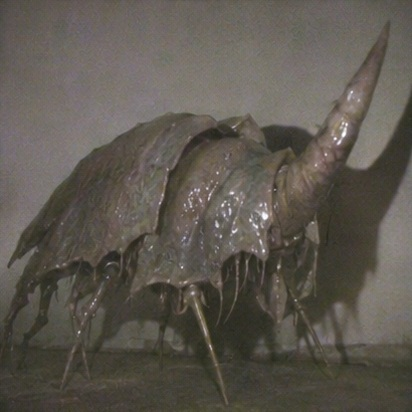
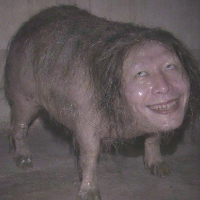
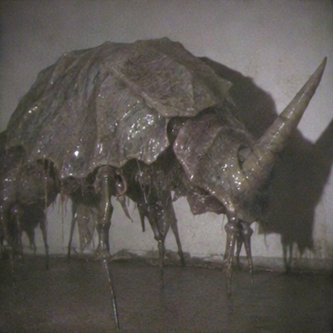
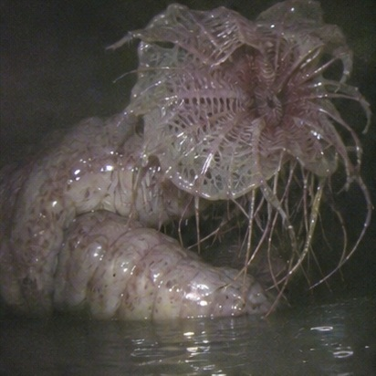
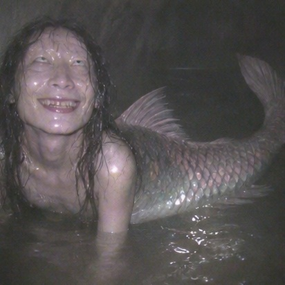
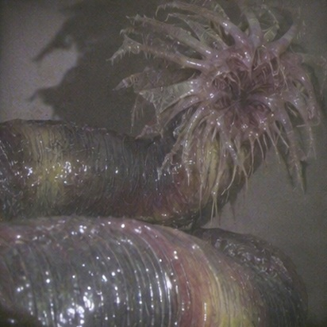
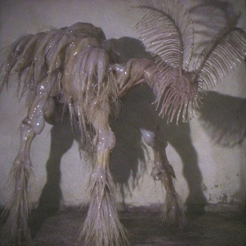
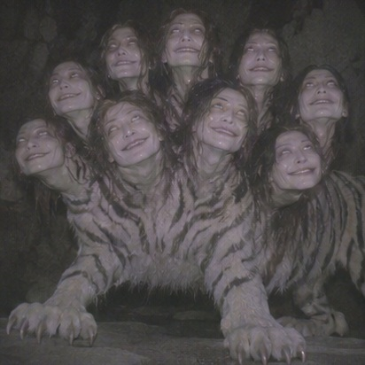
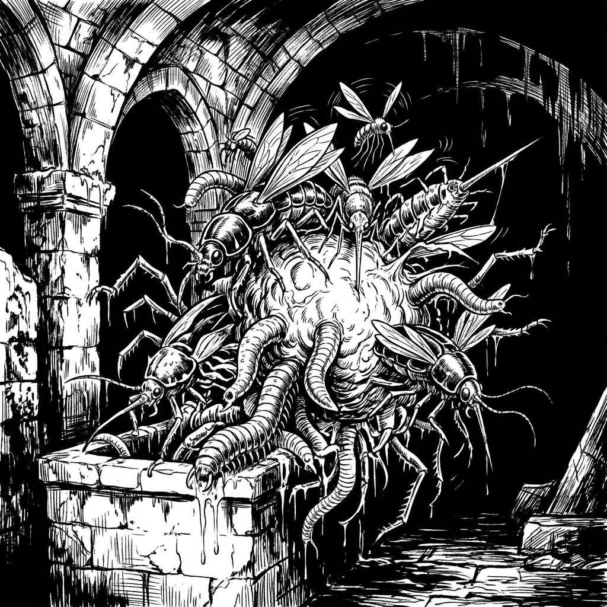
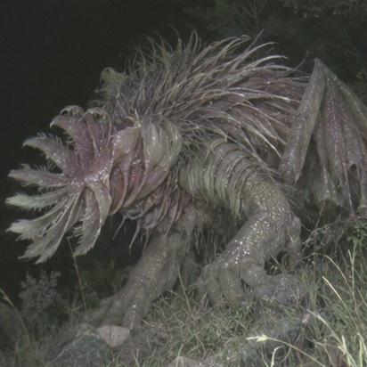

# 🏔️ 《山海經》純怪獸與妖怪圖鑑・卷 10～13〈海內四經〉

> **返回導覽**：[👹 妖怪篇總綱](../00-妖怪篇總綱與圖鑑分級.md) ｜ [📖 山海經總錄](./00-山海經怪獸妖怪總錄.md) ｜ [⬅️ 海外四經](./05-卷06至09_海外四經.md) ｜ [➡️ 大荒與海內經](./07-卷14至18_大荒四經與海內經.md)
>
> **收錄統計與範圍（2026-11-21 定案・純怪獸零神明鐵律）**：本卷嚴格依《山海經》原典順序，貫穿**卷十〈海內南經〉**、**卷十一〈海內西經〉**、**卷十二〈海內北經〉**與**卷十三〈海內東經〉**，從首頁到末頁完整收錄全四經共 **41 條**純怪獸、巨蟲、毒禽、深海異魚、恐怖谷偽人與寄生復活活屍異變體！全卷共嵌入磁碟實存黑白墨線圖檔 **11 張**（涵蓋本卷專屬怪獸圖檔 **9 張**，另於卷十二「窮奇海內虎翼食人版」雙圖對照嵌入本作五大標竿基準圖 **2 張**），其餘 **31 條**尚未配圖條目皆已附 `<!-- 圖位預留：待補繪 -->`。
>
> **嚴格剔除純神明與純人類國族聲明**：依本作 2026-11-21 純妖怪怪獸紅線，原典〈海內四經〉登場之一切**至高神祇、天庭司神、河嶽正神、巫祝先祖、帝王陵統與純人類部族方國**一律徹底剔除不立條目，包含但不限於：
> - **卷十〈海內南經〉剔除**：司神**孟涂**（夏后啟之臣）、帝舜與帝丹朱葬陵（蒼梧之山）、純人類方國（甌、閩、伯慮國、離耳國、雕題國、北朐國、匈奴、開題之國、列人之國）及純地脈植物（三天子鄣山、桂林八樹、氾林、建木）。
> - **卷十一〈海內西經〉剔除**：**六巫**（巫彭、巫抵、巫陽、巫履、巫凡、巫相）、崑崙之虛天帝下都百神、仁羿、后稷之葬、純人類方國（流黃酆氏之國、東胡、夷人、貊國）及純神木礦泉（木禾、珠樹、文玉樹、玗琪樹、不死樹、離朱、聖木曼兌、甘水等）。
> - **卷十二〈海內北經〉剔除**：**西王母**、**河伯冰夷**（從極之淵乘兩龍神）、舜妻登比氏與二靈女**宵明・燭光**、把戈神人**大行伯**、蛇巫之山操柸人、古帝四臺（帝堯・帝嚳・帝丹朱・帝舜臺）、純人類國族與仙境地名（犬封國女子、蓋國、鉅燕、倭、朝鮮、列陽、列姑射、射姑國、明組邑、蓬萊山、大人之市）。
> - **卷十三〈海內東經〉剔除**：**雷澤雷神**（龍身人頭鼓腹神）、**大禹**治水敘事、帝顓頊與九嬪葬統（唯保留護陵之「四蛇」入怪獸檔案）、純人類部族與地理名（埻端、璽㬇、大夏、豎沙、居繇、月支之國、西胡、都州、琅琊臺、會稽山等）。
>
> **美術與生物恐怖重構鐵律**：全卷徹底捨棄傳統威風神獸、祥瑞名馬、仙氣人魚與古風鬼魅框架，全面取材自**昆蟲、節肢動物、寄生生物、軟體與環節動物**四大生物原型庫，融合**黑暗地牢（Darkest Dungeon）潮濕腐蝕壓迫感 × 克蘇魯不可名狀感 × 恐怖谷偽人（Mimic）**，所有條目均嚴格標註 `【類人偽人型】` 或 `【非人生物恐怖型】`，並恪守 `【原典記載】` × `【本作衍生】` 雙軌考據。

---

## 🗺️ 本卷地理脈絡與「海內活屍・深淵水脈」生態總覽

〈海內四經〉與〈海外四經〉互為表裡，自海內東南陬、西南陬、西北陬一路繞回東北陬，最後以卷十三綿密貫通華夏全境的**二十餘條大江大河水系**收束。若說〈五藏山經〉是封存在濕熱深山裡的異獸蟲窟，〈海內四經〉呈現的便是令人理智徹底失溫的四大終極恐怖母題：

1. **極致恐怖谷偽人集群（卷十・卷十一・卷十二）**：從反踵模仿人笑的**梟陽**、喊出受害者本名的海內**狌狌**、頂著九顆異相人頭看守九門的**開明獸**，到無足人面魚身的**氐人**、手足俱全登岸爬行的**陵魚**、額生單目的**鬼國一目怪**、豎目黑首的**袜（魅）**，幾乎把「披著人皮卻徹底非人」的偽人（Mimic）恐怖推向巔峰。
2. **不死藥失敗復活與克蘇魯分屍活屍（卷十・卷十一・卷十二）**：本卷密集收錄《山海經》最陰慘的「尸（活屍異變體）」系譜——雙手與長髮反綁枯木仍被寄生復活拖木爬行的**貳負之尸**、遭強行灌藥復活卻腐化為龍首弱水食人巨怪的**窫窳與窫窳之尸**、折頸無手的**據比之尸**，以及手足胸首牙齒七處斷裂卻靠寄生肉絲彼此牽引爬行的**王子夜之尸**！
3. **黑暗地牢巨型昆蟲與吞噬蠕蟲災體（卷十・卷十二）**：生吞大象三年方出其骨的環節巨蛭吞噬怪**巴蛇**、體如鴛鴦與酒壺的食人巨蟲**大蜂與朱蛾**、無定形昆蟲寄生集群狩獵相**窮奇**，以及背甲綿延千里、堪稱深海移動地牢大陸的**大蟹**。
4. **貫穿地下暗渠的海內黑脈大水系（卷十三）**：卷十三〈海內東經〉後半記載自岷江、長江、漢水（鮒魚之山）至淮水、湘水、洛水、濟水之龐大河系，在本作現代都市靈異世界觀中被道門稱為「**海內黑脈大動脈**」——無數水棲魚怪、寄生盲蛭與海霧怪禽正是循著這些斷裂的古水系陰脈，跨越海峽滲入台灣各地的**漁港消波塊、水庫暗渠、都會雨水箱涵、廢棄地下蓄水池與高濕度老舊地下室**。

> **本卷原典非生物要物備忘（供劇情道具與法器設定引用，依純怪獸鐵律不另立怪物條目）**：
> - **桂林八樹**（卷十・番隅東）：八株成林之巨桂，木質可製驅濕破幻法器。
> - **建木**（卷十・弱水上）：狀如牛、引之有皮若纓黃蛇、葉如羅、實如欒、木若蓲，古稱天地天梯；本作設定為異界裂隙的高危空間支柱，凡人觸皮即遭反剝。
> - **崑崙神樹群**（卷十一・開明北）：珠樹、文玉樹、玗琪樹、不死樹、木禾、聖木曼兌、甘水、服常樹與琅玕樹——皆為引發妖物爭奪、黑市邪修以活人試藥的異界靈材源頭。
> - **大澤群鳥解羽地**（卷十一・鴈門北）：方百里之解羽濕澤，脫落腐羽常被高階蟲禽撿拾築巢。

---

## 📋 本卷純怪獸與妖怪速查表（海內四經全錄・共 41 條）

| 編號 | 名稱（別稱） | 所屬經卷 | 造型路線 | 本作黑暗地牢／寄生／偽人重構原形 | 物種／唯一性 | 稀有度 | 本作階位 | 配圖 |
| :---: | :--- | :--- | :---: | :--- | :--- | :---: | :--- | :---: |
| `SHJ10-001` | **梟陽**（狒狒／贛巨人） | 卷十・海內南經 | `【類人偽人型】` | 反踵模仿笑臉偽人・長唇掀覆寄生剛毛口器・骨管吸魂怪 | `物種（群體）` | `★★★ 珍級（SR）` | 二流頂 | 🖼️ |
| `SHJ10-002` | **兕**（舜葬東獨角腐獸） | 卷十・海內南經 | `【非人生物恐怖型】` | 蒼黑腐食獨角巨兜蟲獸・齦肉外翻毒角針・屍液重甲縫 | `物種（群體）` | `★★ 稀級（R）` | 二流 | 🖼️ |
| `SHJ10-003` | **狌狌（海內變種）**（知人名豕怪） | 卷十・海內南經 | `【類人偽人型】` | 腫脹腐豬甲殼身・中年寫實偽人臉・複眼微光喚名定身怪 | `物種（群體）` | `★★ 稀級（R）` | 三流頂～二流 | 🖼️ |
| `SHJ10-004` | **犀牛**（海內三甲異獸） | 卷十・海內南經 | `【非人生物恐怖型】` | 漆黑三層脫殼巨型三叉犀金龜蟲獸・甲縫蠕動蟲囊・噴酸三角 | `物種（群體）` | `★★ 稀級（R）` | 二流 | 🖼️ |
| `SHJ10-005` | **窫窳**（弱水龍首食人巨怪） | 卷十・海內南經 | `【非人生物恐怖型】` | 弱水腐甲龍首寄生巨怪・咽喉深處嵌生哭嚎蛇身偽人殘臉 | `獨一無二` | `★★★★ 絕級（SSR）` | 一流頂～巔峰 | 🖼️ |
| `SHJ10-006` | **氐人魚怪**（無足人面魚怪） | 卷十・海內南經 | `【類人偽人型】` | 無足溺屍偽人臉・鋸齒鰓裂吸盤・腹下剛毛蠕動巨蛭魚身 | `物種（群體）` | `★★ 稀級（R）` | 三流頂～二流 | 🖼️ |
| `SHJ10-007` | **巴蛇**（食象三歲出骨巨怪） | 卷十・海內南經 | `【非人生物恐怖型】` | 極致巨型環節蠕蟲與盲蛭吞噬怪・半透明體壁顯露緩溶象骨 | `物種特異個體` | `★★★★ 絕級（SSR）` | 一流頂 | 🖼️ |
| `SHJ10-008` | **旄馬**（四節長毛馬怪） | 卷十・海內南經 | `【非人生物恐怖型】` | 脫肉暗夜竹節馬骨節肢怪・四節關節爆出鐵線蟲黑髮纏腳毛叢 | `物種（群體）` | `★ 凡級（N）` | 三流 | 🖼️ |
| `SHJ11-001` | **貳負之尸**（疏屬山枷鎖腐屍怪） | 卷十一・海內西經 | `【類人偽人型】` | 雙手與長髮反綁枯木・右足戴枷卻遭蟲巢寄生拖木爬行活屍怪 | `獨一無二` | `★★★★ 絕級（SSR）` | 一流～一流頂 | ⏳ |
| `SHJ11-002` | **孟鳥**（三色東鄉腐蛾巨鳥） | 卷十一・海內西經 | `【非人生物恐怖型】` | 赤黃青三色毒斑巨型天蠶蛾毒蜂禽・翅下垂掛靜默蟲蛹群 | `物種（群體）` | `★★ 稀級（R）` | 二流 | ⏳ |
| `SHJ11-003` | **開明獸**（九首人面節肢虎巨怪） | 卷十一・海內西經 | `【類人偽人型】` | 九顆異相恐怖谷偽人人頭・生長於巨大幾丁質多節肢虎甲巨軀 | `獨一無二` | `★★★★★ 神級災厄（UR）` | 巔峰～規格外 | 🖼️ |
| `SHJ11-004` | **崑崙戴蛇鳳皇・鸞鳥群** | 卷十一・海內西經 | `【非人生物恐怖型】` | 頭頂腳踏吸血赤蛭・胸腔共生環節血蛇・頂盾腐蛾異化巨禽 | `物種特異個體` | `★★★★ 絕級（SSR）` | 一流頂 | ⏳ |
| `SHJ11-005` | **視肉**（聚肉雙目肉塊怪） | 卷十一・海內西經 | `【非人生物恐怖型】` | 無定形腐肝變形蟲軟體肉團・體表陷生兩顆永遠凝視之濕潤人眼 | `物種（群體）` | `★★★ 珍級（SR）` | 一流（再生特化） | ⏳ |
| `SHJ11-006` | **窫窳之尸**（蛇身人面腐屍態） | 卷十一・海內西經 | `【類人偽人型】` | 縫合針孔潰爛偽人面・下身塌縮為滲綠不死毒藥之腐蛇巨蛭屍 | `獨一無二` | `★★★★ 絕級（SSR）` | 一流 | ⏳ |
| `SHJ11-007` | **三頭人**（服常樹三首偽人怪） | 卷十一・海內西經 | `【類人偽人型】` | 下顎癒合三顆蒼白偽人頭・六複眼360度窺視倒吊節肢枯瘦體 | `物種特異個體` | `★★★ 珍級（SR）` | 二流頂～一流初 | ⏳ |
| `SHJ11-008` | **六首蛟**（兼考六首樹鳥） | 卷十一・海內西經 | `【非人生物恐怖型】` | 六頭獨立搏動環形齒水蛭巨蛟・四對反折蟹爪・共生六首腐鳥 | `物種特異個體` | `★★★ 珍級（SR）` | 一流 | ⏳ |
| `SHJ11-009` | **開明南大蝮與怪蛇**（兼陰窟豹） | 卷十一・海內西經 | `【非人生物恐怖型】` | 倒鉤蚊喙巨型蜈蚣毒蝮・半透明滿腹線蟲腐蛇・卵孔甲殼寄生豹 | `物種（群體）` | `★★ 稀級（R）` | 二流～二流頂 | ⏳ |
| `SHJ11-010` | **蜼**（仰鼻叉尾倒吊猴蟲怪） | 卷十一・海內西經 | `【非人生物恐怖型】` | 仰翻黑洞鼻孔盲猴節肢怪・雨天以分岔吸血水蛭長尾塞鼻蓄毒 | `物種（群體）` | `★★ 稀級（R）` | 二流 | ⏳ |
| `SHJ11-011` | **誦鳥與鶽**（表池低語禽與骨雕） | 卷十一・海內西經 | `【非人生物恐怖型】` | 複誦死者遺言複眼誦鳥・身披鈣化人骨甲殼俯衝巨型螳螂腐雕 | `物種（群體）` | `★★ 稀級（R）` | 二流中～頂 | ⏳ |
| `SHJ12-001` | **三青鳥**（崑崙北取食腐肉三禽） | 卷十二・海內北經 | `【非人生物恐怖型】` | 屍斑青黑三連神經絲巨型食腐青蠅禿鷲・蚊式抽血管啄食心眼 | `物種特異個體` | `★★★ 珍級（SR）` | 二流頂～一流初 | ⏳ |
| `SHJ12-002` | **吉量**（縞身朱鬣文馬異獸） | 卷十二・海內北經 | `【非人生物恐怖型】` | 慘白骨蠟甲殼馬怪・血蛭紅線蟲朱鬣・背刺釘穿騎手造千年活屍 | `物種特異個體` | `★★★ 珍級（SR）` | 一流初 | ⏳ |
| `SHJ12-003` | **鬼國一目怪**（人面獨眼偽人怪） | 卷十二・海內北經 | `【類人偽人型】` | 平滑無鼻偽人臉・額中橫裂巨大蜘蛛單眼聚合獨目・滲灰黏液 | `物種（群體）` | `★★★ 珍級（SR）` | 二流頂 | ⏳ |
| `SHJ12-004` | **蜪犬**（青色食人從首始犬蟲怪） | 卷十二・海內北經 | `【非人生物恐怖型】` | 青綠脫毛腐犬鞭蠍虎甲蟲怪・脫臼圓筒倒鉤齒顎套頭活啃腦漿 | `物種（群體）` | `★★★ 珍級（SR）` | 二流頂～一流初 | ⏳ |
| `SHJ12-005` | **窮奇（海內虎翼食人版）** ⚠️標竿 | 卷十二・海內北經 | `【非人生物恐怖型】` | 無定形昆蟲寄生集群狩獵相・萬蟲咬合虎斑甲・蒼蠅毒蚊殘膜翼 | `獨一無二` | `★★★★★ 神級災厄（UR）` | 一流頂～巔峰 | 🖼️×2 |
| `SHJ12-006` | **大蜂與朱蛾**（食人巨蜂與劇毒蛾） | 卷十二・海內北經 | `【非人生物恐怖型】` | 體如鴛鴦酒壺漆黑產卵管食人巨胡蜂・腥紅腐肉酸粉劇毒朱蛾 | `物種（群體）` | `★★★ 珍級（SR）` | 二流頂～一流 | ⏳ |
| `SHJ12-007` | **蟜**（虎文腫脛人面偽人怪） | 卷十二・海內北經 | `【類人偽人型】` | 瘦高人皮透虎斑甲殼紋・畸形膨大蝗蟲跳躍肌腫瘤小腿肚偽人怪 | `物種（群體）` | `★★ 稀級（R）` | 二流 | ⏳ |
| `SHJ12-008` | **闒非**（人面青色獸身偽人怪） | 卷十二・海內北經 | `【類人偽人型】` | 溺死青白無血色偽人面・頸下接青黑濕亮四足腐食甲蟲屍斑獸軀 | `物種（群體）` | `★★ 稀級（R）` | 二流中～頂 | ⏳ |
| `SHJ12-009` | **據比之尸**（折頸無手活屍怪） | 卷十二・海內北經 | `【類人偽人型】` | 180度折斷頸骨被髮垂頭・白線蟲代頸椎・斷肩爆射水蛭觸手活屍 | `獨一無二` | `★★★ 珍級（SR）` | 一流初 | ⏳ |
| `SHJ12-010` | **環狗**（環拘・獸首／黃蝟狗怪） | 卷十二・海內北經 | `【非人生物恐怖型】` | 人形枯軀頂黃膿毒棘縱裂犬蟲首・蜷縮成滾動毒刺電鋸蝟狗球 | `物種（群體）` | `★★ 稀級（R）` | 二流 | ⏳ |
| `SHJ12-011` | **袜**（礻末／襪・黑首縱目魅怪） | 卷十二・海內北經 | `【類人偽人型】` | 蒼白瘦長人身・焦黑甲殼黑首・臉中雙道垂直裂開複眼豎瞳魅怪 | `物種（群體）` | `★★★ 珍級（SR）` | 二流頂 | ⏳ |
| `SHJ12-012` | **戎**（人首三角偽人角怪） | 卷十二・海內北經 | `【類人偽人型】` | 僵面偽人顱頂破皮鑽出三根螺旋鍬形蟲寄生骨角・低頻震腦 | `物種（群體）` | `★★ 稀級（R）` | 二流 | ⏳ |
| `SHJ12-013` | **騶吾**（五采長尾異化巨獸） | 卷十二・海內北經 | `【非人生物恐怖型】` | 劇毒五彩寶石甲蟲重甲巨螳螂獸・超長倒鉤鞭蠍毒尾極速追獵怪 | `物種特異個體` | `★★★★ 絕級（SSR）` | 一流～一流頂 | ⏳ |
| `SHJ12-014` | **王子夜之尸**（七處分屍肉絲活怪） | 卷十二・海內北經 | `【類人偽人型】` | 兩手兩股胸首牙齒七處斷裂異處・靠濕紅寄生肉絲牽引爬行克蘇魯怪 | `獨一無二` | `★★★★ 絕級（SSR）` | 一流頂 | ⏳ |
| `SHJ12-015` | **大蟹**（蓋千里深海大陸巨蟹怪） | 卷十二・海內北經 | `【非人生物恐怖型】` | 深海大陸級移動地牢巨型甲殼節肢蟹・背甲滿布藤壺屍窟與蟹蝨潮 | `獨一無二` | `★★★★★ 神級災厄（UR）` | 規格外 | ⏳ |
| `SHJ12-016` | **陵魚**（人面手足魚身偽人魚怪） | 卷十二・海內北經 | `【類人偽人型】` | 溺屍偽人人面＋反折四肢手足＋臃腫產卵巨魚身・登岸壁行吸盤怪 | `物種（群體）` | `★★★ 珍級（SR）` | 二流頂～一流初 | ⏳ |
| `SHJ12-017` | **大鯾**（俗傳大鯥・海中巨扁魚怪） | 卷十二・海內北經 | `【非人生物恐怖型】` | 三十公尺極薄深海巨渦蟲扁甲魚怪・腹面萬口吸盤包船吸乾血肉 | `物種特異個體` | `★★★ 珍級（SR）` | 一流 | ⏳ |
| `SHJ13-001` | **韓鴈**（海中鐵羽寄生怪雁） | 卷十三・海內東經 | `【非人生物恐怖型】` | 漆黑幾丁質薄片鐵羽與水蛭膜海怪雁・針喙集群啄顱遷徙怪禽 | `物種（群體）` | `★★ 稀級（R）` | 二流 | ⏳ |
| `SHJ13-002` | **始鳩**（海中先聲霧毒鳩怪） | 卷十三・海內東經 | `【非人生物恐怖型】` | 藤壺濕藻甲殼海霧毒蛾鳩・滲霧巨複眼・低頻幻聲誘船入礁怪禽 | `物種（群體）` | `★★ 稀級（R）` | 二流 | ⏳ |
| `SHJ13-003` | **鮒魚之山四衛蛇**（陵窟聯體巨蛭） | 卷十三・海內東經 | `【非人生物恐怖型】` | 四條青白環節吸盤盲蛭蛇・尾端深埋地下水脈癒合共用產卵肉核 | `物種特異個體` | `★★★ 珍級（SR）` | 一流初 | ⏳ |
| `SHJ13-004` | **海內大水系異魚怪**（黑脈深淵魚群） | 卷十三・海內東經 | `【非人生物恐怖型】` | 腐甲魚蝨母巢巨鮒・暗渠人牙七鰓鰻水蛭魚・逆流鑽管寄生細魚群 | `物種（群體）` | `★★ 稀級（R）` | 三流～二流頂 | ⏳ |
| `SHJ13-005` | **鳥鼠同穴雙生怪**（鵌𪕬連體寄生怪） | 卷十三・海內東經 | `【非人生物恐怖型】` | 濕黑複眼鐮爪穴禽「鵌」腹腔肉洞內嵌吸血短尾肉瘤鼠蟲「𪕬」 | `物種（群體）` | `★★ 稀級（R）` | 二流 | ⏳ |

---

## 🌋 第一單元：卷十〈海內南經〉（海內東南陬以西・共 8 條）

> **本經原典逐則核對與剔除清單**：原典自「甌居海中」起至「匈奴、開題之國、列人之國並在西北」止。已嚴格剔除純地理與神木（甌、閩、三天子鄣山、桂林八樹、氾林、建木）、純人類古族（伯慮國、離耳國、雕題國、北朐國、匈奴、開題之國、列人之國）、古帝葬地（蒼梧之山帝舜與帝丹朱之葬）及巴地司神**孟涂**；全數精錄本經 **8 條**實體怪獸與恐怖谷偽人怪，全數已配磁碟實存黑白墨線圖檔（8 張）。

### [SHJ10-001] 梟陽（狒狒／贛巨人／長唇反踵模仿笑臉偽人怪）
- **出處順序**：卷 10〈海內南經〉・北朐之西（原典第 5 則）
- **類別與造型路線**：`【類人偽人型】`｜極致恐怖谷模仿笑臉偽人・翻唇寄生口器・反踵節肢山怪
- **物種／唯一性**：`物種（群體）`（原典以「梟陽國」稱之，晉・郭璞注亦記其群居於南康山中，實為擅長模仿人類表情的群聚偽人魔怪種群）
- **稀有度與道行對照**：`★★★ 珍級（SR）`｜模糊道行：數百年深山陰濕山精成氣候者，約當西遊洞府精怪悍將層級｜本作階位：二流頂
- **外貌與黑暗地牢／恐怖谷視覺改寫**：
  - 
  - 【原典外貌】「梟陽國在北朐之西，其為人人面長脣，黑身有毛，反踵，見人笑亦笑，左手操管。」——擁有一張人類面孔與異常肥長的上唇，通體黑身有毛，腳跟朝前、腳趾朝後（「反踵」），遇見人類發笑便跟著發笑，左手常握著一根管狀物。
  - 【本作克蘇魯／昆蟲寄生／偽人重構】本作**「極致恐怖谷模仿笑臉偽人」**代表作！身高近兩米半，瘦長佝僂得像被硬塞進潮濕山道裡的畸形黑影；遠看似乎披著黑亮長毛，近距離以手電筒一照才令人胃部痙攣——那根本不是哺乳類毛髮，而是從灰黑濕軟幾丁質表皮縫隙裡密密麻麻鑽出的**漆黑毒蛾硬質剛毛與細密蜈蚣觸鬚**！牠的雙腳腳踝完全 180 度反折、腳跟朝前且趾端嵌生鈣化黑爪，踏過爛泥留下的腳印永遠指向完全相反的方向。最令人理智崩毀的是牠的臉：一張比例幾乎與人類無異、卻因為過度用力牽拉嘴角而皮肉皸裂的蒼白偽人臉，雙眼毫無笑意且在暗處閃過蒼蠅複眼冷光；當你哪怕因為緊張扯動一絲嘴角，牠便同步撕裂臉頰大笑——那片肥厚滑膩的**超長上唇**竟如濕軟水蛭肉膜般向上瘋狂翻捲，瞬間整片蓋住額頭與雙眼，而暴露在翻唇底下的不是人類牙床，而是一圈層層外翻、分泌腥臭麻醉黏液的**寄生環形倒鉤齒與四瓣縱裂昆蟲捕食口器**！左手死死攥著的那根「竹管」，實為一截中空沾滿黑血的**巨型蚊式吸血骨管**。黑白墨線以大量交叉密線刻畫黑毛剛毛質感，死白突顯反翻長唇與裂至耳根的僵硬假笑。
- **特性**：
  - 【原典記載】見人笑亦笑；反踵；左手操管。郭璞注引古說其笑則上唇掩目，亦通「狒狒」（見〈海內經〉），能言善笑、嗜食人血肉。
  - 【本作衍生】**「鏡像笑臉神經劫持」**：梟陽一旦與人類四目交接，便會釋放微弱神經信息素刺激對方面部神經抽搐——受害者明明嚇得全身發抖，臉部肌肉卻會不受控地抽動出一抹「僵硬微笑」；一旦目標露出牙齒，梟陽便徹底鎖定獵殺判定，在狂笑聲中翻起長唇撲噬，再以左手骨管插進胸骨吸乾溫熱心血。
- **弱點**：
  - 【原典記載】郭璞注引古獵人擒法：其大笑時肥長上唇必然向上翻覆遮蔽雙目（瞬間陷入全盲），獵人可趁隙以鐵錐或竹釘直接將牠翻起的長唇釘死於額頭上再予以斬殺。
  - 【本作衍生】1. **「釘唇破盲」實戰機制**：台灣實戰除妖師對付梟陽的黃金法則，就是**故意大笑或用手機螢幕／假面具誘使其進入「狂笑翻唇」狀態**，趁牠上唇完全遮眼的致命兩秒，以塗抹硃砂黑狗血的**鎮魂鋼釘或特製釘槍符箭**直接將其長唇釘死在額骨與牆面上，令其陷入永久失明並痛極痙攣；2. **「奪管斷吸」**：左手所操吸血骨管連通其體內寄生儲血囊，以掌心雷或銳器擊碎骨管會引發其體內高壓反噬吐血。
- **習性**：
  - 【原典記載】棲於北朐之西深林陰嶺。
  - 【本作衍生】現代台灣極易出沒於中南部潮濕濃霧的**郊山竹林古道、夜間無人山區公路明隧道、以及老舊公寓頂樓滲水樓梯間**。常刻意倒著行走留下「正在遠離」的反向泥足跡，誘使追查的登山客或除妖師以為妖物已經離開，實則正倒掛在頭頂橫樑上靜靜模仿你的臉部表情。
- **喜好**：
  - 【原典記載】見人則笑，好捉人食之。
  - 【本作衍生】對人類的笑聲、相聲廣播、恐怖喜劇音效以及「照鏡子」有著扭曲執念；巢穴牆壁常貼滿從受害者手機列印或撕下的笑臉大頭照，並會用骨管反覆刮擦照片上的嘴角。
- **擅長的招式／異能**：
  - 【原典記載】反踵誤蹤、見人笑亦笑（翻唇撲噬）。
  - 【本作衍生】**「強迫痙笑瘴」**（散發致幻孢子令目標臉部肌肉不自主上揚抽笑，強制觸發牠的獵殺規則）、**「翻唇蟲顎暴咬」**（長唇掀起掩眼的瞬間，隱藏在唇後的四瓣昆蟲大顎如捕蠅草般高速彈射，直接咬碎人類下顎與咽喉）、**「骨管抽心」**（左手吸血骨管貫穿胸腔，三秒內將獵物吸成乾癟皮囊）。

---

### [SHJ10-002] 兕（舜葬東重甲獨角腐獸）
- **出處順序**：卷 10〈海內南經〉・舜葬東、湘水南（原典第 6 則）
- **類別與造型路線**：`【非人生物恐怖型】`｜蒼黑腐食巨型獨角仙兜蟲獸・齦肉外翻毒角針・滲液重甲怪
- **物種／唯一性**：`物種（群體）`（《山海經》多卷亦見其蹤，屬棲息於陰濕沼澤與墳塋地脈的重甲異變怪獸族群）
- **稀有度與道行對照**：`★★ 稀級（R）`｜模糊道行：數十年至百餘年聚墳陰成精的鈍重甲殼妖獸｜本作階位：二流
- **外貌與黑暗地牢／恐怖谷視覺改寫**：
  - 
  - 【原典外貌】「兕在舜葬東，湘水南，其狀如牛，蒼黑，一角。」——體形如巨牛，通體呈陰鬱蒼黑色，額頭長有一根堅硬獨角（古籍稱其皮極厚可製鎧甲）。
  - 【本作克蘇魯／昆蟲寄生／偽人重構】徹底揚棄溫馴野牛外殼，重構為盤踞在古墓淤泥與廢棄高架橋沼澤裡的**「重甲腐食獨角巨兜蟲獸」**！體長超過三公尺，全身覆蓋如龜裂柏油路面般厚重、泛著潮濕屍蠟冷光的蒼黑色**層疊幾丁質重甲**；每一道甲板接縫都在隨呼吸開闔、滲出惡臭暗黑屍液並爬出密密麻麻的食腐埋葬蟲幼蟲。原本該是牛眼的眼眶深深凹陷成兩排微弱發光的硬蜱單眼，口器並非草食扁牙，而是厚重如碎石機般的水平雙剪甲蟲大顎。最駭人的是額頭正中央破骨長出的那根**巨型蒼黑獨角**——角根處皮肉翻捲暴露出暗紅發紫如腐敗牙齦般的搏動寄生肉環，角尖細看其實是一根中空滴落酸臭黑漿的**巨型毒蜂注液鋼針**！四蹄徹底節肢化為粗壯倒鉤的掘地兜蟲重爪，踏過之處留下一攤攤冒泡腐水。黑白墨線重點表現厚重重黑甲殼裂紋、外翻肉環與濕亮反白水漬。
- **特性**：
  - 【原典記載】皮甲極厚（《左傳》《禮記》皆言兕甲堅不可摧），生獨角，居於古帝舜葬地之東的陰濕水畔。
  - 【本作衍生】**「墳陰屍氣探角＋防彈級腐甲」**：額中獨角是一根活體陰氣天線，能精準感應半徑一公里內的新葬屍體、靈骨塔滲水處與剛亡故者的怨氣；蒼黑幾丁質背甲足以硬扛制式手槍彈與普通鐵劍劈砍，且受創甲縫噴出的黑臭酸液能瞬間腐蝕刀刃與防彈衣。
- **弱點**：
  - 【原典記載】原典未載。
  - 【本作衍生】1. **甲縫軟膜與角根齦肉為唯一死穴**：正對厚甲攻擊徒勞無功，唯有趁其衝鋒轉向遲鈍時，將**破甲穿骨符**或強效生石灰撒入翻開的頸甲縫與角根外翻肉環，可令寄生神經瞬間劇痛癱瘓；2. **極度畏懼正午烈日與高溫脫水**：一旦被誘至毫無遮蔭的乾燥柏油廣場，重甲下滲出的屍油會快速硬化結塊，使牠關節卡死無法轉身。
- **習性**：
  - 【原典記載】棲於舜葬之東、湘水南岸濕澤。
  - 【本作衍生】現代台灣常潛伏於大型**公墓外圍排水溪谷、廢棄土葬區積水坑、以及緊鄰河濱高灘地的老舊橋墩暗溝**。白晝如同一塊生苔發臭的巨大黑泥岩石半埋在爛泥中一動不動，入夜後循著屍氣翻爬上岸，啃食廢棄墓穴裡的腐物與夜半誤闖高灘地的單車客。
- **喜好**：
  - 【原典記載】原典未載。
  - 【本作衍生】極度迷戀陳年腐屍滲出的屍蠟味、潮濕爛泥漿以及老舊墳墓裡生鏽的鐵釘與骨灰罈碎片，常將泥沙混著骨屑塞進背甲縫中增厚裝甲。
- **擅長的招式／異能**：
  - 【原典記載】原典未載（唯見其龐大牛形獨角之勢）。
  - 【本作衍生】**「蒼角貫壁衝」**（低頭壓實重甲發動直線狂衝，足以直接撞穿紅磚牆與鐵皮圍籬，並以中空毒角刺穿目標注入溶肉腐酸）、**「開甲爆蟲霧」**（受重擊時猛然震開背甲接縫，噴出遮蔽視線的腐敗氣浪與數百隻噬肉埋葬蟲幼蟲）。

---

### [SHJ10-003] 狌狌（海內知人名變種／豕身人面偽人怪）
- **出處順序**：卷 10〈海內南經〉・舜葬西（原典第 9 則；*註：與卷 01〈南山經・招搖之山〉「狀如禺而白耳」系同源分枝，本條專錄卷十「如豕而人面、知人名」之海內異變株*）
- **類別與造型路線**：`【類人偽人型】`｜腫脹腐豬甲殼身・中年寫實偽人臉・複眼微光喚名定身怪
- **物種／唯一性**：`物種（群體）`（可自然繁衍於濕熱南地與現代都會暗巷的群體性偽人怪）
- **稀有度與道行對照**：`★★ 稀級（R）`｜模糊道行：數十年至百餘年專精竊音喚名的小妖｜本作階位：三流頂～二流
- **外貌與黑暗地牢／恐怖谷視覺改寫**：
  - 
  - 【原典外貌】「狌狌知人名，其為獸如豕而人面，在舜葬西。」——不同於招搖山白耳獼猴形，海內南經的狌狌軀幹肥腫如豬（「如豕」），卻生著一張人類面孔，並具備直接說出陌生人姓名的詭異能力。
  - 【本作克蘇魯／昆蟲寄生／偽人重構】相較於卷一招搖株的消瘦長臂，海內株往**「極度生理作嘔的肥腫腐豬蟲軀 × 過分逼真的中年熟人臉」**方向劇烈畸變！脖子以下是一頭脹得彷彿快要炸裂的灰白肥豬軀殼，表皮覆滿泡水屍斑與層層疊壓的**潮濕鼠婦（球潮蟲）甲殼褶**，原本豬蹄的位置長出六條細短如腐食甲蟲多節螯足的細腳，拖著墜地滲膿的肥肚在暗溝積水裡快速爬行。然而從粗腫豬頸前端生出的，卻是一張**細緻到連毛孔、法令紋、油光與鬍渣都極度寫實的中年台灣路人人臉**（甚至能隨目標記憶微調五官，像極了你的鄰居、老爸或已故親友）！仔細盯著牠的瞳孔，會看見眼白裡爬過極細的白色寄生線蟲，瞳仁泛出蒼蠅複眼的細碎格光；當牠微笑著喊出你的全名時，整張人臉的腮幫會沿著皮下甲殼接縫微微「喀啦」張開吐出濕熱酸臭氣。黑白墨線以濕胖皺褶陰影與過分精緻逼真的人面五官製造撕裂般的恐怖谷反差。
- **特性**：
  - 【原典記載】「知人名」——未曾謀面即可一眼叫出人類的真實姓名；郭璞注並引古書言其「知往而不知來」（通曉過去卻不知未來陷阱）。
  - 【本作衍生】**「記憶資訊素竊讀＋呼名定身」**：海內狌狌鼻腔的昆蟲觸角絨毛能直接嗅出人類汗腺與殘留魂息中的「自我認知標籤」，進而精準竊取目標的本名、小名甚至父母親暱稱呼！一旦牠用你最熟悉的人的聲線叫出全名且你本能回頭應聲，對方腦幹便會遭其低頻音浪注入**神經麻痺波**，瞬間僵直無法動彈。
- **弱點**：
  - 【原典記載】郭璞注引古獵法：狌狌極嗜美酒與草屐，且「知往而不知來」；獵人於林間置酒與連綴草鞋，狌狌雖明知是陷阱仍罵而復返飲酒穿鞋，最終醉倒絆足遭擒。
  - 【本作衍生】1. **「假名・法名反制」**：執業除妖師面對海內狌狌時，必須從進門起就在內心反覆默念**道門法名或臨時假名**（切忌掛著真實員工識別證或名牌），並緊記絕不可在聽到背後喊自己本名時回頭應「哎／有」；2. **「高濃度烈酒誘醉＋細線絆蟲足」**：灑落高粱酒或藥酒會瞬間癱瘓其嗅覺讀名觸毛，使其陷入極度亢奮的醉酒自語狀態，此時以浸過黑狗血的細鋼線絆住其六條甲蟲細足即可輕易斬首。
- **習性**：
  - 【原典記載】棲於帝舜葬地之西、氾林之側的潮濕密林。
  - 【本作衍生】現代極度適應台灣夜間人聲鼎沸的**熱炒店後巷油汙水溝、夜市垃圾集中區、傳統市場肉攤下水道與老舊國宅信箱間**。牠們會潛伏在信箱下偷嗅水電帳單與掛號信上的名字，或在後巷記住喝醉酒食客互相喊出的全名，等落單者走進暗巷撒尿時，貼在背後小聲用母親的聲音喊出對方的全名。
- **喜好**：
  - 【原典記載】郭注載其極度嗜酒、喜穿人類草鞋。
  - 【本作衍生】病態收集印有人名的身分證影本、快遞紙箱標籤、學生制服名牌與喝剩的高粱酒瓶；巢穴積水中常飄滿被啃爛名字欄的帳單與單隻濕透的拖鞋。
- **擅長的招式／異能**：
  - 【原典記載】知人名、知往（窺探過往記憶碎片）。
  - 【本作衍生】**「熟聲喚真名」**（模仿受害者至親嗓音精準呼喊全名，凡回頭應聲者神經系統強制僵直三至五秒）、**「往事耳語幻惑」**（一口氣吐出目標過去最隱私的愧疚往事動搖心神）、**「裂腮吸盤撲噬」**（趁目標僵直時，寫實中年人臉猛然沿下顎縱裂展開，暴露整張豬吻與吸血吸盤一口咬斷頸動脈）。

---

### [SHJ10-004] 犀牛（海內黑甲三甲異獸）
- **出處順序**：卷 10〈海內南經〉・狌狌西北（原典第 10 則）
- **類別與造型路線**：`【非人生物恐怖型】`｜三層脫殼漆黑巨型三叉犀金龜蟲獸・半透明腐內臟甲縫・噴酸三角
- **物種／唯一性**：`物種（群體）`（原典多處記載之黑甲異獸族群，海內南經所載者體色全黑、甲質尤異）
- **稀有度與道行對照**：`★★ 稀級（R）`｜模糊道行：百年腐澤黑甲精怪｜本作階位：二流
- **外貌與黑暗地牢／恐怖谷視覺改寫**：
  - 
  - 【原典外貌】「狌狌西北有犀牛，其狀如牛而黑。」晉・郭璞注：「犀似水牛，豬頭，大腹，庳腳，腳有三蹄，黑色。三角，一在頂上，一在額上，一在鼻上……食角也，好啖棘。」
  - 【本作克蘇魯／昆蟲寄生／偽人重構】徹底剝離動物園灰犀牛形象，依據原典「黑」與郭注「三角・三蹄」重構為**「三層活體脫殼漆黑三叉犀金龜蟲獸」**！體型如一輛報廢裝甲運鈔車，全身由**三層厚重漆黑、像潮濕焦油般泛著油膩光澤的幾丁質外甲**重疊包覆；詭異的是這三層甲殼永遠處於「半剝落、半再生」的病態蛻皮狀態——外層黑甲片片龜裂捲起，裂縫底下暴露出慘白半透明的潮濕內層薄膜，透過薄皮能清楚看見內臟裡密密麻麻蠕動的**白色寄生條蟲囊與搏動暗黑腺體**！頭頂、額心與鼻端破殼生出三根漆黑彎曲的**中空幾丁質大叉角**（宛如長戟兜蟲與南洋大兜蟲的巨型角鉗），角面佈滿滲出腐蝕血酸的微孔；四足短粗如三叉蟹螯重爪，每走一步都拖出厚重黑泥與脫落的腐爛角質碎甲。黑白墨線刻意強調重黑裝甲與裂縫間露出的濕亮軟肉對比。
- **特性**：
  - 【原典記載】體黑、生三角（頂角、額角、鼻角），古傳「好啖棘」（喜啃荊棘硬刺）；後世亦傳其角具「燃犀照怪」（燃燒角片可照出潛藏水族精怪）之奇異靈性。
  - 【本作衍生】**「三甲循環蛻防＋燃犀通靈角」**：三層外甲可像壁虎斷尾般於受重擊時主動「爆殼脫落」卸去斬擊與符雷傷害，脫落的碎甲片還附著強酸寄生幼蟲；其鼻端主角（食角）蘊含極高濃度的生物螢光靈脂，被台灣地下除妖界奉為極品法材——將其乾燥角屑投入火盆「**燃犀**」，冒出的慘青煙火能瞬間撕碎一切低中階偽人與水怪的障眼法！
- **弱點**：
  - 【原典記載】原典未載。
  - 【本作衍生】1. **「朔日蛻甲虛弱期」**：每逢農曆初一（朔日）或劇烈潮濕暴雨夜，牠必須同時剝落外層兩層舊甲，此時全身半透明軟肉外露、防禦力歸零，一張普通**烈火符**或粗鹽散彈即可令其痛極翻滾斃命；2. **「三蹄關節截筋」**：雙眼幾乎全盲，全靠鼻角震動感應定位，以高分貝音爆或震地雷符干擾後，專攻其短粗低矮的節肢關節縫即可使其徹底癱瘓。
- **習性**：
  - 【原典記載】居於狌狌西北方之荒澤密林。
  - 【本作衍生】現代台灣常潛伏於**老舊工業區廢棄化學槽地下室、荒廢動物園改建遺址、以及河川高灘地長滿刺草與廢鋼筋的汙泥荒地**。白天半埋在發臭工業泥漿裡蛻甲，夜間啃食生鏽鐵絲網、枯木荊棘與誤闖工地的流浪犬隻。
- **喜好**：
  - 【原典記載】郭注載其「好啖棘」（喜啃生滿尖刺的荊棘與硬枝）。
  - 【本作衍生】病態嗜嚼帶刺的廢棄鐵絲網、碎玻璃碴、生鏽鐵釘與發臭泥炭，藉此在胃囊中研磨出極具腐蝕性的黑鐵酸漿，再反芻塗布於三根角質巨角上。
- **擅長的招式／異能**：
  - 【原典記載】原典未載（郭注示其三角與厚黑甲之勢）。
  - 【本作衍生】**「三叉角酸噴衝」**（三根空心巨角同步噴灑濃黑胃酸腐霧，隨後以三層重甲發動無堅不摧的鐵甲衝撞）、**「蛻甲爆刺」**（遭近身貼符時主動震碎外層舊黑甲，讓帶符甲片脫落並順勢將碎甲如散彈般震飛割傷對手）。

---

### [SHJ10-005] 窫窳（猰貐／弱水龍首食人巨怪｜兼考卷十一屍變終態）
- **出處順序**：卷 10〈海內南經〉・狌狌知人名之西、弱水中（原典第 12 則；*註：與卷 11〈海內西經〉「開明東……窫窳之尸，蛇身人面，貳負臣所殺也」互為「遭殺灌藥復活 → 徹底崩壞成弱水食人巨怪」之前後異變階段*）
- **類別與造型路線**：`【非人生物恐怖型】`（咽喉深處殘留極致恐怖谷偽人人面殘片）｜弱水腐甲龍首寄生巨怪・多顎水蛭吞噬腔・神屍墮化災體
- **物種／唯一性**：`獨一無二`（原典明指其為遭貳負與危殺害後、經強行灌藥復活卻徹底畸變墮化的唯一食人巨怪）
- **稀有度與道行對照**：`★★★★ 絕級（SSR）`｜模糊道行：千年古神殘屍墮化而成之頂級食人凶怪，足堪抗衡西遊一方大妖王｜本作階位：一流頂～巔峰
- **外貌與黑暗地牢／恐怖谷視覺改寫**：
  - 
  - 【原典外貌】「窫窳龍首，居弱水中，在狌狌知人名之西，其狀如貙，龍首，食人。」——體型碩大如猛獸「貙」（或虎豹類大獸），卻頂著一顆森然巨型龍首，長踞鴻毛不浮的「弱水」深處，性極殘暴嗜食活人（*另卷十一記其原身本為「蛇身人面」，復活失敗後終成此相*）。
  - 【本作克蘇魯／昆蟲寄生／偽人重構】本作最悲愴亦最駭人的**「強行復活失敗・多相寄生深淵巨怪」**！徹底摒棄東方威嚴祥龍頭顱，重構為從漆黑死水下緩緩浮出的**巨型腐甲龍首寄生吞噬怪**：龐大頭顱由數十塊泡脹發青、層層疊壓的濕亮深水巨蟹與龍骨幾丁質甲板拼合而成，鱗甲縫隙間卡滿數百枚受害者死前抓撓斷裂的慘白指甲與濕黑長髮；原本應在陸地行走的貙獸軀幹已浸泡得臃腫半爛，體側裂開六對宛如深海大王具足蟲與水蛭吸盤般的划水多節肢。最令人理智瞬間蒸發的畫面，在牠猛然張開巨型龍顎的剎那——口腔上下兩排並非單純獸牙，而是三層同心旋轉的**環形水蛭倒鉤齒**與外翻的昆蟲下顎鬚；而在漆黑滲血的咽喉最深處，竟還像寄生腫瘤般嵌生著牠復活前原本的那張**「蛇身人面」慘白偽人臉**！那張卡在喉嚨裡的人臉雙眼流著黑濁弱水、嘴唇永遠開闔著無聲哀嚎「殺……了……我……」，一邊哭喊，一邊隨著巨型龍顎的瘋狂吞嚥把活人整個拖進胃酸深淵！黑白墨線以沉重暗黑水波與咽喉深處留白人臉構成強烈視覺衝擊。
- **特性**：
  - 【原典記載】龍首、狀如貙、居於弱水之中、食人；生前遭貳負與危殺害，經不死之藥強行復生卻異化為絕世食人凶怪。
  - 【本作衍生】**「不死藥腐蝕再生＋弱水失浮領域」**：當年強行灌入屍體的「不死藥」早已在牠體內與深淵寄生菌變異為瘋狂增生的**惡性再生黑泥**——任何砍傷皆會在十秒內從傷口爆出無數濕滑寄生肉芽與水蛭觸鬚強行填合；更致命的是牠周身滲出的「**弱水黑液**」，凡沾染此水的物體、法器乃至人體皆會失去一切浮力與輕身法術加持，如鉛塊般筆直墜入深潭溺斃。
- **弱點**：
  - 【原典記載】本卷未載明確殺法；惟《淮南子・本經訓》記載後世由神射手「羿」於疇華之野將窫窳射殺，暗示遠程穿心重擊可終結其不死再生。
  - 【本作衍生】1. **「離水乾涸失衡」**：弱水既是牠的獵場也是牠的牢籠——龐大腐甲極度依賴水壓支撐，一旦被誘離深水區拖上乾燥水泥地超過三分鐘，其表皮不死黑泥會迅速龜裂失壓，移動速度暴跌七成；2. **「咽喉殘臉即真核」**：斬爛外層龍首只會觸發無限再生，唯有用**破魔雷箭、穿心硃砂釘或遠程法砲**在牠張嘴吞噬的瞬間精準貫穿咽喉深處那張哭嚎的「蛇身人面殘臉」，並在攻擊前以古音呼喚其生前舊名誘使其短暫呆滯，方能徹底終結這場持續千年的復活噩夢。
- **習性**：
  - 【原典記載】盤踞狌狌之西、建木之東的弱水深淵。
  - 【本作衍生】現代台灣潛伏於**偏遠深山水庫的廢棄洩洪底部暗池、長年封閉滲水的地下防空大蓄水庫、以及頻繁發生「莫名腳抽筋直沉水底」溺斃案的深色山間碧潭**。平時僅將龍首吻部微露水面如一塊長滿水草的腐木，專等有人靠近岸邊打撈失物或跳水救人。
- **喜好**：
  - 【原典記載】食人。
  - 【本作衍生】咽喉深處殘留的「生前被救治記憶」扭曲成了病態執念——特別容易被**消毒藥水味、中藥煎煮味與穿著白袍的醫護人員、救護車警笛聲**吸引，常在暴雨夜循著下水道逼近臨河醫院的地下室太平間與汙水井。
- **擅長的招式／異能**：
  - 【原典記載】居弱水、食人。
  - 【本作衍生】**「弱水沉淵場」**（自鰓甲噴出漆黑黏稠弱水霧，使周遭積水瞬間喪失浮力，凡落水者無論水性多佳皆如綁鐵球般垂直下沉）、**「喉面悲鳴誘殺」**（張口露出咽喉裡的偽人殘臉發出令人心碎的真實人類求救哭嚎，誘使富有同情心者伸手援救再一口吞沒）、**「不死腐泥狂潮」**（遭重創時從甲縫爆出大量寄生水蛭黑泥席捲全場，將接觸到的活物拖回血口）。

---

### [SHJ10-006] 氐人魚怪（氐人國／人面魚身無足偽人魚怪）
- **出處順序**：卷 10〈海內南經〉・建木西（原典第 14 則）
- **類別與造型路線**：`【類人偽人型】`｜極致恐怖谷無足人面魚身偽人怪・鋸齒鰓裂吸盤・腹生寄生剛毛爬行水怪
- **物種／唯一性**：`物種（群體）`（原典作「氐人國」，實為群居於淺海暗礁與陰濕水池的偽人魚怪族群）
- **稀有度與道行對照**：`★★ 稀級（R）`｜模糊道行：數十年至百餘年水族陰濕怪魅｜本作階位：三流頂～二流
- **外貌與黑暗地牢／恐怖谷視覺改寫**：
  - 
  - 【原典外貌】「氐人國在建木西，其為人人面而魚身，無足。」——長著人類的臉孔與魚類的身體，沒有雙足（*郭璞注：盡為人面，胸以上人，胸以下魚也；一說通體魚身唯獨前端生人面*）。
  - 【本作克蘇魯／昆蟲寄生／偽人重構】徹底粉碎童話美人魚的唯美幻想，打造極致令人起雞皮疙瘩的**「無足溺屍偽人魚怪」**！完全沒有人類手臂與雙腿——一張泡水浮腫、神情極端木然、毫無眼皮且永遠不會眨動的**慘白溺水者人臉**，毫無脖頸過渡地直接焊生在一條長達兩公尺、油亮發滑且缺乏硬鱗的**灰黑巨型盲鰻／環節巨蛭魚身**前端！最恐怖的是人臉耳際兩側：耳廓位置徹底撕裂為三對深紅搏動、內緣密生細小倒鉤齒的**鰓裂寄生吸盤**，每次呼吸都會發出潮濕的「咕嚕、嘶哈」黏液吸氣聲。雖然「無足」，但當牠爬離水面時，魚腹底下會猛然翻出數百條如海毛蟲與馬陸般的**半透明寄生剛毛與吸盤肉足**，以極不自然、高速左右扭動的蠕蟲步態貼著潮濕磁磚直衝而來，那張一動不動的人臉就這麼死盯著你越貼越近！黑白墨線以濕亮黏液反白高光、死白無瞳人臉與滿佈寄生吸盤的暗黑魚身營造強烈生理噁心感。
- **特性**：
  - 【原典記載】人面魚身、無足，棲於弱水之西海域與深澤。
  - 【本作衍生】**「池面浮首擬態＋黏液兩棲潛行」**：在水池或淹水地下室中僅將那張慘白人臉垂直浮出水面，遠看活脫脫像一名泡在深水裡無助望向岸邊的溺水市民；其體表分泌的半透明黏液能在乾燥水泥地上維持短暫濕潤膜，並於爬過之處留下極難清理、帶有強烈死魚腥臭與麻痺毒素的寄生黏痕。
- **弱點**：
  - 【原典記載】無足（缺乏長距離陸地追擊骨骼結構）。
  - 【本作衍生】1. **「粗鹽與生石灰速乾破防」**：無鱗軟體水蛭魚身對高滲透壓鹽類與生石灰毫無抵抗力——抓一把**粗鹽混生石灰**撒在地面或直接砸在牠臉側鰓裂上，其表皮黏液會立刻劇烈起泡收縮，腹下爬行剛毛當場脫水焦爛；2. **「離水一刻失能」**：將其強行拖離水源並以**燥火符**烤乾空氣濕度，不出十五分鐘便會窒息抽搐而死。
- **習性**：
  - 【原典記載】聚居於建木之西的陰冷海域。
  - 【本作衍生】現代台灣最常混跡於**大型廟宇無人看管的渾濁放生池、荒廢老舊公園人工湖、廢棄釣蝦場積水池，以及豪雨淹水後的社區地下機械車位**。白晝沉在池底爛泥中裝作大型錦鯉或土虱，深夜悄悄浮出水面，貼在池邊欄杆下方直勾勾仰望獨自路過的夜歸人。
- **喜好**：
  - 【原典記載】原典未載。
  - 【本作衍生】莫名迷戀香客投進許願池的銅板、腐爛的吐司麵包屑，以及人類從池邊彎腰往下張望時倒映在水面上的臉孔；牠會試圖記住每張看過牠的臉，並把自己的五官緩慢扭曲模仿成上一名受害者的長相。
- **擅長的招式／異能**：
  - 【原典記載】原典未載。
  - 【本作衍生】**「溺者浮面呼救」**（僅露人面於黑水之上，以喉鰓共振發出哽咽微弱的「救救我……手給我……」，誘使好心人俯身伸手）、**「鰓盤鎖喉拖水」**（張開慘白人嘴吐出七鰓鰻式環形吸盤舌，同時以耳側鋸齒鰓裂死死吸住獵物手腕，靠重達百斤的滑溜魚身猛力倒拽入水底溺斃）。

---

### [SHJ10-007] 巴蛇（食象三歲出其骨／極致巨型環節蠕蟲吞噬怪）
- **出處順序**：卷 10〈海內南經〉・犀牛西（原典第 15 則）
- **類別與造型路線**：`【非人生物恐怖型】`｜極致巨型環節蠕蟲與吸血盲蛭吞噬災怪・半透明腐酸消化囊・排骨寄生體
- **物種／唯一性**：`物種特異個體`（上古吞象巨蛇脈中歷經千年吞噬畸變、體長逾數十公尺乃至百公尺的深淵霸主級個體）
- **稀有度與道行對照**：`★★★★ 絕級（SSR）`｜模糊道行：千年食象大妖蟒，等同西遊七絕山紅鱗大蟒精之終極太古凶化上位體｜本作階位：一流頂
- **外貌與黑暗地牢／恐怖谷視覺改寫**：
  - 
  - 【原典外貌】「巴蛇食象，三歲而出其骨，君子服之，無心腹之疾。其為蛇青黃赤黑。一曰黑蛇青首，在犀牛西。」——能將整頭巨象活吞入腹，耗時三年方將消化殆盡的殘骨排出體外；體色斑駁呈現青、黃、赤、黑四色（或黑身青首）。
  - 【本作克蘇魯／昆蟲寄生／偽人重構】徹底揚棄普通巨蟒鱗片，重構為本作最震撼的**「地底極致巨型環節蠕蟲與吸血巨蛭吞噬災怪」**！體長可達六十至百公尺、直徑堪比整座捷運潛盾隧道，通體並非光滑蛇鱗，而是由數百道沉重肥厚、不斷前後蠕動收縮的**青黑與黃紅腐斑肉質環節**構成，每一道環節溝槽裡皆密布細小的倒鉤剛毛與分泌惡臭腐酸的黏液腺孔！牠根本沒有傳統蛇眼與信子——青黑色膨大前端是一座直徑四公尺、如黑洞般向內層層渦旋的**多層環形齒狀吸盤巨口**，口緣垂掛著十二條如巨型水螅觸手般的肉質捕食鬚。最令人反胃失語的是牠中段極度撐脹的消化腹腔：那段環節皮膜被撐得慘白半透明，在黑白高反差墨線與微弱手電筒光束下，能清清楚楚看見暗紅酸液裡懸浮著一具**正在被慢速溶解的龐大象骨（在現代都市則是整輛生鏽廂型車車架與無數糾纏的人類骸骨）**，以及上萬隻在胃酸中翻騰啃食殘肉的乳白寄生巨蛆！
- **特性**：
  - 【原典記載】食象、三歲而出其骨；「君子服之，無心腹之疾」——古傳吞服其耗時三年反芻或排出之骨粉，可治一切頑固心腹積聚惡疾。
  - 【本作衍生】**「三年極慢酸解消化＋雙刃劍巴蛇殘骨」**：巴蛇的胃液含有世間最霸道的「萬蟲溶解酶與鎮痛神經毒素」，歷經整整三年反覆酸洗、蟲啃與靈氣浸潤後排出的慘白「巴蛇骨」，確實能瞬間殺滅人體內一切惡性蠱毒、心腹腫瘤與低階妖蟲寄生，因此在台灣地下黑市被炒至天價！但黑市永遠不敢告訴買家的真相是：**凡未經三昧陽火七日煆燒就服食巴蛇骨者，骨髓微孔裡休眠的巴蛇微卵會在三個月內於患者腹腔孵化，從內部將宿主改造成下一個微型吞噬胃囊！**
- **弱點**：
  - 【原典記載】原典未載殺法；後世《淮南子・本經訓》載后羿「斷修蛇於洞庭」（古注多以修蛇即巴蛇），顯示必須以巨力攔腰截斷其長軀。
  - 【本作衍生】1. **「三年飽食滯緩窗」**：剛吞下超大型獵物（如整輛卡車、大型妖獸或整群獵物）後的前半年，巴蛇因中段消化囊劇烈沉重膨脹而極難高速盤繞退縮，是除妖界唯一敢發起圍剿的致命空檔；2. **「強鹼石灰＋貫穿半透明胃囊」**：切忌從正面強攻其多層吸盤巨口，必須以重型裝藥、高濃度生石灰配合**五雷爆裂符**直接轟破牠被撐到最薄的「半透明消化腹壁」，讓其體內強酸倒灌燒毀自身環節神經與所有寄生胃蟲！
- **習性**：
  - 【原典記載】盤踞犀牛之西的荒谷深澤（後世多指洞庭湖與巴蜀江淵）。
  - 【本作衍生】現代台灣唯獨能容納這等龐然大物的巢穴，只有**深埋都會地底的廢棄巨型雨水滯洪箱涵、停工廢棄的跨山舊鐵路隧道、以及水庫深層引水涵洞**。平時將百公尺環節肉軀緊密盤折成一團彷彿整條隧道都在緩慢「呼吸蠕動」的活體地牢內壁，每隔數年饑餓週期醒來一次，便會造成整段山路塌陷或夜間路過大貨車「連車帶人憑空蒸發」。
- **喜好**：
  - 【原典記載】食象（專好超大型血肉目標）。
  - 【本作衍生】對體積龐大、富含熱能與震動頻率的目標有本能吞噬慾望——舉凡夜間行駛於隧道的載豬大貨車、孤身深入深淵的二流以上大型妖獸、甚至誤闖禁區的重型怪手，都是牠連殼帶肉整口活吞的美味。
- **擅長的招式／異能**：
  - 【原典記載】吞象、三歲出骨。
  - 【本作衍生】**「黑洞吸盤全吞」**（環形齒口劇烈擴張並收縮後方數十道環節肌產生恐怖真空負壓，將隧道內十公尺範圍的空氣、碎石與活人連根吸入喉道）、**「環節腐酸浪」**（劇烈嘔吐出積存兩年的半透明酸液與寄生胃蟲洪流，瞬間融化鋼板與護身法罩）、**「三年靈封胃獄」**（凡被活吞入腹而未即時咬死之法師，全身靈力會被消化腔神經毒壓制封鎖整整三年，只能在半透明體壁內絕望目睹外界光影而逐漸被融成白骨）。

---

### [SHJ10-008] 旄馬（四節長毛節肢馬怪）
- **出處順序**：卷 10〈海內南經〉・巴蛇西北、高山南（原典第 16 則；本經最末實體怪獸）
- **類別與造型路線**：`【非人生物恐怖型】`｜脫肉暗夜竹節馬骨節肢怪・四節關節爆生鐵線蟲黑髮毛叢
- **物種／唯一性**：`物種（群體）`（棲息於高寒陰濕山嶺與夜間霧路的群體型低階異獸）
- **稀有度與道行對照**：`★ 凡級（N）`｜模糊道行：數年至數十年山陰霧氣成精的小怪｜本作階位：三流
- **外貌與黑暗地牢／恐怖谷視覺改寫**：
  - 
  - 【原典外貌】「旄馬，其狀如馬，四節有毛。在巴蛇西北，高山南。」——形貌如馬，唯獨四肢膝踝等「四節」關節部位生有異常長密的毛叢（如古代旗竿上的「旄」飾）。
  - 【本作克蘇魯／昆蟲寄生／偽人重構】徹底去除高原駿馬的英挺毛皮，重構為一頭**「瘦長脫肉的暗夜巨型竹節蟲馬骨節肢怪」**！軀幹乾癟得只剩一層漆黑濕亮、緊繃在肋骨與幾丁質腹板上的薄膜，頭顱瘦長如剝皮馬骨與螳螂倒三角頭的詭異融合，雙眼位置嵌著兩顆無瞳灰白圓膜。最令人背脊發麻的視覺核心在於牠四條細長反折的節肢馬腿——在四肢膝蓋與踝節的關節縫隙裡，各自爆裂鑽出一大束長及地面、濕黏烏黑、乍看宛如**四顆倒拖在柏油路上的女人長髮頭顱**的濃密黑毛叢！近看那根本不是馬毛，而是數以千計從關節蟲囊裡探出體外、隨陰風瘋狂抽動扭捲的**漆黑寄生鐵線蟲與吸血盲蛭細絲**！當牠在濃霧山路奔跑時，四肢拖曳的四團黑髮在地上發出「沙沙、啪嗒」的潮濕拍打聲，讓迎面而來的夜間機車騎士以為自己同時撞見了四個貼地狂追的披髮女鬼。黑白墨線以極瘦削反白骨感軀幹對比四處狂亂潑墨的濃黑寄生毛束。
- **特性**：
  - 【原典記載】狀如馬，四節有毛，居於高山之南。
  - 【本作衍生】**「節毛獵風感應＋鐵線蟲纏踝」**：四肢關節上的寄生黑毛束是極度靈敏的氣流與體溫感測觸鬚，能在百公尺濃霧中準確捕捉人類呼出的熱氣與機車排氣管餘溫；奔跑時黑毛叢會自動舒展變長，如同活體黑髮羅網般甩出死死絞住目標腳踝或機車後輪！
- **弱點**：
  - 【原典記載】原典未載。
  - 【本作衍生】1. **「火燒節毛即失衡」**：四處關節寄生鐵線蟲毛叢既是武器也是牠維持高速平衡的氣流陀螺儀，且極度易燃——以打火機配合防狼噴霧或一張低階**引火符**點燃其中一兩束黑毛，整頭旄馬便會因關節劇痛與重心崩潰當場側翻骨折；2. **「鐵剪斷毛」**：以塗抹硃砂的利刃剪斷四節毛束，牠的感測與纏繞異能即刻歸零。
- **習性**：
  - 【原典記載】棲於巴蛇西北、高山之南的寒濕山道。
  - 【本作衍生】現代台灣極易出沒於**北宜公路、陽金公路、中橫與南迴等深夜起濃霧的高山產業道路與廢棄舊路段**。喜歡無聲無息地從濃霧旁切出，與夜間孤獨行駛的機車或單車保持完全相同的時速並行十數秒，等騎士轉頭驚恐分神的瞬間甩出關節黑毛絞死輪軸製造「自摔墜谷」意外。
- **喜好**：
  - 【原典記載】原典未載。
  - 【本作衍生】迷戀高山濕冷夜霧、高速疾風拍打毛束的震動感，以及車禍現場散落的溫熱機油與新鮮血泥。
- **擅長的招式／異能**：
  - 【原典記載】原典未載。
  - 【本作衍生】**「髮蹄並行驚煞」**（於霧夜無聲緊貼目標身側狂奔，四節寄生長毛掃過騎士小腿製造極致冰冷觸感誘發失控）、**「黑絲纏輪絞骨」**（猛然甩動四節關節，數千條漆黑鐵線蟲剛毛如活鞭般捲住輪胎或腳踝，同時微針刺入皮膚釋放肌肉抽筋毒液）。

---

## 🌋 第二單元：卷十一〈海內西經〉（海內西南陬以北・共 11 條）

> **本經原典逐則核對與剔除清單**：原典自「海內西南陬以北者」起，歷經疏屬之山、流黃酆氏之國、大澤群鳥解羽地、海內崑崙之虛九門與開明四方（西、北、東、南）而止。已嚴格剔除純神明與先祖巫祝（**巫彭、巫抵、巫陽、巫履、巫凡、巫相**六巫、崑崙天帝下都百神、仁羿、后稷之葬）、純人類部族國度（流黃酆氏之國、東胡、夷人、貊國）及純神木礦泉（木禾、珠樹、文玉樹、玗琪樹、不死樹、離朱、聖木曼兌、甘水、服常樹、琅玕樹等）；全數精錄本經 **11 條**實體怪獸、活屍異變體與恐怖谷偽人魔怪。本經於 `SHJ11-003` 開明獸嵌入磁碟實存黑白墨線圖檔 **1 張**，其餘 10 條均附 `<!-- 圖位預留：待補繪 -->`。

### [SHJ11-001] 貳負之尸（疏屬山枷鎖腐屍怪）
- **出處順序**：卷 11〈海內西經〉・疏屬之山、開題西北（原典第 1 則）
- **類別與造型路線**：`【類人偽人型】`｜雙手與長髮反綁枯木・右足戴枷・掘木蟲巢寄生拖木爬行活屍怪
- **物種／唯一性**：`獨一無二`（上古因謀殺窫窳而遭天帝鎖縛於疏屬之山的罪囚活屍本體；後世散落陰山的腐枷蟲屍皆為其微卵分株）
- **稀有度與道行對照**：`★★★★ 絕級（SSR）`｜模糊道行：千年怨煞與天枷鎮壓反噬催生的上古頂級活屍大妖，等同西遊鎮壓千年破封而出的凶戾妖王｜本作階位：一流～一流頂
- **外貌與黑暗地牢／恐怖谷視覺改寫**：
  - <!-- 圖位預留：待補繪 -->
  - 【原典外貌】「貳負之臣曰危，危與貳負殺窫窳。帝乃梏之疏屬之山，桎其右足，反縛兩手與髮，繫之山上木。在開題西北。」——雙手與披散長髮被反折緊縛於疏屬山上的枯木幹，右腳鎖著沉重刑具木枷，歷經萬載化作不死不腐的枷鎖怪屍。
  - 【本作克蘇魯／昆蟲寄生／偽人重構】本作**「極致束縛活屍偽人」**的壓迫頂點！遠望像一截被雷劈焦、連根拔起的巨大黑濕枯樹幹在濃霧山壁上自行緩緩挪動，走近才令人血液結凍——那截枯木背面竟緊緊捆縛著一具身長近兩米半、皮膚青灰如潮濕陳舊屍蠟的瘦長人形偽人軀體！牠的雙臂被反扭脫臼後以無數滲血黑麻繩與幾丁質蟲絲跟滿頭濕臭長髮死死捆在木幹上，右腳踝套著一具長滿墨綠苔蘚與鈣化骨刺的腐黑重枷。然而整具屍皮早已中空化為寄生巨巢：慘白浮腫的恐怖谷偽人臉皮下，清清楚楚能看見**漆黑堅硬的掘木天牛節肢脈紋**如浮雕般來回遊走；垂落黑髮遮掩下的雙眼眼皮外翻，露出一對在暗處泛起冷冽**蒼蠅複眼反光**的死灰眼球；每當牠張嘴發出枯木摩擦般的哀嚎，整張下顎便會沿著人中與嘴角四向縱裂，吐出沾滿腐木汁液的**四瓣倒鉤昆蟲大顎**與一根從咽喉深處緩緩鑽出、不斷滴落麻醉酸液的**暗紅伸縮產卵管**！更駭人的是牠的移動方式：被反縛在背後的那整株枯樹幹早已被體內伸出的數十條漆黑蜈蚣巨足與水蛭肉根貫穿寄生，使牠能背負整棵扭曲死木、靠單隻無枷左腳與滿樹爆出的節肢巨爪像畸形蜘蛛般拖木狂奔！黑白墨線以極度密集的枯木裂紋、濕重纏縛黑髮與皮下爆出的節肢關節形成窒息構圖。
- **特性**：
  - 【原典記載】右足戴桎枷，雙手與長髮反繫山上木，長困於疏屬之山而不朽。
  - 【本作衍生】**「刑枷轉煞＋枯木寄生觸足」**：上古天帝留下的右足刑枷與反縛枯木並未徹底殺死牠，反而在千年陰濕腐敗中與寄生蟲群融合成活體重裝甲與超距武器——刑枷鎖鏈能隨牠心念崩長成帶著倒鉤水蛭的暗紅骨鍊，整棵枯木更會隨牠爬行向四周彈射密密麻麻的鑽腦白蟻與掘木幼蟲。
- **弱點**：
  - 【原典記載】遭天帝施以「桎右足、反縛手髮繫木」之重刑禁制，原典未載徹底滅殺法。
  - 【本作衍生】1. **「補釘天枷」鎮壓法**：切忌傻傻砍斷牠背後的繩索與枯木（一旦徹底鬆綁解除刑制，牠會瞬間蛻殼進入無法壓制的暴走完全體），高階除妖師反而要以**五帝鎮屍雷釘**再次釘死牠右足木枷的裂縫，重新啟動上古鎮煞法陣將其定身；2. **「烈火焚木迫離」**：寄生核心深嵌於枯木髓心與屍體胸腔交界處，唯有以含硫磺與三昧陽火符的燃燒彈將枯木徹底焚化，才能逼出牠柔弱發白的寄生蟲囊本體。
- **習性**：
  - 【原典記載】鎖縛於疏屬之山陰壁，位在開題之國西北。
  - 【本作衍生】現代台灣偶有靈脈震盪時，其怨煞投射體或寄生殘枝會現身於**深山崩塌的廢棄伐木林道、百年受刑古榕樹根窟、以及長期荒廢滲水的舊看守所地下拘留室**。平時將自己完全緊貼在枯倒巨木或發霉水泥柱上裝死，唯有鎖鏈拖地「鏗鏘、喀啦」的單腳重拖聲在霧中由遠而近。
- **喜好**：
  - 【原典記載】原典未載（唯見其與危合謀狙殺窫窳之凶戾往事）。
  - 【本作衍生】對「被束縛者」、「失去自由的焦慮氣息」有著病態共鳴，特別喜歡襲擊手腳受傷、被安全帶卡在車禍殘骸裡動彈不得、或獨自迷失在密林藤蔓中的遇難者，並會用黑髮與蟲絲把對方也反綁在樹幹上活體產卵。
- **擅長的招式／異能**：
  - 【原典記載】原典未載。
  - 【本作衍生】**「拖木蛛行突襲」**（背負巨型枯木靠數十根爆出樹皮的幾丁質巨足在垂直岩壁與林冠間高速倒爬撲殺）、**「反縛髮絲絞刑」**（捆在木幹上的數丈濕黑長髮如活體鐵線蟲般暴漲飛射，瞬間將獵物雙手與頸項反剪吊上樹枝）、**「枷震腐蟲雨」**（高舉戴枷右足猛力踏地，釋放震裂筋骨的怨煞衝擊波，同時從枯木裂縫抖落成千上萬隻噬肉掘木毒蟲）。

---

### [SHJ11-002] 孟鳥（三色東鄉腐蛾巨鳥）
- **出處順序**：卷 11〈海內西經〉・貊國東北（原典第 2 則）
- **類別與造型路線**：`【非人生物恐怖型】`｜赤黃青三色毒斑巨型天蠶蛾毒蜂禽・翅下垂掛靜默蟲蛹群
- **物種／唯一性**：`物種（群體）`（棲息於陰寒荒原與群鳥解羽大澤外圍的群聚型毒蛾異禽）
- **稀有度與道行對照**：`★★ 稀級（R）`｜模糊道行：數十年至百餘年聚沼澤屍霧化形的異變毒禽｜本作階位：二流
- **外貌與黑暗地牢／恐怖谷視覺改寫**：
  - <!-- 圖位預留：待補繪 -->
  - 【原典外貌】「孟鳥在貊國東北，其鳥文赤、黃、青，東鄉。」——羽毛交織赤、黃、青三色斑紋，棲立時總是面朝東方凝望不動。
  - 【本作克蘇魯／昆蟲寄生／偽人重構】徹底剝除傳統錦雞彩鳥的美感，重構為一頭翼展近三公尺、令人密集恐懼症全面發作的**「三色毒斑巨型天蠶蛾與寄生毒蜂複合怪禽」**！所謂「赤、黃、青」三色斑紋，實則是潮濕腐羽表面大片潰爛滲膿的**血紅水蛭吸斑、病態硫黃毒粉囊與發霉屍青幾丁質鱗片**；頭顱極小卻生著兩對毛絨絨的漆黑大蛾觸角與三列漆黑複眼，喙部化為細長滴液的胡蜂吸血針管，尾端拖著一根不斷微顫的鋸齒倒鉤產卵器。牠最詭異的畫面在於收翅停棲時——永遠像受邪靈牽線般死死面朝東方（「東鄉」）一動不動，而微微撐開的潮濕翼膜底下，竟如陰森風鈴般密密麻麻垂掛著**二、三十顆半透明搏動的灰白靜默蟲蛹**，透過黏滑蛹膜隱約能看見裡頭蜷縮著畸形的赤黃青小蟲鳥胎！雙爪則演化為帶著吸盤肉墊與鐮鉤的節肢巨足，扣死在腐朽電線桿與枯木枝頭上。黑白墨線以厚重腐蝕斑點與層層垂掛的肉蛹剪影營造極致地牢壓抑感。
- **特性**：
  - 【原典記載】身具赤、黃、青三色文彩，恆向東方（「東鄉」）。
  - 【本作衍生】**「朝東磁場感應＋靜默爆蛹巢」**：孟鳥雙翅觸角具備異常敏銳的地磁感測力，永遠面向東方迎接第一道陰寒海霧與屍氣流向；牠體表與翅下蟲蛹能在毫無聲響的狀態下釋放三色劇毒鱗粉——赤粉溶皮、黃粉致盲、青粉麻痺心肺，且一旦本體遭受重創，翅下所有蟲蛹會同步破囊爆裂湧出滿天盲咬毒蛾群！
- **弱點**：
  - 【原典記載】原典未載。
  - 【本作衍生】1. **「背西盲區偷襲」**：因為天生受地磁與寄生神經強制鎖定「東鄉」朝向，牠的後方（正西方）視野與觸角感應極度遲鈍，老練除妖師一律繞至其正西方下風處發動突襲；2. **「強風吹散＋高溫封蛹」**：切忌在密閉無風廢墟內與之糾纏，需在開闊通風處以烈風驅散三色毒粉，並以火焰直接燒死翅下未破囊的蟲蛹群，絕不可給牠爆蛹增援的機會。
- **習性**：
  - 【原典記載】棲於貊國東北荒野，常成列佇立面向東方。
  - 【本作衍生】現代台灣常棲息於東海岸與東北角濕氣極重的**廢棄海防哨所、山坳濃霧高壓電塔、以及雜草叢生的廢棄養禽鐵皮屋**。入夜後十數隻孟鳥會並排蹲在屋脊與電纜上，所有頭顱整齊劃一地死盯著太平洋東方黑海，直到活人走過屋簷下方才同時無聲張翅抖落毒粉與蟲蛹。
- **喜好**：
  - 【原典記載】原典未載。
  - 【本作衍生】嗜吸夜間飛撲路燈的巨型蛾群、濕爛動物屍體上的腐液，以及人類受驚時急促呼吸排出的潮濕溫熱氣流。
- **擅長的招式／異能**：
  - 【原典記載】原典未載。
  - 【本作衍生】**「三色腐粉幕」**（劇烈震動蛾翼撒出赤黃青三層毒粉霧牆，吸入者肺泡瞬間灼痛腐蝕並陷入方向錯亂）、**「垂蛹活降」**（切斷翅下數顆蟲蛹砸向目標頭頂，落地破殼瞬間湧出數十隻吸血幼蟲順著衣領與耳道往體內瘋狂鑽爬）、**「東鄉針喙穿喉」**（從霧中直線俯衝，以中空毒針喙刺入獵物頸側直接注入消化酶）。

---

### [SHJ11-003] 開明獸（九首人面節肢虎巨怪）
- **出處順序**：卷 11〈海內西經〉・海內崑崙之虛九門（原典第 3 則）
- **類別與造型路線**：`【類人偽人型】`｜九顆異相恐怖谷偽人人頭・巨大幾丁質多節肢虎甲巨軀・崑崙九門災厄守衛
- **物種／唯一性**：`獨一無二`（鎮守海內崑崙之虛九道異界巨門的太古唯一超規格巨怪，屬本作最頂尖恐怖谷神級災厄之一）
- **稀有度與道行對照**：`★★★★★ 神級災厄（UR）`｜模糊道行：鎮壓太古空間裂隙萬載的絕世妖皇／規格外守門凶獸，等同西遊九靈元聖與上古太歲級別的極致壓迫存在｜本作階位：巔峰～規格外
- **外貌與黑暗地牢／恐怖谷視覺改寫**：
  - 
  - 【原典外貌】「海內崑崙之虛，在西北，帝之下都……面有九門，門有開明獸守之……開明獸身大類虎而九首，皆人面，東嚮立崑崙上。」——龐大身軀形類巨虎，肩頸處同時長出九顆人類面孔的頭顱，巍然立於崑崙之虛高處面朝東方鎮守九門。
  - 【本作克蘇魯／昆蟲寄生／偽人重構】本作**「恐怖谷多首偽人 × 克蘇魯巨甲攻城怪獸」**的終極象徵！龐大如三層透天厝的身軀徹底剝去溫熱虎毛，重構為一頭令人理智當場崩塌的**「深黑幾丁質多節肢腐甲巨虎」**——層層交疊的粗厚漆黑背甲間滲流著暗紅腐漿與鈣化骨棘，虎斑實為甲板裂口裡緩慢開闔呼吸的百道呼吸孔與寄生盲蛭囊；四肢與脅腹伸出六對帶著反折鐮爪與吸血吸盤的巨型節肢虎腿，每踏一步都令大地如黑暗地牢般滲出黑水。而最令人當場跪倒嘔吐、靈魂失溫的核心，是那條畸形寬闊如城牆的脖頸上並排聳立的**九顆碩大無朋、長相年齡神情截然不同的恐怖谷偽人人頭**——由左至右依序像是冷笑的中年官僚、翻白眼的乾癟老嫗、嘴角淌涎的呆滯男童、垂淚的新娘、面無表情的僧侶、滿臉疤痕的屠夫、閉目低喃的少女、雙唇緊抿的書生，以及正中央那顆臉皮緊繃得幾乎透明的無性別巨首！九張蒼白偽人臉皮下全都清晰浮凸著**暗黑交錯的節肢甲殼脈紋**，十八顆死魚般的眼珠全體同步轉向同一名入侵者、深處閃爍刺骨的**昆蟲複眼寒光**；當開明獸進入獵殺判定，九張嘴會以令人發瘋的錯拍節奏依序從嘴角撕裂至耳根，露出層層重疊的**寄生環形倒鉤口器**與九條長短不一、滴落腐酸黏液的**血紅伸縮產卵管**！黑白墨線以強烈粗黑刀刻筆觸表現幾丁質巨虎身軀的沉重鐵鏽壓迫，再以極細膩寫實的人臉陰影刻畫九顆異相頭顱的驚悚恐怖谷反差。
- **特性**：
  - 【原典記載】身大類虎、九首皆人面、東嚮立崑崙上、獨自鎮守崑崙九門。
  - 【本作衍生】**「九首九重靈覺＋九門空間鎖死」**：九顆偽人頭顱各自司掌一種致命異能與感官（視覺、熱感、聽覺、靈壓、謊言辨識、時間延遲、重力扭曲、記憶讀取與空間封鎖），因此完全不存在任何潛行盲區與偷襲死角！更恐怖的是九顆頭顱能各自同時吟唱不同頻率的低沉人聲合唱——凡聽見完整九聲疊合者，大腦會立刻發生「九重人格撕裂幻覺」，以為自己身旁站著九個最親近的家人正輪流勸自己走進黑暗裂隙。
- **弱點**：
  - 【原典記載】原典未載任何敗績或弱點（上古守門至凶）。
  - 【本作衍生】1. **「九首意念微差內耗」**：九顆偽人頭雖然共用同一具幾丁質巨虎心核，但因吸收了不同時代無數誤闖者的殘魂記憶，在面對「極端道德悖論」或「九種互斥強靈波干擾」時，九張臉會出現 0.5 秒的爭執錯拍，此時正中央主首喉下那道**滲光甲縫心核**會短暫敞開；2. **「不得直視中央主首＋分頭封口」**：實戰中絕無單人擊殺可能，唯有頂尖大陣同時以九面鎮魂銅鏡遮蔽或封堵其中至少五顆頭顱的口器合唱，強行打斷「九門鎖界」才能換取撤離生機。
- **習性**：
  - 【原典記載】終古東嚮矗立於海內崑崙之虛九門之前。
  - 【本作衍生】本體極難完整降臨現世（一旦完整現身足以引發半座島嶼級空間塌陷），但每逢台灣重大地震後地脈撕開深層空間裂隙，其**九首之一的投影或節肢殘軀分體**常盤踞於深山封印洞窟、廢棄巨型戰備坑道九岔口與超大型地下變電所核心，靜靜面朝東方審視每一個跨過界線的活人。
- **喜好**：
  - 【原典記載】守門東嚮，威震百物。
  - 【本作衍生】對「規矩」、「界線」與「擅自越門者的恐懼表情」抱有極度冷酷的審視執念——九顆頭顱會彼此輪流點評入侵者的臉蛋，挑選最恐懼的一名活人摘下頭顱，試圖取代自己九首中較為腐爛的那一顆。
- **擅長的招式／異能**：
  - 【原典記載】鎮守崑崙九門、九首齊視。
  - 【本作衍生】**「九聲錯拍噬魂誦」**（九顆偽人頭以相差零點二秒的詭異輪唱方式齊聲呼喊目標平生最愧疚的秘密，瞬間瓦解心智防線令其七竅滲血）、**「九門空間斷頭閘」**（主首複眼一凝，在戰場四周憑空展開九道漆黑無形的空間裂門，任何法術或逃跑者衝過門線即被空間剪刃直接攔腰切斷）、**「九管齊射・百節虎撲」**（九張口器同步裂開彈射出九條長逾二十公尺的帶鉤產卵管封鎖全場，緊接著六對幾丁質巨爪踩塌地層碾殺而下）。

---

### [SHJ11-004] 崑崙戴蛇鳳皇・鸞鳥群（共生血蛇腐蛾巨禽）
- **出處順序**：卷 11〈海內西經〉・開明西（原典第 4 則）
- **類別與造型路線**：`【非人生物恐怖型】`｜頭頂腳踏吸血赤蛭・胸腔共生環節血蛇・頂盾腐蛾異化巨禽
- **物種／唯一性**：`物種特異個體`（盤踞開明獸西方禁地的太古異化巨禽群落，與世俗傳說祥瑞鳳凰截然不同，屬嗜血寄生生態霸主）
- **稀有度與道行對照**：`★★★★ 絕級（SSR）`｜模糊道行：數千年吞食太古毒蛇與不死異樹腐果的凶禽霸主，等同西遊金翅大鵬雕陰邪寄生異化亞脈｜本作階位：一流頂
- **外貌與黑暗地牢／恐怖谷視覺改寫**：
  - <!-- 圖位預留：待補繪 -->
  - 【原典外貌】「開明西有鳳皇、鸞鳥，皆戴蛇踐蛇，膺有赤蛇。」（另開明東亦記鳳皇頭頂盾牌「戴瞂」之怪相。）——鳳皇與鸞鳥頭頂盤踞毒蛇、雙爪踩踏活蛇，胸膛更牢牢纏附著鮮紅赤蛇。
  - 【本作克蘇魯／昆蟲寄生／偽人重構】徹底撕碎「百鳥之王祥瑞神鳥」的金色濾鏡，還原為《山海經》最陰森詭異的**「血蛇盲蛭共生・頂骨盾腐蛾巨禽」**！翼展達五至八公尺，周身並非流光溢彩的鮮紅鳳羽，而是沾滿暗紅乾血塊、濕黏油亮如腐爛孔雀天蠶蛾般的**殘破灰黑巨翅**，羽眼斑點實為一顆顆會隨脈搏張縮的**滲血吸盤肉孔**！牠們的顱頂覆蓋一塊宛如古老殘盾般厚重開裂的暗骨板（「戴瞂」），而骨板縫隙裡竟硬生生鑽出並盤繞著三、四條不斷吐信噴毒的**吸血赤紅環節水蛭蛇**（「戴蛇」）；兩隻巨型節肢禽爪死死踩抓著早已與爪筋融為一體的雙頭盲蛇（「踐蛇」）；最令人毛骨悚然的是牠們裂開的胸膛（「膺有赤蛇」）——兩排裸露發白的肋骨間沒有心臟，反而窩藏著一整團猩紅滑膩、如巨型水螅與血蛭糾結纏繞的**活體赤蛇寄生叢**，隨時能從胸腔噴湧而出將獵物拖入肋骨籠中活活絞碎！雙尾拖曳著數根滴落酸液的產卵長針羽管。黑白墨線以極具張力的亂蛇糾纏與腐羽重黑壓迫全幅。
- **特性**：
  - 【原典記載】皆戴蛇、踐蛇、膺有赤蛇；群棲於開明獸西方與崑崙不死神樹之側。
  - 【本作衍生】**「禽蛇雙重生命核＋血蛭雨幕」**：鳳皇與鸞鳥並非單一生物，而是巨禽宿主與數十條寄生赤蛇、血蛭構成的頂級共生掠食複合體——即使砍斷巨禽一翼，胸腔與頭頂的赤蛇群立刻分泌高黏度血絲將斷骨臨時拉合，並狂噴腐蝕酸血逼退敵手；此外，牠們能吸收周遭火系與雷系術法熱量，反轉化為高溫沸騰的「腥紅血霧」籠罩戰場。
- **弱點**：
  - 【原典記載】原典未載。
  - 【本作衍生】1. **「先斷胸蛇、再破骨盾」**：鳥體本身的神經全受胸腔「膺中赤蛇群」刺激調控，若以極寒冰凍術或專克蟲蛭的**重雄黃冰鹽散**直接灌入其開裂肋骨洞，只要胸腔赤蛇群凍僵脫落，巨禽便會瞬間陷入劇烈抽搐墜地；2. **「強聲波干擾共生節律」**：禽鳥與血蛇依靠特定低頻嘶鳴維持行動同步，以高分貝法鐘或音波炸彈轟鳴，可引發禽爪反咬自身頭頂血蛇的恐怖自殘內亂。
- **習性**：
  - 【原典記載】棲息於開明西之高崖異樹群。
  - 【本作衍生】現代台灣極為罕見，唯偶爾於颱風登陸前的極低氣壓暴雨夜，出沒在**中央山脈三千公尺以上雲霧斷崖、或深山廢棄礦坑高壓索道鐵塔**。牠們習慣先投下頭頂與爪間的小型吸血赤蛇如紅雨般落地封鎖退路，再展開漆黑蛾翅無聲滑翔而下收割癱軟獵物。
- **喜好**：
  - 【原典記載】棲伴珠樹、文玉樹等異界靈材，與毒蛇同棲。
  - 【本作衍生】對體內含有濃郁靈氣的道士鮮血、高階妖獸心肝以及富含重金屬礦脈的濕熱溫泉蒸氣有極強嗜好；巢穴內堆滿閃閃發亮卻沾滿腐血的骨殖與被掠奪的金屬法器。
- **擅長的招式／異能**：
  - 【原典記載】戴蛇踐蛇、膺藏赤蛇。
  - 【本作衍生】**「開胸赤蛇洪流」**（俯衝逼近時胸骨轟然外掀，胸腔數十條赤紅環節血蛇如紅色觸手海嘯般爆射而出，纏絞並啃穿護體靈罩）、**「腐蛾血鱗風暴」**（雙翼巨力扇動，灑落混雜吸血微蛭與腐蝕鱗粉的黑紅狂風，所過之處鋼鐵生鏽、皮膚秒速潰爛）、**「戴盾撞陣」**（低頭以頭頂厚重骨盾高速俯衝撞碎防線，並由盾縫毒蛇趁亂噴射致盲毒液）。

---

### [SHJ11-005] 視肉（聚肉雙目肉塊怪）
- **出處順序**：卷 11〈海內西經〉・開明北與開明南表池（原典第 5 則；並見〈海外南經〉〈大荒南經〉等多處）
- **類別與造型路線**：`【非人生物恐怖型】`｜無定形腐肝變形蟲軟體肉團・體表陷生兩顆永遠凝視之濕潤人眼
- **物種／唯一性**：`物種（群體）`（廣泛生於古帝陵側、崑崙神樹陰潭與極陰屍潭的太古無定形活肉妖種）
- **稀有度與道行對照**：`★★★ 珍級（SR）`｜模糊道行：千年不死陰潭醞釀的無限增殖活體肉塊，防禦與再生能力堪比一流妖王｜本作階位：一流（再生特化）
- **外貌與黑暗地牢／恐怖谷視覺改寫**：
  - <!-- 圖位預留：待補繪 -->
  - 【原典外貌】「開明北有視肉……」（晉・郭璞注：「聚肉形如牛肝，有兩目也，食之無盡，尋復更生如故。」）——形如一團巨大牛肝般的凝聚活肉，體表生有兩隻眼睛，任人割食永遠吃不盡，切下處轉瞬又復原如初。
  - 【本作克蘇魯／昆蟲寄生／偽人重構】純粹到極致的**「克蘇魯無定形變形蟲軟體肉團」**！體積小則如一輛報廢機車、大則足以塞滿整間老舊地下室屠宰冷庫，整體宛如浸在暗褐腐血與透明黏液裡的巨型**暗紫滑膩生牛肝肉山**，表面毫無皮膚包覆，而是密布不斷呼吸鼓脹的蜂窩吸盤孔、伸縮不定的半透明變形蟲偽足與水螅狀消化細絲！最令觀者胃部劇烈反胃、頭皮發麻的是嵌在肉團正中央那兩道深陷肉褶裡——**兩顆碩大如拳、濕潤發亮、永遠一眨不眨死死跟隨活人每一步移動的極寫實人類眼球**！湊近細看，那兩顆眼球的眼白底下正有無數極細小的乳白寄生線蟲在玻璃體內緩緩游動。當你揮刀切下一塊「視肉」，切面不僅不會噴血死去，反而立刻像沸騰發泡的腐肉泥般「滋滋」冒泡蠕動，三秒內長出更肥厚的新肉，而被切落在地的那塊碎肉竟會自己長出細小水蛭偽足與迷你肉眼，朝你的鞋尖悄悄爬來！黑白墨線以大量黏膩水光高光、翻捲肉褶與兩顆死白凝視眼球製造極端生理不適。
- **特性**：
  - 【原典記載】形如牛肝，生有兩目，食之無盡，割後尋復更生如故。
  - 【本作衍生】**「惡夢無限再生＋活體變形蟲寄生陷阱」**：民間黑市與邪修瘋狂追逐「視肉」，妄想割肉食用獲得長生不老或取之不盡的靈藥肉源；但真相殘酷得令人絕望——視肉之所以「任人割食且自動再生」，根本不是恩賜，而是牠最高明的**「被動獵食與體內奪舍機制」**！只要活人吞下哪怕一口未徹底灰化的視肉，休眠的變形蟲母胞便會在三天內於宿主胃壁生根發芽，從內部將人的五臟六腑一吋吋同化成新的暗紫牛肝肉團，最終撐破肚皮長出那對冰冷凝視的雙眼！
- **弱點**：
  - 【原典記載】原典未載殺法（僅言「食之無盡，尋復更生」）。
  - 【本作衍生】1. **「禁斬禁切・全體脫水焚灰」**：物理刀劍砍殺對視肉而言等於幫牠無性繁殖分裂出更多分體！唯一根除法是以大量**工業生石灰、濃鹽酸或強力三昧燥火陣**將整團肉塊徹底包圍脫水烤成焦脆黑炭，絕不留下一滴黏液落入排水溝；2. **「雙目即為神經中樞」**：體表那對凝視眼球是牠唯一的集體協調中樞，以塗抹硃砂烈酒的赤銅針同時貫穿並焚毀雙眼，會令整團變形蟲組織陷入一分鐘的盲目崩潰與再生遲滯。
- **習性**：
  - 【原典記載】生於開明北不死樹側、表池陰濕林泥及古帝葬陵深處。
  - 【本作衍生】現代台灣最常被誤認成「發臭的不明廢棄肉塊」而潛伏於**老舊傳統市場地下污水槽、廢棄肉品冷凍倉庫、醫院停用病理標本室、以及陰暗潮濕的地下室化糞池**。平時像一灘溫熱搏動的暗紅爛肉攤在牆角，卻會默默用那雙永遠不眨的濕眼盯著每一個走進地下室的人。
- **喜好**：
  - 【原典記載】原典未載。
  - 【本作衍生】極度渴望「被活人割下帶回家食用」，為了誘人靠近，牠甚至能分泌出一種詭異的焦香滷肉與溫熱鮮奶混合氣味，引誘饑餓的流浪動物、貪婪的黑市收購客或迷路者主動伸手觸碰。
- **擅長的招式／異能**：
  - 【原典記載】尋復更生（無限再生）。
  - 【本作衍生】**「雙目凝視僵直」**（被肉團上那對人類眼球直視者會產生強烈的飢餓幻覺與四肢沉重感，本能想蹲下抓起生肉塞進嘴裡）、**「偽足肉浪吞噬」**（整團牛肝肉牆轟然攤開成半透明黏液膜撲蓋目標，無數吸盤孔分泌強力消化酶將活人從外皮開始溶成肉糊吸收）、**「碎肉分殖爬行」**（刻意自爆飛濺數十塊帶眼小肉團貼附在除妖師裝備與鞋底，趁夜潛入安全屋繁殖成巢）。

---

### [SHJ11-006] 窫窳之尸（蛇身人面腐屍態）
- **出處順序**：卷 11〈海內西經〉・開明東（原典第 6 則；與卷十弱水龍首食人態 `SHJ10-005` 互為前後異變因果）
- **類別與造型路線**：`【類人偽人型】`｜縫合針孔潰爛偽人面・下身塌縮為滲綠不死毒藥之腐蛇巨蛭屍
- **物種／唯一性**：`獨一無二`（窫窳遭貳負與危暗殺後、遭強行灌注異界不死毒藥強行吊命卻徹底失敗腐化的原初「蛇身人面活屍態」；本作設定此態為牠墜入弱水異變成龍首食人巨怪前夕的禁忌腐屍殘相，亦可於法陣逆喚重現）
- **稀有度與道行對照**：`★★★★ 絕級（SSR）`｜模糊道行：灌注過量上古不死異藥產生嚴重排斥畸變的太古活屍大妖｜本作階位：一流
- **外貌與黑暗地牢／恐怖谷視覺改寫**：
  - <!-- 圖位預留：待補繪 -->
  - 【原典外貌】「開明東……夾窫窳之尸，皆操不死之藥以距之。窫窳者，蛇身人面，貳負臣所殺也。」——原形本為蛇身人面，遇害成屍後遭強行灌以「不死之藥」抗拒死亡腐敗，成為《山海經》最哀慘駭人的起死回生畸變源頭。
  - 【本作克蘇魯／昆蟲寄生／偽人重構】與卷十完全狂化為弱水龍首巨怪的窫窳不同，本條目定格的是牠剛被「不死之藥」強行吊回半口氣、正處於生死腐爛夾縫裡的**「醫療恐怖 × 恐怖谷偽人活屍態」**！上半身維持著一顆蒼白浮腫、滿臉密布粗黑縫合線孔與青紫注射針痕的**極度逼真痛苦偽人臉**——臉皮因過量不死毒藥排斥而處處鼓起半透明膿泡，皮下透出劇烈蠕動的**青黑節肢紋路與寄生硬殼碎塊**；原本該已死寂的雙眼被強行撐開無法閉合，瞳孔深處泛起劇毒螢光綠與**蒼蠅複眼冷光**；當牠發出抽氣般的嘶啞嗚咽，縫滿黑線的嘴唇竟活生生繃斷縫線向兩頰裂開，露出裡頭正不斷反芻墨綠藥汁的**三瓣倒鉤蟲顎口器**與一條沾滿毒漿的**暗紫伸縮產卵管**！而從鎖骨與脖頸以下，整具身體早已失去骨頭支撐，徹底塌縮臃腫為一條長逾十公尺、不斷脫落腐臭油皮、每隔半公尺便爆開一道冒出螢光綠藥泡肉瘤的**「巨型環節腐蛇與吸水盲蛭活屍軀」**！腹下密生數百對細小慘白的節肢爬鉤，在滲水石地上拖出一道冒煙的螢光綠屍毒黏液軌跡。黑白墨線對比臉部密密麻麻的針孔縫線與蛇屍潰爛膿泡，呈現令人窒息的實驗失敗怪誕感。
- **特性**：
  - 【原典記載】本為蛇身人面，遭貳負與危所殺，後遭施以「不死之藥」距死而復甦異變。
  - 【本作衍生】**「不死藥腐蝕排斥體＋活屍同化感染」**：體內永不枯竭的異界「不死之藥」早已腐敗變質為世間最毒的「強行續命腐漿」——任何致命傷口都會被螢光綠藥液瞬間強制黏合增生出畸形蟲肉，且藥汁一旦濺到活人傷口，會讓受害者在劇痛潰爛中「怎麼死也死不了」，全身關節逐漸溶化成蠕動的蛇蛭軟肉！
- **弱點**：
  - 【原典記載】曾遭危與貳負偷襲致命，需仰賴不死藥維繫生機。
  - 【本作衍生】1. **「斷藥解生・以死克不死」**：普通殺傷對牠只會觸發不死毒藥的瘋狂增生反撲，必須動用道門專門用來超渡橫死厲煞的**「歸寂斷生符」**或高純度**黑狗血混生漆**封堵牠脖頸兩側不斷滲出綠液的藥孔，切斷體內異藥循環；2. **「貳負怨氣引發狂亂」**：對任何帶著「枷鎖撞擊聲」與「枯木摩擦氣味」的訊號會有極端創傷應激反應，會瞬間陷入盲目撕咬自身蛇軀的失控破綻。
- **習性**：
  - 【原典記載】原置於開明東陰壇受不死之藥吊命。
  - 【本作衍生】現代台灣極易成為地下長生邪教與非法靈異實驗室瘋狂試圖「降靈取藥」的禁忌對象；其分體或怨屍常盤踞在**荒廢多年的老醫院地下太平間、廢棄製藥廠地下廢水槽與深山陰暗溶洞**，像一條拖著滿身輸液軟管的巨型腐蛇屍般在瓷磚地上緩慢爬行，嘴裡不斷用破碎人聲哀求「好痛……拔掉針……讓我死……」。
- **喜好**：
  - 【原典記載】原典未載。
  - 【本作衍生】極端怨恨並渴望撕碎一切穿著白袍、手持針筒或散發中藥草腥味的人類；同時卻又無法抗拒吞食高濃度醫療廢液、福馬林與腐爛血肉來暫時緩解體內不死毒藥啃噬靈魂的劇痛。
- **擅長的招式／異能**：
  - 【原典記載】受不死藥距死而不朽。
  - 【本作衍生】**「崩線毒藥噴吐」**（臉頰縫線全數繃斷，從裂開的寄生口器高壓噴出大片螢光綠腐敗不死藥霧，沾之即令活人皮肉異常增生扭曲如瘤）、**「藥蛭纏絞」**（腐蛇巨軀猛力收捲並從潰爛膿泡射出數十條浸透綠毒的寄生水蛭吸盤吸附獵物抽乾陽氣）、**「強續殘命詛咒」**（以產卵管刺入垂死敵人或妖屍體內灌注一滴毒藥，將對方強行拉起變成聽命於牠的潰爛縫線傀儡屍）。

---

### [SHJ11-007] 三頭人（服常樹三首偽人怪）
- **出處順序**：卷 11〈海內西經〉・開明北服常樹上（原典第 7 則）
- **類別與造型路線**：`【類人偽人型】`｜下顎癒合三顆蒼白偽人頭・六複眼360度窺視倒吊節肢枯瘦體
- **物種／唯一性**：`物種特異個體`（長期寄生倒掛於異界靈木「服常樹」高枝、暗中窺伺琅玕樹之詭異三首守望偽人魔怪）
- **稀有度與道行對照**：`★★★ 珍級（SR）`｜模糊道行：數百年吸食異樹毒露成精的樹棲偽人精怪｜本作階位：二流頂～一流初
- **外貌與黑暗地牢／恐怖谷視覺改寫**：
  - <!-- 圖位預留：待補繪 -->
  - 【原典外貌】「服常樹，其上有三頭人，伺琅玕樹。」——棲伏於高聳異木服常樹的枝椏之間，長著三顆人頭，終日無聲窺伺著鄰近的琅玕神樹。
  - 【本作克蘇魯／昆蟲寄生／偽人重構】堪稱**「高處窺視恐怖谷偽人」**的經典心理陰影！軀幹乾瘦如被吸乾內臟的焦黑枯枝，四肢拉長成比例徹底失調的**巨型竹節蟲反折節肢**，手掌與腳掌化作帶吸盤肉刺的樹棲鐮爪，能毫無聲息地倒掛在兩層樓高的行道樹冠、山林枯木或廢棄工廠天花板鋼架上！而牠肩頸處長著的不是分開的三條脖子，而是**三顆蒼白無血、沿著下顎與耳後皮肉畸形擠壓癒合的成年男性偽人頭顱**，呈「品」字形朝向正前、左後與右後形成完美的 360 度全景無死角監視！三張面孔如塗了一層陰冷濕滑的石膏屍蠟，皮下清晰浮現樹皮裂紋般的**深褐幾丁質節肢骨稜**；最嚇人的是六顆沒有絲毫眼白、純黑泛藍的**巨型馬蠅複眼**，永遠同時靜止盯著樹下毫不知情的路人；當牠發動獵殺，三顆頭顱的下顎竟能如三瓣綻放的腐爛食人花般同步往外撕開成相通的**巨型複合寄生口器**，從癒合的咽喉中央猛然彈射出一根長達三公尺、末端生滿倒鉤吸盤的**慘白樹棲產卵長管**，像變色龍捕蠅般從樹冠瞬間刺穿行人的頭蓋骨！黑白墨線極度強調倒掛枯瘦剪影與三張並排死盯的慘白人臉。
- **特性**：
  - 【原典記載】居服常樹上、生三頭、專司「伺」（窺伺監視）琅玕樹。
  - 【本作衍生】**「360 度六眼零死角鎖定＋三腦輪休永不入睡」**：三顆偽人頭能輪流進入半睡眠狀態，意味著牠一年三百六十五天永遠保持至少兩顆頭顱全神貫注地監視領地，任何試圖從背後繞近的潛行術都會被背面那顆頭顱的複眼冷冷看破！且牠對所有「發光玉石、法器珠寶與高靈氣靈材」具有獵犬般的極致佔有欲。
- **弱點**：
  - 【原典記載】原典未載。
  - 【本作衍生】1. **「三眼強光同步致盲」**：三顆癒合頭顱共用同一組視神經束，只要往樹冠同時投擲高亮度**閃光爆裂符**或強光戰術手電筒的爆閃光束，哪怕只照中其中一顆頭顱，強烈的神經訊號過載也會讓其餘兩顆頭瞬間同時劇痛失明並鬆爪摔落樹幹；2. **「落地即弱」**：脫離高處樹枝與鋼樑後，牠細長反折的竹節蟲節肢在平坦地面上極難穩站，脆弱得極易被近戰法器攔腰斬斷。
- **習性**：
  - 【原典記載】常年伏於服常樹高枝窺伺琅玕樹。
  - 【本作衍生】現代台灣極易藏身在**山區百年老榕樹氣根叢、老舊社區盤根錯節的中庭巨樹、以及深夜無人公園的路燈死角樹冠裡**。你夜裡走過樹下時若突然覺得背後發涼、隱約聽見頭頂枝葉傳來「有人輕輕換氣」的細微吐息，千萬別抬頭——三張蒼白的倒吊人臉可能正離你額頭不到一公尺靜靜打量你口袋裡閃亮的玉墜或手機！
- **喜好**：
  - 【原典記載】終日伺守琅玕樹（美石珍果之樹）。
  - 【本作衍生】迷戀一切泛著溫潤玉光、珠寶光澤與靈氣波動的小物件（如玉珮、水晶手鍊、平安符香灰袋、甚至反光強烈的手機鏡頭）；牠會把搶來的玉石和獵物眼球整齊嵌在樹洞縫隙裡，三顆頭整夜輪流凝視把玩。
- **擅長的招式／異能**：
  - 【原典記載】三頭窺伺。
  - 【本作衍生】**「三首連環盲點預判」**（三顆頭分別鎖定目標的視線、腳步與靈力流向，提前零點五秒預判閃避方向）、**「癒合巨顎產卵突刺」**（三張人臉下顎同時外翻裂成單一大口器，從樹冠垂直彈射三公尺帶鉤產卵管將獵物吊上樹梢吸乾）、**「枯枝擬態隱身」**（緊縮節肢與樹影完全融為一體，連紅外線熱像儀都只能測到與濕冷樹皮相同的溫度）。

---

### [SHJ11-008] 六首蛟（兼考六首樹鳥）
- **出處順序**：卷 11〈海內西經〉・開明南（原典第 8 則）
- **類別與造型路線**：`【非人生物恐怖型】`｜六頭獨立搏動環形齒水蛭巨蛟・四對反折蟹爪・共生六首腐鳥
- **物種／唯一性**：`物種特異個體`（盤踞開明南「表池」深泥的六頭異變大蛟，背脊常年共生六首樹鳥，古本斷句「樹鳥六首；蛟……」與「六首蛟」雙考合一）
- **稀有度與道行對照**：`★★★ 珍級（SR）`｜模糊道行：數百年積陰濕潭吞噬毒蟲成精的多頭惡蛟，約當西遊黑水河小鼉龍上位凶化體｜本作階位：一流
- **外貌與黑暗地牢／恐怖谷視覺改寫**：
  - <!-- 圖位預留：待補繪 -->
  - 【原典外貌】「開明南有樹鳥，六首；蛟、蝮、蛇、蜼、豹、鳥秩樹，於表池樹木……」——開明獸南方陰濕水木之間，棲息著六頭怪禽與潛潭惡蛟（歷代考據或連讀為「六首蛟」、或分指「六首樹鳥」與「大蛟」）。
  - 【本作克蘇魯／昆蟲寄生／偽人重構】本作將雙重古讀完美鍛造為一座令人頭皮發麻的**「表池黑泥多頭水蛭巨蛟 × 背生六首腐鳥共生體」**！巨蛟本體長逾十五公尺，完全捨棄優雅飛龍形象，通體由暗褐發黑、沾滿淤泥與腐藻的**肥厚環節巨蛭肉軀**與龜裂鱷甲板構成，腹側破皮長出**四對反折如深淵巨蟹般的幾丁質重鐮步足**；肩頸以上分裂出**六條各自獨立搏動、粗如水桶的滑膩黑紅肉頸**，六顆頭顱沒有眼耳，前端全是層層向內渦旋的**七鰓鰻環形倒鉤齒巨口**，口緣吐出沾滿麻醉黏液的觸鬚！而更添克蘇魯惡寒的是牠如濕爛枯木般隆起的背甲腐孔裡，竟牢牢扎根共生著數隻外型枯黑、同樣長著**六顆畸形小鳥頭的「六首樹鳥」**——牠們的鳥爪直接嵌進蛟背肌肉吸食蛟血維生，平時靜立不動偽裝成泥潭裡冒出水面的枯樹枝，實則幫盲眼巨蛟擔任 360 度空中偵察哨與發聲誘餌！黑白墨線以六條糾纏扭動的齒盤蛇頸與背脊枯枝般的六首怪鳥群營造強烈的深淵壓迫感。
- **特性**：
  - 【原典記載】棲於開明南表池陰水樹林間，六首並生。
  - 【本作衍生】**「盲蛟借鳥目＋六口交替封鎖」**：六首蛟本體視覺早已在黑泥深水裡退化，全靠背脊共生的「六首樹鳥」以高頻嘎叫傳遞目標精確座標；一旦發動襲擊，六顆水蛭巨口不會盲目齊咬，而是三顆負責鎖死四肢關節、三顆從死角噴吐腐酸沼氣並強行撕扯獵物肢體！
- **弱點**：
  - 【原典記載】原典未載。
  - 【本作衍生】1. **「先清背鳥致全盲」**：只要能以散彈符箭、烈風或範圍電擊先將蛟背上的「六首樹鳥」群盡數震斃或驅離，六首蛟就會瞬間喪失精準立體定位，六條盲眼肉頸甚至會因焦躁互咬噴毒而自相殘殺；2. **「濃鹽鹼破蛭頸」**：六條水蛭肉頸毫無硬甲保護，將混有粗海鹽與雄黃粉的高壓水柱或雷法轟擊頸根分岔處，會讓六顆頭同時劇烈痙攣抽縮。
- **習性**：
  - 【原典記載】潛伏於表池濕林深水與爛泥根盤之間。
  - 【本作衍生】現代台灣最易盤踞在**長年未清淤的深山滯洪池、廢棄攔沙壩底泥潭、以及岸邊長滿爛枯木與布袋蓮的死水埤塘**。白天整個巨軀深沉黑泥之下，只把背上偽裝成「六杈枯木」的六首樹鳥探出水面，等誤以為那是浮木的釣客或獨木舟划近，水面便猛然炸開六道血盆齒口！
- **喜好**：
  - 【原典記載】原典未載。
  - 【本作衍生】嗜食水邊飲水的大型牲畜、落水動物屍體，以及帶著濃烈金屬鐵鏽與血腥味的沉水異物；背上共生的六首樹鳥則特別喜歡啄食落水者卡在樹枝間的髮絲與眼珠。
- **擅長的招式／異能**：
  - 【原典記載】原典未載。
  - 【本作衍生】**「六鳥枯木誘餌陣」**（六首樹鳥模擬六種截然不同的林鳥與孩童低笑聲引誘目標走進泥潭淺水區）、**「六頸齒環輪咬」**（六條水蛭巨頸如六根液壓鐵管般從水面不同角度輪番突刺，只要咬中一處便以環形倒鉤死死咬合並將獵物拉進黑泥窒息）、**「黑泥蟹爪絞盤」**（腹側四對幾丁質巨蟹足抓住水底岩縫固定巨軀，任憑目標如何施法都無法掙脫其恐怖拖曳力）。

---

### [SHJ11-009] 開明南大蝮與怪蛇（兼陰窟豹）
- **出處順序**：卷 11〈海內西經〉・開明南（原典第 9 則）
- **類別與造型路線**：`【非人生物恐怖型】`｜倒鉤蚊喙巨型蜈蚣毒蝮・半透明滿腹線蟲腐蛇・卵孔甲殼寄生豹
- **物種／唯一性**：`物種（群體）`（共棲於開明南陰濕深窟與表池腐林中的三種高危群聚毒物生態鏈，常聯手形成無解的潮濕地牢毒圈）
- **稀有度與道行對照**：`★★ 稀級（R）`｜模糊道行：數十年至百餘年盤踞深山毒窟的異化妖蟲猛獸群｜本作階位：二流～二流頂
- **外貌與黑暗地牢／恐怖谷視覺改寫**：
  - <!-- 圖位預留：待補繪 -->
  - 【原典外貌】「開明南有……蝮、蛇、蜼、豹……」——開明南毒林深窟裡密布大蝮蛇、怪蛇與凶猛山豹等諸多毒物猛獸。
  - 【本作克蘇魯／昆蟲寄生／偽人重構】徹底揚棄動物園裡的毒蛇與花豹，將開明南這組致命地牢生態重構為令人起滿雞皮疙瘩的**「三聯昆蟲寄生毒窟集群」**：
    1. **開明大蝮**：體長三公尺、軀幹寬扁得不像蛇而像一條披滿灰黑硬殼的**巨型百足毒蜈蚣腐蝮**，腹側兩排偽足密布細密爬鉤，倒三角頭顱前端沒有蛇牙，而是兩根長達十五公分、中空滴落腐肉黑汁的**倒鉤吸血巨蚊喙**！
    2. **表池怪蛇**：通體沒有鱗片，包覆著一層濕軟黏膩、慘白**半透明的腐爛水蛭膠膜**，在微弱手電光下竟能清清楚楚看見牠整條透明肚皮裡面塞滿了數以千計、正瘋狂扭動翻滾的**紅白寄生鐵線蟲與吸蟲**！
    3. **陰窟寄生豹**：曾是山林猛獸，如今毛皮大塊腐爛脫落並硬化為深褐幾丁質甲殼，全身原本華麗的黑色金錢豹斑點竟全數凹陷異化成一座座**濕紅滲膿的蜂巢狀產卵孔**，每奔跑一步便有半透明盲蛆與小毒蟲從豹斑肉孔裡探頭蠕動！雙眼早已白化失明，全靠口鼻處長出的六條蜘蛛觸鬚狩獵。
  - 黑白墨線以極細密蜈蚣節甲、半透明腹腔寄生蟲團與蜂巢凹洞豹紋交織出窒息感。
- **特性**：
  - 【原典記載】並聚於開明南濕林毒澤。
  - 【本作衍生】**「三煞毒巢生態鏈」**：三者在黑暗陰窟中形成可怕的協同獵殺鏈——陰窟寄生豹負責高速撲倒並以背斑產卵孔釋放麻痺蟲群；半透明表池怪蛇趁獵物倒地時自爆體壁噴灑滿腹寄生線蟲鑽入傷口；最後開明大蝮悄無聲息爬近，以雙管巨蚊喙刺穿大動脈抽乾血液與溶解後的內臟！
- **弱點**：
  - 【原典記載】原典未載。
  - 【本作衍生】1. **「火油硫磺淨窟」**：三種怪物的共通死穴就是體表寄生蟲卵與濕軟膠膜極度畏懼**高溫乾火與濃烈硫磺雄黃煙霧**，切忌單打獨鬥深入狹窄陰洞，必須先向洞口投擲雄黃燃燒煙彈迫其外逃；2. **「擊破盲豹觸鬚即潰散」**：陰窟寄生豹是整個毒群的先鋒主力，砍斷牠口鼻六條蜘蛛觸鬚即可令其盲目撞壁、進而踩死周遭的怪蛇與毒蝮。
- **習性**：
  - 【原典記載】棲於開明南潮濕密林、毒草與岩石洞窟之間。
  - 【本作衍生】現代台灣常潛伏於**中低海拔廢棄礦坑坑道、崩塌無人古道涵洞、以及深山廢棄磚窯與老舊防空洞**。凡踏入此類陰窟若聞見濃重腐肉酸味伴隨「沙沙」爬行聲、地面還滾落著沾滿黏液的灰白蟲殼，代表整組開明南毒群就在頭頂岩縫裡鎖定了你。
- **喜好**：
  - 【原典記載】原典未載。
  - 【本作衍生】酷愛相對濕度超過百分之九十的無光死水窟穴，對發燙的鮮血、受傷逃竄的獵物體味以及潮濕腐敗的動物屍體極度敏感。
- **擅長的招式／異能**：
  - 【原典記載】原典未載。
  - 【本作衍生】**「蚊喙雙管抽髓」**（開明大蝮如巨型百足蟲般彈射攀上目標肩背，雙管倒鉤蚊喙死死扣住鎖骨縫隙注入溶血毒液並反向抽血）、**「破膜蟲潮自爆」**（表池怪蛇受擊後刻意炸裂半透明表皮，將數千條活體紅白線蟲糊滿除妖師面罩與縫隙）、**「蜂斑卵霧撲殺」**（陰窟寄生豹低伏飛撲，震動全身蜂巢豹斑噴出細密寄生微卵迷霧）。

---

### [SHJ11-010] 蜼（仰鼻叉尾倒吊猴蟲怪）
- **出處順序**：卷 11〈海內西經〉・開明南（原典第 10 則；亦散見〈南山經〉注考）
- **類別與造型路線**：`【非人生物恐怖型】`｜仰翻黑洞鼻孔盲猴節肢怪・雨天以分岔吸血水蛭長尾塞鼻蓄毒
- **物種／唯一性**：`物種（群體）`（棲息於暴雨陰濕山林與濃霧峽谷的樹棲節肢異猴妖群）
- **稀有度與道行對照**：`★★ 稀級（R）`｜模糊道行：數十年吸食山瘴酸雨成精的樹棲雨怪｜本作階位：二流
- **外貌與黑暗地牢／恐怖谷視覺改寫**：
  - <!-- 圖位預留：待補繪 -->
  - 【原典外貌】「開明南有……蜼……」（晉・郭璞注：「蜼，似獼猴而大，黃黑色，尾長數尺，似獺，尾末有岐。鼻露向上，雨即自縣於樹，以尾塞鼻，或以兩指。」）——形似巨型獼猴，毛色黃黑，長尾末端分岔如叉，鼻孔奇異地朝天仰翻，逢下雨便倒吊樹梢並以分岔尾端塞入鼻孔遮雨。
  - 【本作克蘇魯／昆蟲寄生／偽人重構】把古籍中原本略帶奇趣的「雨天叉尾塞鼻猴」，徹底拖入黑暗地牢的潮濕生物恐怖深淵！體型瘦長高大如剝皮巨猿，覆滿濕漉漉結成惡臭泥塊的黃黑剛毛與深褐幾丁質關節甲，四肢異常纖長且多出一道反折關節，宛如**大型盲眼蜘蛛與腐爛獼猴的畸形雜交體**；眼眶早已塌陷縫合長滿細密蟲毛，唯獨臉部中央那座恐怖鼻腔極度向上翻捲，露出兩道直通顱內深淵、邊緣長滿蠕動暗紅吸血絨毛的**巨大仰翻黑洞鼻孔**！牠身後拖著一條長逾兩公尺半、滑膩無毛如暗紅巨蛭的怪尾，尾端分裂成兩條各自長著**環形小吸盤與微針產卵口器**的分岔肉叉！每當雷雨驟降、空氣濕度急升，整群蜼便四肢反折無聲倒掛在公路隧道頂樑、高架橋底或山林高枝上，將那對不停蠕動的分岔水蛭尾尖精準捅進自己仰翻的雙鼻孔中——那根本不是為了「擋雨」，而是藉由尾端毒腺與雨水在空洞顱腔內混合發酵，把整顆腦袋鼓脹成一具高壓腐蝕酸霧儲氣囊！黑白墨線著重倒吊細長節肢、仰天黑洞雙鼻與捅入鼻孔的雙叉肉尾細節。
- **特性**：
  - 【原典記載】仰鼻向上，長尾有岐，遇雨自懸於樹並以岐尾塞鼻。
  - 【本作衍生】**「雨夜顱腔酸霧發酵＋盲音超距感測」**：只要逢梅雨季、颱風夜或山區午後大雷雨，蜼的戰力便會暴漲數倍！將分岔水蛭尾插進仰鼻後，牠的顱腔會發出如同水壺沸騰般的低沉「咕嚕、嘶嘶」發酵聲，隨時能拔出叉尾往下方高壓噴射出一大團劇毒酸雨霧，同時藉雨水落地回聲精準定位每一名撐傘路人的呼吸位置！
- **弱點**：
  - 【原典記載】古人獵蜼常趁雨天其自懸塞鼻不願動彈時仰射擒之。
  - 【本作衍生】1. **「晴乾炙熱即萎縮」**：乾燥晴朗的環境會讓牠暴露朝天的鼻腔黏膜迅速乾裂流血、雙叉水蛭尾脫水硬縮，因此在乾燥白晝幾乎喪失戰鬥力；2. **「雨中塞鼻硬直期」**：當牠正在高枝倒懸以叉尾塞鼻醞釀毒霧的五秒內，四肢全數用於抓握支撐且無法移動，若能趁此時一箭或掌心雷直擊牠分岔的尾根，毒霧將在牠自己顱腔內提前引爆反噬！
- **習性**：
  - 【原典記載】群居於開明南多雨深山密林。
  - 【本作衍生】現代台灣極易在**宜蘭、基隆、汐止、九份與中南部梅雨深山**的**老舊雨棚下方、高架橋陰暗橋底、隧道出入口鋼架與山區步道路燈高枝**出沒。夜間撐傘經過積水騎樓或山路時，若聽見頭頂黑暗裡傳來陣陣悶在鼻腔裡的「咕嚕咕嚕」潮濕抽氣聲、並有幾滴帶鐵鏽臭味的溫熱黏液滴在傘面上，千萬不要收傘張望，立刻全速衝進明亮室內！
- **喜好**：
  - 【原典記載】原典未載。
  - 【本作衍生】對傾盆大雨、潮濕霉味與撐著鮮豔雨傘獨行的夜歸人充滿捕獵興致；特別喜歡趁雷聲轟隆掩蓋動靜時，垂下分岔水蛭長尾像釣魚般無聲捲走被害人的咽喉。
- **擅長的招式／異能**：
  - 【原典記載】懸樹岐尾塞鼻。
  - 【本作衍生】**「拔尾顱腔酸霧噴射」**（猛然從雙鼻孔抽回分岔尾尖，高壓噴吐出帶著腐蝕酸液與麻醉神經毒的濃烈黑黃霧柱，能瞬間融化雨傘與護目鏡）、**「岐尾雙蛭絞喉」**（兩條分岔水蛭尾尖如毒蛇般獨立纏繞目標頸項與手腕，吸盤緊死咬合並注入蟲卵）、**「雷雨盲音倒撲」**（藉打雷聲瞬間鬆爪從高處無聲墜落，反折節肢巨爪直接鎖死獵物雙肩拖回高枝）。

---

### [SHJ11-011] 誦鳥與鶽（表池低語禽與骨雕）
- **出處順序**：卷 11〈海內西經〉・開明南表池樹木間（原典第 11 則；本經最末實體怪獸）
- **類別與造型路線**：`【非人生物恐怖型】`｜複誦死者遺言複眼誦鳥・身披鈣化人骨甲殼俯衝巨型螳螂腐雕
- **物種／唯一性**：`物種（群體）`（棲於開明南表池腐木林間的「誘音＋俯衝」雙禽共生狩獵種群）
- **稀有度與道行對照**：`★★ 稀級（R）`｜模糊道行：數十年至百年飲表池屍水成精的妖禽雙煞｜本作階位：二流中～頂
- **外貌與黑暗地牢／恐怖谷視覺改寫**：
  - <!-- 圖位預留：待補繪 -->
  - 【原典外貌】「於表池樹木，誦鳥、鶽、視肉。」（晉・郭璞注：「鶽，大雕也。」誦鳥以善誦異聲得名，與巨雕鶽並棲表池林木。）
  - 【本作克蘇魯／昆蟲寄生／偽人重構】將表池林間這對妖禽重構為黑暗地牢最冷血的**「精神誘殺 × 物理斬首」雙禽恐怖組合**：
    1. **誦鳥**：體型如一隻發腫的濕黑渡鴉，但整張鳥臉已被兩顆畸形膨大、不斷轉動反光的**暗紅巨型昆蟲複眼**佔滿，鳥喙細長開裂如同三瓣吸血蚊器；最駭人的是牠那顆脹大得像垂掛在胸前的**半透明青白肉膜喉囊**——透過發亮的薄膜能看見裡面緊密排列著數十根不斷高速摩擦顫動的**幾丁質發聲骨琴片**，每當喉囊鼓脹，便會像受潮變調的舊錄音帶般，一字不差地重複誦念出所有曾葬身此處的溺水者與遇難者的臨終遺言！
    2. **鶽（音同「隼／俊」，古表池巨雕）**：翼展逾四公尺的**「鈣化人骨甲殼巨型螳螂腐雕」**！全身不再覆蓋普通雕羽，背脊與胸甲竟嵌滿從歷代受害者身上啄食並吐膠黏合而成的**慘白鈣化人類指骨、鎖骨與碎顱骨甲片**，飛過夜空時骨甲相互碰撞發出陰森「喀嗒、喀嗒」碎響；雙翅前緣演化出一對漆黑泛冷光的**鋸齒巨型斧螳螂鐮刃**，雙爪布滿寄生吸盤與鐵鉤般的噬骨爪，尾羽暗藏三根沾滿屍毒的產卵刺！
  - 黑白墨線強烈對比誦鳥透明喉囊的詭異共振線條，以及鶽展開骨甲巨翼如死神陰影籠罩夜空的震撼剪影。
- **特性**：
  - 【原典記載】誦鳥善誦、鶽為巨雕，共棲於表池樹木之間。
  - 【本作衍生】**「遺言回音鎖敵＋高空骨刃斬首」**：誦鳥絕不親自衝鋒，牠會成群躲在黑林高枝上，用極度逼真的哭泣與求救人聲（「我在這裡……腳扭到了……幫幫我……」）把搜救人員、夜爬登山客或除妖師一步步誘離掩體走入開闊林間空地；而盤旋在兩百公尺無光高空中的巨雕「鶽」則藉誦鳥喉囊發出的次聲波定位鎖定，零點五秒內收翼垂直俯衝，以雙翅螳螂鐮刃直接削飛目標頭顱！
- **弱點**：
  - 【原典記載】原典未載。
  - 【本作衍生】1. **「辨認循環語病・絕不仰頭入空地」**：誦鳥複誦的人聲雖極逼真，但每隔十五秒必然會帶著微弱的「喀滋」幾丁質骨片卡頓雜音重複完全相同的字句語調——只要冷靜識破並緊貼茂密樹幹或屋簷掩體下絕不踏入開闊地，巨雕「鶽」的雙翅鐮刃便無從施展俯衝；2. **「擊破透明喉囊＋拉網纏翅」**：誦鳥的透明喉囊一擊即爆，而鶽雖披重骨甲卻極怕高強度靈絲網或纏繞符鎖死關節，一旦墜地失去空優便顯得沉重笨拙。
- **習性**：
  - 【原典記載】棲於開明南表池水畔樹木。
  - 【本作衍生】現代台灣最常現身於**發生過山難與溺水事件的深山野溪谷、廢棄水庫蓄水區枯木林、以及濃霧瀰漫的郊山稜線電塔區**。誦鳥專記山難者最後透過對講機或呼喊留下的話語，在每個起霧的深夜於山谷間反覆「誦念」，為棲伏在電塔頂端的巨雕鶽釣起下一批自投羅網的熱心救援者。
- **喜好**：
  - 【原典記載】原典未載。
  - 【本作衍生】誦鳥酷愛收集各種帶著極度絕望情緒的人類聲音（連手機通話錄音與哨音都會模仿）；巨雕鶽則痴迷於收藏形狀完整的人類鎖骨、肋骨與手骨，會細心舔去殘肉後用口器分泌的腐膠黏貼在自己背甲的破損處。
- **擅長的招式／異能**：
  - 【原典記載】誦鳥善誦、巨雕鶽俯獵。
  - 【本作衍生】**「亡者遺言輪誦陣」**（三至五隻誦鳥分散四方交錯複誦不同死者的呼救聲，徹底破壞聽者方向感並誘發強烈焦慮失誤）、**「骨鎧螳鐮斷頭俯衝」**（鶽自高空無聲收翼貼地掠過，雙翅前緣鋸齒鐮刀爆發足以切開汽車Ａ柱的恐怖剪斷力）、**「碎骨雨雹」**（受創驚起時劇烈抖落背甲上沾滿屍毒的尖銳鈣化骨片，化作致命破片雨封鎖地面追擊）。

---

## 🌋 第三單元：卷十二〈海內北經〉（海內西北陬以東・共 17 條）

> **本經原典逐則核對與剔除清單**：原典自「海內西北陬以東者」起，歷經蛇巫之山、崑崙虛北、犬封國、鬼國、窮奇北、林氏國、古帝四臺至蓬萊山、大人之市止。已嚴格剔除純神明與仙靈（**西王母**、**河伯冰夷**、舜妻登比氏與二靈女**宵明・燭光**、把戈神人**大行伯**、蛇巫之山操柸人、貳負神）、古帝四臺（帝堯・帝嚳・帝丹朱・帝舜臺）及純人類方國與仙境地名（犬封國女子、林氏國人類、蓋國、鉅燕、倭、朝鮮、列陽、列姑射、射姑國、明組邑、蓬萊山、大人之市）；全數精錄本經 **17 條**實體怪獸、巨型毒蟲、恐怖谷偽人、分屍活屍與深海大陸級災厄！本經於 `SHJ12-005` 窮奇（海內虎翼食人版）雙圖對照嵌入磁碟實存黑白墨線圖檔 **2 張**（含本作五大標竿基準圖），其餘 16 條均附 `<!-- 圖位預留：待補繪 -->`。

### [SHJ12-001] 三青鳥（崑崙北取食腐肉三禽）
- **出處順序**：卷 12〈海內北經〉・崑崙虛北（原典第 2 則）
- **類別與造型路線**：`【非人生物恐怖型】`｜屍斑青黑三連神經絲巨型食腐青蠅禿鷲・蚊式抽血管啄食心眼
- **物種／唯一性**：`物種特異個體`（盤踞崑崙虛北極陰高崖的三頭連體神經巨禽，古稱大鵹、少鵹、青鳥；本作抽離神使光環，還原為殘暴血腥的取食腐肉三煞禽）
- **稀有度與道行對照**：`★★★ 珍級（SR）`｜模糊道行：數百年於極陰荒墟取食活人眼心的食腐妖禽三聯體｜本作階位：二流頂～一流初
- **外貌與黑暗地牢／恐怖谷視覺改寫**：
  - <!-- 圖位預留：待補繪 -->
  - 【原典外貌】「其南有三青鳥，為西王母取食。在崑崙虛北。」——三頭青色異鳥並飛同行，專司往返險境攫取血食。
  - 【本作克蘇魯／昆蟲寄生／偽人重構】徹底粉碎道家壁畫裡翩翩仙鶴般的青鳥幻象，重構為三頭令人反胃的**「青黑屍斑巨型青蠅禿鷲複合妖禽」**！每頭翼展逾兩公尺，原本所謂的「青羽」竟是泛著腐屍金屬綠藍油光的**病態食腐大蒼蠅幾丁質硬翅膜與脫毛青黑禿鷲腐皮**，翅膀下方寄生滿密密麻麻扭動的白肥屍蛆與吸血羽蝨；牠們細長彎曲的鳥喙早已退化為一根中空帶倒鉤的**巨型毒蚊抽血管**，頸側生有可大幅膨脹儲血的半透明肉囊，雙爪則化為帶著吸血吸盤與骨鉤的節肢爪。最令人理智發寒的是三頭青鳥之間並非各自獨立——在黑暗陰空中細看，三隻怪禽的後頸竟牽連著三條極細微、在濕氣裡閃爍暗紅微光的**半透明寄生神經肉絲**，彼此共享視覺與痛覺，飛行隊形如被無形傀儡線牽動的死屍標本般詭異同步！黑白墨線著重蒼蠅翅脈、禿頭屍斑與三鳥之間緊繃的細長血絲。
- **特性**：
  - 【原典記載】三禽同行，專司遠途取食。
  - 【本作衍生】**「三禽共享感官＋活挖眼心反芻」**：只要其中一隻青鳥的金屬複眼鎖定了獵物，另外兩隻哪怕遠隔數百公尺霧區也能零延遲同步俯衝包夾！牠們的「取食」極端殘忍精準——絕不啃食整具屍體，而是三鳥聯手壓制目標後，以中空蚊喙直刺雙眼眼窩與左胸心室，將新鮮溫熱的眼球與心血抽入頸囊帶回巢穴反芻供奉給高階陰物或母巢。
- **弱點**：
  - 【原典記載】原典未載。
  - 【本作衍生】1. **「斬斷三連神經絲即失控」**：三禽之間牽連的細長紅白神經肉絲既是優勢也是最大破綻，一旦以附帶雷電或灼熱陽氣的長兵器（如**陽雷鞭**、**燃火鎖鏈**）橫掃切斷肉絲，三隻青鳥會同時陷入劇烈腦神經撕裂痛而墜地互啄；2. **「厭惡強烈艾草與檀香濃煙」**：牠們仰賴食腐青蠅般的超高靈敏嗅覺辨識活人恐懼分泌的腎上腺素，點燃重煙艾草或雄黃驅蟲煙能令其嗅覺失靈。
- **習性**：
  - 【原典記載】出沒於崑崙虛北荒嶺，往來取食。
  - 【本作衍生】現代台灣偶於連日陰雨起霧的**山區大型納骨塔外圍稜線、廢棄屠宰場屋頂與沿海荒廢醫院天台**成三聯陣盤旋。若黃昏時分看見三隻體型異常龐大、飛姿死板同步且不斷發出低沉「嗡嗡」振翅聲的青黑怪鳥繞著屋頂打轉，代表整棟建築裡已有人被標記成「貢品血食」。
- **喜好**：
  - 【原典記載】專司取食。
  - 【本作衍生】只對極度新鮮、仍殘留強烈驚恐情緒的活體雙眼與心臟感興趣，對死去超過一小時的冷屍完全不屑一顧。
- **擅長的招式／異能**：
  - 【原典記載】三禽合擊取食。
  - 【本作衍生】**「三角死線圍殺」**（三禽藉神經絲同步拉出等邊三角伏擊陣，從三個死角同時高速俯衝封死一切格擋角度）、**「蚊喙穿瞳抽心」**（中空倒鉤針喙精準貫穿護目鏡或眼瞼，一秒內抽乾眼球液並注入麻痺唾液）、**「屍蛆腐翅風」**（低空急煞振翅，從翅下腐皮抖落大片帶有溶血毒素的寄生蛆雨干擾視線）。

---

### [SHJ12-002] 吉量（縞身朱鬣文馬異獸）
- **出處順序**：卷 12〈海內北經〉・犬封國境（原典第 3 則）
- **類別與造型路線**：`【非人生物恐怖型】`｜慘白骨蠟甲殼馬怪・血蛭紅線蟲朱鬣・背刺釘穿騎手造千年活屍
- **物種／唯一性**：`物種特異個體`（犬封國荒原極為罕見的「偽祥瑞長生陷阱」頂級異馬妖獸，世間留存屈指可數）
- **稀有度與道行對照**：`★★★ 珍級（SR）`｜模糊道行：數百年以貪婪求長生者為養分的極陰偽祥瑞大妖｜本作階位：一流初
- **外貌與黑暗地牢／恐怖谷視覺改寫**：
  - <!-- 圖位預留：待補繪 -->
  - 【原典外貌】「有文馬，縞身朱鬣，目若黃金，名曰吉量，乘之壽千歲。」——花紋駿馬，身軀潔白如生絲（「縞身」），長鬣赤紅如朱（「朱鬣」），雙眼燦若黃金，傳說騎乘牠的人便能享壽千年。
  - 【本作克蘇魯／昆蟲寄生／偽人重構】本作最陰險毒辣的**「偽祥瑞長生噩夢馬怪」**！遠在濃霧中驚鴻一瞥，牠確實宛如一匹高大駿逸、通體雪白紅鬣金眸的絕世神駒；但只要受誘靠近至五公尺內，光線照亮表皮便令人胃酸逆流——那層慘白發亮的「縞身」根本不是白馬毛皮，而是如潮濕生石灰與**脫水屍蠟般泛著龜裂紋路的慘白幾丁質骨甲**，馬腹與肋側甲縫裡不斷滲出乳白防腐屍脂！頸背上迎風飄揚的華麗「朱鬣」，近看竟然是**數百條吸飽溫熱人血、瘋狂扭擺垂掛並分泌抗凝血黏液的猩紅巨型吸血水蛭與赤紅線蟲叢**！那對燦若黃金的「黃金目」，則是兩顆塞滿密密麻麻琥珀色寄生孢子囊、毫無焦距卻散發病態誘惑金光的**巨型食腐金龜複眼**！最令人毛骨悚然的細節藏在牠看似平滑的馬背鞍位——幾丁質脊骨接縫裡暗藏著兩排如毒蜂產卵針般的**中空慘白寄生骨刺**，口中裂開的更是層疊馬蠅倒鉤齒。黑白墨線以死白僵硬的骨蠟馬身對比瘋狂扭動的深黑血蛭長鬣，張力十足。
- **特性**：
  - 【原典記載】縞身朱鬣，目若黃金，乘之壽千歲。
  - 【本作衍生】**「『乘之壽千歲』的血腥真相——活體馬背腐屍共生」**：吉量從未說謊——凡是跨坐上牠脊背的人類，確實能「活滿一千年」！當貪求長生或疲憊不堪的旅人翻身上馬的瞬間，脊背甲縫立刻彈出數十根中空骨刺貫穿騎手的尾椎、股動脈與脊髓，同時朱紅血蛭鬣毛倒捲纏死騎手四肢，將高濃度寄生防腐液與馬體靈血灌入人體。騎手的肉身不會老死也不會腐爛，但意識永遠清醒地被困在骨刺與血蛭之中，一步步退化成與馬背融為一體、替吉量思考獵術與誘騙下一個求生者的**「千年活體人形肉鞍」**！
- **弱點**：
  - 【原典記載】原典未載。
  - 【本作衍生】1. **「絕對不可跨騎・先燒朱鬣血蛭」**：面對吉量第一條保命鐵律就是抗拒黃金複眼的長生低語誘惑、絕不碰觸牠的馬背！牠的寄生營養循環與感應全靠頸背那叢猩紅血蛭朱鬣維持，以**高純度烈酒火油配合陽雷符**燒毀其朱鬣，骨蠟重甲會瞬間失去供血潤滑而龜裂碎斷；2. **「強鹼腐蝕骨蠟甲」**：四肢關節處的白色屍蠟軟膜畏懼濃鹼與粗鹽水，灑落地面即可令其節肢馬蹄打滑崩裂。
- **習性**：
  - 【原典記載】出沒於犬封國荒原深處。
  - 【本作衍生】現代台灣傳聞曾有瀕死富豪、黑市煉丹術士與失蹤登山客在**中央山脈深夜白霧箭竹草原或廢棄賽馬場濃霧中**見過這匹「紅鬃白馬」的鬼魅身影。牠極具耐心，會在絕症垂死或迷途失溫者身旁溫順低頭跪地，雙眼泛起溫暖金光，無聲引誘對方跨上脊背。
- **喜好**：
  - 【原典記載】原典未載。
  - 【本作衍生】極度偏愛心懷「極端恐懼死亡、執迷長生不老」之念的高階修士、權貴老人或臨死之人；越是不甘心死去的靈魂，釘在牠背上越能維持百年不枯的濃烈靈血養分。
- **擅長的招式／異能**：
  - 【原典記載】乘之壽千歲（長生誘惑與寄生異能）。
  - 【本作衍生】**「黃金複眼長生幻夢」**（雙目釋放催眠金光，讓目擊者看見自己青春永駐、病痛全消的幻景並不受控地伸手翻身上背）、**「脊刺貫髓鎖鞍」**（背甲骨刺與數十條寄生產卵管瞬間彈射，一秒內把試圖近身格鬥的對手強行釘死在馬背上）、**「朱鬣血蛭狂鞭」**（猛甩長頸，數百條猩紅巨蛭如帶鉤血鞭四散抽擊並瘋狂吸乾目標體力）。

---

### [SHJ12-003] 鬼國一目怪（人面獨眼偽人怪）
- **出處順序**：卷 12〈海內北經〉・貳負之尸北（原典第 4 則）
- **類別與造型路線**：`【類人偽人型】`｜平滑無鼻偽人臉・額中橫裂巨大蜘蛛單眼聚合獨目・滲灰黏液
- **物種／唯一性**：`物種（群體）`（原典明指「為物人面而一目」，屬盤踞極陰死墟、成群結隊窺視活人的恐怖谷獨眼偽人妖種；已嚴格剔除同則別稱之貳負神）
- **稀有度與道行對照**：`★★★ 珍級（SR）`｜模糊道行：數百年於古戰場與陰濕鬼窟滋生之獨眼偽人精怪｜本作階位：二流頂
- **外貌與黑暗地牢／恐怖谷視覺改寫**：
  - <!-- 圖位預留：待補繪 -->
  - 【原典外貌】「鬼國在貳負之尸北，為物人面而一目。」——生於貳負之尸北方陰地，形態是「為物」（妖物怪獸），長著一張人臉，臉上卻僅有一隻眼睛。
  - 【本作克蘇魯／昆蟲寄生／偽人重構】本作**「極簡五官缺失恐怖谷偽人」**的代表惡夢！身軀蒼白瘦削、四肢微腫如在冷濕福馬林槽中浸泡過久的無名失蹤者，整張人臉幾乎平滑得像用熱蠟抹平的人體模型——完全沒有眉毛、沒有鼻梁與鼻孔、也沒有正常雙眼眼窩，唯有原本該是人皮的臉頰底下透出細密規律的**暗青幾丁質節肢肌理暗紋**！而整張平滑死白的偽人臉正中央、眉心至兩鬢之間，赫然橫向撕裂出一道寬達十五公分、沾滿灰白濃稠黏液的**濕紅巨型眼縫**！更讓人當場尖叫失聲的是眼縫裡的結構——那並非一顆放大的人眼，而是由**數百顆漆黑油亮的巨型狼蛛單眼與密集蜂巢複眼強行簇擁聚合而成的巨大「複合獨目」**，每一顆細小黑眼都在獨立微調焦距、同時折射出令人頭痛欲裂的複眼冷光！平滑無鼻的下方原本僅有一道淺淺唇線，一旦鎖定獵物，下唇瞬間向左右與下巴三向裂開成**帶鋸齒吸盤的昆蟲寄生口器**，並從舌根吐出一條濕滑細長、尖端帶吸針的**灰白產卵管**！黑白墨線以大面積死白無鼻人臉極度突出正中那道黑壓壓的複眼聚合巨縫。
- **特性**：
  - 【原典記載】為物，人面而一目，居於貳負之尸北方陰界。
  - 【本作衍生】**「聚合獨目視網膜烙印＋無息暗影潛行」**：因為沒有鼻腔呼吸，鬼國一目怪貼近你耳後一吋也不會發出半絲喘息聲；而那顆由數百蜘蛛單眼與複眼聚成的巨大獨目能同時捕捉紫外線、紅外熱像與人類心跳微震，只要與牠那顆不斷滲出灰白黏液的獨目對視超過三秒，對方大腦就會被強行寫入「視覺重影眩暈」，眼裡看到的每張人臉都會扭曲成只剩一顆黑裂巨眼的怪物！
- **弱點**：
  - 【原典記載】原典未載。
  - 【本作衍生】1. **「唯一脆弱巨眼怕烈辣與強光」**：整張平滑臉皮唯一的感覺器官與弱點就是額中那道毫無眼瞼保護的巨大獨目——灑出一把混合**辣椒精、生蒜汁、雄黃粉的破邪散**或直擊強光爆裂符，數百顆聚合複眼同時發炎潰爛會讓牠立刻抱頭翻滾徹底失明；2. **「無法跨越強鹽線與鏡面反射」**：牠極度恐懼在鏡子裡看見自己那顆聚合獨目的倒影，在門檻佈設八卦凸鏡可迫使其停步退縮。
- **習性**：
  - 【原典記載】群居於貳負之尸北方陰寒鬼窟。
  - 【本作衍生】現代台灣極易藏身在**無人值守的老舊大樓地下室電梯井縫、長廊轉角滅火器凹槽、以及停電的地下街老舊公廁隔間門縫後方**。牠們最愛的把戲是從僅開兩指寬的門縫裡，把整張平滑無鼻的慘白臉孔靜靜貼過來——門縫裡剛剛好只露出一道不斷滲出灰黏液、閃爍百點複眼反光的巨大橫裂獨目！
- **喜好**：
  - 【原典記載】原典未載。
  - 【本作衍生】對人類的「雙眼對稱感」懷有扭曲嫉妒，獵殺後總喜歡用尖銳節肢手指把受害者其中一隻眼球生生挖掉、再把另一隻眼眶縫裂擴大，試圖把活人改造成跟自己一樣的「一目同類」。
- **擅長的招式／異能**：
  - 【原典記載】原典未載。
  - 【本作衍生】**「百瞳凝視失焦」**（巨大聚合獨目內數百顆單眼高速旋轉聚焦，誘發目標嚴重偏頭痛、嘔吐與空間平衡徹底崩壞）、**「灰黏眼淚腐蝕噴射」**（擠壓獨目眼縫高壓射出混雜麻痺毒素與寄生微蟲的灰白黏液柱糊住目標雙眼）、**「三瓣口器穿耳產卵」**（趁目標失明摀臉時無聲貼身，裂開下唇口器以細長產卵管刺入耳道直搗大腦）。

---

### [SHJ12-004] 蜪犬（青色食人從首始犬蟲怪）
- **出處順序**：卷 12〈海內北經〉・窮奇南（原典第 5 則）
- **類別與造型路線**：`【非人生物恐怖型】`｜青綠脫毛腐犬鞭蠍虎甲蟲怪・脫臼圓筒倒鉤齒顎套頭活啃腦漿
- **物種／唯一性**：`物種（群體）`（成群徘徊於窮奇獵場外圍、與窮奇共享「食人從首始」血腥習性的殘忍獵首犬蟲魔怪）
- **稀有度與道行對照**：`★★★ 珍級（SR）`｜模糊道行：數百年嗜食生人腦髓成氣候的荒原凶犬妖群｜本作階位：二流頂～一流初
- **外貌與黑暗地牢／恐怖谷視覺改寫**：
  - <!-- 圖位預留：待補繪 -->
  - 【原典外貌】「蜪犬如犬，青，食人從首始。」——體貌如野犬，通體呈詭異青色，獵食人類時必先從頭顱開始吞啃。
  - 【本作克蘇魯／昆蟲寄生／偽人重構】把「青色食腦妖犬」重構為黑暗地牢裡速度極快、令除妖師聞風喪膽的**「青綠腐甲鞭蠍虎甲犬蟲怪」**！肩高逾一米四，全身完全沒有溫暖犬毛，披覆著一層如銅鏽屍斑般濕冷泛光的**青綠色脫毛腐皮與幾丁質虎甲硬殼**，瘦骨嶙峋的背脊與長腿關節處斜刺出銳利如**鞭蠍與虎甲蟲鐮刀**般的反折節肢骨刺，四爪則是能死死抓牢柏油與水泥牆面的寄生吸盤倒鉤爪。最令人作嘔窒息的是牠的頭顱構造——兩側無眼僅存兩道感溫裂孔，而整顆細長犬嘴在發動撲殺時會發出清脆駭人的**「喀啦」四向脫臼斷裂聲**，上下左右顎骨如巨型寄生七鰓鰻與虎甲蟲大顎般徹底外翻撐開成一座直徑四十公分的**血紅圓筒倒鉤齒顎口器**！口器深處不見狗舌，反而懸吊著一根不斷滴落溶骨強酸的**骨刺吸腦產卵管**——牠撲倒活人後不咬咽喉不咬四肢，而是直接用圓筒齒口將受害者整顆腦袋嚴絲合縫「套住」，三秒內咬碎顱蓋骨活活吸空溫熱腦漿！黑白墨線重點描繪青黑斑駁甲殼與四向脫臼翻開的圓筒齒顎瞬間。
- **特性**：
  - 【原典記載】通體青色，食人必「從首始」。
  - 【本作衍生】**「腦波熱源精準鎖頭＋顱骨酸解秒殺」**：蜪犬臉側感溫裂孔對人類大腦高耗能運轉時散發的熱量與電訊號有著病態敏感度——越聰明、越慌張拼命思考逃生路線的人，在牠的感官裡腦袋就亮得像一盞黑夜探照燈！一旦被牠的圓筒齒顎套頭鎖死，體內分泌的「溶骨神經酸」會瞬間軟化頭骨並麻痺痛覺，使目標在毫無反抗之力下被吸成空殼！
- **弱點**：
  - 【原典記載】原典未載。
  - 【本作衍生】1. **「護頸鐵領＋卡顎破脫臼」**：既然蜪犬的獵殺本能死死鎖定「從首始」，實戰時只要配戴強化符鋼頭盔或故意舉起纏滿爆裂符與鋼鐵硬刺的假人頭誘餌，牠會本能地脫臼大口套咬上去並因倒鉤齒死死卡在硬金屬上拔不出來，暴露出脆弱的青綠下腹軟甲；2. **「強電磁雜訊干擾鎖頭」**：投擲高壓電擊器或雷暴符製造強烈電磁脈衝，可瞬間致盲牠的腦波熱感裂孔。
- **習性**：
  - 【原典記載】群居於窮奇之南荒原，常隨窮奇之後撿食或成群圍獵。
  - 【本作衍生】現代台灣偶有成群蜪犬順著荒廢溪床暗脈流竄至**偏鄉廢棄工業區夜間無燈道路、郊區荒廢犬隻收容所與山區夜衝族出沒的彎道樹叢**。牠們從不吠叫，只會發出類似生鏽鐵門摩擦與犬顎關節脫臼的「喀喀、喀啦」低響，專門從高處水泥護欄撲向未戴全罩安全帽的機車騎士頭部！
- **喜好**：
  - 【原典記載】食人從首始（極端嗜好人腦）。
  - 【本作衍生】對新鮮溫熱的人腦與富含靈力的道士泥丸宮精元有上癮般的狂熱渴望，啃空頭顱後常會把完整無缺的無頭軀體隨意棄置路邊，形成令人寒毛直豎的「空顱懸案」。
- **擅長的招式／異能**：
  - 【原典記載】食人從首始。
  - 【本作衍生】**「四向脫臼套頭咬」**（高速騰空直撲目標頭顱，上下左右顎骨瞬間脫臼撐成圓筒倒鉤齒籠將整個腦袋死死鎖入口中）、**「顱酸吸髓管」**（圓筒口器深處刺出骨針產卵吸管，噴射酸液軟化天靈蓋並抽乾腦漿同時留卵於空顱內）、**「鞭蠍鐮爪碎盔」**（遇到配戴堅硬頭盔的除妖師時，先以雙前肢虎甲鐮刀連劈猛砸破開面罩再發動套頭噬咬）。

---

### [SHJ12-005] 窮奇（海內虎翼食人版） ⚠️標竿
- **出處順序**：卷 12〈海內北經〉・蜪犬北（原典第 6 則；與卷二〈西山經〉珪山「狀如牛、蝟毛」之窮奇並稱太古四凶雙相，本作定此卷虎翼食人版為窮奇最凶殘之「狩獵災厄相」與五大視覺標竿核心！）
- **類別與造型路線**：`【非人生物恐怖型】`｜無定形昆蟲寄生集群狩獵相・萬蟲咬合虎斑甲・蒼蠅毒蚊殘膜翼
- **物種／唯一性**：`獨一無二`（上古四大凶獸之一；〈海內北經〉所載乃其離開珪山巢穴、全面展開殺戮與吞噬時的「虎翼集群狩獵真身」）
- **稀有度與道行對照**：`★★★★★ 神級災厄（UR）`｜模糊道行：太古四凶之一、與饕餮混沌並立的滅世級大災妖皇，等同西遊遠古洪荒凶獸頂級存在｜本作階位：一流頂～巔峰
- **外貌與黑暗地牢／恐怖谷視覺改寫**：
  - 
  - 
  - 【原典外貌】「窮奇狀如虎，有翼，食人從首始，所食被髮。在蜪犬北。一曰從足。」（《左傳》與《神異經》並稱其毀信惡忠、懲善揚惡、聞人鬥輒食直者。）——形如生著雙翼的巨型猛虎，專好捕食散披長髮之人，且必從頭顱（或腳底）開始活生生啃噬。
  - 【本作克蘇魯／昆蟲寄生／偽人重構】本作**「五大美術視覺標竿」**之一——徹底摧毀威武霸氣的「飛天白虎神獸」幻想，化作令人理智瞬間歸零的**「無定形昆蟲寄生集群狩獵巨災」**！遠望看似一頭肩高四公尺、拖著雙翼的龐大黑黃斑猛虎剪影，然而只要靠近十公尺細看，每一寸皮膚都會讓你頭皮炸裂：牠根本沒有固定的血肉與虎皮！整具虎身實乃由**數十萬隻漆黑油亮的幾丁質毒甲蟲、嗜血大水蛭、蒼白盲蝦、巨型寄生盲蛛與腐肉屍蛆彼此死死咬合、層疊堆砌而成的活體移動蟲巢**！所謂黑黃相間的「虎斑」，其實是漆黑重甲蟲群縫隙裡鼓脹滲膿的**病態明黃毒腺囊與暗紅寄生血絲**；從畸形虎肩兩側轟然展開的那對遮天巨翼，更絕非潔白鳥羽，而是兩片滿布腐爛黑斑、脈絡粗大滴血的**超巨型腐爛蒼蠅與毒蚊殘破半透明薄翅**，每一次震動都發出足以震裂耳膜的億萬蟲鳴「嗡嗡」噪音並狂撒致命寄生卵雨！而牠那顆看似猙獰虎首的部位更是純粹的克蘇魯無定形夢魘——在獵殺瞬間整張虎臉會從鼻梁中線直接潰散分裂成一座無邊無際的**多層寄生口器與節肢大顎黑洞漩渦**，四爪反折化作萬條水蛭吸盤與產卵針叢，活生生從被害者披散的長髮與天靈蓋一路連骨帶魂吞噬至腳底！雙圖並陳完美定錨本作最高等級之黑白高反差墨線寄生集群美學。
- **特性**：
  - 【原典記載】狀如虎而有翼；食人從首始（一曰從足），專食被髮者；古傳更「懲善揚惡」，聞爭鬥必噬正直之士而反以野獸餵養奸邪惡人。
  - 【本作衍生】**「無定形集群免疫斬擊＋善惡感知逆獵場」**：因為窮奇的「虎身」是萬蟲即時咬合拼裝出的集群偽態，任何單體刀劍劈砍甚至飛彈破片轟擊穿過牠身體，只會震散一小片黑蟲、半秒內立刻重新聚攏填補傷口！更可怕的是牠與生俱來的**「噬直揚惡靈場」**——窮奇的蟲群複眼能直接嗅出人類散發的「正義感、同情心、愧疚感與捨己救人念頭」；戰場上誰最無私、最拚命保護同伴，窮奇的億萬蟲口就會第一時間瘋狂優先集火撕碎他，反而會故意饒過冷血自私、見死不救或陷害隊友的卑劣之徒，甚至吐出新鮮血肉誘使其徹底墮落！
- **弱點**：
  - 【原典記載】原典未載殺法（太古凶名赫赫，唯靠上古大聖大陣驅逐流放）。
  - 【本作衍生】1. **「核心母蟲核轉移破綻」**：再龐大的萬蟲集群體內也必定隱藏著唯一一顆直徑如籃球、負責釋放統御信息素的**「暗紅蜂王母蟲心核」**，唯有動用大範圍掃描天眼鎖定母核在虎軀內不斷游移的紅點，再以**九霄神雷大陣、超高溫真空燃燒彈或超大範圍強鹼酸霧**一次性蒸發母核與半數蟲群，方能重創驅逐；2. **「以惡制惡・偽裝冷血心境」**：實戰頂尖除妖隊流傳著極其殘酷的求生秘術——遭遇窮奇時必須強行服下「絕情止念丹」或以冷血偽善念頭遮蔽內心正義感，甚至故意假裝與隊友反目推諉，方能短暫擾亂窮奇的「噬直」優先鎖定判定！
- **習性**：
  - 【原典記載】盤踞蜪犬之北荒寒深境，隨時振翅巡獵四方。
  - 【本作衍生】現代絕難見其完全體現世，但每當都市爆發大型群體暴力衝突、災難現場爆發極端道德考驗、或陰氣極盛的**廢棄重工業區與颱風斷電黑夜高樓天台**，常會降臨由數萬毒蟲聚成的「窮奇小型分體」，振著令人崩潰的巨型蒼蠅翼嗡鳴聲，從高空精準挑選正在拼命搶救傷患的救災員或正義除妖師發動「從首始」獵殺！
- **喜好**：
  - 【原典記載】專食被髮之人、噬正直忠信者、賞奸邪背信者。
  - 【本作衍生】對「披頭散髮絕望奔逃的模樣」以及「高尚靈魂在極端背叛與絕望中崩壞的味道」迷戀至極；有時故意不立刻吃掉正義者，而是用蟲絲將對方綁起來逼他眼睜睜看著自己保護的人為了活命而向窮奇獻媚背叛。
- **擅長的招式／異能**：
  - 【原典記載】虎翼撲獵、從首始食（或從足始）、懲善揚惡。
  - 【本作衍生】**「萬蟲潰散・無定形吞首漩渦」**（整顆巨虎頭顱突然解體化作百道漆黑蟲柱從四面八方無縫隙湧來，直接包裹吞噬目標頭顱並順著髮絲啃穿頭蓋骨）、**「蒼蠅殘翼瘟疫音爆」**（劇烈振翅發出百萬隻毒蠅齊鳴的超高分貝次聲波，震破目標耳膜與靈脈護罩並吹起遮蔽視野的劇毒卵粉黑風暴）、**「噬直揚惡領域」**（方圓百公尺內散發扭曲人心之蟲群信息素，放大人類自私貪婪恐懼，凡心生保護他人之念者頭頂立刻浮現血紅蟲印遭萬蟲死鎖）。

---

### [SHJ12-006] 大蜂與朱蛾（食人巨蜂與劇毒蛾）
- **出處順序**：卷 12〈海內北經〉・窮奇近域（原典第 7 則）
- **類別與造型路線**：`【非人生物恐怖型】`｜體如鴛鴦酒壺漆黑產卵管食人巨胡蜂・腥紅腐肉酸粉劇毒朱蛾
- **物種／唯一性**：`物種（群體）`（共棲於窮奇獵場陰暗腐樹林與巨窟中的兩大太古巨型食人毒蟲種群）
- **稀有度與道行對照**：`★★★ 珍級（SR）`｜模糊道行：數百年吸食戰場屍油與瘴氣巨大化的太古毒蟲霸主｜本作階位：二流頂～一流
- **外貌與黑暗地牢／恐怖谷視覺改寫**：
  - <!-- 圖位預留：待補繪 -->
  - 【原典外貌】「大蜂，其狀如螽。朱蛾，其狀如蛾。」（晉・郭璞注引《楚辭・招魂》「玄蜂若壺」，考大蜂巨如鴛鴦與酒壺，朱蛾體赤如巨壺，皆為奇巨毒蟲。）
  - 【本作克蘇魯／昆蟲寄生／偽人重構】純粹、窒息、毫無溫情的**「黑暗地牢巨型食人毒蟲雙煞」**：
    1. **大蜂**：體長超過一公尺半、腹部膨脹得宛如一只沉重漆黑的**濕亮腐鐵大酒壺或腫脹鴛鴦**，通體覆蓋黑黃油亮且生滿倒鉤細刺的厚重幾丁質裝甲；頭部嵌著兩顆大如機車大燈、映出無數畸形倒影的暗紅巨複眼與能輕易剪斷鋼筋的鋸齒雙顎；最恐怖的是尾部那根長達六十公分、不斷上下抽插滴落琥珀色麻痺毒漿的**中空鋸齒鋼針產卵管**——牠不只要螫死你，更要直接刺穿胸腹把數十顆活蜂卵注入溫熱內臟！
    2. **朱蛾**：翼展逼近兩公尺半的**「腥紅腐肉酸粉劇毒巨蛾」**！雙翅厚重垂墜如兩片剛從屠宰場剝下來沾滿血水的鮮紅爛肉皮，翅面密布一層層不斷剝落飛揚的**腥紅劇毒腐蝕鱗粉**與假眼膿包；腹下生滿六對帶著寄生吸盤的赤黑節肢足與一條能伸長吸食腐腦液的捲曲管狀口器！
  - 黑白墨線以極具質感的重黑幾丁質反光、恐怖長產卵針與滿紙飛散的毒粉潑墨呈現極度壓迫感。
- **特性**：
  - 【原典記載】大蜂形巨如螽／壺，朱蛾通體腥紅大如壺，並見於海內極北險域。
  - 【本作衍生】**「酸粉破防＋活體胸腔築巢」**：朱蛾與大蜂常共享同一座陰濕巨巢形成致命分工——朱蛾先行低飛灑落大片腥紅腐蝕酸粉，腐蝕除妖師的道袍護符、防毒面具濾芯與裸露皮膚，令其痛極咳嗽失明；緊接著體如大酒壺的漆黑大蜂從死角高速呼嘯突刺，以半公尺長產卵管釘穿目標脊背注入麻痺毒液，拖回陰暗紙漿骨巢裡當作幼蟲活體保溫箱！
- **弱點**：
  - 【原典記載】原典未載。
  - 【本作衍生】1. **「低溫冰霧凍翼＋高壓水柱壓粉」**：兩種巨蟲對劇烈降溫與高壓鹼性水柱極為敏感——水霧能瞬間把朱蛾的腐蝕紅粉壓落地面避免吸入，寒冰符則能凍僵大蜂高頻震動的薄翼令其墜地；2. **「胸腹細腰為致命斷點」**：大蜂雖有防彈級厚重背甲，但連結胸部與巨型酒壺腹部的極細「蜂腰」軟節脆弱無比，一記精準劍氣攔腰斬斷即可瞬間秒殺。
- **習性**：
  - 【原典記載】築巢於海內北荒腐林懸崖之間。
  - 【本作衍生】現代台灣偶有體型縮水但仍大如中型犬的亞種巢穴潛伏於**廢棄大型紡織廠高挑鐵皮屋頂、深山崩塌隧道通風豎井、以及老舊荒廢國宅水塔夾層**。牠們用嚼碎的腐木、生鏽鐵屑混雜人類頭髮與骨粉築起兩層樓高的陰森灰紅巨巢，遠遠就能聽見宛如重型發電機低鳴般的恐怖「嗡隆」共振聲。
- **喜好**：
  - 【原典記載】原典未載。
  - 【本作衍生】大蜂偏好體格健壯、氣血充沛且體溫偏高的活體宿主（特別愛追咬奔跑出汗的活人）；朱蛾則迷戀深夜閃爍故障的暗紅霓虹招牌、醫院太平間血腥味與發酵腐爛的含糖腐汁。
- **擅長的招式／異能**：
  - 【原典記載】巨蟲蟄毒。
  - 【本作衍生】**「紅鱗腐肺塵暴」**（朱蛾貼近猛力拍翅，掀起直徑十公尺的腥紅毒粉旋風，沾皮起泡潰爛、吸入肺部三秒內引發劇烈咳血窒息）、**「酒壺破甲產卵貫刺」**（大蜂俯衝加速並反捲巨腹，將六十公分鋸齒鋼針產卵管連同高壓神經毒一舉貫穿護甲與胸肋）、**「雙顎斷喉剪」**（雙前肢吸盤足鎖住目標雙肩，巨型鋸齒大顎左右交錯猛剪直接削斷頸動脈）。

---

### [SHJ12-007] 蟜（虎文腫脛人面偽人怪）
- **出處順序**：卷 12〈海內北經〉・窮奇東（原典第 8 則）
- **類別與造型路線**：`【類人偽人型】`｜瘦高人皮透虎斑甲殼紋・畸形膨大蝗蟲跳躍肌腫瘤小腿肚偽人怪
- **物種／唯一性**：`物種（群體）`（棲於窮奇東方及崑崙虛北陰暗石林的畸形跳躍偽人妖種）
- **稀有度與道行對照**：`★★ 稀級（R）`｜模糊道行：數十年至百年聚陰濕蟲氣異化的跳躍型偽人怪｜本作階位：二流
- **外貌與黑暗地牢／恐怖谷視覺改寫**：
  - <!-- 圖位預留：待補繪 -->
  - 【原典外貌】「蟜，其為人虎文，脛有𦠄（一作䏿）。在窮奇東。一曰狀如人，昆侖虛北所有。」——人形怪物，身披虎紋，雙腿小腿肚（「脛」）異常肥大腫脹成瘤囊狀（「有𦠄」）。
  - 【本作克蘇魯／昆蟲寄生／偽人重構】堪稱**「暗巷畸形跳躍恐怖谷偽人」**！身高近兩米一，上半身瘦長乾枯得像長期營養不良的病態男屍，穿著破爛濕泥衣褲走在昏暗防火巷裡乍看只是個怪異高個子；但等街燈映出牠裸露的脖頸與臉頰才讓人心臟驟停——一層泛黃灰白的病態人皮緊繃在骨架上，皮下竟清清楚楚透出一道道漆黑凹凸的**虎斑狀幾丁質節肢硬甲暗紋**！那張瘦長僵硬的偽人臉毫無表情，雙眼深處泛起冷冰冰的**巨蝗複眼反光**，緊閉的嘴唇在發怒或撲咬瞬間會直裂至顎骨兩側，彈出橫向咬合的**昆蟲啃噬口器**與咽喉深處滴落麻痺黏液的**伸縮產卵細針**！而最令人密集恐懼且作嘔到極致的視覺特徵在於牠的雙小腿——原本該是人類小腿肚的位置竟畸形膨脹得如兩顆**塞滿紫黑靜脈與巨大蝗蟲跳躍橫紋肌的恐怖肉瘤囊**，半透明緊繃表皮底下還能用肉眼看見數十隻肥白寄生跳蟲正不斷頂起皮膜翻滾！黑白墨線著重瘦枯人形與那對極端不合比例、布滿虎紋甲裂與腫泡的畸形巨型小腿肚。
- **特性**：
  - 【原典記載】人形虎文，小腿肚畸形腫大。
  - 【本作衍生】**「腫脛高壓彈跳＋爆瘤跳蟲彈射」**：那對紫黑腫瘤小腿肚不僅是充滿超高彈力幾丁質肌腱的「生物液壓彈簧」，讓蟜能毫無助跑地一躍直上五層樓高陽台或十公尺遠天橋；更毒辣的是牠每次起跳落地擠壓腫脛，表皮氣孔便會噴射出一波細小卻跳躍力驚人的**噬肉吸血跳蚤與寄生幼蟲**！
- **弱點**：
  - 【原典記載】原典未載。
  - 【本作衍生】1. **「專斬腫脛即全廢」**：蟜全部的爆發力、平衡與寄生蟲囊都集中在兩條極度臃腫且無法靈活閃避的小腿肚——只要避開牠第一次直線猛躍，在落地緩衝瞬間以橫掃利刃、捕獸鐵夾或低空雷網割破牠緊繃發亮的腫脛肉囊，高壓體液與蟲漿爆出後牠會當場癱軟倒地徹底失去行動能力；2. **「無法於低矮天花板空間起跳」**：引誘牠進淨高不到兩公尺的狹矮地下通道或電梯廳，可徹底封死牠最致命的高空縱躍優勢。
- **習性**：
  - 【原典記載】出沒於窮奇東方及崑崙虛北陡峭岩地。
  - 【本作衍生】現代台灣極易潛伏在**老舊無電梯五樓老公寓狹窄防火巷、高架捷運橋下陰暗死角與夜間廢棄校園體育館看台**。夜間獨自待在四、五樓陽台收衣服或抽菸時，若聽見樓下巷底突然傳來兩聲沉重濕黏如肉袋擠壓的「噗滋——砰！」，下一秒一張透著虎斑甲紋的僵白人臉可能已無聲扒在你家陽台鐵窗外側！
- **喜好**：
  - 【原典記載】原典未載。
  - 【本作衍生】痴迷高處往下俯視活人的快感，特別喜歡追蹤穿著高跟鞋或步伐急促的夜歸者，並偏愛啃咬人類健壯的小腿腓腸肌來補充腫脛蟲囊的養分。
- **擅長的招式／異能**：
  - 【原典記載】腫脛高躍。
  - 【本作衍生】**「暗巷五樓垂直飛撲」**（兩顆紫黑腫脛轟然充血縮張，如巨型蝗蟲般無聲彈射二十公尺直墜獵物肩頭，雙腳倒鉤爪瞬間鎖死鎖骨）、**「膝擊爆瘤蟲霧」**（以腫脹小腿狠狠掃撞對手胸腹，碰撞瞬間擠破表皮膿孔噴濺腐蝕毒血與吸血跳蟲群）、**「裂嘴啃髓刺」**（撲倒目標後四向裂開偽人口器咬穿頸窩並刺入細長產卵針）。

---

### [SHJ12-008] 闒非（人面青色獸身偽人怪）
- **出處順序**：卷 12〈海內北經〉・蟜近域（原典第 9 則）
- **類別與造型路線**：`【類人偽人型】`｜溺死青白無血色偽人面・頸下接青黑濕亮四足腐食甲蟲屍斑獸軀
- **物種／唯一性**：`物種（群體）`（棲於陰冷積水石窟與古墓地脈的四足人面青獸偽人妖群）
- **稀有度與道行對照**：`★★ 稀級（R）`｜模糊道行：數十年至百年聚陰寒濕腐氣化形的人面屍獸｜本作階位：二流中～頂
- **外貌與黑暗地牢／恐怖谷視覺改寫**：
  - <!-- 圖位預留：待補繪 -->
  - 【原典外貌】「闒非，人面而獸身，青色。」——生有一張人類面孔，脖頸以下卻是四足野獸身軀，通體呈現陰冷青色。
  - 【本作克蘇魯／昆蟲寄生／偽人重構】把「人面獸身青色」打造成令無數夜班管理員魂飛魄散的**「地下停車場積水四足溺屍偽人獸」**！當你彎腰往老舊地下室最深處積水車格底下一瞄，最先撞進手電筒光圈裡的，是一張**宛如剛從冰冷黑潭撈起、浮腫青白毫無一絲血色的年輕人類面孔**——眼神空洞呆滯地回望著你，唯獨光束斜照過去時瞳孔深處閃過詭異的**食腐甲蟲複眼冷光**，青白臉皮底下隱約浮現出密密麻麻爬動的**深青幾丁質節肢脈絡**！就在你誤以為是失蹤溺死棄屍而愣住的半秒，那顆人頭竟陡然貼著積水高速爬出車底——脖頸之後毫無人類肩胸，反而極端突兀地接合著一具**青黑濕亮、背脊裂開腐甲滲出腥臭藍黑黏液的四足食腐埋葬甲蟲與瘦長病犬融合怪軀**！四條節肢獸腿關節反折且足底生滿吸盤與腐鉤，能毫無聲響地四足貼地狂奔；而那張看似無辜的青白人臉在張口嘶吼時，會猛然撕裂嘴角露出滿口細密寄生倒鉤齒口器與吐出一根青紫滑膩的**伸縮產卵吸管**！黑白墨線強調溺屍臉孔的死白光滑與青黑濕爛甲蟲獸軀的極端撕裂感。
- **特性**：
  - 【原典記載】人面獸身，通體青色。
  - 【本作衍生】**「死屍青霧擬態＋低姿態死角撲踝」**：闒非全身不斷散發如老舊冷藏停屍間般的冰冷潮濕青霧，能將自身體溫降到與水泥地板完全一致藉以規避熱感探測；牠極善利用「只露出慘白人臉藏在車底、門後或排水口」製造驚嚇僵直，趁活人本能低頭查探的瞬間，以四足甲蟲獸身爆發驚人橫向衝刺直接咬斷跟腱！
- **弱點**：
  - 【原典記載】原典未載。
  - 【本作衍生】1. **「人頭與甲殼獸軀接合頸圈極脆弱」**：青白偽人頭與青黑甲蟲獸身的交界處僅靠一層滲液軟膜與寄生神經束維繫，一旦以橫斬利刃、破煞銅劍或雷光鎖鏈狠擊頸環，便能將偽人首與獸軀一刀兩斷；2. **「強光炙熱與純陽硃砂」**：長期匿居陰濕低溫暗角，面對大功率鹵素燈、日光直射或灑滿硃砂的純陽火圈會劇烈嘶鳴退避，青黑甲縫會冒出白煙龜裂。
- **習性**：
  - 【原典記載】匿伏於海內北方陰寒濕林地穴。
  - 【本作衍生】現代台灣極易藏身於**淹過水且長年漏水的老舊地下停車場 B3～B4 死角、荒廢地下防空洞、以及夜市周邊陰濕發霉的地下儲藏室**。平時四足蜷縮在車底或管線陰影裡，只露出那張青白人臉靜靜盯著每一雙走過積水的皮鞋與球鞋。
- **喜好**：
  - 【原典記載】原典未載。
  - 【本作衍生】對剛淋完雨發抖的活人、沾著泥水的潮濕鞋襪與地下室裡冷硬發霉的腐臭肉塊有著怪異執著；獵殺後常把受害者拖進停水已久的陰暗車格底或排水暗溝裡慢慢享用。
- **擅長的招式／異能**：
  - 【原典記載】原典未載。
  - 【本作衍生】**「車底青臉僵煞」**（刻意於陰暗低處露出慘白偽人面發出微弱抽噎聲，誘發目標俯身靠近瞬間釋放寒濕青瘴麻痺四肢）、**「埋葬甲蟲橫撲斷腱」**（四條反折節肢獸足貼地如巨型蟑螂般高速側移，裂開偽人口器精準咬斷獵物阿基里斯腱令其失衡仆倒）、**「屍液甲縫噴毒」**（拱起青黑背甲從裂縫高壓擠出腐臭屍藍黏液與寄生盲蛆糊住對手雙眼與武器）。

---

### [SHJ12-009] 據比之尸（折頸無手活屍怪）
- **出處順序**：卷 12〈海內北經〉・闒非近域（原典第 10 則）
- **類別與造型路線**：`【類人偽人型】`｜180度折斷頸骨被髮垂頭・白線蟲代頸椎・斷肩爆射水蛭觸手活屍
- **物種／唯一性**：`獨一無二`（上古遭折頸斷臂酷刑而怨氣不滅、遭深淵線蟲與吸血盲蛭共同寄生活化而成的著名「尸」系活屍怪）
- **稀有度與道行對照**：`★★★ 珍級（SR）`｜模糊道行：千年怨毒折頸不滅之古活屍大怪｜本作階位：一流初
- **外貌與黑暗地牢／恐怖谷視覺改寫**：
  - <!-- 圖位預留：待補繪 -->
  - 【原典外貌】「據比之尸，其為人折頸被髮，無一手。」——形貌為一名頸項徹底折斷、披頭散髮且失去一隻手臂的詭異活屍。
  - 【本作克蘇魯／昆蟲寄生／偽人重構】把《山海經》短短九字原典推向**「斷頸亂髮 × 斷肩水蛭巢」的極致身體恐怖谷偽人**！遠遠望見陰暗長廊盡頭背對著你搖晃走來一個披頭散髮、少了一隻右臂的高大黑影，當你開口喊住牠時——牠的身體完全沒有轉過身，反而由背後發出一連串令人牙酸的濕黏拉扯聲，垂掛在後背亂髮間的那顆頭顱竟赫然正對著你微笑！原來牠的脖子早已被硬生生向後**180 度徹底折斷**，撕裂的頸部皮肉間不見一節人類頸椎骨，取而代之的是**數十束慘白油亮、如粗繩般瘋狂扭曲抽動並代為牽拉頭顱360度旋轉的巨型寄生白線蟲與幾丁質軟筋**！倒垂的恐怖谷偽人臉浮腫灰白，皮下清晰的**節肢蟲脈**沿著太陽穴直爬額頭，濕臭亂髮縫隙裡一對佈滿血絲的眼睛閃爍冰冷**昆蟲複眼反光**，下顎裂開露出交錯寄生鋸齒口器並緩緩伸出暗紅**產卵長管**！而牠空蕩蕩失去右臂的殘缺肩窩更是噩夢噴泉——肩骨斷口處張著一座濕紅搏動的巨大寄生蟲洞，裡頭密密麻麻塞滿數十條漆黑滑溜、粗如成腕的**吸血水蛭觸手**，一進入攻擊距離便如深海海葵毒鞭般從斷肩轟然爆射而出！黑白墨線重點表現後折垂頭的詭異幾何剪影、白線蟲斷頸與爆湧而出的濃黑水蛭臂群。
- **特性**：
  - 【原典記載】折頸、被髮、無一手。
  - 【本作衍生】**「白線蟲萬向折頸＋斷肩水蛭偽臂」**：因頸骨早已被高韌性寄生白線蟲取代，據比之尸完全無視人類解剖極限——能將頭顱瞬間前折貼胸、後垂貼背甚至像旋轉軸承般連續旋轉三圈鎖定任何方向敵人！更棘手的是人們常誤以為牠「無一手」便從斷臂側搶攻，豈料那側正是數十條射程長達五公尺、吸力恐怖的吸血水蛭觸手正面火力覆蓋區！
- **弱點**：
  - 【原典記載】原典未載。
  - 【本作衍生】1. **「專攻完好單臂側・火鹽封斷肩」**：牠唯獨留存的那條完好左臂反倒動作僵硬遲緩且缺乏保護，戰鬥時務必刻意切向牠「有手臂」那一側閃避斷肩水蛭群，再將灌滿粗海鹽與雄黃烈油的爆裂彈塞進牠空洞的右肩窩，可一舉燒毀整巢水蛭觸手；2. **「斬斷白線蟲束即令首身分離」**：頭顱與驅幹之間全靠那束白線蟲傳遞神經指令，以純陽雷刃精準斬斷頸部白線蟲束，雖仍會微動卻將徹底失去協調攻防力。
- **習性**：
  - 【原典記載】行於海內北荒陰谷古塚之間。
  - 【本作衍生】現代台灣偶有怨念感召其活屍分靈現身於**發生過重大斷頸工安意外的荒廢建築工地電梯井、深夜無人的舊高架橋下人行地下道、以及老舊公寓停電昏暗的迴旋逃生梯間**。最愛背對著路人站在樓梯轉角處輕輕左右晃肩，讓路過者以為有人獨自面壁痛哭而上前拍肩。
- **喜好**：
  - 【原典記載】原典未載。
  - 【本作衍生】對人類「完整無缺的右手臂」與「筆直挺立的脖頸」懷有極端怨恨——獵殺後必定將受害者頸骨向後生生折斷一百八十度，再把對方的右臂硬生生扯下來試圖塞進自己爬滿水蛭的斷肩肉洞裡。
- **擅長的招式／異能**：
  - 【原典記載】折頸被髮、無一手。
  - 【本作衍生】**「斷肩水蛭萬鞭射」**（空洞右肩窩轟然張裂，二十餘條濕黑吸血巨蛭觸手如彈射繩索般同步狂鞭並死死吸住目標四肢拖近）、**「360度垂髮折頸絞殺」**（白線蟲高速甩動垂吊的頭顱，漫天油膩長髮與寄生線蟲如鐵索般將近身目標脖子死死絞斷）、**「倒吊偽臉產卵吻」**（趁水蛭觸手鎖死對手，倒懸的慘白人臉貼上目標咽喉裂開口器刺入產卵管）。

---

### [SHJ12-010] 環狗（環拘・獸首／黃蝟狗怪）
- **出處順序**：卷 12〈海內北經〉・據比之尸近域（原典第 11 則）
- **類別與造型路線**：`【非人生物恐怖型】`｜人形枯軀頂黃膿毒棘縱裂犬蟲首・蜷縮成滾動毒刺電鋸蝟狗球
- **物種／唯一性**：`物種（群體）`（《山海經》兼具「其為人獸首」與「狀如黃狗刺蝟」雙重異文之奇異變形群聚毒獸）
- **稀有度與道行對照**：`★★ 稀級（R）`｜模糊道行：數十年至百年於毒瘴墳場蛻殼成群的變形棘刺妖物｜本作階位：二流
- **外貌與黑暗地牢／恐怖谷視覺改寫**：
  - <!-- 圖位預留：待補繪 -->
  - 【原典外貌】「環狗，其為人獸首。一曰蝟狀如狗，黃色。」——一說呈人形而頂著野獸頭顱，又一說形如通體發黃的刺蝟怪狗。
  - 【本作克蘇魯／昆蟲寄生／偽人重構】本作將兩條古籍異文完美鍛造為一頭極具壓迫力的**「雙態摺疊變形・黃膿毒刺電鋸蝟狗蟲怪」**！平時直立潛行時呈現「其為人獸首」的詭譎站態：一具如脫水乾屍般乾瘦漆黑的**節肢人形枯軀**，關節長滿暗黃幾丁質倒鉤刺，肩頸上卻頂著一顆體型不成比例、毛皮潰爛並從中線縱向裂開三瓣犬牙寄生口器的**「黃膿毒棘怪犬蟲頭」**，眼窩擠滿泛黃小複眼！一旦鎖定獵物或受驚發狂，牠全身關節立刻發出密集的「喀嗒、喀嗒」機械反折扣合聲——人形枯軀與犬蟲首瞬間向內極限摺疊抱團，背皮下隱藏的數千根粗長中空**暗黃滲膿劇毒骨棘與寄生吸刺**同時爆挺豎直，整頭怪物徹底變形為一顆直徑近兩公尺、散發濃烈硫黃腐膿臭味的**「高速滾動毒刺電鋸黃蝟狗球」**（「環狗」之名更如環輪狂滾！），沿著斜坡與長廊發出轟隆巨響碾壓掃蕩一切活物！黑白墨線以狂亂放射狀的密麻空心毒刺與縱裂犬蟲頭展現強烈動態殺意。
- **特性**：
  - 【原典記載】一說人形獸首，一說黃色蝟狀如狗。
  - 【本作衍生】**「雙態關節摺疊＋滾刺電鋸碾壓」**：站立人形態時擅長藉暗影偽裝成人類流浪漢並以反折節肢攀爬鐵絲網與梯子；一進入狹長斜坡或地下隧道立刻化作「滾動黃蝟毒刺球」，時速可飆破五十公里，每根空心黃棘內部都連通腐膿毒囊與微針產卵管，只要被擦過皮肉就會瞬間注入劇烈化膿毒素並扯碎大片筋膜！
- **弱點**：
  - 【原典記載】原典未載。
  - 【本作衍生】1. **「高溫火油點燃黃膿刺」**：牠身上滲出的黏稠黃膿極富含易燃屍脂，一旦在牠必經滾道上潑灑汽油、高濃度烈酒或設下火符陷阱，滾球會瞬間燒成一顆劇痛失控的火球迫使其彈開解體；2. **「鋼索絆滾＋直刺展開軟腹」**：利用結實鋼纜或鎮妖鐵網設於斜坡急轉彎處將高速滾球強行彈翻撞牆，趁牠頭暈被迫鬆開摺疊節肢、暴露出毫無骨刺的乾癟腹腔時一擊貫殺。
- **習性**：
  - 【原典記載】群居於海內北荒多石丘陵與洞道。
  - 【本作衍生】現代台灣最易出沒在**山坡地廢棄舊社區陡峭地下車道、多彎道無人廢棄單車隧道、以及長滿雜草的荒廢礦場斜坡排水溝**。深夜若在地下車道聽見上方傳來如同巨大生鏽輪胎混雜無數骨刺刮擦水泥地的「轟隆喀滋」高速翻滾聲，千萬別往下方直線逃跑，立刻跳上兩側水泥高台或躲進承重柱後方！
- **喜好**：
  - 【原典記載】原典未載。
  - 【本作衍生】對高速滾動衝撞的快感以及刺穿血肉後掛在毒刺上滴血的殘塊有病態狂熱；滾完獵場後常躲回陰角重新展開人形枯軀，用縱裂犬蟲嘴一根根舔食自己背刺上串滿的碎肉。
- **擅長的招式／異能**：
  - 【原典記載】環捲成蝟球。
  - 【本作衍生】**「黃膿電鋸滾輪碾壓」**（關節反折扣合成兩公尺毒棘巨球高速翻滾撞擊，能直接掀翻機車並把活人輾成篩子）、**「離心毒棘齊射」**（高速自轉瞬間藉離心力甩飛上百根充滿化膿腐毒的空心黃棘覆蓋整個通道）、**「犬蟲三瓣撕喉」**（於近距離突然展開枯瘦人形枯軀打斷對手預判，三瓣犬顎一口鎖死面門）。

---

### [SHJ12-011] 袜（礻末／襪・黑首縱目魅怪）
- **出處順序**：卷 12〈海內北經〉・環狗近域（原典第 12 則）
- **類別與造型路線**：`【類人偽人型】`｜蒼白瘦長人身・焦黑甲殼黑首・臉中雙道垂直裂開複眼豎瞳魅怪
- **物種／唯一性**：`物種（群體）`（原典以「為物」直稱其怪異非人本質，乃海內北荒極度陰森的豎目黑首偽人魅怪種群）
- **稀有度與道行對照**：`★★★ 珍級（SR）`｜模糊道行：數百年吸食陰鬱絕望與孤寂怨氣成形的高階影魅偽人｜本作階位：二流頂
- **外貌與黑暗地牢／恐怖谷視覺改寫**：
  - <!-- 圖位預留：待補繪 -->
  - 【原典外貌】「袜，其為物人身黑首從目。」（注：「袜」音ㄇㄛˋ，古通「魅」之異體；「從目」即「縱目」，雙目直立縱生於面。）——擁有接近人類的軀幹，頭顱卻通體漆黑，臉上長著垂直縱裂的雙眼。
  - 【本作克蘇魯／昆蟲寄生／偽人重構】堪稱深夜無燈長廊盡頭最令大腦瞬間死機的**「極致色差黑首豎目恐怖谷偽人」**！身高超過兩米二，脖頸以下的整具瘦長軀體覆蓋著一層蒼白浮腫、如同長期見不到太陽的病態人皮，皮下隱隱透出細密規整的**暗褐幾丁質節肢肋紋**，十根異常修長的手指尖端嵌著寄生吸盤小鉤。然而當視線往上移過鎖骨，整顆頭顱竟呈現出完全吞噬光線、宛如焦炭與濕亮黑漆甲蟲殼融合的**絕對漆黑無毛「黑首」**！那顆焦黑幾丁質頭顱上沒有眉毛、沒有鼻梁、也沒有耳朵，唯有左右臉頰中央各有一道從額頂一路**垂直撕裂至下顎的狹長暗紅肉縫（「從目／縱目」）**！當牠冷冷察覺你的存在，兩道垂直眼縫如兩張直立的濕黏蟲口般緩緩拉開——裡頭排滿上下縱列、泛著死灰金屬光澤的**數十顆細密昆蟲複眼豎瞳**！隨著牠詭異地將黑首歪斜九十度打量獵物，兩道豎眼正下方竟會「滋啦」一聲橫向撕開一道滴落漆黑腐涎的**鋸齒寄生口器**，並探出一根漆黑纖細如馬尾鐵線蟲般的**吸血產卵管**！黑白墨線以極簡死白修長人體與極重潑墨焦黑頭顱、白線反劃兩道豎目裂縫構成強烈視覺衝擊。
- **特性**：
  - 【原典記載】為物，人身黑首從目（縱目）。
  - 【本作衍生】**「縱目空間拉長錯覺＋焦首吞光隱匿」**：袜那顆絕對漆黑的幾丁質頭顱能吸收周遭百分之九十以上的微弱光線，使牠在昏暗走廊裡遠看宛如一具「走動的無頭蒼白屍體」；直到你湊近兩公尺突然看見兩道垂直張開的慘白反光豎眼，大腦就會瞬間遭受其**「縱軸視覺扭曲場」**侵蝕——受害者眼前的走廊與天花板會劇烈垂直拉長無限延伸，徹底失去逃生距離感！
- **弱點**：
  - 【原典記載】原典未載。
  - 【本作衍生】1. **「強紫外線與純陽鏡照破黑首甲」**：袜的黑首幾丁質最怕強效紫外線燈與純陽靈光直射，高能光照一旦穿透牠吞光黑殼的吸熱表層，會讓焦黑甲殼內部瞬間過熱爆裂、迫使兩道縱目緊閉淌血；2. **「不可順著牠歪頭方向直視」**：當牠歪斜九十度把兩道豎眼變成「橫眼」時正是精神衝擊最強的瞬間，戰鬥時一律低頭盯住牠蒼白軀幹的雙膝與腳步即可免疫九成幻覺。
- **習性**：
  - 【原典記載】潛行於海內北境無光深谷與荒廢聚落。
  - 【本作衍生】現代台灣最常現身於**深夜停業的大型商場逃生走道、老舊大學教學大樓深夜長廊、以及燈管忽明忽滅的地下捷運聯通道**。牠特別喜歡站在走廊盡頭一動不動，讓遠處路人誤以為那裡立著一具白色的無頭服裝假人模特兒。
- **喜好**：
  - 【原典記載】原典未載。
  - 【本作衍生】極端厭惡吵雜明亮的群聚人群，專愛挑選戴著降噪耳機、獨自低頭滑手機走進暗廊的落單者，享受對方抬頭瞬間看見黑首兩道豎眼驟然張開時爆發出的純粹絕望顫慄。
- **擅長的招式／異能**：
  - 【原典記載】黑首縱目之異相。
  - 【本作衍生】**「縱目無盡長廊幻境」**（兩道垂直複眼同時張至極限，干擾目標視覺皮層令眼前短短十公尺逃生門被無限拉長成永無止境的漆黑深淵）、**「九十度歪首精神震盪」**（將漆黑甲殼頭猛然折歪九十度，對視者瞬間陷入耳鳴僵直與冷汗虛脫）、**「黑涎產卵鎖喉」**（蒼白長臂突進鎖住雙肩，黑首下方裂開鋸齒口器噴出腐蝕黑涎並以細長產卵管刺穿咽喉）。

---

### [SHJ12-012] 戎（人首三角偽人角怪）
- **出處順序**：卷 12〈海內北經〉・袜近域（原典第 13 則）
- **類別與造型路線**：`【類人偽人型】`｜僵面偽人顱頂破皮鑽出三根螺旋鍬形蟲寄生骨角・低頻震腦
- **物種／唯一性**：`物種（群體）`（棲息於荒涼陰濕丘陵與老舊破屋中的三螺旋骨角偽人妖種）
- **稀有度與道行對照**：`★★ 稀級（R）`｜模糊道行：數十年至百年由寄生角蟲徹底侵佔人類顱骨異變而來的偽人怪｜本作階位：二流
- **外貌與黑暗地牢／恐怖谷視覺改寫**：
  - <!-- 圖位預留：待補繪 -->
  - 【原典外貌】「戎，其為人人首三角。」——形貌如人，頭部竟破顱長出三根怪異犄角。
  - 【本作克蘇魯／昆蟲寄生／偽人重構】徹底拋棄西方惡魔的帥氣牛角，重構為令人額頭發麻、彷彿能聽見頭蓋骨碎裂聲的**「顱頂螺旋蟲角恐怖谷偽人」**！身披破舊發霉大衣或髒污雨衣，初看像名低著頭步履僵硬的中年流浪漢，一張蠟黃浮腫的恐怖谷偽人臉永遠凝固在茫然失神、嘴角微微下垂的死板表情——臉皮底下能看見細小抽動的**深褐節肢肌紋**，渾濁眼白深處藏著一圈冰冷的**甲蟲複眼微光**，看似木訥緊閉的嘴唇在獵殺時會撕開臉皮吐出帶著倒鉤吸盤的**四瓣蟲顎口器**與一根中空滴液的**暗紅產卵管**！而當牠掀開兜帽或抬起頭顱的瞬間，整個畫面徹底失控——牠光禿潰爛的頭蓋骨竟活生生被撐裂出三個發炎流膿的血肉骨孔，孔內破皮鑽出**三根粗大扭曲、如巨型深褐螺旋鍬形蟲大顎與寄生骨角融合而成的怪異三角**（左右額角各一、頭頂正中最高聳一根），每一根骨角根部都連著皮下不斷搏動蠕動的**寄生甲蟲毒囊**！三根螺旋骨角靠得極近，隨時能像巨大音叉般劇烈高頻振動！黑白墨線著重破開頭皮血肉鑽出的三根粗硬螺旋角紋與僵死蠟黃的人臉對比。
- **特性**：
  - 【原典記載】人首三角。
  - 【本作衍生】**「三角音叉次聲波震腦＋蟲角鑽顱傳染」**：三根破顱而出的螺旋鍬形蟲骨角絕不只是衝撞冷兵器——戎能驅動顱內蟲囊讓三根骨角以不同頻率互相撞擊震顫，釋放出人耳聽不見、卻能直接穿透水泥牆與頭骨的**致命次聲波共振**！方圓十五公尺內的活人會瞬間感到腦漿沸騰、鼻血狂湧、失去平衡癱軟跪地，任憑牠慢條斯理走近以三根骨角尖端鑽孔產卵！
- **弱點**：
  - 【原典記載】原典未載。
  - 【本作衍生】1. **「敲斷任一骨角即廢次聲波」**：三根骨角必須構成完整三角共鳴幾何才能發出次聲波震盪，戰鬥時只需配戴強力隔音抗震耳罩衝近，以重鎚、符鐵棍或爆破符擊斷其中一根骨角（尤其正中央主角），整個次聲波系統立即報廢，還會引發牠顱內寄生蟲囊劇烈內出血；2. **「頭重腳輕轉向僵硬」**：三根巨大骨角沉重無比，導致牠低頭衝撞時完全無法急煞轉彎，側閃後猛擊後腦軟組織即可輕鬆制敵。
- **習性**：
  - 【原典記載】活動於海內北方荒野山崖與枯屋群。
  - 【本作衍生】現代台灣偶有出沒於**廢棄磚造老平房群、高架橋底陰暗遊民營地邊緣、以及深夜老舊夜市收攤後的狹窄騎樓暗角**。平日總拉低寬大連帽雨衣或破斗笠死死遮住頭頂三角，像個縮在牆角發抖的失智老人，等路人起善心靠近遞水或詢問時，帽簷底下便緩緩傳出震裂骨髓的低頻嗡鳴！
- **喜好**：
  - 【原典記載】原典未載。
  - 【本作衍生】迷戀密閉水泥空間裡強烈的回音共鳴（例如地下道、空水塔與老屋浴室），喜歡對著牆壁反覆震動三角聽著灰泥簌簌震落，並將震昏的活人拖進死角作為下一批寄生蟲角的培育苗床。
- **擅長的招式／異能**：
  - 【原典記載】三角突刺。
  - 【本作衍生】**「三角次聲碎腦波」**（三根螺旋骨角劇烈高頻共鳴，無形聲波衝擊使半徑十五公尺內所有人類耳膜破裂、噁心嘔吐甚至腦微血管爆裂昏厥）、**「破顱三叉蠻衝」**（低頭將三根沾滿腐血的螺旋鍬形蟲巨角對準目標胸腹猛衝釘死牆壁）、**「裂唇蟲顎吸漿」**（釘住獵物後撕開僵硬偽人臉皮，以寄生吸盤口器與產卵管直接貼臉吸食並留卵）。

---

### [SHJ12-013] 騶吾（五采長尾異化巨獸）
- **出處順序**：卷 12〈海內北經〉・林氏國境（原典第 14 則；已嚴格剔除林氏國人類敘事，保留珍獸騶吾並依本作鐵律徹底黑暗生物恐怖重構）
- **類別與造型路線**：`【非人生物恐怖型】`｜劇毒五彩寶石甲蟲重甲巨螳螂獸・超長倒鉤鞭蠍毒尾極速追獵怪
- **物種／唯一性**：`物種特異個體`（荒古極其罕見、擁有驚世極速的五彩劇毒節肢掠食霸主；後世儒家因畏其凶威與炫麗毒彩而訛美化為「不踐生草」之仁獸，實則乃嗜血極速獵殺怪物！）
- **稀有度與道行對照**：`★★★★ 絕級（SSR）`｜模糊道行：千年蛻甲數十次方成五彩劇毒重裝的荒原頂級速殺妖獸，等同西遊頂級奔雷快攻妖將｜本作階位：一流～一流頂
- **外貌與黑暗地牢／恐怖谷視覺改寫**：
  - <!-- 圖位預留：待補繪 -->
  - 【原典外貌】「有珍獸，大若虎，五采畢具，尾長於身，名曰騶吾，乘之日行千里。」——體型大如猛虎，通體兼具五色斑斕華彩，尾部長度更勝於整個身軀，傳說跨乘之上能日行千里。
  - 【本作克蘇魯／昆蟲寄生／偽人重構】大膽顛覆後世「仁慈白虎祥瑞」的溫馴幻想，將「五采畢具、尾長於身、日行千里」還原為自然界最致命的**「警戒色劇毒五彩寶石甲蟲 × 巨型斧螳螂 × 超長鞭蠍毒尾極速獵殺巨怪」**！體型宛如一輛低趴伏地的重型跑車般大若猛虎，全身披覆的「五采畢具」絕非柔順彩毛，而是閃耀著如南美劇毒寶石金龜、藍環章魚毒斑與腐敗石油虹彩般的**厚重金屬光澤五彩幾丁質重裝甲**——每一片炫麗虹彩甲殼底下皆藏著高壓分泌神經毒液的毒腺孔！細長倒三角蟲頭嵌著一對不斷折射病態虹光的巨型螳螂複眼與交錯鋼剪大顎；一雙修長粗壯的前肢徹底異化為兩柄長逾兩公尺、邊緣密布倒鉤血槽的**鋸齒巨型斧螳螂死神鐮刀**，四條後足則如巨型獵豹與虎甲蟲融合的噴射爆發節肢！而最令人膽寒的是牠那條比整具三公尺軀體還要更長（總長逾五公尺）的恐怖巨尾——由數十節環環相扣、泛著五彩毒光的幾丁質骨節串成一條**超長巨型鞭蠍毒尾**，尾端高聳著一根滴落強酸與寄生蟲卵的**彎月狀巨型產卵螫針**！黑白墨線以強烈金屬高光對比五彩甲殼的反光質感、鋒利螳螂鐮刃與繞身飛舞的超長倒鉤蠍尾。
- **特性**：
  - 【原典記載】大若虎、五采畢具、尾長於身、日行千里。
  - 【本作衍生】**「極速音障殘影＋五彩警戒毒甲＋拖屍千里」**：後世訛傳「騶吾不踐生草」，真相其實是牠極速奔襲時靠節肢尾端微噴高壓毒氣貼地滑掠，快得雙足幾乎不觸草尖！而「乘之日行千里」更是一場毛骨悚然的獵食慘劇——騶吾會先以五公尺鞭蠍長尾一針勾穿獵物肩胛骨，隨後狂飆百里在山林礁石間將活人拖行撞碎、直到全身骨肉徹底震爛成一團軟泥才停下吸食！
- **弱點**：
  - 【原典記載】原典未載。
  - 【本作衍生】1. **「極速轉彎過載與急煞弱點」**：為了支撐媲美高鐵的短距爆發衝刺，騶吾的節肢關節與五彩甲殼承受極大慣性負荷，若能將牠引入狹窄彎折的貨櫃迷宮、茂密鐵柱林或密集佈設**高張力鋼絲符線陣**，高速衝撞產生的反作用力會直接反切斷牠自己的前肢鐮刀與幾丁質關節；2. **「重油強膠黏死長尾平衡器」**：長過身軀的鞭蠍毒尾是牠高速奔跑不可或缺的配重舵，一旦以高黏度工業樹脂符彈或重鏈鎖住尾端，牠會立刻高速翻滾失控！
- **習性**：
  - 【原典記載】馳騁於海內北荒廣袤平原與林氏國深林。
  - 【本作衍生】現代台灣極為罕見，唯偶爾於深夜空無一車的**花東縱谷筆直長公路、中南部海線濱海快速道路高架橋段或深夜荒廢機場跑道**傳出目擊——夜間監視器裡常只拍到一道閃著詭異彩虹金屬反光的低矮殘影一閃而逝，路面只留下一道數百公尺長、沾滿劇毒螢光黏液與碎肉的恐怖拖痕。
- **喜好**：
  - 【原典記載】原典未載。
  - 【本作衍生】天生痴迷「追獵高速移動物體」的本能——舉凡深夜狂飆的重型機車、高速奔逃的強大妖獸或低空掠過的巡邏無人機，都會瞬間激發牠的極速追殺狂熱。
- **擅長的招式／異能**：
  - 【原典記載】日行千里、長尾揮擊。
  - 【本作衍生】**「虹彩殘影瞬斬」**（以超越人類神經反應速度的百公里時速貼地突進，雙前肢巨型斧螳螂鐮刃瞬間交叉削斷目標護身法器與軀幹）、**「五公尺鞭蠍勾魂拖行」**（超長節肢毒尾如狙擊長槍般瞬間彈直貫穿目標鎖骨，隨後猛然加速拖著獵物高速撞擊山壁與電桿）、**「五采毒霧脫殼爆」**（陷入重圍時主動崩開一層發光五彩舊甲，噴出強烈致幻與腐蝕神經的彩虹毒瘴遮蔽視線並瞬移脫逃）。

---

### [SHJ12-014] 王子夜之尸（七處分屍肉絲活怪）
- **出處順序**：卷 12〈海內北經〉・古帝臺南（原典第 15 則；《山海經》全書最極致之克蘇魯分屍身體恐怖奇觀！）
- **類別與造型路線**：`【類人偽人型】`｜兩手兩股胸首牙齒七處斷裂異處・靠濕紅寄生肉絲牽引爬行克蘇魯怪
- **物種／唯一性**：`獨一無二`（上古遭慘絕人寰之「七處分屍」酷刑卻被深淵極陰肉絲寄生強行串聯不死的終極怨屍怪）
- **稀有度與道行對照**：`★★★★ 絕級（SSR）`｜模糊道行：千年怨毒化作不可殺死分屍集合體的頂尖恐怖谷活屍大妖｜本作階位：一流頂
- **外貌與黑暗地牢／恐怖谷視覺改寫**：
  - <!-- 圖位預留：待補繪 -->
  - 【原典外貌】「王子夜之尸，兩手、兩股、胸、首、齒，皆斷異處。」——名為王子夜的詭異活屍，雙手、雙腿（「兩股」）、胸膛、頭顱乃至整排牙齒七處部位全部徹底斷裂分散在不同地方，卻依然以「尸」之姿不朽存活。
  - 【本作克蘇魯／昆蟲寄生／偽人重構】本作**「最毛骨悚然、徹底打破人體邊界的七處分屍克蘇魯偽人活屍」**！牠從不以一具完整人影登場，而是將整座黑暗地牢、老舊廢墟病房或地下走廊瞬間化作一座張滿血肉絲網的立體屠宰場——**七塊彼此徹底斷離、相距三至十公尺散落在天花板、牆角、積水地板與通風口裡的慘白腐爛人體殘骸**：兩隻十指反折像巨型狼蛛般四處疾爬的**青白斷手**；兩條膝蓋扭曲、斷口垂掛濕黏血塊卻依然能直立踩踏奔跑的**發黑斷腿**；一具肋骨如鳥籠般張裂開闔、內部心肺全被暗紅巨型寄生水蛭巢替代的**懸空爬行胸腔**；一顆在積水裡滾動低語的**蒼白恐怖谷偽人斷首**；以及最令人精神徹底崩潰的第七處——一整排連著濕紅牙齦、像長了數十條細小蜈蚣足般在牆壁上不斷「喀嗒、喀嗒」自行開闔咀嚼狂爬的**血淋淋脫落人齒牙床**！維繫這七塊殘骸的，是數百條在陰暗空間裡拉得筆直微顫、沾滿透明腐蝕黏液的**濕紅寄生鐵線蟲肉絲與幾丁質筋腱**，彷彿一座無形巨蛛網將七塊屍體串成一個超距立體獵殺怪物！斷首那張蒼白清俊卻毫無生氣的偽人臉皮下鼓動著漆黑**節肢紋路**，雙眼泛起森冷**複眼反光**，而失去整排牙齒的空洞血紅口腔更能直接裂開化作**多瓣吸盤口器**並伸出濕亮**產卵長管**！黑白墨線極度強化空間裡縱橫交錯的細密紅黑牽引肉絲與七塊各自活跳爬行的分屍局部特寫。
- **特性**：
  - 【原典記載】兩手、兩股、胸、首、齒，七處皆斷異處。
  - 【本作衍生】**「七處獨立圍殺＋斷絲瞬移重組」**：與王子夜之尸戰鬥簡直是心理與戰術的雙重地獄——你剛揮刀劈開朝臉門飛撲的兩隻斷手，背後的斷齒牙床已經沿著衣領無聲爬上你的後頸一口咬下；你剛舉火燒向滾動的斷首，兩條斷腿已經像彈射鐵鎚般從側面踹斷你的肋骨，而懸在天花板的開裂胸腔正順著濕紅肉絲垂降準備將你整個人吞進肋骨籠裡！只要七處中還剩任何兩處與肉絲相連，其餘殘骸便能循著肉絲從暗角被瞬間拉回重組復原！
- **弱點**：
  - 【原典記載】原典未載。
  - 【本作衍生】1. **「先鎖『胸腔寄生母核』與『斷齒』」**：七塊分屍之中，唯獨那具開裂的「胸腔」藏著統御所有濕紅肉絲的暗紅寄生肉核，而體積最小、最防不勝防的則是到處鑽縫偷咬的「斷齒」——頂尖除妖隊一律先以**廣域雷火符網**掃燒空間裡看不見的牽引肉絲，切斷七處之間的神經同步後，集火轟碎開裂胸腔的母核！2. **「七處分封鹽鐵罐」**：即便將其打碎，殘骸仍極難徹底化灰，道門最高保密規範要求必須以七只貼滿**太上鎮屍重符**的厚重鉛鐵鹽罐，將手、股、胸、首、齒七處殘片分別封印於相距超過十公里的七處不同陽地！
- **習性**：
  - 【原典記載】散處於海內北荒古塚地宮之中。
  - 【本作衍生】現代台灣偶有極陰凶宅或廢棄醫院大樓爆發「整棟樓不同樓層同時鬧鬼」的詭異複合事件——五樓有人看見斷手爬過窗台、三樓樓梯間有雙腳獨自上樓、二樓天花板滴血傳來牙齒打顫聲、一樓排水溝滾出一顆嘆氣人頭——那極可能根本不是七隻鬼，而是被一團濕紅寄生肉絲串滿整座大樓管道間的「王子夜之尸」分體！
- **喜好**：
  - 【原典記載】原典未載。
  - 【本作衍生】懷抱著扭曲至極的「拼湊完整身體」執念，卻早已忘記人類正常的拼法——牠常把獵殺到的活人也切成七塊，用自己的濕紅寄生肉絲把對方的手腳胸首牙齒胡亂縫在房間的牆壁與天花板上，彷彿在欣賞一件對稱藝術品。
- **擅長的招式／異能**：
  - 【原典記載】七處斷異處。
  - 【本作衍生】**「七方肉絲立體絞殺陣」**（七塊殘骸佔據戰場上下左右七個方位，高速繃緊數百條鋒利如鋼琴線的濕紅幾丁質肉絲交錯切割整個房間）、**「飛齒噬動脈」**（脫落牙床藉肉絲彈射如子彈般咬入目標頸動脈或防毒面具管線，死咬不放同時注入麻醉腐液）、**「裂肋胸籠活吞」**（開裂胸腔自天花板俯衝罩住獵物上半身，十二對慘白肋骨轟然向內合攏扣死，內腔水蛭群一擁而上抽乾血肉）。

---

### [SHJ12-015] 大蟹（蓋千里深海大陸巨蟹怪）
- **出處順序**：卷 12〈海內北經〉・東北海中（原典第 16 則）
- **類別與造型路線**：`【非人生物恐怖型】`｜深海大陸級移動地牢巨型甲殼節肢蟹・背甲滿布藤壺屍窟與蟹蝨潮
- **物種／唯一性**：`獨一無二`（潛伏於海內極東海溝深淵、背甲綿延千里宛如移動黑暗大陸的太古舊日支配者級海洋節肢巨災）
- **稀有度與道行對照**：`★★★★★ 神級災厄（UR）`｜模糊道行：與鯤鵬、相柳並立的太古天地級深海活體大陸災厄，早已超越尋常妖王與西遊大聖之單體戰力框架｜本作階位：規格外
- **外貌與黑暗地牢／恐怖谷視覺改寫**：
  - <!-- 圖位預留：待補繪 -->
  - 【原典外貌】「大蟹在海中。」（晉・郭璞注：「蓋千里之蟹也。」）——潛居於深海之中的絕世巨蟹，身軀龐大到足以覆蓋千里海域。
  - 【本作克蘇魯／昆蟲寄生／偽人重構】純粹到令人失去語言能力的**「克蘇魯舊日支配者級・深海移動地牢大陸巨蟹」**！牠根本無法在視線裡一眼看全——當遠洋漁船或科考船在雷暴濃霧的台灣東岸黑潮外海突然觸礁擱淺，船員們走上這座海圖上完全不存在的漆黑「新浮孤島」探勘，走過三百公尺滿布黏滑死珊瑚、千年沉船鋼板與成群巨型鈣化火山口狀岩石後，整座島嶼竟緩緩深吸一口海水、向海底下沉了十公尺！原來整座綿延數十至數百海里的漆黑礁島，全是大蟹背上那塊龜裂厚重、長滿腐蝕陰森地牢入口的**超級幾丁質鈣化蟹背甲**！那一座座十公尺高的中空「石火山」，其實是寄生在蟹背上的**超巨型吸血巨藤壺屍窟**，裡頭填滿歷代失蹤船員被海酸泡脹的半溶骸骨與湧動的灰白盲蟲；每條甲殼裂縫裡皆棲息著億萬隻大小堪比中型休旅車、揮舞鐮刀螯爪的**寄生巨蟹蝨、嗜血盲海蛭與變異大王具足蟲潮**！而當大蟹在萬公尺海溝底微微抬起一對宛如兩條漆黑跨海鐵橋般的巨型鋸齒蟹螯、口器裂縫噴出吞噬整艘萬噸貨輪的深海沸騰腐水漩渦時，這已不再是一頭怪物，而是會自我呼吸、自我移動的**深海活體地獄大陸**！黑白墨線以極致宏觀的巨物恐懼比例（對比甲背上渺如米粒的萬噸失事船骸與巍峨巨藤壺林）締造窒息史詩感。
- **特性**：
  - 【原典記載】在海中，蓋千里之巨。
  - 【本作衍生】**「活體海蝕地牢生態系＋覆海潮汐災變」**：任何現代軍事武器與單體道門大陣對大蟹本體而言都如同蚊蟲叮咬——牠最大的恐怖在於自身背甲就是一座持續生產二流至一流海洋妖蟲（巨蟹蝨、吸血藤壺怪、深海盲蛭群）的移動母巢大陸！且牠每隔百年於太平洋海溝緩慢翻身一次，便會引發毫無地震前兆的「幽靈大海嘯」與長達數月的離奇海難失蹤潮！
- **弱點**：
  - 【原典記載】原典未載（人力絕無可能正面殺死）。
  - 【本作衍生】1. **「只能驅避與逃離，絕不可正面開戰」**：本作除妖體系明文將大蟹列為「不可討伐級天災」，唯一對策是在其背甲邊緣尚剛浮出暗礁霧區時，立即啟動船隊避險並往海面投放大量**極高頻深水聲納干擾浮標與純陽鎮海雷陣**，刺痛牠眼柄與甲背藤壺神經迫使其提前下潛改道；2. **「背甲內側腐縫神經節為唯一內部脫身點」**：若不幸連船帶人被捲進背甲藤壺地牢，唯有忍耐寄生蟹蝨潮一路殺至甲殼呼吸氣門深處，以猛烈火藥炸傷其內層白色軟鰓膜引發牠劇烈咳嗽排氣，藉高速噴出的氣泡洪流把殘存生還者拋回海面！
- **習性**：
  - 【原典記載】常年伏於東海極淵深海底層。
  - 【本作衍生】百年沉眠於台灣東部花東海盆外緣的萬公尺漆黑海溝之中，唯有在強颱接連過境、海底火山活躍或地脈極陰潮汐交會之年，才會緩緩抬升背甲逼近海面數十公尺處「曬甲換氣並收割過路船隻與深海鯨群」。
- **喜好**：
  - 【原典記載】原典未載。
  - 【本作衍生】對沉沒的巨型鋼鐵船體（用來修補背甲裂縫鈣化層）、海底熱泉硫磺氣流以及大量聚集的洋流魚群與船員血肉有著近乎地質尺度的慢速吞噬渴望。
- **擅長的招式／異能**：
  - 【原典記載】蓋千里之巨軀（覆海天災）。
  - 【本作衍生】**「幽靈孤島陷阱下潛」**（刻意讓部分覆滿沉船金銀與避風港灣的背甲浮出濃霧海面，待漁船登島避風後轟然下潛千公尺，將整支船隊吸入背甲藤壺地牢）、**「億萬巨蟹蝨海潮」**（從甲縫呼吸孔湧出鋪天蓋地的汽車大寄生蟹蝨與海蛭吞沒一切登甲活物）、**「海溝巨螯覆海浪」**（微微揮動山嶽般龐大的主蟹螯，直接掀翻方圓數十海里的海面形成百公尺黑水滅世巨浪）。

---

### [SHJ12-016] 陵魚（人面手足魚身偽人魚怪）
- **出處順序**：卷 12〈海內北經〉・大蟹近域海中（原典第 17 則；與卷十無足「氐人魚怪」互為兩棲爬行進階對照！）
- **類別與造型路線**：`【類人偽人型】`｜溺屍偽人人面＋反折四肢手足＋臃腫產卵巨魚身・登岸壁行吸盤怪
- **物種／唯一性**：`物種（群體）`（棲於近海暗礁沉洞並能憑藉四肢手足登岸爬牆獵殺的恐怖谷兩棲人面魚怪種群）
- **稀有度與道行對照**：`★★★ 珍級（SR）`｜模糊道行：百年食屍海陰成精的兩棲人魚魔怪｜本作階位：二流頂～一流初
- **外貌與黑暗地牢／恐怖谷視覺改寫**：
  - <!-- 圖位預留：待補繪 -->
  - 【原典外貌】「陵魚人面，手足，魚身，在海中。」——生有一張人臉、一雙人手與一雙人足，主軀幹卻是龐大魚身，出沒於海中與近岸。
  - 【本作克蘇魯／昆蟲寄生／偽人重構】徹底埋葬童話浪漫美人魚，將《山海經》明記的「人面・手足・魚身」打造成令人深夜不敢靠近漁港與海岸碉堡的**「登岸壁行溺屍產卵人魚偽人」**！身長近兩米半，前端生著一張泡水略顯浮腫、卻依舊保留清晰眉眼輪廓的**慘白溺水者恐怖谷偽人臉**——光線一掃，浮腫人皮下清晰浮凸著細密如**縮頭魚蝨節肢脈絡的灰黑暗紋**，水腫眼瞼下兩顆渾濁眼珠閃爍詭異**複眼冷光**；原本微微張合似在喘息的人嘴一旦貼近獵物，便會沿著腮幫劇烈撕裂露出兩排向內傾斜的**七鰓鰻寄生倒鉤口器**與一條滑膩慘白、正不斷擠出黏液的**伸縮產卵管**！而整張人臉之後既無正常人類肩頸，竟直接膨脹為一條沾滿厚重黑臭黏液、無鱗軟皮底下塞滿數千顆發亮透光灰白魚卵囊的**臃腫深海巨腐魚軀幹**！最令人尖叫失聲、徹底擊穿理智的，是從那條肥大魚腹兩側破皮硬生生鑽出的**四條蒼白瘦長卻關節完全 180 度反折的人類手足**——手指與腳趾間連生腐爛黑膜蹼，掌心與腳底密布數十個濕紅有力的**章魚與水蛭複合吸盤**！這讓牠上岸後竟能像一頭重達兩百公斤的巨型蒼白壁虎般，靠四隻反折人手人腳倒貼在九十度垂直防波堤、漁港廢棄冷藏庫天花板與老舊海濱旅館窗戶外牆上無聲飛爬！黑白墨線著重臃腫卵腹腐魚身與四條詭異反折人手人腳緊扣石牆的驚悚張力。
- **特性**：
  - 【原典記載】人面、手足、魚身，居於海中（名「陵魚」亦含「登陵上岸」之雙關古意）。
  - 【本作衍生】**「四肢吸盤壁行＋溺屍體味掩蔽＋活體卵囊爆胎」**：相較於只能在水邊拉人下水的卷十氐人魚怪，陵魚最致命的威脅在於「徹底打破岸線安全區」——牠能靠反折手足與吸盤悄無聲息翻過數公尺高的海堤消波塊，甚至沿著海景民宿外牆排水管爬上三樓陽台！且牠龐大的魚腹一旦受創破裂，數千顆帶著倒鉤微絨毛的寄生魚卵會瞬間噴濺而出，沾到活人皮膚立刻鑽進毛孔吸收血液孵化！
- **弱點**：
  - 【原典記載】原典未載。
  - 【本作衍生】1. **「斬斷四肢吸盤即失陸戰力」**：陵魚臃腫笨重的產卵魚身在陸地上完全仰賴那四條異常脆弱細長的反折人手足支撐，只要避開正面撲咬並以利刃或破煞雷鞭切斷牠其中一對支撐手足，整個肥大魚身就會重重摔落水泥地瘋狂扭打失去爬牆能力；2. **「厚撒生石灰吸乾黏液」**：牠離開海水後全靠體表那層厚重腥臭黏液保濕呼吸，灑上大量生石灰或乾沙粉會瞬間結塊堵死牠耳後鰓裂，使其在三分鐘內劇烈窒息乾癟！
- **習性**：
  - 【原典記載】居海中而能陟陵登岸。
  - 【本作衍生】現代台灣極易在**基隆八斗子、野柳、恆春廢棄海防碉堡、澎湖及花蓮深夜荒涼漁港消波塊群與海濱廢棄養殖魚塭**現身。漲潮起濃霧的深夜裡，若在海堤邊看見一隻帶著慘白人手卻拖著肥大黑魚尾的怪影沿著水泥牆垂直爬向路燈死角，並發出如同喉嚨進水般的「咯咯」潮濕呼喚，務必立刻撤向乾燥明亮的高處市區！
- **喜好**：
  - 【原典記載】原典未載。
  - 【本作衍生】對夜釣客腳邊活跳的漁獲血水、海邊潮濕腐爛的海鮮廢料，以及獨自在防波堤吹海風哭泣者的體溫氣味有著極高敏感度；產卵季節會把抓回洞穴的活人用黏液封在半淹水的海蝕洞牆壁上，當作溫熱的活體孵卵床。
- **擅長的招式／異能**：
  - 【原典記載】手足登陵、海中潛獵。
  - 【本作衍生】**「倒貼壁頂無聲垂襲」**（四條反折人手足靠掌心吸盤倒貼於碉堡天花板或橋底，等目標經過正下方瞬間鬆開雙手倒吊咬住頭肩）、**「反折四手鎖骨絞」**（四隻帶著黑蹼與吸血吸盤的人手足同時死死抱扣獵物四肢與脖頸，強行把對方往冰冷大海深處拖行）、**「破腹毒卵淋浴」**（劇烈收縮腫脹魚腹，從口腔產卵管與腹側生殖孔狂噴數百顆高黏性寄生腐魚卵，封鎖行動並強行鑽皮寄生）。

---

### [SHJ12-017] 大鯾（俗傳大鯥・海中巨扁魚怪）
- **出處順序**：卷 12〈海內北經〉・陵魚近域海中（原典第 18 則；本經最末實體怪獸）
- **類別與造型路線**：`【非人生物恐怖型】`｜三十公尺極薄深海巨渦蟲扁甲魚怪・腹面萬口吸盤包船吸乾血肉
- **物種／唯一性**：`物種特異個體`（盤踞海內極東深海暗流、體型奇巨卻薄如黑布的深淵扁魚巨怪；古本異作「大鯾／大鯥」，本作依考據正名並附俗傳）
- **稀有度與道行對照**：`★★★ 珍級（SR）`｜模糊道行：數百年於深海沉船墳場吞食船員成長的深淵扁平巨妖｜本作階位：一流
- **外貌與黑暗地牢／恐怖谷視覺改寫**：
  - <!-- 圖位預留：待補繪 -->
  - 【原典外貌】「大鯾居海中。」（一作大鯥；清・郝懿行等考「鯾」即扁身闊腹之巨鯿魚怪，潛居無邊深海之中。）
  - 【本作克蘇魯／昆蟲寄生／偽人重構】徹底揚棄尋常大扁魚或優雅魔鬼魚形象，重構為令人深海恐懼症徹底崩潰的**「三十公尺極薄深海巨型扁平渦蟲與腐皮扁魚複合怪」**！展開直徑足有三十公尺，整具身軀邊緣卻薄得像一張**隨海浪詭異波浪起伏的巨型腐爛漆黑油布或濕滑裹屍布**，背部灰黑粗糙、零星結著鈣化幾丁質骨鱗與滲液寄生海虱孔，潛伏在海面下兩三公尺時簡直就像一片無害的暗礁倒影或大片漏油黑影！然而當牠從深黑海底猛然向上翻湧包住整艘漁船、露出慘白半透明的廣闊腹面時，每一名目擊水手都會當場崩潰失禁——牠整片猶如籃球場般寬廣的雪白肚皮底下毫無正常魚嘴與魚眼，反而密密麻麻排滿了**上萬張大小不一、同時瘋狂開闔抽吸的環形倒鉤水蛭吸盤口器、水螅消化細絲與無數細長中空產卵酸針**！整張極薄巨體像一隻無限放大的深海變形蟲裹屍膜，一接觸木頭、鐵皮或活人肌膚，萬口吸盤便瞬間同時鎖死分泌強力腐蝕消化酶！黑白墨線著重巨大黑影包覆小漁船的絕望尺度對比，以及翻捲腹面上密密麻麻令人密集恐懼爆發的萬張齒盤吸口。
- **特性**：
  - 【原典記載】身形極大而極扁，常居深海之中。
  - 【本作衍生】**「萬口吸盤包船裹屍＋無聲靜默貼底」**：大鯾游泳時沒有巨浪沒有鰭影，靠邊緣肌肉極度柔軟的波浪律動在水中如鬼魅黑影般貼著船底無聲潛行，連傳統漁船魚探聲納常都會誤判成海底平緩海床！一旦發動襲擊，牠整片三十公尺薄身會從左右兩側陡然捲起，把整艘中小漁船、遊艇甚至落水救生筏嚴嚴實實「打包」裹成一顆浮在黑海上的巨大血肉水餃，三分鐘內萬口吸盤便能隔著甲板與船艙門縫將所有船員吸成乾癟貼壁人皮，隨後緩緩鬆開薄體，留下一艘完好無損卻空無一人的詭異幽靈漂流船！
- **弱點**：
  - 【原典記載】原典未載。
  - 【本作衍生】1. **「極薄體壁怕垂直貫穿爆破與高壓雷擊」**：為了換取極致的包裹柔軟度，大鯾中央厚度甚至不到一公尺且沒有任何堅硬脊椎骨！只要在牠剛包上船舷尚未完全封頂的十秒黃金空窗期內，往翻捲上來的雪白吸盤腹面集中投入**深水爆裂雷符、高壓電魚脈衝或重型火焰噴射器**，強電流與高溫會瞬間傳導貫穿整片濕滑薄體，令上萬張吸盤同時痙攣鬆脫沉回深海；2. **「強濃油煙與高溫螺旋槳絞割」**：牠極度厭惡發燙高轉速的金屬螺旋槳與燃燒中的海面重油火幕，船長若察覺船底突然莫名失去吃水阻力且水面浮起一層詭異黑布邊緣，應立刻全速倒車並點燃海面漂浮火油彈衝出包圍圈。
- **習性**：
  - 【原典記載】潛居海內東北海中深流。
  - 【本作衍生】現代台灣偶有遠洋漁民與澎湖、龜山島夜釣船長流傳「海面黑布吞船」的詭異口耳相傳——在無風無浪的暗夜海面上，船隻突然引擎熄火靜止，四周原本閃爍星光的黑海毫無徵兆地「隆起一層滑膩無光的死黑薄膜」，若沒能及時發現拉響高頻警報並向船舷潑灑生石灰火油，整艘船天亮時就會變成海巡署永遠查不出船員下落的空殼幽靈船。
- **喜好**：
  - 【原典記載】原典未載。
  - 【本作衍生】對發出穩定低頻引擎震動的中小型木殼漁船與玻璃纖維快艇有著強烈包覆獵食慾望，尤其喜歡在深夜海釣船點亮強烈集魚燈、把成群透抽與活魚吸引到船底時連魚帶船一次打包吞吸。
- **擅長的招式／異能**：
  - 【原典記載】原典未載。
  - 【本作衍生】**「黑布裹船幽靈葬」**（三十公尺薄體自船底四周同時翻捲上爬，如活體黑帳篷般將整艘船徹底封死遮蔽星光與求救訊號）、**「萬盤酸酶抽乾」**（腹面萬口水蛭吸盤緊貼甲板與人體，同時分泌強酸軟化纖維與皮膚並以極端負壓抽乾全部血液與體液）、**「邊緣毒絲割浪」**（高速甩動極薄肉膜邊緣，無數隱藏在波浪膜緣的細密水螅毒絲如隱形劇毒漁網般把試圖跳海逃生的船員盡數捲回腹下）。

---

## 🌋 第四單元：卷十三〈海內東經〉（海內東北陬以南與黑脈大水系・共 5 條）

> **本經原典逐則核對與剔除清單**：原典自「海內東北陬以南者」起，經鉅燕、流沙、海中韓鴈、始鳩、雷澤、都州、琅琊臺、會稽山，後半部大篇幅詳述貫穿華夏全境之**二十餘條大江大河水脈**（岷三江、浙江、廬江、淮水、湘水、漢水鮒魚之山、濛水、溫水、潁水、汝水、涇水、渭水鳥鼠同穴、白水、沅水、贛水、泗水、鬱水、肆水、潢水、洛水、汾水、沁水、濟水、潦水、虖沱水、漳水）而止。已嚴格剔除純神明與帝王先祖（**雷澤雷神**龍身人頭鼓腹神、**大禹**治水敘事、帝顓頊與九嬪葬統——唯獨提取護陵「四蛇」入怪獸檔案），並徹底剔除純人類部族與地理名勝（埻端、璽㬇、大夏、豎沙、居繇、月支之國、西胡、都州、琅琊臺、會稽山等）；全數精錄本經 **5 條**海空異禽、水脈聯體巨蛭、海內黑脈深淵魚群與雙生連體寄生怪，5 條均附 `<!-- 圖位預留：待補繪 -->`。

### [SHJ13-001] 韓鴈（海中鐵羽寄生怪雁）
- **出處順序**：卷 13〈海內東經〉・都州南海中（原典第 4 則）
- **類別與造型路線**：`【非人生物恐怖型】`｜漆黑幾丁質薄片鐵羽與水蛭膜海怪雁・針喙集群啄顱遷徙怪禽
- **物種／唯一性**：`物種（群體）`（隨冬季陰寒黑潮海風成百上千集群南遷、掠過海港與濱海暗礁的嗜腦海怪雁群）
- **稀有度與道行對照**：`★★ 稀級（R）`｜模糊道行：數十年吸食海上沉屍與海瘴寒煞成群的遷徙妖禽｜本作階位：二流
- **外貌與黑暗地牢／恐怖谷視覺改寫**：
  - <!-- 圖位預留：待補繪 -->
  - 【原典外貌】「韓鴈在海中，都州南。」——出沒於都州南方茫茫深海之中的奇異海雁群。
  - 【本作克蘇魯／昆蟲寄生／偽人重構】徹底揚棄秋空孤鴻的詩意剪影，重構為冬季陰冷海霧中令所有海防哨兵與漁民毛骨悚然的**「幾丁質鐵羽水蛭膜・集群啄顱海怪雁」**！每隻體型略大於成年海鵝，全身找不到半根柔軟羽毛，取而代之的是層層疊覆、邊緣銳利如刮鬍刀片、飛行振翅時相互刮擦發出刺耳金屬碎響的**漆黑泛油光幾丁質薄片「鐵羽」**；每一枚鐵羽根部肉孔都密密麻麻寄生著吸食雁血的灰白微型海羽蝨，翼骨之間撐開的則是半透明沾滿腥臭黑黏液的**濕冷巨型水蛭軟膜**！牠們沒有圓潤雁喙，修長骨頸前端演化為一根長達二十五公分、受擊可向三面張裂的**漆黑倒鉤鋼針吸血喙**，喉腔深處暗藏伸縮微針產卵管，一對無眼瞼的暗黃大複眼死死向下俯瞰。當數百隻韓鴈排成陰沉死寂的畸形人字黑雲低空貼海飛過時，空氣中充斥著彷彿數千把生鏽剪刀同時開闔的「嚓嚓、錚錚」冷冽金屬刮擦聲，連夜航漁船探照燈都幾乎照不透那片滴落酸血的黑羽霧幕！黑白墨線以極具鋒利質感的層疊薄鐵羽片、針狀長喙與漫天刮擦線條塑造窒息壓迫。
- **特性**：
  - 【原典記載】群居於都州以南海中。
  - 【本作衍生】**「百雁人字金屬音障＋精準啄破天靈」**：單隻韓鴈不過三流偏高，但牠們永遠以數十至上百隻為單位集體遷徙作戰！飛行時數百對幾丁質鐵羽彼此高速摩擦激盪出刺耳高頻金屬雜音，能直接癱瘓無線電通訊並讓底下目標陷入短暫耳鳴；緊接著整群黑雁依序垂直收翼，如同數百枚漆黑標槍般輪番對準活人天靈蓋與眼窩發動「連環啄顱俯衝」，一擊穿骨後立刻以中空針喙抽吸腦髓並將海蝨卵注入顱內！
- **弱點**：
  - 【原典記載】原典未載。
  - 【本作衍生】1. **「強磁場與雷網專克鐵羽群」**：牠們幾丁質鐵羽富集了大量深海鐵鏽重金屬微粒，極易導電——只要於陣地周圍拋射**掌心引雷符、高壓電網或強磁鐵砂袋**，雷弧會在成群韓鴈之間連鎖跳躍瞬間電焦整片人字雁陣；2. **「擊落領頭盲眼母雁即潰散」**：整支雁群全靠最前方那隻體型大上一圈、頸掛寄生水蛭腫囊的領頭雁發出低頻振羽號令，以精準符箭狙殺領頭雁，其餘怪雁會瞬間陷入迷航互撞墜海。
- **習性**：
  - 【原典記載】棲息並遷徙於東海都州以南寒海。
  - 【本作衍生】現代台灣最常在東北季風肆虐、陰雨綿綿的十一月至二月深夜，隨寒流烏雲低空掠過**北海岸富貴角、和平島、宜蘭蘇澳軍港外堤與馬祖東引荒廢坑道海崖**。若深夜海風裡明明沒有飛鳥鳴叫、頭頂黑雲卻響起鋪天蓋地的「碎鐵刮玻璃」刺耳噪音，務必立刻躲入鋼筋水泥掩體緊閉門窗！
- **喜好**：
  - 【原典記載】原典未載。
  - 【本作衍生】偏好極端陰冷潮濕的強風海霧天氣，對漁船甲板上未遮蔽頭部的落單守夜船員、濱海公路半夜停車抽菸的司機，以及帶著金屬鐵鏽氣味的新鮮腦漿與溫熱血液極為執迷。
- **擅長的招式／異能**：
  - 【原典記載】海中集群遷掠。
  - 【本作衍生】**「鐵羽削肉風暴」**（上百隻韓鴈極低空高速貼掠過目標群，邊緣鋒利如剃刀的幾丁質鐵羽瞬間在臉頰與四肢劃出數十道滲黑毒血的深口）、**「標槍連環穿顱」**（五隻一組輪流自二十公尺高空收翼筆直墜刺，倒鉤鋼針喙直鑽頭蓋骨抽髓留卵）、**「落羽寄生雨」**（受創驚逃時主動彈射大片沾滿海羽蝨與水蛭毒黏液的脫落鐵羽封鎖追兵視野）。

---

### [SHJ13-002] 始鳩（海中先聲霧毒鳩怪）
- **出處順序**：卷 13〈海內東經〉・轅厲南海中（原典第 5 則）
- **類別與造型路線**：`【非人生物恐怖型】`｜藤壺濕藻甲殼海霧毒蛾鳩・滲霧巨複眼・低頻幻聲誘船入礁怪禽
- **物種／唯一性**：`物種（群體）`（盤踞海蝕暗礁與濃霧孤島、專於海難降臨前發出詭異「先聲」誘船撞礁的群聚海霧怪鳩）
- **稀有度與道行對照**：`★★ 稀級（R）`｜模糊道行：數十年吸食沉船溺死怨氣與濃霧毒瘴成精的誘難海禽｜本作階位：二流
- **外貌與黑暗地牢／恐怖谷視覺改寫**：
  - <!-- 圖位預留：待補繪 -->
  - 【原典外貌】「始鳩在海中，轅厲南。」（古注亦以「始」為先聲先至之徵，乃出沒深海暗礁、率先鳴喚引來迷霧災厄的海中怪鳩。）
  - 【本作克蘇魯／昆蟲寄生／偽人重構】將古老的海上迷霧先兆禽徹底重構為**「藤壺腐藻甲殼 × 滲霧巨複眼海霧毒蛾鳩」**！體型肥碩臃腫如一隻被海水泡脹的巨型死斑鳩，背脊、肩胛與殘破厚重的蛾狀羽翅上完全結滿灰白粗糙、隨潮氣一張一合的**鈣化吸血藤壺硬殼與滑膩墨綠海腐藻**，翼下軟膜覆滿令人氣管痙攣的潮濕灰白毒蛾鱗粉！牠的頭部更是極端畸形扭曲——沒有任何鳥類眼珠，取而代之的是兩顆佔據整張臉三分之二面積、慘白渾濁且不斷從細密蜂巢眼格裡向外「冒煙」的**超巨型滲霧昆蟲複眼**！絲絲縷縷冰冷刺骨、散發腥臭腐藻氣味的濃白海霧與微型寄生霧孢，正是從牠那對發炎流汁的複眼眼縫中源源不絕滲流而出！而牠腫脹如氣球般垂掛在胸前的暗紫灰氣囊，與內部裂開的寄生水蛭吸盤嘴相連，雙足化作能死死吸咬濕滑礁石的節肢蟹爪，尾端垂掛一根細長滲毒產卵針。黑白墨線著重背甲密布的火山口狀藤壺群、發煙巨複眼與濃霧翻捲中若隱若現的浮腫鳩影。
- **特性**：
  - 【原典記載】居於轅厲南方海中，常為海霧陰煞先聲。
  - 【本作衍生】**「複眼造霧結界＋先聲幻音誘礁」**：只需三至五隻始鳩群聚在暗礁頂端同時張開巨複眼，十分鐘內就能讓方圓兩海里的晴朗海面瞬間陷入伸手不見五指的冰冷濃毒白霧，連船用雷達螢幕都會被牠們滲出的帶電寄生霧孢干擾成一片雪花雜訊！緊接著牠們鼓動胸腹共鳴氣囊，精準模擬出**「燈塔霧笛聲、岸邊港口廣播聲、無線電求救雜音、甚至船員家人呼喚小名的低語」**，引誘失去方向的夜航船隻一頭撞上藏在濃霧深處的尖銳暗礁！
- **弱點**：
  - 【原典記載】原典未載。
  - 【本作衍生】1. **「純陽燥火與強效超音波驅霧」**：始鳩本體敏捷度極低，所有威脅都建築在「濃毒海霧＋幻聲誘敵」之上——老海巡與沿海除妖師一律以**強效高溫信號彈、純陽破霧符風**先撕開濃霧，並立刻塞緊抗噪耳塞屏蔽低頻幻聲，一旦暴露在開闊強光下，背滿沉重藤壺甲殼的始鳩連起飛都極為緩慢笨拙；2. **「刺破胸前共鳴氣囊即斷幻音」**：一記遠程符箭刺穿牠膨大垂墜的胸前氣囊，氣囊瞬間洩氣噴出大量腐霧並讓整群始鳩陷入窒息失聲。
- **習性**：
  - 【原典記載】棲伏海中險礁與濃霧航道。
  - 【本作衍生】現代台灣最常在春季濃霧季節（「平流霧」好發期）盤踞於**基隆嶼暗礁、馬祖南竿與北竿港口外緣、澎湖目斗嶼險灘及東北角鼻頭角海蝕平台**。若你在霧鎖海岸時明明站在險崖礁石邊，卻聽見離自己海面不到二十公尺的大霧裡傳來低沉溫柔的「咕嚕……回家吧……船靠岸了……」甚至清脆的燈塔霧號，千萬別往霧裡踏出半步！
- **喜好**：
  - 【原典記載】原典未載。
  - 【本作衍生】酷愛聽見船底木板與鋼殼撞上暗礁瞬間那聲沉悶絕望的撕裂巨響，以及船隻下沉後從濃霧海面漂上來的微溫遇難者與腐爛魚艙碎肉。
- **擅長的招式／異能**：
  - 【原典記載】先聲致霧。
  - 【本作衍生】**「複眼毒孢海霧帳」**（巨複眼瘋狂滲出冰冷寄生霧孢覆蓋方圓數百公尺，凡未戴防毒面具吸入者立刻出現強烈方向迷失與幻聽）、**「先聲偽港幻笛」**（數隻始鳩胸腔氣囊交錯共振，發出極度逼真的港口霧笛或同伴求救呼喊，將獵物與船隻一步步導入暗礁死穴）、**「藤壺腐藻俯衝撲抓」**（趁目標觸礁落水體力透支，成群從霧中墜下以蟹爪與吸盤口器吸附頸臉抽血並強行產卵入創口）。

---

### [SHJ13-003] 鮒魚之山四衛蛇（陵窟聯體巨蛭）
- **出處順序**：卷 13〈海內東經〉・漢水發源地鮒魚之山古陵陰水脈（原典水系篇第 6 則；已嚴格剔除古帝顓頊與九嬪葬統本身，單獨提取「四蛇衛之」為地下陵窟聯體寄生巨蛭！）
- **類別與造型路線**：`【非人生物恐怖型】`｜四條青白環節吸盤盲蛭蛇・尾端深埋地下水脈癒合共用產卵肉核
- **物種／唯一性**：`物種特異個體`（盤踞漢水深源地下陰脈、四軀同源一核的太古守墓聯體巨型吸血盲蛭怪）
- **稀有度與道行對照**：`★★★ 珍級（SR）`｜模糊道行：千年浸潤古陵陰潭與黑脈地下水的四頭聯體護墓大妖蛭｜本作階位：一流初
- **外貌與黑暗地牢／恐怖谷視覺改寫**：
  - <!-- 圖位預留：待補繪 -->
  - 【原典外貌】「漢水出鮒魚之山，帝顓頊葬于陽，九嬪葬于陰，四蛇衛之。」——漢水發源之鮒魚山古墓陰陽兩側，常年有四條巨蛇終古環繞護衛。
  - 【本作克蘇魯／昆蟲寄生／偽人重構】將「四蛇衛之」化為本作最令探墓者與地下工程人員絕望窒息的**「四體同尾・共用產卵肉核的深淵青白巨盲蛭蛇」**！表面從地底黑水潭中緩緩探出的，是**四條各自長逾十五公尺、粗如老榕樹幹的慘白泛屍青無眼巨蛇**——近看根本不見半片蛇鱗，通體由數百節濕滑滲黏液的肥厚**盲眼吸血環節水蛭肉軀**組成，體側每一環節皆生滿隨水流一張一合的細密小吸盤孔與透明感覺剛毛；四顆毫無眼眶的腫脹蛇首前端沒有正常上下顎，而是如腐爛十字白花般四向裂開的**七鰓鰻齒環吸盤巨口**，口心各探出一根暗紅伸縮毒刺！然而真正令所有見識過牠地底真容的除妖師當場精神潰堤的克蘇魯結構，深藏在地下十公尺積滿屍泥的黑水涵洞正中央——**這四條看似獨立游獵的青白巨蛇尾端根本沒有分開，而是緊密交纏血肉融合成同一顆直徑超過三公尺、不斷劇烈收縮搏動並向暗渠噴湧半透明卵囊的暗紅巨型「共用寄生肉核」**！黑白墨線著重水面之上四道十字齒口盲蛭蛇的包圍殺意，以及水底剖面那顆宛如深淵心臟般牽連四條蛇尾的暗紅搏動肉瘤母核。
- **特性**：
  - 【原典記載】四蛇長衛於鮒魚之山古陵陰陽水脈。
  - 【本作衍生】**「四體同核再生不滅＋水脈震動四方圍獵」**：因四條巨蛭尾端完全癒合於地底「共用產卵肉核」，四蛇之間零延遲共享全部水流震動、熱能感知與痛覺記憶！就算除妖師拼死斬斷其中三條青白巨蛇的頭顱，只要深埋地下黑水裡的那顆暗紅母核尚未徹底焚毀，斷尾便會在七天內（重傷激化時甚至數小時內）從濕黑泥水中瘋狂吸收陰氣重新抽長出更凶殘的新蛇首！且牠們極善分兵合擊：兩條從水下纏腳拖溺、兩條從石壁陰暗排水口突襲咬頸！
- **弱點**：
  - 【原典記載】原典未載。
  - 【本作衍生】1. **「斬蛇不除核・永無止境；必潛毀共用肉核」**：與四衛蛇作戰切忌把所有彈藥與靈力消耗在砍殺水面上那四條可無限再生的巨蛭蛇身！必須由高階水行法師或配備重型潛水破煞裝具的爆破手，趁隊友牽制三條巨蛭的空檔，循著一條被斬傷巨蛇急速收縮退回的肉尾軌跡潛入暗渠底部，將大量**濃鹽鹼炸藥、生石灰包與五雷鎮水符**直接塞進搏動的暗紅「共用寄生肉核」中心一次引爆，四條巨蛇便會瞬間同時軟化腐爛成膿水！2. **「高溫乾鹽炙烤吸盤環節」**：青白盲蛭體壁極度怕濃鹽水與高壓電弧，於淺水戰場施展雷法可同時麻痺四體。
- **習性**：
  - 【原典記載】盤踞鮒魚之山地下泉眼與陵墓陰濕水脈。
  - 【本作衍生】現代台灣極易循「海內黑脈」古陰水系分靈潛藏於**日治時期遺留的深山大型地下水利引水隧道、百年古墓群下方滲水溪澗涵洞、以及荒廢水庫最底層的排砂檢修暗坑**。平時四條青白盲蛭將身軀緊緊貼在潮濕發黑的拱形涵洞壁面上宛如四根發霉的大型舊排水塑膠管，一旦有人手電筒光束掃過且涉水踩動水流，四條「水管」便同時轉頭裂開十字齒盤撲來！
- **喜好**：
  - 【原典記載】終古守衛古墓陰陽地脈，凡擅闖禁域者格殺勿論。
  - 【本作衍生】對所有試圖深入地下古墓、古水脈暗渠挖掘或盜取陪葬靈材的人類懷有刻骨敵意；同時嗜吸落入陰水中的鮮活溫血與富含靈氣的道門精血來滋養地底共用肉核產卵。
- **擅長的招式／異能**：
  - 【原典記載】四蛇衛護圍殺。
  - 【本作衍生】**「四方暗渠十字鎖溺」**（四條盲蛭蛇從東南西北四道不同排水孔同時探出，交錯纏繞封死所有出口並以全身吸盤緊扣獵物拖入深水）、**「齒環抽血＋水核反哺」**（只要任一條蛇口成功吸住目標抽血，溫熱血液會瞬間經由共用肉核均分輸送給其餘三條蛇瞬間治癒傷口）、**「地底肉核毒卵潮」**（當共用肉核遭遇威脅，猛烈噴射數千顆隨激流湧出的透明寄生盲蛭幼卵，瞬間把整段地下涵洞化為噬肉蟲湯）。

---

### [SHJ13-004] 海內大水系異魚怪（黑脈深淵魚群）
- **出處順序**：卷 13〈海內東經〉・海內二十餘條大江大河黑脈水系全境（起自岷江、長江、浙江、淮水、湘水、漢水鮒魚之山至渭水、洛水、濟水、漳水等原典後半水系大總覽）
- **類別與造型路線**：`【非人生物恐怖型】`｜腐甲魚蝨母巢巨鮒・暗渠人牙七鰓鰻水蛭魚・逆流鑽管寄生細魚群
- **物種／唯一性**：`物種（群體）`（貫穿〈海內東經〉古河系「海內黑脈大動脈」、並隨暗渠水氣滲入台灣全境水域與都會排水管網的三層異變水棲魚怪群落）
- **稀有度與道行對照**：`★★ 稀級（R）`｜模糊道行：數年至百年在極陰污染暗水與古水脈中世代寄變的都會水棲妖魚群｜本作階位：三流～二流頂
- **外貌與黑暗地牢／恐怖谷視覺改寫**：
  - <!-- 圖位預留：待補繪 -->
  - 【原典外貌】卷十三〈海內東經〉後半一口氣貫通華夏二十餘條大河水脈（並以「鮒魚之山」標定水怪地名），記載大江大澤流經無數深淵暗伏與入海交匯之處。
  - 【本作克蘇魯／昆蟲寄生／偽人重構】在本作「海內黑脈大動脈」世界觀下，這群順著古老水脈裂隙流遍台灣都會地下箱涵、蓄水池與老舊大樓排水管網的異變魚群，構成了最貼近現代人日常恐懼的**「三層深淵寄生水棲恐怖群落」**：
    1. **底層霸主・腐甲魚蝨母巢巨鮒**（階位：二流頂）：體長近兩公尺、膨脹發臭的巨型深潭腐爛鮒魚怪，魚鱗早已大片脫落化為發黑腐甲，潰爛的魚鰓、魚背與張開的魚嘴裡竟密密麻麻嵌滿數十隻拳頭大、慘白多足的**巨型寄生縮頭魚蝨母蟲**——甚至連牠自己的舌頭都早已被一隻大如嬰兒頭顱的吸血母魚蝨取而代之！背鰭化為滲出腐蝕黑液的毒棘，一甩尾便能把整巢魚蝨如散彈般震飛附身獵物！
    2. **中層獵手・暗渠人牙七鰓鰻水蛭魚**（階位：二流）：盤踞於都會大型雨水箱涵與廢棄地下蓄水池中的一公尺濕黑盲鰻水蛭魚，無眼無鰭、體壁滑膩不斷分泌黑臭麻痺黏液；最令人毛骨悚然的是牠張開的圓形吸盤巨口裡面，排滿的竟不是細尖魚刺，而是**三圈整整齊齊、沾著暗紅血垢、酷似成年人類泛黃臼齒與犬齒的畸形硬牙**，專門趁下水道維修員涉水時無聲游近，一口連肉帶骨嚼斷腳踝！
    3. **淺層噩夢・逆流鑽管寄生透明細魚群**（階位：三流）：僅如成人小指長短、通體半透明能清楚看見暗紅血管與滿腹微卵的**寄生盲線細魚**！鰓蓋與胸鰭演化出如牙醫倒鉤般的極細節肢逆刺與微針產卵嘴，能無視重力沿著潮濕垂直的大樓地下汙水管、地漏排水口甚至老舊公寓馬桶 S 型水封彎管**逆流鑽爬進室內浴室**，一旦嗅到血腥味或人體微創傷口，便瞬間如子彈般鑽入皮下靜脈產卵築巢！
  - 黑白墨線以三層水深解剖視角繪製：最上層從老屋浴室排水孔冒出的半透明倒鉤細魚、中層雨水箱涵裡張開人牙吸盤的暗黑七鰓鰻，以及深淵潭底滿身嵌滿慘白巨魚蝨的腐爛巨鮒母巢！
- **特性**：
  - 【原典記載】貫穿海內諸大江大河與地下伏流，無遠弗屆。
  - 【本作衍生】**「水脈滲透無孔不入＋三層寄生協同」**：這組黑脈魚怪是現代台灣靈異界報案率最高、卻也最難徹底清零的「都會暗渠災厄」——每逢豪雨淹水、颱風過境或老舊社區水塔多年未清洗，海內黑脈陰水便會順著河川支流倒灌進都會雨水下水道！透明細魚負責滲透進民宅浴室製造輕傷失血誘發恐慌；暗渠人牙七鰓鰻在地下停車場與積水地下道拖咬活人；而深潭裡的腐甲魚蝨母巢巨鮒則是源源不絕吐出幼魚與魚蝨的移動水生母巢！
- **弱點**：
  - 【原典記載】原典未載。
  - 【本作衍生】1. **「高濃度漂白氯水＋生石灰＋高壓電魚陣」**：三層異魚皆極度依賴高陰氣濕水存活，針對老舊大樓排水孔與地下室積水，以高濃度次氯酸鈉混雄黃鹽水灌管即可在三十秒內令透明細魚脫水慘白溶化；面對箱涵與深潭裡的人牙七鰓鰻與巨鮒母巢，則以絕緣橡皮舟施放**五雷淨水高壓電網**效果最為立竿見影；2. **「封鎖地漏防逆閥與高溫蒸氣消毒」**：預防勝於斬殺，凡臨近古河道與大排的老屋加裝符印不鏽鋼防蟲逆止閥，即可徹底堵死逆流細魚入宅之路。
- **習性**：
  - 【原典記載】伏行於岷江、漢水、淮水、湘水至濟水等大川深淵與伏流。
  - 【本作衍生】現代台灣極常見於**基隆河舊河道地下暗渠、台北萬華與三重老舊社區積水地下室、台中綠川柳川深層箱涵、高雄愛河古支流涵洞，以及全台各地長年失修的老舊公寓頂樓生鏽水塔與發霉浴室排水孔**。若你在豪雨夜裡洗澡時聽見腳邊不鏽鋼排水孔底下傳來輕微卻急促的「啪嗒、啪嗒」濕肉逆爬聲，務必立刻抬腳衝出浴室並倒下一整桶滾燙開水加濃鹽！
- **喜好**：
  - 【原典記載】原典未載。
  - 【本作衍生】嗜愛混濁溫熱的生活汙水、動物屠宰廢水、人類經血與傷口血腥氣息；暗渠人牙七鰓鰻甚至會刻意啃咬地下電纜外皮，製造短暫停電恐慌好在黑暗積水中大開殺戒。
- **擅長的招式／異能**：
  - 【原典記載】伏流千水、隱於深淵。
  - 【本作衍生】**「腐鮒震尾魚蝨爆散」**（腐甲巨鮒於濁水中猛然翻滾甩尾，將身上數十隻拳頭大的吸血巨魚蝨甩向目標面罩與脖頸強行咬入取代咽喉組織）、**「暗渠人牙鎖踝斷筋」**（成群七鰓鰻水蛭魚藉漆黑積水掩護同步張開人牙圓口咬碎腳踝跟腱，將落水者拉進深水箱涵淹斃）、**「逆流倒鉤鑽血脈」**（數十條半透明細魚趁泡澡或涉水時無聲貼附小腿，藉胸鰭倒鉤硬生生鑽破皮膚順著靜脈直竄心肺產卵）。

---

### [SHJ13-005] 鳥鼠同穴雙生怪（鵌𪕬連體寄生怪）
- **出處順序**：卷 13〈海內東經〉・渭水發源地鳥鼠同穴山（原典水系篇第 13 則；本經暨全卷〈海內四經〉最末一條實體怪獸！）
- **類別與造型路線**：`【非人生物恐怖型】`｜濕黑複眼鐮爪穴禽「鵌」腹腔肉洞內嵌吸血短尾肉瘤鼠蟲「𪕬」
- **物種／唯一性**：`物種（群體）`（《山海經》與《爾雅》並載之著名雙生共生怪獸——外禽「鵌」與內鼠「𪕬」強制血肉連體共生的穴居寄生奇種）
- **稀有度與道行對照**：`★★ 稀級（R）`｜模糊道行：數十年於潮濕陰暗古墓地穴與老宅牆基中血肉融合異變的雙生妖物｜本作階位：二流
- **外貌與黑暗地牢／恐怖谷視覺改寫**：
  - <!-- 圖位預留：待補繪 -->
  - 【原典外貌】「渭水出鳥鼠同穴山……」（《爾雅・釋鳥》與晉・郭璞注詳釋：「鳥鼠同穴，其鳥為鵌，其鼠為𪕬〔亦作鼵〕，如人家鼠而短尾，鵌似鵽而小，黃黑色，穴入地三四尺，鼠在內，鳥在外。」）——異鳥「鵌」與短尾怪鼠「𪕬」奇異地長年共居於同一深穴之中，鳥守穴外、鼠藏穴內。
  - 【本作克蘇魯／昆蟲寄生／偽人重構】徹底粉碎古人浪漫臆想的「鳥鼠互助和諧寓言」，揭開黑暗地牢裡令人頭皮炸裂的殘酷真相——所謂「鳥在外、鼠在內、鳥鼠同穴」，那座「穴」根本不是泥土地洞，而是**活生生挖空在怪鳥胸腹之間的搏動血肉寄生肉洞**！
    1. **外層宿主・鵌（音ㄊㄨˊ）**：體型宛如一隻瘦長陰森、身長逾一公尺的**黃黑腐羽掘穴巨怪鳥**，雙翼沾滿潮濕黃泥與腐蝕黏液，眼眶膨大成兩顆死死盯人的暗紅昆蟲複眼，鳥喙彎曲開裂如鉗蟲大顎；雙腳演化出強壯反折的**巨型螻蛄與螳螂掘地鐮刀節肢爪**，能在潮濕泥牆與老屋地基裡無聲飛速挖出深達數公尺的陰暗隧道！
    2. **內嵌寄生體・𪕬（音ㄊㄨˊ）**：當怪鳥「鵌」猛然張開雙翼並向左右撕開自己毫無羽毛的蒼白腫脹肚皮，裡頭竟然露出一座**濕熱搏動、邊緣長滿吸盤肉瓣的暗紅「活體腹腔肉洞」**——一隻通體無毛、體表覆滿節肢硬皮褶皺與無數滲膿肉瘤吸盤、尾部短粗如水蛭吸管的畸形巨型吸血毒鼠蟲「𪕬」，正靠三條暗紅臍帶血管死死嵌生在鳥腹心肺正中央！牠從鳥腹肉洞裡猛然探出半截沾滿血水的光禿鼠頭，兩對漆黑盲眼微顫、上下四顆中空毒牙滴落劇毒麻痺唾液與寄生微卵，像一台安裝在飛行怪禽胸膛上的活體生物奇襲砲塔！
  - 黑白墨線以極具衝擊力的正視特寫，刻畫張開腐羽的複眼鐮爪怪鳥與從牠撕裂腹洞中探頭呲牙、滿身濕黏臍帶的肉瘤短尾毒鼠蟲。
- **特性**：
  - 【原典記載】鳥為鵌、鼠為𪕬，黃黑短尾，鼠在內而鳥在外，終生同穴共生。
  - 【本作衍生】**「空中偵搜＋腹腔奇襲二段獵殺＋一死一狂暴」**：外禽「鵌」負責高空追蹤、掘洞設伏與近身鐮爪牽制，且牠在撲擊時會刻意用雙翅遮擋腹腔偽裝成普通怪鳥；等到除妖師舉刀格擋住鳥喙與鐮爪的致命半秒，鳥腹肉洞轟然張開，內嵌毒鼠蟲「𪕬」順著極富彈性的血肉臍帶如彈簧蛇般猛然爆射一公尺半，直接咬穿敵方喉結或手腕並注入強效溶血鼠疫蟲毒！最凶險的是兩者神經循環徹底連體——若只殺死外鳥「鵌」，內鼠「𪕬」會立刻瘋狂啃食母鳥心臟並在十秒內全身膨脹自爆噴出劇毒血霧！
- **弱點**：
  - 【原典記載】原典未載。
  - 【本作衍生】1. **「必須優先貫穿腹腔毒鼠『𪕬』」**：與鳥鼠同穴怪交手切記「先打裡頭的老鼠、再斬外頭的鳥」！只要趁牠張翅威嚇的瞬間，以**破煞長槍、符彈槍或雷劍**精準直刺其腹腔肉洞裡的短尾毒鼠蟲「𪕬」，寄生肉鼠一旦當場暴斃，外層早已中空依賴鼠心供血的怪鳥「鵌」會在五秒內劇烈失血抽搐墜亡，完全不會觸發自爆狂化；2. **「濃硫磺與強雄黃煙封洞」**：兩者在潮濕老屋牆縫築穴時極怕毒煙倒灌，封死氣孔後注入雄黃濃煙可讓腹內毒鼠率先窒息並反咬母鳥內臟雙雙慘死。
- **習性**：
  - 【原典記載】掘穴入地三四尺，棲於渭水源頭濕涼土崖。
  - 【本作衍生】現代台灣最易潛藏在**山腳荒廢土角厝掏空泥牆內、老舊傳統三合院陰濕天花板夾層、以及鄉間荒廢防空壕泥土護坡洞窟裡**。深夜若聽見臥室牆壁裡面同時傳來怪異的「老鼠唧唧啃牆聲」與「大型鳥爪在木板刮擦的沙沙拍翅聲」竟然出自同一個狹窄黑洞，千萬別伸手拿手電筒湊近牆洞張望！
- **喜好**：
  - 【原典記載】原典未載。
  - 【本作衍生】極端偏愛陰濕發霉的紅磚泥土氣息、堆積舊報紙與棉絮的昏暗老舊儲藏室，以及體溫溫熱的小型家畜、獨居長者與夜半深入廢墟探險的落單者；母鳥偏好啄食眼珠筋膜，腹中寄生毒鼠則痴迷啃咬新鮮指骨與吸食骨髓。
- **擅長的招式／異能**：
  - 【原典記載】鳥外鼠內、同穴協作。
  - 【本作衍生】**「破腹毒鼠彈射咬」**（外鳥鵌俯衝以鐮爪硬架住對手兵器，趁雙目對峙瞬間撕開腹腔肉洞，內鼠𪕬藉血臍彈力暴射直咬咽喉並注射神經麻痺毒與蟲卵）、**「鐮爪塌牆活埋」**（外鳥鵌以螻蛄巨鐮高速刨鬆廢墟土牆與天花板橫樑，製造崩塌煙塵掩護雙生連體發動偷襲）、**「臍斷同歸血疫爆」**（一旦外鳥重傷瀕死，內鼠𪕬立刻扯斷血臍脹成暗紅膿球猛撲對手自爆，噴出大面積腐蝕毒血與劇毒寄生鼠蚤）。

---

## 🔚 卷末結語與黑脈伏筆

至此，**卷十〈海內南經〉、卷十一〈海內西經〉、卷十二〈海內北經〉、卷十三〈海內東經〉**全四經合計 **41 條**純怪獸、巨型毒蟲、恐怖谷偽人、不死藥分屍活屍與深海黑脈災厄已一條不漏悉數建檔完畢（共嵌入實存黑白墨線圖檔 **11 張**，其餘 **31 條**皆已標記待補繪圖位）。自海內崑崙九門鎮界之九首「開明獸」、萬蟲咬合標竿「窮奇」、七處斷離靠濕紅肉絲牽引爬行的「王子夜之尸」，乃至背甲蓋千里之深海移動地牢「大蟹」與貫通古今都會暗渠的「海內大水系黑脈魚群」，〈海內四經〉正式將上古妖患的陰濕觸鬚一路延伸至現代港埠與地下管網。跨出這道滲水暗脈之後，迎面而來的將是《山海經》最宏闊也最瘋狂的終極殘卷——**卷 14～18〈大荒四經與海內經〉**。

> **導覽連結**：[⬅️ 海外四經](./05-卷06至09_海外四經.md) ｜ [📖 山海經總錄](./00-山海經怪獸妖怪總錄.md) ｜ [👹 妖怪篇總綱](../00-妖怪篇總綱與圖鑑分級.md) ｜ [➡️ 大荒與海內經](./07-卷14至18_大荒四經與海內經.md)
