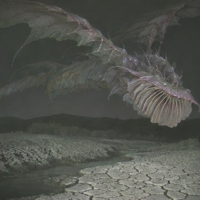
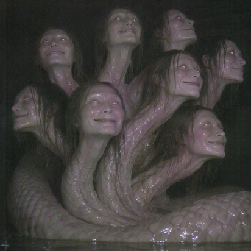
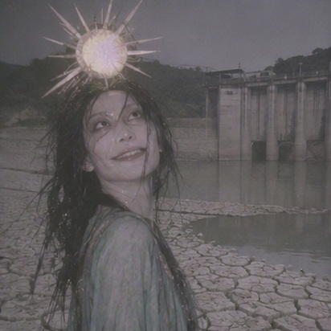
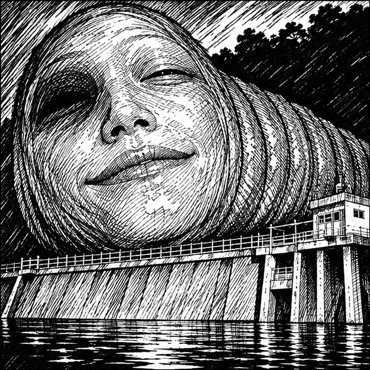

# 🏔️ 《山海經》純怪獸與妖怪圖鑑・卷 14～18〈大荒四經與海內經〉

[👹 妖怪篇總綱](../00-妖怪篇總綱與圖鑑分級.md) ｜ [📖 山海經總錄](./00-山海經怪獸妖怪總錄.md) ｜ [⬅️ 海內四經](./06-卷10至13_海內四經.md)

---

## 🗺️ 本卷導覽、全書終結界線與純怪獸收錄聲明

本卷涵蓋《山海經》最後五卷——**卷十四〈大荒東經〉、卷十五〈大荒南經〉、卷十六〈大荒西經〉、卷十七〈大荒北經〉**以及全書壓軸終章**卷十八〈海內經〉**，自「東海之外大壑」一路收錄至全書最後一頁「幽都之山六玄怪群」，為整部《山海經》純怪獸與妖怪圖鑑劃下句點。

在本作現代台灣都市靈異世界觀中，大荒四經與海內終卷所記載的並非尋常山林野怪，而是道門機密檔案中稱為「**荒溟遺毒與幽都深層系譜**」的太古異變體：它們誕生於洪荒斷層、沸泉死海、枯旱裂谷與極北黑水深淵，本體早已脫離哺乳動物與鳥禽常識，全面演化為**軟體環節巨蟲、節肢甲殼連體怪、寄生產卵母巢、腐屍活變體**以及披著僵冷人皮的**極致恐怖谷偽人（Mimic）**。隨著現代都市過度抽取地下水、興建深層捷運隧道與填海造陸，這些沉睡在幽都暗流與荒漠死水底層的終極怪獸正順著箱涵、蓄水池與廢棄礦坑重新湧上地表。

> [!IMPORTANT]
> **純怪獸零神明鐵律（2026-11-21 定案・嚴格剔除清單）**：  
> 卷十四至十八原典包含龐大的上古帝王神話世系與諸方異域部族，本卷**嚴格剔除所有神明、上古神王世系、四方海神風神、巫師與純人類國族**，一律不立怪獸檔案：
> - **剔除之上古神王、正神與世系**：帝俊、羲和、常羲、黃帝、顓頊、鯀、禹、重、黎、噎、吳回、后稷、叔均、共工、祝融、后土、炎帝、大皞（伏羲）、少昊、女媧（含女媧之腸）、王亥、夏后開、西王母、靈山十巫、夸父、羿、巧倕、柏子高、素女、韓流、術器、噎鳴、禺虢、折丹、不廷胡余、因因乎、禺彊等。
> - **剔除之純人類國族與地理奇民**：大人國、小人國（靖人）、君子國、中容國、司幽國、白民國、黑齒國、玄股國、季釐國、三身國、張弘、寒荒國、壽麻國、沃民國、互人國、軒轅國、肅慎國、叔歜國、北齊國、毛民國、無腸國、繼無民、跂踵國、儋耳國、朝鮮、天毒、壑市、氾葉、朝雲、司彘、禺中、列襄、鹽長（鳥民）、巴國、流黃辛氏人、嬴民、苗民、氐羌、玄丘民、大幽國、赤脛民、釘靈國等。
> - **去神化生物異變收錄原則**：原典中雖偶被古人敬畏冠以「神」字，實質為**毀滅級巨獸、毒潭怪蛇、旱災活屍或九首異鳥**者（如**應龍、旱魃、燭陰、九鳳、天吳、彊良、延維、崑崙白虎異獸**及諸「**尸**」怪），本作一律徹底剝離神格與祭祀色彩，以純粹「黑暗地牢生物恐怖怪獸／活屍寄生體／偽人災厄」定案收錄。
> - **跨卷考據誠實標註**：原典正本見於前卷、然於南荒／西荒／海內終卷生態鏈常遭併論之**蛫**（原出〈中山經〉）、**龍魚**（原出〈海外西經〉）與**朱厭**（原出〈西山經〉），均依考據誠實註明原典出處並於本卷收錄其荒野變異亞株或跨卷關聯補遺。

> **本卷統計**：依原典順序收錄卷十四（10 條）、卷十五（10 條）、卷十六（10 條）、卷十七（12 條）、卷十八至全書末頁（19 條，含全書壓軸「幽都之山六玄怪群」6 條），合計 **61 條**純怪獸與妖怪檔案；嵌入磁碟實存黑白墨線圖檔 **3 張**（`SHX19-應龍.jpg`、`SHX20-旱魃.jpg`、`SHX04-燭陰.jpg`），其餘 58 條預留補繪圖位。

---

## 📋 本卷怪獸與妖怪速查表（卷 14～18 全錄・共 61 條）

| 編號 | 名稱（別稱） | 所屬經卷與出處 | 造型路線 | 本作黑暗地牢／寄生／偽人重構核心 | 物種／唯一性 | 稀有度 | 配圖 |
| :---: | :--- | :--- | :---: | :--- | :--- | :---: | :---: |
| `SHJ14-01` | **犁䰠之尸**（犁𩵀之尸） | 卷14〈大荒東經〉・大壑外 | `【類人偽人型】` | 無手足腐屍寄生偽人・皮下線蟲蠕動肉囊 | `獨一無二` | `★★★ 珍級（SR）` | ⏳ |
| `SHJ14-02` | 青丘九尾狐（東荒支脈） | 卷14〈大荒東經〉・青丘之國 | `【類人偽人型】` | 潮霧偽人皮囊・脊裂九條幾丁質節肢產卵尾 | `物種（群體）` | `★★★ 珍級（SR）` | ⏳ |
| `SHJ14-03` | 大蟹（女丑荒海株） | 卷14〈大荒東經〉・海內荒域 | `【非人生物恐怖型】` | 巨型深海寄生幾丁質螯蟹・腹甲嵌人骨幼蟲槽 | `物種特異個體` | `★★★ 珍級（SR）` | ⏳ |
| `SHJ14-04` | 載日之烏（湯谷火鴉） | 卷14〈大荒東經〉・湯谷扶木 | `【非人生物恐怖型】` | 沸泉硫磺巨型磷火食腐虻鴉・灼背孵化蟲囊 | `物種（群體）` | `★★★ 珍級（SR）` | ⏳ |
| `SHJ14-05` | **奢比之尸**（大荒版） | 卷14〈大荒東經〉・孽搖頵羝 | `【類人偽人型】` | 僵冷犬耳偽人腐屍・雙青水蛭穿耳寄生母體 | `獨一無二` | `★★★★ 絕級（SSR）` | ⏳ |
| `SHJ14-06` | **五采妖鳥群** | 卷14〈大荒東經〉・猗天蘇門等 | `【非人生物恐怖型】` | 虹彩腐蠅甲殼妖鳥集群・排沙產卵音爆蜂禽 | `物種（群體）` | `★★ 稀級（R）` | ⏳ |
| `SHJ14-07` | 天吳（大荒八首水怪相） | 卷14〈大荒東經〉・朝陽之谷外 | `【類人偽人型】` | 八顆浮腫溺斃偽人首・十條環節水蛭巨尾災體 | `獨一無二` | `★★★★★ 神級災厄（UR）` | ⏳ |
| `SHJ14-08` | **應龍（羽鱗巨怪異化相）** | 卷14〈大荒東經〉・凶犁土丘 | `【非人生物恐怖型】` | 深陷泥沼墮落太古巨怪・腐翼長滿濕爛水蛭與蓄水囊 | `獨一無二` | `★★★★★ 神級災厄（UR）` | 🖼️ |
| `SHJ14-09` | **夔（流波山雷鳴巨怪）** | 卷14〈大荒東經〉・東海流波山 | `【非人生物恐怖型】` | 單根巨型甲殼躍足・蒼身發聲震鳴腔黑暗地牢巨蟲 | `獨一無二` | `★★★★★ 神級災厄（UR）` | ⏳ |
| `SHJ14-10` | **雷獸**（流波骨甲鳴怪） | 卷14〈大荒東經〉・東海流波山 | `【非人生物恐怖型】` | 中空壓電石灰質骨甲巨蠍蟬・斷骨自鳴雷擊怪 | `物種特異個體` | `★★★★ 絕級（SSR）` | ⏳ |
| `SHJ15-01` | **䟣踢**（跊踢） | 卷15〈大荒南經〉・赤水之西 | `【非人生物恐怖型】` | 左右雙首食人野豬甲蟲怪・雙端鋸齒裂顎連體獸 | `物種（群體）` | `★★★ 珍級（SR）` | ⏳ |
| `SHJ15-02` | **雙雙**（三青相併獸） | 卷15〈大荒南經〉・南海之外 | `【非人生物恐怖型】` | 三青軀側融合馬陸寄生連體獸・共循環酸液肉囊 | `物種（群體）` | `★★★ 珍級（SR）` | ⏳ |
| `SHJ15-03` | 蒼梧群怪（離俞・𩿨久・委維・視肉） | 卷15〈大荒南經〉・蒼梧之野 | `【非人生物恐怖型】` | 無骨變形蟲「視肉」再生母體與共生腐禽毒蛇群 | `物種（群體）` | `★★★ 珍級（SR）` | ⏳ |
| `SHJ15-04` | 黑水玄蛇與巫山黃鳥 | 卷15〈大荒南經〉・黑水／巫山 | `【非人生物恐怖型】` | 食鹿級環節吸血黑巨蟒 × 皮下產卵馭蛇毒蜂鳥 | `物種（群體）` | `★★★ 珍級（SR）` | ⏳ |
| `SHJ15-05` | 育蛇（宋山楓木赤蛇） | 卷15〈大荒南經〉・宋山 | `【非人生物恐怖型】` | 猩紅血鏽環節水蛭蛇・楓根與腹腔孕幼寄生怪 | `物種（群體）` | `★★ 稀級（R）` | ⏳ |
| `SHJ15-06` | 鑿齒（融天山大荒版） | 卷15〈大荒南經〉・融天之山 | `【類人偽人型】` | 穿唇巨型鑿齒偽人掠食怪・皮下隱藏螳螂骨鐮 | `物種特異個體` | `★★★ 珍級（SR）` | ⏳ |
| `SHJ15-07` | **蜮**（含沙射影水蟲・兼黃蛇） | 卷15〈大荒南經〉・蜮山 | `【非人生物恐怖型】` | 純正黑暗地牢水生毒蟲・三足蜱蠍甲殼噴射毒卵影沙 | `物種（群體）` | `★★★ 珍級（SR）` | ⏳ |
| `SHJ15-08` | **祖狀之尸** | 卷15〈大荒南經〉・大荒南境 | `【類人偽人型】` | 方塊骨齒僵冷活屍偽人・尾椎撕裂巨蠍蜈蚣毒尾 | `獨一無二` | `★★★ 珍級（SR）` | ⏳ |
| `SHJ15-09` | **蛫**（南荒異傳禦火株） | 卷15〈大荒南經〉關聯（原出〈中山經〉） | `【非人生物恐怖型】` | 慘白石灰殼水生巨蝨龜・充血紅瘤伸縮吸盤首 | `物種（群體）` | `★★ 稀級（R）` | ⏳ |
| `SHJ15-10` | **菌人**（寄生菌類人怪） | 卷15〈大荒南經〉・甘淵蓋猶近域 | `【類人偽人型】` | 極微小掌心冬蟲夏草菌絲偽人・裂顱噴吐控腦孢子 | `物種（群體）` | `★★ 稀級（R）` | ⏳ |
| `SHJ16-01` | **狂鳥**（五色有冠妖鳥） | 卷16〈大荒西經〉・西荒澤野 | `【非人生物恐怖型】` | 五彩腐蛾磷粉怪鳥・肉冠寄生蜂巢鳴聲致急性狂亂 | `物種（群體）` | `★★★ 珍級（SR）` | ⏳ |
| `SHJ16-02` | 三青鳥（大鵹・少鵹・青鳥） | 卷16〈大荒西經〉・西荒高丘 | `【非人生物恐怖型】` | 猩紅剝皮肉瘤首・漆黑巨型蒼蠅複眼三聯寄生禽 | `物種特異個體` | `★★★ 珍級（SR）` | ⏳ |
| `SHJ16-03` | **崑崙白虎異獸** | 卷16〈大荒西經〉・崑崙之丘 | `【類人偽人型】` | 白化死屍偽人人面・鈣化虎甲蟲軀・倒鉤白尾怪 | `獨一無二` | `★★★★ 絕級（SSR）` | ⏳ |
| `SHJ16-04` | **龍魚**（西荒陵居跨卷株） | 卷16〈大荒西經〉關聯（原出〈海外西經〉） | `【非人生物恐怖型】` | 離水陸行濕滑肺魚巨蜈蚣・背生寄生吸附肉鞍 | `物種（群體）` | `★★★ 珍級（SR）` | ⏳ |
| `SHJ16-05` | **屏蓬**（左右雙首巨彘） | 卷16〈大荒西經〉・鏖鏊鉅山 | `【非人生物恐怖型】` | 左右獨立雙首寄生重甲巨彘・腹腔翻湧腐蛆膿囊 | `物種（群體）` | `★★★ 珍級（SR）` | ⏳ |
| `SHJ16-06` | 黃姖之尸 | 卷16〈大荒西經〉・金門之山 | `【類人偽人型】` | 蠟黃浮腫屍液婦人偽人・五官滲蜜蠟幼蟲蜂巢體 | `獨一無二` | `★★★ 珍級（SR）` | ⏳ |
| `SHJ16-07` | 西荒比翼鳥與玄喙白鳥 | 卷16〈大荒西經〉・金門山域 | `【非人生物恐怖型】` | 線蟲縫骨連體腐鳥 × 漆黑蚊針彎喙慘白食腐鳥 | `物種（群體）` | `★★ 稀級（R）` | ⏳ |
| `SHJ16-08` | 天犬（赤犬・兵災怪獸） | 卷16〈大荒西經〉・金門山域 | `【非人生物恐怖型】` | 剝皮暗紅巨型鞭蠍犬蟲・高空墜落散播狂暴血孢 | `物種特異個體` | `★★★★ 絕級（SSR）` | ⏳ |
| `SHJ16-09` | **魚婦**（偏枯復甦偽人怪） | 卷16〈大荒西經〉・西荒大水泉 | `【類人偽人型】` | 半溺屍魚鰓偽人 × 半乾癟鑽蛇屍身・死而復甦異變體 | `獨一無二` | `★★★★ 絕級（SSR）` | ⏳ |
| `SHJ16-10` | **三面之人異變怪相** | 卷16〈大荒西經〉・大荒之山 | `【類人偽人型】` | 三張不同步死白偽人臉・胸口單生多節巨臂不死畸胎 | `物種特異個體` | `★★★★ 絕級（SSR）` | ⏳ |
| `SHJ17-01` | 附禺寒荒群怪（大物小物等） | 卷17〈大荒北經〉・附禺之山 | `【非人生物恐怖型】` | 凍土無定形肉塊「大物／小物」與金屬羽琅鳥黃蛇群 | `物種（群體）` | `★★ 稀級（R）` | ⏳ |
| `SHJ17-02` | **蜚蛭**（四翼巨型吸血水蛭） | 卷17〈大荒北經〉・不咸之山 | `【非人生物恐怖型】` | 最純正環節水蛭黑暗地牢怪・四片血管腐膜翅・千齒吸盤 | `物種（群體）` | `★★★ 珍級（SR）` | ⏳ |
| `SHJ17-03` | **琴蟲**（偽人弦鳴蟲怪） | 卷17〈大荒北經〉・不咸之山 | `【類人偽人型】` | 獸首蛇身／偽人人面雙態蟲怪・撥動幾丁質體弦誘獵 | `物種（群體）` | `★★★ 珍級（SR）` | ⏳ |
| `SHJ17-04` | 不咸大青蛇（黃頭食麈蛇） | 卷17〈大荒北經〉・大人國近域 | `【非人生物恐怖型】` | 硫磺黃毒囊巨首・青黑滑膩吞鹿級環節巨蛭蟒 | `物種（群體）` | `★★★ 珍級（SR）` | ⏳ |
| `SHJ17-05` | 獵獵（黑蟲如熊狀） | 卷17〈大荒北經〉・衡天叔歜域 | `【非人生物恐怖型】` | 熊軀直立純黑重甲埋葬蟲怪・腹藏密排倒鉤捕食足 | `物種（群體）` | `★★★ 珍級（SR）` | ⏳ |
| `SHJ17-06` | **犬戎白犬怪獸** | 卷17〈大荒北經〉・融父山／賴丘 | `【類人偽人型】` | 自相牝牡白化剝皮犬蟲群 × 人面獸身肉食偽人母體 | `物種（群體）` | `★★★ 珍級（SR）` | ⏳ |
| `SHJ17-07` | 戎宣王尸（無首赤馬屍怪） | 卷17〈大荒北經〉・融父山 | `【非人生物恐怖型】` | 剝皮猩紅無頭馬屍怪・斷頸裂開環形齒盤寄生巨口 | `獨一無二` | `★★★ 珍級（SR）` | ⏳ |
| `SHJ17-08` | **九鳳**（九首人面鳥身） | 卷17〈大荒北經〉・北極天櫃山 | `【類人偽人型】` | 九顆慘白偽人人臉擠生腐鳥軀幹・同步裂顎九重哀啼 | `獨一無二` | `★★★★★ 神級災厄（UR）` | ⏳ |
| `SHJ17-09` | 彊良（虎首長肘銜蛇怪） | 卷17〈大荒北經〉・北極天櫃山 | `【非人生物恐怖型】` | 螳螂反折長肘・四鈣化蟲蹄・口操神經寄生毒蛇巨怪 | `獨一無二` | `★★★★ 絕級（SSR）` | ⏳ |
| `SHJ17-10` | **相繇**（相柳大荒毒潭版） | 卷17〈大荒北經〉・崑崙之北 | `【非人生物恐怖型】` | 九首自環腐蝕環節巨蛭・屍血崩地成苦毒黑潭災體 | `獨一無二` | `★★★★★ 神級災厄（UR）` | ⏳ |
| `SHJ17-11` | **旱魃**（枯旱活屍偽人怪） | 卷17〈大荒北經〉・係昆之山 | `【類人偽人型】` | 青衣赤枯龜裂活屍偽人・皮下鑽滿乾渴蝗蟲幼體抽水災 | `獨一無二` | `★★★★★ 神級災厄（UR）` | 🖼️ |
| `SHJ17-12` | **燭陰**（燭龍・千米巨蛇怪相） | 卷17〈大荒北經〉・章尾山 | `【類人偽人型】` | 千米猩紅環節巨蛇 × 巨型慘白偽人臉・縱目爆光灼燒神經 | `獨一無二` | `★★★★★ 神級災厄（UR）` | 🖼️ |
| `SHJ18-01` | **蝡蛇**（靈山赤蛇） | 卷18〈海內經〉・靈山 | `【非人生物恐怖型】` | 樹棲啃木猩紅巨型天牛幼蟲環節蛇・噴吐腐木強酸 | `物種（群體）` | `★★ 稀級（R）` | ⏳ |
| `SHJ18-02` | **窫窳**（海內龍首・蛇身人面版） | 卷18〈海內經〉・建木之南 | `【類人偽人型】` | 死而復甦蛇身人面偽人・裂顱展開龍首蟲顎生吞活人 | `獨一無二` | `★★★★ 絕級（SSR）` | ⏳ |
| `SHJ18-03` | 猩猩（海內青獸人面版） | 卷18〈海內經〉・建木之南 | `【類人偽人型】` | 青黑濕冷甲殼人面溺屍偽人・暗處學聲伏擊獵手 | `物種（群體）` | `★★ 稀級（R）` | ⏳ |
| `SHJ18-04` | **朱卷黑蛇**（青首食象黑蛇） | 卷18〈海內經〉・朱卷之國 | `【非人生物恐怖型】` | 漆黑油亮環節水蛭巨蟒・青綠螢光毒腺巨首吞象怪 | `物種特異個體` | `★★★★ 絕級（SSR）` | ⏳ |
| `SHJ18-05` | 贛巨人（反踵長脣笑人怪） | 卷18〈海內經〉・南方 | `【類人偽人型】` | 三公尺反踵黑毛偽人・水蛭肉瓣長脣狂笑蔽目噬人 | `物種（群體）` | `★★★ 珍級（SR）` | ⏳ |
| `SHJ18-06` | 虎首鳥足食蛇黑怪 | 卷18〈海內經〉・南方 | `【非人生物恐怖型】` | 純黑幾丁質虎顎巨首・禽爪節肢生啖毒蛇掠食畸怪 | `物種特異個體` | `★★★ 珍級（SR）` | ⏳ |
| `SHJ18-07` | 封豕（巨型重甲野豬怪） | 卷18〈海內經〉・嬴民之域 | `【非人生物恐怖型】` | 巨型重甲兜蟲腐食巨彘・鐮刀毒牙與硬蜱寄生群 | `物種（群體）` | `★★★ 珍級（SR）` | ⏳ |
| `SHJ18-08` | **延維**（委蛇・雙首偽人巨蛇） | 卷18〈海內經〉・苖民之域 | `【類人偽人型】` | 長如車轅左右雙首偽人巨蛇・紫黑血膜與充血吸盤冠 | `獨一無二` | `★★★★ 絕級（SSR）` | ⏳ |
| `SHJ18-09` | **菌狗**（山囷狗） | 卷18〈海內經〉・南方濕林 | `【非人生物恐怖型】` | 如兔青黴菌絲寄生硬蜱犬・朝生暮死高速散播孢子 | `物種（群體）` | `★★ 稀級（R）` | ⏳ |
| `SHJ18-10` | **翠鳥與孔鳥** | 卷18〈海內經〉・南方濕林 | `【非人生物恐怖型】` | 金屬毒蜂吸血翠鳥 × 尾屏密布轉動蒼蠅複眼孔鳥 | `物種（群體）` | `★★ 稀級（R）` | ⏳ |
| `SHJ18-11` | **翳鳥**（蔽鄉五采巨禽） | 卷18〈海內經〉・北海蛇山 | `【非人生物恐怖型】` | 翼展遮蔽全鎮之極巨型毒蛾集群鳥・降下腐蝕鱗粉黑雨 | `物種特異個體` | `★★★★ 絕級（SSR）` | ⏳ |
| `SHJ18-12` | **相顧之尸** | 卷18〈海內經〉・北海之內 | `【類人偽人型】` | 反縛木枷慘白活屍偽人・背刺骨戈・頭顱反轉凝視目標 | `獨一無二` | `★★★ 珍級（SR）` | ⏳ |
| `SHJ18-13` | **朱厭**（卷末跨卷關聯補遺） | 卷18關聯補遺（原出〈西山經〉） | `【類人偽人型】` | 脫毛死白顱・浸血赤足偽人狂猿・誘發群體血腥暴動 | `物種特異個體` | `★★★★ 絕級（SSR）` | ⏳ |
| `SHJ18-14` | **幽都玄鳥**（六玄怪群之一） | 卷18〈海內經〉末頁・幽都之山 | `【非人生物恐怖型】` | 漆黑油膜複眼腐蠅巨鴉・吞光消音高空偵察寄生禽 | `物種（群體）` | `★★★ 珍級（SR）` | ⏳ |
| `SHJ18-15` | **幽都玄蛇**（六玄怪群之二） | 卷18〈海內經〉末頁・幽都之山 | `【非人生物恐怖型】` | 無眼純黑柏油環節巨蛭蛇・潛行黑水溝渠絞殺產卵 | `物種（群體）` | `★★★ 珍級（SR）` | ⏳ |
| `SHJ18-16` | **幽都玄豹**（六玄怪群之三） | 卷18〈海內經〉末頁・幽都之山 | `【非人生物恐怖型】` | 墨黑濕滑多節肢鞭蠍獵豹・暗影牆壁靜音倒掛撲殺 | `物種（群體）` | `★★★ 珍級（SR）` | ⏳ |
| `SHJ18-17` | **幽都玄虎**（六玄怪群之四） | 卷18〈海內經〉末頁・幽都之山 | `【非人生物恐怖型】` | 黑曜幾丁質重甲埋葬蟲巨虎・多層顎齒咬碎防禦結界 | `物種（群體）` | `★★★★ 絕級（SSR）` | ⏳ |
| `SHJ18-18` | **幽都玄狐蓬尾**（六玄怪群之五） | 卷18〈海內經〉末頁・幽都之山 | `【類人偽人型】` | 漆黑瞳孔偽人皮囊・尾椎爆裂蓬鬆黑色鐵線蟲菌絲巨尾 | `物種（群體）` | `★★★★ 絕級（SSR）` | ⏳ |
| `SHJ18-19` | **幽都黑水大玄母巢**（六玄怪群之六） | 卷18〈海內經〉末頁・幽都黑水大玄山 | `【非人生物恐怖型】` | 沉澱黑水底層之無定形變形蟲黏液菌床・孕育全書終極暗影怪群 | `獨一無二` | `★★★★★ 神級災厄（UR）` | ⏳ |

---

## 🌊 卷十四〈大荒東經〉（全 10 條）

> **原典起訖與剔除註記**：自「東海之外大壑」起，至「流波山夔與雷獸」止。本卷嚴格剔除少昊、顓頊、帝俊、羲和浴日、王亥、黃帝、禺虢（東海神）、折丹（東方風神），以及大人國、靖人（小人國）、君子國、司幽國、中容國、白民國、黑齒國、玄股國、壎民國等純神王與人類部族，專錄十尊真正具備黑暗地牢生物恐怖與活屍異變本質之大荒東境怪獸。

### [SHJ14-01] 犁䰠之尸（犁𩵀之尸／無手足腐屍寄生怪）
- **出處順序**：卷 14〈大荒東經〉・大壑之外（緊鄰靖人國之荒海泥灘）
- **類別與造型路線**：`【類人偽人型】`｜無手足腐屍寄生偽人・皮下環節線蟲蠕動肉囊怪
- **物種／唯一性**：`獨一無二`｜原典明指為大荒東境特定「之尸」異變體，由太古溺斃巨獸與寄生腐屍縫合而成的唯一不朽畸胎。
- **稀有度與道行對照**：`★★★ 珍級（SR）`｜約數百年腐屍妖氣與寄生母巢怨力，相當於西遊／封神中盤踞荒洞之老妖｜本作階位：二流頂～一流初
- **外貌與黑暗地牢／恐怖谷視覺改寫**：
  - <!-- 圖位預留：待補繪 -->
  - 【原典外貌】「有神，人面獸身，名曰犁𩵀之尸。」（異體作「犁䰠之尸」或「犂𩵀之屍」，原典以「尸」稱其非生非死之異形神怪。）
  - 【本作克蘇魯／昆蟲寄生／偽人重構】徹底揚棄任何神聖氣息，重構為令人胃部翻攪的**「無手足腐屍寄生肉囊偽人」**：本體是一具長約兩公尺半、徹底喪失四肢的腫脹灰綠獸形肉袋，宛如被潮水泡爛的巨型海象腐屍，但肩頸處卻生著一張極度逼近人類中年男子的蒼白死臉——雙眼緊閉卻在眼皮底下高速轉動，嘴角維持僵硬微張。原典的「獸身」在本作中乃是由上萬條乳白色巨型鐵線蟲與腐食蛆蟲將腐肉撐起所偽裝出的畸形軀體，全身無手無足，靠腹面裂開的一整排濕亮環節水蛭吸盤一縮一伸地拖行蠕動；肩胛與髖部原本該長四肢的切口處完全潰爛，塞滿如海葵觸手般向外試探擺動的細長產卵管。黑白墨線以大量密集交叉影線刻畫濕黏褶皺腐皮、皮下凸起的條狀蟲影，以及那張過分平靜死白的人臉反差。
- **特性**：
  - 【原典記載】人面獸身，以「尸」存世於東海大荒之隅，其餘細節原典從簡。
  - 【本作衍生】全身沒有任何骨骼與要害器官，斬斷軀幹只會讓藏於內腔的線蟲群爆散而出、各自鑽回殘屍重新拼合；凡觸及其爬行留下的銀白黏液，皮膚會在十分鐘內軟化發泡，四肢關節迅速喪失知覺（俗稱「解肢腐毒」）。
- **弱點**：
  - 【原典記載】原典未載。
  - 【本作衍生】1. 無法忍受高濃度海鹽、強鹼性漂白水與乾燥烈焰，生石灰撒上其腹面吸盤可使其立刻翻滾抽搐、暴露口腔內的寄生蟲中樞母核；2. 臉部眉心正後方三寸藏有唯一的「硬殼母蟲腦核」，須先以「鎮屍雷符」麻痺皮下蟲網，再以桃木長針貫穿眉心方能根絕。
- **習性**：
  - 【原典記載】處於東海大荒極偏僻之處，與小人國相鄰。
  - 【本作衍生】現代常藉連日豪雨順著海港汙水截流管爬入基隆、高雄、淡水一帶的廢棄地下商場、停工工地積水井與防空洞。平常蜷縮成一團看似遭棄置的黑色大型垃圾袋，一旦感應到落單遊民或夜間巡守員靠近，便會突然翻過身露出那張慘白人臉，在無手無足的狀態下以驚人速度貼地滑行逼近。
- **喜好**：
  - 【原典記載】原典未載。
  - 【本作衍生】嗜愛高濕度腐爛澱粉味、積水地下室的發霉紙箱，以及人類剛失去溫度的四肢關節軟骨——它會把獵物的手腳吞入產卵腔溶解，只留下無手足的空殼軀幹作為下一代寄生巢。
- **擅長的招式／異能**：
  - 【原典記載】原典未載。
  - 【本作衍生】**「無肢滑湧」**（腹面數百環形吸盤同步收縮，在濕滑磁磚與牆面上如巨型鼻涕蟲般無聲高速折返）、**「肩孔射管」**（四肢殘缺孔洞驟然爆射數十條白色寄生線蟲束縛腳踝並注射解肢麻痺液）、**「偽人哀喚」**（僵硬人臉喉腔擠出近似溺水者的沙啞求助聲，誘騙救援者俯身查看）。

---

### [SHJ14-02] 青丘九尾狐（大荒東荒野化支脈）
- **出處順序**：卷 14〈大荒東經〉・青丘之國
- **類別與造型路線**：`【類人偽人型】`｜潮霧偽人皮囊・脊裂九條幾丁質節肢產卵尾怪
- **物種／唯一性**：`物種（群體）`｜原典於〈南山經〉與〈大荒東經〉皆記青丘九尾狐，本條為飄流至東海大荒海霧絕域、演化出更濃重潮濕寄生特徵的東荒野化群落。
- **稀有度與道行對照**：`★★★ 珍級（SR）`｜三百至八百年野妖道行，屬一方巢穴掠食種群｜本作階位：二流頂～一流
- **外貌與黑暗地牢／恐怖谷視覺改寫**：
  - <!-- 圖位預留：待補繪 -->
  - 【原典外貌】「有青丘之國，有狐，九尾。」
  - 【本作克蘇魯／昆蟲寄生／偽人重構】嚴格摒棄毛絨仙狐或古風妖豔美人套路！東荒支脈的九尾狐表層披著一具略顯濕冷浮腫的現代都會年輕男女「偽人皮囊」，站姿僵直、瞳孔過度放大且隱隱透出節肢動物的橫裂複眼光暈，鎖骨與指縫下方在冷光下浮現甲殼接縫紋。一旦進入獵食或受威脅狀態，後背脊椎會沿中線「嘶啦」垂直撕裂，翻捲的血肉裡伸出**九條漆黑濕亮、像巨型鞭蠍與蜈蚣融合體的幾丁質節肢長尾**；每一條節肢尾末端皆非狐毛，而是不斷抽搐搏動的透明肉質**產卵管**與環形細齒吸盤，伴隨潮濕海藻腥味與甲殼摩擦的「喀喀」細響。黑白墨線極度克制偽人面部的陰影，反而將大量濃黑排線傾注於背後綻開的九條節肢蟲尾與滴落黏液。
- **特性**：
  - 【原典記載】九尾之狐，與〈南山經〉「音如嬰兒、能食人」同脈。
  - 【本作衍生】東荒支脈長期棲息海霧鹽濕帶，分泌的「擬態費洛蒙」能干擾人類腦部杏仁核，讓目擊者在看見它背後節肢尾的瞬間大腦自動將其「腦補」成飄逸長髮或風衣下擺，直到產卵管刺入後頸才驚覺真相。
- **弱點**：
  - 【原典記載】原典未載。
  - 【本作衍生】1. 透過手機鏡頭、行車紀錄器或法器銅鏡間接觀察可大幅削弱其費洛蒙認知遮蔽；2. 脊背裂口暴露的九條節肢尾根部神經節極怕高壓電流與陽火，以「五雷破煞符」直接釘入背後裂縫可迫其強制脫離偽人皮囊。
- **習性**：
  - 【原典記載】棲於東海大荒青丘之地。
  - 【本作衍生】台灣沿海霧氣濃重的漁港舊宿舍、濱海公路廢棄汽車旅館與深夜高架橋下，常偽裝成撐透明傘、低頭滑手機的孤單路人，專挑剛下大夜班精神渙散的單身者搭訕借火或問路。
- **喜好**：
  - 【原典記載】原典未載。
  - 【本作衍生】極愛陰雨連綿的回南天、人體溫熱頸動脈血液，以及將受害者體溫維持在攝氏三十七度的「活體恆溫孵卵狀態」。
- **擅長的招式／異能**：
  - 【原典記載】九尾異相、擬聲誘食。
  - 【本作衍生】**「認知遮蔽・偽人障眼」**（釋放海霧腥甜信息素令獵物忽略其關節異常與背後蟲尾）、**「九節鞭棘穿刺」**（九條幾丁質節肢尾如高速長鞭交錯刺擊，瞬間釘死四肢）、**「嬰啼催眠」**（嘴部微裂成蟲顎，發出高頻嬰兒哭聲瓦解除妖師念咒節奏）。

---

### [SHJ14-03] 大蟹（女丑荒海巨蟹怪）
- **出處順序**：卷 14〈大荒東經〉・海內荒域
- **類別與造型路線**：`【非人生物恐怖型】`｜深海寄生巨型幾丁質螯蟹・腹甲嵌人骨幼蟲槽怪
- **物種／唯一性**：`物種特異個體`｜原典於〈海內北經〉記「蓋余之國大蟹在海中」，〈大荒東經〉再記「女丑有大蟹」，本作定調為東海斷層中活過千年的巨型雌性寄生甲殼母體。
- **稀有度與道行對照**：`★★★ 珍級（SR）`｜約五百年深海巨獸妖力｜本作階位：二流頂～一流初
- **外貌與黑暗地牢／恐怖谷視覺改寫**：
  - <!-- 圖位預留：待補繪 -->
  - 【原典外貌】「海內有兩人，名曰女丑。女丑有大蟹。」
  - 【本作克蘇魯／昆蟲寄生／偽人重構】絕非海產餐廳放大版的紅毛螃蟹，而是一座長寬逾四公尺、宛如黑暗地牢沉船腐木般漆黑粗糙的**深海寄生重甲節肢巨怪**：背甲上覆滿鈣化藤壺、蠕動白色海蟲與遭它強行黏合偽裝用的**十數具人類頭骨與碎肋骨**；十條步足長而扁平如巨型蜘蛛與海蟑螂步足，關節縫隙不斷湧出腐臭泡沫。雙螯並非鈍鉗，而是布滿倒鉤齒刃的螳螂鋸齒割裂鉗；最駭人的是其翻開的腹臍——裡頭沒有蟹黃，而是密密麻麻像蜂巢般嵌滿數百顆半透明脈動卵囊，每顆卵囊內都蜷縮著一隻長有人指狀細腳的寄生幼蟹。黑白墨線強調甲殼破裂處滲出的黑液、人骨鑲嵌的荒誕輪廓與密布剛毛的細長蟲腳。
- **特性**：
  - 【原典記載】伴隨「女丑」存於東海之內，體型極巨。
  - 【本作衍生】外骨骼混雜深海重金屬礦質，尋常刀劍與警用制式子彈擊中只會迸出火星；它能透過吐出高黏度腐蝕海沫迅速將整層地下室地板變成滑溜酸沼，並釋放數百隻指甲蓋大小的寄生幼蟹鑽入獵物耳鼻與傷口。
- **弱點**：
  - 【原典記載】原典未載。
  - 【本作衍生】1. 雙眼柄與口器下方的軟膜節點無硬甲保護，強效驅蟲劑、雄黃酒與高溫蒸汽噴射可使其口器劇烈痙攣並被迫掀開腹臍；2. 害怕強烈的乾燥高頻震動（如鑿岩機或密集爆裂雷符），會導致其鈣化重甲出現應力裂紋。
- **習性**：
  - 【原典記載】棲息東海海內水域。
  - 【本作衍生】順著大潮與颱風海水倒灌湧入沿海城市的地下防洪滯洪池、貨櫃碼頭廢棄抽水站與濱海涵洞。白天將背甲埋入淤泥只露出人骨偽裝成漂流雜物，半夜漲潮時沿潮濕壁面橫行狩獵。
- **喜好**：
  - 【原典記載】原典未載。
  - 【本作衍生】極度迷戀金屬鏽味、腐敗貝類屍臭與人類堅硬的長骨——它會把獵物剔肉後，將人骨整齊卡進自己背甲的石灰質分泌物中當作護盾。
- **擅長的招式／異能**：
  - 【原典記載】原典未載。
  - 【本作衍生】**「腐沫酸潮」**（口器噴出大片帶有腥臭泡沫的強酸海液，腐蝕鞋底與符紙）、**「腹臍蜂潮」**（猛然翻掀腹甲釋放數百隻高速爬行的寄生幼蟹圍攻）、**「骨甲斷鉗」**（單螯閉合瞬間產生等同液壓剪的剪切力，可輕易夾斷鋼筋與肢體）。

---

### [SHJ14-04] 載日之烏（湯谷扶木灼日腐鴉群）
- **出處順序**：卷 14〈大荒東經〉・孽搖頵羝山・溫源谷（湯谷扶木）
- **類別與造型路線**：`【非人生物恐怖型】`｜沸泉硫磺巨型磷火食腐虻鴉・灼背寄生蟲囊怪
- **物種／唯一性**：`物種（群體）`｜原典記十日輪流「皆載于烏」，本條徹底剔除羲和生十日之神話，還原為棲息地熱沸泉的十數隻極端耐熱寄生巨蟲禽群。
- **稀有度與道行對照**：`★★★ 珍級（SR）`｜約三百年以上地熱煞氣異化妖禽｜本作階位：一流初（單隻二流頂，成群達一流）
- **外貌與黑暗地牢／恐怖谷視覺改寫**：
  - <!-- 圖位預留：待補繪 -->
  - 【原典外貌】「有谷曰溫源谷。湯谷上有扶木。一日方至，一日方出，皆載于烏。」
  - 【本作克蘇魯／昆蟲寄生／偽人重構】絕非金光閃耀的神聖三足金烏！在黑暗地牢視角下，這群怪鳥乃是由地底硫磺沸泉孕育出的**「焦黑腐食巨型火虻鴉」**：體長約一點五公尺，羽毛早已在高溫酸性水氣中脫落殆盡，裸露出炭黑龜裂、宛如焦炭與濕亮甲蟲鞘翅混合的硬殼軀幹。最駭人的是牠們背脊中央凹陷處鑲嵌著一顆直徑半公尺、不停劇烈沸騰並散發刺眼白熾磷光的**巨大半透明氣泡肉囊**——古人遠望誤以為烏鴉背負太陽，近看才發現囊內塞滿數以萬計發光發熱的硫磺寄生幼蟲與高壓易燃磷氣！頭部沒有鳥眼，而是兩顆燒紅炭塊般發亮的龐大蒼蠅複眼，喙部則為三瓣開合的鐵鉗狀吸血口器，三條細長焦黑蟲足末梢滴落滾燙硫磺黏液。
- **特性**：
  - 【原典記載】棲於沸熱湯谷扶木，往來高空承載烈日。
  - 【本作衍生】體表覆蓋耐高溫幾丁質隔熱層，所經之處空氣因高濃度磷氣自燃而驟升至攝氏七十度以上；若遭強行擊破背部發光肉囊，高溫腐蝕磷液會如凝固汽油彈般四濺，附著人體難以撲滅。
- **弱點**：
  - 【原典記載】原典未載。
  - 【本作衍生】1. 高度依賴硫磺與高溫環境，一旦遭大量液態氮、乾冰滅火器或「玄冰鎮水符」強行降溫，其體表幾丁質會在熱脹冷縮下脆裂崩解；2. 腹部無發光囊保護的呼吸氣門若被泥漿或高壓泡沫堵塞，會在三分鐘內窒息墜地。
- **習性**：
  - 【原典記載】棲居溫源谷沸泉巨木，日夜交替出沒。
  - 【本作衍生】現代台灣主要盤踞於北投硫磺谷廢棄溫泉管線井、陽明山噴氣孔深洞、火力發電廠冷卻廢熱排放道與鋼鐵廠高爐煙囪內側，深夜趁熱對流滑翔至都市屋頂狩獵，常造成民宅頂樓莫名高溫自燃的靈異火警。
- **喜好**：
  - 【原典記載】原典未載。
  - 【本作衍生】極度迷戀硫化氫惡臭、工業廢油蒸汽與經高溫烤熟的焦化蛋白質。
- **擅長的招式／異能**：
  - 【原典記載】載日昇降（高熱強光衝擊）。
  - 【本作衍生】**「沸囊白熾閃爆」**（壓縮背部發光幼蟲囊釋放致盲強光與高溫氣浪，瞬間灼傷視網膜）、**「磷液空投」**（自高空甩落沸騰發光黏液，落地化為滾燙火點與竄動灼熱幼蟲）、**「三爪焦鉗」**（三條灼熱蟲腳交替抓取獵物肩背，將其拖入地熱裂縫烤乾）。

---

### [SHJ14-05] 奢比之尸（大荒東經雙青蛇犬耳腐屍怪）
- **出處順序**：卷 14〈大荒東經〉・孽搖頵羝山・湯谷之側
- **類別與造型路線**：`【類人偽人型】`｜僵冷犬耳偽人腐屍・雙青水蛭穿耳寄生母體
- **物種／唯一性**：`獨一無二`｜原典於〈海外東經〉與〈大荒東經〉兩度出現，為東海最惡名昭彰的不死腐屍怪異之一，本條收錄其盤踞大荒溫源谷腐霧深處的完全體母體相。
- **稀有度與道行對照**：`★★★★ 絕級（SSR）`｜千年太古屍怪道行，可驅動區域性屍瘟霧瘴｜本作階位：一流頂～巔峰初
- **外貌與黑暗地牢／恐怖谷視覺改寫**：
  - <!-- 圖位預留：待補繪 -->
  - 【原典外貌】「有神，人面、犬耳、獸身，珥兩青蛇，名曰奢比尸。」
  - 【本作克蘇魯／昆蟲寄生／偽人重構】徹底剝除一切神靈詮釋，塑造成極致令人毛骨悚然的**「雙耳穿蛇偽人屍王」**：高達兩公尺半，脖頸以下是一具嚴重腐敗發黑、皮下滿佈硬殼甲蟲背板與外露肋骨的畸形長臂獸軀，但頸項以上卻挺立著一張五官端正得近乎詭異的慘白東亞人臉，嘴唇永遠微揚著不合時宜的僵硬微笑。頭顱兩側豎起一對濕漉漉、缺乏毛髮且筋脈青紫的長大犬耳，最令人生理反胃的是左右耳垂與耳道被兩條手臂粗、不斷吐信滴液的**青綠色環節吸血水蛭巨蛇**活生生貫穿懸掛——這兩條青蛇並非飾物，而是直接扎根進它大腦聽覺皮層的雙生寄生神經主幹！當它緩慢轉頭時，偽人人臉毫無表情，兩條穿耳青蛇卻同時張開環形利齒吸盤發出嘶鳴，並將大量青綠屍水順著它的臉頰流進微張的口中。
- **特性**：
  - 【原典記載】人面犬耳獸身，耳垂兩青蛇，名列大荒「尸」怪。
  - 【本作衍生】雙耳寄生青蛇負責感知聲音與操控屍身，即使將奢比之尸的胸腹打爛，只要兩條穿耳青蛇未死，屍軀便能不斷吸收周圍腐氣與濕氣再生；其散發的「屍霧」會誘發人類耳鳴幻聽，使人不由自主將雙手伸向自己耳廓撕扯。
- **弱點**：
  - 【原典記載】原典未載。
  - 【本作衍生】1. **耳道寄生蛇根部是唯一死穴**：必須在三秒內同步斬斷或焚毀左右兩條穿耳青蛇（只斬一條時，另一條會立刻鑽入顱骨接管並狂暴化）；2. 極懼雄黃硫磺燻煙與高頻共振音波，強烈低音炮或銅鐘震鳴會令雙青蛇在耳道內抽搐絞死宿主神經。
- **習性**：
  - 【原典記載】盤踞東海大荒湯谷溫源之側。
  - 【本作衍生】現代極偏好潮濕悶熱且帶有腐屍氣味之密閉空間，如廢棄殯儀館冰庫夾層、坍塌老舊靈骨塔地下室或長期漏水的醫院停屍間外廊；常筆直佇立在走廊盡頭暗處，僅露出那張微笑人臉與垂在臉側微微晃動的兩條青影。
- **喜好**：
  - 【原典記載】原典未載。
  - 【本作衍生】嗜聽人類絕望時的尖叫與耳語，特別喜歡收藏受害者的耳骨，並將新鮮耳廓串成潮濕骨鍊垂掛在胸前肋骨縫上。
- **擅長的招式／異能**：
  - 【原典記載】珥兩青蛇（雙蛇異相）。
  - 【本作衍生】**「雙青蛇貫耳」**（左右穿耳青蛇驟然暴伸三公尺，如兩支帶環齒吸盤的長矛直刺敵人太陽穴與耳道注入腦控幼蟲）、**「犬耳聲納鎖定」**（徹底無視煙霧與視線遮蔽，精準鎖定百公尺內心跳與衣料摩擦聲）、**「屍笑惑神」**（僵硬人臉猛然張嘴裂開至耳根，釋放引發劇烈暈眩與耳出血的次聲波）。

---

### [SHJ14-06] 五采妖鳥群（相鄉棄沙・猗天蘇門異禽集群）
- **出處順序**：卷 14〈大荒東經〉・東海大荒（相鄉棄沙之域／猗天蘇門之山）
- **類別與造型路線**：`【非人生物恐怖型】`｜虹彩腐蠅甲殼妖鳥集群・排沙產卵音爆蜂禽
- **物種／唯一性**：`物種（群體）`｜原典於〈大荒東經〉兩度出現「五采之鳥」，其中一處更記其「相鄉棄沙」，屬數百至數千隻成群行動的恐怖蟲禽群體。
- **稀有度與道行對照**：`★★ 稀級（R）`｜單隻為十年～數十年底層妖禽，成群時可達二流頂威脅｜本作階位：三流（單隻）～二流頂（百隻集群）
- **外貌與黑暗地牢／恐怖谷視覺改寫**：
  - <!-- 圖位預留：待補繪 -->
  - 【原典外貌】「有五采之鳥，相鄉棄沙。惟帝俊下友。帝下兩壇，采鳥是司。」又記「有山名曰猗天蘇門……有五采之鳥。」（本作剔除帝俊主從神話，還原其非人集群怪相。）
  - 【本作克蘇魯／昆蟲寄生／偽人重構】毫無孔雀或彩鳳的典雅美感——所謂「五采」，實質上是**數百隻體型如大號烏鴉、全身覆蓋如金頭麗蠅與吉丁蟲般油膩金屬虹彩甲殼的無毛腐食蟲鳥**！牠們在暗處反照出令人頭暈的紫綠銅鏽惡光；翅膀由半透明黑脈昆蟲翅膜與稀落沾血骨刺拼成，腹腔異常肥大下垂。原典所言詭異行為「相鄉棄沙」（彼此面對面吐出或排泄沙粒），在本作重構為極具生理衝擊的集體繁衍儀式：成群五采妖鳥會停在廢棄建物屋頂圍成圓圈，面對面同時從縱裂的蚊式口器噴吐出混合著消化酸液與**數萬顆硬殼寄生蟲卵的五彩濕黏砂礫**，遠看像在拋沙，近看滿地砂粒都在微微跳動孵化！
- **特性**：
  - 【原典記載】五采羽毛，常成群「相鄉棄沙」。
  - 【本作衍生】群體共享高頻嗡鳴共振，數百隻同時拍動硬殼膜翅會發出如同變壓器爆炸前的刺耳高壓電流雜音，令獵物耳膜劇痛、無法專心畫符；排出的「五彩蟲卵砂」一遇雨水或汗液便立刻爆殼鑽出無數嗜血小蛆。
- **弱點**：
  - 【原典記載】原典未載。
  - 【本作衍生】1. 單體外殼薄脆，極懼大範圍濃煙與殺蟲劑氣霧火牆，封閉空間內一枚「烈火清瘟符」即可團滅整群；2. 缺乏單獨作戰智慧，只要擊殺群中體型最大、胸甲呈金紫色的「訊號母鳥」，其餘集群便會陷入混亂互相撞擊。
- **習性**：
  - 【原典記載】群居東海荒山與廢壇遺跡。
  - 【本作衍生】台灣都會區廢棄大型百貨中庭、老舊高架橋底隙縫與港區荒廢穀倉，常在午後雷陣雨前夕成百上千聚集，朝樓下巷道撒下宛如五彩細砂的蟲卵雨，導致整條街區住戶爆發詭異的皮膚潰爛爬行症。
- **喜好**：
  - 【原典記載】原典未載。
  - 【本作衍生】極度偏好廢棄建築的金屬霓虹燈光反射、發臭積水坑與潮濕水泥砂漿。
- **擅長的招式／異能**：
  - 【原典記載】相鄉棄沙。
  - 【本作衍生】**「棄沙卵雨」**（集群低空盤旋，同時噴撒大量混有酸液與硬殼蟲卵的虹彩砂礫覆蓋獵物全身）、**「虹膜震音」**（數百對硬質膜翅同步高頻摩擦，產生令電子器材當機與人腦劇痛的複合雜音）、**「百喙分食」**（俯衝圍攻倒地目標，以吸管口器集體抽乾體液）。

---

### [SHJ14-07] 天吳（大荒八首十尾水怪相）
- **出處順序**：卷 14〈大荒東經〉・大荒海隅（對照〈海外東經〉朝陽之谷）
- **類別與造型路線**：`【類人偽人型】`｜八顆浮腫溺斃偽人首・十條環節水蛭巨尾深海潮汐怪
- **物種／唯一性**：`獨一無二`｜原典稱「水伯」，本作嚴格剝離神祇頭銜，定調為太古海溝孕育的唯一一尊多首偽人水災災厄巨怪。
- **稀有度與道行對照**：`★★★★★ 神級災厄（UR）`｜數千年不可名狀太古深海怪獸，單體足以引發沿岸特大海嘯與封城級淹水災難｜本作階位：巔峰～規格外
- **外貌與黑暗地牢／恐怖谷視覺改寫**：
  - <!-- 圖位預留：待補繪 -->
  - 【原典外貌】「有神人，八首人面，虎身十尾，名曰天吳。」（〈海外東經〉補充其為「八首人面、八足八尾、皆青黃」之水怪。）
  - 【本作克蘇魯／昆蟲寄生／偽人重構】摒棄威嚴水神畫像，改寫為極致克蘇魯與恐怖谷衝擊的**「八首溺屍深海巨怪」**：本體如一台雙節公車般龐大，軀幹呈青灰腫脹、長滿層疊虎斑幾丁質甲片與濕滑海生多毛蟲剛毛的巨型節肢獸身；八條如多足海蜘蛛般的骨節巨肢支撐著沉重身體。最令人當場崩潰的是頸部如腐爛蓮蓬般並排簇擁著**八顆大小不一、慘白浮腫如長年泡水溺斃屍體的偽人人頭**——八張臉分屬男女老幼不同年齡，嘴角皆淌著黑綠海泥，每顆頭都能各自獨立轉動並用完全不同的聲線低聲呢喃！身後拖曳的**十條粗長尾巴**根本不是虎尾，而是十條能無限延展、前端長滿環形倒齒吸盤的巨型青黃環節吸血水蛭，在積水地牢中不斷攪動捲起腥臭漩渦。
- **特性**：
  - 【原典記載】八首人面，虎身十尾，統御潮汐大水。
  - 【本作衍生】八顆偽人頭各自擁有獨立感官與思維，無法被單一幻術或偷襲盲區克制；體內蓄水腔與沿海地下水脈直接連通，所行之處混凝土牆壁會莫名爆裂滲水、所有排水孔逆湧黑臭海水。
- **弱點**：
  - 【原典記載】原典未載。
  - 【本作衍生】1. 無法長時間脫離高濕環境或進入極度乾燥的高溫封閉區，高壓熱風與大量吸濕工業矽膠／生石灰結界能大幅滯緩其十條水蛭尾的伸縮速度；2. 八顆偽人首中僅有最中央那顆「閉眼無表情的老者首」為真正寄生母腦，其餘七首遭斬斷皆會在一分鐘內重新膨脹長出，唯有以頂級「鎮海破煞大陣」同時鎮壓十尾並斬斷中樞首級方能重創驅離。
- **習性**：
  - 【原典記載】盤踞東海大荒水域。
  - 【本作衍生】百年難遇的規格外災體，僅在超級強烈颱風登陸、地殼海溝異動或大規模地下蓄水隧道貫通時，透過深海暗湧投影或分身現蹤於台灣北部與東部濱海特大排水涵洞及深層地下工程中。
- **喜好**：
  - 【原典記載】原典未載。
  - 【本作衍生】沉迷收集溺水亡者的最後一句呼喊，並將受害者人頭記憶複製到自己八張偽人臉上反覆重播。
- **擅長的招式／異能**：
  - 【原典記載】興風作浪、操弄大水。
  - 【本作衍生】**「八首溺音合唱」**（八張溺屍人臉齊聲發出不同頻率的窒息咕嚕聲與求助哭號，令聽者肺部產生幻覺積水而活活乾溺）、**「十蛭倒灌漩渦」**（十條環節水蛭尾鑽入地底水管，瞬間引爆方圓一公里內所有廁所、水溝與消防栓高壓噴湧黑水）、**「虎甲八肢碾壓」**（八條節肢骨爪貼牆高速攀爬，以百噸衝撞力粉碎鋼筋水泥柱）。

---

### [SHJ14-08] 應龍（凶犁土丘・羽鱗巨怪異化相）
- **出處順序**：卷 14〈大荒東經〉・大荒東北隅・凶犁土丘（兼見〈大荒北經〉應龍畜水）
- **類別與造型路線**：`【非人生物恐怖型】`｜深陷泥沼太古墮落巨怪・腐翼寄生巨蛭與蓄水肉囊母體
- **物種／唯一性**：`獨一無二`｜原典中殺蚩尤與夸父後力竭滯留南極泥澤、不得復上天界的唯一太古羽鱗巨怪。
- **稀有度與道行對照**：`★★★★★ 神級災厄（UR）`｜數千年太古規格外災厄巨獸（嚴格去神明化，純作墮落蓄水腐朽巨怪）｜本作階位：規格外
- **外貌與黑暗地牢／恐怖谷視覺改寫**：
  - 
  - 【原典外貌】「大荒東北隅中，有山名曰凶犁土丘。應龍處南極，殺蚩尤與夸父，不得復上，故下數旱。旱而為應龍之狀，乃得大雨。」（古注稱「應龍，有翼之龍也」，又載「應龍畜水」。）
  - 【本作克蘇魯／昆蟲寄生／偽人重構】**嚴格拒絕神聖天龍或威武祥瑞造型！** 本作將「殺蚩尤與夸父後不得復上」的原典悲劇徹底推向極致黑暗地牢生物恐怖——它是一尊因沾染過量太古魔血與腐爛業毒、永遠失去飛翔能力而**深陷漆黑泥沼的五十公尺級墮落巨怪**！原本覆蓋身軀的厚重鱗甲早已半數剝落潰爛，露出下方像巨型深海多毛蟲與環節大蛭般的暗紅濕黏肉節；那雙曾遮蔽天日的巨大蝠翼與羽翼早已徹底濕爛下垂、宛如泡在汙水池裡千年的破敗腐皮革，翼膜與骨縫之間密密麻麻爬滿成千上萬條肥碩搏動的**黑色吸血巨水蛭與發光水生寄生蟲**！最驚悚的是其下顎、胸腹與肋側垂掛著數十顆巨大半透明、隨著沉重喘息不斷鼓脹收縮的**「蓄水肉囊」**，囊內混濁黑水裡漂浮著無數腐骨與幼蟲；它那雙無瞼巨目早已被乳白色白內障覆蓋，嘴部裂開成數層參差不齊的魚齒與昆蟲顎爪，只能日復一日在腐爛泥潭中痛苦翻滾、漏出漫天腥臭黑雨。
- **特性**：
  - 【原典記載】有翼、能畜水，因不得復上而令天下數旱；世人效其狀祈禱則降大雨。
  - 【本作衍生】身為活體「氣象寄生蓄水庫」，它只要沉睡閉合蓄水肉囊，周遭百公里水氣便會被其體表寄生水蛭瘋狂抽吸而引發極端乾旱；一旦遭驚擾或受特定古祭儀刺激而爆破肉囊，便會傾瀉含有大量水蛭幼體與腐屍細菌的致命豪雨（俗稱「黑龍水災」）。
- **弱點**：
  - 【原典記載】原典明載「不得復上」（喪失制空與飛升能力，受困於低窪泥澤）。
  - 【本作衍生】1. 沉重潰爛的巨軀與滿翼寄生水蛭令它徹底無法騰空，行動遲緩且高度受限於深層泥沼與大型水庫地形；2. 凡人除妖師絕無正面斬殺可能，現代唯一應對方案並非討伐，而是以「分洪引水古陣」結合人工增雨誘導它平緩排泄蓄水囊，避免它因極端焦躁翻身引發滅城級土石流與寄生蟲洪災；其脫落的腐翼水蛭與乾枯鱗粉則畏懼高濃度陽火與雷擊。
- **習性**：
  - 【原典記載】處南極泥澤與凶犁土丘地脈，長年蟄伏不出。
  - 【本作衍生】本作中它被鎮壓或自然沉眠於台灣中南部深山已淤積的百年水庫庫底淤泥層之下，每逢極端反聖嬰大旱、水庫見底龜裂時，庫底泥裂縫中便會率先爬出無數異常肥大的黑水蛭並響起如同深地低吼的悶雷，正是應龍翻身的凶兆。
- **喜好**：
  - 【原典記載】原典未載；唯記世人「為應龍之狀」可引其感應降雨。
  - 【本作衍生】對極度渾濁的陳年淤泥、大量腐爛動物屍體與帶有古血祭節奏的沉重鼓聲有強烈的本能共鳴。
- **擅長的招式／異能**：
  - 【原典記載】畜水致旱、感應降大雨。
  - 【本作衍生】**「抽澤乾坤」**（全身蓄水肉囊與萬千寄生水蛭同步開啟負壓抽吸，在數小時內吸乾鄰近河川濕氣，引發極端酷暑與生物脫水）、**「腐翼蛭雨」**（沉重拍擊滿是寄生蟲的腐爛巨翼，將成噸腥臭黑水與數萬條嗜血水蛭甩向高空如暴雨傾盆而下）、**「泥沼沉陷領域」**（體液滲透地層，將方圓數公里硬地液化為吞噬建築物的漆黑腐泥沼）。

---

### [SHJ14-09] 夔（東海流波山・一足無角雷鳴巨蟲怪）
- **出處順序**：卷 14〈大荒東經〉・東海流波山
- **類別與造型路線**：`【非人生物恐怖型】`｜單根巨型甲殼躍足・蒼黑膨大發聲震鳴腔黑暗地牢巨蟲怪
- **物種／唯一性**：`獨一無二`｜原典明載僅棲於「入海七千里流波山」之唯一太古雷鳴巨怪（區別於〈中山經〉岷山群居之「夔牛」）。
- **稀有度與道行對照**：`★★★★★ 神級災厄（UR）`｜數千年太古規格外雷暴怪獸，剝皮製鼓猶能聲震五百里｜本作階位：規格外
- **外貌與黑暗地牢／恐怖谷視覺改寫**：
  - <!-- 圖位預留：待補繪 -->
  - 【原典外貌】「東海中有流波山，入海七千里。其上有獸，狀如牛，蒼身而無角，一足，出入水則必風雨，其光如日月，其聲如雷，其名曰夔。」
  - 【本作克蘇魯／昆蟲寄生／偽人重構】徹底粉碎「獨腳萌牛」的傳統想像，改寫為極具震撼力的**「單足雷鳴巨型地牢蟲怪」**：體長逾十二公尺，沒有任何牛類溫馴皮毛，而是由蒼青發黑、沾滿深海鹽霜與黏液的厚重**幾丁質重甲板**層疊包裹成的巨型桶狀蟲軀！頭部光禿無角、亦無常規五官，正面是一整面不斷急促鼓漲收縮、表面佈滿靜電藍光脈絡的**巨型半透明鼓膜發聲震鳴腔**，張開時宛如數十層蟬鳴鼓膜與環形寄生吸盤疊合；全身沒有四肢，僅在胸腹正中向下延伸出一根粗逾三公尺、覆滿密集倒刺與粗大反折肌腱的**單根巨型蝗蟲／甲蟲式彈跳躍足**，單腳砸地瞬間便可將巨軀彈射數百公尺高空！當它進出海面時，背甲縫隙爆射如同太陽焊弧般刺目的高壓生物放電強光（「其光如日月」），發聲腔共振引發直接震碎內臟的百倍超低頻雷爆！
- **特性**：
  - 【原典記載】一足無角蒼身，出入水必致風雨，發光如日月，發聲如雷；其皮堅韌至極，可蒙為震天戰鼓。
  - 【本作衍生】整張蒼青背皮實為天然「超導壓電生物複合甲」，凡雷電法術與高壓電網擊中皆會被它全數吸收並轉化為更恐怖的聲波衝擊；它單足躍起墜海的瞬間可製造局部人造超級雷胞與瞬間氣壓驟降。
- **弱點**：
  - 【原典記載】原典記載曾遭黃帝獵獲並剝皮製鼓，證明此怪雖屬規格外災體，仍具物理實體、非絕對不可殺。
  - 【本作衍生】1. 單一躍足支撐龐大體重，若在它蓄力起跳的瞬間以超高頻共振干擾或特重型穿甲「斷筋破甲符箭」重創單足膝關節軟膜，可迫使它失衡倒地喪失機動；2. 必須避開其正面震鳴腔發聲軸線，並戴上軍規降噪與靈力護耳結界，否則三秒內七竅爆血而亡；3. 其體表壓電甲最懼絕緣泥封與「絕雷封音大陣」，強行切斷空氣與海面導電迴路可使其生物電反噬內爆。
- **習性**：
  - 【原典記載】盤踞東海深處流波孤島，出入海水。
  - 【本作衍生】潛伏於台灣東部外海太平洋深溝斷層與海底火山孤礁，僅在極端劇烈地磁風暴或無月雷暴夜才短暫單足躍出海面，導致東岸漁船雷達全毀、沿海變電所連環炸裂並傳來數十公里外清晰可聞的詭異「單點悶雷」。
- **喜好**：
  - 【原典記載】原典未載。
  - 【本作衍生】極度迷戀超高壓電流場與風暴眼內的低氣壓環境，有時會被沿海超高壓電塔與海底電纜發出的電磁嗡鳴吸引靠近岸邊。
- **擅長的招式／異能**：
  - 【原典記載】出入水必風雨、光如日月、聲如雷。
  - 【本作衍生】**「流波雷鳴震腔」**（胸前巨型發聲鼓膜高速震動，射出肉眼可見的環狀音爆衝擊波，百公尺內玻璃與人體臟器同步碎裂）、**「日月電弧盲閃」**（背甲壓電縫隙瞬放數百萬伏特白熾電光，直接燒毀周圍電子設備與目擊者雙眼）、**「單足天墜風暴」**（以巨型甲殼躍足垂直彈升千米高空再猛砸水面，掀起數十公尺高雷雨狂濤）。

---

### [SHJ14-10] 雷獸（東海流波共鳴骨甲蟲怪）
- **出處順序**：卷 14〈大荒東經〉・東海流波山（附載於夔條下）
- **類別與造型路線**：`【非人生物恐怖型】`｜中空壓電石灰質骨甲巨蠍蟬・斷骨自鳴雷擊怪
- **物種／唯一性**：`物種特異個體`｜原典以「橛以雷獸之骨」記其遺骨具驚世雷威，郭璞注稱「雷獸即雷神也，人面龍身，鼓其腹者」，本作嚴格去神明化，重構為與「夔」共生於流波雷雲帶的罕見骨甲雷蟲巨怪。
- **稀有度與道行對照**：`★★★★ 絕級（SSR）`｜千年上古雷脈巨怪，僅憑一根斷骨即能擊出聲聞五百里之雷震｜本作階位：一流頂～巔峰
- **外貌與黑暗地牢／恐怖谷視覺改寫**：
  - <!-- 圖位預留：待補繪 -->
  - 【原典外貌】「黃帝得之，以其皮為鼓，橛以雷獸之骨，聲聞五百里，以威天下。」（原典正文僅稱「雷獸」，不作神像描寫，突顯其骨骼蘊含極致震雷異力。）
  - 【本作克蘇魯／昆蟲寄生／偽人重構】去神化為一頭長約四公尺、極端詭譎的**「中空骨甲雷鳴巨蠍蟬怪」**：全身骨骼並非常見內骨，而是翻生體外的灰白多孔石灰質外骨骼，遠看像一具由大量中空笛管與人體長骨拼裝而成的巨型多足蠍蟲；每一節骨腔內部都寄生著密密麻麻釋放靜電的藍紫電弧線蟲。腹部膨大如乾裂骨鼓，一雙粗壯的骨鐮前肢會不斷神經質地反覆猛拍自己鼓脹的骨腹（「鼓其腹」之生物異化版），每拍一下，周圍空氣便爆出一串紫白電弧與震耳炸雷！其脫落或遭斬斷的殘肢骨節即便離開本體數百年，只要敲擊硬物仍會自發共鳴出驚雷煞氣。
- **特性**：
  - 【原典記載】其骨可作擊夔皮鼓之鼓槌，一擊聲聞五百里。
  - 【本作衍生】體內壓電骨髓能將任何物理撞擊放大百倍轉化為高壓雷震波，因此近戰物理武器劈砍它時，刀劍反震力會當場震碎攻擊者腕骨並導引雷電反擊。
- **弱點**：
  - 【原典記載】原典明載其骨遭取得為鼓槌，證實可被獵殺分屍。
  - 【本作衍生】1. 高度依賴骨腔內部的中空共鳴結構，只要向其骨管縫隙灌注高密度膨脹發泡膠、泥漿或「封竅泥土符」堵死中空腔道，便會令其無法共振發雷甚至在敲腹時震碎自身脆骨；2. 絕緣橡膠與接地銅線陣可有效導走其體表靜電。
- **習性**：
  - 【原典記載】與夔同棲東海流波雷澤之域。
  - 【本作衍生】現代常寄生於台灣高山高壓輸電鐵塔基座、廢棄雷達站地下電纜溝與雷擊頻發的海岸礁洞中，每逢夏季午後雷陣雨便爬上高處瘋狂敲擊骨腹「引雷進食」，其脫落的碎骨在黑市法器拍賣中動輒價值千萬。
- **喜好**：
  - 【原典記載】原典未載。
  - 【本作衍生】嗜吸高壓電離臭氧味與天然落雷，亦會主動尋找與夔皮類似的高張力薄膜敲擊玩樂。
- **擅長的招式／異能**：
  - 【原典記載】骨蘊驚雷之威。
  - 【本作衍生】**「拍腹連環雷」**（以骨鐮前肢高速連敲中空骨腹，每拍一次即在周身十公尺範圍隨機劈落粗壯紫白電弧）、**「骨槌震波」**（甩動末端鈣化成重錘的蠍尾砸擊地面，沿混凝土結構傳導震裂建築承重牆）、**「斷骨餘鳴」**（即便被斬斷一足，斷肢仍會在地上劇烈抽搐並持續釋放高壓電弧阻礙追擊）。

---

## 🌿 卷十五〈大荒南經〉（全 10 條）

> **原典起訖與剔除註記**：自「南海之外，赤水之西」起，至「蓋猶之山、菌人」止。本卷嚴格剔除帝俊、娥皇、季釐、羲和、重、黎、不廷胡余（南海神）、因因乎（南方風神）、大舜、叔均、蚩尤，以及三身國、季釐國、張弘、驩頭國、羽民國、焦僥國等純神王與人類異族，全數收錄大荒南經中真正屬於雙頭連體怪獸、寄生巨蛇、毒蟲「蜮」、腐屍「祖狀之尸」與寄生菌類人怪「菌人」等十條純怪獸檔案。

### [SHJ15-01] 䟣踢（跊踢／左右雙首食人野豬怪）
- **出處順序**：卷 15〈大荒南經〉・南海之外・赤水之西・流沙之東
- **類別與造型路線**：`【非人生物恐怖型】`｜左右雙首食人野豬甲蟲怪・雙端鋸齒裂顎連體獸
- **物種／唯一性**：`物種（群體）`｜原典以「有獸」泛稱，與〈海外西經〉並封、〈大荒西經〉屏蓬同屬遠古雙首寄生變異獸譜系。
- **稀有度與道行對照**：`★★★ 珍級（SR）`｜約兩百至五百年荒野妖力｜本作階位：二流頂～一流初
- **外貌與黑暗地牢／恐怖谷視覺改寫**：
  - <!-- 圖位預留：待補繪 -->
  - 【原典外貌】「南海之外，赤水之西，流沙之東，有獸，左右有首，名曰䟣踢。」（亦作「跊踢」，古注考其與并封同類，形似黑豬、前後左右各生一首。）
  - 【本作克蘇魯／昆蟲寄生／偽人重構】徹底剝除普通雙頭豬的滑稽感，重構為極度駭人的**「雙端裂顎巨型腐食甲蟲彘怪」**：沒有明確的前後方向，長約三公尺、漆黑油膩的圓筒狀身軀包覆著層層重疊的腐食埋葬蟲厚甲，甲縫不斷滲出發酵惡臭的褐黃屍油。軀幹左右兩端各長著一顆佈滿疣突剛毛的畸形豬形蟲首——沒有鼻鏡，取而代之的是兩對如鍬形蟲巨顎般朝外翻張的**四重鋸齒骨牙口器**，口器深處伸出長滿倒刺的粉紅吸血舌管！四對（共八條）反折馬陸骨腿分向兩側生長，讓它無需轉身即可在窄巷與下水道裡瞬間倒車衝鋒，兩顆頭顱常因爭奪獵物血肉而在中段腹腔互相擠壓蠕動。
- **特性**：
  - 【原典記載】左右皆有首，棲於赤水與流沙交界荒域。
  - 【本作衍生】雙頭擁有完全獨立的神經結與視聽系統，一頭沉睡時另一頭保持清醒警戒，完全無背後死角；被它撕咬的傷口會沾染「雙生腐蛆卵」，數小時內傷口左右兩側肌肉便會詭異地自行分裂增生壞死。
- **弱點**：
  - 【原典記載】原典未載。
  - 【本作衍生】1. 兩顆頭顱雖共享一條極粗的中央消化道卻經常因進食本能互搶，向兩側同時投擲浸過雄黃血餌的誘物，會讓左右兩首為了向反方向拉扯吞食而陷入短暫撕裂內鬥；2. 中段腹部的軟膜氣門是唯一沒有重甲覆蓋的死穴，須由上方垂降或佈置地雷式「烈火焚甲符」自底向上引爆。
- **習性**：
  - 【原典記載】活動於南海赤水流沙地帶。
  - 【本作衍生】現代極擅長在狹長無法掉頭的空間伏擊——如台灣老舊市區的超窄防火巷、高速公路排水涵管、廢棄鐵路隧道與工地地下聯絡道。受害者往往剛從一頭驚慌逃離，就被它毫無前搖的反向高速暴衝迎面咬碎下半身。
- **喜好**：
  - 【原典記載】原典未載。
  - 【本作衍生】瘋狂迷戀屠宰場廢水溝的腐臭豬血、發酵廚餘桶與溫熱的人類內臟。
- **擅長的招式／異能**：
  - 【原典記載】左右雙首異相。
  - 【本作衍生】**「雙向零轉身衝撞」**（無須回頭即可在狹窄廊道內往返高速折返碾壓，徹底封殺側閃空間）、**「雙顎絞肉」**（左右兩首輪番噴吐強酸消化液，再以四重鍬形齒顎夾碎鋼門與骨骸）、**「分體逃遁」**（瀕死時竟能強行自中段腹腔撕裂斷開，讓較大一頭吞食另一頭殘軀迅速恢復體力竄逃）。

---

### [SHJ15-02] 雙雙（三青獸相併連體寄生獸）
- **出處順序**：卷 15〈大荒南經〉・南海之外・赤水之西
- **類別與造型路線**：`【非人生物恐怖型】`｜三軀側融合青綠幾丁質馬陸寄生連體獸・共循環黏液囊怪
- **物種／唯一性**：`物種（群體）`｜原典記「有三青獸相并，名曰雙雙」，郭璞注稱「言體合為一也」，乃天生以三體連生形態繁衍的異形集群物種。
- **稀有度與道行對照**：`★★★ 珍級（SR）`｜約三百年連體妖氣｜本作階位：二流頂
- **外貌與黑暗地牢／恐怖谷視覺改寫**：
  - <!-- 圖位預留：待補繪 -->
  - 【原典外貌】「有三青獸相并，名曰雙雙。」
  - 【本作克蘇魯／昆蟲寄生／偽人重構】打破「三隻可愛青色小獸併排走」的溫和錯覺，重構為令人極度生理不適的**「三軀側身黏合寄生連體蟲怪」**：三具似豺非豺、覆滿青綠發亮潮濕甲殼與細密馬陸步足的瘦長節肢軀體，沿著肋骨與側腹被一層不斷搏動的半透明青灰色寄生肉膜死死融合成一體，遠看如同一片寬達兩公尺半、橫向蠕動推進的扁平青綠多足肉牆！三顆沒有耳廓的扁長蟲頭緊貼併排，各自生有三對無瞼蒼蠅複眼與可向兩側展開的鐮狀下顎；每當其中一顆頭張嘴吞食獵物時，其餘兩顆頭會同步劇烈乾嘔，從口腔吐出大量幫助溶解骨肉的腐蝕青液。黑白墨線著重描繪三具軀幹在側腹黏合處扭曲交錯的人骨殘片、十二條不協調卻同步划動的節肢腿與滴落不停的濃稠黏液。
- **特性**：
  - 【原典記載】三頭青獸並體合一。
  - 【本作衍生】三具軀幹共享一套極高效率的「三重冗餘循環系統」，只要還有一具軀體完整，另外兩具遭斬碎的組織便會在二十四小時內從側腹黏膜重新發芽長出；三體並進時可瞬間封鎖整條巷道寬度。
- **弱點**：
  - 【原典記載】原典未載。
  - 【本作衍生】1. 三具軀幹間的半透明側腹黏合膜（俗稱「並胎縫」）缺乏硬殼保護，且是三體共享循環管路所在——以「離體斬煞符劍」或高壓熱線沿著黏合縫一次切斷三體連結，會引發劇烈免疫排斥而導致三體同時大出血休克；2. 畏懼高溫乾燥環境，在烈日曝曬下其黏液囊會迅速乾裂。
- **習性**：
  - 【原典記載】棲息南海之外荒野，與䟣踢同域。
  - 【本作衍生】潛伏於台灣潮濕多雨山區的廢棄水泥蓄水塔、老舊地下停車場排水槽與山間滲水涵洞；喜歡緊貼潮濕牆壁呈橫向攤平偽裝成大片青苔水漬，等獵物經過時驟然彈起將人三面包夾捲入腹下。
- **喜好**：
  - 【原典記載】原典未載。
  - 【本作衍生】對成雙成對或三人同行的獵物有異常執著，會試圖將捕獲的多名活體受害者用黏液纏在一起「強行黏合」成新的連體食物球。
- **擅長的招式／異能**：
  - 【原典記載】三體合一協同行動。
  - 【本作衍生】**「三顎酸涎齊噴」**（三顆蟲首同步噴出交叉網狀的青綠腐蝕酸液，覆蓋整面牆壁與逃生路線）、**「橫牆絞殺」**（三軀橫展如活體漁網，十二條倒鉤節肢齊齊扣進目標四肢將人壓扁拖走）、**「並胎再生」**（將兩側受創最重的一體暫時收縮進中央腹囊，集中火力以剩餘兩首瘋狂反撲）。

---

### [SHJ15-03] 蒼梧群怪（離俞・𩿨久・委維・視肉生態群）
- **出處順序**：卷 15〈大荒南經〉・氾天之山・蒼梧之野
- **類別與造型路線**：`【非人生物恐怖型】`｜無骨變形蟲「視肉」再生母體與共生腐禽毒蛇寄生生態群
- **物種／唯一性**：`物種（群體）`｜原典羅列蒼梧之野「文貝、離俞、𩿨久、鷹、賈、委維、熊、羆、象、虎、豹、狼、視肉」，本作剔除普通凡獸，將其核心異變體「視肉」與奇禽怪蛇重構為一套互利共生的黑暗地牢腐肉生態群。
- **稀有度與道行對照**：`★★★ 珍級（SR）`｜單體二流，整座視肉共生巢穴可達一流初威脅｜本作階位：二流～一流初
- **外貌與黑暗地牢／恐怖谷視覺改寫**：
  - <!-- 圖位預留：待補繪 -->
  - 【原典外貌】「赤水之東，有蒼梧之野……爰有文貝、離俞、𩿨久、鷹、賈、委維、熊、羆、象、虎、豹、狼、視肉。」（郭璞注：「離俞即離朱，𩿨久即鵂鶹，委維即委蛇也」；視肉即如牛肝有兩目、食之復生的不死肉塊。）
  - 【本作克蘇魯／昆蟲寄生／偽人重構】整座蒼梧荒野的恐怖核心在於盤踞濕窟中央的**「視肉」**——一團重達數百公斤、宛如巨大腐爛牛肝與變形蟲黏液融合的無定形暗紅肉塊，表面不定時鼓起兩顆永遠不眨的混濁牛眼珠，割下一塊後斷口會立刻長出乳白肉芽瘋狂增殖！圍繞這團無限再生肉母共生的，是三種以此肉塊為產卵溫床的黑暗地牢異怪：**離俞**（無羽赤眼、專啄活人眼球的巨型食腐盲鴉）、**𩿨久**（體表生滿硬毛毒刺的夜行寄生鴞蛾）以及**委維**（滑膩紫黑、專從視肉褶皺裡鑽出的雙頭環節寄生小蛇群，亦即延維之幼生亞群），共同構成一座不斷腐爛又不斷增殖的恐怖肉巢。
- **特性**：
  - 【原典記載】視肉食之無盡、割而復生；離俞、𩿨久、委維群聚共生於蒼梧之野。
  - 【本作衍生】「視肉」分泌的高熱量腥甜肉漿能誘使任何誤闖者產生強烈進食衝動，但凡生食一口視肉者，體內便會被委維幼蛇與𩿨久蟲卵寄宿，七日內皮下脂肪開始失控增生如牛肝般肉塊化。
- **弱點**：
  - 【原典記載】原典未載。
  - 【本作衍生】1. 視肉本身行動極慢，但普通斬擊只會讓它分裂出更多獨立小肉塊，必須以工業強酸、高溫焚化爐或道門「焦土斷生火陣」從外圍同步碳化燒盡，絕不可留下任何指甲蓋大小的活體組織；2. 先以驅蟲燻煙驅離離俞與𩿨久群，再切斷視肉核心雙眼珠底下的白色神經結即可癱瘓整座肉巢。
- **習性**：
  - 【原典記載】聚集於赤水之東蒼梧之野。
  - 【本作衍生】現代常隱藏於廢棄肉品加工廠冷凍庫、停業十年以上的地下美食街油水分離槽深處，地下黑市流傳的「不老太歲肉湯」即是不法份子從此類肉巢偷割出來的致命劇毒。
- **喜好**：
  - 【原典記載】原典未載。
  - 【本作衍生】視肉嗜吸地底屍水與腐敗動物油脂；共生的離俞與𩿨久則酷愛溫暖濕潤的眼球與腦髓。
- **擅長的招式／異能**：
  - 【原典記載】視肉割而復生、群怪並居。
  - 【本作衍生】**「視肉爆殖吞噬」**（受創時反向高速膨脹伸出無數變形蟲偽足將敵人包裹進肉腔消化）、**「離俞盲啄」**（共棲腐鴉群直撲臉部雙眼，強制剝奪除妖師視野）、**「委維肉褶伏襲」**（數十條紫黑環節蛇自視肉裂縫齊射而出纏繞腳踝注射麻醉毒液）。

---

### [SHJ15-04] 黑水玄蛇與巫山黃鳥（食麈巨蛇與司蛇寄生妖禽）
- **出處順序**：卷 15〈大荒南經〉・黑水之南・巫山
- **類別與造型路線**：`【非人生物恐怖型】`｜吞鹿級環節吸血黑巨蟒 × 皮下產卵馭蛇毒蜂妖鳥
- **物種／唯一性**：`物種（群體）`｜原典明記「黑水之南，有玄蛇，食麈」與「黃鳥於巫山，司此玄蛇」，本作將兩者重構為極具黑暗地牢窒息感的「寄生宿主 × 操偶蜂鳥」雙生殺陣！
- **稀有度與道行對照**：`★★★ 珍級（SR）`｜玄蛇約三百年巨妖，搭配操縱它的巫山黃鳥合計達一流初戰力｜本作階位：二流頂～一流初
- **外貌與黑暗地牢／恐怖谷視覺改寫**：
  - <!-- 圖位預留：待補繪 -->
  - 【原典外貌】「黑水之南，有玄蛇，食麈。有巫山者，西有黃鳥。帝藥，八齋。黃鳥于巫山，司此玄蛇。」
  - 【本作克蘇魯／昆蟲寄生／偽人重構】**黑水玄蛇**長逾十五公尺，通體並非光滑蛇鱗，而是如浸泡在重油裡的漆黑巨型環節水蛭身軀，上下顎完全軟化脫臼，能張開直徑逾兩公尺的環形倒齒肉洞生吞整頭巨鹿（麈）或中型休旅車！最令人發寒的是原典所謂「黃鳥司此玄蛇」的殘酷真相——**巫山黃鳥**根本不是典雅金絲雀，而是一種翼展一公尺、體呈焦黃黑斑如**巨型虎頭蜂與腐食禿鷲混合體**的寄生妖禽！牠們會直接降落在黑水玄蛇頭頂，將尾部長達三十公分的漆黑**產卵針管**狠狠刺進玄蛇腦幹與脊髓，透過分泌神經毒素像操控活體戰車般驅使這頭食鹿巨蟒替自己獵食與守護巢穴！玄蛇頭背滿佈潰爛穿孔，無數黃黑幼蟲在蛇皮下蠢蠢欲動。
- **特性**：
  - 【原典記載】玄蛇食麈（大鹿），巫山黃鳥司管此玄蛇。
  - 【本作衍生】兩者形成完美空地聯動：黃鳥提供高空複眼偵察與神經加速毒素，令原本遲鈍的巨型玄蛇進入不畏痛楚的狂暴死戰模式；玄蛇吞下獵物後吐出的半消化腐肉團，則正好餵養黃鳥幼蟲。
- **弱點**：
  - 【原典記載】原典未載。
  - 【本作衍生】1. **擒賊先擒「操偶師」**：單獨攻擊巨型玄蛇只會耗光彈藥與符咒，必須先以「破甲狙擊雷符」或高壓強光射殺盤旋或停在蛇首的巫山黃鳥；2. 一旦黃鳥死亡、神經控毒中斷，腦幹受損的玄蛇會在十分鐘內陷入劇烈抽搐與自噬盲撞，此時以生石灰炸裂其脫臼口囊即可輕鬆收尾。
- **習性**：
  - 【原典記載】玄蛇潛於黑水之南，黃鳥棲於巫山司控之。
  - 【本作衍生】現代棲伏於南部偏遠水庫深谷、廢棄攔砂壩涵洞與陰濕河谷密林，黃鳥常偽裝成電線桿上異常巨大的黃黑鳥影監視過往登山客，再驅使潛藏溪潭的黑水玄蛇猛然衝出拖人下水。
- **喜好**：
  - 【原典記載】玄蛇嗜食大鹿（麈）。
  - 【本作衍生】玄蛇偏愛體型龐大的溫血哺乳動物（水鹿、野豬與成年人）；巫山黃鳥則嗜好大型爬蟲與妖怪的中樞神經液。
- **擅長的招式／異能**：
  - 【原典記載】玄蛇吞食巨獸、黃鳥司御玄蛇。
  - 【本作衍生】**「蜂針御蟒」**（黃鳥向玄蛇脊髓注射高劑量狂暴神經毒，令玄蛇無視火焰與斬傷瘋狂衝撞）、**「脫臼吞麈洞」**（玄蛇張開佔據半條河道的環形倒齒巨口製造強大水下負壓吸力生吞活物）、**「毒蜂幼蟲雨」**（黃鳥受創時自玄蛇潰爛背孔逼出數百隻狂躁毒蜂幼體掩護撤退）。

---

### [SHJ15-05] 育蛇（宋山楓木赤血寄生蛇）
- **出處順序**：卷 15〈大荒南經〉・宋山（楓木之域）
- **類別與造型路線**：`【非人生物恐怖型】`｜猩紅血鏽環節水蛭蛇・楓根與腹腔孕幼寄生怪
- **物種／唯一性**：`物種（群體）`｜原典記宋山產「育蛇」與蚩尤桎梏所化之「楓木」，屬伴生於血煞腐木根部的群居寄生赤蛇。
- **稀有度與道行對照**：`★★ 稀級（R）`｜數十年～百年煞氣妖蛇｜本作階位：二流
- **外貌與黑暗地牢／恐怖谷視覺改寫**：
  - <!-- 圖位預留：待補繪 -->
  - 【原典外貌】「有宋山者，有赤蛇，名曰育蛇。有木生山上，名曰楓木。楓木，蚩尤所棄其桎梏，是為楓木。」
  - 【本作克蘇魯／昆蟲寄生／偽人重構】體長僅約一至一點五公尺，卻令人光看一眼便頭皮發麻：通體呈鐵鏽血塊般的濕亮暗紅，表皮完全沒有蛇鱗，而是像被剝了皮的**鮮紅環節水蛭與血線蟲融合體**，周身滲出黏稠血腥楓脂液。之所以得名「育蛇」，在本作中意味著極端殘酷的**「活體腹腔孕育機制」**——其尾端細尖如醫用縫合針與昆蟲產卵管，能無聲鑽入腐木空洞或熟睡人類的肚臍與傷口，在宿主腹腔內產下數十條透明血色幼蛇，讓受害者腹部異常隆起如懷胎，最終從內向外破肚湧出！盤踞在百年老楓樹氣根間時，活像垂滿樹幹的腐爛血血管。
- **特性**：
  - 【原典記載】赤蛇，棲息於傳說由蚩尤血染桎梏化生的宋山楓木之間。
  - 【本作衍生】分泌含「抗凝血與局部麻醉酶」的赤紅黏液，遭它鑽入體內初期甚至毫無痛感，只會覺得小腹微溫發癢；它對鐵鏽與舊枷鎖殘留的刑罰怨氣極度敏感，能藉此快速成長。
- **弱點**：
  - 【原典記載】原典未載。
  - 【本作衍生】1. 體表無甲殼保護，極度畏懼高濃度酒精、濃鹽水與「驅蠱清陽符」，一經接觸立刻脫水萎縮成乾枯血條；2. 若不幸遭其入腹產卵，必須在二十四小時內以道門「催吐斷蠱散」配合熱艾灸神闕穴逼出幼蛇，絕不可貿然開刀驚擾母體，以免其分泌敗血毒素。
- **習性**：
  - 【原典記載】棲於宋山楓木之間。
  - 【本作衍生】現代台灣極常藏匿於郊山老舊公園枯朽楓香樹洞、曾發生過刑案或自殺事件的荒廢老宅庭院積水盆，以及老舊監獄廢墟的潮濕牆角。
- **喜好**：
  - 【原典記載】原典未載。
  - 【本作衍生】對生鏽鐵器、陳舊血跡、腐爛楓葉酸味與溫熱的哺乳類腹膜液有強烈趨性。
- **擅長的招式／異能**：
  - 【原典記載】原典未載。
  - 【本作衍生】**「無痛針尾鑽腹」**（藉潮濕楓葉偽裝垂落獵物肩背，釋放麻痺血涎後以尖銳產卵尾直接刺穿衣物與皮膚鑽入體腔）、**「血脂束縛」**（多條育蛇纏繞成血紅繩網，分泌黏稠楓脂膠黏住獵物手腕如無形枷鎖）、**「破肚群湧」**（受威脅時強制催熟附近寄生宿主體內的幼蛇，同時破體噴湧製造混亂）。

---

### [SHJ15-06] 鑿齒（融天山大荒版・巨齒偽人掠食怪）
- **出處順序**：卷 15〈大荒南經〉・融天之山（對照〈海外南經〉壽華之野）
- **類別與造型路線**：`【類人偽人型】`｜穿唇巨型鑿齒偽人掠食怪・皮下隱藏螳螂骨鐮怪
- **物種／唯一性**：`物種特異個體`｜原典於〈海外南經〉與〈大荒南經〉均記「鑿齒」，本作將大荒南經融天山一脈定調為脫離昔日戰場、演化出都市偽裝能力的重型骨齒偽人變異個體。
- **稀有度與道行對照**：`★★★ 珍級（SR）`｜約五百年以上凶煞戰怪道行｜本作階位：一流初
- **外貌與黑暗地牢／恐怖谷視覺改寫**：
  - <!-- 圖位預留：待補繪 -->
  - 【原典外貌】「大荒之中，有山名曰融天，海水南入焉。有人曰鑿齒，羿殺之。」（郭璞注：「齒長三尺，其狀如鑿，下徹頷下，而持戈盾。」）
  - 【本作克蘇魯／昆蟲寄生／偽人重構】摒棄原始部落野人形象，重構為極具恐怖谷壓迫感的**「穿頷骨鑿偽人掠食怪」**：身形如兩公尺二以上的削瘦西裝高個男子，平日戴著巨大的醫療口罩或拉高深色圍巾掩蓋下半張臉，眼神死灰直勾、眼白佈滿細碎甲蟲複眼裂紋。一旦拉下遮掩物，下半張臉駭人至極——嘴部早已潰爛無下巴，一根長達一公尺、宛如發黃發黑巨型象鼻蟲鑿吻與人類門牙畸形鈣化而成的**粗大寬刃鑿狀長牙**直接從上顎貫穿下頷血肉直垂至胸骨！兩條過度修長的手臂皮下鼓動著螳螂捕食肢般的鋸齒骨刺，揮舞時皮肉爆裂伸出兩面厚重鈣化幾丁質骨盾與骨戈（原典「持戈盾」之肉體器官化！）。
- **特性**：
  - 【原典記載】巨齒如鑿貫穿下頷，手持戈盾極具攻擊性。
  - 【本作衍生】那根貫穿下巴的巨大骨鑿不僅能輕易鑿穿防盜鐵門與裝甲車鋼板，鑿齒中空髓道還能像巨型蚊針般在刺入人體後直接高壓抽乾內臟血漿！皮下骨盾可硬扛散彈槍近距離轟擊。
- **弱點**：
  - 【原典記載】原典明載「羿殺之」，證實懼怕高貫穿力的遠程破甲箭矢／術法射擊。
  - 【本作衍生】1. 巨型鑿齒重量驚人，導致其高速前衝突刺後難以急停轉向，側閃瞬間攻擊其無骨盾保護的後頸與脊椎縫隙最為致命；2. 鑿齒中空根部連通大腦痛覺中樞，若以高頻爆破雷符或強力音波震裂其長齒，會令它痛極失控。
- **習性**：
  - 【原典記載】棲於大荒融天之山，臨南海入流處。
  - 【本作衍生】現代常潛伏於深夜施工的地下管線工地、老舊立體停車場與貨櫃場陰影，習慣用寬大連帽雨衣與口罩遮住垂在胸前的巨齒偽裝成高大工人，專找落單保全或深夜加班者下手。
- **喜好**：
  - 【原典記載】原典未載。
  - 【本作衍生】對堅硬水泥柱與金屬閘門有強迫症般的磨牙癖好——其出沒地點的混凝土牆角常留下一道道深達十公分的詭異平頭鑿痕。
- **擅長的招式／異能**：
  - 【原典記載】鑿齒噬敵、持戈盾突戰。
  - 【本作衍生】**「穿頷重鑿突刺」**（俯身將一公尺長巨齒當作攻城錘直線爆衝，瞬間鑿穿牆體與人體）、**「血鑿負壓抽吸」**（巨齒刺入目標後啟動內部寄生吸盤瓣膜，三秒內將目標抽成乾癟皮囊）、**「皮裂骨盾反擊」**（雙臂皮肉外翻展開鈣化甲殼盾格擋法器，同時自肘尖彈出骨戈斜斬）。

---

### [SHJ15-07] 蜮（含沙射影水蟲毒怪・兼蜮山黃蛇）
- **出處順序**：卷 15〈大荒南經〉・蜮山
- **類別與造型路線**：`【非人生物恐怖型】`｜純正黑暗地牢水生毒蟲・三足扁平蜱蠍甲殼噴射毒卵影沙怪
- **物種／唯一性**：`物種（群體）`｜原典記「有蜮山者……射蜮是食。有人方扜弓射黃蛇」，歷代注家（郭璞、陸璣、干寶）皆證「蜮」即含沙射人影致瘡必死之南荒劇毒水蟲，本作剔除「蜮民之國」人類部族，專錄真正之毒蟲「蜮」及其伴生「蜮山黃蛇」。
- **稀有度與道行對照**：`★★★ 珍級（SR）`｜單隻為百年劇毒妖蟲，潛伏都市水系極難防範｜本作階位：二流頂～一流初（暗殺毒素特化）
- **外貌與黑暗地牢／恐怖谷視覺改寫**：
  - <!-- 圖位預留：待補繪 -->
  - 【原典外貌】「有蜮山者，有蜮民之國……射蜮是食。有人方扜弓射黃蛇，名曰蜮人。」（古注詳載蜮亦名短狐、射工，形如鱉或巨蟲，三足，長三四寸至數尺，口中有橫物如角弩，含沙射人影則生瘡致死。）
  - 【本作克蘇魯／昆蟲寄生／偽人重構】**全書最純正的黑暗地牢毒蟲代表之一！** 本作將其徹底去烏龜化，重構為臉盆大小、通體濕亮暗褐如腐朽鐵皮的**「三足巨型水生蜱蠍噴射蟲怪」**：背甲扁平佈滿凹陷膿坑與感應水流微震的細密毒毛，腹下僅生三條畸形粗壯、末端分叉如鉤爪的反折節肢長足；沒有正常眼睛，取而代之的是頭緣一整排對光影溫差極度敏感的**熱紅外與偏振複眼凹坑**！最駭人的是其口器——並非牙齒，而是一根深藏於咽喉肉瓣內、宛如**活體十字弓與醫用高壓針筒融合的角質氣壓噴管**，管腔內塞滿混合自身強腐蝕消化酶與億萬顆顯微毒蟲卵的黑色尖銳矽砂！伴生於同水域的「蜮山黃蛇」則是受其毒砂吸引、全身泛黃腫脹如腐爛黃蠟的水生環節毒蛭蛇，專替蜮清理殘屍。
- **特性**：
  - 【原典記載】含沙射人影（或直接射水邊人），中者發熱生瘡潰爛，不治則亡；與黃蛇同棲蜮山。
  - 【本作衍生】「含沙射影」的生物學恐怖真相：蜮的偏振複眼專鎖定投射在水面、濕滑柏油路或潮濕牆壁上的「人類倒影熱源與光線折射角」，接著瞬間以音速噴出高壓氣溶膠毒砂霧，借由水面反彈與氣流擴散精準打入獵物暴露的皮膚毛孔；中砂者起初以為只是被泥水濺到，六小時後傷口劇烈灼痛並鑽出成群細小水蟲幼體啃穿血管！
- **弱點**：
  - 【原典記載】原典稱「射蜮是食」（證實可被強勁遠程物理貫穿武器射殺）；古方亦載以雄黃、蒜汁、犀角或大鵝／水禽剋制。
  - 【本作衍生】1. 氣壓噴砂管每次射擊後需約五秒重新充氣蓄壓，此為最佳反擊破口；2. 無法在完全乾燥、無任何積水反光處瞄準，強光探照燈直射其頭緣感光凹坑可使其瞬間「光盲」亂射；3. 生蒜搗汁混合雄黃與高濃度漂白水倒入積水坑，可瞬間灼爛其腹下三足氣門。
- **習性**：
  - 【原典記載】潛伏蜮山陰濕溪澗濁水。
  - 【本作衍生】完美適應現代台灣豪雨後的積水騎樓、老舊夜市臭水溝格柵下、社區地下室汙水泵浦井與公園景觀滯洪池；專挑下雨夜撐傘經過水窪的行人，盯準路燈在水洼上拉出的人影驟然開火，堪稱都市除妖師最痛恨的「下水道狙擊蟲」。
- **喜好**：
  - 【原典記載】原典未載。
  - 【本作衍生】極度偏愛路燈倒映在黑臭水窪中的人影波紋、潮濕青苔與發酵垃圾滲出水。
- **擅長的招式／異能**：
  - 【原典記載】含沙射影、毒瘡噬命。
  - 【本作衍生】**「水影折角狙砂」**（潛伏濁水底層不露身形，計算人影入射角後以高壓角質氣弩噴射含卵毒砂，從極刁鑽的低角度穿透褲管與腳踝）、**「影瘡爆殖」**（中砂處在數小時內潰爛發黑，幼蟲順靜脈上衝心肺，並散發吸引鄰近黃蛇圍攻的血腥費洛蒙）、**「三足彈水遁」**（三條節肢足猛蹬水底掀開大片黑泥煙霧，瞬間鑽入直徑僅五公分的排水暗管逃脫）。

---

### [SHJ15-08] 祖狀之尸（方齒虎尾腐屍異變怪）
- **出處順序**：卷 15〈大荒南經〉・大荒南境
- **類別與造型路線**：`【類人偽人型】`｜方塊骨齒僵冷活屍偽人・尾椎撕裂巨蠍蜈蚣毒尾怪
- **物種／唯一性**：`獨一無二`｜原典明載為大荒南經獨有之「之尸」活屍異變體。
- **稀有度與道行對照**：`★★★ 珍級（SR）`｜約三百至六百年活屍寄生怨體｜本作階位：一流初
- **外貌與黑暗地牢／恐怖谷視覺改寫**：
  - <!-- 圖位預留：待補繪 -->
  - 【原典外貌】「有人方齒虎尾，名曰祖狀之尸。」
  - 【本作克蘇魯／昆蟲寄生／偽人重構】極具恐怖谷衝擊的**「方齒蠍尾偽人活屍」**：乍看是一名身穿破舊褪色老人衣衫、皮膚青白乾皺的佝僂老者（呼應「祖狀」二字之長輩偽裝感！），站在老舊公寓門廳陰影裡靜靜盯著歸家住戶。然而只要它裂嘴說話，極度反常的生理違和感便會撲面而來——它口腔裡沒有普通人的尖牙或犬齒，而是塞滿上下雙排異常寬大、雪白冰冷得如同**麻將牌或墓碑切割塊般的四方形巨齒**，咬合時發出「喀嚓、喀嚓」如同石臼碾碎骨頭的恐怖脆響！而它身後從尾椎皮肉硬生生撕裂拖曳而出的所謂「虎尾」，實質上是一條長達三公尺、覆蓋黑黃交錯幾丁質條紋甲片的**巨型毒蠍與蜈蚣融合長尾**，尾端高高翹起一根滴落腐屍麻痺毒液的彎鉤毒針！
- **特性**：
  - 【原典記載】方齒虎尾，屬大荒不死「尸」怪。
  - 【本作衍生】滿口方塊巨齒咬合力等同碎石機，能將硬幣、防盜門鎖、法師桃木劍與人體頭骨連皮帶骨碾成肉泥粉末；其「祖狀」長輩氣場會讓獨居長者或疲憊返家的年輕人下意識產生「好像是哪位認識的鄰居阿公」的短暫遲疑。
- **弱點**：
  - 【原典記載】原典未載。
  - 【本作衍生】1. 雙排方齒無法靈活張合大角度，近身時避開正面撲咬並鎖死其下顎，即可廢除其最恐怖的碾骨攻擊；2. 尾椎連接蠍尾處的潰爛皮孔是寄生神經中樞，以「鎮屍黑狗血墨線」絞緊尾根並貼上「陽火鎮魂符」，可令其整個尾節麻痺脫落。
- **習性**：
  - 【原典記載】盤踞大荒南經陰鬱荒域。
  - 【本作衍生】現代極常潛伏於台灣中南部荒廢三合院祖廳、高齡化老舊國宅昏暗電梯口或深夜無人看守的安養院地下通道，習慣背對光源低頭喘息，靠老人輪廓降低人類警覺，再驟然甩出藏在褲管後的黑黃節肢毒尾貫穿獵物大腿。
- **喜好**：
  - 【原典記載】原典未載。
  - 【本作衍生】酷愛咀嚼硬脆物品——從骨頭、瓷磚碎塊到生鏽螺絲釘皆會放入口中用方齒慢慢磨碎發出「咯吱」聲，並特別喜歡收集老舊族譜與泛黃黑白家族照。
- **擅長的招式／異能**：
  - 【原典記載】方齒噬咬、虎尾鞭擊。
  - 【本作衍生】**「方齒石臼碾」**（雙顎反常張裂，以四方形厚重骨齒咬住目標肢體或法器橫向研磨，瞬間震斷骨骼）、**「黑黃毒尾穿刺」**（褲管炸裂，三公尺節肢毒尾自背後死角弧形高速甩刺，注入令全身肌肉僵硬的屍僵毒液）、**「偽祖低語」**（模仿受害者記憶中已故祖輩的沙啞嘆息喚出小名，誘發一秒精神恍惚）。

---

### [SHJ15-09] 蛫（南荒異傳・赤首白甲禦火水蟲龜怪）
- **出處順序**：卷 15〈大荒南經〉濕地關聯株（**原典誠實考據**：通行本《山海經》「蛫」正本見於卷 05〈中山經・即公之山〉；因歷代南荒水怪註解常將其與大荒南經水蟲毒怪「蜮」並舉，本作特收錄其南荒濕地變異亞株並註明跨卷出處）
- **類別與造型路線**：`【非人生物恐怖型】`｜慘白石灰殼水生巨蝨龜・充血紅瘤伸縮吸盤首怪
- **物種／唯一性**：`物種（群體）`｜原典記其可「禦火」，屬群居於南方悶熱泥潭與陰暗暗渠之兩棲寄生甲殼怪。
- **稀有度與道行對照**：`★★ 稀級（R）`｜數十年～百年水濕妖氣｜本作階位：三流頂～二流中
- **外貌與黑暗地牢／恐怖谷視覺改寫**：
  - <!-- 圖位預留：待補繪 -->
  - 【原典外貌】〈中山經・即公之山〉：「有獸焉，其狀如龜，赤首白身，名曰蛫，是可以禦火。」（郭璞注：「蛫音規，似龜而白身赤首。」）
  - 【本作克蘇魯／昆蟲寄生／偽人重構】絕非可愛白殼小烏龜！南荒濕地變異株的「蛫」體型如廢棄汽車輪胎，背甲呈死屍泡白般的**慘白多孔石灰質巨蝨殼**，殼面凹凸不平且不斷從氣孔滲出冰冷滑膩的透明凝膠黏液；四肢早已退化成六對短粗帶勾的等足類海蟑螂抓爬腳。最令人噁心的是從慘白甲縫裡緩慢探出的所謂「赤首」——那根本不是龜頭，而是一條像**剝皮充血大腸與巨型吸血水蛭融合的暗紅肉瘤長頸**，頂端沒有眼睛，只有一張佈滿五圈向內翻捲細齒的鮮紅環形吸盤口器，張合時噴出刺鼻的阻燃冰冷氨氣霧！
- **特性**：
  - 【原典記載】狀如龜，赤首白身，可以禦火。
  - 【本作衍生】體表氣孔持續分泌高含水阻燃凝膠（遇高溫瞬間發泡膨脹成隔熱白殼），因此尋常「烈火符」、火焰噴射器與汽油彈對它幾乎完全無效——這對高度依賴火符驅蟲的基層除妖師而言是極為棘手的克制陷阱！
- **弱點**：
  - 【原典記載】原典未載。
  - 【本作衍生】1. **極度畏懼低溫冰凍與鈍擊震盪**：它的阻燃凝膠遇零下低溫會瞬間結晶脆化，以乾冰噴霧或「寒霜定身符」凍硬後，用重錘或「奔雷破甲符」猛砸慘白石灰殼即可一擊震碎內臟；2. 伸縮出來的鮮紅水蛭頸部極度脆弱，抓住其噴吐阻燃泡的瞬間以利刃截斷頸肉即可奪命。
- **習性**：
  - 【原典記載】棲於即公之山與南荒濕熱水域。
  - 【本作衍生】現代極愛潛伏於大型工廠消防蓄水池、大樓地下室冷卻水塔底槽與經常發生電線走火的老舊變電井旁——它甚至會主動爬進起火後的潮濕焦炭堆中，吞食被濃煙嗆暈的消防員或受困者。
- **喜好**：
  - 【原典記載】原典未載。
  - 【本作衍生】反常地喜歡灼熱焦煙氣味與冰冷發臭的消防死水，常在火災現場廢墟餘燼尚未冷卻時成群爬出。
- **擅長的招式／異能**：
  - 【原典記載】禦火（天然抗火結界）。
  - 【本作衍生】**「阻燃冷膠泡幕」**（背殼氣孔猛然噴出大片厚重冰冷白沫，瞬間澆熄周圍一切火焰與陽火符咒，並使人腳底打滑）、**「赤蛭頸鞭吸咬」**（縮在殼內的充血紅頸如彈簧般暴伸兩公尺，以五圈齒狀吸盤死咬獵物咽喉抽血）、**「死白石灰偽裝」**（縮頭貼牆靜止時，極易被誤認為地下室剝落發霉的水泥塊或冷氣保麗龍）。

---

### [SHJ15-10] 菌人（極微小寄生菌類人怪）
- **出處順序**：卷 15〈大荒南經〉・甘淵・蓋猶之山近域
- **類別與造型路線**：`【類人偽人型】`｜極微小掌心冬蟲夏草菌絲偽人・裂顱噴吐控腦孢子怪
- **物種／唯一性**：`物種（群體）`｜原典記「有小人，名曰菌人」，本作嚴格將其與純人類小人國（靖人）徹底切割，緊扣「菌」字本質重構為恐怖谷寄生真菌類人怪群。
- **稀有度與道行對照**：`★★ 稀級（R）`｜單隻僅凡級，但整面發霉牆壁同時孵化的菌人群落可達二流頂～一流初滅門級災難｜本作階位：未入流（單隻）～二流頂（百體菌巢）
- **外貌與黑暗地牢／恐怖谷視覺改寫**：
  - <!-- 圖位預留：待補繪 -->
  - 【原典外貌】「有小人，名曰菌人。」（《爾雅》與古注亦釋「菌」如朝菌、蘑菇之屬，暗示其形微若菌菇。）
  - 【本作克蘇魯／昆蟲寄生／偽人重構】打破童話小精靈幻想，打造出令人起滿雞皮疙瘩的**「掌心冬蟲夏草腐菌偽人」**：身高僅五至十二公分（約成人手指到巴掌大小），通體由潮濕慘白、帶半透明膠質感的**活體真菌肉絲與細密冬蟲夏草菌柄**扭結構成，卻偏偏長出極度精細的縮小版人類五官與瘦弱四肢！每隻菌人都赤身裸體、眼眶空洞無瞳，嘴角永遠拉扯出死板的微笑；一旦受驚或準備寄宿，它小小的天靈蓋會突然像成熟蘑菇般「啵」地裂開撐出一朵暗紫濕黏的**肉質毒菌傘蓋**，從菌褶裡瘋狂噴出灰黑色致幻腦控孢子粉！成百上千隻菌人手牽手密密麻麻爬滿發霉浴室天花板、同步轉頭無聲盯著洗澡者的畫面，堪稱現代都市最頂尖的密集恐懼與恐怖谷夢魘。
- **特性**：
  - 【原典記載】體型極微小，名曰菌人。
  - 【本作衍生】能透過微小孢子經由鼻腔與耳道侵入哺乳類大腦邊緣系統，將受害者變成面無表情、不斷往陰濕處尋找水源的「行屍菌床」——三週後受害者頭皮與關節會長出數十隻嶄新的掌心菌人脫落爬走！
- **弱點**：
  - 【原典記載】原典未載。
  - 【本作衍生】1. 極端懼怕乾燥強紫外線、雙氧水與次氯酸鈉（高濃度漂白水），一桶稀釋漂白水搭配除濕機與高功率紫外線殺菌燈即可大面積消滅菌人群落；2. 行動時若已吸入孢子，必須立即以「清肺驅瘴符水」漱洗鼻咽並服用強效抗真菌藥劑，且現場除妖師務必配戴 N95 以上防毒面具，絕不可張口念冗長咒語。
- **習性**：
  - 【原典記載】棲居南荒高溫高濕山林腐殖層。
  - 【本作衍生】完美寄生於台灣長年潮濕壁癌嚴重之頂樓加蓋套房、通風不良老舊公寓浴室矽利康黑黴縫、長年未清洗的冷氣機鼓風輪內，以及漏水地下室衣櫃底層；平常縮回菌傘裝作一簇簇普通白黴或潮濕香菇，半夜住戶熟睡後成群列隊爬上枕頭邊，湊近人類鼻孔集體噴粉。
- **喜好**：
  - 【原典記載】原典未載。
  - 【本作衍生】極度偏愛梅雨季節的濕熱腐木、沾滿皮屑的潮濕棉被、冷氣滴水盤汙泥，以及人類睡眠時呼出的溫熱二氧化碳。
- **擅長的招式／異能**：
  - 【原典記載】原典未載。
  - 【本作衍生】**「裂顱孢子霧」**（數十隻菌人同時撐破頭蓋骨噴出神經麻痺與幻覺孢子，讓獵物在原地呆笑不動）、**「菌絲織網奪舍」**（趁目標昏睡鑽入耳道與口腔，伸出無數慘白菌絲迅速接管運動神經，迫使受害者自己反鎖房門並打開熱水製造高濕溫室）、**「群體微步擬聲」**（數百隻菌人同步輕拍牆壁發出如同輕輕叩門或細語的詭異沙沙聲，誘騙住戶伸手檢查發霉角落）。

---

## 🏜️ 卷十六〈大荒西經〉（全 10 條）

> **原典起訖與剔除註記**：自「西北海之外，大荒之隅」起，至「大荒之山、三面之人」止。本卷嚴格剔除常羲浴月、帝俊、后稷、叔均、夏后開（啟）、老童、重、黎、祝融、西王母、靈山十巫、女媧之腸、石夷（西方風神）、弇茲（西海神），以及壽麻國、沃民國、互人國、軒轅國、白民國、長脛國、寒荒國、女子國、丈夫國等純神王世系與人類異族，專錄大荒西境十尊具備黑暗地牢寄生異變與恐怖谷偽人本質之純怪獸與妖怪。

### [SHJ16-01] 狂鳥（五色有冠・磷粉蜂巢狂亂妖鳥）
- **出處順序**：卷 16〈大荒西經〉・西荒澤野（大荒西經五采怪禽系譜）
- **類別與造型路線**：`【非人生物恐怖型】`｜五彩腐蛾磷粉怪鳥・肉冠寄生蜂巢鳴聲致急性狂亂
- **物種／唯一性**：`物種（群體）`｜原典明載為西荒澤野棲息之五彩有冠狂亂妖禽種群。
- **稀有度與道行對照**：`★★★ 珍級（SR）`｜約兩百至五百年荒野群聚妖氣，單體可擾亂整棟大樓人員神經｜本作階位：二流中～二流頂
- **外貌與黑暗地牢／恐怖谷視覺改寫**：
  - <!-- 圖位預留：待補繪 -->
  - 【原典外貌】「有五采之鳥，有冠，名曰狂鳥。」（古注亦以「狂」訓其性躁亂、聞聲見影皆易誘發癲狂之異相。）
  - 【本作克蘇魯／昆蟲寄生／偽人重構】徹底粉碎彩羽鳳雛的浪漫想像，重構為令人頭皮發麻的**「五彩腐蛾蜂巢肉冠妖鳥」**：體型近似中型秃鷲，卻毫無柔軟羽毛，全身披覆著由數萬片油膩反光、呈現病態紫綠金紅五色屍斑的**巨型毒蛾鱗片與硬質鞘翅甲片**。最令人作嘔的是它頭頂高高聳立的所謂「冠」——那並非鳥冠，而是一團腫脹潰爛、佈滿上百個六角形孔洞的**鮮紅活體寄生蜂巢肉冠**！孔洞裡不斷鑽出又縮回無數米粒大小的透明吸血胡蜂幼蟲，伴隨高頻嗡鳴與潮濕膿液滴落；鳥喙則向左右四瓣裂開，內側密布如蒼蠅口器般的鋸齒與吸汁肉管。黑白墨線以極細密圓孔點描呈現頭部蜂巢密集恐懼，翼展揮動時甩落漫天沾黏神經毒素的五彩磷粉黑霧。
- **特性**：
  - 【原典記載】五采有冠，名曰狂鳥。
  - 【本作衍生】肉冠蜂巢中高速震盪的氣流能發出穿透耳膜與腦幹的「次聲波瘋狂頻率」，凡聽見其尖銳「嘎——嗡——」複合嘶鳴超過十秒的人類，大腦多巴胺與腎上腺素會瞬間失控暴衝，陷入無差別自殘與撕咬身邊親友的急性狂亂狀態；掉落的五彩磷粉吸入肺部則會引發視網膜色塊錯亂。
- **弱點**：
  - 【原典記載】原典未載。
  - 【本作衍生】1. 肉冠寄生蜂巢極度懼怕高溫濃煙與有機磷殺蟲煙霧，以「艾草硫磺燻香陣」或消防二氧化碳滅火器噴射其頭冠，可當場窒息冠內蜂蟲、中斷狂亂次聲波；2. 迎戰前須塞上高降噪工業耳塞並貼上「清心定神符」，只要封住聽覺與口鼻過濾，狂鳥本身的物理爪牙遠不如重甲猛獸耐打。
- **習性**：
  - 【原典記載】棲居西荒燥熱澤野。
  - 【本作衍生】現代極常盤踞於台灣中南部荒廢大型禽畜屠宰場、高壓電塔頂端鳥巢，或深夜燈火雜亂的廢棄夜市鐵皮屋頂；專挑壓力龐大、情緒緊繃的醫院急診室停車場、深夜便利商店外圍低空盤旋，藉鳴叫引爆人類互毆流血後，再俯衝下來用四裂口器吸食傷者滾燙血肉。
- **喜好**：
  - 【原典記載】原典未載。
  - 【本作衍生】異常迷戀刺耳的救護車警笛、閃爍頻率不穩的壞掉霓虹燈管，以及人類陷入歇斯底里狂笑與尖叫時散發的腎上腺素氣味。
- **擅長的招式／異能**：
  - 【原典記載】狂鳴致亂。
  - 【本作衍生】**「肉冠蜂潮狂嘯」**（頭頂蜂巢肉冠鼓脹震鳴並放飛大量寄生毒蜂，令方圓三十公尺內所有活物陷入自相殘殺的狂亂幻覺）、**「五彩毒鱗盲暴」**（劇烈拍翼甩出五色腐蛾鱗粉雲，吸入者雙眼充血並看見四面八方湧來蟲影）、**「四瓣裂喙鑿腦」**（趁獵物抱頭狂亂時自暗處俯衝，四瓣鋸齒喙直接鉗住頭蓋骨鑽孔吸髓）。

---

### [SHJ16-02] 三青鳥（大鵹・少鵹・青鳥・赤首黑目三聯寄生禽）
- **出處順序**：卷 16〈大荒西經〉・西荒高丘（三危山近域）
- **類別與造型路線**：`【非人生物恐怖型】`｜猩紅剝皮肉瘤首・漆黑巨型蒼蠅複眼三聯寄生禽
- **物種／唯一性**：`物種特異個體`｜原典獨指名號為「大鵹、少鵹、青鳥」之三隻一組怪鳥（本作嚴格去神明化，徹底剝離西王母信使仙禽濾鏡，純作三體共享寄生神經鏈的荒野食腐怪群）。
- **稀有度與道行對照**：`★★★ 珍級（SR）`｜三隻獨立成體但共享感官神經網，單獨為二流中，三隻聯手圍獵達一流初｜本作階位：二流中（單體）～一流初（三體連動）
- **外貌與黑暗地牢／恐怖谷視覺改寫**：
  - <!-- 圖位預留：待補繪 -->
  - 【原典外貌】「有三青鳥，赤首黑目，一名曰大鵹，一名少鵹，一名曰青鳥。」
  - 【本作克蘇魯／昆蟲寄生／偽人重構】將後世粉飾的「青鳥報喜」徹底撕爛，忠實還原並極度放大原典**「赤首黑目」**四字的生理解剖恐怖！這三隻形影不離的青黑色腐羽大禽（大鵹體長逾兩公尺居主攻、少鵹瘦長敏捷居策應、青鳥纖細如巨型蝙蝠居偵察），其頭顱完全沒有羽毛與正常皮膚，而是像被活生生剝去整張頭皮般**赤紅鮮血淋漓、佈滿搏動腫瘤與裸露肌絲的剝皮肉瘤首**；眼眶裡鑲嵌著兩顆大得不成比例、佔據半張血肉鳥臉的**純黑油亮巨型蒼蠅半球複眼**，絲毫沒有眼白與瞳孔，只在手電筒照射下折射出數千個密密麻麻的冷硬多邊形反光！三隻怪鳥頸後皮肉皆伸出一條半透明黏液細絲隱入陰影，彼此透過寄生線蟲聲納同步鎖定獵物，爪間掛滿被風乾醃漬的人類指節與碎骨。
- **特性**：
  - 【原典記載】三鳥同行，赤首黑目，各有名號，專職巡獵取食。
  - 【本作衍生】三體之間存在「寄生神經共感」——只要其中最細小的「青鳥」在千米高空或通風管內用複眼看中一名獵物，大鵹與少鵹便能無視牆壁遮擋、精準鎖定受害者的心律與逃跑路線；此外，三鳥吞食腐肉後會將半消化的酸性骨糜反芻餵養彼此，令傷口在數十秒內結痂再生。
- **弱點**：
  - 【原典記載】原典未載。
  - 【本作衍生】1. 共享感官亦是致命罩門——只要對體型最小的「青鳥」施放高強度爆閃強光彈或「震目破煞符」，其巨型複眼過載的劇痛會瞬間沿神經鏈同步癱瘓大鵹與少鵹約五秒；2. 三隻赤首毫無毛甲防護，極度畏懼粗鹽水、強酸與火烤，且必須在十分鐘內全數斬殺或分開鎮封，否則殘存者吞食同伴屍體後會迅速蛻變孵化出新的三聯個體。
- **習性**：
  - 【原典記載】盤踞西荒險峻高丘與枯骨山谷。
  - 【本作衍生】現代常築巢於台灣高山棄置氣象觀測站、跨海大橋橋塔維修空間或郊區廢棄焚化爐高聳煙囪內；習慣在黃昏起霧時由「青鳥」先落於登山客或獨行夜歸者的公寓窗台無聲凝視（許多靈異目擊誤以為是「三隻怪烏鴉」），確認門窗薄弱處後，由大鵹撞碎玻璃、少鵹封死退路進行高效率分食。
- **喜好**：
  - 【原典記載】原典未載。
  - 【本作衍生】偏好高脂肪內臟、剛凍死或失溫昏迷的登山客眼珠，以及將獵物隨身攜帶的金屬飾品帶回巢穴排成詭異的三角幾何圖案。
- **擅長的招式／異能**：
  - 【原典記載】三禽協同取食。
  - 【本作衍生】**「三目複眼鎖定」**（青鳥在盲區高處標記目標，令大鵹與少鵹所有撲擊附帶無視煙霧與暗影的絕對必中補正）、**「赤瘤爆血酸霧」**（大鵹劇烈甩動剝皮肉瘤頭顱，噴濺出帶著大量寄生蟲卵的沸熱毒血腐蝕護盾）、**「三角絞殺輪衝」**（三鳥自上、左、右三個死角以毫秒差輪番俯衝撕扯，用帶倒鉤的青黑鐵爪硬生生撕開防彈背心與驅魔護甲）。

---

### [SHJ16-03] 崑崙白虎異獸（人面虎身・皆白鈣化偽人巨怪）
- **出處順序**：卷 16〈大荒西經〉・崑崙之丘（弱水之淵與炎火之山間）
- **類別與造型路線**：`【類人偽人型】`｜白化死屍偽人人面・鈣化虎甲蟲軀・倒鉤白尾怪
- **物種／唯一性**：`獨一無二`｜原典於〈大荒西經〉崑崙之丘不名而記「有神，人面虎身，有文有尾，皆白，處之」（與〈西山經〉九尾陸吾異脈），本作徹底剝離神格，重構為盤踞崑崙死地斷層的唯一白化偽人虎甲巨怪。
- **稀有度與道行對照**：`★★★★ 絕級（SSR）`｜逾千年荒古絕地守巢怪獸，單體戰力逼近太古頂尖凶妖｜本作階位：一流頂～巔峰初
- **外貌與黑暗地牢／恐怖谷視覺改寫**：
  - <!-- 圖位預留：待補繪 -->
  - 【原典外貌】「西海之南，流沙之濱，赤水之後，黑水之前，有大山，名曰崑崙之丘。有神，人面虎身，有文有尾，皆白，處之。」
  - 【本作克蘇魯／昆蟲寄生／偽人重構】摒棄白虎神獸威儀，將原典**「人面虎身，有文有尾，皆白」**改寫為令人窒息的**「白化死屍偽人 × 鈣化虎甲巨怪」**：體長逾五公尺，全身呈現毫無生氣的停屍間福馬林慘白色；那具看似雄壯的虎軀實質上覆蓋著一層厚重、像白化獨角仙與石灰岩骨塊拼合的**慘白鈣化幾丁質甲殼**，體表所謂「有文（花紋）」竟是一道道深陷甲縫、不斷滲出透明組織液的**死白肋骨狀節肢裂紋**！最毛骨悚然的是它碩大脖頸正前方嵌著一張異常巨大、面容工整得像古代白瓷面具卻帶著微弱呼吸起伏的**慘白男性死屍偽人臉**——無眉無鬚、雙眼為白化症般的淡粉半透明虹膜，嘴唇始終平直無表情，唯獨開口咆哮時，偽人下顎會如節肢毒螯般向左右裂開三公分，露出後方三排白骨鋸齒！身後那條純白長尾則是長滿慘白骨刺與蠍尾倒鉤的節肢鞭尾，每拖行一步便在潮濕地面刮出刺耳的粉筆碎裂聲。
- **特性**：
  - 【原典記載】人面虎身，斑紋與尾巴通體皆白，盤踞弱水與炎火山環繞之絕域。
  - 【本作衍生】全身鈣化白甲對極端高溫（「炎火之山」耐受演化）與極寒浮力異常水域（「弱水之淵」耐受演化）皆具高度抗性；其死白人面散發的「絕對靜寂領域」會讓半徑五十公尺內所有昆蟲與動物失聲僵直，人類則產生四肢冰冷、宛如置身巨大冷凍停屍庫的強烈窒息感。
- **弱點**：
  - 【原典記載】原典未載。
  - 【本作衍生】1. 全身重度鈣化甲殼雖能硬扛火符與常規槍彈，卻極度懼怕高頻低音震波與強酸性腐蝕符液（如「蝕骨陰酸陣」），一旦甲縫鈣片產生裂痕，其內部柔弱如白化幼蟲般的軟肉便會暴露；2. 偽人臉的淡粉白化雙眼對超高流明紫外線與雷射強光極為敏感，強制致盲能讓它暫時陷入狂暴自撞。
- **習性**：
  - 【原典記載】常駐崑崙絕壁洞穴與黑水、炎火交界之荒地。
  - 【本作衍生】現代極罕見，通常僅在深層地熱發電鑽井、高海拔廢棄大理石採礦坑道或大型冷鏈冷凍倉儲發生空間靈脈錯位時短暫現蹤；獵食前不會發出虎嘯，而是靜靜伏在純白水泥柱或冰霜貨架陰影中，將慘白人臉貼近監視器鏡頭直勾勾盯著值班保全。
- **喜好**：
  - 【原典記載】原典未載。
  - 【本作衍生】對極度慘白無瑕的密閉空間（如無塵室、醫院白色磁磚太平間、大理石墓園）與骨骼鈣質含量高的強壯獵物有偏執佔有欲。
- **擅長的招式／異能**：
  - 【原典記載】鎮守絕域、威攝群獸。
  - 【本作衍生】**「白堊靜域」**（甲殼裂紋噴散慘白鈣化骨粉霧氣，令周圍活物呼吸道鈣化結硬並陷入絕對死寂恐懼）、**「裂面虎顎咬」**（看似文靜的慘白人臉驟然從鼻樑至下巴十字裂開，伸出節肢骨齒將目標連同防護法衣一併咬碎）、**「白骨倒鉤尾鞭」**（四公尺慘白節肢長尾橫掃，尾端倒鉤撕裂血肉並將受害者硬生生拖回胸前偽人臉近距離凝視）。

---

### [SHJ16-04] 龍魚（西荒陵居跨卷株・陸行肺魚巨蜈蚣怪）
- **出處順序**：卷 16〈大荒西經〉荒野關聯株（**原典誠實考據**：通行本《山海經》「龍魚」正本見於卷 07〈海外西經〉「龍魚陵居在其北，狀如貍［一作鯉］，一曰鰕」；因歷代西荒異獸圖譜常將其與大荒西經陵丘荒水系並論，本作特於本卷收錄其西荒陸行異化變體。）
- **類別與造型路線**：`【非人生物恐怖型】`｜離水陸行濕滑肺魚巨蜈蚣・背生寄生吸附肉鞍
- **物種／唯一性**：`物種（群體）`｜西荒乾旱丘陵與伏流暗河交界處演化出極強陸行能力的古老兩棲節肢怪魚群落。
- **稀有度與道行對照**：`★★★ 珍級（SR）`｜約三百年荒水妖氣，極擅高速越障衝撞與跨區流竄｜本作階位：二流頂
- **外貌與黑暗地牢／恐怖谷視覺改寫**：
  - <!-- 圖位預留：待補繪 -->
  - 【原典外貌】〈海外西經〉：「龍魚陵居在其北，狀如貍（異本作鯉），一曰鰕（蝦／鯢）。即有神聖乘此以行九野。」（原典特點在「陵居」——明明是魚蝦之屬卻爬上丘陵陸地棲息，且背部可被騎乘。）
  - 【本作克蘇魯／昆蟲寄生／偽人重構】徹底推翻仙家坐騎神龍魚的美化！緊扣原典「陵居」、「似鯉似蝦」與「可乘行九野」的詭異特徵，重構為極具黑暗地牢生物恐怖感的**「離水陸行巨型肺魚蝦蜈蚣」**：體長達四公尺，前半身是佈滿黏稠黑灰黏液、長著兩條肥厚肉鬚與雙排針狀魚牙的**畸形巨型肺魚頭**，兩側魚鰓不斷像風箱般劇烈開合發出「噗滋、噗滋」的濕濁吸氣聲；後半身卻褪去魚尾，異化為一節節半透明青灰色的**巨型潮蟲與大龍蝦分節腹甲**，腹面左右密排著四十對細長帶鉤、能在乾燥水泥牆與土坡上飛速狂奔的**蜈蚣狀節肢步足**！最駭人的是原典「乘此以行九野」的真相——它背部隆起一塊宛如馬鞍形狀的**暗紫肉質寄生吸附鞍座**，鞍面長滿密密麻麻細小吸盤與神經肉刺；凡試圖騎乘或誤墜其背部的生物，都會被肉鞍吸死並被神經刺貫穿脊髓，淪為與龍魚血肉共生的活體傀儡騎手！
- **特性**：
  - 【原典記載】魚蝦之形卻棲息丘陵陸地，奔行速度極快，可日行九野。
  - 【本作衍生】體表分泌的厚重膠質黏膜能鎖住水分，使它脫離水源後仍能在乾燥柏油路與山坡上以時速八十公里如鬼魅般貼地蛇行狂奔；背部寄生肉鞍會散發類似海產腥香與輕微致幻氣味，誘使意志薄弱的流浪者或落單除妖師產生「跨上去就能帶我逃離此地」的致命衝動。
- **弱點**：
  - 【原典記載】原典未載。
  - 【本作衍生】1. 魚鰓開合處無任何蝦甲保護，且黏液遇高濃度生石灰、粗鹽或乾燥熱風會瞬間凝固結殼、塞死鰓瓣令其窒息抽搐；2. 腹部四十對節肢步足細脆，在地面鋪設鋼釘路障、燃燒瀝青或「地刺縛妖符陣」可迅速切斷其高速陸行優勢。
- **習性**：
  - 【原典記載】陵居於西荒丘陵與沙地暗河口。
  - 【本作衍生】現代極常潛伏於台灣西部沿海地層下陷區的荒廢魚塭抽水站、大型河川堤防防汛涵洞，以及通往山區的長隧道排水明溝中；雨夜時常貼著山路護欄邊緣高速疾馳，車燈照過只見一條滿身多腳、背上似乎還緊黏著半具乾屍的怪異大魚閃進草叢。
- **喜好**：
  - 【原典記載】原典未載。
  - 【本作衍生】酷愛生吞濕滑泥鰍、腐爛水鳥，以及將抓獲的人類死死黏在自己背部肉鞍上，一路狂奔拖行直到獵物體液被吸乾成為風乾「鞍屍」。
- **擅長的招式／異能**：
  - 【原典記載】陵居疾行、日行九野。
  - 【本作衍生】**「九野百足暴衝」**（四十對蝦蜈蚣節肢高速錯步，在斜坡、隧道牆壁與天花板上如無重力般閃電奔襲撞飛目標）、**「肉鞍神經釘吸」**（將獵物壓倒或背摔至自己背部的紫色肉鞍上，數百吸盤與骨刺瞬間扎入脊椎奪取行動力）、**「肺鰓濁沫噴射」**（兩側巨鰓猛然合攏，噴出高壓臭腥魚膠黏液糊住獵物口鼻與雙眼）。

---

### [SHJ16-05] 屏蓬（左右雙首・重甲腐蛆連體巨彘）
- **出處順序**：卷 16〈大荒西經〉・鏖鏊鉅山（日月所入之西荒絕嶺）
- **類別與造型路線**：`【非人生物恐怖型】`｜左右獨立雙首寄生重甲巨彘・腹腔翻湧腐蛆膿囊
- **物種／唯一性**：`物種（群體）`｜原典於〈大荒西經〉記作「屏蓬」，與〈海外西經〉之「并封」屬同源異名，本作在西荒篇聚焦其盤踞「鏖鏊鉅山」深層礦洞之重甲腐蛆特化種群。
- **稀有度與道行對照**：`★★★ 珍級（SR）`｜三百至六百年荒嶺重裝食腐妖獸，極難從前後兩端偷襲｜本作階位：二流頂～一流初
- **外貌與黑暗地牢／恐怖谷視覺改寫**：
  - <!-- 圖位預留：待補繪 -->
  - 【原典外貌】「大荒之中，有山名曰鏖鏊鉅，日月所入者。有獸，左右有首，名曰屏蓬。」（郭璞注：「即并封也，語有輕重耳。」）
  - 【本作克蘇魯／昆蟲寄生／偽人重構】打破卡通雙頭豬的滑稽感，塑造出壓迫感十足的**「雙端重甲埋葬蟲巨彘怪」**：體型如一輛報廢小型推土機，沒有前後之分、也沒有尾巴，身體左右兩端各長出一顆碩大猙獰、覆蓋泥黑幾丁質硬甲板的**畸形野豬甲蟲頭**！兩顆頭顱並無統一大腦，各自張著四根如生鏽彎鐮般上翹的慘白毒獠牙，臉頰兩側還多生出數對不斷開合試探的**昆蟲大顎觸鬚**；正中央肥厚圓滾的軀幹實質上是一顆覆蓋黑褐剛毛與硬蜱寄生蟲的**巨型共享膿囊腹腔**，腹部皮膚半透明潰爛，肉眼可見裡面翻滾著無數乳白色肥碩腐蛆與兩端共用消化道的強酸胃液！左右兩首時常因爭奪吞食方向而發出雙重尖銳嚎叫，互相拉扯撕扯卻又在遇敵時瞬間切換方向、無死角交替衝鋒！
- **特性**：
  - 【原典記載】左右皆有首，盤踞西荒日沒之山。
  - 【本作衍生】「雙端無背」結構令它徹底消滅了「背後偷襲」這個戰術盲區——當你以為繞到它身後揮刀時，另一端早已睜開四顆暗紅複眼張開獠牙反咬！其共享腹腔內積滿超高腐蝕性消化腐蛆液，死前或重傷時會主動脹裂腹囊波及周遭。
- **弱點**：
  - 【原典記載】原典未載。
  - 【本作衍生】1. 左右兩顆頭的獨立神經在高度緊張下極易互相干擾——若除妖師分立左右兩側以完全對稱的強光或血肉誘餌同時引誘，兩首會因爭奪主導權原地撕咬僵持、暴露出正中央毫無甲殼覆蓋的脆弱腹腔肉壁；2. 腹腔最怕穿甲燃燒彈與「烈火焚穢符」，點燃內部沼氣即可引發連環內爆。
- **習性**：
  - 【原典記載】出沒於大荒西境日落陰寒山地。
  - 【本作衍生】現代極易棲息在廢棄垃圾掩埋場滲出水涵管、偏遠養豬場荒廢化糞池與無燈山區舊鐵路隧道中；因為兩端都有頭，它在狹窄隧道裡完全不需要調頭轉身，遇到卡車或逃生人群便直接雙向來回碾壓掃蕩。
- **喜好**：
  - 【原典記載】原典未載。
  - 【本作衍生】瘋狂嗜食發酵酸臭的廚餘桶、腐爛豬屍與被車撞死在山路上的野生動物殘骸，進食時左右兩口會同時狼吞虎嚥直到把整條隧道塞滿酸氣。
- **擅長的招式／異能**：
  - 【原典記載】雙首輪番衝撞撕咬。
  - 【本作衍生】**「無界雙向衝車」**（完全省去轉彎時間，前首撞壁煞停的零點三秒內後首立即反方向加速暴衝，專破狹窄走廊陣型）、**「雙首毒鐮絞殺」**（彎曲肥軀將兩顆頭合攏成鉗形，以八根毒獠牙與昆蟲大顎夾斷獵物腰椎）、**「腐蛆膿腔爆噴」**（遭遇包圍時左右兩口同時劇烈嘔吐出夾雜萬千噬肉腐蛆的強酸膽汁淹沒腳下空間）。

---

### [SHJ16-06] 黃姖之尸（金門山・蠟黃蜜蠟蜂巢屍婦偽人）
- **出處順序**：卷 16〈大荒西經〉・金門之山
- **類別與造型路線**：`【類人偽人型】`｜蠟黃浮腫屍液婦人偽人・五官滲蜜蠟幼蟲蜂巢體
- **物種／唯一性**：`獨一無二`｜原典明載為金門之山獨有之女性「之尸」異變體（與東荒犁䰠之尸、奢比之尸、南荒祖狀之尸共構《山海經》四大恐怖谷「之尸」活屍系譜）。
- **稀有度與道行對照**：`★★★ 珍級（SR）`｜約四百至七百年屍蠟腐怨母體，極擅偽裝受難女性誘殺｜本作階位：一流初
- **外貌與黑暗地牢／恐怖谷視覺改寫**：
  - <!-- 圖位預留：待補繪 -->
  - 【原典外貌】「有山名曰金門之山。有人名曰黃姖之尸。」（「姖」通古代婦人稱謂，原典特顯「黃」色異態與非生非死之「尸」相。）
  - 【本作克蘇魯／昆蟲寄生／偽人重構】打造出令人背脊發涼、充滿蠟像館異臭的**「屍蠟蜂巢婦人偽人」**：外型是一名身高約一百六十五公分、身穿褪色泛黃陳舊長裙的浮腫中年婦人，通體皮膚並非活人膚色，而是呈現極度反常、宛如浸泡泥沼百年後徹底**「皂化屍蠟化」的暗沉蠟黃色**，表皮泛著一層濕冷油膩的脂肪蠟光！她站立時脖子永遠歪斜成三十五度角，雙眼半闔且眼白完全發黃；只要有人走近與她對視，就會恐懼地發現她雙眼淚腺、鼻孔、耳道與僵硬微笑的嘴角正源源不絕滲出濃稠發甜的**金黃色屍脂蜜蠟液**——而在那張看似柔軟的蠟黃人皮底下，整個胸腔與顱腔早已被數萬隻金黃屍蜂與肉蛆啃空改造成一座活體蠟巢，每一聲喘息都伴隨胸口皮膚像氣泡膜般密集隆起、塌陷，並傳出低沉悶啞的「嗡嗡」共振聲！
- **特性**：
  - 【原典記載】名曰黃姖之尸，盤踞金門荒山。
  - 【本作衍生】全身肥厚的皂化屍蠟層具有極強的絕緣與鈍擊吸收能力，刀劍劈砍進去會像砍進一大塊冰冷牛油般死死卡住刀刃；她分泌的屍脂蜜蠟散發著詭異的「陳年蜂蜜混雜福馬林甜香」，能迅速麻痺周圍人類的危機直覺，令受害者產生昏昏欲睡的暈眩感。
- **弱點**：
  - 【原典記載】原典未載。
  - 【本作衍生】1. 屍蠟結構最致命的弱點正是高溫明火——只要以「三昧烈火符」或高溫噴槍點燃其體表油脂，整具蠟黃屍體會像巨型人形蠟燭般劇烈助燃融化，將內部屍蜂母巢連同幼蟲一併燒成焦炭；2. 絕不可用未塗油防黏的鈍器或徒手觸碰其皮膚，否則黏稠屍蠟會瞬間封死關節與毛孔。
- **習性**：
  - 【原典記載】棲身金門之山荒僻石室或古道。
  - 【本作衍生】現代常出現於台灣老舊公寓昏黃無人的頂樓樓梯間、停業荒廢的傳統蠟像館／舊嫁妝布行，或雨夜郊外無人公車站牌下；總是低著頭像迷路失智的阿姨般輕聲問路，等好心路人俯身湊近她蠟黃的臉龐時，突然張開嘴將滿口腔滾燙屍蠟與幼蟲直接噴糊在對方臉上。
- **喜好**：
  - 【原典記載】原典未載。
  - 【本作衍生】極度迷戀溫暖潮濕的舊木衣櫃、泛黃老照片、甜膩發酵的過期水果，以及將活人包裹在厚厚黃色屍蠟繭中慢慢發酵孵化新蜂群。
- **擅長的招式／異能**：
  - 【原典記載】原典未載。
  - 【本作衍生】**「五官溢蠟封喉」**（耳目口鼻同時噴湧高溫濃稠屍脂黃蠟，遇冷三秒即硬化成堅硬蠟殼封死獵物口鼻使其窒息）、**「蠟皮粘刃奪兵」**（刻意敞開浮腫胸腹硬吃刀劍，用極度黏滯的皂化屍肉牢牢咬死武器並順勢湧出腐屍金蜂順著刀柄爬向除妖師手臂）、**「甜腥催眠囈語」**（喉腔伴隨蜂鳴發出慈祥卻音調走板的婦人哼歌聲，配合甜蠟費洛蒙誘發獵物原地癱軟）。

---

### [SHJ16-07] 西荒比翼鳥與玄喙白鳥（線蟲縫骨連體鳥 × 蚊針彎喙食腐鳥）
- **出處順序**：卷 16〈大荒西經〉・金門之山近域
- **類別與造型路線**：`【非人生物恐怖型】`｜線蟲縫骨連體腐鳥 × 漆黑蚊針彎喙慘白食腐鳥
- **物種／唯一性**：`物種（群體）`｜原典於金門之山並列記載之兩種荒西異禽（一為雙體連生之比翼鳥，一為青翼黃尾玄喙之白鳥），本作將二者建構為「高空寄生聯手清道夫生態鏈」。
- **稀有度與道行對照**：`★★ 稀級（R）`｜單對或單隻約數十年至百年荒野妖氣，成群結隊則極具區域傳染威脅｜本作階位：三流頂～二流中
- **外貌與黑暗地牢／恐怖谷視覺改寫**：
  - <!-- 圖位預留：待補繪 -->
  - 【原典外貌】「有比翼之鳥，有白鳥，青翼，黃尾，玄喙。」
  - 【本作克蘇魯／昆蟲寄生／偽人重構】將兩者徹底剝離浪漫神話濾鏡，還原為極度令人不安的黑暗地牢畸形共生禽群！
    - **西荒比翼鳥（線蟲縫骨連體腐鳥）**：根本不是恩愛神鳥，而是兩隻原本畸形殘缺、各僅剩單眼單翼的禿毛灰褐食腐怪鳥，被數百條像粗黑縫衣線般的**活體寄生鐵線蟲**從肋骨與胸骨硬生生穿透縫合在一起的**恐怖連體畸胎**！縫合處的皮肉長年化膿翻紅，兩顆病態鳥頭一邊在半空拼命拍動左右各一隻破敗肉翅保持平衡，一邊卻因疼痛與飢餓互相瘋狂啄咬對方的脖子，滴落帶著鐵線蟲卵的膿血！
    - **玄喙白鳥（蚊針彎喙慘白食腐鳥）**：通體長著像發霉棉花般鬆垮慘白的病羽，雙翼沾滿銅綠屍斑（「青翼」），尾部拖著一束滲出硫磺黃臭油的膿黃腺體毛（「黃尾」）；最致命的是它那根長逾三十公分、漆黑油亮如生鏽外科抽脂針筒般的**「玄喙」**——細長彎曲、中空透血，內藏如巨型蚊子口器般的六根鋸齒穿刺針，能無聲扎穿頭骨吸食腦漿與骨髓！
- **特性**：
  - 【原典記載】比翼並飛；白鳥青翼黃尾玄喙。
  - 【本作衍生】兩種妖鳥形成惡劣的互利獵食關係：西荒比翼鳥擅長製造高空混亂並撒下鐵線蟲縫合寄生絲纏繞獵物四肢，玄喙白鳥則靜候在陰影電線上，一旦獵物被纏倒便成群精準俯衝，將漆黑蚊針玄喙刺入獵物太陽穴與關節抽乾體液。
- **弱點**：
  - 【原典記載】原典未載。
  - 【本作衍生】1. 比翼鳥極度依賴兩側鳥體的同步振翅與中線鐵線蟲縫合帶，只要以「破煞金刃」或散彈精準切斷兩鳥之間的黑蟲縫線，兩隻殘缺怪鳥便會立刻失去飛行平衡互相拖墜摔死；2. 玄喙白鳥的細長漆黑針喙雖穿刺力驚人，但中空易折，只要用硬質金屬盾牌或厚木板誘其高速猛啄，常會當場卡斷鳥喙並引爆其顱內壓致死。
- **習性**：
  - 【原典記載】棲息大荒西境金門山枯林與荒谷。
  - 【本作衍生】現代常混跡於台灣西部濱海垃圾轉運站、廢棄屠宰冷凍庫屋頂與高架橋橋底陰暗水泥樑縫；霧霾濃重或颱風前夕低氣壓時特別活躍，成群低空盤旋在車禍現場或荒郊獨行騎士上空等待意外發生。
- **喜好**：
  - 【原典記載】原典未載。
  - 【本作衍生】比翼鳥嗜愛纏繞活體動物令其相連痛苦掙扎；玄喙白鳥則獨愛溫熱未凝固的新鮮骨髓、腦脊髓液與眼球玻璃體。
- **擅長的招式／異能**：
  - 【原典記載】雙鳥連翼齊飛、玄喙啄食。
  - 【本作衍生】**「縫骨蟲絲網」**（比翼鳥在飛行中從胸口潰爛縫合線噴射出黏韌黑線蟲網，強行把兩名落單的隊友或獵物四肢縫縛在一處無法行動）、**「蚊針玄喙穿顱」**（玄喙白鳥收翼垂直俯衝，漆黑細長吸針精準貫穿防風頭盔縫隙或後頸風池穴瞬間抽血）、**「青黃臭羽擾視」**（群鳥集體抖落浸滿腐油的銅綠與硫黃病羽，在狹窄巷道形成劇臭盲區）。

---

### [SHJ16-08] 天犬（赤犬・兵災剝皮鞭蠍犬蟲巨怪）
- **出處順序**：卷 16〈大荒西經〉・金門之山近域（流星隕落兵災異獸）
- **類別與造型路線**：`【非人生物恐怖型】`｜剝皮暗紅巨型鞭蠍犬蟲・高空墜落散播狂暴血孢
- **物種／唯一性**：`物種特異個體`｜原典明載「有赤犬，名曰天犬，其所下者有兵」，本作剔除星官神獸色彩，重構為隨高空隕石氣流墜落人間、專司誘發群體屠殺暴亂的極罕見赤紅掠食怪獸。
- **稀有度與道行對照**：`★★★★ 絕級（SSR）`｜千年兵災凶妖級別，一頭降臨即可令整座城區爆發無法遏止的隨機血腥衝突｜本作階位：一流頂～巔峰初
- **外貌與黑暗地牢／恐怖谷視覺改寫**：
  - <!-- 圖位預留：待補繪 -->
  - 【原典外貌】「有赤犬，名曰天犬，其所下者有兵。」（歷代天文志亦附會「天狗墮地有聲如雷、千里破軍殺將」，《山海經》原典則直白定性為墜地致兵之「赤犬」。）
  - 【本作克蘇魯／昆蟲寄生／偽人重構】拒絕神氣凜然的哮天犬！本作徹底將其打造為如墜落焦炭與活體血塊交織而成的**「剝皮暗紅鞭蠍巨犬蟲」**：體型宛如一頭巨型高加索犬，卻毫無犬毛，通體覆蓋著被高空墜落大氣摩擦灼燒得暗紅龜裂、宛如被徹底剝去整張皮毛的**焦紅肌肉與亮紅甲殼鱗片**！四肢長得詭異纖長且帶反折節肢關節，每根腳趾皆是三寸長的漆黑鉤爪；背部脊椎處生出一排不斷冒著暗紅硫磺煙霧與火星的**火山口狀血孢噴孔**；頭顱雖保有獵犬般拉長的吻部，卻沒有眼睛，整張嘴從耳根一路向上顎對稱裂成四片覆滿倒鉤骨牙的**巨型鞭蠍螯口**，舌頭則是一條滴著滾燙血酸、末端分叉的暗紅寄生肉鞭！當它從夜空如赤紅流星砸入柏油路面時，不會摔死，而是從焦黑彈坑裡緩緩撐起多節紅肢，向全城噴吐紅霧！
- **特性**：
  - 【原典記載】赤色犬形，自天墜下之處必爆發兵戈戰亂。
  - 【本作衍生】體內血孢噴孔散發出的「兵燹血腥費洛蒙」能穿透混凝土建築直擊人類大腦杏仁核與前額葉，在半小時內讓方圓三公里內所有人類的微弱怨氣、路怒與猜忌放大一百倍，演變成持刀街頭互砍與大規模暴動（「其所下者有兵」之現代都市災厄化）；它則靠吸食這場集體殺戮散發的沸騰血氣與怨念急速修復灼傷軀殼。
- **弱點**：
  - 【原典記載】原典未載。
  - 【本作衍生】1. 剛自高空隕落觸地的最初三分鐘內，其焦紅外殼處於極端高熱膨脹狀態，若能立刻以大量高壓消防水柱、液態氮或「寒淵玄冰符」進行急劇冷卻熱脹冷縮，其幾丁質血甲會當場爆裂脆化；2. 本身無雙眼，完全依賴熱感應與血腥怨氣波動定位，切斷自身殺氣並施展「靜心隱息術」或「止戈安民鎮魂陣」安撫周圍人群，便能大幅削弱其狂暴充能。
- **習性**：
  - 【原典記載】平常隱匿高空雲層或西荒絕域，僅於世道動盪前兆如流星般墜地現蹤。
  - 【本作衍生】現代極常在大型抗爭衝突現場、幫派火拼街區或跨年極度擁擠的鬧區夜空上方現出暗紅火光，隨後無聲砸落於附近無人公園或高樓停機坪，潛伏暗處不斷噴放紅霧催化全城失控暴走，再趁亂吞食倒臥巷弄的傷亡者。
- **喜好**：
  - 【原典記載】原典未載。
  - 【本作衍生】極度迷戀金屬刀刃互砍的錚鳴、警匪交火的硝煙火藥味，以及人類因極端暴怒而加速奔流的滾燙動脈鮮血。
- **擅長的招式／異能**：
  - 【原典記載】天墜致兵災。
  - 【本作衍生】**「天墜赤星衝擊」**（捲縮成暗紅硬殼火球自數百公尺高空垂直砸下，炸碎柏油路並引爆半徑五十公尺的高溫血孢氣浪）、**「兵燹狂潮血霧」**（背部噴孔全力釋放暗紅神經毒孢，強制令範圍內所有意志不堅者拿起手邊任何硬物陷入無差別互殺）、**「四裂赤螯追獵」**（以超越超跑的短程爆發力貼牆疾奔，四瓣鞭蠍犬顎瞬間咬斷防暴盾牌與獵物肩頸）。

---

### [SHJ16-09] 魚婦（偏枯復甦・半溺屍魚鰓半蛇鑽偽人怪）
- **出處順序**：卷 16〈大荒西經〉・西荒大水泉
- **類別與造型路線**：`【類人偽人型】`｜半溺屍魚鰓偽人 × 半乾癟鑽蛇屍身・死而復甦異變體
- **物種／唯一性**：`獨一無二`｜原典明載「有魚偏枯，名曰魚婦……風道北來，天乃大水泉，蛇乃化為魚，是為魚婦」，本作徹底剔除顓頊神話附會，忠實重構「偏枯（半身枯死）」、「蛇化為魚」與「死而復甦」三位一體的極致恐怖谷不死偽人怪！
- **稀有度與道行對照**：`★★★★ 絕級（SSR）`｜近千年不死轉生異變體，無論遭毀屍滅跡多少次都能藉北風湧泉重組復甦｜本作階位：一流頂
- **外貌與黑暗地牢／恐怖谷視覺改寫**：
  - <!-- 圖位預留：待補繪 -->
  - 【原典外貌】「有魚偏枯，名曰魚婦……風道北來，天乃大水泉，蛇乃化為魚，是為魚婦。」（郭璞注：「偏枯，半體枯死也。」揭示其一邊如魚半活、一邊乾枯死爛且與蛇蛻化重生的恐怖生理異相。）
  - 【本作克蘇魯／昆蟲寄生／偽人重構】全書最令人毛骨悚然的解剖級不對稱恐怖谷偽人——**「半溺魚鰓 × 半枯蛇巢復甦偽人」**！它站起來約一公尺八高，外形是一名赤身披著破爛濕衣的詭異長髮人影，然而沿著身體正中線從額頭到腳底卻呈現出極端殘酷的**「左右生死分裂（偏枯）」**：
    - **左側半身（魚化浮腫側）**：呈現溺斃半個月的青白腫脹屍體質感，左臉頰與左頸整齊劃開五道鮮紅濕黏、不斷一張一合吐出腥臭魚泡的**深海巨魚鰓裂**，左眼圓睜無瞼如死魚白睛，左臂與左腿佈滿半透明濕滑黏液魚鱗與蹼爪。
    - **右側半身（偏枯蛇鑽側）**：徹底乾癟發黑如曝曬百年的木乃伊乾屍，右眼眶塌陷成漆黑空洞，乾裂如枯樹皮的胸腹與右腿皮肉裡鑽出無數條漆黑濕亮、不斷探頭吐信又鑽回骨縫的**寄生盲目環節毒蛇與水蛭**！每當它面臨致命傷時，右側蛇群便會瘋狂咬爛殘軀並浸入冰冷水潭，在陣陣刺骨北風中脫皮膨脹、再次強行長出嶄新的「魚化半身」死而復甦！
- **特性**：
  - 【原典記載】半體偏枯，北風吹起湧出大水泉時由蛇化魚、死而復甦。
  - 【本作衍生】真正意義上的「環境條件不死怪」——只要現場吹拂陰冷北風且存在任何積水、水井、排水溝或爆裂自來水管，哪怕將她大卸八塊，乾枯右半身裡藏匿的寄生蛇群都會拖著殘肉滑入水中，在十分鐘內完成「蛇化為魚」的噁心重組再次爬起！
- **弱點**：
  - 【原典記載】原典明指其復甦機制高度綁定「風道北來，天乃大水泉」（北風陰氣與水源）。
  - 【本作衍生】1. 欲徹底斷絕其死而復甦，必須同時滿足「絕風」與「斷水」兩大條件——將其誘入密閉無風的乾燥高溫鍋爐房或以「封風涸澤大陣」蒸乾方圓二十公尺積水，再用烈火徹底焚毀右側木乃伊乾屍內所有寄生蛇卵；2. 其左側魚鰓肉膜極度脆弱且無法耐受乾燥強鹼，撒入工業漂白粉可令其左側半身迅速潰爛脫力。
- **習性**：
  - 【原典記載】出沒於大荒西經寒風呼嘯的湧泉與黑水澤畔。
  - 【本作衍生】現代極常在強烈寒流冷氣團南下（「風道北來」）並伴隨豪雨淹水的深夜，出沒於台灣北部基隆河沿岸抽水站、山區溫泉廢棄舊冷泉池，或醫院地下室漏水停屍間；總是背對路人發出半邊濕濁水聲、半邊乾骨摩擦聲的詭異拖行腳步，轉過身來那張左右徹底割裂的偽人臉足以令目擊者當場休克。
- **喜好**：
  - 【原典記載】原典未載。
  - 【本作衍生】癡迷於寒流過境時的零度刺骨雨水、陰濕發臭的地下井水，以及收集人類因中風或半身不遂而壞死的肢體標本。
- **擅長的招式／異能**：
  - 【原典記載】偏枯異體、北風湧泉復甦。
  - 【本作衍生】**「偏枯觸咒」**（以乾癟枯黑的右手抓握目標，注入寄生枯萎毒菌，令獵物被碰觸的整側半身在三十秒內陷入肌肉萎縮與神經偏癱）、**「北風湧泉重生」**（召來刺骨陰風震爆周遭地下水管製造淹水環境，重傷軀體瞬間沉水化為數百條毒蛇游走重組滿血復活）、**「魚鰓腥水噴吐」**（左側臉頰五道鰓裂張開，高壓噴射混雜腐爛魚鱗與寄生幼蟲的冰冷毒水淹沒目標視線）。

---

### [SHJ16-10] 三面之人異變怪相（大荒之山・三臉單臂不死畸胎偽人）
- **出處順序**：卷 16〈大荒西經〉・大荒之山（全卷收尾壓軸怪）
- **類別與造型路線**：`【類人偽人型】`｜三張不同步死白偽人臉・胸口單生多節巨臂不死畸胎
- **物種／唯一性**：`物種特異個體`｜原典記「有人焉，三面……三面一臂，三面之人不死」，本作嚴格剔除顓頊之子神話世系與人類異國歸類，將其徹底重構為盤踞大荒之山深處的頂級恐怖谷「三面單臂不死畸胎偽人」。
- **稀有度與道行對照**：`★★★★ 絕級（SSR）`｜逾千年不死再生畸胎偽人，極端抗死且無視覺盲區｜本作階位：一流頂～巔峰初
- **外貌與黑暗地牢／恐怖谷視覺改寫**：
  - <!-- 圖位預留：待補繪 -->
  - 【原典外貌】「大荒之中，有山名曰大荒之山，日月所入。……有人焉，三面，是顓頊之子，三面一臂，三面之人不死。」
  - 【本作克蘇魯／昆蟲寄生／偽人重構】打破任何古神威嚴濾鏡，將**「三面、一臂、不死」**六字推向極致恐怖谷與節肢生物畸變的深淵：它有著兩公尺半高、蒼白無毛且嚴重浮腫的直立人型軀幹，然而肩膀兩側空無一物、平滑封死，全身唯一的**那條粗壯巨臂竟是從胸骨正中央硬生生破肉橫生而出**！這條單生胸臂並非常人手臂，而是由七段額外多出的反折骨節與幾丁質筋膜串聯構成、長逾兩公尺半的**多節巨型螳螂掠食骨臂**，末端生著一隻佈滿密密麻麻細小吸盤與九根細長反曲指節的慘白巨掌！更令人理智崩斷的是它頭顱——整個圓腫死白的腦袋以一百二十度無死角緊密融合了**三張各自獨立、表情完全不同步的慘白偽人人臉**：正面是一張死死凝視著你且嘴角裂到耳根的狂笑臉、左面是一張雙眼淌血默然哭泣的絕望臉、右面則是一張下顎脫臼張開無聲尖叫的窒息臉！三張臉底下共用的顱腔塞滿了永不休止自我分裂的慘白變形蟲幹細胞肉網，令它幾乎無法以常規物理手段殺死！
- **特性**：
  - 【原典記載】三面一臂，永恆不死。
  - 【本作衍生】三張臉賦予它真正的「三百六十度無盲區全景視野」與三套獨立思考中樞，絕無法從任何方向偷襲；而所謂「不死」，源於它體內變形蟲幹細胞般的恐怖逆向修復機制——就算把三張臉其中兩張打成肉泥、把胸前巨臂齊根斬斷，只要還剩下一張臉的腦幹與十公克活性肉塊，三十秒內便會像噁心的白色肉芽般蠕動鼓脹、長出全新的三面畸胎！
- **弱點**：
  - 【原典記載】原典未載。
  - 【本作衍生】1. 胸口唯一的單生巨臂雖力量與射程極度恐怖，卻無法同時防禦來自「完全對立兩側」的高速雙向夾擊；2. 欲破除其「不死」異能，必須先以「封魂鎮煞鎖」同時釘穿三張臉的眉心阻斷幹細胞分裂信號，再將整具軀體以超低溫液態氮急速冷凍後投入高溫焚化爐或「九陽鎮魔銅棺」徹底氣化封印，絕不可留下任何一小塊殘肉！
- **習性**：
  - 【原典記載】隱伏於大荒之山日月沒落之極陰深壑。
  - 【本作衍生】現代僅極少數頂級除妖機密檔案記載過其目擊紀錄——多半出沒於完全廢棄封鎖的深山核能防空洞、廢棄精神療養院地下隔離病房或停工爛尾的巨型地下停車場；平常只露出正面那張詭異微笑的偽人臉貼在玻璃窗後盯著闖入者，當對方轉身逃跑時，卻會驚恐發現不管逃向哪個死角，那顆三面腦袋始終有一張臉正貼在走廊轉角面無表情盯著自己。
- **喜好**：
  - 【原典記載】原典未載。
  - 【本作衍生】對人類面對極端痛苦、絕望與瘋狂笑意的三種情緒瞬間有著變態收集癖，會用胸前單臂抓住受害者，輪流將對方按到自己三張臉前面「校準表情」。
- **擅長的招式／異能**：
  - 【原典記載】三面全景視角、單臂巨力、不死再生。
  - 【本作衍生】**「胸臂七節神鞭抽擊」**（胸口單生多節長臂如鞭蠍與螳螂鐮足般瞬間延伸三公尺，以音爆級揮擊直接拍碎承重磚牆與護體法陣）、**「三面不同步精神汙染」**（三張偽人臉同時以狂笑、哭泣、尖叫三種完全矛盾的情緒聲線灌入獵物腦海，令目標大腦鏡像神經元過載當場精神錯亂）、**「白芽不死逆生」**（遭致命重創後傷口爆出大量慘白變形蟲肉絲，迅速吞噬周遭任何活體或屍體有機質強行重構肉身）。

---

## ❄️ 卷十七〈大荒北經〉（全 12 條）

> **原典起訖與剔除註記**：自「東北海之外，附禺之山」起，至「西北海之外，章尾山燭陰」止。本卷嚴格剔除顓頊、鯀、禹、黃帝、共工、蚩尤、夸父、禺彊（北海神）、飂（北方風神），以及肅慎氏國、大人國、叔歜國、北齊國、毛民國、無腸國、繼無民、跂踵國、儋耳國、一眼國、深目國等純神王世系與人類部族；同時將九鳳、彊良、相繇、旱魃、燭陰徹底剝離神話神格，專錄大荒北境十二尊最純粹、最具毀滅威壓的極寒寄生蟲怪、活屍異變體與規格外太古巨怪。

### [SHJ17-01] 附禺寒荒群怪（大物・小物・琅鳥・黃蛇共生群）
- **出處順序**：卷 17〈大荒北經〉・東北海之外・附禺之山
- **類別與造型路線**：`【非人生物恐怖型】`｜凍土無定形肉塊「大物／小物」與金屬羽琅鳥黃蛇群
- **物種／唯一性**：`物種（群體）`｜原典於附禺之山並舉「大物、小物、視肉、琅鳥、黃蛇」等荒北異類，本作整合為棲息極陰寒地斷層的「無定形凍肉母塊 × 寄生蛇鳥共生群落」。
- **稀有度與道行對照**：`★★ 稀級（R）`｜單體「小物」僅凡級，但整座凍肉群落與蛇鳥衛隊聯合則可困殺二流小隊｜本作階位：三流中～二流頂
- **外貌與黑暗地牢／恐怖谷視覺改寫**：
  - <!-- 圖位預留：待補繪 -->
  - 【原典外貌】「東北海之外，大荒之中，河水之間，附禺之山……爰有大物、小物（或作久文）、赤豹、黃熊、青鳥、琅鳥、玄鳥、黃鳥……黃蛇、視肉……皆出衛於山。」（原典連形狀都無法定義、只能直呼「大物、小物」，本身即是極致克蘇魯不可名狀之先聲！）
  - 【本作克蘇魯／昆蟲寄生／偽人重構】緊扣原典令人毛骨悚然的命名——**「大物」與「小物」**，將其徹底重構為極寒暗穴中無法歸類的**「凍土無定形原生質變形蟲肉塊」**！
    - **大物／小物**：完全沒有頭尾、四肢或任何骨骼，僅是一團團在冰冷淤泥與腐雪中緩慢蠕動、表皮泛著生豬肝般暗紫冰霜黏膜的巨型變形蟲肉團（「大物」重逾半噸如癱軟冰山，「小物」如嬰兒拳頭密密麻麻爬滿岩壁）；肉團表層隨時凹陷裂開數十個毫無規律的**環形吮吸肉孔**，邊緩緩吞噬岩石礦物與凍屍，邊分泌出濃稠發綠的抗凍酸液。
    - **琅鳥與黃蛇（共生護衛群）**：寄生在大物肉褶裡的**琅鳥**並非玉鳥，而是全身披覆冰冷銳利、碰撞時發出清脆「叮噹」金屬敲擊聲的**矽化硬甲節肢食腐禽**；盤繞在肉塊底部的**黃蛇**則是通體硫黃半透明、能看見腹內滿滿白色卵粒的**極寒環節毒蛭蛇**。三者互相供養，構成會自主清場的「出衛於山」活體地牢生態陷阱。
- **特性**：
  - 【原典記載】大物、小物與視肉、琅鳥、黃蛇皆出衛於附禺之山。
  - 【本作衍生】大物與小物能隨時分裂合體——砍斷大物只會讓它裂解成幾十隻高速滾動撲向腳踝的「小物」並迅速鑽入鞋襪啃食皮肉；琅鳥的矽化甲羽如飛刀般鋒利，專門啄瞎靠近肉塊者的雙眼。
- **弱點**：
  - 【原典記載】原典未載。
  - 【本作衍生】1. 全群落皆高度依賴低溫凍土維持原生質凝聚，一旦投入高溫鎂光燃燒彈、生石灰混熱水或「烈陽焚冰陣」，大物與小物會在劇烈高溫下迅速蛋白變性融化為一灘臭水；2. 琅鳥甲殼雖硬卻極重、飛行轉向笨拙，以粗網或高壓電擊可輕易使其因金屬矽化殼導電而全數焦斃。
- **習性**：
  - 【原典記載】棲居東北極寒大荒山谷，共同防衛巢穴領地。
  - 【本作衍生】現代極易盤踞於台灣高海拔廢棄冷氣壓縮機房、深山大型廢棄蔬菜冷藏庫與零下低溫冷凍貨櫃棄置場；平常「大物」裝作一大團覆滿白霜的結凍腐肉堆在角落，直到有人打開冷凍庫大門，天花板的琅鳥立刻俯衝鎖門、滿地小物則從門縫湧出爬上小腿。
- **喜好**：
  - 【原典記載】原典未載。
  - 【本作衍生】酷愛零度以下低溫潮濕環境、動物脂肪凍塊、含鐵礦泉水以及溫血動物剛失溫時僵硬卻微溫的肢體。
- **擅長的招式／異能**：
  - 【原典記載】群怪協同出衛。
  - 【本作衍生】**「大小分裂湧潮」**（受重創的大物瞬間崩散為數百團「小物」四散滾爬，封死所有出口並往衣領褲管裡鑽）、**「琅羽叮噹飛刃」**（琅鳥猛震雙翼射出數十片如碎玻璃與刀片般的矽化硬甲羽切割動脈）、**「抗凍黃液封足」**（黃蛇與肉團聯手吐出遇冷立刻結成黏韌冰膠的硫黃黏液，將目標雙腳死死凍黏於地面）。

---

### [SHJ17-02] 蜚蛭（不咸山・四翼巨型吸血環節水蛭怪）
- **出處順序**：卷 17〈大荒北經〉・不咸之山（肅慎氏國近域）
- **類別與造型路線**：`【非人生物恐怖型】`｜最純正環節水蛭黑暗地牢怪・四片血管腐膜翅・千齒吸盤
- **物種／唯一性**：`物種（群體）`｜原典僅寥寥五字「有蜚蛭，四翼」，卻堪稱《山海經》全書最純正、最令人頭皮炸裂的飛天吸血環節怪蟲種群！
- **稀有度與道行對照**：`★★★ 珍級（SR）`｜單隻即具極高致死吸血威脅，成群湧出堪比移動滅絕血霧｜本作階位：二流中～二流頂
- **外貌與黑暗地牢／恐怖谷視覺改寫**：
  - <!-- 圖位預留：待補繪 -->
  - 【原典外貌】「大荒之中，有山名曰不咸……有蜚蛭，四翼。」（「蜚」通飛，明載此怪為長著四片翅膀的飛行吸血巨蛭！）
  - 【本作克蘇魯／昆蟲寄生／偽人重構】本作最忠實於黑暗地牢與環節生物恐怖的標竿怪獸——**「四翼巨型吸血飛蛭」**！體長一公尺半至兩公尺，完全沒有脊椎與四肢，本體是一條肥碩濕滑、由三十六節烏紫暗紅油亮肉環組成的**巨型環節吸血水蛭**，每一道體節縫隙都滲出腥臭抗凝血黑黏液；軀幹背側前中兩段硬生生撐出**兩對（共四片）半透明、佈滿暗紅充血毛細血管網與發霉破洞的蜻蜓狀腐皮肉膜翅**！當它低空滑翔時，四片濕爛血膜翅發出「噗嚕、噗嚕」宛如濕毛巾狂甩的詭異拍打聲；它沒有眼睛，前端鈍圓的頭部正面驟然外翻張開如綻放的暗紅血肉海葵——內壁密密麻麻排佈著**三層迴旋鋸齒與超過一千顆細碎幾丁質吸血顎齒**的巨型吸盤口器，中央伸出一根粗如水管、不斷脈動抽吸的肉質穿刺血吻！
- **特性**：
  - 【原典記載】蛭蟲之體而生四翼，能騰空飛襲吸血。
  - 【本作衍生】吸盤分泌的「極效水蛭素麻痺唾液」既能讓傷口完全無痛、又會使血液徹底喪失凝血機能——受害者常在濃霧中只覺得後頸涼了一下，半分鐘後全身鮮血便已被背上吸得鼓成氣球般的蜚蛭抽乾八成！吸飽血的蜚蛭體積會膨脹至三倍大，並從體尾產卵口直接噴下滿地孵化極快的吸血蛭卵。
- **弱點**：
  - 【原典記載】原典未載。
  - 【本作衍生】1. 徹底繼承環節水蛭的生理死穴——極端懼怕高濃度粗鹽、濃醋、烈酒與高溫灼燒；將一把粗鹽或「烈陽鹽爆符」灑在其濕滑環節肉壁上，它會在兩秒內因滲透壓劇變當場脫水扭曲爆血鬆口！2. 四片血管腐膜翅極為脆弱怕火，只要燒穿其中一對血翅，這頭巨蛭便會像沉重爛肉袋般墜地喪失制空權。
- **習性**：
  - 【原典記載】棲居不咸山（長白／東北寒濕大澤）陰霧沼林。
  - 【本作衍生】現代極常藉潮濕梅雨季與颱風豪雨躲藏於台灣北部山區潮濕溪谷吊橋底部、廢棄自來水淨水場沉澱池、地下排水箱涵天花板，以及登山步道旁陰暗公廁屋樑上；習慣成群倒掛於頭頂，感應到下方溫熱二氧化碳氣流與心跳聲時，四片血翅無聲滑翔撲落後背死角。
- **喜好**：
  - 【原典記載】原典未載。
  - 【本作衍生】瘋狂嗜吸高血壓或剛劇烈運動完的高溫動脈鮮血，並特別喜愛滯留在積滿雨水的地下停車場通風井與血腥味濃重的菜市場暗溝中。
- **擅長的招式／異能**：
  - 【原典記載】四翼飛撲吸血。
  - 【本作衍生】**「無痛千齒鎖喉」**（四翅無聲滑降貼附獵物頸背，千齒吸盤旋轉切入血管並注入強效麻醉抗凝血素，十秒內抽空兩公升血液）、**「膨脹血彈爆噴」**（吸飽血後高空盤旋，收縮體環向地面噴灑高壓發燙腐血雨，遮蔽視線並引發劇烈傷口潰爛感染）、**「四翅血霧振盪」**（四片血管肉翅高速振動，將體表濕黏寄生蛭卵甩成肉眼難辨的紅黑色微粒霧氣侵入獵物口鼻）。

---

### [SHJ17-03] 琴蟲（不咸山・偽人弦鳴誘獵蟲怪）
- **出處順序**：卷 17〈大荒北經〉・不咸之山（緊鄰蜚蛭條下）
- **類別與造型路線**：`【類人偽人型】`｜獸首蛇身／偽人人面雙態蟲怪・撥動幾丁質體弦誘獵
- **物種／唯一性**：`物種（群體）`｜原典簡記「有蟲，獸首蛇身，名曰琴蟲」，歷代考釋以其鳴聲似古琴撥弦、能攝人魂魄著稱；本作重構為兼具「獸首蛇身本體」與「偽人人面誘餌囊」的雙態弦鳴地牢蟲怪。
- **稀有度與道行對照**：`★★★ 珍級（SR）`｜約三百年寒域音殺怪蟲，專獵獨行旅人與落單巡夜者｜本作階位：二流頂～一流初
- **外貌與黑暗地牢／恐怖谷視覺改寫**：
  - <!-- 圖位預留：待補繪 -->
  - 【原典外貌】「有蟲，獸首蛇身，名曰琴蟲。」（名取「琴」字，暗喻其軀體或發聲機制如繃緊琴弦般能奏出詭異攝魂樂音。）
  - 【本作克蘇魯／昆蟲寄生／偽人重構】打造出極具克蘇魯與恐怖谷反差的**「雙態弦鳴琴蟲偽人」**：平時盤踞暗處誘獵時，它會將身體前半段直立起來，從膨脹的脖頸背皮裡翻出一張慘白柔弱、雙目微垂、極似深夜獨自彈奏樂器的**孤獨人類少女或樂師偽人半身皮囊**，兩隻蒼白細長的手指彷彿正在懷裡輕輕撥弄一把隱形古琴；但只要手電筒光束照破陰影，就會驚恐看見那根本不是樂器，而是它從自己裂開的慘白胸腔肋骨之間拉緊了**七條粗細不一、沾滿鮮紅黏液的幾丁質肌腱共鳴體弦**！一旦獵物被琴音吸引踏入三公尺內，偽人臉皮瞬間像蛻皮般向後翻捲垂落，徹底露出原典記載的真正面目——一顆長滿濕滑倒刺與漆黑複眼的**猙獰畸形獸首**，拖著長達四公尺、密排幾丁質發聲鱗片的**環節巨蟲蛇身**，胸腔七根血肉肌腱瞬間像鋼琴線般爆射纏住獵物咽喉！
- **特性**：
  - 【原典記載】獸首蛇身，名曰琴蟲。
  - 【本作衍生】以細長螳螂節肢前爪撥動胸口七根幾丁質體弦，能彈奏出與人類大腦阿爾法波完全共振的「淒絕古琴弦音」——這股音樂不僅會穿透耳機與門窗勾起受害者最深沉的悲傷記憶，更會讓聽者的肌肉隨弦音節拍僵化、不由自主一步步走向黑暗角落。
- **弱點**：
  - 【原典記載】原典未載。
  - 【本作衍生】1. 胸口暴露在外的七根幾丁質肌腱共鳴弦既是它的武器也是最脆弱的命門——一旦以「斷弦金煞刃」或高溫雷射瞬間切斷三根以上體弦，強大的神經反彈劇痛會令琴蟲當場失聲翻滾、偽人皮囊徹底潰爛；2. 施放極端刺耳雜亂的白噪音（如電鋸聲、高分貝金屬摩擦音或破音佛號廣播）能徹底打斷它的共振旋律，讓它陷入狂躁混亂。
- **習性**：
  - 【原典記載】棲於東北極寒林野石縫。
  - 【本作衍生】現代極常藏身於荒廢音樂教室地下儲藏室、老舊國宅夜晚漏水的空屋、偏僻山區廢棄民宿大廳或捷運末班車收班後的長走廊陰影中；常被住戶誤以為「隔壁空屋半夜有人在練古箏或大提琴」，直到有人好奇湊近門縫或貓眼偷看，門後那張僵冷偽人臉便會緩緩裂開。
- **喜好**：
  - 【原典記載】原典未載。
  - 【本作衍生】痴迷於收集人類極端悲慟時流下的眼淚、老舊發霉的木製樂器共鳴箱，以及用受害者的跟腱與神經筋膜來替換自己磨損的胸口體弦。
- **擅長的招式／異能**：
  - 【原典記載】弦鳴惑獵。
  - 【本作衍生】**「七弦攝魂哀歌」**（前爪疾撥胸骨七根血紅體弦，令方圓四十公尺內的人類陷入淚流滿面的催眠幻覺、主動走向它敞開的獸口）、**「繃弦割喉絞殺」**（胸口幾丁質筋弦驟然脫鉤彈射而出，宛如七條高速旋轉的鋒利鋼絲切碎目標四肢與護盾）、**「偽人翻皮驚駭」**（在近距離突然將溫婉偽人臉皮像撕濕紙般向後掀開露出多眼獸顎，製造一秒精神崩潰硬直）。

---

### [SHJ17-04] 不咸大青蛇（黃頭食麈・毒囊環節巨蛭蟒）
- **出處順序**：卷 17〈大荒北經〉・大人國近域（大荒北經巨蛇系譜）
- **類別與造型路線**：`【非人生物恐怖型】`｜硫磺黃毒囊巨首・青黑滑膩吞鹿級環節巨蛭蟒
- **物種／唯一性**：`物種（群體）`｜原典簡勁記載「有大青蛇，黃頭，食麈」，為大荒北境專以大型鹿類（「麈」即大鹿）與溫血巨獸為食的極地重型毒巨蛇種群。
- **稀有度與道行對照**：`★★★ 珍級（SR）`｜約三至六百年荒寒毒蟒妖氣，兼具劇毒溶解與巨力絞殺｜本作階位：二流頂～一流初
- **外貌與黑暗地牢／恐怖谷視覺改寫**：
  - <!-- 圖位預留：待補繪 -->
  - 【原典外貌】「有大青蛇，黃頭，食麈。」（青身黃首、體型巨大到能整頭活吞巨型麈鹿。）
  - 【本作克蘇魯／昆蟲寄生／偽人重構】跳脫普通巨蟒模樣，重構為極具潮濕腐蝕壓迫感的**「硫黃毒腫巨首 × 青黑環節巨蛭蟒」**：體長達十四公尺、腰粗逾一公尺，身軀並非乾燥蛇鱗，而是宛如長年浸泡黑泥的**青黑滑膩環節巨蛭皮囊**，體節表面密佈細密逆生軟棘與不斷滲出的冰涼黏液！最駭人的是它那顆碩大畸形的**「黃頭」**——整個頭部腫脹如發酵腐爛的巨型硫磺瓜，半透明明黃皮膜下清晰可見兩顆劇烈搏動、填滿強酸腐蝕黃汁的**巨型雙瓣毒囊**，兩側擠出六隻混濁無瞳的黃色複眼瘤；下顎完全脫離骨骼限制，張開時內襯像七鰓鰻與水蛭般排滿五圈向內傾倒的鉤狀骨牙，能將一整隻成年水鹿連角帶骨、或一輛小型汽車連人帶車頭硬生生套入口腔強酸溶解！
- **特性**：
  - 【原典記載】青身黃首，體巨食麈（大鹿）。
  - 【本作衍生】硫磺黃頭毒囊分泌的並非神經麻痺毒，而是極度恐怖的「溶骨化泥胃酸毒霧」——在它絞殺獵物之前，會先往目標身上噴濺一大口高溫黃色濃漿，三分鐘內便能將骨骼與鋼筋軟化如橡膠，方便它連骨帶肉囫圇吞下，消化完後再吐出慘白成團的毛髮與金屬碎塊。
- **弱點**：
  - 【原典記載】原典未載。
  - 【本作衍生】1. 頭部兩顆極度膨脹的明黃半透明毒囊完全缺乏鱗甲覆蓋，若能以遠程穿甲「破煞雷箭」或重火力直接刺破毒囊，滾燙強酸會瞬間倒流燒穿它自己的整個頭顱與食道！2. 剛剛吞食大型獵物後的六小時內行動會劇烈遲緩，青黑環節腹壁被撐得薄如蟬翼，正是絕佳的剖腹斬殺時機。
- **習性**：
  - 【原典記載】伏獵於大荒北經林澤荒谷，專吞大鹿。
  - 【本作衍生】現代常盤踞在台灣中北部深山荒廢發電廠引水隧道、山區大型野生動物出沒之霧林峽谷或豪雨過後的土石流堰塞湖底；平常將青黑巨軀沉在濁水枯枝下，只露出那顆硫黃大頭偽裝成一塊長滿黃苔的潮濕巨石，靜候誤入山林的登山隊或野鹿靠近。
- **喜好**：
  - 【原典記載】食麈（大型鹿類與高骨量大型哺乳動物）。
  - 【本作衍生】酷愛高骨髓含量的大型溫血獵物，以及散發濃厚硫磺地熱味與濕爛青苔氣息的深山溫泉暗渠。
- **擅長的招式／異能**：
  - 【原典記載】巨口吞麈、青蟒絞殺。
  - 【本作衍生】**「硫黃溶骨毒爆」**（壓縮頭部雙瓣黃色毒囊，向正面十公尺扇形範圍噴出沸騰強酸黏漿，瞬間腐蝕防毒衣、車輛鈑金與防禦符盾）、**「環節逆棘死絞」**（十四公尺青黑滑軀高速纏繞目標，體表數千根逆生軟棘全數豎起倒扎進血肉，越掙扎勒得越深）、**「七鰓巨吻吞天」**（脫臼下顎垂直撐開達兩公尺寬，形成負壓吸力連人帶掩體一併拖入強酸喉腔）。

---

### [SHJ17-05] 獵獵（衡天荒域・純黑重甲熊軀埋葬蟲怪）
- **出處順序**：卷 17〈大荒北經〉・衡天叔歜之域（大荒北經奇蟲系譜）
- **類別與造型路線**：`【非人生物恐怖型】`｜熊軀直立純黑重甲埋葬蟲怪・腹藏密排倒鉤捕食足
- **物種／唯一性**：`物種（群體）`｜原典極為精準地記作「有黑蟲如熊狀，名曰獵獵」（一作狕狕），明指其本質乃「巨大如熊之純黑昆蟲」，為《山海經》少見直接以「蟲」冠名的大型重裝掠食怪獸！
- **稀有度與道行對照**：`★★★ 珍級（SR）`｜約三百年荒原食屍重甲妖蟲，正面蠻力與外骨骼防禦極為駭人｜本作階位：二流頂～一流初
- **外貌與黑暗地牢／恐怖谷視覺改寫**：
  - <!-- 圖位預留：待補繪 -->
  - 【原典外貌】「有黑蟲如熊狀，名曰獵獵。」（原典短短八字直接給出「黑蟲」與「如熊狀」兩大極致黑暗地牢視覺核心！）
  - 【本作克蘇魯／昆蟲寄生／偽人重構】毫無懸念地重構為令人窒息的**「熊型直立純黑重甲埋葬蟲怪」**：四肢著地時高逾兩公尺、人立而起可達三公尺半，輪廓乍看如同一頭龐大黝黑的巨型黑熊；然而只要走近十步，便會驚駭發現它全身沒有一根熊毛，而是由數十塊漆黑油亮、佈滿刮痕與腐土泥垢的**厚重埋葬蟲與黑金龜幾丁質裝甲板**緊密嵌合而成！頭部不是熊頭，而是縮小前突、生著兩片粗大如液壓剪般的**漆黑鋸齒鍬形巨顎**與六顆泛著冷光的針孔單眼；最令人肝膽俱裂的是它看似厚實的「熊腹」——一旦直立撲向獵物，整塊純黑腹甲會如雙開鐵棺蓋般向左右轟然彈開，裡頭竟密密麻麻藏著**十二對沾滿腐肉碎屑、不斷瘋狂抽搐划動的鐮刀倒鉤節肢捕食足**，宛如一座活體絞肉牢籠將獵物一把摟入懷中活活壓碎分屍！
- **特性**：
  - 【原典記載】純黑巨蟲，其狀如熊，名曰獵獵（寓意極具狩獵侵略性）。
  - 【本作衍生】厚達五公分的幾丁質漆黑重甲足以直接彈開普通手槍子彈與三流除妖師的桃木劍；身為巨型「埋葬蟲」異變體，它能隔著兩公尺厚的水泥土層嗅到腐屍與剛受傷流血者的氣味，並以驚人掘土速度在柏油路與山坡下挖出伏擊地坑將獵物活埋醃漬！
- **弱點**：
  - 【原典記載】原典未載。
  - 【本作衍生】1. 腹甲彈開露出十二對捕食足與淡黃軟腹膜的那兩秒鐘是它全身唯一的無甲破綻——若能頂住恐懼在它人立張開腹棺的瞬間，朝腹內軟肉投入「破甲震雷符」或高溫鋁熱劑，即可一擊炸穿內臟；2. 轉身與攀爬陡壁速度較笨重，且極度厭惡高濃度薄荷腦、樟腦油與強烈驅蟲除臭煙霧干擾其觸角嗅覺。
- **習性**：
  - 【原典記載】潛行於大荒北境荒蕪黑土凍原。
  - 【本作衍生】現代極易潛伏於台灣偏遠山區盜採砂石棄置坑洞、公墓邊緣未整修的荒僻墳地、廢棄煤炭礦坑口與大型土資場廢土堆底下；深夜掘土爬出，四肢貼地奔跑時遠看常被夜歸司機誤報為「大黑熊闖進馬路」，直到撞車後車頭被那雙鍬形巨顎活活剪開才驚見真相。
- **喜好**：
  - 【原典記載】原典未載。
  - 【本作衍生】有強烈的「活埋醃屍」癖好——捕獲獵物後常不立刻吃光，而是拖回自己挖好的濕冷地洞裡，往對方傷口注入防腐麻痺蟲汁並覆蓋黑土，留作未來數週的活體儲備糧。
- **擅長的招式／異能**：
  - 【原典記載】如熊撲獵、黑蟲重甲蠻力。
  - 【本作衍生】**「黑棺開腹擁抱」**（如巨熊人立猛撲，彈開漆黑腹甲用十二對倒鉤節肢足死死鎖抱獵物拖入腹腔絞殺）、**「液壓鍬顎斷骨」**（頭前雙巨顎合攏施壓，一擊剪斷防盜鐵門、機車大鎖或人體大腿骨）、**「埋葬震地掘襲」**（雙前爪化為鏟狀高速鑽入泥土或鬆軟路面，三秒後直接自目標正腳底破土暴起拉入地坑）。

---

### [SHJ17-06] 犬戎白犬怪獸（雙白犬自相牝牡蟲群 × 人面獸身肉食偽人母體）
- **出處順序**：卷 17〈大荒北經〉・融父山／賴丘（原典雙條合參：自相牝牡白犬 × 人面獸身肉食怪）
- **類別與造型路線**：`【類人偽人型】`｜自相牝牡白化剝皮犬蟲群 × 人面獸身肉食偽人母體
- **物種／唯一性**：`物種（群體）`｜原典於〈大荒北經〉記「有二白犬，自相牝牡，是為犬戎，肉食」及「有人面獸身，名曰犬戎」；本作**嚴格剔除古代犬戎人類部族**，完全剝離民族史觀，專取這兩段最詭異的非人敘述，重構為「自體雌雄同體無性爆殖白化犬蟲群 × 人面獸身偽人母體」之極致生物恐怖怪群！
- **稀有度與道行對照**：`★★★ 珍級（SR）`｜單頭白犬為二流中，母體與自殖白犬群聚則可迅速演變為一流初級生態災害｜本作階位：二流中（白犬子體）～一流初（人面母體）
- **外貌與黑暗地牢／恐怖谷視覺改寫**：
  - <!-- 圖位預留：待補繪 -->
  - 【原典外貌】「大荒之中，有山名曰融父山，順水入焉。……有二白犬，自相牝牡，是為犬戎，肉食。」另載：「有人面獸身，名曰犬戎。」
  - 【本作克蘇魯／昆蟲寄生／偽人重構】打造出一組令人毛骨悚然的母子共生恐怖谷噩夢：
    - **自相牝牡白犬蟲群**：根本不是優雅白狼或雪橇犬，而是全身白化、毫無皮毛、彷彿剛從胎盤剝出來的**半透明慘白剝皮獵犬狀寄生蟲怪**！每一隻皆為雌雄同體（「自相牝牡」），腹部開裂著一整排粉紅濕亮、不斷交配受精並滴落黏液的軟體生殖囊與多足鉤爪；兩隻白犬常在黑暗巷道裡緊緊絞纏交尾，只需十分鐘便會從彼此裂開的肚皮裡爆生出六隻沾滿血絲、落地即狂奔啃咬活肉的慘白幼犬蟲！
    - **人面獸身偽人母體**：群落核心是一頭體長三公尺、四肢細長反折如白化巨犬的詭異巨獸，脖頸處卻生著一張極端僵冷死白、嘴角沾滿生肉血渣的**無性別慘白偽人臉**——五官輪廓分明卻毫無眨眼動作，眼白裡浮現犬科般的細長暗紅光斑，皮下隱約可見成團白色胎蟲在臉頰底下左右滑動，每當發動群獵便會張開人嘴發出極為突兀的狂躁犬吠！
- **特性**：
  - 【原典記載】雙白犬自相牝牡繁殖，嗜肉食；並具人面獸身異相。
  - 【本作衍生】極端駭人的「戰場自體爆殖」能力——只要群落中殘存任意兩頭白犬且現場有新鮮生肉供其吞食，它們就能躲在暗處「自相牝牡」急速分裂增殖，讓除妖小隊越殺越多、彈盡援絕！
- **弱點**：
  - 【原典記載】原典未載。
  - 【本作衍生】1. 全群白化無皮毛保護，對紫外線強光、強鹼腐蝕劑與烈火燒灼極度脆弱，特別是腹部暴露的軟體生殖囊，一旦受創便會直接喪失自殖能力並迅速休克；2. 擒賊先擒王——唯有先斬殺「人面獸身偽人母體」阻斷群體信息素指揮，再徹底焚毀所有殘餘白犬遺骸（嚴禁留下兩具以上完整屍體，否則殘餘寄生生殖囊仍可能在屍堆裡完成最後一次交配爆卵！）。
- **習性**：
  - 【原典記載】棲居融父山順水荒谷與冷涼丘陵。
  - 【本作衍生】現代極常潛伏於台灣郊區非法廢棄繁殖場、荒廢肉品冷凍分切廠或深夜無人的河濱公園防汛涵洞中；常被附近居民誤聽為深夜野狗群異常淒厲的嚎叫，但走近只會看見一雙雙在黑暗中排列得過分整齊的粉紅白化雙眼，以及正中間那張直勾勾盯著人看、嘴裡叼著生肉的慘白人臉。
- **喜好**：
  - 【原典記載】嗜好肉食。
  - 【本作衍生】狂熱嗜食溫熱生肉、動物胎盤與內臟，對帶有血腥味的塑膠垃圾袋有極度敏銳的追蹤本能。
- **擅長的招式／異能**：
  - 【原典記載】自相牝牡繁衍、肉食圍獵。
  - 【本作衍生】**「雙犬交尾爆殖」**（兩頭受傷白犬在掩體後互相撕咬交合，三十秒內爆裂產下四隻高速狂奔的自殺式白化幼犬蟲撲咬獵物腳筋）、**「偽人犬嘯震懾」**（人面母體張開人嘴爆出超越一百三十分貝的複合人類尖叫與惡犬狂吠，瞬間震碎目標心神與聽覺平衡）、**「剝皮白潮撕咬」**（數十隻無毛慘白犬蟲同步撲壓，用反折節肢爪死死摳進肉裡將目標生生撕成碎片）。

---

### [SHJ17-07] 戎宣王尸（融父山・剝皮無頭赤馬寄生巨口屍怪）
- **出處順序**：卷 17〈大荒北經〉・融父山近域（緊鄰犬戎條下）
- **類別與造型路線**：`【非人生物恐怖型】`｜剝皮猩紅無頭馬屍怪・斷頸裂開環形齒盤寄生巨口
- **物種／唯一性**：`獨一無二`｜原典明載「有赤獸，馬狀無首，名曰戎宣王尸」，屬大荒北經最駭人的非人巨獸型「之尸」活屍異變體。
- **稀有度與道行對照**：`★★★ 珍級（SR）`｜約四至七百年不滅戰馬屍怨與寄生巨口怪體，高速衝鋒破壞力極強｜本作階位：一流初
- **外貌與黑暗地牢／恐怖谷視覺改寫**：
  - <!-- 圖位預留：待補繪 -->
  - 【原典外貌】「有赤獸，馬狀無首，名曰戎宣王尸。」（赤紅如剝皮血肉、狀如駿馬卻徹底沒有頭顱的活屍巨怪！）
  - 【本作克蘇魯／昆蟲寄生／偽人重構】徹底震撼視覺的黑暗地牢夢魘——**「剝皮血肉無頭巨馬 × 斷頸齒盤寄生口」**！肩高逾兩公尺半、體重超過一噸半，整個龐大馬身彷彿被殘忍地活生生剝去整張馬皮，通體暴露著鮮血淋漓、筋膜清晰抽動且不斷冒出溫熱血腥白霧的**猩紅裸露肌束與蒼白肌腱**（「赤獸」之極致血肉詮釋）；四隻鐵蹄早已鈣化裂開，變形為如巨型馬陸足爪般的黑紅骨節裂蹄，踏在柏油路上發出沉悶濕黏的血肉踐踏聲。最令人當場腿軟的是它那截高高昂起、原本應該長著馬頭的粗大斷頸——斷口處並未癒合，而是像一朵不斷痙攣外翻的巨大鮮紅食人花般，**徹底裂開成一座直徑七十公分、佈滿七圈螺旋七鰓鰻倒鉤骨齒與數十條血紅吸血觸鬚的寄生巨口**！斷頸氣管深處持續發出如同破風箱漏氣般的嘶啞悲鳴與「喀啦喀啦」牙齒磨擦聲！
- **特性**：
  - 【原典記載】赤色馬狀、無首，名曰「尸」，屬不死活屍怪。
  - 【本作衍生】因為根本沒有頭顱與大腦，所有針對「爆頭、致盲、精神幻術、催眠對視」的攻擊對它完全無效！它靠遍布剝皮肌束表面的熱感應寄生神經絲捕捉周遭一切震動與體溫，並能以時速七十公里的無頭狂奔瞬間撞毀鋼筋護欄與除妖防線。
- **弱點**：
  - 【原典記載】原典未載。
  - 【本作衍生】1. 真正控制這具無頭赤馬屍骸的寄生中樞藏在它**胸腔正中央那顆裸露搏動的腐黑大心臟**（必須先躲過斷頸巨口撲咬，從肋骨間隙貫穿心核）；2. 剝皮肌束完全沒有表皮隔離保護，極度畏懼強鹽酸、生石灰粉、辣椒素噴霧與高濃度「鎮屍黑狗血鹽水」，只要潑中裸露肌束便會引發劇烈神經痙攣而失速跪倒。
- **習性**：
  - 【原典記載】馳騁於大荒北境荒冷戰場遺址與枯骨荒丘。
  - 【本作衍生】現代極常在無月濃霧之夜出沒於台灣偏遠省道無人長直路段、廢棄軍營舊戰車訓練場或郊區荒廢賽馬場／大型牧場廢墟；夜歸騎士常會聽見背後響起極度詭異沉重、卻聽不見馬嘶反而像「吸塵器抽氣」的急促蹄聲，後照鏡一瞥竟是一匹血淋淋的無頭巨馬正張開斷頸齒口貼近車尾！
- **喜好**：
  - 【原典記載】原典未載。
  - 【本作衍生】對高速移動的發熱引擎、奔跑者的劇烈心跳聲與戰爭遺留的鏽蝕刀槍鐵鏽血味有著瘋狂追逐本能。
- **擅長的招式／異能**：
  - 【原典記載】無首赤馬奔踏噬咬。
  - 【本作衍生】**「無首血車狂衝」**（低垂粗壯斷頸全力加速衝撞，以超過一噸半的衝量連牆帶人碾成肉醬並直接用斷頸巨口順勢吞噬）、**「斷頸觸鬚套鎖」**（斷頸血口驟然彈出十餘條黏膩鮮紅的食道吸血觸鬚，遠距離纏住目標頭顱硬生生拖進七圈骨齒盤裡絞碎）、**「裸肌血霧高壓噴散」**（全身肌肉強烈收縮，從毛細血管與斷口同時噴出滾燙猩紅屍血酸霧封鎖視線並灼傷皮膚）。

---

### [SHJ17-08] 九鳳（北極天櫃山・九首人面腐鳥偽人災厄）
- **出處順序**：卷 17〈大荒北經〉・北極天櫃之山（海水北注之極北絕地）
- **類別與造型路線**：`【類人偽人型】`｜九顆慘白偽人人臉擠生腐鳥軀幹・同步裂顎九重哀啼
- **物種／唯一性**：`獨一無二`｜原典稱「有神，九首人面鳥身，名曰九鳳」；本作嚴格剔除楚文化神鳥圖騰與神格光環，徹底重構為鎮壓極北深海斷層的唯一一尊「九首偽人腐禽規格外災厄」！
- **稀有度與道行對照**：`★★★★★ 神級災厄（UR）`｜數千年太古極陰規格外災厄巨怪，現身即意味區域靈脈崩解與集體精神瘋狂｜本作階位：巔峰～規格外
- **外貌與黑暗地牢／恐怖谷視覺改寫**：
  - <!-- 圖位預留：待補繪 -->
  - 【原典外貌】「大荒之中，有山名曰北極天櫃，海水北注焉。有神，九首人面鳥身，名曰九鳳。」（後世亦衍生「九頭鳥／鬼車」滴血降災之極凶恐懼，而《山海經》原典之「九首人面」更直指極致恐怖谷本源！）
  - 【本作克蘇魯／昆蟲寄生／偽人重構】**全面粉碎祥瑞鳳凰幻想，直擊克蘇魯與恐怖谷極限！** 這尊翼展超過二十五公尺的太古極北噩夢，擁有一具瘦骨嶙峋、披滿油膩漆黑腐爛禿羽與濕冷巨型飛蛾毛刺的**畸形巨鳥腐骸軀幹**，雙翼骨節間垂掛著無數半透明血絲肉膜與腐壞蟲繭。真正令任何直視者瞬間理智粉碎的，是它粗大潰爛的鳥頸頂端宛如發瘋癌變的肉蓮蓬般，密密麻麻擠生並排著**九條長短不一、皮肉濕冷慘白的細長蛇形人頸**——九條脖頸末端各自頂著一顆**慘白無血色、五官極度逼真卻僵硬死板的成年男女偽人人頭**！九張人臉永遠不會同時看向同一個方向，而是像受驚的昆蟲般喀喀扭轉著頸骨，分別露出微笑、悲泣、冷漠、怨毒與空洞痴笑；而當它準備獵食或發動災厄鳴叫時，九張慘白人臉會**在百分之一秒內完全同步將下顎垂直撕裂至鎖骨**，從九個血肉口腔裡一起爆伸出沾滿黑血的節肢鳥喙與多齒舌管，發出震裂整座城市玻璃與人腦血管的**「九重人聲哀啼合唱」**！
- **特性**：
  - 【原典記載】九首人面鳥身，盤踞海水北注之極陰天櫃絕山。
  - 【本作衍生】九顆偽人人頭對應九種獨立的靈異感官與九重陰煞音域——即便被現代特戰隊與頂級法師聯手炸碎其中八顆人頭，只要還剩下一顆頭連著鳥心，它便會滴落腐臭黑血、在一小時內從斷頸裡再度吐出八顆嶄新且記住敵人臉孔的偽人頭！其滴落的每一滴漆黑腐血落地都會化作瘟疫屍蠅群與急性失智詛咒。
- **弱點**：
  - 【原典記載】原典未載（後世民間傳說九頭鳥多懼猛犬吠咬與失首滴血之痛，可作本作弱點化用）。
  - 【本作衍生】1. 九張偽人臉之間存在極微小的神經同步延遲——必須集結至少三組頂級強者，利用「極陽犬煞鎮魂陣」與高頻定向聲波炮強行打亂其九重合唱的頻率共振，迫使其九顆腦袋陷入互噬混亂；2. 無法於正午萬里無雲的強烈高溫烈日下長時間停留，極度厭惡強紫外線與純陽九天雷陣；3. 欲徹底驅離或重創，必須避開九顆假頭，直接轟擊其九條脖頸交會處那顆藏於黑羽底下的「十目寄生母腺」。
- **習性**：
  - 【原典記載】棲息極北天櫃山與歸墟海眼交會之極陰黑夜空域。
  - 【本作衍生】屬於台灣道門《極密災厄預警錄》中最高警戒級別的移動天災；平常沉眠於東北太平洋深海歸墟裂谷，僅在百年一見的「極端寒冬血月濃霧夜」才會沿著北台灣海岸線低空掠過高樓雲端——城市裡只會先傳來九種重疊在一起、彷彿男女老幼同時在窗外喊你名字的詭異哭笑聲，緊接著整條街的路燈熄滅、天空滴下發臭的黑紅血點。
- **喜好**：
  - 【原典記載】原典未載。
  - 【本作衍生】偏愛在極寒大霧的跨夜裡俯瞰燈火通明的孤寂城市高樓，收集九種截然不同的臨終哀嚎刻錄於自己九張臉的聲帶中。
- **擅長的招式／異能**：
  - 【原典記載】九首人面異象、天櫃極陰威壓。
  - 【本作衍生】**「九重偽人裂顎哀啼」**（九顆偽人頭同步撕裂下顎發出跨頻段複合人聲哀嚎，方圓一公里內所有耳膜未封閉者瞬間七竅流血、大腦皮層陷入無法逆轉的幻聽崩潰）、**「黑羽鬼車血雨」**（二十五公尺腐翼劇烈翻捲，從潰爛翼膜與九頸傷口灑落漫天腐蝕黑血，凡沾染血滴之建物迅速發黑腐朽、活體立刻感染致命噬肉血蟲）、**「九頸蛇影絞空」**（九條慘白人頸驟然伸長十公尺化作九條人頭巨蟒，從空中九個角度同時俯衝咬碎目標防禦結界）。

---

### [SHJ17-09] 彊良（北極天櫃山・虎首長肘四蹄銜蛇巨怪）
- **出處順序**：卷 17〈大荒北經〉・北極天櫃之山（緊鄰九鳳條下）
- **類別與造型路線**：`【非人生物恐怖型】`｜螳螂反折長肘・四鈣化蟲蹄・口操神經寄生毒蛇巨怪
- **物種／唯一性**：`獨一無二`｜原典稱「又有神，銜蛇操蛇，其狀虎首人身，四蹄長肘，名曰彊良」，本作徹底剝離神祇頭銜，專扣「虎首、四蹄、長肘、銜蛇操蛇」四大極度畸形特徵，重構為盤踞極北絕壁的獨一無二寄生操蛇巨怪！
- **稀有度與道行對照**：`★★★★ 絕級（SSR）`｜逾千年極北絕地肉搏巨凶，兼具超距毒蛇神經網與毀滅級近戰骨肘｜本作階位：一流頂～巔峰
- **外貌與黑暗地牢／恐怖谷視覺改寫**：
  - <!-- 圖位預留：待補繪 -->
  - 【原典外貌】「又有神，銜蛇操蛇，其狀虎首人身，四蹄長肘，名曰彊良。」（極具荒誕解剖衝擊：虎頭、直立畸形人身、卻生著四隻蹄足與畸形過長的巨肘，口裡咬蛇、手裡還抓操著毒蛇！）
  - 【本作克蘇魯／昆蟲寄生／偽人重構】去神化為一頭高逾四公尺半、站在潮濕地牢陰影裡便令人呼吸停滯的**「螳螂長肘 × 鈣化四蹄 × 寄生操蛇虎顎巨怪」**！它直立的瘦長暗灰軀幹毫無正常人類比例，全身肌肉乾硬如腐木筋束並嵌滿深褐色甲蟲護板；下盤並非兩條人腿，而是生著**四條反曲多節、末端踩著厚重慘白鈣化蟲蹄（似巨型甲蟲與馬蹄融合）**的穩固支撐怪肢（「四蹄」）。最令人驚駭的是上半身那對異變到極致的**「長肘」**——從肩胛向下延伸出長達三公尺半、像巨型殺人螳螂鐮刀前肢般多節反折且長滿鋸齒骨刺的超長畸形肘臂，雙手竟能輕鬆垂到膝蓋與四蹄之下！頂端那顆巨大虎首毫無毛皮，而是佈滿暗黃虎斑紋的骨質幾丁質頭甲，沒有眼球、只有兩團燃著慘綠屍火的複眼窩；最詭異的是原典「銜蛇操蛇」的黑暗真相——它裂開的虎顎裡死死銜著一條、左右長肘利爪各自死死攥著兩條**粗如兒臂的漆黑多眼神經寄生毒蛇**，這些蛇的尾端其實早已深深扎進彊良自己的口腔與掌心血管裡，成為與它中樞神經直連的活體伸縮毒鞭武器！
- **特性**：
  - 【原典記載】虎首人身、四蹄長肘、銜蛇操蛇，與九鳳共據北極天櫃之山。
  - 【本作衍生】三條與自身血管相連的寄生毒蛇擁有獨立的熱感應與毒霧噴射能力，能在彊良發動超長臂展螳螂斬擊的同時，從完全意想不到的刁鑽角度鑽入敵人防禦縫隙注射神經麻痺毒素；四蹄牢牢釘地令它幾乎不可能被任何重擊震退倒地。
- **弱點**：
  - 【原典記載】原典未載。
  - 【本作衍生】1. 三條口銜手操的寄生毒蛇與彊良主神經網直接相連——若能以極寒急凍或「斷脈斬妖劍」狠狠斬斷其中一條毒蛇，劇烈的神經截斷反噬會讓彊良整個半邊長肘當場抽搐癱瘓兩秒；2. 超長反折肘關節在極狹窄空間（寬度小於兩公尺的巷道或管線間）無法完全施展最大揮砍弧度，善用障礙物卡位可大幅限縮其臂展壓制力。
- **習性**：
  - 【原典記載】長期踞守極北寒海天櫃深山斷層，極少南下。
  - 【本作衍生】現代極罕見，偶爾透過深山古墓封禁鬆動或極端地磁異常顯形於台灣深山荒廢水力發電巨型調壓塔內部或深層地下岩洞實驗場；獵食時習慣先用四隻鈣化蹄足無聲蹲伏於高達十公尺的鋼架樑頂，再垂下三公尺半的恐怖長肘與吐信黑蛇，宛如深淵吊車般將地面獵物直接抓拎上空。
- **喜好**：
  - 【原典記載】銜蛇操蛇，對各類劇毒蛇蟲有極強的共生收集欲。
  - 【本作衍生】酷愛捕捉台灣深山劇毒蛇類（百步蛇、雨傘節、眼鏡蛇）生吞進口腔並以體內寄生腺體將其異化改造為新的活體操縱毒鞭。
- **擅長的招式／異能**：
  - 【原典記載】長肘橫掃、四蹄踐踏、銜蛇操蛇噬敵。
  - 【本作衍生】**「三蛇神經毒鞭網」**（口中與雙掌三條活體寄生黑蛇驟然暴伸八公尺，高速交織封死三維空間並噴出麻痺神經毒霧）、**「長肘螳螂骨鐮斬」**（三公尺半反折巨肘以超音速揮出十字弧形骨刃，輕易劈開裝甲車與連環護身法器）、**「四蹄崩地鐵踏」**（四隻鈣化蟲蹄同步猛跺地面，引發局部強震並震碎目標腳下結構使其墜入蛇口）。

---

### [SHJ17-10] 相繇（相柳大荒毒潭版・九首自環腐蝕環節巨蛭災體）
- **出處順序**：卷 17〈大荒北經〉・崑崙之北（共工之臺附近・對照卷 08〈海外北經〉相柳氏）
- **類別與造型路線**：`【非人生物恐怖型】`｜九首自環腐蝕環節巨蛭・屍血崩地成苦毒黑潭災體
- **物種／唯一性**：`獨一無二`｜原典於〈大荒北經〉詳載「相繇，九首蛇身，自環，食于九土……其血腥臭，不可生穀，其地多水，不可居也……三仞三沮」；本作徹底剝離共工臣屬與神話治水敘事，專將其重構為《山海經》全書最致命的「生化腐蝕生態毀滅級九首巨蛭」！
- **稀有度與道行對照**：`★★★★★ 神級災厄（UR）`｜太古滅世級生化劇毒巨怪，連屍血都能永久毀滅百里地脈與地下水系｜本作階位：規格外
- **外貌與黑暗地牢／恐怖谷視覺改寫**：
  - 
  - 【原典外貌】「共工臣名曰相繇，九首蛇身，自環，食于九土。其所歍所尼，即為源澤，不辛乃苦，百獸莫能處。禹湮洪水，殺相繇，其血腥臭，不可生穀，其地多水，不可居也。禹湮之，三仞三沮，乃以為池。」
  - 【本作克蘇魯／昆蟲寄生／偽人重構】**拒絕威風神龍九頭蛇，將其推向令人胃液倒流的極致毒潭環節腐蝕怪物！** 這尊體長逾六十公尺的恐怖巨怪，本體是一條通體青灰潰爛、不斷向外滲出黑綠腐蝕酸泥與冒泡毒脂的**極巨型環節深淵毒蛭蟒**，最詭異的是原典精準描繪的**「自環」**姿態——它龐大滑膩的毒軀總是像一團打死結的腐爛巨腸般將自己層層盤纏扭結成一座高達十餘公尺的肉山毒巢，從扭曲打結的肉環中心輻射狀炸開**九條粗大濕滑、滿佈膿瘡與水蛭吸盤的長蛇頸**！九顆頭顱絕非莊嚴蛇首，而是裂開多層慘白骨顎、舌尖分叉滴落沸騰強酸、眼窩裡擠滿數十顆混濁寄生肉瘤複眼的**畸形腐蝕巨蛭首**！九張巨口同時朝九個方向瘋狂啃食泥土、混凝土與建築地基（「食于九土」），所過之處吐出的黑綠嘔吐物與排泄毒液（「所歍所尼」）會瞬間把堅硬大地蝕穿塌陷成散發極苦刺鼻惡臭、寸草不生的沸騰黑毒澤！
- **特性**：
  - 【原典記載】九首自環，食於九土；所嘔所止即化為辛辣極苦之毒澤，百獸不能近；其血劇毒腥臭，土填三遍皆塌陷（「三仞三沮」），永絕五穀生機。
  - 【本作衍生】全書最棘手的「殺了反而更慘」規格外生化活體炸彈——相繇體內每一滴血液皆含有不可降解的太古噬土蝕水毒菌與超強腐蝕黑酸！若貿然在都會區將其斬殺，數十噸腥臭毒血將在一小時內貫穿整個盆地地下水層、溶解地基導致高樓「三仞三沮」連環塌陷，令整座城市在百年內徹底淪為無法居住的絕命毒池！
- **弱點**：
  - 【原典記載】原典明載曾被大禹討殺，然其屍血劇毒無法填埋，最終僅能就地築堤圍池封印（「乃以為池」）。
  - 【本作衍生】1. 現代除妖最高機密守則明定對相繇**「嚴禁直接斬首放血」**！唯一有效手段是預先構築多層防滲高密度強鹼中和「鎮澤玄晶池陣」，先以超低溫急凍凝血法將其全身毒血凍成固態冰塊，再以特化封魔重棺連同汙染土層整體挖除封入深海地殼或無人荒漠鹽坑；2. 九首雖能同時啃食九個方向，但因身體長期「自環」纏結，移動轉場速度相對緩慢，利於提前佈設大型圍堵中和結界。
- **習性**：
  - 【原典記載】盤踞崑崙之北陰寒毒水澤地，貪食九方水土。
  - 【本作衍生】本作中它屬於深埋地殼斷層底層的沉睡規格外災體，唯有極度嚴重的工業重金屬違法偷排、深層化學廢液地下注井或百年強震裂開地底古封印池時，才會有一截「九首分株」順著受汙染的地下水脈湧出，將整片工業區或沿海農地一夜化作冒著苦毒黑泡的無底腐泥沼。
- **喜好**：
  - 【原典記載】食於九土（瘋狂吞噬各類土壤、水源與活物精華）。
  - 【本作衍生】對高度重金屬汙染廢水、強酸廢液槽、化糞池深泥以及充滿絕望腐敗氣息的死水窪有著極度狂熱的吞食本能。
- **擅長的招式／異能**：
  - 【原典記載】九首齊噬、歍尼成苦毒源澤、屍血三仞三沮毀地。
  - 【本作衍生】**「九首食土大崩陷」**（九顆腐蝕巨蛭首同時猛扎進地面建築地基與地下管線瘋狂啃噬並注入強酸，三十秒內令整座街區地層液化塌陷成十公尺深黑毒沼）、**「歍尼辛苦毒泉噴湧」**（九張裂顎齊齊噴吐數百公升極苦辛辣、附帶劇烈腐蝕毒菌的黑綠強酸泥浪，直接蒸發所有常規防禦結界與防化服）、**「三仞三沮絕命血域」**（任何重創使其濺出的毒血都會在地面無限擴大腐蝕半徑，甚至連填土與水泥修復法術都會在接觸毒血三秒後反覆崩解塌陷）。

---

### [SHJ17-11] 旱魃（係昆山・青衣赤枯蝗蟲寄生活屍偽人災厄）
- **出處順序**：卷 17〈大荒北經〉・係昆之山（赤水之北・所居不雨之極旱災體）
- **類別與造型路線**：`【類人偽人型】`｜青衣赤枯龜裂活屍偽人・皮下鑽滿乾渴蝗蟲幼體抽水災
- **物種／唯一性**：`獨一無二`｜原典記「有人衣青衣，名曰黃帝女魃……魃不得復上，所居不雨」；本作**徹底剝離黃帝之女神格與神戰光環**，將原典「衣青衣、赤地千里、不得復上、所居不雨」以及後世殭屍旱災恐懼融為一體，定調為滯留人間絕境的唯一一尊規格外「枯旱寄生活屍偽人」！
- **稀有度與道行對照**：`★★★★★ 神級災厄（UR）`｜數千年太古規格外天災活屍，單純停駐一座縣市即可令全區水庫乾涸見底、人類集體中暑乾癟｜本作階位：規格外
- **外貌與黑暗地牢／恐怖谷視覺改寫**：
  - 
  - 【原典外貌】「有係昆之山者，有共工之臺……有人衣青衣，名曰黃帝女魃。……魃不得復上，所居不雨。」（《神異經》後續亦補足旱魃「裸形／衣青衣、目在頂上、走行如風、所見之國大旱赤地千里」之駭人怪象。）
  - 【本作克蘇魯／昆蟲寄生／偽人重構】**徹底摒棄悲情美少女神女套路！** 重構為令人喉嚨發乾、雙眼刺痛的極致恐怖谷**「青衣龜裂枯屍 × 皮下乾渴蝗巢偽人」**：它身披一襲褪色發霉、早已被高溫烘烤得酥脆焦硬如枯葉般的**破敗古式暗青長衣**（「衣青衣」），露出的臉龐、脖頸與細長如柴的四肢並非活人肌膚，而是宛如遭遇百年特大旱災的**暗紅龜裂乾旱河床泥殼**——皮膚徹底脫水發黑泛赤，佈滿縱橫交錯、深可見骨的恐怖龜裂深縫！雙眼極度深陷乾縮如焦黑空洞（頭頂天靈蓋乾皮裂開處更異化出一隻不斷灼燒空氣的赤紅無瞼縱目），乾枯發紫的雙唇永遠無聲微張，發出一種像乾草起火般的細微「劈啪」裂響。最令人毛骨悚然的是它龜裂的死屍皮膚裂縫底下——裡面沒有半滴血液，而是密密麻麻塞滿了成千上萬隻極度乾渴、通體赤紅透明、不斷摩擦翅甲發出震耳燥熱噪響的**「抽水寄生旱蝗與赤蟻幼體」**！只要旱魃踏出一步，無數炙熱細小的乾渴蟲群便從她的青衣袖口與皮膚裂紋中湧出，瞬間抽乾方圓百公尺內所有花草、混凝土濕氣與人體眼眶口腔裡的水分！
- **特性**：
  - 【原典記載】衣青衣，滯留人間不得復上，凡所居之地必滴雨不降、赤地千里。
  - 【本作衍生】本身宛如一具行走的「絕對零濕度生物熱力黑洞」——周身方圓數公里內的積雨雲會被她體內湧出的炙熱乾燥氣流強行撕裂蒸發；凡靠近她五十公尺內的人類，嘴唇會在十秒內乾裂出血、眼球瞬間乾澀發炎，若遭她乾枯指尖觸碰，體內七成水分會在五秒內被湧入皮下的乾渴蝗蟲幼體徹底吸光，化作一具輕飄飄的紙片乾屍！
- **弱點**：
  - 【原典記載】原典明載世人無法強殺，唯能驅逐安置於「赤水之北」極荒無人地（「所欲逐之者，令曰：『神北行！』先除水道，決通溝瀆」）。
  - 【本作衍生】1. **「先除水道，決通溝瀆」之現代轉譯**：正面施放普通水系法術只會被她瞬間蒸發成灼傷己方的滾燙高壓蒸汽！必須先疏通整座城市的地下排水暗渠、打開所有水庫調節洩洪道並啟動跨縣市「引澤鎮旱大陣」，以持續不斷的龐大流動冷水氣場包圍稀釋她的抽水領域，迫使她皮下嗜乾蝗蟲陷入休眠窒息，再順勢將其驅離鎮封於無人荒島或深層人工乾涸廢礦井中；2. 其暗青枯衣與皮膚裂縫畏懼高濃度液態氮極寒封凍與「玄冥極陰寒冰符」，可在極短時間內凍結她皮下蝗蟲群的抽水活性。
- **習性**：
  - 【原典記載】不得復上，流連荒野，所到之處大旱絕雨。
  - 【本作衍生】現代每逢台灣遭遇破紀錄百年大旱、水庫蓄水率跌破一成且乾裂庫底露出廢棄舊村落遺址時，道門氣象監測組便會全面監控極端異常熱島核心——因為極可能有旱魃正身穿殘破青衣，赤足無聲漫步在滾燙龜裂的水庫泥裂縫或半夜高達四十度的城市柏油路中央，像迷路焦渴的乾屍般挨家挨戶舔舐乾涸的水龍頭。
- **喜好**：
  - 【原典記載】原典未載；其「不得復上」與極度乾燥本能令它本能尋覓水分卻又在靠近瞬間毀滅一切水源。
  - 【本作衍生】極度渴望吞飲冰涼活人的鮮血、眼淚與清澈井水，卻因自身災厄體質在入口瞬間便將一切液體蒸成白煙，因而陷入永無止境的瘋狂乾渴循環。
- **擅長的招式／異能**：
  - 【原典記載】所居不雨、赤地千里。
  - 【本作衍生】**「赤地抽濕絕域」**（青衣無風鼓動，方圓數公里相對濕度驟降至零、氣溫暴升逾攝氏五十度，植物自燃、人體迅速脫水休克）、**「裂膚旱蝗潮」**（全身龜裂死皮縫隙轟然張開，爆射數十萬隻赤紅透明抽水寄生蝗蟲鋪天蓋地撲咬目標，三秒內將活體吸成脆乾木乃伊）、**「沸氣反蒸爆」**（一旦遭消防水柱或水系法術直射，立刻將大量水分在體表零點一秒內氣化引爆成致命高溫水蒸氣衝擊波反殺圍攻者）。

---

### [SHJ17-12] 燭陰（章尾山・千米猩紅環節巨蛇 × 縱目偽人巨臉災厄）
- **出處順序**：卷 17〈大荒北經〉・西北海之外・赤水之北・章尾山（大荒四經壓軸終極怪獸；兼見卷 08〈海外北經〉燭陰條）
- **類別與造型路線**：`【類人偽人型】`｜千米猩紅環節巨蛇 × 巨型慘白偽人臉・縱目爆光灼燒神經
- **物種／唯一性**：`獨一無二`｜原典記「人面蛇身而赤，直目正乘，其瞑乃晦，其視乃明，不食不寢不息，風雨是謁。是燭九陰，是謂燭龍」；本作**徹底剝離創世太陽時間大神光環**，將其重構為《山海經》全書體型最浩瀚、壓迫感直逼不可名狀古神的終極規格外克蘇魯深淵巨怪！
- **稀有度與道行對照**：`★★★★★ 神級災厄（UR）`｜太古不可名狀終極規格外怪獸，單純一次「睜眼」即可令整片海域與沿岸城市陷入永久神經致盲與極晝灼燒｜本作階位：規格外（天災頂點）
- **外貌與黑暗地牢／恐怖谷視覺改寫**：
  - 
  - 【原典外貌】「西北海之外，赤水之北，有章尾山。有神，人面蛇身而赤，直目正乘，其瞑乃晦，其視乃明，不食不寢不息，風雨是謁。是燭九陰，是謂燭龍。」（〈海外北經〉更詳載其「身長千里，視為晝，瞑為夜，吹為冬，呼為夏，不飲不食不息，息為風」。）
  - 【本作克蘇魯／昆蟲寄生／偽人重構】**徹底擊碎神聖赤龍光環，構築全書最令人靈魂戰慄的克蘇魯巨物恐懼 × 恐怖谷偽人終極奇觀！** 藏身於極北深海地殼極淵裂縫（「九陰絕域」）中的燭陰，是一頭體長達數公里、粗若跨海隧道的**「猩紅深海巨型環節蠕蟲巨蛇」**——整個無邊無際的軀幹呈現令人窒息的血紅半透明質感，宛如一條被放大一萬倍的巨型深海管蟲與血紅環節巨蛭，體表覆滿層層疊疊微微起伏的濕亮血紅肉節與發光神經纖毛，沒有進食口道、沒有睡眠、甚至沒有任何呼吸胸廓起伏（「不食不寢不息」之非生非死異形本質！）。而當這段千米血肉巨軀緩緩從漆黑暴風雲海或深海斷層深處浮出水面時，盤踞天際正中央的竟是一張寬逾百公尺、五官異常靜謐死白、彷彿以冰冷大理石與死人屍皮拉扯鑄成的**「巨型慘白恐怖谷偽人人臉」**！它雙眼並非橫生，而是嚴格照原典**「直目正乘」**——在慘白額臉中央垂直裂開兩道長達數十公尺、眼皮上下疊合如寄生甲殼鞘門般的**血紅直立縱目**！雙眼緊閉時，方圓百里驟然陷入伸手不見五指、連電磁訊號都徹底吞噬的死寂極夜（「其瞑乃晦」）；一旦那對縱目肉瞼緩緩向左右拉開，瞳孔裡並非太陽火球，而是數以百萬計沸騰脈動的**超高能生物冷光複眼發光體**，瞬間爆發出足以燒毀視網膜、灼穿人體神經髓鞘的詭異慘白輻射強光（「其視乃明」），令目擊者在一秒內徹底瘋狂！
- **特性**：
  - 【原典記載】身長千里、赤身人面、直目正乘；睜眼為晝、閉眼為夜；不食不寢不息；吐息成暴風極冬與酷暑。
  - 【本作衍生】「不食不寢不息」代表它根本不具常規生物的新陳代謝弱點——毒藥、窒息、絕食、疲勞戰術對它毫無意義！它光是無意識地切換縱目開合，就能讓周邊數百公里的大氣氣壓、光輻射與生物晝夜節律全面崩壞，伴隨深層地殼極低頻轟鳴引發跨海特大暴風雪或極端熱浪。
- **弱點**：
  - 【原典記載】原典未載任何傷殺紀錄，顯其不可抗衡之太古威壓。
  - 【本作衍生】1. **絕非可討伐目標**：台灣及全球秘術聯盟皆將燭陰列為「零接觸、零直視、全區撤離」的滅世觀察對象；若僅遇其億萬分之一的深海地脈投影分體，所有人員必須立即配戴全黑防強輻射護目鏡並退入地下三層以上鋼筋混凝土掩體，嚴禁任何肉眼或光學鏡頭直視那對垂直縱目（透過即時螢幕觀看亦會觸發神經灼傷模因汙染！）；2. 唯一能誘導它重新閉眼沉眠的方法，是徹底切斷周邊百公里所有高強度人工光源與地熱震動干擾，並以頂級「歸墟沉眠大陣」模擬極陰無聲深海暗壓，靜候其自行潛回章尾深淵。
- **習性**：
  - 【原典記載】永恆盤踞極北章尾山九陰極暗深淵。
  - 【本作衍生】絕大多數世紀都處於縱目緊閉的死寂沉潛狀態；僅在極端地球磁極劇烈擾動、極地冰層崩解或深海超深鑽探工程觸碰地幔暗脈時，才會於極光異常南移的詭異黑夜中，在海平線盡頭悄然裂開那道直立慘白的恐怖巨縫。
- **喜好**：
  - 【原典記載】不飲、不食、不寢、不息，超越凡塵低階生物一切慾望。
  - 【本作衍生】彷彿對極端深沉的純粹黑暗（「九陰」）與地磁脈動有著本能的歸巢靜置需求，任何強烈的核爆震動或深海聲納都會將它從沉潛中驚醒睜眼。
- **擅長的招式／異能**：
  - 【原典記載】視明瞑晦、吹冬呼夏、謁風雨、燭九陰。
  - 【本作衍生】**「直目爆光神經焚燬」**（兩道垂直巨目肉瞼向左右緩慢張開，釋放涵蓋全光譜與不可見靈能輻射的慘白極晝強光，直視者眼球玻璃體沸騰、神經系統三秒內不可逆燒毀）、**「瞑晦極夜吞蝕」**（直目倏然閉合，瞬間將方圓數百公里壓縮為吞光消音的絕對死夜，一切火焰、手電筒與電子照明全面失效）、**「吹冬呼夏極溫吐息」**（那張百公尺偽人巨嘴微微開闔一次，吹氣令整片海域零點五秒凍結成百米冰山，呼氣則令地表柏油與鋼鐵在極端熱風中瞬間融化崩塌）。

---

## 🕳️ 卷十八〈海內經〉（全 19 條・含壓軸幽都六玄怪群）

> **原典起訖與剔除註記**：自「東海之內，北海之隅」起，一路收錄至全書最後一頁「北海之內，幽都之山、黑水、大玄之山」六玄怪群終結！本卷嚴格剔除黃帝、炎帝、帝俊、顓頊、鯀、禹、共工、祝融、后土、后稷、叔均、噎鳴、韓流、術器、晏龍、巧倕、羿、大皞、少昊、素女等龐大上古帝王神明世系，以及朝鮮、天毒、壑市、氾葉、朝雲、司彘、禺中、列襄、鹽長、巴國、流黃辛氏、嬴民、苗民、氐羌、玄丘民、大幽國、赤脛民、釘靈國等純人類國族；同時誠實納入卷末跨卷關聯補遺「朱厭」，完整收官《山海經》全十八卷純怪獸與妖怪系譜。

### [SHJ18-01] 蝡蛇（靈山・樹棲啃木猩紅巨型天牛幼蟲環節蛇）
- **出處順序**：卷 18〈海內經〉・靈山（建木近域濕林）
- **類別與造型路線**：`【非人生物恐怖型】`｜樹棲啃木猩紅巨型天牛幼蟲環節蛇・噴吐腐木強酸
- **物種／唯一性**：`物種（群體）`｜原典簡記「有靈山，有赤蛇在木上，名曰蝡蛇，木食」，明指其棲於高木、專啃木質的赤紅蠕動怪蛇群（「蝡」即蟲蛇蠕動貌）。
- **稀有度與道行對照**：`★★ 稀級（R）`｜約數十年至百年林木食腐妖蟲，單體威脅適中但成群啃蝕建築結構極具災難性｜本作階位：三流頂～二流中
- **外貌與黑暗地牢／恐怖谷視覺改寫**：
  - <!-- 圖位預留：待補繪 -->
  - 【原典外貌】「有靈山，有赤蛇在木上，名曰蝡蛇，木食。」
  - 【本作克蘇魯／昆蟲寄生／偽人重構】拋開尋常樹棲赤蛇樣貌，緊扣「蝡（蟲蠕）」、「赤蛇」、「木食」三詞重構為令人頭皮發麻的**「猩紅巨型天牛幼蟲環節怪蛇」**：體長兩至三公尺，肥碩臃腫如充血赤腸，通體沒有蛇鱗，而是由四十餘節半透明腥紅、濕亮發黏的**天牛幼蟲狀肥厚環節肉囊**拼接而成，透過紅皮隱約可見腹腔裡翻滾消化中的木屑黑渣！頭部無眼無耳，僅是一塊覆蓋黑紅角質硬甲的平截圓盤，正中央嵌著兩片極度銳利、高速開合「喀喀」作響的**重型鑿木天牛大顎**與噴酸腺孔；腹側兩排密密麻麻生著數百枚細小抓木肉鉤，令它能緊緊倒吸在百年老樹幹或木造老宅橫樑上無聲蠕行。
- **特性**：
  - 【原典記載】赤色居木上，以樹木為食。
  - 【本作衍生】能從口器噴吐專門溶解纖維素與木質素的「腐木強酸唾液」，三分鐘內就能把整根實心檜木承重樑啃蝕中空化為爛泥！若缺乏老樹可供進食，它也會毫不猶豫地將人類的骨骼與軟骨錯認為硬木直接鑿碎吞食。
- **弱點**：
  - 【原典記載】原典未載。
  - 【本作衍生】1. 身體幾乎全是脆弱充血的軟體環節肉囊，毫無重甲防護，極懼高溫明火、生石灰與強效除蟲磷劑；2. 缺乏視覺、全靠震動與木質濕氣定位，離開樹木或跌落乾燥柏油水泥地面時行動極度緩慢笨拙。
- **習性**：
  - 【原典記載】盤踞靈山潮濕巨木樹冠與枯洞內。
  - 【本作衍生】現代極易寄生於台灣歷史悠久之日式老舊木造宿舍群、百年古廟大木結構屋頂桁架、深山巨木神木樹洞與老舊家具木材倉庫；平常鑽進木樑內部啃成空殼，屋內人只會在深夜聽見天花板傳來異常響亮、像有人拿鋸子慢拉的「咯滋、咯滋」啃木聲，直到整片屋頂連同數十條滴著紅酸的大赤蟲轟然塌落。
- **喜好**：
  - 【原典記載】木食（嗜啃各類潮濕木材）。
  - 【本作衍生】特別偏好浸泡過長年雨水、長滿白蟻與靈氣沉積的百年檜木、樟木與古寺廟陳舊木雕樑柱。
- **擅長的招式／異能**：
  - 【原典記載】居木啃食。
  - 【本作衍生】**「腐木強酸吐沫」**（自樹冠或天花板垂直滴落滾燙紅酸消化液，瞬間腐蝕木板、雨傘、衣物與護身木劍）、**「天牛鑿骨咬」**（黑紅大顎緊咬獵物肢體高速旋轉刮鋸，宛如電動圓鋸切碎骨骼）、**「空樑坍塌陷阱」**（預先將頭頂木構啃至僅剩一層薄皮，待獵物踏入下方時集體墜落壓砸圍食）。

---

### [SHJ18-02] 窫窳（海內龍首・蛇身人面裂顱食人偽人怪）
- **出處順序**：卷 18〈海內經〉・建木之南（兼參卷 11〈海內西經〉貳負殺窫窳、死而復甦蛇身人面原典異化脈絡）
- **類別與造型路線**：`【類人偽人型】`｜死而復甦蛇身人面偽人・裂顱展開龍首蟲顎生吞活人
- **物種／唯一性**：`獨一無二`｜《山海經》全書跨越多卷演變最徹底的著名食人巨凶——原典從〈海內西經〉「蛇身人面」慘遭謀殺後復甦異變，至本卷〈海內經〉終定型為「有窫窳，龍首，是食人」；本作將兩大形態完美合體為極致恐怖谷「裂顱變態食人偽人」！
- **稀有度與道行對照**：`★★★★ 絕級（SSR）`｜逾千年死而復生之怨毒食人巨怪，極擅偽裝受難活人近身暴起吞噬｜本作階位：一流頂～巔峰初
- **外貌與黑暗地牢／恐怖谷視覺改寫**：
  - <!-- 圖位預留：待補繪 -->
  - 【原典外貌】〈海內經〉：「有窫窳，龍首，是食人。」〈海內西經〉：「窫窳者，蛇身人面，貳負臣所殺也。」（復甦變異為食人惡怪，兼有「蛇身人面」與「龍首食人」雙重恐懼相！）
  - 【本作克蘇魯／昆蟲寄生／偽人重構】打造全書最令人毛骨悚然的**「雙重形態裂顱偽人巨蛇」**：
    - **偽裝潛伏態（蛇身人面）**：下半身拖曳著長達八公尺、覆蓋潮濕灰白浮屍蛇皮與環節黏液吸盤的粗大蛇軀，胸膛以上卻挺立著一具蒼白瘦削、脖頸殘留一道深可見骨的暗紫勒殺割喉舊傷（「所殺復甦」之屍痕）的**靜默慘白偽人上半身**；那張人臉眉目清秀卻全無活氣，眼眶裡泛著昆蟲複眼般的冷灰光點，見人時總會捂著脖子發出沙啞哀鳴乞求協助。
    - **噬人裂顱態（龍首蟲顎）**：一旦獵物踏入五公尺獵殺圈，那張平靜慘白的偽人臉龐會沿眉心與鼻樑「喀嚓」縱向轟然對半撕裂，向左右外翻成兩片垂掛滴血的人皮耳翼——從撕裂的顱骨內部如變態成蟲破蛹般爆彈出一顆長逾一公尺半、覆蓋黑紅骨甲與長滿分叉骨角觸鬚的**猙獰多顎「龍首」巨蟲頭顱**！四瓣節肢巨顎層層咬合、喉間噴出濃烈腐臭胃酸，直接把整名活人從頭到腳生吞入腹！
- **特性**：
  - 【原典記載】曾遭殺害復甦，兼具蛇身人面與龍首，極度嗜食活人。
  - 【本作衍生】身為「被殺後強行復活」的異變畸胎，它對一般致命外傷具有極強的抗性——砍下偽人臉皮只會強制提前觸發它的「龍首蟲顎狂暴態」；其體內分泌的「弱水屍寒血」能大幅減緩周遭對手的肢體血液循環。
- **弱點**：
  - 【原典記載】原典明載曾為貳負之臣所殺並以「桎梏反縛」封印屍體於疏屬之山，證明其可被物理鎮殺並以特殊枷鎖壓制。
  - 【本作衍生】1. 脖頸當年留下的「舊割喉傷疤」是它從偽人臉切換至龍首巨顎時的唯一神經卡榫點——在它裂顱展開龍首的那零點五秒硬直內，以刻有「疏屬鎮煞咒」的破魔重刃或鐵鏈死鎖其頸後舊疤，可強行卡死顱骨使其陷入反噬內出血；2. 徹底擊倒後絕不可單純棄屍，必須立刻反縛雙肢並投入烈火或高壓強酸徹底焚骨銷毀，否則七日後必再次死而復甦！
- **習性**：
  - 【原典記載】出沒於建木之南幽深水澤與弱水險地。
  - 【本作衍生】現代極常潛伏於台灣深山廢棄水庫大壩底層檢修廊道、偏遠山區豪雨坍方後斷電的隧道暗處，或荒廢多年的大型溫泉會館地下儲水槽；喜歡先露出上半身泡在齊胸積水中假裝受困溺水者呼救，將下方八公尺蛇身藏在黑水下，等救援人員涉水走近便驟然裂顱吞人。
- **喜好**：
  - 【原典記載】嗜食活人（「是食人」）。
  - 【本作衍生】對充滿同情心、主動靠近施救的人類溫熱胸腔內臟有著病態執著，進食後常把受害者完好無損的衣物疊整齊留在水邊。
- **擅長的招式／異能**：
  - 【原典記載】龍首噬人、死而復生。
  - 【本作衍生】**「裂面破蛹龍顎噬」**（慘白偽人臉瞬間對半爆裂，彈出多層幾丁質骨顎的猙獰龍首，以時速百公里彈射距離三公尺一口咬碎目標軀幹）、**「八尺濕蛇死絞」**（隱藏黑水下的粗壯環節蛇尾繞後纏死雙腿，將獵物拖入溺水深處防止發聲施咒）、**「弱水屍寒吐息」**（龍首喉底噴出冰冷腥臭的灰黑屍霧，令目標四肢凍僵失溫並腐蝕靈力護盾）。

---

### [SHJ18-03] 猩猩（海內青獸人面版・濕冷甲殼溺屍偽人獵手）
- **出處順序**：卷 18〈海內經〉・建木之南（緊鄰窫窳條下；兼對照〈南山經〉狌狌）
- **類別與造型路線**：`【類人偽人型】`｜青黑濕冷甲殼人面溺屍偽人・暗處學聲伏擊獵手
- **物種／唯一性**：`物種（群體）`｜原典於〈海內經〉特書「有青獸，人面，名曰猩猩」，與〈南山經〉白耳長走狌狌分列，本作收錄其棲於海內濕林暗潭之青黑溺屍偽人亞種。
- **稀有度與道行對照**：`★★ 稀級（R）`｜百年濕林學聲妖怪，單隻擅智取伏擊，極易令缺乏經驗之登山客與外勤新手中計喪命｜本作階位：三流頂～二流中
- **外貌與黑暗地牢／恐怖谷視覺改寫**：
  - <!-- 圖位預留：待補繪 -->
  - 【原典外貌】「有青獸，人面，名曰猩猩。」（特顯「青色獸軀」與「逼真人面」，古注又載其「知人名、能言、好飲酒、著屐」。）
  - 【本作克蘇魯／昆蟲寄生／偽人重構】徹底洗去靈長類毛絨猿猴聯想！緊扣原典「青獸、人面」四字，重構為令人冷汗直流的**「青黑濕滑水甲殼 × 溺屍人面偽人」**：四肢伏地爬行如瘦長怪獸、雙臂過膝且關節生著濕亮青黑色**龍蝦狀薄甲護片**與細長多節黑爪；背部濕冷光滑如泡水青蛙屍體，毫無毛髮卻長滿細密滲出青綠黏液的毛孔氣囊。最駭人的是它那張嵌在青黑脖頸上、呈現泡水微腫青灰色的**「年輕男子僵冷人面」**——臉頰兩側隱約透出甲殼咬合細紋，雙眼在黑暗中反射出像深海節肢動物般的暗青微光，喉嚨裡竟能精準模仿任何它偷聽過的人類語氣與姓名，在漆黑密林或雨夜巷弄裡笑著呼喚你的名字！
- **特性**：
  - 【原典記載】青獸人面，能通人言、呼人姓名。
  - 【本作衍生】擁有「回聲盜名神經腺」——只要在暗處偷聽過同行隊友互喊名字超過三次，它就能在十公尺外的濃霧裡以一模一樣的聲線、語調甚至喘息聲叫喚其中一人名字將其騙離隊伍；此外它極度迷戀酒精氣味，甚至能藉由飲酒麻痺自身痛覺陷入狂暴撕咬。
- **弱點**：
  - 【原典記載】歷代傳說詳載其「好飲酒與穿鞋（屐）」，獵人常設毒酒與草鞋誘其醉倒受縛，本作完美保留此經典民俗破綻！
  - 【本作衍生】1. 對高濃度高粱酒、藥用酒精與發酵米酒有著完全無法抗拒的生理成癮——在誘捕點倒灑混有強效麻醉劑或「鎮妖化功散」的烈酒，青皮猩猩往往會放棄警覺趴地狂舔至癱軟；2. 青黑薄甲雖防滑耐水卻極怕高溫乾燥熱浪與雷擊，強光照射其人面會令它發出刺耳尖叫摀臉後退。
- **習性**：
  - 【原典記載】潛行於海內南方陰濕密林與水岸巨樹下。
  - 【本作衍生】現代極常躲藏在台灣山區多霧古道（如桶後越嶺、阿朗壹或廢棄林道工寮）、郊區深夜無人露營區廁所旁，或老舊國宅潮濕中庭花圃暗處；慣於先偷聽情侶或登山隊對話記下小名，再藏在濃霧彎道後探出青灰人臉輕聲招手喊名字。
- **喜好**：
  - 【原典記載】嗜好醇酒與模倣人類穿戴鞋襪。
  - 【本作衍生】瘋狂嗜飲高度蒸餾烈酒、米酒頭，並特別喜歡剝下遇害者的運動鞋套在自己畸形反曲的青黑甲爪上歪歪扭扭學人走路。
- **擅長的招式／異能**：
  - 【原典記載】學人言語呼名惑獵。
  - 【本作衍生】**「盜聲喚名離間」**（在視線盲區以毫無破綻的親友聲線反覆喊出目標本名，誘發對方回頭答腔而暴露弱點位置）、**「青甲濕牆壁行」**（四肢青黑黏液爪牢牢吸貼潮濕岩壁與牆面，無聲繞至目標正上方驟然墜落勒頸）、**「醉狂撕顎」**（飲酒後青臉充血泛紫、痛覺歸零，裂開偽人嘴唇伸出雙排細密尖齒瘋狂啃咬面門）。

---

### [SHJ18-04] 朱卷黑蛇（青首食象・螢光毒腺環節水蛭巨蟒）
- **出處順序**：卷 18〈海內經〉・朱卷之國近域（跨卷對照卷 10〈海內南經〉食象巴蛇）
- **類別與造型路線**：`【非人生物恐怖型】`｜漆黑油亮環節水蛭巨蟒・青綠螢光毒腺巨首吞象怪
- **物種／唯一性**：`物種特異個體`｜原典簡勁記載「有黑蛇，青首，食象」；本作將其定位為與南經巴蛇同源異化、棲息於海內極陰黑澤、體色純黑油亮而頭生青綠螢光毒腺之特異級巨蟒怪！
- **稀有度與道行對照**：`★★★★ 絕級（SSR）`｜逾千年吞象級超級怪蛇，單體物理絞殺力與腐骨消化液達一流頂巔峰｜本作階位：一流頂
- **外貌與黑暗地牢／恐怖谷視覺改寫**：
  - <!-- 圖位預留：待補繪 -->
  - 【原典外貌】「有黑蛇，青首，食象。」（郭璞注：「即巴蛇也。」然本卷明辨其為「黑身、青首」，色彩對比極端詭異！）
  - 【本作克蘇魯／昆蟲寄生／偽人重構】塑造出比尋常巨蟒恐怖百倍的黑暗地牢深潭霸主——**「黑油環節巨蛭身 × 青綠螢光毒腺巨首」**：體長逾二十五公尺、軀幹直徑相當於整節台北捷運車廂！整條巨身覆蓋著如剛潑過焦油般漆黑油亮、毫無鱗片接縫卻佈滿一圈圈深度摺皺的**巨型環節吸血水蛭皮肉**，表皮每蠕動一公分便滲出大量黏稠腥臭的黑油黏液。唯有它那顆大如貨櫃車頭的扁平巨首，通體呈現極度反常、宛如長滿劇毒發光銅綠黴菌般的**慘青色（「青首」）**——青皮底下鼓脹著數十顆在絕對黑暗中幽幽泛著慘綠磷光的**發光消化毒腺囊**！它下顎沒有固定鉸鏈，能像巨型深海吞鰻與吸盤水蛭般向四面擴張成直徑四公尺的黑洞肉口，內壁滿佈層層疊疊沾著象骨碎渣與腐肉的倒刺軟鉤，連整輛裝甲運兵車或成年巨象都能一口吞進黑腹慢慢溶骨！
- **特性**：
  - 【原典記載】黑身青首，能生吞巨象。
  - 【本作衍生】青色頭顱裡的發光毒腺能分泌「超強溶鈣軟骨黑酶」，即便整頭吞下十噸重巨象或鋼筋水泥塊，也能在三天內將堅骨與有機組織悉數溶成液態精華，只從體側排骨孔吐出一根根慘白發亮、佈滿酸蝕蜂窩孔的巨骨標本！
- **弱點**：
  - 【原典記載】原典未載（參〈海內南經〉「三歲而出其骨」推演其吞巨物後極長之消化僵直期）。
  - 【本作衍生】1. 吞下大型獵物（如整台車輛或大型生物）後腹腔劇烈膨脹，移動速度會驟降至原本兩成以下，且青綠螢光頭顱在黑暗中宛如巨型燈籠極易被遠程重砲與穿甲雷符鎖定；2. 漆黑油亮表皮富含高揮發易燃脂油，一旦以「烈火焚油陣」或燃燒彈擊穿表層黏液引燃，火勢會沿著全身環節褶皺迅速竄燒至青首毒囊引發劇烈爆燃。
- **習性**：
  - 【原典記載】棲居朱卷之國（南方濕熱巨澤）深淵泥河底層。
  - 【本作衍生】現代極罕見，通常潛伏於東南亞與台灣南部偏遠深山已荒廢的巨型滯洪池深槽、跨溪大型引水隧道或淹水廢棄地下礦坑深潭；平常盤在數十公尺深漆黑濁水中，僅讓發出詭異青綠磷光的巨大扁首靜靜浮近水面，吸引好奇窺視的夜釣客或探險者踏入吞噬範圍。
- **喜好**：
  - 【原典記載】嗜吞大象等級的超巨型溫血獵物。
  - 【本作衍生】對體積龐大、熱源顯著的目標（大型越野車、畜牧場整群乳牛、大型搜救隊集體陣列）有壓倒性吞食慾望，對單隻瘦小獵物反而懶得張口。
- **擅長的招式／異能**：
  - 【原典記載】巨口吞象、絞殺壓碎。
  - 【本作衍生】**「青光誘殺噬淵」**（黑暗水潭中青首毒腺閃爍催眠般的慘綠螢光波紋，待目標靠近驟然爆張四公尺倒刺巨口連水帶人一口吸吞）、**「黑油環節絞車」**（二十五公尺黑蛭巨身瞬間盤繞目標建物或大型載具，以超過百噸收縮壓力將鋼骨結構像鋁罐般壓扁）、**「磷青溶骨酸瀑」**（昂起慘青巨首向正前方噴湧數噸發著冷綠磷光的腐骨黑酸，瞬間溶解防線與掩體）。

---

### [SHJ18-05] 贛巨人（南方・三公尺反踵黑毛長脣狂笑偽人怪）
- **出處順序**：卷 18〈海內經〉・南方（對照卷 10〈海內南經〉梟陽／狒狒系譜）
- **類別與造型路線**：`【類人偽人型】`｜三公尺反踵黑毛偽人・水蛭肉瓣長脣狂笑蔽目噬人
- **物種／唯一性**：`物種（群體）`｜原典詳繪「南方有贛巨人，人面長臂，黑身有毛，反踵，見人笑亦笑，脣蔽其面，因即逃也」，本作嚴格剔除純人類巨人觀念，將其重構為極具台灣山林夜路恐怖感的「反踵長脣狂笑偽人掠食怪」！
- **稀有度與道行對照**：`★★★ 珍級（SR）`｜約三至五百年深山食人偽人惡怪，極擅近距撕扯與詭異狂笑精神壓迫｜本作階位：二流頂～一流初
- **外貌與黑暗地牢／恐怖谷視覺改寫**：
  - <!-- 圖位預留：待補繪 -->
  - 【原典外貌】「南方有贛巨人，人面長臂，黑身有毛，反踵，見人笑亦笑，脣蔽其面，因即逃也。」（人臉、超長手臂、黑毛巨軀、腳跟朝前腳趾朝後的「反踵」，以及最恐怖的「大笑時上嘴唇翻捲蓋住整張臉」！）
  - 【本作克蘇魯／昆蟲寄生／偽人重構】打造極度令人反胃與恐懼的**「反踵黑毛偽人 × 水蛭肉瓣巨脣怪」**：身高逾三公尺，枯瘦修長的漆黑身軀覆滿濕黏結塊、彷彿浸過屍油的粗硬黑毛與暗藏皮下的多節黑甲筋膜；雙臂異常畸形過長垂落至腳踝，而它腳掌更是徹底違背人體工學的**「反踵」**——雙腳腳跟突兀向前、五根帶倒鉤的黑灰腳趾詭異朝正後方反長，令它倒退追殺或攀岩時快得違反常理！最令人毛骨悚然的是它那張慘白死硬的**偽人人臉**與異常肥厚畸形的**「長脣」**——平時上下兩片嘴唇像一大塊腫脹發紫、滿佈細密環紋的**巨型吸血水蛭肉瓣**般鬆垮垂掛在胸口；一旦看見活人，它便會發出極端尖銳失真的「嘻嘻嘻——哈哈哈——」神經質狂笑，隨著笑聲越瘋狂，那片噁心的肥厚紫紅上脣竟會像失控翻轉的軟體肉膜般猛然向上掀翻、**「啪」地一聲整個緊緊蓋住自己雙眼與額頭（「脣蔽其面」）**，露出嘴唇翻開底下密密麻麻五排細長鋸齒蟲牙與不斷滴落黏液的猩紅食道！
- **特性**：
  - 【原典記載】人面長臂反踵，見人笑亦笑，笑極則長脣上翻遮蔽整張臉目，活人可趁機逃脫。
  - 【本作衍生】擁有強烈的「強制情緒鏡像反應」——越是冷靜沉著面對它，它越會冷酷精準地用三公尺長臂把你撕成兩半；唯獨當人類刻意在它面前裝作大笑時，它臉部畸形神經便會不可控地觸發狂笑抽搐，將肥厚肉脣翻上腦門徹底蓋死雙眼！
- **弱點**：
  - 【原典記載】原典親授千古保命秘訣：**「見人笑亦笑，脣蔽其面，因即逃也！」**（古注亦載獵人將長竹筒套手臂上，趁它狂笑嘴唇遮眼時用釘子把上脣釘死在它自己額頭上再從容斬殺！）
  - 【本作衍生】1. 利用其「強制鏡像大笑」生理缺陷——隊伍中一人故意對它大聲狂笑觸發「脣蔽其面」造成約五秒完全失明，另一人立刻以「釘魂長針／工業射釘槍」精準將翻捲的肥厚肉脣直接釘死在它額骨上，即可令它永久失明亂撞；2. 反踵雙足在平滑結冰或灑滿機油的硬地上極易重心前傾摔倒。
- **習性**：
  - 【原典記載】潛伏於南方崇山峻嶺陰暗巨樹林間。
  - 【本作衍生】現代極常出沒於台灣中南部偏僻產業道路香蕉園深處、廢棄山區遊樂園荒涼鬼屋或濃霧籠罩的深山林道涼亭旁；路人常在路燈下看見地上留著一串「方向完全相反」的巨大赤腳黑泥腳印，抬頭便聽見樹冠傳來壓抑不住的怪異偷笑聲。
- **喜好**：
  - 【原典記載】見人笑則喜而跟笑，實則好抓捕活人啃食。
  - 【本作衍生】異常迷戀人類神經緊繃時發出的失控乾笑與哭笑不得的聲音，並喜歡將受害者用三公尺長臂高高倒吊在樹梢上「逗弄」。
- **擅長的招式／異能**：
  - 【原典記載】長臂捉人、反踵疾行、狂笑蔽目噬咬。
  - 【本作衍生】**「三米黑臂巨鉗摘首」**（過膝黑毛長臂驟然伸展，五指關節發出節肢錯位脆響一把攥住獵物頭顱捏碎）、**「水蛭肉脣爆捲吸噬」**（長達四十公分的紫紅肥厚嘴唇猶如巨蛭吸盤般猛撲包覆目標臉部，邊狂笑邊將口內鋸齒蟲牙扎入太陽穴）、**「反踵逆向詭步」**（雙腳反長造就極端反直覺的步法軌跡，讓慣於判讀人類重心的武者與除妖師全面誤判閃避方向）。

---

### [SHJ18-06] 虎首鳥足食蛇黑怪（南方・純黑幾丁質虎顎禽爪掠食畸怪）
- **出處順序**：卷 18〈海內經〉・南方（緊鄰贛巨人條下）
- **類別與造型路線**：`【非人生物恐怖型】`｜純黑幾丁質虎顎巨首・禽爪節肢生啖毒蛇掠食畸怪
- **物種／唯一性**：`物種特異個體`｜原典記「又有黑人，虎首鳥足，兩手持蛇，方啗之」；本作徹底剔除人類民族聯想，直接緊扣「純黑、虎首、鳥足、手捉活蛇生啖」四重異形意象，重構為極具壓迫感的黑暗地牢直立節肢畸怪！
- **稀有度與道行對照**：`★★★ 珍級（SR）`｜約四百年南方毒林天敵級掠食怪，免疫絕大多數蛇蟲劇毒且爆發力極為兇殘｜本作階位：一流初
- **外貌與黑暗地牢／恐怖谷視覺改寫**：
  - <!-- 圖位預留：待補繪 -->
  - 【原典外貌】「又有黑人，虎首鳥足，兩手持蛇，方啗之。」（純黑直立身軀、猛虎頭顱、巨鳥利爪雙足，雙手抓著活毒蛇正大口生吞啃咬！）
  - 【本作克蘇魯／昆蟲寄生／偽人重構】打造一尊彷彿從地獄腐泥沼澤裡直接爬出來的**「純黑幾丁質虎顎 × 禽爪節肢食蛇畸怪」**：直立身高兩公尺八，全身並非黑皮膚，而是由極端漆黑、不斷分泌濕亮防腐黑蠟的**重型甲蟲幾丁質骨甲與緊繃黑肌腱**包裹而成！肩頸上頂著一顆碩大猙獰、佈滿暗黑虎紋刻痕的**無毛幾丁質虎首**，口顎雙側多裂出一對螳螂狀鉗口，張口時正咬住一條仍在劇烈扭動滴血的巨大青蛇（「方啗之」），蛇血與黑綠毒涎沿著下巴瘋狂滴落胸口！雙臂瘦長卻肌腱如鋼纜，五指前端化為專門死鎖蛇頭的細長倒鉤節肢爪；下半身膝蓋以下則徹底異化為一雙粗大漆黑、覆蓋堅硬鱗片與四根十公分鐮刀狀骨趾的**巨型食火雞與猛禽混合鳥足**，落地踩踏瞬間便能踏穿水泥地磚並彈射出十公尺遠的恐怖撲殺跳躍！
- **特性**：
  - 【原典記載】虎首鳥足，雙手捉毒蛇生啖。
  - 【本作衍生】因為長年專以高毒活蛇與劇毒環節怪蟲為食，體內演化出「百毒轉化濃縮腺」——任何毒系符咒、神經毒氣或毒液攻擊打在它身上不僅無效，反而會被它體表黑甲吸收，轉化成更致命的毒涎塗滿雙手節肢爪與虎牙！
- **弱點**：
  - 【原典記載】原典未載。
  - 【本作衍生】1. 雙鳥足雖賦予恐怖的縱向跳躍與爆發衝刺力，但腳掌支撐面積窄、重心高，若能在它高速落地瞬間以「陷地流沙符」或低位絆索重創其細長禽脛關節，它將失去平衡倒地翻滾；2. 進食活蛇或撕咬剛捕獲的毒怪時會出現短暫的「嗜食專注盲區」，可趁機以純物理重砲或「破甲金陽雷符」（嚴禁使用任何毒系法術！）轟擊其沒有黑甲保護的腹部軟縫。
- **習性**：
  - 【原典記載】出沒於南方酷熱毒蛇橫行之深山密林。
  - 【本作衍生】現代常潛伏在台灣南部毒蛇出沒頻繁的山區果園廢棄工寮、違法地下珍稀毒蛇繁殖場廢墟，或大型汙水廠陰暗沉砂池四周；常在深夜主動獵殺周圍所有低階蛇妖與毒蟲，甚至連道門中豢養的「控蛇蠱師」都會被它當作特級自助餐連人帶蠱一併生啖！
- **喜好**：
  - 【原典記載】極度嗜食各類活體毒蛇（「兩手持蛇，方啗之」）。
  - 【本作衍生】越是劇毒、越是掙扎劇烈的活體環節蛇怪與寄生毒蟲，越能激發它咀嚼的快感；進食時會發出像咬碎冰塊混雜猛虎低吼的「嘎嘣」聲。
- **擅長的招式／異能**：
  - 【原典記載】虎首噬咬、鳥足蹬踢、抓蛇生吞。
  - 【本作衍生】**「禽爪飛蹬開胸」**（鳥足肌腱蓄力暴跳十公尺，雙爪鐮刀骨趾在空中劃出漆黑殘影，一腳蹬穿防彈盾牌與肋骨）、**「啗蛇百毒噴涎」**（在口中當場咬爆剛捉住的劇毒活蛇，將混合自身胃酸的劇毒黑血如散彈般高壓吐向目標雙眼）、**「虎顎節肢斷首鉗」**（雙臂倒鉤黑爪鎖死目標雙肩，黑甲虎首與側裂螳螂鉗同步合咬直接絞斷頸椎）。

---

### [SHJ18-07] 封豕（嬴民之域・巨型重甲兜蟲腐食毒牙巨彘）
- **出處順序**：卷 18〈海內經〉・嬴民之域（傳說中肆虐人間、毀禾食人之極凶巨彘）
- **類別與造型路線**：`【非人生物恐怖型】`｜巨型重甲兜蟲腐食巨彘・鐮刀毒牙與硬蜱寄生群
- **物種／唯一性**：`物種（群體）`｜原典簡記「有封豕」（郭璞注：「大豬也」；古籍多言封豕長蛇同為吞食天下的凶暴巨怪），本作剔除鳥足嬴民，專將封豕重構為身披厚重兜蟲骨甲與萬千吸血硬蜱的坦克級巨型野豬怪！
- **稀有度與道行對照**：`★★★ 珍級（SR）`｜約三至五百年荒野重裝妖彘，直線衝撞足以徹底毀滅一整排老舊民宅｜本作階位：二流頂～一流初
- **外貌與黑暗地牢／恐怖谷視覺改寫**：
  - <!-- 圖位預留：待補繪 -->
  - 【原典外貌】「有封豕。」（封者，大也；自古即指體大如象、皮厚如鐵、獠牙食人毀田之太古巨豬怪獸。）
  - 【本作克蘇魯／昆蟲寄生／偽人重構】徹底遠離普通山豬形象，重構為如重型生化戰車般壓迫感爆表的**「重甲獨角兜蟲巨彘 × 硬蜱寄生活巢」**：肩高逾兩公尺半、體長超過四公尺半，全身披覆著由數十塊泥黑發亮、厚度逾八公分的**巨型獨角仙與犀金龜幾丁質重甲板**交疊組成的龐大豬軀，甲板接縫處硬生生豎起一排排如同鏽蝕鐵釘般的漆黑倒刺鋼鬃！口部向前突出兩對長達一公尺、彎曲如死神鐮刀且內側帶有導毒血槽的**慘白鈣化毒獠牙**；吻部鼻盤潰爛外翻，張合間噴出濃濁硫磺腐氣。更令人密集恐懼症發作的是它重甲褶皺與耳根底部——密密麻麻爬滿並緊吸著數千隻拳頭大小、吸得渾圓發紫的**巨型吸血寄生硬蜱蟲群**！每當封豕狂怒衝撞震動地面，成百上千隻肥碩硬蜱便會如黑紫冰雹般從它甲縫震落，瘋狂撲向倒地獵物鑽進衣領吸血！
- **特性**：
  - 【原典記載】體極巨大、凶暴貪食、橫衝直撞毀壞農作與生靈。
  - 【本作衍生】正面覆甲衝鋒動能相當於一台全速行駛的砂石車，普通木牆、磚牆、休旅車與二流防禦符陣在其正面踐踏下皆會如紙糊般瞬間粉碎；其鐮刀毒牙刮傷之傷口會立刻感染極難癒合的腐敗破傷風與寄生蜱熱病。
- **弱點**：
  - 【原典記載】原典傳說中曾遭神射射斷雙腿筋腱後伏誅，顯見其「龐大身軀與下肢承重極限」乃天然破綻。
  - 【本作衍生】1. 轉向半徑極大、煞車慣性笨重——切忌正面硬扛其直線衝鋒，必須利用高聳堅固的混凝土橋墩或深坑陷阱誘導它失速撞牆，趁其暈眩卡殼的數秒內猛攻四肢缺乏重甲保護的後膝肌腱；2. 甲縫裡寄生的數千隻肥大硬蜱極度懼怕高溫烈火與噴射式除蟲火油，一旦點燃硬蜱群，牠們受熱爆裂釋放的毒血會反過來劇烈灼燒封豕自己的甲縫神經令其發狂失控！
- **習性**：
  - 【原典記載】出沒於荒原耕地與山林邊緣，專門啃毀糧食與吞噬路人。
  - 【本作衍生】現代極常盤踞在台灣中南部深山已棄耕荒廢的大型農地、偏僻山區違法傾倒廢棄物山谷與夜間無人看守的果菜批發轉運場周邊；每當農作物收成或深夜廚餘車經過，便會拖著滿身硬蜱轟隆隆撞碎鐵皮圍牆大肆掃蕩吞食。
- **喜好**：
  - 【原典記載】極端貪食無厭（古以「封豕長蛇」喻貪婪無度）。
  - 【本作衍生】來者不拒的極致雜食腐食狂——從生肉、整袋未拆封的農作物、發臭垃圾堆到帶著機油味的廢輪胎都能一口咬爛吞下肚。
- **擅長的招式／異能**：
  - 【原典記載】巨軀衝毀、獠牙挑殺。
  - 【本作衍生】**「重甲兜蟲戰車衝撞」**（低垂獨角骨甲與四根一公尺鐮刀毒牙全力加速直線衝鋒，碾碎路徑上一切掩體與車輛）、**「硬蜱黑雹震落」**（重重頓地並劇烈甩動背甲，將數百隻拳頭大的吸血紫黑硬蜱甩射至周遭十公尺範圍群起寄生吸血）、**「毒鐮翻地掘殺」**（巨牙插入柏油或土層猛然向上一挑，掀起數噸碎石土塊如砲彈般轟炸正面敵人）。

---

### [SHJ18-08] 延維（委蛇・車轅長左右雙首偽人紫膜巨蛇）
- **出處順序**：卷 18〈海內經〉・苖民（苗民）之域
- **類別與造型路線**：`【類人偽人型】`｜長如車轅左右雙首偽人巨蛇・紫黑血膜與充血吸盤冠
- **物種／唯一性**：`獨一無二`｜原典載「有神焉，人首蛇身，長如轅，左右有首，衣紫衣，冠旃冠，名曰延維，人主得而饗食之，伯天下」（亦通《莊子》所載見之足令齊桓公病倒之怪蛇「委蛇」）；本作**徹底剝離神格與「食之伯天下」之祥瑞妄談**，重構為極致恐怖谷「紫黑胎膜 × 血冠雙首偽人巨蛇」！
- **稀有度與道行對照**：`★★★★ 絕級（SSR）`｜逾千年大荒海內奇詭雙首偽人蛇怪，凡與雙首同時對視者必陷致命病祟與精神錯亂｜本作階位：一流頂～巔峰初
- **外貌與黑暗地牢／恐怖谷視覺改寫**：
  - <!-- 圖位預留：待補繪 -->
  - 【原典外貌】「有神焉，人首蛇身，長如轅，左右有首，衣紫衣，冠旃冠，名曰延維。」（長度如馬車車轅、蛇身兩端各自長出一顆人頭、身披紫色衣裳、頭戴鮮紅毛氈般的冠帽！）
  - 【本作克蘇魯／昆蟲寄生／偽人重構】將原典華麗詭異的「衣紫衣、冠旃冠、左右人首」徹底翻譯成令人寒毛倒豎的生理解剖噩夢——**「紫黑血膜雙首偽人巨蛇」**！體長約三公尺半（恰如一截厚重木車轅），身軀是一條肥厚冰冷、毫無四肢的環節巨蛇肉柱，最詭異的是蛇身左右兩端**完全對稱地各生著一顆慘白死寂、眼神空洞卻嘴角掛著極淺冷笑的偽人人頭**！原典所謂「衣紫衣」，實則是整條蛇軀外部鬆垮包裹著一層彷彿剛從巨獸子宮拉出來、不斷滲出紫黑色黏液與脈動暗紅血管的**半透明腐敗紫黑胎膜肉衣**；而左右兩顆慘白偽人頭頂上高高聳立的所謂「旃冠（紅毛冠）」，竟然是兩團鮮血充血腫脹、密密麻麻長滿細長蠕動紅肉鬚與吸血吸盤的**猩紅肉質寄生冠瘤**！兩顆偽人頭會像蹺蹺板般交替昂起貼近受害者臉龐，左右一搭一唱地用低沉溫柔的古怪男聲與女聲對你發問！
- **特性**：
  - 【原典記載】長如車轅、左右有首、人首蛇身；見之者常因劇烈驚恐染上莫名重病（《莊子》記見委蛇而病）。
  - 【本作衍生】雙首同時凝視一名人類超過三秒，便會透過頭頂猩紅肉冠散發出的「失魂瘟祟磁場」瞬間擊垮目標免疫系統與心智，令受害者當場高燒抽搐、皮膚浮現紫色蛇纏斑痕，在三日內器官衰竭而亡；而妄圖照古書「饗食之伯天下」生吞其肉的貪婪狂徒，更會立刻淪為延維寄生肉冠的活體溫床！
- **弱點**：
  - 【原典記載】原典明載「人主得而饗食之」，反證其具備血肉實體、並非不可捕獲斬殺之神靈。
  - 【本作衍生】1. 雙首頭頂充血的猩紅肉冠（「旃冠」）是維持它瘟祟磁場與雙腦聯動的關鍵器官——切忌與兩張人臉同時對視，必須戴上偏光墨鏡或透過反光鏡鎖定，以極陽火箭或「斬祟飛刃」同時燒毀兩顆肉冠，紫黑胎膜便會急速乾縮脫落；2. 蛇軀僅長三公尺半、無足無翼，在開闊乾燥且強光照耀的空間裡閃避速度遠不如陰暗泥潭。
- **習性**：
  - 【原典記載】棲身大澤深水紫泥草叢之中（古籍稱委蛇處於深澤）。
  - 【本作衍生】現代極常潛伏於台灣郊區荒廢蓮花生態池黑泥底、長期淹水的廢棄高爾夫球場滯洪池，或老舊高級別墅荒廢長滿青苔的地下室內泳池中；常在深夜主動爬上池畔，將兩顆戴著充血紅肉冠的慘白人頭一左一右悄悄探出紫色水草，靜靜盯著夜巡者或誤闖的貪財政商權貴（許多沉迷歪門邪道的富商甚至會秘密高價懸賞活捉延維企圖食用轉運，結果整棟豪宅反被滅門）。
- **喜好**：
  - 【原典記載】原典未載；與權力貪欲者互相吸引。
  - 【本作衍生】極度偏愛氣場充斥強烈權力貪婪、焦慮與傲慢的目標，並特別喜愛浸泡在發酵紫紅落花淤泥與微溫腐水裡。
- **擅長的招式／異能**：
  - 【原典記載】雙首凝視致祟、紫衣紅冠異相攝魂。
  - 【本作衍生】**「雙首相望紫祟咒」**（蛇身彎成 U 字形將目標頭顱夾在左右兩顆慘白偽人臉之間強迫雙面同時對視，瞬間引爆高燒失魂與全身紫色出血斑）、**「紫胎酸膜窒息裹」**（體表滑膩的紫黑血胎膜驟然膨脹脫離身體如濕爛紫布般飛罩獵物頭臉，活活悶窒並腐蝕皮膚）、**「雙口異聲迷魂問」**（左首用沉穩男聲、右首用尖細女聲交替問出受害者心底最深秘密，只要答錯或猶豫半秒，兩顆頭頂紅肉冠便同步爆射數十條吸血管扎穿太陽穴）。

---

### [SHJ18-09] 菌狗（山囷狗・青黴菌絲寄生硬蜱犬群）
- **出處順序**：卷 18〈海內經〉・南方濕林（緊鄰延維條下）
- **類別與造型路線**：`【非人生物恐怖型】`｜如兔青黴菌絲寄生硬蜱犬・朝生暮死高速散播孢子
- **物種／唯一性**：`物種（群體）`｜原典簡勁記載「有青獸如菟，名曰菌狗」（或作「山囷狗」），本作緊扣「青色、如兔大小、菌（真菌）」與「狗」字特徵，重構為朝生暮死、高速繁殖擴散的「青黴寄生硬蜱菌犬群」！
- **稀有度與道行對照**：`★★ 稀級（R）`｜單隻壽命極短僅凡級，但一晚之間能讓整棟潮濕社區淪為青黴毒林的生化傳染怪群｜本作階位：未入流（單隻）～二流中（群體爆殖）
- **外貌與黑暗地牢／恐怖谷視覺改寫**：
  - <!-- 圖位預留：待補繪 -->
  - 【原典外貌】「有青獸如菟，名曰菌狗。」（體型小如野兔、通體青色、名為菌狗。）
  - 【本作克蘇魯／昆蟲寄生／偽人重構】完全剔除可愛兔耳小狗形象！重構為令人喉嚨發癢、噁心至極的**「青黴真菌 × 硬蜱寄生畸形小犬」**：體型僅如一隻肥胖野兔大小，四肢細長多節宛如長滿青毛的巨型寄生硬蜱蟲腿，背脊與頭顱完全被一層厚實絨密、散發刺鼻潮濕發霉土腥味的**青綠色活體黴菌菌毯與傘狀小毒菇**層層覆蓋（「青獸、菌」之實體化！）；沒有眼睛，吻部裂開如同幼犬般不斷發出短促乾啞的「汪、咳——」咳嗽吠聲——每叫一聲，口鼻與背部上百朵成熟青黴菌傘便同時爆裂噴出一團濃密青綠孢子煙霧！這群怪獸宛如朝菌般「朝生暮死」：個體壽命不超過二十四小時，死前會瘋狂撲向任何溫血活物自爆成一灘青綠發臭菌漿，讓寄生硬蜱腿與新菌絲在六小時內於宿主傷口或潮濕地板上再孵出十隻新菌狗！
- **特性**：
  - 【原典記載】青色如兔，名曰菌狗。
  - 【本作衍生】極端恐怖的「自爆式孢子鏈鎖增殖」——用普通刀劍砍爆一隻菌狗不僅無法解決問題，反而會幫它提前把腹腔裡數十億顆活性青黴孢子與寄生蜱卵炸散到整個室內空間，讓未戴防毒面具的隊員在十分鐘內爆發急性真菌肺炎與皮膚青黴潰瘍！
- **弱點**：
  - 【原典記載】原典未載。
  - 【本作衍生】1. **嚴禁冷兵器劈砍爆漿！** 正確處置法必須使用高溫噴火槍、強效紫外線消毒陣或大量次氯酸鈉稀釋液結合「乾陽焚瘴符」就地整體高溫碳化，在孢子爆開前將其外層菌毯烤焦鎖死；2. 極端畏懼乾燥低濕環境與強陽光曝曬，曝曬正午太陽下十分鐘即全數枯萎成灰白菌粉。
- **習性**：
  - 【原典記載】叢生於南方終年不見天日的高濕腐葉濕林底層。
  - 【本作衍生】現代常於台灣梅雨季連下兩週豪雨後，在積水未退的地下室停車場、廢棄老市場潮濕木棧板堆、發霉廢棄紙箱倉庫與深山無人公廁角落一夜之間大量湧現；遠看像一團團發霉長滿綠毛的破毛絨玩偶，突然齊刷刷撐起多節硬蜱細腿邊咳嗽邊往你腳邊跳撲。
- **喜好**：
  - 【原典記載】原典未載。
  - 【本作衍生】極度酷愛潮濕發霉的紙張、浸水地毯、寵物排泄物以及人體微濕的腳縫與呼吸道黏膜。
- **擅長的招式／異能**：
  - 【原典記載】菌體群聚。
  - 【本作衍生】**「咳吠青孢毒雲」**（數十隻菌狗同時發出乾啞狗咳，將狹窄走廊徹底填滿令人肺部出血發霉的濃稠青綠孢子霧）、**「朝生暮死自爆寄宿」**（瀕死或靠近獵物小腿時主動引爆全身青黴肉囊，將大量寄生菌絲硬蜱炸糊在目標衣物與傷口上強制寄生）、**「兔躍硬蜱纏足」**（靠後肢如野兔般驚人彈跳力猛撲鎖住腳踝與臉部，用細密倒鉤口器咬開表皮直接注菌）。

---

### [SHJ18-10] 翠鳥與孔鳥（南方濕林・金屬毒蜂吸血翠鳥 × 複眼尾屏孔鳥）
- **出處順序**：卷 18〈海內經〉・南方濕林（緊鄰菌狗條下）
- **類別與造型路線**：`【非人生物恐怖型】`｜金屬毒蜂吸血翠鳥 × 尾屏密布轉動蒼蠅複眼孔鳥
- **物種／唯一性**：`物種（群體）`｜原典並列簡記「有翠鳥，有孔鳥」（古注以翡翠鳥與孔雀當之）；本作全面顛覆觀賞美禽的刻板印象，將這對海內濕林奇禽重構為極具密集恐懼與節肢毒蜂質感的黑暗地牢妖禽雙煞！
- **稀有度與道行對照**：`★★ 稀級（R）`｜單隻為三流頂，林間集群協作（孔鳥致幻催眠 × 翠鳥針刺吸血）足可令二流隊伍陰溝翻船｜本作階位：三流頂～二流中
- **外貌與黑暗地牢／恐怖谷視覺改寫**：
  - <!-- 圖位預留：待補繪 -->
  - 【原典外貌】「有翠鳥，有孔鳥。」
  - 【本作克蘇魯／昆蟲寄生／偽人重構】將華麗羽色徹底異化為金屬冷硬的昆蟲病態之美！
    - **翠鳥（金屬毒蜂吸血翠鳥）**：體型僅如手掌大小，卻絕非柔軟小鳥，全身披覆著泛著妖異冰冷藍綠光澤、如藍綠金龜與金屬毒蜂幾丁質甲殼般的**鋒利剃刀硬甲羽**！腹尾縮著一根不斷滴落神經酸液的透明蜂針產卵管，尖長鳥喙則是中空如針灸鋼針般的吸血刺管，高速飛行時宛如數十枚失控的藍綠金屬子彈在林間呼嘯穿梭，專門趁人眨眼瞬間刺穿動脈吸光鮮血並把蟲卵注入靜脈！
    - **孔鳥（複眼尾屏寄生孔鳥）**：體型大如禿鷹，脖頸細長乾瘦覆蓋發黑潰爛藍甲；最令人靈魂抽搐的是它猛然撐開寬達兩公尺半的華麗「尾屏」——那上面數百個原本該是羽毛眼斑的圓圈，全都是**活生生嵌在尾羽肉梗裡、密密麻麻不斷朝不同方向獨立轉動反光的漆黑蒼蠅複眼與充血濕潤肉眼球**！每個眼斑中央還藏著一個會張開吐絲的細小產卵孔，開屏瞬間百眼齊轉死死鎖定你並發出高頻沙沙振動，直接觸發極度嚴重的密集恐懼暈眩與精神催眠！
- **特性**：
  - 【原典記載】翠鳥與孔鳥共生於南方濕林。
  - 【本作衍生】兩者在濕林與廢棄園區中形成致命聯手——由孔鳥悄無聲息在濃霧中突然展開百眼複眼尾屏，以高速轉動的百隻複眼與次聲波讓目標大腦視覺皮層當場超載僵直；緊接著躲在樹蔭裡的數十隻金屬翠鳥如暴雨飛針般同步俯衝，十秒內把僵在原地的獵物刺成千瘡百孔的乾癟血袋！
- **弱點**：
  - 【原典記載】原典未載。
  - 【本作衍生】1. 遇見孔鳥開屏切忌直視尾屏眼斑，應立即閉眼或使用煙霧彈、滅火器白粉遮蔽這對雙煞的視覺連動，並直接以散彈火網或大範圍「火雲爆煞符」燒毀孔鳥毫無防禦力且極易燃燒的肉膜尾屏；2. 金屬翠鳥體積小、防禦脆弱，一旦受高分貝音爆或強電磁脈衝干擾飛行平衡，便會像金屬碎片般紛紛撞樹墜亡。
- **習性**：
  - 【原典記載】棲息南方高溫多霧之珍禽密林。
  - 【本作衍生】現代極易藏身於台灣荒廢多年的老舊觀光鳥園、郊區荒棄大型溫室植物園、雜草叢生的廢棄度假村水池旁；常有都市探險者被樹影裡一閃而逝的耀眼藍綠反光吸引走進廢墟溫室，轉過玻璃花架便正面撞上一面突然撐開、兩百顆蒼蠅眼珠齊齊盯著自己的恐怖巨屏。
- **喜好**：
  - 【原典記載】原典未載。
  - 【本作衍生】孔鳥癡迷於收集光亮鏡片、廢棄手機螢幕與人類驚恐放大的瞳孔；金屬翠鳥則獨愛高含氧的新鮮溫熱動脈血。
- **擅長的招式／異能**：
  - 【原典記載】孔鳥開屏炫目、翠鳥疾飛啄刺。
  - 【本作衍生】**「百眼複眼催眠屏」**（孔鳥猛展開滿是轉動蒼蠅複眼與活體肉球的尾屏，誘發直視者劇烈偏頭痛、癲癇發作與五秒僵直麻痺）、**「翠甲毒蜂千針雨」**（數十隻金屬甲殼翠鳥排成錐形高速俯衝，如穿甲機槍針雨般貫穿防風衣與四肢血管吸血注卵）、**「尾眼吐絲縛獵」**（孔鳥尾屏眼斑中央孔洞同時噴出黏韌透明神經絲網封死獵物逃跑路徑）。

---

### [SHJ18-11] 翳鳥（北海蛇山・蔽鄉極巨型毒蛾集群鳥）
- **出處順序**：卷 18〈海內經〉・北海之內・蛇山（飛蔽一鄉之極巨遮天怪禽）
- **類別與造型路線**：`【非人生物恐怖型】`｜翼展遮蔽全鎮之極巨型毒蛾集群鳥・降下腐蝕鱗粉黑雨
- **物種／唯一性**：`物種特異個體`｜原典赫然記載「北海之內，有蛇山者……有五采之鳥，飛蔽一鄉，名曰翳鳥」（「翳」即遮蔽天日之意）；本作將這尊能憑雙翼徹底吞沒整座鄉鎮陽光的太古巨禽，重構為遮天蔽日的「集群毒蛾腐肉母鳥」！
- **稀有度與道行對照**：`★★★★ 絕級（SSR）`｜逾千年遮天級區域災害怪禽，單是低空飛越就能讓整座鄉鎮陷入腐蝕鱗粉黑雪與集體窒息｜本作階位：一流頂～巔峰初
- **外貌與黑暗地牢／恐怖谷視覺改寫**：
  - <!-- 圖位預留：待補繪 -->
  - 【原典外貌】「北海之內，有蛇山者，蛇水出焉……有五采之鳥，飛蔽一鄉，名曰翳鳥。」（雙翼展開足以完全遮蔽整座鄉鎮天日、宛如移動日蝕的五彩極巨型怪禽！）
  - 【本作克蘇魯／昆蟲寄生／偽人重構】放棄神話大鵬金翅的莊嚴感，構築極端令人絕望的巨物恐懼與昆蟲集群噩夢——**「蔽鄉極巨型五彩毒蛾集群母鳥」**！它的骨架翼展寬達八十至一百二十公尺（幾乎等同兩架巨無霸客機首尾相連），然而那對遮蔽整座小鎮陽光的龐大雙翼竟然不是單純羽毛，而是由數百萬隻呈現腐敗屍紫、毒綠、死灰、焦黃、血紅五色（「五采」）的**活體腐蝕毒蛾與寄生飛虱密密麻麻層疊附著在潰爛肉翅骨架上所組成的「活體蟲翼」**！翳鳥本體則是一頭極度瘦長、胸腔中空滿是共振氣囊與長著四隻漆黑複眼的巨大無毛畸形毒蛾鳥怪；每當它於三百公尺低空緩慢滑翔掠過城鎮上空，整片大地瞬間陷入宛如白晝日蝕般的死寂陰影（「飛蔽一鄉」），數千萬片帶著強酸腐蝕與麻痺纖毛的五彩毒蛾鱗粉與半死不活的寄生幼蟲便如**「五彩腐蝕黑雨」**般鋪天蓋地傾瀉而下！
- **特性**：
  - 【原典記載】五采巨鳥，張翼飛行足以遮蔽整座鄉鎮天光。
  - 【本作衍生】移動的區域級「人工陰影與生化鱗粉災區」——凡被它翼影籠罩的街區，太陽能、光電監控與陽屬性法術威力瞬間暴跌七成；灑落的毒蛾鱗粉細如微米級玻璃纖維，吸入肺部會瞬間引發嚴重哮喘、肺水腫與皮膚灼燒起泡，甚至能在十分鐘內堵塞所有防空警報機、空調主機與車輛引擎濾網！
- **弱點**：
  - 【原典記載】原典未載。
  - 【本作衍生】1. 極巨型肉骨翼架極度依賴熱氣流滑翔且防空敏捷度低，而附著在雙翼上的百萬毒蛾與鱗粉正是極度易燃的粉塵爆炸介質——只要能將特化「破空焚天閃焰彈」或遠程「九陽火雷火箭」準確射入它腹下密集鱗粉雲層中央，瞬間引發的**高空粉塵大氣爆**即可直接燒光它整對蟲翼迫其墜落！2. 地面應對人員必須全副配戴工業防毒面具與密閉護目鏡，並待在室內緊閉門窗與冷氣外氣循環。
- **習性**：
  - 【原典記載】築巢於北海極遠蛇山絕壁，極罕長途南飛。
  - 【本作衍生】百年罕見的超高空靈異氣象災難；偶爾於強烈冷鋒南下或颱風外圍沉降氣流期間自北方高空雲層滑翔掠過台灣東北角或離島山鎮，氣象雷達螢幕上會突然出現一塊形狀像巨鳥展翅、覆蓋整個鄉鎮的詭異回波黑斑，緊接著全鎮天空無預警一黑、漫天飄落發著五色油光的灼人黑灰粉塵。
- **喜好**：
  - 【原典記載】原典未載。
  - 【本作衍生】偏愛在陰霾潮濕的盆地上空盤旋，藉著高空撒粉令下方大量動物與家畜窒息死亡後，再派翼上分體毒蛾與腐蟲下去吞食回收養分。
- **擅長的招式／異能**：
  - 【原典記載】雙翼蔽鄉遮天。
  - 【本作衍生】**「蔽鄉日蝕陰影」**（百米巨翼懸停小鎮上空徹底吞沒陽光，大幅壓制一切純陽道法並將全區拉入極陰恐懼領域）、**「五采毒鱗酸雪暴」**（雙翼緩慢扇動一次，甩落數十噸微米級腐蝕毒蛾鱗粉與寄生絨毛覆蓋全區街道，致人盲目、肺部出血與器械癱瘓）、**「百萬毒蛾脫翼狂潮」**（遭高空攻擊時瞬間從雙翼剝離數十萬隻五色巨型吸血毒蛾如黑雲般俯衝反撲地面發射陣地）。

---

### [SHJ18-12] 相顧之尸（北海之內・反縛木枷背刺骨戈反首凝視偽人活屍）
- **出處順序**：卷 18〈海內經〉・北海之內（《山海經》全書最後一尊「之尸」系譜壓軸怪）
- **類別與造型路線**：`【類人偽人型】`｜反縛木枷慘白活屍偽人・背刺骨戈・頭顱反轉凝視目標
- **物種／唯一性**：`獨一無二`｜原典於〈海內經〉北海之內獨書「有相顧之尸」五字，與全書前幾卷之「犁䰠之尸、奢比之尸、祖狀之尸、黃姖之尸、戎宣王尸」遙相呼應，為全書「之尸」活屍異變體的終極恐怖谷收官作！
- **稀有度與道行對照**：`★★★ 珍級（SR）`｜約四至七百年極端怨毒之刑戮不死活屍偽人，一旦與之形成「互相回望（相顧）」便極難擺脫鎖死詛咒｜本作階位：一流初
- **外貌與黑暗地牢／恐怖谷視覺改寫**：
  - <!-- 圖位預留：待補繪 -->
  - 【原典外貌】「有相顧之尸。」（「相顧」即彼此回頭凝視；古籍中「之尸」多帶有慘遭刑戮束縛卻陰怨不散之屍怪意象。）
  - 【本作克蘇魯／昆蟲寄生／偽人重構】全書最令人毛骨悚然的**「反首凝視刑屍偽人」**：它是一具高約一公尺八十五、赤足青灰浮腫的成年男性慘白活屍偽人，雙手自手肘以下被一具早已長滿漆黑腐朽菌絲與活體寄生樹根的**沉重血汙古式木枷鐵鎖**死死反縛在背後，一根由它自己脊椎骨增生刺穿體表、長逾兩公尺的**慘白帶倒刺腐骨長戈**就這樣從它胸背斜插貫穿而出！最令人心臟驟停的便是對應「相顧」二字的極致畸變——它的身體與雙腳永遠背對著你、宛如一名步履蹣跚遠離你的背影，然而它那截發黑潰爛的脖子卻像被扭斷的乾麻繩般**硬生生向正後方水平反轉了整整一百八十度**！那張佈滿細密灰白裂紋、眼眶無瞳只剩兩點針尖黑反光的慘白死臉就這樣緊貼在自己背脊上方，始終直勾勾、一眨不眨地回頭死盯著身後的你（「相顧」），下顎皮下更有數十條白色食屍蛆蟲沿著扭曲氣管爬進爬出！
- **特性**：
  - 【原典記載】名曰「相顧之尸」，以非生非死之「尸」相存於北海陰域。
  - 【本作衍生】核心詛咒規則即為**「相顧鎖死」**——只要你在黑暗走廊、電梯鏡子或馬路盡頭看見它那個背對你的怪異背影，並出於本能與它一百八十度反轉的慘白死臉**完成哪怕零點一秒的四目相交（互相凝視）**，你自己的頸椎便會立刻傳出令人恐懼的「喀啦」錯位聲響，雙腳彷彿灌鉛般被迫停住，而它每當你一眨眼便會「背著身子倒退瞬移」拉近十公尺，直到它背後那根貫穿胸背的腐骨長戈從後背狠狠將你串穿並強行把你的頭顱扭轉一百八十度！
- **弱點**：
  - 【原典記載】原典未載。
  - 【本作衍生】1. **破局鐵律「絕不回頭、絕不與鏡中反影對視」**：只要完全不與它反轉的偽人臉眼神接觸，它便只能維持緩慢的屍行步伐，無法發動背向瞬移鎖死；2. 反縛雙臂的木枷與胸背貫穿骨戈雖是其武器，亦是封印其全力的枷鎖——攻擊時切忌打斷木枷（否則會釋放它異化為雙排骨鐮的雙手！），而應專攻它徹底扭斷、僅靠腐爛皮肉與白色寄生蟲絲勉強連著的**反轉頸椎軟骨**，以「純陽斷頸鎮屍符」搭配火攻將頭顱徹底焚離軀幹方能破咒。
- **習性**：
  - 【原典記載】徘徊於北海極陰無人荒野。
  - 【本作衍生】現代極常出沒於台灣深夜無人長直地下道、老舊監獄改建公園周邊巷弄、廢棄醫院長走廊以及夜間空無一人的地下捷運連通道；路人總是先看見前方十公尺有個雙手背在身後、肩膀怪異聳起的男子慢慢往前走，心裡剛覺得不對勁，那人的腦袋便發出「咯吱、咯吱」骨頭擰斷的脆響，在原地一百八十度轉回來面無表情地盯住你。
- **喜好**：
  - 【原典記載】原典未載。
  - 【本作衍生】對「背後有腳步聲卻忍不住回頭看一眼」的人類好奇心與恐懼本能有著無止境的病態執著。
- **擅長的招式／異能**：
  - 【原典記載】相顧凝視屍相。
  - 【本作衍生】**「相顧百八扭頸咒」**（四目對視瞬間觸發精神與物理同步鎖死，令獵物頸部肌肉不受控地反向抽搐擰轉，被迫眼睜睜看著自己脖子折斷）、**「背向瞬移骨戈穿刺」**（趁目標眨眼或燈光閃爍的瞬間背向突進至貼身距離，猛然向後撞擊以背脊伸出的兩公尺腐骨長戈將目標貫穿釘牆）、**「枷鎖黑根纏足」**（背後木枷上生長的漆黑寄生菌絲根鬚暴竄入地，從目標腳底破土而出死死絞綁雙腿防止逃脫）。

---

### [SHJ18-13] 朱厭（卷末跨卷關聯補遺・白首赤足兵災狂猿偽人怪）
- **出處順序**：卷 18〈海內經〉末世兵荒跨卷關聯補遺（**原典誠實考據**：通行本《山海經》「朱厭」正本見於卷 02〈西山經・小次之山〉「有獸焉，其狀如猿，而白首赤足，名曰朱厭，見則大兵」；因歷代《山海經》兵亂大災怪獸總錄多將其與大荒西經「天犬」及海內經末世群凶併舉，本作特於全書收官壓軸前作為跨卷關聯補遺收錄其都市暴動異化株！）
- **類別與造型路線**：`【類人偽人型】`｜脫毛死白顱・浸血赤足偽人狂猿・誘發群體血腥暴動
- **物種／唯一性**：`物種特異個體`｜僅於特大兵災與群體流血衝突前夕現蹤的極罕見白首赤足兵災狂猿偽人。
- **稀有度與道行對照**：`★★★★ 絕級（SSR）`｜千年級兵災瘟怒妖怪，單體近身格鬥與區域煽動集體血腥暴動之威足以癱瘓整座行政區｜本作階位：一流頂
- **外貌與黑暗地牢／恐怖谷視覺改寫**：
  - <!-- 圖位預留：待補繪 -->
  - 【原典外貌】〈西山經〉：「有獸焉，其狀如猿，而白首赤足，名曰朱厭，見則大兵。」（狀如猿猴、腦袋慘白、雙足血紅，所現之處必爆大兵戰亂！）
  - 【本作克蘇魯／昆蟲寄生／偽人重構】徹底剝離猴子神獸聯想，打造令人毛骨悚然的都市暴動夢魘——**「死白脫毛人顱 × 浸血赤足寄生狂猿偽人」**：身高約一公尺九，彎腰弓背時像一具四肢瘦長過分的畸形怪猿，卻渾身透著詭異的人類恐怖谷比例；最觸目驚心的便是原典**「白首赤足」**四字的生理解剖化——它整個頭顱完全脫毛禿光、表皮呈現彷彿剛經過漂白水浸泡過的**極端死白光滑屍顱皮囊**，五官扭曲介於暴怒狂人與露齒巨猿之間，臉頰皮下清晰浮現一排排像蜈蚣足般的抽搐血管紋；而它雙腳膝蓋以下則像剛從沸騰血池裡拔出來般**終年滴著鮮紅溫熱的剝皮赤血（「赤足」）**，腳掌潰爛滲血處密布著能分泌狂暴神經氣體的猩紅寄生氣孔！每踏出一步，柏油路面上都會印下一雙冒著暗紅蒸氣的血腳印，它一邊用死白人臉露出瘋癲暴虐的猙獰狂笑，一邊瘋狂拍擊自己長滿黑硬節肢毛刺的胸膛！
- **特性**：
  - 【原典記載】白首赤足，見則天下大兵（引發大規模暴力衝突與血戰）。
  - 【本作衍生】與「天犬」的高空血孢不同，朱厭是透過極低頻的**「拍胸戰鼓次聲波」與「赤足血印蒸氣」**近距離點燃人類原始靈長類大腦的血腥殺戮衝動——只要它混在擁擠人潮的制高點拍胸狂嘯三十秒，原本和平排隊或通勤的數千名市民就會雙眼通紅、徹底喪失理智地徒手互毆撕咬，瞬間引爆血流成河的都市級大騷亂！
- **弱點**：
  - 【原典記載】原典未載。
  - 【本作衍生】1. 雙隻終年潰爛滲血的「赤足」是它散發狂暴蒸氣與支撐超高速攀躍的雙重關鍵——只要在地面佈設高濃度工業乾冰、液態氮或「鎮血玄冰釘陣」凍裂灼傷其赤足血肉，它不僅會喪失極速機動，其煽動暴動的光環半徑亦會當場縮水八成；2. 迎戰朱厭必須徹底隔絕其拍胸次聲波並貼上「清心止戈符」，切忌在情緒激動或憤怒時與之近身搏鬥，否則你的殺氣越重、它的反擊力道便會同步增幅！
- **習性**：
  - 【原典記載】原出西山小次之山，專於大兵戰亂前夕現身人間聚落。
  - 【本作衍生】現代極常在社會高度對立時期潛入大型都會火車站屋頂鋼樑、大型體育場高空照明塔架或跨夜人群聚集廣場邊緣的廢棄頂樓；總是安靜蹲伏在無人抬頭看的暗角，露出那顆醒目得可怕的死白光頭，直到它突然縱身跳下用浸血赤足在柏油路中央踩出第一串血腳印。
- **喜好**：
  - 【原典記載】原典未載；唯與兵戈暴動高度綁定。
  - 【本作衍生】對人類群體失控推擠的怒吼聲、玻璃砸碎聲、警棍敲擊盾牌的節奏以及滾燙飛濺的鼻血與斷牙極為著迷。
- **擅長的招式／異能**：
  - 【原典記載】見則大兵。
  - 【本作衍生】**「大兵拍胸暴動鼓」**（雙臂暴起幾丁質骨刺猛拍胸腔，發出穿透建築牆體的原始戰鼓次聲波，強制令方圓兩百公尺內所有未受防護的人類陷入無差別血腥互殺）、**「赤足血踏爆燃」**（浸血雙足高速踏地彈跳，落地瞬間引爆高壓血霧氣浪震碎石磚並將狂怒毒素強行壓入對手傷口）、**「白首狂猿碎骨撲」**（以超越視線捕捉的立體折返跳躍從死角撲抱目標肩頸，憑狂暴蠻力直接徒手折斷敵人四肢並裂開偽人血口撕咬咽喉）。

---

### [SHJ18-14] 幽都玄鳥（全書末頁・幽都六玄怪群之一・吞光腐蠅偵察巨鴉）
- **出處順序**：卷 18〈海內經〉全書最末頁・北海之內・幽都之山（幽都六玄怪群・空中偵察斥候）
- **類別與造型路線**：`【非人生物恐怖型】`｜漆黑油膜複眼腐蠅巨鴉・吞光消音高空偵察寄生禽
- **物種／唯一性**：`物種（群體）`｜原典全書最後一句絕唱「北海之內，有山，名曰幽都之山，黑水出焉。其上有玄鳥、玄蛇、玄豹、玄虎、玄狐蓬尾。有大玄之山」之首怪——純黑極陰幽都玄鳥群！
- **稀有度與道行對照**：`★★★ 珍級（SR）`｜約三百年幽都極陰暗影妖禽，單隻為二流頂，整片玄鳥黑雲覆蓋夜空則為一流初級獵殺封鎖網｜本作階位：二流頂～一流初
- **外貌與黑暗地牢／恐怖谷視覺改寫**：
  - <!-- 圖位預留：待補繪 -->
  - 【原典外貌】「北海之內，有山，名曰幽都之山，黑水出焉。其上有玄鳥……」（通體極黑、誕生於終年無光幽都黑水之上的不祥黑禽！）
  - 【本作克蘇魯／昆蟲寄生／偽人重構】摒棄商代圖騰玄鳥燕子的高雅想像，徹底還原「幽都黑水」的極端死寂與吞光絕望——**「漆黑油膜複眼腐蠅巨鴉」**！翼展逾兩公尺半，體表毫無正常鳥羽反光，而是覆蓋著一層彷彿吸乾一切光線、猶如奈米碳黑與發亮石油腐泥混合而成的**「絕對吞光黑油絨膜」**——哪怕把最強軍用手電筒直射在它身上，光束也會像墜入黑洞般瞬間被吞沒得無影無蹤，只剩輪廓處滲出細微的墨黑黏霧！頭部徹底昆蟲化，兩顆佔據半邊腦袋的巨大半球體是**純黑反光腐蠅複眼**，鳥喙裂成四瓣沾滿黑水腐蛆的吸管口器；拍動雙翼時竟完全違反空氣動力學——**不會發出半點拍翅風聲**，宛如一片會移動的純黑剪紙悄無聲息滑過城市夜空！
- **特性**：
  - 【原典記載】生於幽都之山黑水絕域，通體純玄（極黑）。
  - 【本作衍生】身為幽都六玄怪群的「高空之眼」，玄鳥群飛過之處會直接形成半徑五十公尺的**「吞光消音死域」**——路燈與頭燈亮度驟減九成、無線電與對講機徹底失聲、連大聲呼救的聲音都會被牠們翼下振動的黑膜完全吸收，讓落單目標在伸手不見五指的絕對靜寂中，被其餘幽都玄怪從暗影中分食殆盡！
- **弱點**：
  - 【原典記載】原典未載。
  - 【本作衍生】1. 吞光黑油膜雖能吞噬可見光與普通手電筒，卻極端畏懼**高頻爆閃純陽雷弧與超高溫鎂光燃燒彈**（高溫直接引燃黑油絨膜，瞬間將隱形巨鴉化作空中燃燒火球！）；2. 無法在強烈逆風或高壓消防水霧中維持消音飛行，大量水珠附著黑油膜會暴露出牠們在空中的確切輪廓。
- **習性**：
  - 【原典記載】棲息極北幽都黑水陰山絕頂，隨黑水陰氣湧出。
  - 【本作衍生】每當幽都黑水暗脈於台灣深層捷運隧道、廢棄海港深水防波堤或停電漆黑的工業區滲出地表，最先出現的永遠是成群無聲停滿高壓電纜與大樓女兒牆的「幽都玄鳥」——牠們一動不動盯著下方，讓整個街區莫名陷入詭異的無聲死黑。
- **喜好**：
  - 【原典記載】原典未載。
  - 【本作衍生】嗜吞剛失去微光的人類垂死眼珠、熄滅的蠟燭黑煙與極陰無月之夜的冰冷露水。
- **擅長的招式／異能**：
  - 【原典記載】幽都純玄暗影飛行。
  - 【本作衍生】**「吞光消音黑幕」**（十餘隻玄鳥低空盤旋共振，將整條街道的光線與聲波徹底吞噬歸零，令除妖小隊瞬間瞎聾失聯）、**「黑油腐蠅酸滴」**（自絕對黑暗的高空悄然甩落燃燒視網膜的漆黑油性屍水，順帶撒下數百隻無聲噬肉黑蠅幼蟲）、**「無聲四喙鑿瞳」**（於徹底消音狀態下零預警垂直俯衝，精準鎖定目標雙眼與喉嚨刺入抽血）。

---

### [SHJ18-15] 幽都玄蛇（全書末頁・幽都六玄怪群之二・無眼柏油環節巨蛭蛇）
- **出處順序**：卷 18〈海內經〉全書最末頁・北海之內・幽都之山（幽都六玄怪群・水域暗渠潛獵者）
- **類別與造型路線**：`【非人生物恐怖型】`｜無眼純黑柏油環節巨蛭蛇・潛行黑水溝渠絞殺產卵
- **物種／唯一性**：`物種（群體）`｜幽都六玄怪群第二怪，終年潛行於「幽都黑水」與現代都市地下汙水暗渠之純黑無眼巨蛭蛇群。
- **稀有度與道行對照**：`★★★ 珍級（SR）`｜約三至五百年黑水陰毒怪蛇，極擅於現代城市下水道與淹水地下室形成無解水域絞殺網｜本作階位：二流頂～一流初
- **外貌與黑暗地牢／恐怖谷視覺改寫**：
  - <!-- 圖位預留：待補繪 -->
  - 【原典外貌】「北海之內，有山，名曰幽都之山，黑水出焉。其上有……玄蛇……」
  - 【本作克蘇魯／昆蟲寄生／偽人重構】徹底脫離鱗片冷血爬蟲，重構為從都市地下黑水箱涵湧出的極致黏膩噩夢——**「無眼純黑柏油環節巨蛭蛇」**：體長八至十二公尺，通體如同流動的冰冷液態瀝青柏油般漆黑發亮、軟滑無骨，細看是由上百道緊密相嵌、不斷滲出腥臭黑水黏液的**純黑環節水蛭體節**構成！頭部光滑圓鈍、完全沒有眼睛與鼻孔，只有一道自吻尖向後深裂達一公尺的縱向黑肉裂口——裂口張開時內襯像漆黑海葵般翻出無數圈細如縫衣針的倒鉤吸齒與三條不斷痙攣探測水流震動的**黑色環節產卵肉管**！當它潛伏在淹水地下室或城市黑水溝渠裡時，軀體與深黑汙水徹底融為一體，肉眼根本無法分辨哪裡是死水、哪裡是正在緩緩纏上你腳踝的活蛇！
- **特性**：
  - 【原典記載】棲居幽都黑水之畔，純黑極陰。
  - 【本作衍生】體表分泌的「幽都黑柏油黏液」兼具極度滑膩（令刀劍劈砍打滑卸力）與瞬間固化黏著（沾到人類四肢關節三秒內即像超黏黑瀝青般把雙腿死死黏成一團！）兩種反常物理特性；更恐怖的是它能把卵囊順著自來水逆流管與馬桶排水管深處塞入民宅暗管中孵化！
- **弱點**：
  - 【原典記載】原典未載。
  - 【本作衍生】1. 徹底無眼，全靠水中震動與熱感應鎖定獵物，在水面上拋擲高頻震動假餌或離水躍上高處乾燥鐵架可大幅干擾其定位；2. 漆黑柏油體表極怕高濃度工業溶劑（松節油、柴油）與高壓粗鹽滾水——灑入大量生石灰與粗鹽攪入黑水，會讓這頭純黑環節巨蛭蛇在劇烈脫水灼痛中翻肚浮出水面！
- **習性**：
  - 【原典記載】沿幽都黑水深流潛伏四方。
  - 【本作衍生】現代都市靈異危機中滲透力最強的幽都玄怪——只要某處河口或老舊下水道與幽都黑水地脈產生微小裂隙，玄蛇便會順著排水箱涵、捷運集水井與大樓地下廢水池無聲蔓延；暴雨積水時最愛潛伏在看不見底的地下停車場坡道積水中，等涉水逃難的車主經過便靜靜纏住雙腿往黑水底拖曳。
- **喜好**：
  - 【原典記載】原典未載。
  - 【本作衍生】酷愛發酵發臭的城市下水道黑污泥、淹死的老鼠與流浪貓屍體，以及將活生生溺昏的人類腹腔當作「黑水恆溫產卵袋」。
- **擅長的招式／異能**：
  - 【原典記載】黑水潛行、玄蛇絞噬。
  - 【本作衍生】**「黑水同化無影纏」**（身軀壓扁貼平黑水液面完全隱形，繞至獵物雙腳間瞬間纏繞收緊並分泌固化黑柏油黏死膝蓋）、**「瀝青窒息吐浪」**（巨口猛吸黑水混合體液，高壓噴出一股濃稠黑油膠浪將目標全身裹成動彈不得的黑油人偶）、**「三管逆喉產卵」**（鎖死溺水昏迷目標的下顎，口內三根漆黑產卵管強行探入食道將數百顆冰冷黑蛇蛭卵注入胃囊）。

---

### [SHJ18-16] 幽都玄豹（全書末頁・幽都六玄怪群之三・多節肢鞭蠍暗影獵豹）
- **出處順序**：卷 18〈海內經〉全書最末頁・北海之內・幽都之山（幽都六玄怪群・垂直立體靜音刺客）
- **類別與造型路線**：`【非人生物恐怖型】`｜墨黑濕滑多節肢鞭蠍獵豹・暗影牆壁靜音倒掛撲殺
- **物種／唯一性**：`物種（群體）`｜幽都六玄怪群第三怪，專司在幽暗垂直空間、天花板與巷道牆影中執行零噪音必殺突襲的極速暗影節肢獵豹！
- **稀有度與道行對照**：`★★★ 珍級（SR）`｜約三至六百年幽都暗殺妖怪，單體速度與立體偷襲威脅堪比一流初頂尖刺客｜本作階位：一流初
- **外貌與黑暗地牢／恐怖谷視覺改寫**：
  - <!-- 圖位預留：待補繪 -->
  - 【原典外貌】「北海之內，有山，名曰幽都之山，黑水出焉。其上有……玄豹……」
  - 【本作克蘇魯／昆蟲寄生／偽人重構】拋開優雅黑豹姿態，徹底異化為令所有進入黑暗走廊者不敢抬頭看天花板的**「墨黑濕滑多節肢鞭蠍獵豹」**：軀幹極端瘦長柔韌如漆黑凝膠肌肉束，體表毫無毛皮，覆滿一層泛著濕冷油光的墨黑薄甲與細密暗紋（唯有在強光斜射下才能看見豹斑實質上是一塊塊會微微收縮呼吸的**純黑幾丁質微孔吸盤斑**！）。原本的四肢延伸出多出一倍的**多節蜘蛛／鞭蠍狀反折細長骨肢**，肋側更暗藏兩對能隨時撐開緊摳天花板水泥的漆黑輔助鐮足！頭部極窄扁平、生著一排八顆無聲泛黑光的針孔節肢複眼與向下倒鉤的毒針貓顎；身後拖曳著一條長逾兩公尺半、由四十節黑亮幾丁質骨環串成且尾端分叉成細長鞭毛的**巨型鞭蠍尾鞭**！它能整隻身體像漆黑壁虎與巨蛛般徹底壓扁、零聲息倒掛在漆黑天花板或牆壁陰影裡，靜靜跟在路人頭頂上方同步爬行！
- **特性**：
  - 【原典記載】生於幽都陰山，通體純玄如墨。
  - 【本作衍生】全身佈滿「吸音肉墊與微孔吸附豹斑」，奔跑、跳躍與牆面爬行全程低於五分貝（幾乎絕對靜音！）；其黑色微甲能依據周遭陰影濃度微調吸光率，一旦靜止在天花板角落或樓梯轉角陰影裡，連熱顯像儀都只能捕捉到一團與室溫幾乎無異的冰冷黑塊。
- **弱點**：
  - 【原典記載】原典未載。
  - 【本作衍生】1. 為了換取極致無聲高速與倒掛輕盈，玄豹的薄甲外骨骼極度輕薄脆硬——只要被強光照明彈或「三百六十度無死角陽明陣」逼出陰影、看破其倒掛位置，一發重霰彈、剛猛重錘或「陽雷爆破符」即可震碎其纖細多節腿骨；2. 細長鞭蠍尾負責維持空中撲殺重心，斬斷其尾鞭會令它當場失去立體轉向能力墜落地面。
- **習性**：
  - 【原典記載】隱伏於幽都黑山峭壁與密林暗影。
  - 【本作衍生】現代都市裡最恐怖的「高樓陰影追蹤者」——極愛潛伏在停電大樓逃生梯井天花板、地下室通風管上方、夜間老舊公寓窄巷兩側外牆冷氣架陰影間；習慣一路無聲倒掛在目標頭頂上方三公尺處跟蹤數百公尺，耐心等待對方停下來掏鑰匙開門的那一秒，無聲垂直墜落咬斷後頸。
- **喜好**：
  - 【原典記載】原典未載。
  - 【本作衍生】痴迷於高處向下俯視獵物卻不被發現的極致靜謐獵殺快感，偏好切斷受害者的聲帶與跟腱後慢慢拖回高處樑頂分食。
- **擅長的招式／異能**：
  - 【原典記載】暗影潛伏、絕速撲殺。
  - 【本作衍生】**「倒懸零音天墜」**（自頭頂天花板暗影零聲息鬆爪自由落體，六肢鐮足與毒顎在半秒內精準鎖抱目標後頸切斷氣管）、**「鞭蠍尾針穿盲區」**（兩公尺半漆黑多節長尾如閃電般繞過盾牌死角，尾端分叉毒刺精準戳爆太陽穴或膝窩神經）、**「暗影平貼隱形」**（全身節肢緊貼牆角陰影壓扁至僅十公分厚，瞬間徹底融入黑影規避掃射）。

---

### [SHJ18-17] 幽都玄虎（全書末頁・幽都六玄怪群之四・黑曜重甲埋葬蟲巨虎）
- **出處順序**：卷 18〈海內經〉全書最末頁・北海之內・幽都之山（幽都六玄怪群・重裝正面攻城破陣主戰怪）
- **類別與造型路線**：`【非人生物恐怖型】`｜黑曜幾丁質重甲埋葬蟲巨虎・多層顎齒咬碎防禦結界
- **物種／唯一性**：`物種（群體）`｜幽都六玄怪群第四怪，統率幽都正面暴力碾壓、專門生吞撕裂頂級除妖防線的重裝黑曜甲殼巨虎群！
- **稀有度與道行對照**：`★★★★ 絕級（SSR）`｜逾千年幽都極陰重甲凶獸，正面攻防與破陣咬合力皆達一流頂巔峰｜本作階位：一流頂
- **外貌與黑暗地牢／恐怖谷視覺改寫**：
  - <!-- 圖位預留：待補繪 -->
  - 【原典外貌】「北海之內，有山，名曰幽都之山，黑水出焉。其上有……玄虎……」
  - 【本作克蘇魯／昆蟲寄生／偽人重構】打破威風黑老虎形象，鑄造出一頭宛如漆黑液壓粉碎機般的**「黑曜幾丁質重甲埋葬蟲巨虎」**：肩高近兩公尺半、體長逾五公尺半，通體覆蓋著一層泛著冰冷深黑玻璃光澤的**「黑曜石質感重型幾丁質蟲甲板」**——原本的虎紋竟是一道道深邃漆黑、在呼吸時向外噴吐極陰黑寒霧氣的**甲片開合散熱骨裂縫**！四肢粗壯如實心鑄鐵柱，每隻巨掌伸出五根像挖掘機黑鋼爪牙般厚重的鐮刀蟲蹄；最令人膽寒的是它那顆沉重龐大的黑曜虎首——沒有正常皮肉臉頰，整個下顎與上顎向外層層展開**三套彼此獨立咬合的黑曜骨齒大顎（最外層是兩對大型鍬形鉗顎、中層是四根三十公分斷鋼犬牙、最內層是像碎木機般高速錯位碾磨的環形骨齒輪）**！一旦這頭黑曜巨虎在黑水岸邊發動低沉咆哮，聲浪竟會讓周圍所有金屬刀劍與防護法陣產生劇烈共鳴震裂！
- **特性**：
  - 【原典記載】生於幽都之山，通體純玄、凶威冠絕群獸。
  - 【本作衍生】那張三層交疊的黑曜巨顎具備極為恐怖的**「噬靈破結界」**異能——它不僅能一口咬碎裝甲車鋼板，連道門頂級高人佈設的「金剛伏魔結界光罩」都會被它直接用外層鍬形鉗顎硬生生啃咬出缺口、連同靈力光絲像麵條般吞進腹中消化！全身黑曜蟲甲更對常規斬擊、槍彈與陰寒類法術近乎免疫。
- **弱點**：
  - 【原典記載】原典未載。
  - 【本作衍生】1. 黑曜幾丁質重甲雖硬極抗割，卻具備類似天然黑曜岩與厚甲蟲的「高脆性震裂」物理弱點——以極度集中的高頻衝擊震波武器、超重型鈍擊「破山鎮魔銅錘」或連環「震岳雷印」反覆猛擊同一塊肩甲骨縫，即可令整片黑曜重甲沿結晶紋理轟然炸裂露出底層灰白軟肉！2. 三層巨顎張至最大角度咬噬結界時，咽喉下方一塊巴掌大小、沒有甲殼覆蓋的漆黑呼吸軟囊會短暫暴露一秒，正是唯一能一擊穿心破敵的絕命死穴。
- **習性**：
  - 【原典記載】踞守幽都黑水大玄山主通道與極陰峽谷。
  - 【本作衍生】平時絕不輕易現身現代表世界，唯獨當幽都黑水母巢大舉外溢、道門聯合軍方築起高強度結界防線圍堵汙染區時，這群宛如攻城坦克般的黑曜巨虎才會自漆黑積水霧牆中邁著震動地表的沉重步伐緩步走出，親自咬碎人類最後的防護牆！
- **喜好**：
  - 【原典記載】原典未載。
  - 【本作衍生】異常嗜啃蘊含高純度陽剛靈力的法器、符文盾牌、特種合金裝甲板以及強壯頂級武者的鋼筋硬骨，嚼碎時眼中會亮起貪婪的暗灰冷光。
- **擅長的招式／異能**：
  - 【原典記載】玄虎咆哮撲殺。
  - 【本作衍生】**「三層黑曜噬陣顎」**（三套蟲顎連環展開咬住防禦光罩或大型武器，外鉗鎖死、中牙貫穿、內齒輪高速絞碎，三秒生啃破除一流結界）、**「黑曜震地虎嘯」**（胸腔甲縫齊齊噴發極陰黑霧並爆出超低頻咆哮，瞬間震碎周圍所有低階法器並令金屬武器劇烈發顫脫手）、**「埋葬重甲死撲」**（三噸黑曜甲軀以反常的短距爆發力猛撲壓頂，落地瞬間巨爪鋼蹄將整片柏油路與掩體踩成深坑）。

---

### [SHJ18-18] 幽都玄狐蓬尾（全書末頁・幽都六玄怪群之五・漆黑瞳偽人 × 鐵線蟲菌絲巨尾）
- **出處順序**：卷 18〈海內經〉全書最末頁・北海之內・幽都之山（幽都六玄怪群・終極恐怖谷偽人滲透指揮官）
- **類別與造型路線**：`【類人偽人型】`｜漆黑瞳孔偽人皮囊・尾椎爆裂蓬鬆黑色鐵線蟲菌絲巨尾
- **物種／唯一性**：`物種（群體）`｜原典全書末頁五怪中唯一被特筆多加「蓬尾」二字強調其異狀之怪（「玄狐蓬尾」）！本作將其定調為幽都六玄怪群中最陰險、最能完美混入現代台灣都市人群、暗中擴張黑水母巢的頂級恐怖谷偽人怪！
- **稀有度與道行對照**：`★★★★ 絕級（SSR）`｜逾千年極陰偽人惑智巨妖，擅長長期偽裝混跡都會並同時操縱整支幽都玄怪群發動伏擊｜本作階位：一流頂
- **外貌與黑暗地牢／恐怖谷視覺改寫**：
  - <!-- 圖位預留：待補繪 -->
  - 【原典外貌】「北海之內，有山，名曰幽都之山，黑水出焉。其上有……玄狐蓬尾。」（特筆標明「玄狐」且「蓬尾」——一條極度膨大蓬鬆的黑尾！）
  - 【本作克蘇魯／昆蟲寄生／偽人重構】徹底撕裂狐狸精美人神話，獻上全書最令人坐立難安的**「全黑無白瞳偽人 × 爆裂鐵線蟲黑菌絲蓬尾怪」**！平時混入現代捷運車廂、深夜超商或高樓辦公廳時，它披著一張過分精緻蒼白、體溫冰冷且幾乎不會呼吸起伏的**現代冷豔男女偽人皮囊**，初看毫無破綻，唯獨只要湊近端詳它雙眼就會全身瞬間起滿雞皮疙瘩——它眼眶裡根本沒有眼白，整雙眼睛是一片深不見底、彷彿倒灌了幽都黑水般**徹底純黑反光的漆黑全瞳（「玄狐」）**，嘴角永遠保持著毫釐不差的僵硬微笑，鎖骨與耳後皮下在冷白日光燈下透出細密如黑蜘蛛絲般的菌絲網紋！而一旦身份識破或準備處決獵物，它尾椎與後腰皮肉會「嘶啦」一聲血腥爆裂，從血洞裡瞬間炸開並極速膨脹出一團直徑逾三公尺、遠看像蓬鬆巨大黑狐尾、近看卻令人差點當場嘔吐暈厥的**「蓬尾」**——那根本不是狐毛，而是由數十萬根油亮蠕動、彼此瘋狂糾結翻滾的**漆黑巨型鐵線蟲與吸光黑色真菌菌絲束**所組成的活體黑毛球巨尾！十萬黑蟲絲隨它心念在空中蓬散舞動、摩擦出如同數百人在耳邊低聲竊笑的詭異沙沙聲！
- **特性**：
  - 【原典記載】生於幽都黑山，通體純黑，尾極蓬大。
  - 【本作衍生】身為六玄怪群中智商最高的「都會滲透與群體中樞」，玄狐蓬尾能透過那團十萬黑鐵線蟲菌絲巨尾釋放高階「黑水資訊素」，精準指揮玄鳥封鎖光聲、玄蛇阻斷下水道、玄豹倒掛刺殺、玄虎正面破陣！此外，凡被它單根黑色鐵線蟲鑽入耳道或後頸的人類，會在四十八小時內神不知鬼不覺地化為雙眼逐漸全黑的「黑水行屍傀儡」，成為替它打開大樓門禁與水閥的內應。
- **弱點**：
  - 【原典記載】原典未載。
  - 【本作衍生】1. 偽人皮囊雖幾乎完美，但**「純黑無白瞳孔」與「冰冷無脈搏」**在近距離強光手電筒與紅外線體溫儀下無所遁形（且它在高溫熱茶蒸氣或強陽香氣味下，耳後皮下黑菌絲會不自覺抽搐顯形）；2. 尾椎爆出的十萬鐵線蟲黑菌絲巨尾雖覆蓋面極廣且再生迅速，卻極端畏懼高壓「九陽純火焚絲陣」與強氧化漂白霧劑——唯有先以烈火徹底燒乾蓬尾所有黑蟲絲、阻斷其指揮訊號，再以「破妄純陽金釘」貫穿偽人眉心，方能將這尊陰險偽人徹底滅殺。
- **習性**：
  - 【原典記載】藏匿幽都陰山洞府，隨黑水滲透出沒。
  - 【本作衍生】現代最擅長偽裝成深夜獨自搭末班捷運的陰鬱上班族、老舊租屋處不愛開燈的神祕房東，或站在豪雨屋簷下借傘的蒼白陌生人；每次開口說話語速都異常均勻無起伏，總愛問你「你聽見地下水管裡的水聲了嗎？」
- **喜好**：
  - 【原典記載】原典未載。
  - 【本作衍生】極度享受在燈火通明的現代鬧區裡大搖大擺與除妖師擦肩而過卻不被識破的優越感，並熱衷於一點一滴將一整棟住宅大樓的住戶全數寄生替換成黑瞳傀儡。
- **擅長的招式／異能**：
  - 【原典記載】蓬尾巨玄異相、幽都魅惑。
  - 【本作衍生】**「十萬黑絲蓬尾暴綻」**（尾椎爆裂瞬間撐開三公尺漆黑鐵線蟲菌絲巨浪，宛如十萬條帶毒黑觸手封死整條走廊並將所有目標纏裹進黑絲繭裡抽髓寄生）、**「黑瞳深淵失智凝視」**（強行掰開獵物眼皮令其直視自己毫無眼白的純黑雙瞳，三秒內把幽都黑水幻覺灌入大腦使其陷入溺水窒息假死狀態）、**「六玄號令共振」**（抖動蓬尾菌絲發出跨頻段極陰呼號，瞬間召喚周邊一公里內潛伏的玄鳥、玄蛇、玄豹與玄虎同步發動立體滅絕圍殺）。

---

### [SHJ18-19] 幽都黑水大玄母巢（全書終極壓軸・幽都六玄怪群之六・無定形變形蟲黑水菌床災體）
- **出處順序**：卷 18〈海內經〉全書最後一頁終點・幽都之山・黑水・大玄之山（《山海經》全書最後收官終極規格外災厄！）
- **類別與造型路線**：`【非人生物恐怖型】`｜沉澱黑水底層之無定形變形蟲黏液菌床・孕育全書終極暗影怪群
- **物種／唯一性**：`獨一無二`｜原典全書壓軸終章「幽都之山，黑水出焉。其上有玄鳥、玄蛇、玄豹、玄虎、玄狐蓬尾。有大玄之山」的終極生態源頭——將湧出一切純玄異怪之「幽都黑水」與「大玄之山」合一，重構為整部《山海經》妖怪圖鑑最深層、最不可名狀的終極黑暗地牢母體！
- **稀有度與道行對照**：`★★★★★ 神級災厄（UR）`｜太古地殼底層不可名狀終極規格外母巢，並非單一怪獸，而是孕育整個幽都暗影生態系、足以吞沒整座島嶼地下水脈的活體黑水深淵｜本作階位：規格外（全書終極深淵核心）
- **外貌與黑暗地牢／恐怖谷視覺改寫**：
  - <!-- 圖位預留：待補繪 -->
  - 【原典外貌】「北海之內，有山，名曰幽都之山，黑水出焉。其上有玄鳥、玄蛇、玄豹、玄虎、玄狐蓬尾。有大玄之山。」（至此，《山海經》全十八卷正文戛然而止於這片終年不見天日、湧出純黑陰水與五玄怪群的無盡「大玄」深淵！）
  - 【本作克蘇魯／昆蟲寄生／偽人重構】**為整部《山海經》黑暗地牢克蘇魯重構畫下最深沉戰慄的終章！** 沉睡於大玄山極陰地層與現代都會最深處斷層地下水脈底部的，根本不是一座死山或一潭死水，而是一座面積廣達數平方公里、厚度逾數十公尺、緩慢搏動呼吸的**「純黑無定形原生質變形蟲黏液母巢菌床」**！整座「大玄」母巢通體呈現極端濃稠、吞噬一切手電筒光線的純黑油膠半液態，表面像沸騰瀝青般不斷無聲鼓起又破滅數以千計直徑數公尺的巨大黑色半透明**「孕怪胎泡」**——透過半透明黑膠泡壁，可以令人理智崩潰地看見裡面正分別浸泡、組裝並劇烈抽搐成型著一隻隻尚在滴落黑水的**幽都玄鳥、玄蛇、玄豹、玄虎，以及雙眼全黑微笑沉睡的幽都玄狐蓬尾偽人**！整個母巢沒有眼睛、沒有嘴巴，卻在每一次深沉如地鳴的緩慢脈動間，從億萬條黑色變形蟲偽足與菌絲觸鬚裡滲出綿綿不絕的**「幽都黑水」**，順著地殼裂隙、捷運潛盾隧道與都市深井抽水管悄無聲息地滲向每一座明亮喧囂的現代城市地底！
- **特性**：
  - 【原典記載】位於北海最深幽都大玄之境，源源不絕湧出黑水，孕育並供養五方純玄怪群。
  - 【本作衍生】全書最徹底的「不可名狀生態級災體」——大玄母巢本身就是一座擁有集體意識的活體基因熔爐與暗影複製工廠！任何墜入幽都黑水的生物、法器甚至人類記憶，都會在七十二小時內被變形蟲菌床徹底溶解吸收、剝去一切色彩與人性，重新從黑色胎泡裡孵化成一頭通體純黑、服從母巢意志的全新「玄化變異怪」！只要母巢核心尚存一滴活性黑水原生質，前五種幽都玄怪便永無止境、源源不絕地從地底湧出！
- **弱點**：
  - 【原典記載】原典未載任何克制或消滅紀錄，唯置於全書最末幽都極北絕境，象徵自古即被隔絕於活人陽界之外。
  - 【本作衍生】1. **絕無單人或小隊正面徹底毀滅之可能**：面對數平方公里規模的地底黑水原生質母巢，任何物理爆破只會令黏液飛濺造成更廣範圍的二次感染擴散！2. 現代台灣道門最高評議會與國際秘術防線制定的終極對策僅有兩階段——**第一階段「斷脈阻滲」**：第一時間偵測並封灌所有冒出純黑無光冷水的地下工程、捷運深井與涵洞，以高濃度純陽生石灰混凝土搭配「九宮鎮幽絕脈大陣」強行切斷黑水與母巢本體的補給連結；**第二階段「烈陽焦土炙封」**：僅針對外溢至地表的分株菌床，動用超大規模高溫電漿火焰與高濃度紫外線陣列進行連續七十二小時不停歇炙烤，將黑水原生質徹底碳化蒸乾至零水分，並在封口處永遠豎立「大玄禁界碑」，嚴禁後世人類過度深掘地下水脈再度驚醒全書最後這片深淵。
- **習性**：
  - 【原典記載】永恆沉澱於幽都之山與大玄之山最底層黑水極淵，終年不見天日。
  - 【本作衍生】如地球陰影面般靜靜沉睡在文明腳下最幽深的無光地層；人類越是狂妄地向地心深挖隧道、抽乾地下水層、製造無數陰濕廢棄地下城，就越是親手替這座太古「幽都黑水大玄母巢」打開通往二十一世紀都市心臟的大門。
- **喜好**：
  - 【原典記載】原典未載。
  - 【本作衍生】沒有低階生物的情緒與口腹之慾，只有如同深淵重力般永恆、緩慢而不可阻擋的本能——將世間一切光亮、色彩、溫暖血肉與喧囂文明，全數拖入冰冷漆黑的幽都黑水之中，同化為純粹無聲的「大玄」。
- **擅長的招式／異能**：
  - 【原典記載】湧出黑水、孕生五玄怪群、統覆大玄絕域。
  - 【本作衍生】**「黑水湧脈淹城」**（地底母巢緩慢收縮脈動一次，令方圓十公里內所有深水井、地下室排水孔與捷運隧道同步噴湧冰冷吞光的幽都黑水，將整座都會地下層瞬間改造成大玄前哨狩獵場）、**「大玄胎泡無限孵怪」**（遭遇大規模鎮壓攻勢時，黏液菌床表面同時爆開上百顆黑色巨泡，在十秒內即時吐出成編制的玄鳥、玄蛇、玄豹、玄虎與玄狐蓬尾發動不計傷亡的淹沒式反撲）、**「原生質萬觸玄化同化」**（母巢黑泥驟然掀起十公尺高變形蟲偽足巨浪，將所有觸及的活物、鋼鐵機械與結界陣柱整片吞沒覆蓋，於數分鐘內將其徹底染黑異化為母巢的新生肢體與守衛怪物）。

---

## 🏁 全書終卷收官結語：自南山鵲山至幽都黑水

自卷一〈南山經〉鵲山之首「狌狌」啟卷，歷經五藏山經之崇山深洞、海外四經與海內四經之絕域異海，一路直抵大荒四經的沸泉枯旱與本卷終章〈海內經〉最後一頁的「幽都之山六玄怪群」——至此，《山海經》全十八卷**純怪獸與妖怪黑暗地牢圖鑑系列**正式圓滿收官。

全系列七冊嚴格恪守**「純怪獸零神明」**與**「克蘇魯不可名狀 × 黑暗地牢節肢／寄生／環節／變形蟲異變 × 恐怖谷偽人（Mimic）」**兩大核心創作美學，徹底剝除後世祥瑞仙化與帝王神話世系的濾鏡，將先民留存於竹簡荒經裡那些最原始、最潮濕、最令人本能戰慄的異形生物與活屍災體，全數轉化為可無縫植入現代台灣都會巷弄、深山隧道、水庫淤泥與地下箱涵的龐大靈異生態系。當城市的霓虹在深夜熄滅、地下排水暗渠深處泛起一縷吸乾光線的黑水微瀾時，這部橫跨數千年的百怪秘檔，便不再只是古老的紙上文字，而是每一位踏入暗影的現代除妖師手中最後的保命指南。

[⬅️ 海內四經](./06-卷10至13_海內四經.md) ｜ [📖 山海經總錄](./00-山海經怪獸妖怪總錄.md) ｜ [👹 妖怪篇總綱](../00-妖怪篇總綱與圖鑑分級.md)
