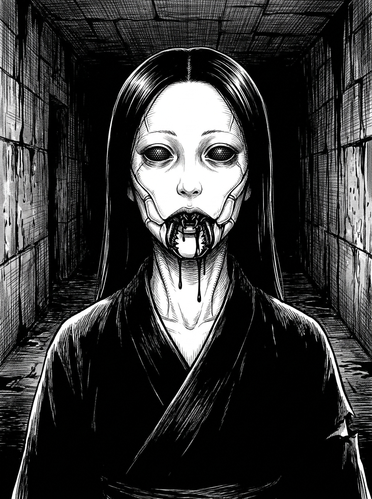
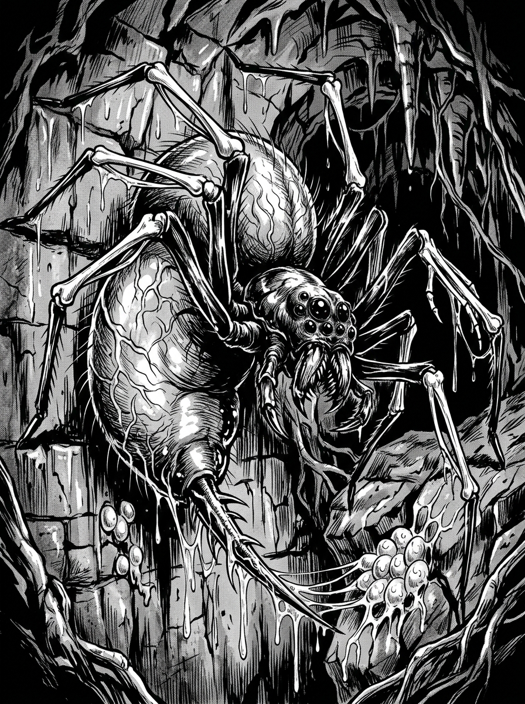
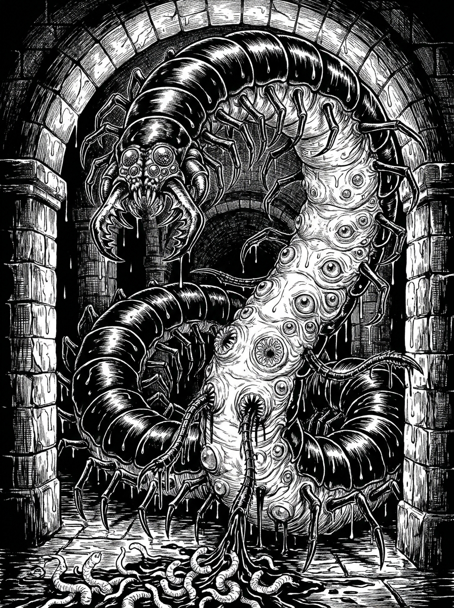

# 🐒 《西遊記》純妖怪與怪獸圖鑑總錄（第 01～100 回｜零神明・黑暗地牢版）

> **返回導覽**：[👹 妖怪篇總綱](../00-妖怪篇總綱與圖鑑分級.md) ｜ [📘 公式書總覽](../../00-公式書總覽與世界觀.md)

---

## 🚫 一、收錄邊界與「零神明」淨化鐵律

> **定案規格（2026-11-21 改版定稿）**：本總錄嚴格依明代百回本《西遊記》**第 01 回至第 100 回**逐回順序編纂，**純粹收錄全書所有「妖怪、魔怪、妖蟲、精魅、腐屍異變體與非人怪獸」**，全五卷共計 **96 則獨立公式書檔案**（涵蓋 **93 組不重複獨立妖魔／怪獸主體**，其中牛魔王、青毛獅子怪、通天河老黿因跨卷呈現不同階段／形態而設雙檔互參）。

### 1. 嚴格剔除清單（一尊不收）
以下所有神明、正神、仙佛與純凡人角色，無論原典戲份多重，皆**徹底剔除**出本圖鑑：
- **天庭與道門神明**：玉皇大帝、王母娘娘、太上老君、三清道祖、鎮元大仙與清風明月、福祿壽三星、東華帝君、黎山老母、真武大帝、紫陽真人、南極仙翁等。
- **佛門聖眾**：如來佛祖、燃燈古佛、彌勒佛、觀世音菩薩、文殊菩薩、普賢菩薩、靈吉菩薩、毗藍婆菩薩、國師王菩薩、地藏王菩薩、十八羅漢、西方四大金剛、烏巢禪師等。
- **星官、宿曜與天將**：太白金星、托塔李天王、哪吒三太子、二郎神楊戩與梅山六兄弟、哮天犬、王靈官、雷部諸神、火德／水德星君、昴日星官、四木禽星、**九曜、十二元辰、二十八宿**、太陰星君與嫦娥等。
- **龍神、冥司與地方正神**：四海龍王、涇河龍王、井龍王、摩昂太子、小白龍（正果坐騎神格）、十殿閻羅、夜遊神、五方揭諦、六丁六甲、四值功曹、十八伽藍、山神土地、河伯等。
- **取經正果與純凡人**：唐三藏、孫悟空（齊天大聖／行者主角位）、純凡人帝王官吏強盜（如車遲／烏雞／比丘／滅法／天竺等凡人君臣、寇洪劫匪與普通人冤魂）。

### 2. 跨身份妖魔處理與「無妖回目」零漏頁備忘
- **剝離神籍、僅取妖相**：凡原典帶有天界坐騎、仙童或貶謫背景之角色（如 **豬剛鬣、流沙河噬人水怪、黃袍怪、金銀角大王、青毛獅子精、獨角兕大王、黃眉老怪、賽太歲、九靈元聖、玉兔精**），本總錄一律剔除其仙佛神籍光環，僅忠實取其**作祟時期之純妖魔／墮落怪獸本體**建檔；**諦聽**亦剝離仙獸神格，純作幽冥伏地辨真之節肢聽覺怪獸建檔。
- **全書無妖回目交代（確保第 01～100 回無漏頁）**：
  - 第 05～07 回（大鬧天宮純天界神戰）、第 09～12 回（長安取經緣起與太宗遊地府）、第 14～15 回（凡人六賊與收小白龍）無獨立新妖王立卡。
  - 第 21 回收束黃風大聖（併入卷一）；第 23～26 回（四聖試禪心、五莊觀、三島求方）及第 36 回（寶林寺）全段無妖魔登場。
  - 第 84 回（滅法國凡人殺僧，本回僅收大舉施放之 `XY5-01` 瞌睡蟲）、第 87 回（鳳仙郡求雨案）、第 96～97 回（銅臺府凡人強盜案）、第 98 回（凌雲渡）與第 100 回（五聖歸位）皆無妖怪登場；第 99 回末難壓軸收錄 `XY5-19` 通天河老黿與 `XY5-20` 奪經陰魔群。
- **雙軌重構鐵律**：全書 96 則檔案統一採 **【原典記載】×【本作黑暗地牢昆蟲／節肢／寄生／環節動物 × 恐怖谷偽人改寫】** 雙軌考據，徹底捨棄毛絨猛獸與美型仙妖套路。

---

## 📚 二、全五卷分冊導覽表

| 卷次 | 分冊連結 | 涵蓋回目（含跨卷收束） | 條目編號 | 實際條目數 | 造型路線分布（類人／非人） | 黑白墨線配圖 | 本卷代表性核心妖魔 |
| :---: | :--- | :--- | :---: | :---: | :---: | :---: | :--- |
| **卷一** | [卷一：第 01～20 回](./01-卷一_第01至20回.md) | 第 01～20 回 *(含第 21 回黃風嶺收束)* | `XY1-01`～`XY1-20` | **20 條** | 類人 `9` ／ 非人 `11` | 18 張已嵌 *(2 處預留)* | 混世魔王、七大聖（牛・蛟・鵬・獅駝・獼猴・禺狨）、雙叉嶺三妖、黑熊精、白衣秀士、凌虛子、豬剛鬣、卵二姐、虎先鋒、黃風大聖 |
| **卷二** | [卷二：第 21～40 回](./02-卷二_第21至40回.md) | 第 21～40 回 *(含第 41～42 回火雲洞收束)* | `XY2-01`～`XY2-12` | **12 條** | 類人 `8` ／ 非人 `4` | 13 張已嵌 *(全配圖)* | 流沙河噬人水怪、⚠️ **白骨精（標竿）**、黃袍怪、金角與銀角大王、精細鬼與伶俐蟲、壓龍洞九尾狐、烏雞國青毛獅子精、紅孩兒與火雲洞六健將 |
| **卷三** | [卷三：第 41～60 回](./03-卷三_第41至60回.md) | 第 41～60 回 *(含第 61 回火焰山收束)* | `XY3-01`～`XY3-19` | **19 條** | 類人 `10` ／ 非人 `9` | 19 張已嵌 *(全配圖)* | 鼉龍怪、車遲三妖與冷龍、靈感大王、通天河老黿、獨角兕大王、如意真仙、蠍子精、混世四猴怪譜、六耳獼猴、諦聽、鐵扇公主、玉面狐、大力牛魔王 |
| **卷四** | [卷四：第 61～80 回](./04-卷四_第61至80回.md) | 第 61～80 回 *(含第 81～83 回無底洞收束)* | `XY4-01`～`XY4-25` | **25 條** | 類人 `15` ／ 非人 `10` | 25 張已嵌 *(2 處預留)* | 九頭蟲、木仙庵七樹精、黃眉老怪、紅鱗大蟒、賽太歲、⚠️ **盤絲七蜘蛛精（標竿）**、七乾兒子蟲妖、⚠️ **百眼魔君（標竿）**、獅駝三魔（金翅大鵬）、白鹿精、老鼠精 |
| **卷五** | [卷五：第 81～100 回](./05-卷五_第81至100回.md) | 第 81～100 回 *(至第 99 回末難壓軸)* | `XY5-01`～`XY5-20` | **20 條** | 類人 `4` ／ 非人 `16` | 15 張已嵌 *(5 處預留)* | 瞌睡蟲、南山大王、鐵背蒼狼怪、黃獅精、九靈元聖與竹節山六獅孫、青龍山三犀牛精（辟寒／辟暑／辟塵）、玉兔精、通天河老黿（復現）、奪經陰魔群 |
| **合計** | **全書第 01～100 回** | **首頁至末頁完整零遺漏** | **全五卷** | **96 條** | **類人 `46` ／ 非人 `50`** | **90 張已嵌** *(9 處預留)* | 涵蓋全書 93 組不重複妖魔主體與 3 組跨卷雙階段詳檔 |

> **跨卷雙階段重逢條目註記（共 3 組）**：① **牛魔王**（`XY1-04` 結義初現偽人速檔 ↔ `XY3-18` 火焰山數百丈多足甲殼真身決戰）；② **青毛獅子怪**（`XY2-10` 烏雞國三年奪舍偽人君主 ↔ `XY4-20` 獅駝嶺裂顎重甲吞噬巨獸）；③ **通天河老黿**（`XY3-08` 第 49 回初現馱渡 ↔ `XY5-19` 第 99 回第八十一難沉水復現）。其餘如七大聖之鵬魔王／獅駝王／獼猴王與後文金翅大鵬／青毛獅子／六耳獼猴，因原典未明言等同，嚴格獨立建檔。

---

## 📊 三、造型路線・物種唯一性・稀有度統計總覽

### 1. 兩大造型路線分布（以主分類統計）

| 造型路線 | 條目數 | 佔比 | 核心視覺與生物恐怖特徵 | 跨路線／雙態備忘 |
| :--- | :---: | :---: | :--- | :--- |
| **`【類人偽人型】`** | **46 條** | **47.9%** | 凡有臉者皆採**恐怖谷偽人（Mimic）皮囊**：第一眼像普通人、道士、宮廷貴人或弱女子，但皮下暗藏幾丁質甲殼、複眼反光、多節關節、縱裂昆蟲口器、吸血水蛭或產卵管。 | 卷四（木仙庵七樹精、宮廷偽人與無底洞女妖群）佔比最高（15/25）；`XY2-10`、`XY4-19` 另明確標註兼跨非人形態。 |
| **`【非人生物恐怖型】`** | **50 條** | **52.1%** | 徹底**去哺乳動物／去神獸化**：以昆蟲、節肢動物、寄生生物與環節軟體動物重構獅、虎、熊、象、牛、鵬、蛟、魚、犀等原典巨怪，強調濕潤黏液反光、寄生吸盤、產卵器、人骨殘留與無定形蠕動。 | 卷五（七獅巢穴、三犀甲蟲、九首水蛭巨獸、末難水獸陰魔）非人佔比高達 80%（16/20）；`XY2-05`、`XY4-16` 另明確標註兼擅偽人擬態。 |

### 2. 物種／唯一性結構統計

| 歸類標籤 | 條目數 | 佔比 | 本作都市異聞運用意義 |
| :--- | :---: | :---: | :--- |
| **`物種（群體）`** | **28 條** | **29.2%** | 可自然繁衍、集體產卵或重複孵化（如蜘蛛精族群、七乾兒子毒蟲軍團、瞌睡蟲、冷龍、虎／狼／蛇／狐／鼠基層妖群），極適合在不同都市單元反覆出現或作生態鏈鋪墊。 |
| **`物種特異個體`** | **48 條** | **50.0%** | 出身自然族群但歷經百年～千年寄生異變而成的一方巢主或大妖霸主（如白骨精、百眼魔君、黑熊精、黃風大聖、蠍子精、大力牛魔王、玄英洞三犀、竹節山六獅孫）。 |
| **`獨一無二`** | **20 條** | **20.8%** | 不可複製之太古怪獸、規格外妖聖或唯一奪舍災體（如六耳獼猴、混世四猴怪譜、獨角兕大王、九頭蟲、黃眉老怪、金翅大鵬雕、九靈元聖、紅孩兒、玉兔精、諦聽）。 |

### 3. 稀有度與本作四階對照統計（合計 96 條）

| 稀有度級別 | 條目數 | 佔比 | 對應本作四階 | 代表性條目舉隅 |
| :--- | :---: | :---: | :--- | :--- |
| **`★ 凡級（N）`** | **8 條** | **8.3%** | 未入流～三流 | `XY2-06` 精細鬼與伶俐蟲、`XY4-01` 奔波兒灞與灞波兒奔、`XY4-11` 丹桂與臘梅、`XY4-15` 有來有去、`XY4-19` 小鑽風與萬妖群、`XY5-04` 折岳洞小妖、`XY5-06` 刁鑽古怪與古怪刁鑽、`XY5-17` 玄英洞油垢小妖 |
| **`★～★★`（跨階群體）** | **2 條** | **2.1%** | 三流～初級二流 | `XY1-03` 七十二洞妖王、`XY3-14` 假取經團猴精群 |
| **`★★ 稀級（R）`** | **26 條** | **27.1%** | 二流 | `XY1-02` 混世魔王、`XY1-11`～`13` 雙叉嶺三妖、`XY1-15` 白衣秀士、`XY1-16` 凌虛子、`XY1-18` 卵二姐、`XY3-05` 冷龍、`XY4-05`～`10` 木仙庵六老與杏仙、`XY4-17` 七乾兒子蟲妖、`XY5-01` 瞌睡蟲、`XY5-20` 奪經陰魔群 |
| **`★★～★★★`（跨階群體）** | **1 條** | **1.0%** | 未入流～二流頂 | `XY1-01` 花果山四健將與山野妖猴群 |
| **`★★★ 珍級（SR）`** | **24 條** | **25.0%** | 二流頂～一流 | `XY1-19` 虎先鋒、⚠️ `XY2-02` **白骨精**、`XY2-08` 壓龍洞九尾狐、`XY3-01` 鼉龍怪、`XY3-02`～`04` 車遲三妖、`XY3-06` 靈感大王、`XY3-10` 如意真仙、⚠️ `XY4-16` **盤絲七蜘蛛精**、`XY4-23` 白鹿精、`XY5-02` 南山大王、`XY5-05` 黃獅精、`XY5-08`～`13` 六獅孫 |
| **`★★★★ 絕級（SSR）`** | **28 條** | **29.2%** | 一流頂～巔峰初 | `XY1-05`～`09` 五大聖、`XY1-14` 黑熊精、`XY1-20` 黃風大聖、`XY2-03` 黃袍怪、`XY2-04`～`05` 金銀角、`XY2-11` 紅孩兒、`XY3-11` 蠍子精、`XY3-15` 諦聽、`XY3-16` 鐵扇公主、`XY4-04` 九頭蟲、`XY4-12` 黃眉老怪、⚠️ `XY4-18` **百眼魔君**、`XY4-20`～`21` 獅象二魔、`XY4-25` 老鼠精、`XY5-14`～`16` 三犀牛精、`XY5-18` 玉兔精 |
| **`★★★★★ 神級災厄（UR）`** | **7 條** | **7.3%** | 巔峰～規格外 | `XY1-04` 平天大聖牛魔王（初現速檔）、`XY3-09` 金兜洞獨角兕大王、`XY3-12` 混世四猴怪譜、`XY3-13` 六耳獼猴、`XY3-18` 大力牛魔王（巔峰真身）、`XY4-22` 金翅大鵬雕、`XY5-07` 九靈元聖 *(合併牛魔王雙檔為 6 尊神級災厄體／譜系)* |

---

## ⭐ 四、《西遊記》三大定案標竿與本作單元劇推薦候選

### 1. 本作三大《西遊記》視覺與設計標竿（收錄於總綱「五大標竿」）

| ⚠️ 標竿一：白骨精（`XY2-02`） | ⚠️ 標竿二：盤絲洞・七蜘蛛精（`XY4-16`） | ⚠️ 標竿三：黃花觀・百眼魔君（`XY4-18`） |
| :---: | :---: | :---: |
|  |  |  |
| **造型路線**：`【類人偽人型】` **稀有度**：`★★★ 珍級（SR）`｜[卷二・第 27 回](./02-卷二_第21至40回.md) **定案基準**：徹底拋棄骷髏美女套路——表面是蒼白柔和的普通女性（偽人），皮膚底下隱約透出幾丁質節肢紋路，雙瞳泛起細密複眼冷光，嘴角可縱向裂開成捕食昆蟲口器，擅長「解屍脫殼」嫁禍與精神離間。 | **造型路線**：`【非人生物恐怖型】`×`【類人偽人型】` **稀有度**：`★★★ 珍級（SR）`｜[卷四・第 72～73 回](./04-卷四_第61至80回.md) **定案基準**：拋棄性感網美蛛妖——核心本相為巨大潮濕反光的寄生巨蛛，腹部生有持續搏動的半透明產卵器，八條步足關節嵌帶被啃碎的人骨殘留；本作序章已定稿之廢棄醫院 `01-蜘蛛精` 即為同脈都市低中階變異株。 | **造型路線**：`【非人生物恐怖型】` **稀有度**：`★★★★ 絕級（SSR）`｜[卷四・第 73 回](./04-卷四_第61至80回.md) **定案基準**：拋棄道袍帥道士形象——完全以盤踞黑暗地牢積水環境的巨型多眼蜈蚣為主體，百節身軀密布環形寄生吸盤、分泌毒黏液的產卵管與千目強光視覺污染，為全書節肢毒蟲恐怖之終極母體。 |

### 2. 本作都市單元劇推薦候選清單（依主角許家銘成長階位分期）

| 劇情階段 | 推薦候選條目 | 推薦理由與本作都市異聞切入點 |
| :--- | :--- | :--- |
| **第一期：開局智鬥篇** *(三流～初入二流｜對應 `★`～`★★`)* | - `XY1-15` [白衣秀士](./01-卷一_第01至20回.md) ＆ `XY1-16` [凌虛子](./01-卷一_第01至20回.md) - `XY1-18` [卵二姐](./01-卷一_第01至20回.md) - `XY2-06` [精細鬼與伶俐蟲](./02-卷二_第21至40回.md) - `XY4-05`～`11` [木仙庵七樹精](./04-卷四_第61至80回.md) - `XY4-17` [盤絲洞七乾兒子蟲妖](./04-卷四_第61至80回.md) - `XY5-01` [瞌睡蟲](./05-卷五_第81至100回.md) - `XY5-20` [通天河奪經陰魔群](./05-卷五_第81至100回.md) | 單體硬實力不高，但**機制殺、偽人違和感與環境壓迫極強**，最契合許家銘前期靠眼力、規則拆解與自製低階符箓以弱勝強： ① **瞌睡蟲**可寫成「整棟長照醫院集體假死昏睡」微蟲推理案； ② **精細鬼與伶俐蟲**是「弱小雜魚卻揹著應聲即亡真名收容器」的都市規則殺地雷； ③ **七乾兒子蟲妖**可作為序章醫院 `01-蜘蛛精` 的直接外圍後續（廢棄花市溫室爆囊蟲潮）； ④ **木仙庵七樹精**適合打造深夜老洋房文雅偽人詩會 × 食蟲花妖恐怖谷單案； ⑤ **奪經陰魔群**極適合作為颱風暴雨夜的極限守夜防禦戰。 |
| **第二期：深巢群像篇** *(二流頂～一流｜對應 `★★★`)* | - ⚠️ `XY2-02` [**白骨精**](./02-卷二_第21至40回.md)（標竿） - `XY1-19` [虎先鋒](./01-卷一_第01至20回.md) - `XY3-02`～`05` [車遲三妖與冷龍](./03-卷三_第41至60回.md) - ⚠️ `XY4-16` [**盤絲洞七蜘蛛精**](./04-卷四_第61至80回.md)（標竿） - `XY4-23`～`24` [白鹿精與白面狐狸精](./04-卷四_第61至80回.md) - `XY4-25` [金鼻白毛老鼠精](./04-卷四_第61至80回.md) - `XY5-02` [南山大王](./05-卷五_第81至100回.md) | 開始觸及跨街區巢穴與多層偽裝，適合中長篇核心單元： ① **白骨精**主打「連環換皮偽人＋解屍脫殼留假屍嫁禍除妖師」，將恐怖谷與人際猜忌拉滿； ② **盤絲七蜘蛛精**可作序章蜘蛛精的**母巢溯源大篇**（廢棄溫泉會館／舊水廠地底產卵群）； ③ **車遲三妖與冷龍**能重寫為現代新興邪教直播顯聖（鐵線蟲縫頭、空腔蟲臟、皮下寒蛭入沸油）； ④ **老鼠精**具備「路邊受困弱女苦肉計 → 捷運廢棄隧道三百里鼠疫迷宮」的極高張力； ⑤ **虎先鋒／南山大王**的「剝皮蟬蛻／連環分體假頭」則是絕佳的反追蹤懸疑戰。 |
| **第三期：封城災厄篇** *(一流頂～巔峰｜對應 `★★★★`～`★★★★★`)* | - ⚠️ `XY4-18` [**百眼魔君**](./04-卷四_第61至80回.md)（標竿） - `XY3-11` [蠍子精](./03-卷三_第41至60回.md) - `XY3-13` [六耳獼猴](./03-卷三_第41至60回.md) ＆ `XY3-15` [諦聽](./03-卷三_第41至60回.md) - `XY4-04` [九頭蟲](./04-卷四_第61至80回.md) - `XY4-12` [黃眉老怪](./04-卷四_第61至80回.md) - `XY4-22` [金翅大鵬雕](./04-卷四_第61至80回.md) ／ `XY3-18` [大力牛魔王](./03-卷三_第41至60回.md) ／ `XY5-07` [九靈元聖](./05-卷五_第81至100回.md) | 主線中後期跨部門／全城封鎖級大事件與世界觀天花板： ① **百眼魔君**順理成章承接盤絲洞線，把都市地下蓄洪池化作千眼吸盤強光與寄生蟲潮的終極地牢； ② **黃眉老怪**的「假道場・活體消化肉囊」是最具克蘇魯空間壓迫感的僭越偽佛大案； ③ **九頭蟲**因原典斷首逃入北海生死未卜，天然適合作為貫穿多卷的長線在逃災厄伏筆； ④ **六耳獼猴**適合終極偽人「鏡像頂替主角／同伴」危機，並順勢帶出巔峰感知技原型 **諦聽**； ⑤ **金翅大鵬雕、大力牛魔王、九靈元聖**則定錨本作「規格外滅城天災」戰力上限。 |

---

## 📑 五、全五卷逐條總索引表（第 01～100 回｜完整 96 條）

> **檢索說明**：本總表嚴格按《西遊記》第 01 回至第 100 回原典順序列出全五卷全部 **96 條**純妖怪與怪獸條目；點擊各條名稱即可直接跳轉至對應分冊閱讀【原典記載 × 本作黑暗地牢改寫】完整詳卡與黑白墨線插圖。

| 編號 | 名稱＋分冊相對連結 | 回目 | 造型路線 | 物種／唯一性 | 稀有度 |
| :---: | :--- | :--- | :---: | :---: | :---: |
| `XY1-01` | [**花果山四健將與山野妖猴群**（馬流二元帥・崩芭二將軍）](./01-卷一_第01至20回.md) | 第 01～03 回 *(續見 4–6、28 回)* | `【非人生物恐怖型】` | `物種（群體）` | `★★ 稀級（R）`～`★★★ 珍級（SR）` |
| `XY1-02` | [**混世魔王**（坎源山水臟洞巨怪）](./01-卷一_第01至20回.md) | 第 02 回 | `【非人生物恐怖型】` | `物種特異個體` | `★★ 稀級（R）` |
| `XY1-03` | [**七十二洞妖王**（花果山附庸群妖）](./01-卷一_第01至20回.md) | 第 03 回 *(續見 5–6 回)* | `【非人生物恐怖型】` | `物種（群體）` | `★ 凡級（N）`～`★★ 稀級（R）` |
| `XY1-04` | [**平天大聖・牛魔王**（卷一初現速檔・詳見卷三）](./01-卷一_第01至20回.md) | 第 03～04 回 | `【類人偽人型】` | `物種特異個體` | `★★★★★ 神級災厄（UR）` |
| `XY1-05` | [**覆海大聖・蛟魔王**（初現怪獸檔）](./01-卷一_第01至20回.md) | 第 03～04 回 | `【非人生物恐怖型】` | `物種特異個體` | `★★★★ 絕級（SSR）` |
| `XY1-06` | [**混天大聖・鵬魔王**](./01-卷一_第01至20回.md) | 第 03～04 回 | `【非人生物恐怖型】` | `物種特異個體` | `★★★★ 絕級（SSR）` |
| `XY1-07` | [**移山大聖・獅駝王**](./01-卷一_第01至20回.md) | 第 03～04 回 | `【非人生物恐怖型】` | `物種特異個體` | `★★★★ 絕級（SSR）` |
| `XY1-08` | [**通風大聖・獼猴王**](./01-卷一_第01至20回.md) | 第 03～04 回 | `【類人偽人型】` | `物種特異個體` | `★★★★ 絕級（SSR）` |
| `XY1-09` | [**驅神大聖・禺狨王**](./01-卷一_第01至20回.md) | 第 03～04 回 | `【類人偽人型】` | `物種特異個體` | `★★★★ 絕級（SSR）` |
| `XY1-10` | [**獨角鬼王**（花果山投誠二鬼怪）](./01-卷一_第01至20回.md) | 第 04 回 *(續見 5 回)* | `【類人偽人型】` | `物種（群體）` | `★★ 稀級（R）` |
| `XY1-11` | [**雙叉嶺・寅將軍**（虎精／腐食巨虎甲蟲寄生虎怪）](./01-卷一_第01至20回.md) | 第 13 回 | `【非人生物恐怖型】` | `物種（群體）` | `★★ 稀級（R）` |
| `XY1-12` | [**雙叉嶺・熊山君**（熊羆精／腐沼寄生甲殼巨怪）](./01-卷一_第01至20回.md) | 第 13 回 | `【非人生物恐怖型】` | `物種（群體）` | `★★ 稀級（R）` |
| `XY1-13` | [**雙叉嶺・特處士**（野牛精／巨角兜蟲寄生腐牛妖）](./01-卷一_第01至20回.md) | 第 13 回 | `【非人生物恐怖型】` | `物種（群體）` | `★★ 稀級（R）` |
| `XY1-14` | [**黑風山・黑熊精**（黑風怪／偽人皮下重甲腐食甲蟲）](./01-卷一_第01至20回.md) | 第 16～17 回 | `【類人偽人型】` | `物種特異個體` | `★★★★ 絕級（SSR）` |
| `XY1-15` | [**白衣秀士**（白花蛇怪／偽人書生皮下環節水蛭）](./01-卷一_第01至20回.md) | 第 17 回 | `【類人偽人型】` | `物種（群體）` | `★★ 稀級（R）` |
| `XY1-16` | [**凌虛子**（蒼狼精／偽人道士皮下寄生蜱蟲）](./01-卷一_第01至20回.md) | 第 17 回 | `【類人偽人型】` | `物種（群體）` | `★★ 稀級（R）` |
| `XY1-17` | [**高老莊妖相・豬剛鬣**（雲棧洞野豬妖相）](./01-卷一_第01至20回.md) | 第 08、18～19 回 | `【類人偽人型】` | `獨一無二` | `★★★★ 絕級（SSR）` |
| `XY1-18` | [**雲棧洞舊主・卵二姐**（卯二姐／寄生蟲卵囊母體）](./01-卷一_第01至20回.md) | 第 19 回追述 | `【類人偽人型】` | `物種特異個體` | `★★ 稀級（R）` |
| `XY1-19` | [**黃風嶺・虎先鋒**（剝皮誘餌寄生虎怪）](./01-卷一_第01至20回.md) | 第 20 回 | `【非人生物恐怖型】` | `物種（群體）` | `★★★ 珍級（SR）` |
| `XY1-20` | [**黃風大聖**（黃毛貂鼠精／腐蝕風沙寄生巢怪）](./01-卷一_第01至20回.md) | 第 20～21 回 | `【非人生物恐怖型】` | `物種特異個體` | `★★★★ 絕級（SSR）` |
| `XY2-01` | [**流沙河噬人水怪**（捲簾墮落期水怪相）](./02-卷二_第21至40回.md) | 第 22 回 *(第 8 回略敘)* | `【非人生物恐怖型】` | `獨一無二` | `★★★★ 絕級（SSR）` |
| `XY2-02` | [⚠️ **白骨精**（白虎嶺屍魔／白骨夫人・**標竿**）](./02-卷二_第21至40回.md) | 第 27 回 | `【類人偽人型】` | `物種特異個體` | `★★★ 珍級（SR）` |
| `XY2-03` | [**黃袍怪**（碗子山波月洞大妖王／嗜血狼蛛蟲顎偽人）](./02-卷二_第21至40回.md) | 第 28～31 回 | `【類人偽人型】` | `獨一無二` | `★★★★ 絕級（SSR）` |
| `XY2-04` | [**金角大王**（平頂山蓮花洞大妖王／重甲爐蟲吞噬怪）](./02-卷二_第21至40回.md) | 第 32～35 回 | `【非人生物恐怖型】` | `獨一無二` | `★★★★ 絕級（SSR）` |
| `XY2-05` | [**銀角大王**（平頂山蓮花洞二妖王／人肢銀甲蟲）](./02-卷二_第21至40回.md) | 第 32～35 回 | `【非人生物恐怖型】` *(兼類人偽人)* | `獨一無二` | `★★★★ 絕級（SSR）` |
| `XY2-06` | [**精細鬼與伶俐蟲**（平頂山蓮花洞低階寄生小妖）](./02-卷二_第21至40回.md) | 第 33～34 回 | `【類人偽人型】` | `物種（群體）` | `★ 凡級（N）` |
| `XY2-07` | [**巴山虎與倚海龍**（平頂山蓮花洞常隨妖將）](./02-卷二_第21至40回.md) | 第 34 回 | `【類人偽人型】` | `物種（群體）` | `★★ 稀級（R）` |
| `XY2-08` | [**九尾狐狸精**（壓龍山壓龍洞老奶奶／節肢產卵老婦）](./02-卷二_第21至40回.md) | 第 34 回 | `【類人偽人型】` | `物種特異個體` | `★★★ 珍級（SR）` |
| `XY2-09` | [**狐阿七大王**（壓龍山多尾甲殼寄生狐妖將）](./02-卷二_第21至40回.md) | 第 35 回 | `【非人生物恐怖型】` | `物種特異個體` | `★★ 稀級（R）` |
| `XY2-10` | [**青毛獅子精**（烏雞國假君主・獅猁怪）](./02-卷二_第21至40回.md) | 第 37～39 回 | `【類人偽人型】` *(顯相轉非人)* | `物種特異個體` | `★★★★ 絕級（SSR）` |
| `XY2-11` | [**聖嬰大王・紅孩兒**（號山枯松澗火雲洞火魔）](./02-卷二_第21至40回.md) | 第 40～42 回 | `【類人偽人型】` | `獨一無二` | `★★★★ 絕級（SSR）` |
| `XY2-12` | [**火雲洞六健將**（雲裡霧・霧裡雲・急如火・快如風・興烘掀・掀烘興）](./02-卷二_第21至40回.md) | 第 41～42 回 | `【類人偽人型】` | `物種（群體）` | `★★ 稀級（R）` |
| `XY3-01` | [**黑水河・鼉龍怪**（小鼉龍／深水巨型節肢鱷蛭怪）](./03-卷三_第41至60回.md) | 第 43 回 | `【非人生物恐怖型】` | `物種特異個體` | `★★★ 珍級（SR）` |
| `XY3-02` | [**車遲國・虎力大仙**（大國師／線蟲縫頭偽人道士）](./03-卷三_第41至60回.md) | 第 44～46 回 | `【類人偽人型】` | `物種特異個體` | `★★★ 珍級（SR）` |
| `XY3-03` | [**車遲國・鹿力大仙**（二國師／剖腹空腔節肢蟲臟偽人）](./03-卷三_第41至60回.md) | 第 44～46 回 | `【類人偽人型】` | `物種特異個體` | `★★★ 珍級（SR）` |
| `XY3-04` | [**車遲國・羊力大仙**（三國師／寄生冷蟲護體偽人妖道）](./03-卷三_第41至60回.md) | 第 44～46 回 | `【類人偽人型】` | `物種特異個體` | `★★★ 珍級（SR）` |
| `XY3-05` | [**冷龍**（油鍋護體寒蛟／蒼白寒冰水蛭・環節凍蟲）](./03-卷三_第41至60回.md) | 第 46 回 | `【非人生物恐怖型】` | `物種（群體）` | `★★ 稀級（R）` |
| `XY3-06` | [**通天河・靈感大王**（蓮池金魚精／鰓寄生吸盤卵囊巨魚）](./03-卷三_第41至60回.md) | 第 47～49 回 | `【非人生物恐怖型】` | `物種特異個體` | `★★★ 珍級（SR）` |
| `XY3-07` | [**斑衣鱖婆**（班衣鱖婆／水下老嫗偽人魚怪）](./03-卷三_第41至60回.md) | 第 48～49 回 | `【類人偽人型】` | `物種（群體）` | `★★ 稀級（R）` |
| `XY3-08` | [**通天河・老黿**（千三百年修道白黿／背甲藤壺水螅巨獸）](./03-卷三_第41至60回.md) | 第 49 回 *(99 回見卷五)* | `【非人生物恐怖型】` | `物種特異個體` | `★★★ 珍級（SR）` |
| `XY3-09` | [**金兜洞・獨角兕大王**（板角青牛精／重甲犀金龜魔獸）](./03-卷三_第41至60回.md) | 第 50～52 回 | `【非人生物恐怖型】` | `獨一無二` | `★★★★★ 神級災厄（UR）` |
| `XY3-10` | [**解陽山破兒洞・如意真仙**（牛魔王胞弟／寄生胎水偽人）](./03-卷三_第41至60回.md) | 第 53 回 | `【類人偽人型】` | `物種特異個體` | `★★★ 珍級（SR）` |
| `XY3-11` | [**毒敵山琵琶洞・蠍子精**（琵琶巨蠍／倒馬毒產卵母蠍）](./03-卷三_第41至60回.md) | 第 54～55 回 | `【類人偽人型】` | `物種特異個體` | `★★★★ 絕級（SSR）` |
| `XY3-12` | [**混世四猴怪譜**（不入十類・四大規格外變異靈長怪獸總覽）](./03-卷三_第41至60回.md) | 第 58 回 | `【非人生物恐怖型】` | `獨一無二` | `★★★★★ 神級災厄（UR）` |
| `XY3-13` | [**六耳獼猴**（假孫悟空／終極偽人鏡像替身・六膜聽覺怪）](./03-卷三_第41至60回.md) | 第 56～58 回 | `【類人偽人型】` | `獨一無二` | `★★★★★ 神級災厄（UR）` |
| `XY3-14` | [**假取經團猴精群**（假唐僧・假八戒・假沙僧・假白馬）](./03-卷三_第41至60回.md) | 第 57～58 回 | `【類人偽人型】` | `物種（群體）` | `★ 凡級（N）`～`★★ 稀級（R）` |
| `XY3-15` | [**諦聽**（善聽／幽冥伏地辨真・多耳聽覺節肢觸角怪獸）](./03-卷三_第41至60回.md) | 第 58 回 | `【非人生物恐怖型】` | `獨一無二` | `★★★★ 絕級（SSR）` |
| `XY3-16` | [**芭蕉洞・鐵扇公主／羅剎女**（枯葉螳螂鐮肢震風偽人貴婦）](./03-卷三_第41至60回.md) | 第 59～61 回 | `【類人偽人型】` | `獨一無二` | `★★★★ 絕級（SSR）` |
| `XY3-17` | [**積雷山・玉面狐狸精**（玉面公主／吸血纖毛節肢尾偽人）](./03-卷三_第41至60回.md) | 第 60～61 回 | `【類人偽人型】` | `物種特異個體` | `★★ 稀級（R）` |
| `XY3-18` | [**大力牛魔王**（平天大聖／數百丈多足甲殼腐蟲牛魔）](./03-卷三_第41至60回.md) | 第 60～61 回 *(初現見卷一)* | `【非人生物恐怖型】` | `物種特異個體` | `★★★★★ 神級災厄（UR）` |
| `XY3-19` | [**辟水金睛獸**（避水金睛獸／水陸兩棲節肢鱗甲坐騎怪獸）](./03-卷三_第41至60回.md) | 第 60～61 回 | `【非人生物恐怖型】` | `獨一無二` | `★★★ 珍級（SR）` |
| `XY4-01` | [**奔波兒灞與灞波兒奔**（腐敗沼澤鯰魚與黑魚寄生小怪）](./04-卷四_第61至80回.md) | 第 62～63 回 | `【非人生物恐怖型】` | `物種（群體）` | `★ 凡級（N）` |
| `XY4-02` | [**萬聖龍妖**（亂石山碧波潭墮落深潭魚龍寄生主）](./04-卷四_第61至80回.md) | 第 60、62～63 回 | `【類人偽人型】` | `物種特異個體` | `★★★ 珍級（SR）` |
| `XY4-03` | [**萬聖公主與龍婆**（碧波潭寄生雌龍女・穿骨老龍母）](./04-卷四_第61至80回.md) | 第 62～63 回 | `【類人偽人型】` | `物種特異個體` | `★★ 稀級（R）` |
| `XY4-04` | [**九頭蟲**（九頭駙馬／鬼車九首吸血水蛭怪獸）](./04-卷四_第61至80回.md) | 第 62～63 回 | `【非人生物恐怖型】` | `獨一無二` | `★★★★ 絕級（SSR）` |
| `XY4-05` | [**勁節十八公**（老松樹精・荊棘嶺四老之首）](./04-卷四_第61至80回.md) | 第 64 回 | `【類人偽人型】` | `物種特異個體` | `★★ 稀級（R）` |
| `XY4-06` | [**孤直公**（老柏樹精・荊棘嶺四老之二）](./04-卷四_第61至80回.md) | 第 64 回 | `【類人偽人型】` | `物種特異個體` | `★★ 稀級（R）` |
| `XY4-07` | [**凌空子**（老檜樹精・荊棘嶺四老之三）](./04-卷四_第61至80回.md) | 第 64 回 | `【類人偽人型】` | `物種特異個體` | `★★ 稀級（R）` |
| `XY4-08` | [**拂雲叟**（老竹精・荊棘嶺四老之四）](./04-卷四_第61至80回.md) | 第 64 回 | `【類人偽人型】` | `物種特異個體` | `★★ 稀級（R）` |
| `XY4-09` | [**赤身鬼**（老楓樹精／丹楓鬼使）](./04-卷四_第61至80回.md) | 第 64 回 | `【類人偽人型】` | `物種特異個體` | `★★ 稀級（R）` |
| `XY4-10` | [**杏仙**（老杏樹精・木仙庵食人捕蠅草花妖）](./04-卷四_第61至80回.md) | 第 64 回 | `【類人偽人型】` | `物種特異個體` | `★★ 稀級（R）` |
| `XY4-11` | [**丹桂女侍與臘梅女童**（木仙庵雙生紙偶花樹女童）](./04-卷四_第61至80回.md) | 第 64 回 | `【類人偽人型】` | `物種（群體）` | `★ 凡級（N）` |
| `XY4-12` | [**黃眉老怪**（黃眉老佛／小雷音寺終極偽佛偽人）](./04-卷四_第61至80回.md) | 第 65～66 回 | `【類人偽人型】` | `獨一無二` | `★★★★ 絕級（SSR）` |
| `XY4-13` | [**紅鱗大蟒**（七絕山深洞環節蠕蟲巨蛭怪獸）](./04-卷四_第61至80回.md) | 第 67 回 | `【非人生物恐怖型】` | `物種特異個體` | `★★★ 珍級（SR）` |
| `XY4-14` | [**賽太歲**（麒麟山金毛犼腐食重甲噴煙魔獸）](./04-卷四_第61至80回.md) | 第 68～71 回 | `【非人生物恐怖型】` | `獨一無二` | `★★★★ 絕級（SSR）` |
| `XY4-15` | [**先鋒怪與心腹小校有來有去**（獬豸洞巡山低階妖校）](./04-卷四_第61至80回.md) | 第 68～70 回 | `【類人偽人型】` | `物種（群體）` | `★ 凡級（N）` |
| `XY4-16` | [⚠️ **盤絲洞・七蜘蛛精**（七姊妹・**標竿**）](./04-卷四_第61至80回.md) | 第 72～73 回 | `【非人生物恐怖型】`×`【類人偽人型】` | `物種（群體）` | `★★★ 珍級（SR）` |
| `XY4-17` | [**盤絲洞七個乾兒子蟲妖**（蜜・螞・蠦・班・蜢・蠟・蜻）](./04-卷四_第61至80回.md) | 第 72 回 | `【非人生物恐怖型】` | `物種（群體）` | `★★ 稀級（R）` |
| `XY4-18` | [⚠️ **黃花觀・百眼魔君**（多目怪／蜈蚣精・**標竿**）](./04-卷四_第61至80回.md) | 第 73 回 | `【非人生物恐怖型】` | `物種特異個體` | `★★★★ 絕級（SSR）` |
| `XY4-19` | [**小鑽風與獅駝嶺萬妖群**（四萬八千巡山寄生小怪群）](./04-卷四_第61至80回.md) | 第 74～75 回 | `【類人偽人型】`×`【非人生物恐怖型】` | `物種（群體）` | `★ 凡級（N）` |
| `XY4-20` | [**大大王・青毛獅子怪**（獅駝嶺大王・裂顎寄生獅甲蟲巨獸）](./04-卷四_第61至80回.md) | 第 74～77 回 | `【非人生物恐怖型】` | `獨一無二` | `★★★★ 絕級（SSR）` |
| `XY4-21` | [**二大王・黃牙老象**（獅駝嶺二王・吸血捲吸口管腫脹巨怪）](./04-卷四_第61至80回.md) | 第 74～77 回 | `【非人生物恐怖型】` | `獨一無二` | `★★★★ 絕級（SSR）` |
| `XY4-22` | [**三大王・金翅大鵬雕**（獅駝國大王・嗜血食腐巨蚊鷲）](./04-卷四_第61至80回.md) | 第 74～77 回 | `【非人生物恐怖型】` | `獨一無二` | `★★★★★ 神級災厄（UR）` |
| `XY4-23` | [**白鹿精**（清華洞假國丈・育蟲挖心宮廷偽人）](./04-卷四_第61至80回.md) | 第 78～79 回 | `【類人偽人型】` | `物種特異個體` | `★★★ 珍級（SR）` |
| `XY4-24` | [**白面狐狸精**（清華洞假美后・瓷面宮廷偽人與節肢尾）](./04-卷四_第61至80回.md) | 第 78～79 回 | `【類人偽人型】` | `物種（群體）` | `★★ 稀級（R）` |
| `XY4-25` | [**金鼻白毛老鼠精**（半截觀音／地湧夫人・無底洞鼠巢）](./04-卷四_第61至80回.md) | 第 80～83 回 | `【類人偽人型】` | `物種特異個體` | `★★★★ 絕級（SSR）` |
| `XY5-01` | [**瞌睡蟲**（神經寄生吸腦微蟲／假死催眠微蟲群）](./05-卷五_第81至100回.md) | 第 81、84、86 回 *(初出 25 回)* | `【非人生物恐怖型】` | `物種（群體）` | `★★ 稀級（R）` |
| `XY5-02` | [**南山大王**（隱霧山折岳連環洞・艾葉花皮豹子精）](./05-卷五_第81至100回.md) | 第 85～86 回 | `【類人偽人型】` | `物種特異個體` | `★★★ 珍級（SR）` |
| `XY5-03` | [**鐵背蒼狼怪**（折岳連環洞先鋒・鐵甲幾丁質倒刺怪）](./05-卷五_第81至100回.md) | 第 85～86 回 | `【非人生物恐怖型】` | `物種（群體）` | `★★ 稀級（R）` |
| `XY5-04` | [**折岳連環洞先鋒小妖群**（三假南山蛻殼替身與洞窟雜妖）](./05-卷五_第81至100回.md) | 第 85～86 回 | `【類人偽人型】` | `物種（群體）` | `★ 凡級（N）` |
| `XY5-05` | [**黃獅精**（玉華州豹頭山虎口洞主・擬態腐食獅甲怪）](./05-卷五_第81至100回.md) | 第 88～90 回 | `【非人生物恐怖型】` | `物種特異個體` | `★★★ 珍級（SR）` |
| `XY5-06` | [**刁鑽古怪與古怪刁鑽**（虎口洞採買雜役偽人商販二人組）](./05-卷五_第81至100回.md) | 第 89 回 | `【類人偽人型】` | `物種（群體）` | `★ 凡級（N）` |
| `XY5-07` | [**九靈元聖**（竹節山九曲盤桓洞祖翁・九首環節水蛭巨獸）](./05-卷五_第81至100回.md) | 第 89～90 回 | `【非人生物恐怖型】` | `獨一無二` | `★★★★★ 神級災厄（UR）` |
| `XY5-08` | [**猱獅**（九曲盤桓洞六獅孫之一・鐵線蟲長肢毛蜘怪）](./05-卷五_第81至100回.md) | 第 90 回 | `【非人生物恐怖型】` | `物種特異個體` | `★★★ 珍級（SR）` |
| `XY5-09` | [**雪獅**（九曲盤桓洞六獅孫之二・白殭菌白化冰殼甲蟲怪）](./05-卷五_第81至100回.md) | 第 90 回 | `【非人生物恐怖型】` | `物種特異個體` | `★★★ 珍級（SR）` |
| `XY5-10` | [**狻猊獅**（九曲盤桓洞六獅孫之三・炮步甲毒煙蜂巢怪）](./05-卷五_第81至100回.md) | 第 90 回 | `【非人生物恐怖型】` | `物種特異個體` | `★★★ 珍級（SR）` |
| `XY5-11` | [**白澤獅**（九曲盤桓洞六獅孫之四・多目寄生扁虱複眼怪）](./05-卷五_第81至100回.md) | 第 90 回 | `【非人生物恐怖型】` | `物種特異個體` | `★★★ 珍級（SR）` |
| `XY5-12` | [**伏狸獅**（九曲盤桓洞六獅孫之五・扁平盲蠍蜈蚣鐮肢怪）](./05-卷五_第81至100回.md) | 第 90 回 | `【非人生物恐怖型】` | `物種特異個體` | `★★★ 珍級（SR）` |
| `XY5-13` | [**摶象獅**（九曲盤桓洞六獅孫之六・重裝獨角仙骨槍巨甲怪）](./05-卷五_第81至100回.md) | 第 90 回 | `【非人生物恐怖型】` | `物種特異個體` | `★★★ 珍級（SR）` |
| `XY5-14` | [**辟寒大王**（青龍山玄英洞長兄・冰寒偽佛犀金龜巨獸）](./05-卷五_第81至100回.md) | 第 91～92 回 | `【非人生物恐怖型】` | `物種特異個體` | `★★★★ 絕級（SSR）` |
| `XY5-15` | [**辟暑大王**（青龍山玄英洞次兄・嗜脂腐熱巨型甲蟲獸）](./05-卷五_第81至100回.md) | 第 91～92 回 | `【非人生物恐怖型】` | `物種特異個體` | `★★★★ 絕級（SSR）` |
| `XY5-16` | [**辟塵大王**（青龍山玄英洞三弟・塵蟎孢子獨角犀甲蟲）](./05-卷五_第81至100回.md) | 第 91～92 回 | `【非人生物恐怖型】` | `物種特異個體` | `★★★★ 絕級（SSR）` |
| `XY5-17` | [**青龍山玄英洞油垢小妖群**（嗜油腐食幼蟲雜妖群）](./05-卷五_第81至100回.md) | 第 91～92 回 | `【非人生物恐怖型】` | `物種（群體）` | `★ 凡級（N）` |
| `XY5-18` | [**天竺國・玉兔精**（假天竺公主／宮廷偽人嚙骨昆蟲口器怪）](./05-卷五_第81至100回.md) | 第 93～95 回 | `【類人偽人型】` | `獨一無二` | `★★★★ 絕級（SSR）` |
| `XY5-19` | [**通天河老黿**（千年白黿・第八十一難末難復現補記）](./05-卷五_第81至100回.md) | 第 99 回 *(互參 49 回)* | `【非人生物恐怖型】` | `物種特異個體` | `★★★ 珍級（SR）` |
| `XY5-20` | [**通天河奪經陰魔群**（第八十一難夜襲搶經・濕霧寄生集群）](./05-卷五_第81至100回.md) | 第 99 回 | `【非人生物恐怖型】` | `物種（群體）` | `★★ 稀級（R）` |

---

> **快速返回**：[👹 妖怪篇總綱](../00-妖怪篇總綱與圖鑑分級.md) ｜ [📘 公式書總覽](../../00-公式書總覽與世界觀.md) ｜ [卷一](./01-卷一_第01至20回.md) ｜ [卷二](./02-卷二_第21至40回.md) ｜ [卷三](./03-卷三_第41至60回.md) ｜ [卷四](./04-卷四_第61至80回.md) ｜ [卷五](./05-卷五_第81至100回.md)
