# 🐒 《西遊記》純妖怪與怪獸圖鑑・卷一（第 01～20 回）

> **返回導覽**：[👹 妖怪篇總綱](../00-妖怪篇總綱與圖鑑分級.md) ｜ [📖 西遊記總錄](./00-西遊記妖怪怪獸總錄.md) ｜ [➡️ 卷二](./02-卷二_第21至40回.md)
>
> **收錄原則（2026-11-21 定案・純妖怪怪獸零神明鐵律）**：本卷嚴格自《西遊記》第一頁第 01 回起，按原典回目順序收錄至第 20 回（含第 21 回交界黃風嶺事件收束）為止之**全部純妖怪、魔怪、怪獸與妖蟲異變體**，共計 **20 條**獨立公式書檔案（嵌入既有黑白墨線圖檔 **18 張**，預留補繪圖位 **2 處**）。
> **嚴格剔除清單**：玉皇大帝、王母娘娘、如來佛祖、觀世音菩薩、太上老君、須菩提祖師、靈吉菩薩、烏巢禪師、李靖、哪吒、楊戩、梅山神將與哮天犬、四海與涇河龍王、小白龍、十殿閻羅與地藏王、千里眼順風耳、太白金星、王靈官與雷部諸神、五方揭諦／六丁六甲／四值功曹／十八伽藍、唐三藏、孫悟空以及凡人官吏強盜，悉數剔除不收。
> **美術與重構鐵律**：全卷徹底揚棄「傳統神話猛獸／毛絨動物／美型妖精」路線，全面改以 **【昆蟲・節肢動物・寄生生物・軟體環節動物】** 結合 **黑暗地牢（Darkest Dungeon）潮濕腐蝕感 × 克蘇魯不可名狀感 × 恐怖谷偽人（Mimic）** 雙路線重構，並嚴守【原典記載】×【本作衍生】雙軌考據。

---

## 📋 本卷純妖怪與怪獸速查表（第 01～20 回・共 20 條）

| 編號 | 名稱（別稱） | 出處回目 | 造型路線 | 本作黑暗地牢／寄生重構原形 | 物種／唯一性 | 稀有度 | 本作階位 | 配圖 |
| :---: | :--- | :---: | :---: | :--- | :--- | :---: | :--- | :---: |
| `XY1-01` | **花果山四健將與山野妖猴群**（馬流二元帥・崩芭二將軍） | 第 01～03 回 | `【非人生物恐怖型】` | 螳螂鐮肢擬猿蟲・多足吸盤群怪 | `物種（群體）` | `★★`～`★★★` | 二流～二流頂 | 🖼️ |
| `XY1-02` | **混世魔王**（坎源山水臟洞巨怪） | 第 02 回 | `【非人生物恐怖型】` | 腐沼重甲田鱉・吸血水蛭巨怪 | `物種特異個體` | `★★` | 二流中上 | 🖼️ |
| `XY1-03` | **七十二洞妖王**（花果山附庸群妖） | 第 03 回 | `【非人生物恐怖型】` | 腐食葬甲・寄生蜂巢骨骸雜聚群怪 | `物種（群體）` | `★`～`★★` | 三流頂～二流 | ⏳ |
| `XY1-04` | **平天大聖・牛魔王**（卷一初現速檔・詳見卷三） | 第 03～04 回 | `【類人偽人型】` | 偽人巨漢・皮下巨角兜蟲重甲妖聖 | `物種特異個體` | `★★★★★` | 巔峰 | 🖼️ |
| `XY1-05` | **覆海大聖・蛟魔王**（初現怪獸檔） | 第 03～04 回 | `【非人生物恐怖型】` | 深淵巨沙蠶海蜈蚣・齒狀吸盤水蛭怪 | `物種特異個體` | `★★★★` | 一流頂～巔峰 | 🖼️ |
| `XY1-06` | **混天大聖・鵬魔王** | 第 03～04 回 | `【非人生物恐怖型】` | 巨型食蟲虻・毒蜂巢腹骨針飛怪 | `物種特異個體` | `★★★★` | 一流頂～巔峰 | 🖼️ |
| `XY1-07` | **移山大聖・獅駝王** | 第 03～04 回 | `【非人生物恐怖型】` | 巨型蟻獅大顎・蠍甲多足岩瘤怪獸 | `物種特異個體` | `★★★★` | 一流頂～巔峰 | 🖼️ |
| `XY1-08` | **通風大聖・獼猴王** | 第 03～04 回 | `【類人偽人型】` | 盲蛛長肢偽人・巨蚊吸音吸血口針怪 | `物種特異個體` | `★★★★` | 一流頂～巔峰 | 🖼️ |
| `XY1-09` | **驅神大聖・禺狨王** | 第 03～04 回 | `【類人偽人型】` | 鐵線蟲長髮偽人祭司・控屍菌絲產卵怪 | `物種特異個體` | `★★★★` | 一流頂～巔峰 | 🖼️ |
| `XY1-10` | **獨角鬼王**（花果山投誠二鬼怪） | 第 04 回 | `【類人偽人型】` | 雙生阿諛偽人・額裂獨角仙寄生繭怪 | `物種（群體）` | `★★` | 二流中下 | 🖼️ |
| `XY1-11` | **雙叉嶺・寅將軍**（虎精） | 第 13 回 | `【非人生物恐怖型】` | 腐食巨虎甲蟲・多足鑿齒寄生虎怪 | `物種（群體）` | `★★` | 二流初～中階 | 🖼️ |
| `XY1-12` | **雙叉嶺・熊山君**（熊羆精） | 第 13 回 | `【非人生物恐怖型】` | 腐沼重甲等足蟲・腹底齒狀吸盤巨怪 | `物種（群體）` | `★★` | 二流初階 | 🖼️ |
| `XY1-13` | **雙叉嶺・特處士**（野牛精） | 第 13 回 | `【非人生物恐怖型】` | 巨角大兜蟲・蠐螬腐腹寄生牛屍怪 | `物種（群體）` | `★★` | 二流初階 | 🖼️ |
| `XY1-14` | **黑風山・黑熊精**（黑風怪） | 第 16～17 回 | `【類人偽人型】` | 偽人黑衣漢・皮下重甲腐食甲蟲與吸盤 | `物種特異個體` | `★★★★` | 一流頂～巔峰初 | 🖼️ |
| `XY1-15` | **白衣秀士**（白花蛇怪） | 第 17 回 | `【類人偽人型】` | 極致偽人書生・皮下巨型環節水蛭與吐酸口器 | `物種（群體）` | `★★` | 二流初～中階 | 🖼️ |
| `XY1-16` | **凌虛子**（蒼狼精） | 第 17 回 | `【類人偽人型】` | 偽人道士・皮下寄生蜱蟲群與多節肢狼顎 | `物種（群體）` | `★★` | 二流初～中階 | 🖼️ |
| `XY1-17` | **高老莊妖相・豬剛鬣**（雲棧洞野豬妖相） | 第 08、18～19 回 | `【類人偽人型】` | 偽人黑胖壯漢・皮囊縱裂寄生獠牙口器怪 | `獨一無二` | `★★★★` | 一流頂 | 🖼️ |
| `XY1-18` | **雲棧洞舊主・卵二姐**（卯二姐） | 第 19 回追述 | `【類人偽人型】` | 枯白偽人婦人・腹背搏動寄生蟲卵囊母體 | `物種特異個體` | `★★` | 二流中階（已亡） | ⏳ |
| `XY1-19` | **黃風嶺・虎先鋒**（黃斑猛虎精） | 第 20 回 | `【非人生物恐怖型】` | 剝皮誘餌寄生虎怪・空殼蛻皮逃遁擬態蟲虎 | `物種（群體）` | `★★★` | 二流頂～一流初 | 🖼️ |
| `XY1-20` | **黃風大聖**（黃毛貂鼠精） | 第 20～21 回 | `【非人生物恐怖型】` | 腐油寄生巢怪・腹腔噴吐腐蝕風沙與細蟲孢子 | `物種特異個體` | `★★★★` | 一流頂（跨階災厄） | 🖼️ |

---

## 🪳 第一單元：第 01～03 回｜花果山群妖・水臟洞巨怪・七十二洞妖盟

### [XY1-01] 花果山四健將與山野妖猴群（馬流二元帥・崩芭二將軍）
- **出處順序**：第 1 回《靈根育孕源流出 心性修持大道生》～第 3 回《四海千山皆拱伏 九幽十類盡除名》（第 4～6 回抗擊天兵、第 28 回重聚花果山續見）
- **類別與造型路線**：`【非人生物恐怖型】`｜擬猿巨型螳螂・馬陸多足吸盤群怪（赤尻馬猴・通背猿猴・山野妖猴群異變重構）
- **物種／唯一性**：`物種（群體）`（原典中「赤尻馬猴」與「通背猿猴」屬混世四猴奇種血脈，花果山各有二尊任四健將，下轄四萬七千餘山野妖猴群體，屬高度群聚繁衍之巢穴種屬）
- **稀有度與道行對照**：`★★ 稀級（R）`～`★★★ 珍級（SR）`｜模糊道行：四健將具數百年妖修與統軍智謀，底層山野妖猴群為數年至數十年淺妖氣｜本作階位：未入流～三流（妖猴群）／二流～二流頂（四健將）
- **外貌與黑暗地牢／恐怖谷視覺改寫**：
  - 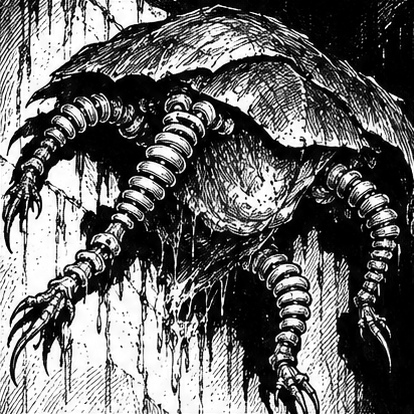
  - 【原典外貌】四健將皆為長年修煉成精的老猴將領——兩隻赤尻馬猴封「馬、流二元帥」，兩隻通背猿猴封「崩、芭二將軍」，披甲執刀槍劍戟，操練花果山水簾洞四萬七千餘妖猴群。
  - 【本作克蘇魯／昆蟲寄生／偽人重構】徹底剝離毛絨猴類與戲曲美猴感，以**黑暗地牢潮濕洞窟的擬猿節肢蟲群**重構。**馬、流二元帥（赤尻馬猴）**並非長著紅屁股的猿猴，而是背脊與臀部外殼腐蝕剝裂、裸露出大量濕亮血紅黏膜氣門與**環形齒狀寄生吸盤**的佝僂節肢怪；其倒三角頭胸呈灰黑幾丁質硬殼，嵌著兩顆滲出黑汁的冰冷複眼，乾癟無唇的口裂下收摺著能探測活體氣脈與陰陽溫差的細長蚊式感覺口針。**崩、芭二將軍（通背猿猴）**之「通背」實為一條橫穿整個枯骨肩胛、完全裸露並滴落濕濁滑液的**巨型捕食螳螂鋸齒鐮肢骨軸**，雙前肢能反關節喀喀抽長數公尺，肘節甲縫間嵌著生鏽殘鐵片與被啃碎的人類指骨殘留。身後數萬**山野妖猴群**則是一片宛若畸形蜘蛛、馬陸與乾癟猿屍拼湊的漆黑多足攀壁蟲群，密密麻麻倒掛於終年滴水的鐘乳洞頂，黑白高對比墨線著重勾勒甲殼反光、密集爪鉤與潮濕岩壁間垂落的黏絲。
- **特性**：
  - 【原典記載】智謀與組織力極高——第 1 回即有老通背猿猴道出世間唯有「佛與仙與神聖三者」不伏閻王老子管轄；第 3 回復獻計前往傲來國搬掠兵器、赴東海索寶，並將漫山野猴操練為陣列分明、輪番放哨的妖軍。赤尻馬猴本具「曉陰陽、會人事、善出入、避死延生」之潛能，通背猿猴本具「拿日月、縮千山、辨休咎、乾坤摩弄」之血脈，惟花果山四健將未遇真師點化，未曾徹底覺醒。
  - 【本作衍生】屬於極危險的**「高智能巢穴工蜂＋兵蟻階級制妖蟲群」**——底層擬猿蟲猴靠氣味費洛蒙與硬殼摩擦高頻音傳遞情報，四健將則充當具備戰術思維的巢穴中樞，懂得偷盜人類五金行、廢鐵場或軍械庫的金屬銳器，以黏液將開山刀與鋼筋焊在螳螂鐮肢上強化殺傷力。
- **弱點**：
  - 【原典記載】極畏大規模烈火焚巢與濃煙燻逼——第 6 回遭放火燒山時，花果山四萬七千妖猴與四健將幾乎全線潰逃、死傷慘重，缺乏頂尖護身神通。
  - 【本作衍生】1. **高度懼怕乾燥高熱、火攻與窒息濃煙**：體表濕潤黏液與氣門呼吸結構一遇**烈火符**爆燃或工業濃煙即會令氣孔封閉窒息；2. **群體指揮高度依賴四健將發出的節肢摩擦高頻波**，一旦用**破障符**鎖定並以**五雷鎮煞符**爆破四健將胸腔發聲器，外圍數十隻底層擬猿蟲群會因費洛蒙失控而互相啃食潰散。
- **習性**：
  - 【原典記載】群居花果山水簾洞與山崖石窟，白日操演兵陣、採果飲酒，遇外敵來犯便以滾木礌石與冷兵器結陣死守。
  - 【本作衍生】在現代台灣常盤踞於深山廢棄礦坑隧道、停業多年的潮濕山區遊樂園地下機房或無人管理的蓄水防空洞；夜間成群沿排水箱涵與高壓電纜潛入市郊五金行與工地掠奪金屬器材，並將落單登山客拖回潮濕洞壁以黏液固定充當活體儲糧。
- **喜好**：
  - 【原典記載】嗜飲發酵果酒、酷愛金屬兵器與軍陣排場，對力量最強的領頭妖王極端盲從忠誠。
  - 【本作衍生】對發酵腐果酒精、生鏽鐵腥味與高濕度滴水環境有本能癖好；崩、芭二將軍特別執著於將獵物的長骨與生鏽鋼管並排插在洞口展示領地階級。
- **擅長的招式／異能**：
  - 【原典記載】刀槍劍戟軍陣圍攻、滾木礌石山林伏擊、潛伏竊械（洗劫傲來國兵器庫）、赤尻與通背猴血脈感知（趨吉避凶與情報研判）。
  - 【本作衍生】**鐮軸反折貫穿**（崩芭二將軍肩背骨軸喀嚓錯位，單側螳螂鐮肢瞬間暴長三公尺穿刺咽喉）、**赤尻吸盤陰陽探測**（馬流二元帥以裸露背節吸盤與口針遠距鎖定法師脈搏與藏匿位置）、**百足蟲猴覆牆圍獵**（數十隻擬猿蟲沿天花板與無窗水泥牆面無聲合圍壓頂）。

---

### [XY1-02] 混世魔王（坎源山水臟洞巨怪）
- **出處順序**：第 2 回《悟徹菩提真妙理 斷魔歸本合元神》
- **類別與造型路線**：`【非人生物恐怖型】`｜腐沼重甲田鱉（巨型水生腐食甲蟲）・吸血水蛭集群巨怪
- **物種／唯一性**：`物種特異個體`（盤踞花果山正北坎源山水臟洞之獨霸水腐巨魔，亦是原典中第一尊被正式斬殺的成名妖王）
- **稀有度與道行對照**：`★★ 稀級（R）`｜模糊道行：數十年至百餘年成精水澤妖王（能喚黑風雷雨、力大無窮，卻無精緻變化神通）｜本作階位：二流（二流中上）
- **外貌與黑暗地牢／恐怖谷視覺改寫**：
  - 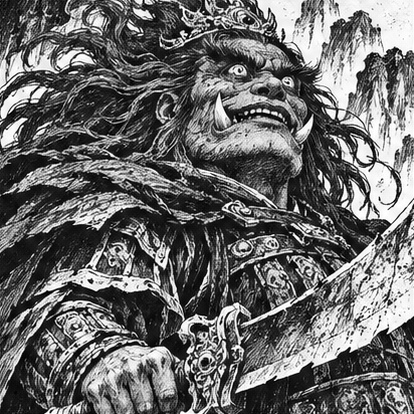
  - 【原典外貌】身高約三丈、腰闊數圍；頭戴烏金盔、身披黑鐵甲與皂羅袍、足踏花褶靴；生得藍靛臉、硃砂髮、巨口獠牙、濃眉圓眼，手持一口寒光闊背大刀。
  - 【本作克蘇魯／昆蟲寄生／偽人重構】緊扣洞名「**水臟洞**（髒水與腐爛內臟之窟）」徹底去人形化，重塑為一尊高逾四公尺、由**超巨型深水腐食甲蟲（田鱉／大龍蝨）**與**成團吸血水蛭**拼合而成的潮濕黑暗地牢巨怪！原典之「烏金盔、黑鐵甲」實為層層疊合、漆黑反光且沾滿腐臭污泥的厚重幾丁質鞘翅與胸背硬甲，「皂羅袍」則是垂掛在甲縫間滴落黑水的腐敗菌膜肉裙；頭顱無人類五官，泛著溺屍般的青藍腐甲光澤，兩側鑲滿蒼蠅般膨凸的灰暗複眼，頭頂與嘴周垂掛數十條如「硃砂髮」般瘋狂扭動、不斷滴落血水的暗紅巨型吸血水蛭與水螅觸手；巨口縱向裂開露出多層倒鉤幾丁質啃顎，右前捕食鐮肢已與生鏽破鐵融合鈣化為一柄重逾數百公斤的殘缺骨刃闊刀，每跨一步便從甲殼裂縫溢出腥臭黑水與蠕動水生幼蟲。
- **特性**：
  - 【原典記載】趁花果山無主之際屢次駕黑風毒霧劫掠水簾洞，擄走小猴充作奴僕並強奪石碗石盆等家私；出沒伴隨雲霧風雨雷電，擅長倚仗體型與大刀正面碾壓，然性情自大輕敵，瞧不起身材矮小赤手空拳之敵。
  - 【本作衍生】典型的**「高裝甲重型腐水坦怪」**——厚重幾丁質水甲足以硬扛普通手槍與單張自製三流烈火符，且周身不斷蒸散潮濕腐臭水霧，能直接讓低階黃符受潮熄火，壓迫感極強；但其心智傲慢、神經傳導遲緩，極度缺乏對付高速游擊與精細破甲戰術的應變能力。
- **弱點**：
  - 【原典記載】極懼高速分身圍攻干擾視線與火焚潮濕巢穴——遭兩三百個靈活分身鑽襠、扳腳、摳眼、捻鼻後，沉重闊刀毫無著力點而瞬間崩潰，反遭奪刃照頂門一刀劈開，水臟洞亦被一把火燒得枯乾。
  - 【本作衍生】1. **複眼、水蛭觸鬚與甲殼關節縫是致命破口**：以**輕身符**拉開距離，先用**單根毫毛誘餌／撒豆成兵（低配）**或強光爆閃吸引其鈍重骨刀揮空，再以**指地成鋼符（陷地符）**卡死其沉重多節後足；2. **極畏高壓電擊與乾燥烈火**：因其通體濕漉導電，將**五雷鎮煞符**或貼身**掌心雷**直接打進頭胸甲縫的水蛭軟肉處，可順著體內黑水引發全身痙攣麻痺，隨後以**烈火符**連爆蒸乾其腐水護膜。
- **習性**：
  - 【原典記載】盤踞正北陰風冷冽、枯藤聳骨之「水臟洞」，豢養一眾小妖，慣常藉惡劣雷雨天出洞劫掠周邊弱小族群。
  - 【本作衍生】潛伏於台灣郊區長年積水的廢棄滯洪池涵洞、地下排水大箱涵交匯處或停業屠宰場淹水地下室；每逢梅雨鋒面或深夜雷陣雨，便順著暴漲的暗溝爬出街頭，將夜間騎車涉水或獨行巷尾的市民拖回積水巢穴，以水蛭觸鬚吸乾血漿並囤積受害者的日用品。
- **喜好**：
  - 【原典記載】酷愛強奪鄰近族群的破爛家當（石碗石盆）與抓捕奴僕壯大聲勢，出戰前愛先擺架子嘲弄矮小對手。
  - 【本作衍生】病態沉迷於收集積水巷弄裡撈回來的生鏽鐵鍋、塑膠臉盆、安全帽與金屬廚具，將其泡在發黑腐水裡堆砌成散發沼氣的巢穴王座。
- **擅長的招式／異能**：
  - 【原典記載】闊背大刀力劈、興雲吐霧、呼風喚雨、雷電掩護突襲。
  - 【本作衍生】**腐水濕霧蔽符**（從背甲氣孔噴出飽含腐泥水氣的濃黑酸霧，令普通自製火符引燃率驟降並遮蔽視線）、**鈣化巨鐮斬**（一擊劈裂地下室水泥承重柱）、**水蛭觸鬚絞吸**（嘴周數十條暗紅水蛭驟然射出，吸附獵物四肢同步注入抗凝血麻痺毒液）。

---

### [XY1-03] 七十二洞妖王（花果山附庸群妖）
- **出處順序**：第 3 回《四海千山皆拱伏 九幽十類盡除名》（第 5～6 回共迎天兵，大敗遭擒潰散）
- **類別與造型路線**：`【非人生物恐怖型】`｜山林腐食葬甲・寄生毒蜂巢・蠍尾馬陸混合群怪
- **物種／唯一性**：`物種（群體）`（盤踞花果山周邊七十二處山窟、受強大妖氣號召而集結的七十二股地方野生精怪與寄生獸巢群體）
- **稀有度與道行對照**：`★ 凡級（N）`～`★★ 稀級（R）`｜模糊道行：數十年至百餘年零散山野精怪（各自為政、道行參差，遠不及七大聖）｜本作階位：三流頂～二流初階
- **外貌與黑暗地牢／恐怖谷視覺改寫**：
  - <!-- 圖位預留：待補繪 -->
  - 【原典外貌】原典泛稱居於花果山鄰近七十二洞之狼蟲虎豹、狐羆獐鹿等成精妖王，各帶小妖持械進貢稱臣，戰時烏合助陣。
  - 【本作克蘇魯／昆蟲寄生／偽人重構】徹底掃除「動物穿甲拿刀」的童話視覺，重塑為七十二座彼此氣味相通的**山林寄生節肢雜交群像**——牠們的真實主體全是**腐食葬甲、巨型山蛭、寄生黃蜂群與長腿馬陸**，只是強行鑽入並撐起山中死去野鹿、野豬、老狼與失蹤旅人的殘缺骨架！在黑白高對比墨線裡，可見一頭空洞鹿顱裡不斷鑽出嗡嗡作響的毒蜂尾針、一條無皮野豬脊椎下長滿密密麻麻濕滑蠕動的百足蟲腿、以及關節處嵌著半截人類股骨與生鏽鐵勾的蠍尾多足腐怪，七十二股形態無一重覆的畸形蟲骸在潮濕濃霧裡摩肩擦踵蠕動前行，發出震人耳膜的甲殼喀嗒合鳴。
- **特性**：
  - 【原典記載】典型投機結盟的草莽妖群——見花果山勢大便爭相攜禮歸附納貢、大擺宴席；然而毫無死戰信念與頂尖法力，一遇正規圍剿與放火燒山便一哄而散、紛紛被生擒活捉。
  - 【本作衍生】呈現現代都市裡**「跨區流竄的地下底層妖蟲黑幫聯盟」**特性——單一洞主僅有三流頂至二流初階戰力，卻能藉共享腐食巢穴與寄生宿主情報，在短時間內拼湊出上百隻不同屬性（吐酸、飛刺、掘土、吸血）的混編蟲潮，讓單打獨鬥的基層除妖師疲於奔命。
- **弱點**：
  - 【原典記載】缺乏統一意志與高階護身法門，一遇烈火封山與強敵斬首即全軍崩潰、各自逃命。
  - 【本作衍生】1. **極度畏懼大範圍陽火焚燒與斷鏈斬首**：寄生於枯骨與腐肉中的節肢族群最怕**烈火符**配合易燃環境阻斷蟲潮；2. **內部派系互食**：一旦施放**破障符**或以聲光干擾打亂其領頭洞主的氣味信號，這批本就互相提防的腐食怪群極易爆發混戰自相吞噬。
- **習性**：
  - 【原典記載】分據深山幽谷各處岩洞，平日各占山頭狩獵生靈，逢強大妖王登高一呼便群聚助威分潤利益。
  - 【本作衍生】零散盤踞於大台北盆地周邊山區的廢棄土石場、荒廢老舊公墓納骨塔邊緣、停工隧道與大型垃圾轉運站陰暗排水溝，平時互不侵犯，唯有在超大型妖王出世或連日豪雨陰氣暴漲時才會集體湧入市郊獵食。
- **喜好**：
  - 【原典記載】好依附強橫靠山、喜聚會分食牲畜酒肉與炫耀旗號。
  - 【本作衍生】酷愛撿拾動物腐屍、無主白骨與生鏽廢鐵拼裝在自己甲殼上，體表黏附的骸骨越多，在七十二洞群妖中的地位便越受忌憚。
- **擅長的招式／異能**：
  - 【原典記載】妖兵合圍、各類山野冷兵器混戰、群湧掠奪。
  - 【本作衍生】**腐骨蟲潮衝擊**（數十隻體型各異的寄生骨甲怪從排水道與樹冠同步壓境）、**雜毒體液噴濺**（葬甲腐液、蜂毒與水蛭抗凝血黏液混合潑灑，快速侵蝕法師衣物與護身符紙）、**棄殼假死脫身**（遭重擊時直接拋下外層拼裝的獸骨空殼，本體蟲群鑽入地縫逃竄）。

---

## 🪲 第二單元：第 03 回末～第 04 回｜結義六大妖聖與獨角鬼王

### [XY1-04] 平天大聖・牛魔王（大力牛魔王／卷一初現速檔，詳見卷三）
- **出處順序**：第 3 回末《四海千山皆拱伏 九幽十類盡除名》～第 4 回《官封弼馬心何足 名注齊天意未寧》（卷一初現結義速檔；完整芭蕉洞、積雷山摩雲洞與大白牛妖聖真身決戰**詳見 [卷三：第 41～60 回](./03-卷三_第41至60回.md)**）
- **類別與造型路線**：`【類人偽人型】`（初現交際偽人巨漢態；本體實為超巨型重甲長戟兜蟲・白化寄生巨怪，詳見卷三）｜重甲巨角兜蟲・寄生腐牛妖聖
- **物種／唯一性**：`物種特異個體`（雖出身牛魔／巨角甲蟲種屬，卻憑數千年吞噬煉體修成七大聖結義之首，乃當世罕見之巔峰大力妖王）
- **稀有度與道行對照**：`★★★★★ 神級災厄（UR）`｜模糊道行：數千年絕頂大妖・肉身蠻力與地煞七十二變冠絕群魔｜本作階位：巔峰
- **外貌與黑暗地牢／恐怖谷視覺改寫**：
  - 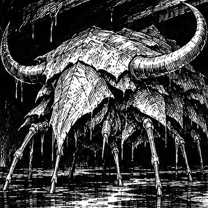
  - 【原典外貌】卷一初現花果山結義時，乃一聲如洪鐘、魁梧雄偉的豪強妖王，位居七大聖之長兄；至卷三始顯「頭如峻嶺、兩角似鐵塔、長千餘丈」之大白牛原形。
  - 【本作克蘇魯／昆蟲寄生／偽人重構】本卷收錄其赴花果山宴飲結盟之**「極致壓迫偽人巨漢態」**——第一眼看似身高近三公尺、披掛沉重黑甲的沉默中年豪商巨漢，但任何開天眼者近看都會瞬間窒息：他僵硬慘白的臉皮毫無毛孔與正常表情肌肉，雙眼眼白渾濁發黑、瞳仁深處映出**密集昆蟲複眼的多重冷光**；太陽穴兩側撐裂人皮探出一對漆黑濕亮、佈滿分叉鋸齒與節片紋路的**巨型長戟兜蟲幾丁質巨角**，角根滲出暗黃油膩體液；厚重寬闊的胸肩在呼吸時隱約傳出沉悶的甲片摩擦聲，鬆垮人皮底下浮現出如裝甲巨蟲鞘翅般的清晰拼接骨縫，嘴角微張便能窺見內層重疊開合的**巨型兜蟲鋸齒大顎與濕滑肉質吸盤**；其背後投影於潮濕岩壁上的巨大黑影，已顯露出如山嶽般蠕動的蒼白巨角腐甲蟲王輪廓（完整真身與戰技詳見卷三）。
- **特性**：
  - 【原典記載】七大聖之首，交友遍布妖界與四海，不靠外借法寶即可單憑肉身與七十二變抗衡頂尖大聖；深諳審時度勢、明哲保身，大鬧天宮風暴爆發前便抽身遠遁，從容割據一方。
  - 【本作衍生】本作中代表**「徹底融入高層暗網與人間重工業地脈的巔峰偽人巨頭」**——平時以沉穩冷酷的人皮偽裝掩蓋山嶽般的巨型寄生兜蟲真身，絕不輕易為了微末小利暴露行蹤，一旦真正撕裂偽裝便是足以夷平整座行政區的災厄。
- **弱點**：
  - 【原典記載】卷一初現未載任何弱點；至卷三第 61 回始露破口——極忌高階照妖類法寶鎖定元神阻斷其變化遁逃，以及至剛陽火圍剿（詳見卷三）。
  - 【本作衍生】巔峰級災厄非基層除妖師可力敵；戰術唯一破口在於「**先以高階鎖形／破妄法器封死其七十二變蛻殼換皮，再切斷其地下巢穴與附庸群妖支援**」（完整對策見卷三）。
- **習性**：
  - 【原典記載】早年常赴花果山與六位結義妖王飲酒論武，後隱跡經營積雷山與翠雲山勢力。
  - 【本作衍生】偏好潛伏於偏遠重工業廢棄礦場、大型地下冷鏈物流倉庫或深山豪奢廢棄莊園的潮濕底層，平日以偽人身分遙控各地低階寄生妖群進貢血食與古法器。
- **喜好**：
  - 【原典記載】好飲烈酒、講江湖長兄排場、廣結各方豪強大妖（卷三亦顯其好色納妾之性）。
  - 【本作衍生】嗜好在陰濕地下石廳擺設生血與腐酵烈酒宴席，唯有力量與道行同級的怪物方能入其眼，凡人與三流除妖師在它眼中連當點心的資格都沒有。
- **擅長的招式／異能**：
  - 【原典記載】混鐵棍、地煞七十二變、法天象地（巨牛真身，詳見卷三）。
  - 【本作衍生】**重甲兜蟲人皮裂解**（瞬間撕開偽人表皮爆發數十噸級角刺衝撞）、**七十二變多蟲擬態**、**混鐵巨骨壓殺**（完整技能詳見卷三）。

---

### [XY1-05] 覆海大聖・蛟魔王（初現怪獸檔）
- **出處順序**：第 3 回末《四海千山皆拱伏 九幽十類盡除名》～第 4 回《官封弼馬心何足 名注齊天意未寧》
- **類別與造型路線**：`【非人生物恐怖型】`｜深淵巨型海蜈蚣（多毛綱沙蠶）・環節吸血水蛭與水螅觸手怪獸
- **物種／唯一性**：`物種特異個體`（蛟類本為水澤毒物大種，然修至與牛魔王比肩、排位七大聖第二並敢號稱「覆海」者僅此一尊絕世海魔）
- **稀有度與道行對照**：`★★★★ 絕級（SSR）`｜模糊道行：數千年深海太古大妖王（七大聖排行次席，威壓其餘四聖與初出茅廬之美猴王）｜本作階位：一流頂～巔峰
- **外貌與黑暗地牢／恐怖谷視覺改寫**：
  - 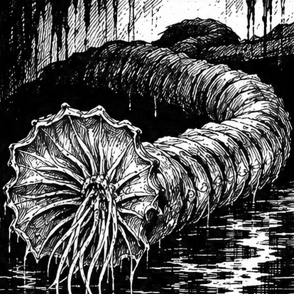
  - 【原典外貌】原典僅記其與牛魔王等七妖結拜，高居次席自號「覆海大聖」，未詳寫五官衣飾，然「蛟魔」與「覆海」二詞直指翻江倒海之惡蛟巨妖。
  - 【本作克蘇魯／昆蟲寄生／偽人重構】徹底揚棄威嚴東方龍神形象，重構為從漆黑深海海溝湧出的**不可名狀克蘇魯環節海怪**——主體為長達數十丈、毫無脊椎支撐的**巨型深海海蜈蚣（博比特蟲／巨沙蠶）× 吸血水蛭混合體**！通體由數百節濕亮黏滑、泛著腐黑墨光的肥厚環節肉筒組成，兩側密密麻麻排滿不斷划動、沾滿藤壺與腐海藻的尖銳幾丁質疣足剛毛；沒有眼珠，頭部正中徹底裂開成一只環繞七層內彎漆黑骨齒的**巨大圓形寄生吸盤巨口**，口腔深處吐出數百條如水螅觸手般半透明、佈滿麻痺刺絲囊的細長肉鬚；環節縫隙裡卡著生鏽沉船鐵片與被海流沖碎的人類頭骨與肋骨殘骸，蠕動經過處整片地面瞬間積滿發黑發臭、具強腐蝕性的黏稠海泥黑潮。
- **特性**：
  - 【原典記載】七大聖排行第二，位在孫悟空之上；敢以「覆海」為名，顯示其擁有足以叫板四海海域的恐怖水系神通，且極懂明哲保身，大鬧天宮事發後即隱匿深海不知所蹤。
  - 【本作衍生】不受任何水府神規束縛的**「野生深淵吞噬型海蟲災厄」**——其體液與水螅毒鬚帶有強烈深海低溫與溶血毒素，能透過沿海地下排水幹線與港口海蝕洞無聲滲入都市底層，將整座臨海區變成潮濕溺斃獵場。
- **弱點**：
  - 【原典記載】原典未載明確弱點（第 4 回後未再出場）。
  - 【本作衍生】1. **極畏正統天雷與高溫乾燥脫水**：軟體環節體表含水率極高、導電性驚人，**五雷鎮煞符**與高階雷法可直接沿其濕滑黏膜貫穿百節神經；2. **脫離深水與潮濕地脈後，巨大軟體身軀會迅速受重力擠壓並乾裂萎縮**：迫使其遠離港灣與地下水箱涵，再以**三昧真火**或持續性高熱陽火蒸乾其體表黏液，為唯一破局生路。
- **習性**：
  - 【原典記載】早年赴花果山與諸大妖飲酒聚會，後音訊杳然。
  - 【本作衍生】長期蟄伏於台灣東部深海斷層、基隆／高雄老舊港口深水防波堤底層洞穴或臨海廢棄海底電纜隧道中；平日休眠積蓄深海陰氣，每逢強颱暴潮或大潮暗夜便會「走蛟」上岸，順著雨水下水道拖吞落單漁工與海巡人員。
- **喜好**：
  - 【原典記載】原典未載細部嗜好，唯見其慕「覆海」霸名、喜與同級大妖豪飲結盟。
  - 【本作衍生】嗜吸帶有大量體溫與靈氣的活體血漿，特別喜愛潛伏在充滿死魚腐臭與機油味的潮濕沉船骸骨堆裡摩擦蛻皮。
- **擅長的招式／異能**：
  - 【原典記載】原典未列專屬兵器，依「覆海大聖」之號推知擅長翻江倒海、興風作浪與水系大神通。
  - 【本作衍生】**覆海黑潮倒灌**（強行引爆沿海排水管線湧出數公尺深、含大量水蛭幼蟲的腐臭黑水淹沒街區）、**七環齒盤吞絞**（巨大圓形口器瞬間展開吸力漩渦，連小型貨車帶活人一併捲入口中絞碎）、**水螅麻痺觸網**（噴射數百條透明毒鬚封鎖整條隧道，觸之瞬間呼吸肌癱瘓）。

---

### [XY1-06] 混天大聖・鵬魔王
- **出處順序**：第 3 回末《四海千山皆拱伏 九幽十類盡除名》～第 4 回《官封弼馬心何足 名注齊天意未寧》
- **類別與造型路線**：`【非人生物恐怖型】`｜巨型食蟲虻・寄生毒蜂巢腹骨針飛怪
- **物種／唯一性**：`物種特異個體`（出身大鵬／巨型掠食飛蟲妖脈，位列七大聖第三；註：原典未明言其與第 74 回獅駝嶺金翅大鵬雕為同一體，考據嚴格獨立建檔）
- **稀有度與道行對照**：`★★★★ 絕級（SSR）`｜模糊道行：數千年制空系絕頂大妖王｜本作階位：一流頂～巔峰
- **外貌與黑暗地牢／恐怖谷視覺改寫**：
  - 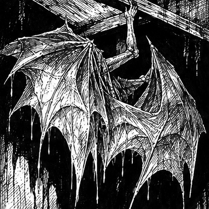
  - 【原典外貌】原典僅記其排行七大聖第三、號「混天大聖」，未詳描五官羽色細節。
  - 【本作克蘇魯／昆蟲寄生／偽人重構】徹底剝除神鳥金羽與威武鷹隼形象，以**巨型掠食食蟲虻 × 腐食寄生胡蜂 × 枯骨翼蟲**重塑為令整個天空窒息的黑暗地牢飛怪！看似「鵬翼」的遮天雙翼實為四片殘破半透明、佈滿鼓脹暗色血脈與滴落黏液的**超巨型昆蟲膜翅**，翼骨邊緣鑲嵌著無數被風乾黏合的猛禽爪骨與人類鎖骨殘片；瘦長駝背的漆黑幾丁質軀幹無羽毛覆蓋，頭顱由兩顆占據全臉八成面積、映出無數扭曲倒影的**巨大黑亮複眼**主導，臉部正中筆直伸出一根足逾兩公尺長、中空開槽且滴落腦漿血漬的**巨蚊式骨質吸血口針（長喙）**；後方懸垂的膨大環節蜂腹佈滿數百個濕滑開合的六角蜂巢氣孔，內裡密密麻麻爬動著隨時噴射而出的毒針幼蟲群，振翅低飛時發出彷彿整棟大樓玻璃即將震碎的狂暴嗡鳴！
- **特性**：
  - 【原典記載】七大聖排行第三，取名「混天」即指振翅攪亂天象、遮蔽日月；見孫悟空反叛天庭惹下彌天大禍後果斷隱遁，展現冷酷高明的生存直覺。
  - 【本作衍生】本作最具絕望感的**「超高空無聲掠食＋毒蟲空投型制空災厄」**——專門在烏雲低垂的暴雨夜自百公尺高空俯衝，一針貫穿目標天靈蓋瞬間抽乾腦髓，並把殘缺屍體拖至高樓頂層充當蜂腹幼蟲的寄生溫床。
- **弱點**：
  - 【原典記載】原典未載明確弱點（第 4 回後未再出場）。
  - 【本作衍生】1. **極度受限於低矮狹窄的地下密閉空間**：一旦獵物躲進地下停車場、老舊狹窄防空洞或無窗防火巷，其巨大膜翅無法張開起飛，戰力立減半數以上；2. **脆弱的半透明膜翅極怕烈火與高壓雷擊**：以**烈火符**配合易燃噴霧或**五雷鎮煞符**直接燒穿其四片薄翼與蜂腹巢孔，可迫使其墜地喪失制空優勢。
- **習性**：
  - 【原典記載】常赴花果山參與群妖結義飲宴，其後遠遁高空深山不知去向。
  - 【本作衍生】潛伏於摩天大樓頂層停用的冷卻水塔、廢棄機場航管塔台、跨河高架橋底深暗鋼樑或懸崖洞窟，常將獵物乾癟屍骸倒掛於鋼架上作為寄生毒蟲孵化巢。
- **喜好**：
  - 【原典記載】原典未載細部喜好，唯見其自負「混天」狂號、好結交絕世強妖。
  - 【本作衍生】極度迷戀在高壓電塔與雷雨烏雲邊緣滑翔俯視恐慌人群，並對鮮活溫熱的靈修者腦髓有著瘋狂進食執念。
- **擅長的招式／異能**：
  - 【原典記載】原典未載具體兵器；依「混天」之號可知精擅極速高空飛行、振翅颶風與遮蔽天日神通。
  - 【本作衍生】**混天毒蜂雨**（空中劇烈震顫蜂腹，從數百巢孔灑下遮天蔽日的帶毒寄生飛蟲與刺針，瞬間覆蓋整條街道）、**音爆骨針貫顱**（自盲區極速俯衝，以巨蚊口針瞬間貫穿護身金光吸乾體液）、**低頻膜翅震魂波**（振翅產生強烈次聲波，令方圓百公尺內的法師耳鼻出血、無法唸咒結印）。

---

### [XY1-07] 移山大聖・獅駝王
- **出處順序**：第 3 回末《四海千山皆拱伏 九幽十類盡除名》～第 4 回《官封弼馬心何足 名注齊天意未寧》
- **類別與造型路線**：`【非人生物恐怖型】`｜巨型蟻獅鋸齒顎・裝甲蠍尾馬陸與寄生岩瘤怪獸
- **物種／唯一性**：`物種特異個體`（出身巨力獸蟲妖脈，憑「移山」蠻力位列七大聖第四；註：原典未明言其與第 74 回獅駝嶺青毛獅子怪有關聯，嚴格獨立分列）
- **稀有度與道行對照**：`★★★★ 絕級（SSR）`｜模糊道行：數千年掘地撼山系絕頂大妖王｜本作階位：一流頂～巔峰
- **外貌與黑暗地牢／恐怖谷視覺改寫**：
  - 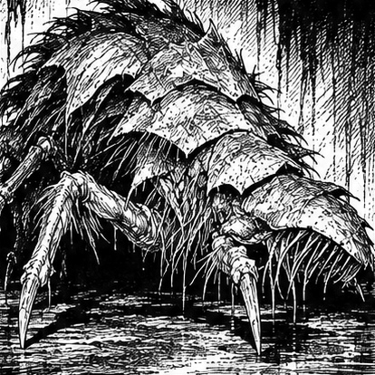
  - 【原典外貌】原典僅記其為七大聖排行第四之「移山大聖獅駝王」，未詳描外貌細節。
  - 【本作克蘇魯／昆蟲寄生／偽人重構】徹底揚棄傳統威武雄獅或雙峰駱駝形象，重構為一座會在地底緩慢蠕動的**「超巨型蟻獅幼蟲 × 重裝蠍尾馬陸 × 寄生蟲瘤岩山」**！高達四公尺以上的龐大身軀完全覆蓋著厚重開裂、與潮濕泥岩黏液長成一體的暗黑幾丁質硬甲；背部「雙駝峰」實為兩座不斷開合噴吐腥臭地底毒塵與細小沙蚤的**巨型活體寄生蟲瘤**；環繞頭部的所謂「獅鬃」其實是數百條像巨型捕鳥蛛與蜈蚣觸角般密密麻麻向外翻捲、不斷抖動偵測地層震動的粗硬節肢剛毛；無鼻無唇的漆黑面甲中央伸出一對粗如鋼筋、滿布內側鋸齒的**巨型蟻獅捕食大顎**，能把水泥承重牆連同人體直接咬碎嚼成肉泥；八對粗短厚重的節肢步足關節處卡滿生鏽鋼筋與被活埋壓碎的人骨殘片，在黑白高對比墨線裡呈現壓迫感十足的地下重裝巨物恐懼。
- **特性**：
  - 【原典記載】以「移山」為大聖尊號，展現撼動山嶽、負重千鈞的極端土系蠻力與防禦力，在七大聖中居於中堅支柱。
  - 【本作衍生】極端難纏的**「地層破壞＋流沙陷阱母體型」**絕級怪獸——它能像巨型蟻獅般在廢棄建築底層掏空地基製造塌陷流沙坑，迫使整棟樓連同獵物緩慢滑落至其滿佈鋸齒大顎的地下巢穴口。
- **弱點**：
  - 【原典記載】原典未載明確弱點（第 4 回後未再出場）。
  - 【本作衍生】1. **體型龐大、轉身極度遲緩，視覺幾乎退化**（完全依賴頭周剛毛感知地面震動，只要使用**輕身符**或懸空拉繩切斷地面震波，便能進入其感知盲區）；2. **雙背瘤氣孔與大顎內側軟膜為核心死穴**：避開正面鋸齒顎，繞至其上方投擲**五雷鎮煞符**炸裂其鬆軟的寄生背瘤，或以**指地成鋼符**反向將它剛挖鬆的泥坑瞬間硬化成鋼板夾死其節肢步足！
- **習性**：
  - 【原典記載】早年常赴花果山與兄弟妖王聚飲，後隱沒深山不再現身。
  - 【本作衍生】潛伏於長期停工的山區捷運潛盾隧道、荒廢採石場深坑、地層下陷的爛尾地下停車場地基下方；平日蜷縮成兩座覆滿潮濕泥土的怪岩休眠，一感應到上方重型卡車或多人腳步震動便會啟動地陷捕獵。
- **喜好**：
  - 【原典記載】原典未載細部喜好，唯見其好結義豪飲。
  - 【本作衍生】嗜好咀嚼混雜人體骨髓的潮濕混凝土碎塊與含鐵礦岩，對工地打樁機、怪手轟鳴聲極度敏感，會將其視為同類領地挑釁而從地底直接頂翻整台重機具。
- **擅長的招式／異能**：
  - 【原典記載】原典未載專屬兵器；以「移山」尊號代表撼動地脈、移石崩山的極致巨力。
  - 【本作衍生】**蟻獅陷地漏斗**（高速震動八對步足瞬間掏空方圓數十公尺柏油路面，將所有車輛與人員吸入地下齒顎中心）、**岩瘤蟲塵爆**（背部雙瘤劇烈收縮噴出夾帶寄生沙蟎的窒息毒霧）、**移山甲殼碾壓**（蜷縮成巨大多刺甲球橫衝直撞碾碎一切掩體）。

---

### [XY1-08] 通風大聖・獼猴王
- **出處順序**：第 3 回末《四海千山皆拱伏 九幽十類盡除名》～第 4 回《官封弼馬心何足 名注齊天意未寧》
- **類別與造型路線**：`【類人偽人型】`｜長足盲蛛・巨蚊吸音吸血口針細長偽人怪
- **物種／唯一性**：`物種特異個體`（出身獼猴／靈猿種屬，修得「通風」奇術躋身七大聖第五；註：原典並未明說其即第 58 回六耳獼猴，考據嚴格分列並保留互參伏筆）
- **稀有度與道行對照**：`★★★★ 絕級（SSR）`｜模糊道行：數千年耳目通天、擅長化風滲透之大妖王｜本作階位：一流頂～巔峰
- **外貌與黑暗地牢／恐怖谷視覺改寫**：
  - 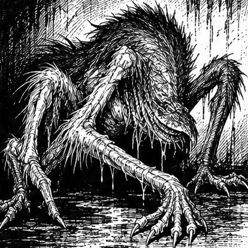
  - 【原典外貌】原典僅記其位列七大聖第五、號「通風大聖獼猴王」，未另著墨細部相貌。
  - 【本作克蘇魯／昆蟲寄生／偽人重構】與粗獷妖猴截然不同，重塑為極致陰森、充滿窺視壓迫感的**「長足盲蛛 × 巨蚊口針偽人」**！初看是一名身形瘦長得違反人體比例、穿著濕冷發霉灰長風衣的無毛乾瘦男子，安靜站在辦公大樓轉角或防火梯陰影裡；但只要細看超過兩秒便會頭皮炸裂——他慘白薄透如宣紙的人臉皮下，清晰浮現一條條宛若**黑色蜘蛛步足與蟲脈**的立體網狀暗紋；雙耳極度尖長，耳道深處伸出像**雄蚊羽狀觸角**般不斷細微震顫的漆黑感知剛毛，能隔著厚重水泥牆壁截聽每一縷微風與心跳；四肢隱藏在袖褲下實則多出兩段可反折貼牆爬行的細長盲蛛節肢；最致命的是他臉上始終掛著一抹裂至耳際卻毫無笑意的僵硬偽人微笑，當它悄無聲息貼近目標後頸時，薄唇會如蚊蠅口器般猛然四向翻開，彈出一根半透明、不斷搏動的細長**吸血吸音骨針**直刺耳蝸與頸動脈！
- **特性**：
  - 【原典記載】明代白話中「通風」兼含「乘風破空」與「通風報信、耳目遍天下」雙重意涵，乃七大聖中最狡詐敏銳的情報暗殺之首，大鬧天宮事變前即悄然抽身，連天兵都尋不著半點蹤跡。
  - 【本作衍生】現代都市裡最令人發瘋的**「管道滲透＋資訊竊聽型偽人暗殺妖王」**——能將瘦長的多節肢偽人軀體極端折疊壓扁，像盲蛛與蚊蟲般無聲穿梭於商辦大樓中央空調風管、抽油煙機排氣道與老舊公寓門縫之間，事先竊聽除妖師的真名、住址與符咒庫存再實施精準虐殺。
- **弱點**：
  - 【原典記載】原典未載明確弱點（第 4 回後未再出場）。
  - 【本作衍生】1. **正面硬拚的裝甲與血量遠遜牛魔王與獅駝王**：一旦退路與所有通風口被徹底封死，這副細長脆弱的盲蛛節肢身軀極怕近身重創；2. **極懼無風密閉火場與高分貝聲波過載**：關緊門窗以**破障符**現形、投擲高分貝爆鳴器震爆其敏感的蚊狀耳道剛毛，再以**鎮妖定身符**鎖住其關節折疊並放**烈火符**燒灼密閉空間氧氣，可瞬間瓦解其「通風」遁術。
- **習性**：
  - 【原典記載】曾與牛魔王、孫悟空等結義花果山，常往來四方山窟傳遞妖界消息。
  - 【本作衍生】潛伏於老舊商業大樓天花板輕鋼架夾層、捷運地下街排風機房與醫院空調管道內，經常倒掛在目標臥室冷氣出風口上方連續偷窺數夜，直到徹底記熟獵物的語氣與習慣才動手。
- **喜好**：
  - 【原典記載】原典未載。
  - 【本作衍生】病態沉迷於竊聽人類在獨處時不敢對外人說的秘密、債務焦慮與恐懼低語，並喜歡在發動突襲前一秒，以極其逼真的模仿嗓音在獵物耳邊輕聲覆誦對方昨晚的自言自語。
- **擅長的招式／異能**：
  - 【原典記載】原典未載專屬兵器；依「通風」尊號擅長極速御風遁跡與千里竊聽情報。
  - 【本作衍生】**盲蛛折骨穿管術**（全身關節脫臼折疊成扁平節肢束，只要有兩公分門縫或排風孔即可無聲鑽入）、**蚊鬚微風竊密**（藉建築氣流振動竊聽整棟大樓所有密談並預判法師起手招式）、**吸音血針絕殺**（口針刺入耳道瞬間抽乾血液並剝奪獵物呼救發聲能力）。

---

### [XY1-09] 驅神大聖・禺狨王
- **出處順序**：第 3 回末《四海千山皆拱伏 九幽十類盡除名》～第 4 回《官封弼馬心何足 名注齊天意未寧》
- **類別與造型路線**：`【類人偽人型】`｜巨型鐵線蟲（馬毛蟲）長髮偽人祭司・冬蟲夏草控屍菌絲產卵怪
- **物種／唯一性**：`物種特異個體`（古籍稱「禺」似獼猴而大、赤目長尾，「狨」乃長毛靈猿；此尊憑役使鬼神之左道邪術位列七大聖第六，乃族群中獨一無二之妖王）
- **稀有度與道行對照**：`★★★★ 絕級（SSR）`｜模糊道行：數千年左道拘神役鬼系絕頂大妖王｜本作階位：一流頂～巔峰
- **外貌與黑暗地牢／恐怖谷視覺改寫**：
  - 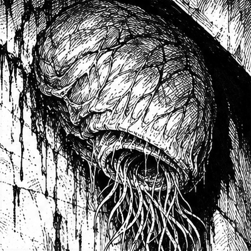
  - 【原典外貌】原典僅記其為七大聖第六席「驅神大聖禺狨王」，未詳寫具體形貌。
  - 【本作克蘇魯／昆蟲寄生／偽人重構】緊扣「長毛長尾赤目」與「驅神邪道」，徹底重構為極度掉 SAN 值的**「寄生鐵線蟲 × 殭屍真菌（冬蟲夏草菌絲）控屍偽人祭司」**！表面看似一名披垂及踝亂髮、身穿潮濕破舊暗灰法袍的枯瘦長臉道人，但黑白高對比細看下令人胃部劇烈翻騰——他那披散全身的所謂「長毛」與身後拖曳數公尺的「長尾」，全是不斷無風自動、滴落透明黏液並糾纏打結的**數千條漆黑活體巨型鐵線蟲（馬毛蟲）與水螅細鬚**！死白凹陷的偽人臉孔上佈滿彷彿發霉木頭般的細密真菌孢子孔，雙眼泛著寄生蟲複眼特有的暗紅反光且永不閉合；胸前掛著一整串用碎裂泥塑土地公頭顱與風乾人指骨串成的邪器，而其後背脊椎裂口處更探出數條隨呼吸脈動的半透明**絲狀產卵管**，能直接刺進孤魂、腐屍乃至低階地縛神靈腦髓，強行將對方改造成眼球爆出白色菌絲、嘴角掛著僵硬微笑的寄生傀儡！
- **特性**：
  - 【原典記載】以「驅神」為尊號，意即能以邪門咒法強行拘遣山神土地與一般陰兵鬼卒為己所用；同樣在悟空大鬧天宮前機警脫身，從此藏匿世外。
  - 【本作衍生】本作裡最防不勝防的**「靈脈劫持與寄生傀儡師型妖王」**——最致命之處在於它能攔截並污染除妖師施展的「喚土地」訊號，將前來應召的區域地脈靈體或附近遊魂當場用鐵線蟲菌絲寄生劫持，反過來撕碎召喚者！
- **弱點**：
  - 【原典記載】原典未載明確弱點（第 4 回後未再出場）。
  - 【本作衍生】1. **高度依賴鐵線蟲絲線與胸前控靈骨串維繫傀儡群**：只要以**破障符**看穿半空透明菌絲軌跡，並用**烈火符**或**五雷鎮煞符**高溫焚斷其鐵線蟲長髮樞紐，遭其奴役的傀儡會瞬間癱瘓並反噬其本體神識；2. **偽人本體防禦脆弱且畏懼純粹高熱乾燥與強鹼消毒環境**（鐵線蟲與寄生真菌離水高熱即迅速萎縮焦化）。
- **習性**：
  - 【原典記載】早年常往花果山與諸結義兄弟飲酒論武，後深隱荒山。
  - 【本作衍生】盤踞在台灣偏遠山區長年荒廢、神像已被塗黑或無頭的陰暗萬應公廟、濕氣極重的無人納骨舊塔與坍方公墓群中，日夜以鐵線蟲寄生周邊徘徊的孤魂、流浪野狗與落單迷路客，編織出層層疊疊的活屍警戒網。
- **喜好**：
  - 【原典記載】原典未載。
  - 【本作衍生】痴迷於蒐集破損神像、倒貼的舊符紙與浸泡過陰水的腐朽木牌，享受透過寄生菌絲操縱昔日正派地脈靈體彼此撕咬的扭曲愉悅。
- **擅長的招式／異能**：
  - 【原典記載】原典未載專屬法寶；依「驅神」之名代表左道役使神鬼與拘魂邪術。
  - 【本作衍生】**鐵線蟲篡喚土地**（劫持方圓數百公尺內的喚土地法訣，召喚出眼窩鑽滿黑蟲的墮化傀儡突襲法師）、**真菌孢子奪舍絲**（背後產卵管射出細長菌絲刺入活人頸椎，令目標在意識清醒下肢體遭接管互殘）、**千蟲長髮絞殺陣**（全身黑髮化作數千條帶倒刺的濕滑鐵線蟲四面八方封死逃路）。

---

### [XY1-10] 獨角鬼王（花果山投誠二鬼怪）
- **出處順序**：第 4 回《官封弼馬心何足 名注齊天意未寧》（兩位獨角鬼王共赴花果山拜獻赭黃袍，進言自立齊天大聖；第 5 回率部出戰遭天兵活捉）
- **類別與造型路線**：`【類人偽人型】`｜雙生阿諛偽人鬼怪・額骨裂生獨角仙寄生繭怪
- **物種／唯一性**：`物種（群體）`（原典明寫「門外有兩個獨角鬼王」，屬成對共生的寄生鬼怪亞種，非單一孤例）
- **稀有度與道行對照**：`★★ 稀級（R）`｜模糊道行：百餘年鬼妖道行（雖獲封花果山前部總督先鋒，實戰卻難敵正規軍陣，第 5 回即遭生擒）｜本作階位：二流（二流中下）
- **外貌與黑暗地牢／恐怖谷視覺改寫**：
  - 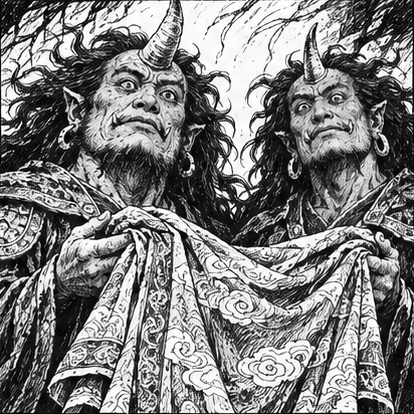
  - 【原典外貌】原典載為「兩個獨角鬼王」，並未詳寫五官服飾，僅記其雙雙捧獻一件華麗「赭黃袍」前來投奔孫悟空。
  - 【本作克蘇魯／昆蟲寄生／偽人重構】極致放大「成對奉承鬼怪」的恐怖谷生理不適感，重塑為一對**連呼吸頻率與微笑角度都完全同步的雙生偽人寄生鬼**！遠看像是兩名畢恭畢敬、微微佝僂、長相絲毫不差的蒼白乾瘦中年男職員，但近看便會毛骨悚然：兩人額頭正中皮肉皆慘烈向外撕裂翻捲，滲出暗黑腐血，中央各直挺挺鑽出一根濕亮漆黑、表面佈滿分叉倒鉤與呼吸氣孔的**巨型腐食獨角仙幾丁質骨角**（角腔中空，直通顱內蠕動的蟲腦）；雙眼漆黑無白且從不轉動，嘴角永遠機械式拉扯成誇張卑微的諂笑弧度，兩頰鬆垮薄皮下隱約可見細小蟲足不斷爬動頂起凸痕；兩人四手共同捧獻的那件「赭黃袍」，在黑暗地牢墨線裡實為一層沾滿黏稠黃膿、內裡密密麻麻附著會隨體溫孵化的寄生幼蟲卵鞘的**巨型腐爛昆蟲蛻繭膜衣**！
- **特性**：
  - 【原典記載】極擅逢迎拍馬與煽動野心——抓準悟空辭官受辱之際，精準獻上象徵僭越帝位的「赭黃袍」並首度提出「齊天大聖」尊號，成功換取「前部總督先鋒」高位，卻在正面大戰中露餡被擒。
  - 【本作衍生】本作現代都市裡最狡猾噁心的**「寄生掮客型雙生偽人鬼」**——單打獨鬥僅二流中下，最擅長找上剛成精、脾氣暴躁的低智商大妖或走火入魔的邪修，靠同步阿諛低語把對方捧得狂性大發，並哄騙目標披上含有寄生蟲卵的「赭黃繭袍」，暗中從宿主身上汲取殘餘精氣！
- **弱點**：
  - 【原典記載】正面戰力與防護薄弱，第 5 回身居前部先鋒卻無力突圍而慘遭生擒。
  - 【本作衍生】1. **雙鬼神經共振，額頂獨角為絕對死穴**：只要以**鎮妖定身符**或重擊震斷其中一隻的幾丁質獨角，另一隻也會同步發生劇烈神經痙攣與口吐黑漿；2. **極懼純陽烈火與雷擊**：披掛與進獻的「赭黃蟲繭袍」油脂極多，一遇**烈火符**即刻爆燃成焦黑火球，**五雷鎮煞符**亦可直接震碎其顱內寄生蟲囊。
- **習性**：
  - 【原典記載】成雙成對流竄於各大山頭，專挑勢頭正盛的大妖投誠獻禮換取權位。
  - 【本作衍生】常雙雙潛伏於廢棄地下賭場包廂、倒閉老舊 KTV 潮濕沙發區或無人神壇偏殿，專門物色心懷怨恨的獨居者或剛覺醒的二流妖怪，半夜準時敲門奉上發霉華服與廉價偽金飾。
- **喜好**：
  - 【原典記載】嗜好權位封賞、擅獻華袍與阿諛奉承。
  - 【本作衍生】偏愛偷竊宮廟出巡用的退色刺繡神明衣、老戲班發霉戲服與往生者壽衣，浸泡在體液蟲卵裡培育成「赭黃繭袍」到處推銷。
- **擅長的招式／異能**：
  - 【原典記載】進獻赭黃袍、率七十二洞妖王前部衝鋒。
  - 【本作衍生】**雙聲共振蠱惑**（兩鬼以毫無時差的同步低語不斷放大目標心底的自卑與憤怒，誘使法師心神失守法力潰散）、**赭黃蟲繭裹縛**（抖開濕黏黃袍罩向目標，數百隻微細食肉幼蟲瞬間順著毛孔鑽咬）、**雙角對衝穿刺**（兩鬼左右夾擊，以中空骨角刺入腹腔噴注麻痺黑液）。

---

> **回目考據過渡（第 05～12 回）**：原典第 05～07 回為大鬧蟠桃會、天庭群神圍剿與五行山鎮壓，第 09～12 回為陳光蕊案、涇河龍王犯條與唐太宗遊陰司，出場角色全屬天庭星官、道門神將、佛門菩薩如來、四海／涇河龍王、十殿閻羅及凡間君臣，依本圖鑑「絕對剔除神明」鐵律全數不錄；第 08 回初現伏筆之**流沙河水怪・沙悟淨**移歸 [卷二（第 21～40 回）](./02-卷二_第21至40回.md) 正式大戰檔詳載，**福陵山豬剛鬣**初現伏筆則整合收錄於本卷 `[XY1-17]`。

---

## 🦂 第三單元：第 13 回｜雙叉嶺血腥陷阱・食人三妖

### [XY1-11] 雙叉嶺・寅將軍（虎精→腐食巨虎甲蟲／多足寄生虎怪）
- **出處順序**：第 13 回《陷虎穴金星解厄 雙叉嶺伯欽留僧》
- **類別與造型路線**：`【非人生物恐怖型】`｜腐食巨虎甲蟲（斑蝥）・多足寄生捕食虎怪
- **物種／唯一性**：`物種（群體）`（猛虎／虎甲蟲血食煞氣異化之山嶺捕食種屬，本體為盤踞雙叉嶺石坎陷坑、當場剖腹分食唐僧二名凡人從者之特定頭目「寅將軍」）
- **稀有度與道行對照**：`★★ 稀級（R）`｜模糊道行：數十年至百餘年吃人猛妖（西行路上首位見血食人之地方小妖王，無高階法寶，純靠陷坑埋伏與酷烈血肉掠食稱霸一方）｜本作階位：二流（二流初～中階）
- **外貌與黑暗地牢／恐怖谷視覺改寫**：
  - 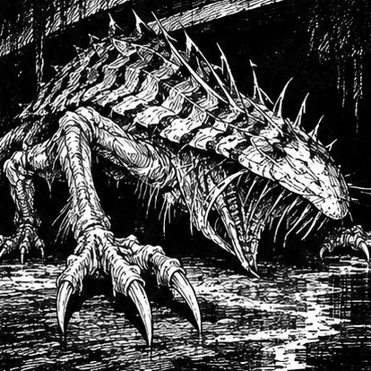
  - 【原典外貌】坐於雙叉嶺石坎洞府中，生得電目飛光、鋸牙舒口外、鑿齒露腮旁、錦繡斑衣、威猛獰惡，自號「寅將軍」並以文雅客套語款待熊山君與特處士生啖活人心肝。
  - 【本作克蘇魯／昆蟲寄生／偽人重構】完全剔除毛絨斑斕大貓與紳士軍官造型，直接取自然界最嗜血兇殘的肉食昆蟲**「虎甲蟲（斑蝥）」＋多足巨蜈蚣＋剖腹寄生幼蟲**重構！體長逾三公尺、低伏於滴滿黑血的潮濕石坎上，所謂「錦繡斑衣」實為焦黑硬亮幾丁質甲殼與從甲縫分泌凝結的腐黃毒液結晶交錯而成的**擬虎斑紋重甲**；頭胸部突出兩顆冰冷鼓脹的漆黑複眼與一對交錯向前探出、佈滿倒鉤鋸齒的**巨型虎甲蟲鐮刀上顎（鑿齒鋸牙）**，口器不斷滴落能將活體內臟快速軟化的強酸消化涎液；胸腹兩側密布六對帶倒刺的細長節肢步足，關節倒鉤上還卡著剛從獵物胸腔撕扯下來的碎裂人肋骨與指節殘骨，腹底更垂掛一條濕滑搏動的肉質寄生產卵管；最令人毛骨悚然的是它竟會利用胸甲刮擦發出扭曲生澀、模仿人類客套寒暄的刮喉發聲，邊「請客」邊精準剖開獵物腹腔！
- **特性**：
  - 【原典記載】西行路上首位真正見血吃人的惡妖！預先在必經荒山暗道挖設深坑陷阱，待唐僧與兩名從者跌落便率小妖捆綁回洞；與熊山君、特處士客套推讓一番後，當面將兩名活人從者**剖腹剜心、剁碎四肢**分食殆盡，只因尚未肚餓才暫把唐僧留作後續點心，最終天亮散席竟全身而退未曾伏誅。
  - 【本作衍生】極具心理陰影的**「高儀式感陷坑剖腹腐食蟲怪」**——它不急著一口吞掉獵物，而是先以甲殼刮擦出的冰冷客套仿人聲折磨倖存者神經，並將獵物胸腔剖開當作幼蟲活體餐盤，連同夥熊山君與特處士分食時都維持著詭異冷酷的蟲巢秩序。
- **弱點**：
  - 【原典記載】原典未載直接致死戰敗經過（天明散席離巢後，其洞府繩縛遭太白金星輕易化解）；顯見其缺乏高階法寶護身與大範圍抗仙術能力，純屬依賴地形陷坑與群妖合圍之中低階山妖。
  - 【本作衍生】1. **高度依賴偽裝陷坑與狹窄暗洞伏擊**：一旦用**開天眼符水**與**破障符**提前識破地表偽裝的腐殖陷阱坑，將其逼入開闊強光地帶，其虎甲蟲伏擊優勢便瓦解大半；2. **複眼畏爆閃、胸腹連接處與產卵管為脆弱軟組織**：以**烈火符**爆燃強光致盲其巨型複眼並燒焦甲表腐黃分泌物（遇火極易起焰），再以**掌心雷／五雷鎮煞符**直轟其咽喉口器內側即可重創斃命。
- **習性**：
  - 【原典記載】盤踞雙叉嶺險峻山洞，慣常在荒路設坑誘捕過客，入夜便邀集鄰近妖友大開生人分食夜宴，天明即各自退回洞窟休眠。
  - 【本作衍生】潛伏於現代台灣偏遠山區荒廢露營區、無人產業道路邊坡廢棄涵洞或停業土雞城地下儲藏室，慣於在暴雨夜於泥濘路面佈置覆蓋腐葉與障眼法的深陷坑洞，將摔落重傷的夜騎騎士與登山客拖入潮濕洞底剖腹開宴。
- **喜好**：
  - 【原典記載】極度嗜食新鮮活人心肝與溫熱臟腑，熱衷在開餐前向同類妖客賣弄「山中無美味」的病態客套排場。
  - 【本作衍生】對仍在微弱跳動的新鮮心臟與充滿恐懼腎上腺素的血漿有近乎偏執的進食癖好，且喜歡把吃剩的完整頭蓋骨排列在潮濕石洞入口充當「餐客席次牌」。
- **擅長的招式／異能**：
  - 【原典記載】深坑陷阱陣、妖風攝人、猛虎鋸牙鑿齒撕裂、指揮山洞小妖捆綁剖腹。
  - 【本作衍生】**虎甲偽坑障眼**（以腐葉黏液配合低階障眼法遮掩深達四公尺、坑底佈滿硬殼倒刺的泥陷阱）、**鑿齒酸液剖腹剪**（巨型鋸齒上顎交錯合攏並噴吐腐蝕胃酸，瞬間剪斷防刺背心與人類胸骨）、**刮甲仿人震懾音**（高速摩擦胸甲發出的詭異客套人聲伴隨高頻雜音，干擾三流法師唸咒與結印）。

---

### [XY1-12] 雙叉嶺・熊山君（熊羆精→腐沼寄生甲殼巨怪）
- **出處順序**：第 13 回《陷虎穴金星解厄 雙叉嶺伯欽留僧》
- **類別與造型路線**：`【非人生物恐怖型】`｜腐沼重甲等足蟲（大王具足蟲）・腹底環形齒狀吸盤巨怪
- **物種／唯一性**：`物種（群體）`（荒野腐沼重甲熊羆妖脈之山林食人種屬，與第 16–17 回黑風山黑熊精完全不同個體，此處為雙叉嶺赴寅將軍血宴之特定怪獸「熊山君」）
- **稀有度與道行對照**：`★★ 稀級（R）`｜模糊道行：數十年至百餘年山野食人妖（道行與格局遠遜黑風山黑熊精，僅憑厚重硬甲與蠻力橫行荒嶺）｜本作階位：二流（二流初階・重裝腐甲坦怪）
- **外貌與黑暗地牢／恐怖谷視覺改寫**：
  - 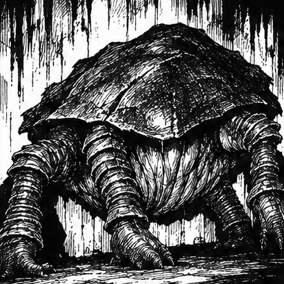
  - 【原典外貌】於寅將軍洞口現身赴宴，生得「雄豪多膽量，輕健夯身軀，涉水惟兇猛，平林但粗疏，一聲吼似雷震，爪掌猶如鐵鉤」，化為一條滿身漆黑粗壯之黑漢。
  - 【本作克蘇魯／昆蟲寄生／偽人重構】徹底丟棄毛絨黑熊造型，往最潮濕惡臭的**「腐沼超巨型等足蟲（大王具足蟲）× 重甲寄生泥蟹怪」**推進！高逾兩公尺半的佝僂巨軀如同一堵緩慢壓迫而來的漆黑濕亮肉牆，整個背脊與肩甲完全由十二片覆滿發酵沼泥、暗綠水苔與灰白寄生藤壺的厚重**幾丁質節片裝甲**疊合而成，甲殼縫隙間不時鑽出密密麻麻啃食腐渣的白色蛆蟲；頭部沒有人類五官，只有層層合攏滴落黑水的**多片漆黑顎足口器**與七顆混濁深陷的暗色單眼；粗壯前肢末端長出五根沾滿黑泥血垢、彎曲如生鏽屠宰鐵鉤的巨型節肢螯爪，最令人作嘔的是它肥厚軟白的腹底長滿數十個隨呼吸不斷吸吮開合的**環形齒狀寄生吸盤**，可直接將整名活人死死吸貼在腹甲下方邊爬行邊啃蝕融解！
- **特性**：
  - 【原典記載】性情粗疏兇猛、涉水無阻且貪饞血食，聽聞寅將軍捕得大唐旅人立刻興沖沖趕來分食活人心肝，吃飽喝足後大搖大擺離去，從頭到尾連洞外有仙氣暗佑都毫無警覺。
  - 【本作衍生】典型的**「高物理防禦＋全地形涉水重裝腐食巨怪」**——厚重泥垢與濕亮等足蟲硬甲對未入流至三流物理打擊與單張凡火烈火符具極強抗性，加上無聲涉水潛行能力，在淹水地下室或泥濘山溪裡對低階除妖師堪稱噩夢。
- **弱點**：
  - 【原典記載】原典未載具體擊殺或重創紀錄（第 13 回分食完畢後未再登場）；然由其「平林但粗疏」性格可知其智謀淺薄、缺乏防禦精妙術法的應變頭腦。
  - 【本作衍生】1. **背甲極厚但腹底寄生吸盤與關節軟膜異常脆弱**：一旦藉**指地成鋼符（陷地符）**或環境柱體絆翻其笨重身軀，露出柔軟濕滑的腹底吸盤面，即可展開致命打擊；2. **全身覆滿潮濕導電沼泥**：將**五雷鎮煞符**直接塞入顎足口器或甲片縫隙間近距離引爆，高壓雷火順著濕泥灌入體腔會瞬間煮熟其內臟與寄生蟲囊。
- **習性**：
  - 【原典記載】棲息於雙叉嶺深處濕林水澤，慣常獨自涉水覓食，聞得鄰近妖王抓到活人便結伴串門共享血食。
  - 【本作衍生】潛伏於現代郊區積滿腐臭泥水的廢棄大型沉澱池、山腳舊魚塭廢墟或長年漏水的地下污水抽水站，夜間爬上柏油路翻找廚餘與死動物屍體，遇到落單夜釣客或清潔員便直接以腹底吸盤壓頂拖回水潭。
- **喜好**：
  - 【原典記載】酷愛生吞新鮮人肉心肝，喜愛與同嶺虎妖、野牛妖結夥赴宴豪食。
  - 【本作衍生】對極度腥臭的沼澤腐泥、發酵生肉血漿與濃烈甜腥廚餘有狂熱嗅覺執念，極易被摻入大量豬血與符粉的誘餌引出深水區。
- **擅長的招式／異能**：
  - 【原典記載】雷鳴粗吼、鐵鉤利爪拍裂、涉水蠻力突襲（原典未載專屬法寶）。
  - 【本作衍生】**腐沼重甲碾壓**（將背甲節片扣緊蜷縮衝撞，直接撞穿老舊磚牆與鐵皮門）、**腹盤齒環吸附**（撲倒獵物後以腹部數十個環形齒狀吸盤死鎖目標四肢同步吸食血肉，令其無法脫身結印）、**沼氣噴濺咆哮**（顎足張開噴出混雜腐泥與麻痺蛆液的震耳雷吼）。

---

### [XY1-13] 雙叉嶺・特處士（野牛精→巨角兜蟲／寄生腐牛妖）
- **出處順序**：第 13 回《陷虎穴金星解厄 雙叉嶺伯欽留僧》
- **類別與造型路線**：`【非人生物恐怖型】`｜巨角大兜蟲・蠐螬腐腹寄生牛屍怪
- **物種／唯一性**：`物種（群體）`（荒野腐牛屍氣與巨角甲蟲共生異變之低中階山妖種屬，遠非神級平天大聖牛魔王可比；此處為雙叉嶺食人三妖之一「特處士」）
- **稀有度與道行對照**：`★★ 稀級（R）`｜模糊道行：數十年至百餘年山野精怪（與寅將軍、熊山君同級，空有狂躁蠻力與偽雅稱號，無高階道法）｜本作階位：二流（二流初階・直線衝撞爆破型）
- **外貌與黑暗地牢／恐怖谷視覺改寫**：
  - 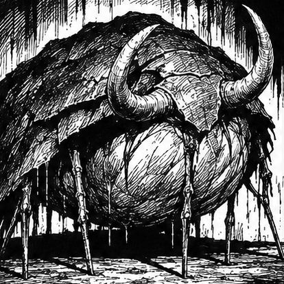
  - 【原典外貌】與熊山君同赴寅將軍洞府赴宴，生得「嵯峨雙角冠，端肅聳雙肩，性疾多剛烈，心狂極悍頑」，化作一條腦滿腸肥、自命清雅隱士的胖漢「特處士」。
  - 【本作克蘇魯／昆蟲寄生／偽人重構】徹底剝除肥胖大叔與普通水牛皮相，重構為**「超巨型漆黑雙角兜蟲（獨角／雙角大兜蟲）強行寄生撐破腐腫牛屍」**的黑暗地牢生物恐怖怪獸！它那極端肥腫臃腫的身軀外層是一對發黑開裂、沾滿乾涸血塊與泥垢的厚重幾丁質鞘翅，但從背後中線裂縫裡卻不斷擠出慘白濕亮、遍布呼吸氣孔與搏動脂肪褶的**超巨型蠐螬（腐食金龜子幼蟲）膨脹軟腹**；頭胸部聳立著兩根佈滿腐蝕坑洞、像生鏽攻城撞角般分叉外彎的粗大漆黑**兜蟲幾丁質巨角**，角根翻裂的腐肉裡還殘留著半截被徹底同化擠壓的蒼白牛骨顱片與幾顆無神死眼；六條末端硬化成漆黑偶蹄狀倒鉤的節肢重足踩碎碎石，每次發出假斯文般的低沉嘶鳴，氣孔便噴出帶著發酵青草酸臭與蒼蠅蛆蟲的熱霧！
- **特性**：
  - 【原典記載】明明是荒野殘暴吃人的野牛精（古文「特」專指雄公牛），卻厚顏自稱高潔隱士「處士」，與寅將軍、熊山君滿口虛偽文雅寒暄，轉手即活生生大嚼兩名無辜凡人血肉；性情極度急躁狂烈、悍頑不知進退。
  - 【本作衍生】屬於**「易怒失控直線衝撞＋腐脹幼蟲爆漿型」**二流怪獸——平時藏在暗處發出裝腔作勢的嘶啞低吟，只要聞到血味或遭到微弱挑釁，就會瞬間進入不計代價的直線巨角衝鋒，足以撞碎一整排老舊公寓磚牆或掀翻行駛中的小貨車。
- **弱點**：
  - 【原典記載】原典未載明確致死弱點（第 13 回分食完畢後即離場）；然原典明指其「性疾剛烈、心狂悍頑」，缺乏冷靜防範意識與高階護體術法。
  - 【本作衍生】1. **直線衝鋒慣性極大、完全無法急轉彎**：在地下停車場柱陣或狹窄老舊巷弄裡，以**輕身符**配合**單根毫毛誘餌**誘導其猛撞鋼筋水泥柱，極易令其漆黑巨角深陷混凝土卡死動彈不得；2. **背裂處裸露的慘白蠐螬軟腹為極致弱點**：繞至其側後方，對準毫無裝甲保護的搏動幼蟲軟腹貼上**烈火符**或**掌心雷**，能瞬間引爆其腹內發酵腐氣與體液致命（施法者務必事前貼好**避穢符／淨氣符**以免被噴濺的強酸蟲液灼傷）。
- **習性**：
  - 【原典記載】潛居雙叉嶺荒谷幽林，與虎精、熊精互稱道友，專於深夜聚眾分食落網路人。
  - 【本作衍生】潛伏於郊區荒廢屠宰場腐臭堆肥槽、廢棄牧場牧草倉或無監視器的山區廢棄農舍地下室；半夜常潛伏在鄉間無燈公路轉彎處，聽見機車引擎聲便發動突襲衝撞將騎士撞飛昏迷後拖入草叢寄生啃食。
- **喜好**：
  - 【原典記載】嗜吃活人血肉，尤其迷戀旁人以文雅稱號「處士」奉承吹捧。
  - 【本作衍生】對刺眼紅光、高音喇叭與任何帶書卷氣味的紙張有怪異執念——巢穴惡臭腐土裡常堆滿從受害者背包翻出來、沾滿黏液的眼鏡、大學課本與名片，彷彿在模仿人類知識分子。
- **擅長的招式／異能**：
  - 【原典記載】嵯峨雙角蠻力衝撞、悍頑搏殺（原典未載專屬法寶）。
  - 【本作衍生】**雙角破壁衝鋒**（六足抓地短距加速，兩根巨型兜蟲角直接頂穿隔間牆與防盜鐵門）、**腐腹蟲酸噴霧**（遭遇夾擊時劇烈壓縮蠐螬軟腹，從氣孔噴出大量灼燒皮膚與腐蝕符紙的酸臭黑霧與幼蟲）、**假儒低頻嘶鳴**（模仿中年文人嘆息的低沉腔音誘使路人回頭查看暗巷）。

---

> **回目考據過渡（第 14～15 回）**：第 14 回兩界山「眼看喜、耳聽怒」等六賊純屬凡人強盜；第 15 回蛇盤山鷹愁澗小白龍為西海龍王三太子神族貶謫，暗佑諸神亦屬天庭佛門正神，依本圖鑑「純妖怪怪獸零神明」鐵律全數剔除不錄。

---

## 🕷️ 第四單元：第 16～17 回｜黑風山偽人三怪（恐怖谷雅集）

### [XY1-14] 黑風山・黑熊精（黑風怪→偽人黑衣漢皮下藏重甲腐食甲蟲與吸盤）
- **出處順序**：第 16 回《觀音院僧謀寶貝 黑風山怪竊袈裟》～第 17 回《孫行者大鬧黑風山 觀世音收伏熊羆怪》
- **類別與造型路線**：`【類人偽人型】`｜極致偽人黑衣漢・皮下重甲腐食甲蟲與環形寄生吸盤母體
- **物種／唯一性**：`物種特異個體`（雖屬黑熊／重甲腐食甲蟲種屬，卻是全書少數不靠先天法寶便能單憑武藝力敵大聖、更深通佛理與延壽吐納之獨步絕級妖王）
- **稀有度與道行對照**：`★★★★ 絕級（SSR）`｜模糊道行：千年得道頂級妖王（黑纓槍力抗金箍棒數十回合不分勝負，逼得大聖不得不設假丹鑽腹奇計方能破局）｜本作階位：一流頂～巔峰初階
- **外貌與黑暗地牢／恐怖谷視覺改寫**：
  - 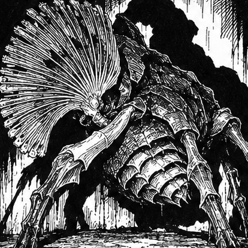
  - 【原典外貌】身高丈二，頭戴火漆光碗子鐵盔、身披烏金鎧甲與皂羅袍、足踏烏皮靴、手執一桿黑纓槍，生得面黑如炭、眼幌金睛如掣電，氣度沉穩文雅。
  - 【本作克蘇魯／昆蟲寄生／偽人重構】徹底洗去厚重毛熊與武將形象，打造成卷一最令人背脊發寒的**「高智商恐怖谷偽人禪師」**！在現代或古剎燭火下，第一眼見到的是一名身高逾兩公尺半、身穿一絲不苟黑長袍（戰時罩上油亮黑鐵古甲）、雙手合十微笑談禪的沉默黑衣壯漢；然而只要凝視三秒，極致的**偽人（Mimic）違和感**便排山倒海湧來——他黝黑的面皮光滑緊繃得宛若塗了黑漆的蠟像，從頭到尾連眼皮都不曾眨過一次，深沉黑瞳在火光下隱約閃過蜂窩狀**昆蟲複眼多面反光**；每當他情緒波動、伸手撫摸偷來的華麗袈裟或揮動黑纓槍時，脖頸、胸膛與前臂的「人類黑皮」竟會沿著對稱接縫微微錯開裂開，清晰露出皮下層層疊合、濕亮反光、不斷喀喀微動的**漆黑重甲腐食葬甲／巨型步行蟲鞘翅裝甲**！而他看似合十參禪的寬厚掌心與指腹內側，竟整齊排列著數十個隨呼吸開合滲出透明黏液的**環形齒狀寄生吸盤**，專門用來死死吸住奪來的頂級法寶與貼身抽吸活人元氣；手中那桿「黑纓槍」實為從背後蟲鞘抽出的巨大漆黑幾丁質骨矛，槍頭黑纓則是無數細密扭動的感覺剛毛！
- **特性**：
  - 【原典記載】全書格調極為罕見的「文青宗師型大妖」——絲毫沒興趣吃唐僧肉，反而常與老僧金池長老談禪論道、傳授延壽吐納法門；見禪院起火本意欲救火，卻一時貪戀頂級法寶「錦襴袈裟」趁火打劫順手竊走，歡天喜地準備辦「佛衣會」慶生！實戰極度穩健剛猛，槍法滴水不漏、不落下風，遇險即化一陣黑風退回洞中緊閉石門，終因深信好友凌虛子而誤吞假仙丹遭鑽腹破防。
  - 【本作衍生】極其致命的**「偽人高階收藏家型一流頂大妖」**——它不會像低等怪物那樣在暗巷瘋狂啃人，而是穿著體面黑衣混跡於深山禪院、古董文物地下拍賣會與老道士圈子裡品茶論道；表面彬彬有禮、對凡人不屑一顧，可一旦盯上某座老廟或法師祖傳的鎮宅寶物，便會在停電失火的混亂夜裡無聲降臨奪寶，凡阻路者皆被它皮下爆出的重甲骨矛與掌心吸盤瞬殺。
- **弱點**：
  - 【原典記載】1. **極度執著於「絕世法衣法寶」與「長生慶壽仙丹」**：對熟識妖友（凌虛子）送來的延壽丹全無戒心，一口吞下後被鑽入腹腔拳打腳踢徹底崩潰；2. **禁箍咒**（一旦被套上頂門見肉生根即徹底受制）。
  - 【本作衍生】外部重甲腐食甲蟲硬殼幾乎完全免疫普通冷兵器、槍械與中低階陽火轟炸（甚至敢獨自闖進失火禪院偷寶）；**唯一致命破口在「內部軟臟與過度迷信古物／丹藥的攻心漏洞」**——切忌正面比拚槍法硬防，必須偽裝成其信任的同好、於它最癡迷的古董法器或延壽丹丸內暗藏**高階內爆型五雷鎮煞符**或**微型破甲符引**，待它卸下偽人甲殼防備吞服或貼身把玩時由內炸穿其蟲巢軟腹！
- **習性**：
  - 【原典記載】盤踞清幽雅緻的黑風山黑風洞，洞內不設血肉刑場，反倒擺滿香爐茶席，常邀白衣秀士與凌虛子清談壽宴與煉丹之道。
  - 【本作衍生】潛伏於深山極隱蔽的潮濕百年廢棄禪院後殿、私人陰暗古董佛具地下收藏室或停業的深山老茶莊；白天像尊雕像般端坐於發潮榻榻米上擦拭搜刮來的古舊神明衣與佛珠，唯有停電失火或大風暴雨夜才會披甲化風出動。
- **喜好**：
  - 【原典記載】極度迷戀錦襴袈裟等佛門至寶、熱衷舉辦「佛衣會」慶生炫耀、愛與道士高僧論禪及服用延壽丹藥。
  - 【本作衍生】重度古物與神聖織品蒐藏癖，極端厭惡別人叫它「畜生」或揭穿它皮下的甲蟲接縫，一旦被人直視識破偽人真面目會瞬間翻臉滅口。
- **擅長的招式／異能**：
  - 【原典記載】黑纓槍頂尖槍法、化黑風高速掠寶與遁逃、延壽吐納秘術（曾授金池長老活至二百七十歲）。
  - 【本作衍生】**黑風甲霧遁**（偽人皮囊瞬間分解為無數漆黑微細腐甲飛蟲捲起腥臭黑旋風，連人帶寶瞬間穿窗遁去）、**掌心吸盤繳械**（近身接招時掌內齒狀吸盤牢牢吸住法師法器或符咒手腕，同時抽出高溫體液令對手手臂麻木壞死）、**重甲骨矛貫鐵刺**（從背後鞘翅裂縫抽出的黑纓骨槍帶著數噸穿甲勁道，一槍直穿二流金光護身符）。

---

### [XY1-15] 白衣秀士（白花蛇怪→極致偽人書生皮下蠕動巨型環節水蛭與吐酸口器）
- **出處順序**：第 17 回《孫行者大鬧黑風山 觀世音收伏熊羆怪》
- **類別與造型路線**：`【類人偽人型】`｜極致偽人蒼白書生・皮下巨型環節水蛭與蒼蠅式吐酸口器
- **物種／唯一性**：`物種（群體）`（濕地白花蛇／巨型白化吸血水蛭異變之陰冷精怪種屬，本體為赴黑風山商議佛衣會而遭一棒打殺之特定蛇妖「白衣秀士」）
- **稀有度與道行對照**：`★★ 稀級（R）`｜模糊道行：數十年至百餘年山澤陰毒小妖（雖擅化形文人與交際，實戰防護卻甚脆弱，遭頂尖高手近身即瞬間伏誅）｜本作階位：二流（二流初～中階）
- **外貌與黑暗地牢／恐怖谷視覺改寫**：
  - 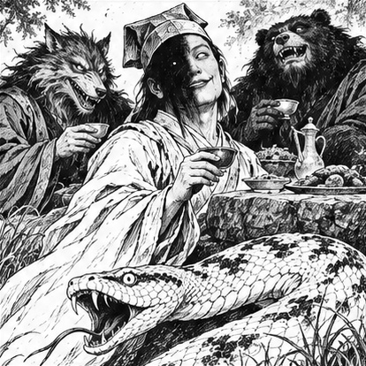
  - 【原典外貌】身著一領潔白素雅儒衫、頭戴書生方巾，與凌虛子、黑熊精圍坐芳草坡高談闊論；遭一棒擊斃後現出一條粗長「白花蛇怪」原形。
  - 【本作克蘇魯／昆蟲寄生／偽人重構】徹底揚棄風流白蛇公子路線，推進至令人強烈生理反胃的**「空殼人皮囊 × 巨型白化環節水蛭 × 吐酸肉管」極致恐怖谷偽人書生**！遠望是一名身材瘦長、面如敷粉、身穿略微受潮發黃寬大白襯衫或白長衫的斯文年輕書生，舉止彬彬有禮甚至總是微笑點頭；但當你靠近一公尺內，便會發現他整個頸項、下顎與前臂完全沒有人類骨骼棱角，蒼白半透明的潮濕皮膚底下，竟有**一條條粗如成人腕骨、滿布環狀肉節的巨型白化吸血水蛭正在不斷伸縮翻滾蠕動**！他細長的雙眼毫無眼白與眨眼動作、表面覆蓋著一層滑膩反光的濕潤黏液膜；而當他準備獵食或陷入驚恐時，清秀蒼白的人類嘴唇會從正中無聲裂開四瓣，自咽喉深處緩慢翻出一根結合**環形三顎水蛭吸盤**與**蒼蠅海綿狀吐酸口器**的慘白濕亮肉管，瞬間噴吐出濃稠刺鼻的強酸消化黏液，將目標臉部與皮肉直接融成溫熱肉泥後大口吸食，所過之處地板總留下一道發亮冰冷的腥滑黏液痕！
- **特性**：
  - 【原典記載】擅長偽裝成溫文爾雅的讀書人「白衣秀士」，精於社交逢迎，常依附黑熊精等強大妖王充當清客幫閒；然實戰警覺性與抗打擊力低落，遭突襲時連反擊都來不及便當場喪命現出原形。
  - 【本作衍生】極度適合台灣現代都市怪談的**「偽裝成夜校文青補習老師、古書店店員或房仲的二流偽人水蛭怪」**——擅長用溫柔斯文的談吐降低獨居男女或學生的戒心，一旦將獵物帶進潮濕無窗的租屋地下室或老舊書房，便立刻翻開偽人唇裂吐酸溶肉。
- **弱點**：
  - 【原典記載】肉身防禦脆弱、面對高速重擊毫無招架之力（原典中一棒即斃命現原形）。
  - 【本作衍生】1. **軟體環節水蛭本質極端畏懼高熱乾燥、粗鹽與強鹼／烈火**：身上沒有任何硬質甲殼防禦，只要先以**避穢符**擋開其腐蝕酸霧，再以**烈火符**或高濃度粗鹽硃砂撒向其裂開的濕滑口器與無骨脖頸，會立刻引發劇烈抽搐脫水與體表焦化潰爛；2. **胸口中段水蛭母節為核心死穴**：近身貼上一記**掌心雷**（潮濕軟體導電率極高）即可瞬間電癱全體神經環節一擊斃命。
- **習性**：
  - 【原典記載】棲息於黑風山潮濕陰涼林澤，酷愛著素白儒衫參與高階妖王的清談宴集。
  - 【本作衍生】潛伏於現代老舊學區潮濕漏水的地下室租屋處、長年壁癌滋生的老舊舊書店倉庫、大學廢棄舊校館水管井旁；悶熱梅雨夜極為活躍，酷寒乾燥天則會將偽人皮囊掛在衣架上、本體縮成濕冷黏液肉團躲在水槽下方排水管裡休眠。
- **喜好**：
  - 【原典記載】好附庸風雅、喜穿白衣充當斯文文士、愛攀附大妖雅集。
  - 【本作衍生】病態迷戀乾淨純白的衣物與文人書香氣息，同時對新鮮溫熱、剛被強酸半溶解的軟組織肉漿有著難以自抑的吞吮嗜好。
- **擅長的招式／異能**：
  - 【原典記載】化形白衣書生術（原典未及施展殺招即遭擊斃）。
  - 【本作衍生】**吐酸溶肉口器**（唇裂噴出射程達三公尺的高腐蝕性白濁消化酸液，瞬間融穿衣物與護身低階符紙）、**無骨水蛭絞纏**（四肢突然喪失骨節如巨型白蛭般拉長反捲，死鎖目標氣管並以體表微孔吸血）、**人皮空殼滑脫**（遭鎖定要害時從後背割開舊偽人表皮，化作一團濕滑白蛭順排水孔溜逃）。

---

### [XY1-16] 凌虛子（蒼狼精→偽人道士皮下長滿寄生蜱蟲與多節肢狼顎）
- **出處順序**：第 17 回《孫行者大鬧黑風山 觀世音收伏熊羆怪》
- **類別與造型路線**：`【類人偽人型】`｜極致偽人清瘦道士・皮下寄生蜱蟲群與多節肢捕食狼顎
- **物種／唯一性**：`物種（群體）`（深山蒼狼血煞與外寄生硬蜱共生異變之邪道精怪種屬，本體為黑風山結交黑熊精並煉丹獻壽、半道遭一棒打死之特定狼妖「凌虛子」）
- **稀有度與道行對照**：`★★ 稀級（R）`｜模糊道行：數十年至百餘年山林邪道精怪（已習外丹雜術與道士偽裝，卻無高階防身實力，迎面遇強敵即遭瞬殺現形）｜本作階位：二流（二流初～中階）
- **外貌與黑暗地牢／恐怖谷視覺改寫**：
  - 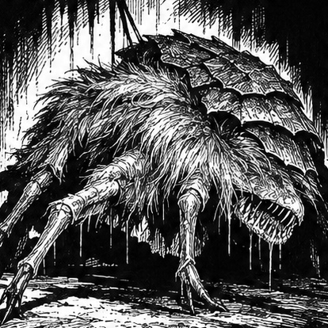
  - 【原典外貌】身穿道袍、腰繫絲絛、手捧玻璃盤盛裝兩粒自煉「仙丹」，自號「凌虛子」前赴黑風洞為黑熊精祝壽；遭一棒擊殺後現出「蒼狼精」原形。
  - 【本作克蘇魯／昆蟲寄生／偽人重構】徹底揚棄傳統狼頭穿道袍造型，直指自然界犬科身上最令人毛骨悚然的寄生惡夢——**「體表與皮下塞滿吸飽血的巨型硬蜱（牛蜱）＋多節肢捕食狼顎」偽人道長**！遠看是一名面容瘦削枯黃、挽著歪斜道髻、雙手端著透明玻璃盤微笑前行的斯文老道士；但湊近凝望便會引發極致密集恐懼：他蠟黃僵硬的額頭、脖頸皺褶與枯瘦手背皮膚底下，竟密密麻麻嵌滿數百顆吸飽污血、灰白鼓脹、不斷微幅蠕動甚至從毛孔探出八條漆黑細小節肢的**寄生巨型蜱蟲腫瘤**！玻璃盤上那兩粒聲稱能延年益壽的灰白「仙丹」，細看之下表膜半透明濕亮，內裡竟清晰蜷縮著正在脈動抽搐的**巨型飽血母蜱卵囊**！一旦遭人識破或發動獵殺，他看似清癯的下巴會發出「喀嚓」幾丁質折斷聲向四瓣驟然裂開，露出深藏喉骨的**層疊多節肢鋸齒狼顎與倒刺吸血口針**，寬大道袍更被從肋間爆出的數十條灰黑毛刺蟲足撐裂！
- **特性**：
  - 【原典記載】比白衣秀士更擅巴結大妖，懂得模仿道士裝扮與外丹煉製術，憑藉一手獻丹討好之術贏得黑熊精極高信任，以致後來有人冒充其外貌獻上假丹時黑熊精竟毫無防備；然自身戰力與反應俱差，半途遇襲連逃都來不及便喪命。
  - 【本作衍生】現代都市裡極具現實恐怖感的**「地下神壇賣黑藥丸偽人道士」**——專門在郊區破舊鐵皮宮廟或鄉下老人會兜售能治百病、延年益壽的詭異灰白「仙丹」（實為活體蜱蟲卵囊），凡人服下後數日內雖會因神經毒素短暫精神亢奮，隨後內臟便會遭孵化的數百隻寄生蜱蟲啃空淪為行屍宿主！
- **弱點**：
  - 【原典記載】近身防禦與危機反應極為薄弱，遭突襲一擊便天靈碎裂現出原形。
  - 【本作衍生】1. **極度畏懼「開天眼符水／破障符」與火焰高溫灼燒**：開天眼一眼即可看穿玻璃盤「仙丹」裡蠕動的幼蟲與道袍下密集鼓動的蜱蟲群；寄生蜱蟲與其滿身枯毛油脂極怕明火，一張**烈火符**爆燃就能令其全身寄生蟲囊連環炸裂哀嚎；2. **頭顱裂顎處幾丁質脆弱**：避開其四瓣咬合口器與噴射吸血蜱蟲，以**掌心雷**直擊其薄弱的偽人鼻樑與咽喉即可令其神經潰散。
- **習性**：
  - 【原典記載】獨居荒山岩洞採藥煉丹，酷愛巴結鄰近頂級妖王尋求庇護，每逢節慶壽誕必親手捧盤送丹。
  - 【本作衍生】潛伏於台灣郊區違法搭蓋的潮濕鐵皮私人小神壇、廢棄中藥粉加工廠或老舊眷村荒宅，專門盯上獨居重病老人與渴望速成道術的貪婪外行人，用免費試吃「養生丹」將整條暗巷變成自己的寄生繁殖場。
- **喜好**：
  - 【原典記載】偏愛道士裝束與仙風雅號（「凌虛子」）、熱衷煉製外丹與攀附強者。
  - 【本作衍生】私底下極度嗜食帶血生臟與膨脹飽血蜱蟲破裂時的濃腥血漿，神案底下的發臭冰箱裡永遠塞滿裝著寄生卵囊的透明塑膠袋。
- **擅長的招式／異能**：
  - 【原典記載】玻璃盤自煉妖丹、道人化形偽裝術（原典未及施展武藝即被擊殺）。
  - 【本作衍生】**蜱卵偽丹奪命術**（以話術哄騙目標吞服寄生蟲卵囊，七十二小時內從胃壁鑽出啃穿五臟並控制宿主行為）、**爆皮蟲彈噴射**（受驚時劇烈震動身體，從臉頰與手臂皮下崩射數十隻飽血巨蜱撲面叮咬注入神經麻痺唾液）、**四瓣節肢顎鎖喉**（偽人下顎驟然四向裂開，彈出帶倒刺的吸血長吻咬碎獵物頸動脈）。

---

## 🐗 第五單元：第 18～19 回｜高老莊偽人野豬妖相與雲棧洞卵囊亡主

### [XY1-17] 高老莊妖相・豬剛鬣（雲棧洞野豬妖相→偽人壯漢皮囊裂開成巨型寄生獠牙口器）
- **出處順序**：第 8 回《我佛造經傳極樂 觀音奉旨上長安》（福陵山雲棧洞吃人妖相初現）～第 18 回《觀音院唐僧脫難 高老莊行者降魔》、第 19 回《雲棧洞悟空收八戒 浮屠山玄奘受心經》（本卷僅收其未歸順前純妖魔化之「豬剛鬣」檔案）
- **類別與造型路線**：`【類人偽人型】`｜偽人黑胖壯漢皮囊・縱裂巨型寄生獠牙口器與棘刺剛毛怪
- **物種／唯一性**：`獨一無二`（原典唯一錯投豬胎、初生即咬殺母豬群彘、占雲棧洞吃人並入贅高老莊作祟、執九齒釘鈀之絕頂豬魔「豬剛鬣」）
- **稀有度與道行對照**：`★★★★ 絕級（SSR）`｜模糊道行：數千年墮落妖魔底蘊（未歸隊前兇殘食人，揮動五千餘斤九齒釘鈀能與大聖激戰整夜不敗，深水戰力尤為駭人）｜本作階位：一流頂
- **外貌與黑暗地牢／恐怖谷視覺改寫**：
  - 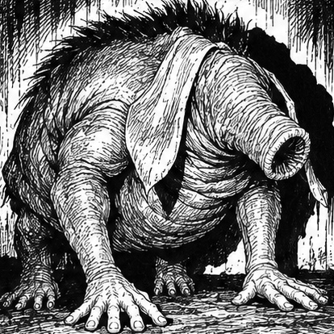
  - 【原典外貌】初投高老莊時變作一名老實能幹的「黑胖漢子」；其後逐漸現出「捲嘴長喙、長耳大扇、腦後一溜黑剛鬣、肥碩烏黑直裰」之猙獰豬妖相，來去狂風飛砂，將高翠蘭囚禁高樓數年，手持重五千零四十八斤「上寶沁金鈀（九齒釘鈀）」。
  - 【本作克蘇魯／昆蟲寄生／偽人重構】徹底抹去戲曲搞笑二師兄印象，還原第 8 回「咬殺母豬、洞中吃人」與第 18 回「強佔民女、夜半現形」最令人窒息的**「居家滲透偽人壯漢 × 縱裂寄生獠牙口器」**恐怖谷怪胎！白日裡他是一張油膩浮腫、身高逾兩公尺二、體型臃腫得擠滿紅磚窄門的黑胖粗工偽人皮囊，沉默幹活不討薪水，唯有後頸衣領下不斷刺出一排宛若漆黑甲蟲毒棘的粗硬剛毛、與那雙死盯著鎖門女眷毫不轉動的細小無神黑眼讓人心底發毛；每到半夜反鎖後宅燈光熄滅，整張「老實壯漢面皮」便會發出濕黏肉膜撕裂聲，從鼻樑正中一路向下**垂直縱裂至胸骨**——裂開的皮囊宛若膨脹腐爛的蛹殼向兩側翻捲成兩片佈滿粗大脈管的巨型幾丁質護顎板（大扇耳），中央徹底展開一座佈滿三圈倒生慘白骨質獠牙、內壁密布蠕動肉刺與**環形吞吸吸盤**的**超巨型深淵寄生裂口**！口中不斷滴落混雜發酵餿水、腐肉血沫與強酸胃液的惡臭涎水，雙手拖著那柄九根寒光鋼齒彷彿從巨蟲捕食足熔鑄而成的暗黑重型九齒釘鈀，拖過老式磨石子地板刮出刺耳火花與黑泥血痕！
- **特性**：
  - 【原典記載】極端危險且狡猾虛偽的雙面兇妖——早年剛落豬胎便咬殺母豬群彘、盤踞福陵山雲棧洞以「吃人度日」，先招贅雲棧洞女妖卵二姐並在其未滿一年暴斃後盡吞整洞家業，即便第 8 回剛發誓戒殺，轉身仍按捺不住淫慾與貪饕，偽裝黑胖壯漢潛入高老莊幹粗活騙婚，得手後食量暴增（一頓飯吃三五斗米、百十燒餅）、現出妖形軟禁高翠蘭並以飛砂狂風恐嚇全家！其近戰實力極為深厚，不靠巧勁便能憑九齒釘鈀與大聖硬戰整夜不落下風。
  - 【本作衍生】本作現代都市最令人毛骨悚然的**「寄生家庭型一流頂偽人食人魔」**——它不像野怪直接破門滅門，而是偽裝成「不用工資、只要給口飯吃就肯幫獨居老人或小工廠搬重貨」的沉默黑胖黑工，一步步住進你家二樓，等你察覺半夜客廳傳來裂皮吞肉聲與發酵腐臭時，全家逃生門早已被它的黑風與釘鈀封死！
- **弱點**：
  - 【原典記載】1. **色慾薰心、貪婪嗜吃且戒心在慾望面前徹底歸零**：高老莊一戰正是因急著鑽進暗房親吻偽裝成高翠蘭的替身，竟毫無防備慘遭揪耳痛毆並一路潰逃回雲棧洞；2. **空戰速度與靈巧度不及頂尖敏捷型對手**，且極怕前世醜聞與真身破綻被徹底揭穿。
  - 【本作衍生】正面硬扛九齒釘鈀重築擊與一流頂厚重皮囊幾乎必死無疑；唯一可行破局在於**「慾望誘餌＋暗室破障鎖死」**：利用其色迷心竅與對大量油膩血食的失控執念，以**替身紙人符**或**障眼法假人**誘使他主動張開胸臉縱裂的巨型口器撲向誘餌，趁其內層軟肉口腔完全暴露且戒備歸零的瞬間，先以**指地成鋼符（陷地符）**鎖死其沉重雙足，再往那張張裂的血口深處投入複數**五雷鎮煞符**由內引爆！
- **習性**：
  - 【原典記載】盤踞福陵山雲棧洞，平日藉黑風飛砂潛往鄰近村莊偽裝粗工騙婚、暴飲暴食並將女眷軟禁後宅，遇硬敵便化狂風縮回石洞死守。
  - 【本作衍生】潛伏於城鄉交界廢棄大型養豬場化糞池、老舊農村三合院後棟倉庫或傳統市場夜市後巷的大型廚餘槽周邊；白天默默扛重物博取老實店家信任，深夜則在反鎖的鐵窗房內剝開偽人皮囊大肆吞食生肉與發酵廚餘。
- **喜好**：
  - 【原典記載】海量暴食（米飯、燒餅、酒肉乃至早期活人血肉來者不拒）、極度貪戀女色與現成房產家業（先併卵二姐洞府、再圖高老莊家財）、愛偷懶酣睡。
  - 【本作衍生】對極度油膩腥濃的整桶廚餘滷汁、高糖油炸物與帶有驚恐體溫的年輕異性有病態佔有慾。
- **擅長的招式／異能**：
  - 【原典記載】上寶沁金鈀（九齒釘鈀，重五千零四十八斤）、天罡三十六變（擅變壯漢、巨體等實用擬態）、捲地黑風飛砂、深水極致潛行搏殺。
  - 【本作衍生】**人皮縱裂吞噬顎**（臉胸中軸驟然裂開化為巨型多排獠牙吸盤裂口，一口咬碎防彈盾牌並吸乾獵物精血）、**九齒重釘貫地築**（一鈀砸下瞬間貫穿鋼筋樓板留下九道冒煙焦孔，震飛周遭一切掩體）、**腥風封宅結界**（張口吐出夾雜碎瓦與腐油臭氣的狂飆黑風，徹底鎖死整棟透天厝的門窗與逃生梯）。

---

### [XY1-18] 雲棧洞舊主・卵二姐（卯二姐／福陵山亡主寄生蟲卵囊母體）
- **出處順序**：第 19 回《雲棧洞悟空收八戒 浮屠山玄奘受心經》（原典由豬剛鬣於雲棧洞親口追述：福陵山雲棧洞原主「卵二姐」〔明代最早百回本金陵世德堂本作「卵二姐」，後世部分刊本訛作「卯二姐」〕見其武藝招為入贅家長，然不上一年身亡，將整座雲棧洞家當盡遺豬剛鬣）
- **類別與造型路線**：`【類人偽人型】`｜極致枯白偽人少婦・腹背搏動巨型寄生蟲卵囊母體
- **物種／唯一性**：`物種特異個體`（原典未明載其動物原形，但身為盤踞荒山妖窟雲棧洞、敢招贅食人巨妖豬剛鬣為婿之獨霸洞主，顯係成氣候之山窟女妖；本作緊扣世德堂原名「卵二姐」定性為寄生蟲卵母體特異個體）
- **稀有度與道行對照**：`★★ 稀級（R）`｜模糊道行：數十年至百餘年山洞獨霸女妖（已具成套洞府家當與化形招婿之能，然終不敵更暴戾之豬剛鬣反噬而亡）｜本作階位：二流（二流中階・已亡故殘巢母體）
- **外貌與黑暗地牢／恐怖谷視覺改寫**：
  - <!-- 圖位預留：待補繪 -->
  - 【原典外貌】原典未正面出場，僅見第 19 回豬剛鬣追述其名「卵二姐」，乃福陵山雲棧洞原主，招贅未滿一年即亡故。
  - 【本作克蘇魯／昆蟲寄生／偽人重構】深度考據世德堂本「**卵**二姐」之字面意象，將這尊只存於台詞背後的亡故妖主重構為黑暗地牢中最滲人的**「枯白偽人產卵母體」**！生前她偽裝成一名面色死白、眼窩深陷、身著潮濕素灰長裙的寡言少婦，總以柔弱孤女姿態誘騙強壯武人或迷途妖物「入贅雲棧洞」；然而她寬鬆陰濕的後背與腹裙底下，整個軀幹其實早已空洞膨脹成一座半透明、表面覆滿青紫血管並隨心跳劇烈鼓縮的**巨型寄生昆蟲卵囊**，囊內密密麻麻擠滿數千顆發亮灰白蟲卵與不斷翻身的長尾幼蟲黑影，尾椎處更盤繞著一條沾滿黏液的漆黑幾丁質**長管產卵器**！原典稱她招贅豬剛鬣不到一年便離奇死亡，本作將這段詭異空白重構為「黑吃黑的生物寄生反殺」——她原意如螳螂與寄生蜂般在交合後將產卵管刺入豬剛鬣脊髓吸乾其強大精血孵化蟲巢，反遭豬剛鬣皮下縱裂的巨型獠牙口器從內部生生咬碎卵囊、吸乾汁液而乾癟慘死，如今雲棧洞岩壁上仍掛滿她生前留下的乾裂灰白空卵鞘與發霉絲膜。
- **特性**：
  - 【原典記載】原典僅記其擁有福陵山雲棧洞整座家業，主動招贅豬剛鬣為「倒蹅門」家長，卻在一年內身故，成為豬剛鬣發跡占洞的關鍵前任洞主。
  - 【本作衍生】代表現代都市怪談中**「以孤獨招贅／合租為餌的寄生蜂式偽人母體」**——專挑體格健壯的單身外籍移工、貨車司機或落單二流妖物同居，在同居數月間悄然將微細寄生卵注入對方飲食與頸背，直到宿主氣血徹底榨乾才物色下一任「新郎」；而其死後遺留在雲棧洞（或廢棄老公寓）的休眠卵鞘，一旦遇上高溫高濕與新鮮血氣仍可能二次孵化作祟！
- **弱點**：
  - 【原典記載】原典未載明確弱點，唯明言其招贅豬剛鬣「不上一年他死了」，顯見其生命力或反制手段遠遜於一流頂大妖。
  - 【本作衍生】1. **腹背半透明巨型卵囊防禦力幾乎為零且極度怕火與穿刺**：一旦識破其偽人素裙背後的異樣腫脹，直接以**烈火符**爆燒其高油脂蟲卵囊，便會引發劇烈連環爆裂與全巢燒毀；2. **高度依賴密閉潮濕同居空間緩慢寄生**：正面強攻戰力在二流中僅屬中下，絕不可讓其近身貼背伸出產卵管，使用**淨氣符**與**破障符**識破飲食中的微細蟲卵即可提前破局。
- **習性**：
  - 【原典記載】獨居福陵山雲棧洞，積攢一洞家當，喜好物色有武藝之強壯外來者入贅做家長。
  - 【本作衍生】同類母體或遺留卵鞘常盤踞在老舊無電梯公寓頂樓加蓋、潮濕發霉的單身出租套房或荒廢山莊地下室；牆角與床板底下總貼滿灰白蜂蠟般的乾硬蟲卵殼，並散發一股甜膩中混著濕腐敗蛋腥味的怪異氣味。
- **喜好**：
  - 【原典記載】原典僅記其見豬剛鬣「有些武藝」便招為家長，顯示其看重雄性力量與體魄。
  - 【本作衍生】對體魄強健、陽氣旺盛的活體宿主有著近乎繁殖本能的偏執渴求，越強壯的「丈夫」越能催生出高階寄生幼蟲。
- **擅長的招式／異能**：
  - 【原典記載】原典未載具體戰鬥招式（僅於追述中提及）。
  - 【本作衍生】**婚褥寄生產卵管**（趁目標熟睡或鬆懈時自背脊裂口探出細長帶麻痺黏液的產卵管，無痛刺入肩胛骨縫產卵）、**休眠卵鞘腐霧**（母體亡故後遺留於巢穴的乾涸卵鞘遭震動即裂開，噴出能鑽入鼻腔與傷口的微米級吸血幼蟲）、**溫順孤婦偽人障眼**（壓抑妖氣並釋放微量安神費洛蒙，令普通男性與三流法師產生莫名憐憫與鬆懈）。

---

## 🌪️ 第六單元：第 20 回（～第 21 回交界）｜黃風嶺剝皮擬態蟲虎與風沙寄生巢怪

### [XY1-19] 黃風嶺・虎先鋒（剝皮誘餌寄生虎怪→留下空殼蛻皮逃遁的擬態昆蟲虎妖！）
- **出處順序**：第 20 回《黃風嶺唐僧有難 半山中八戒爭先》
- **類別與造型路線**：`【非人生物恐怖型】`｜擬態剝皮蛻殼昆蟲虎妖（巨型擬虎血紅螳螂・蟬蛻寄生捕食蟲）
- **物種／唯一性**：`物種（群體）`（猛虎煞氣與高階蛻皮擬態捕食昆蟲融合之兇狠戰妖種屬，此處為黃風大聖帳下最狡猾悍勇的前路先鋒「虎先鋒」）
- **稀有度與道行對照**：`★★★ 珍級（SR）`｜模糊道行：數百年實戰狡詐猛妖（武藝遠勝第 13 回寅將軍，能持赤銅雙刀硬戰九齒釘鈀多合，更憑驚世「剝皮金蟬脫殼計」成功從大聖與八戒眼皮底下劫走唐僧）｜本作階位：二流頂～一流初階
- **外貌與黑暗地牢／恐怖谷視覺改寫**：
  - 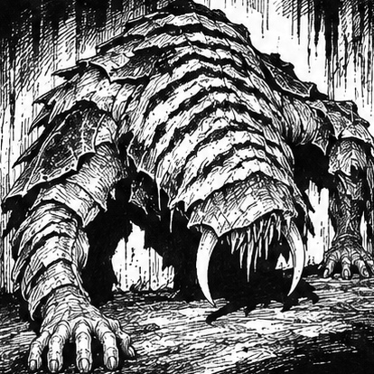
  - 【原典外貌】「血津津的赤剝身軀，紅焞焞的彎環腿足，火焰焰的兩鬢蓬鬆，硬搠搠的雙眉直豎；白森森的四個鋼牙，光耀耀的一雙金眼」，手使兩口寒光閃閃的「赤銅刀」，真身乃巨型黃斑猛虎，更上演當場「自己剝下虎皮罩在臥石上」之驚悚金蟬脫殼！
  - 【本作克蘇魯／昆蟲寄生／偽人重構】直接引爆原典第 20 回「活剝虎皮使金蟬脫殼」的究極生物恐怖基因，將其徹底昆蟲化為**「活體空殼蛻皮擬態蟲虎」**！初登場時那具看似魁梧的黃斑猛虎披甲怪軀，實則是它用來偽裝與抗傷的外層**中空幾丁質擬虎外骨骼（活體蟬蛻）**，表殼長滿剛硬擬毛感覺刺與虎紋甲片；一旦正面戰局吃緊，這具虎軀背部中線便會發出清脆「喀嚓」甲裂巨響自動縱向崩開，伴隨大量暗紅濕滑蛻皮液湧出——外層那張完整的黃斑虎殼竟如巨型蟬蛻般筆直套伏在路邊巨石上，甚至還殘留神經反射微幅抽搐咆哮，將敵人騙得死死圍攻空殼！而從空殼背縫極速鑽出的本尊，則是一頭通體鮮紅濕亮、尚處於剛羽化軟甲階段的**赤裸血肉巨型捕食螳螂 × 多足蜈蚣混合血蟲怪**：半透明赤紅幾丁質薄膜下清晰可見劇烈跳動的黑紅內臟與錯節蟲筋，四枚白森森的巨型幾丁質鋼牙向前翻出，原本的「兩口赤銅刀」實為自前胸爆長而出、染滿蛻皮血漿與鐵鏽的兩對**超長鋸齒赤銅鐮肢**，在黃沙陰風裡化作一道血紅殘影悄無聲息繞到防線後方封喉擄人！
- **特性**：
  - 【原典記載】極其罕見的**「高戰術智商狠辣先鋒妖」**！先正面交鋒掂量出對方實力強橫，當機立斷不惜慘烈自剝整張虎皮罩在石頭上製造「金蟬脫殼」假身，成功騙過火眼金睛與九齒釘鈀兩大強手，真身化腥風繞後輕鬆劫走唐僧獻功；雖最終在洞口再戰不敵聯手追殺慘死於釘鈀之下，卻已證明其陰狠果決遠超尋常莽夫妖怪。
  - 【本作衍生】本作中堪稱令所有基層與二流除妖師膽寒的**「二流頂～一流初階假殼誘殺刺客」**——一般除妖師在濃霧或昏暗工地交戰時，極易把珍貴的五雷鎮煞符與烈火符全部浪費在那具還在抽搐流血的擬虎空殼上，下一秒法力見底之際便被無皮赤紅血蟲真身從盲區一鐮攔腰斬斷！
- **弱點**：
  - 【原典記載】1. **正面硬拚仍不敵一流頂以上聯手強攻**（再戰時無法脫身，被九齒釘鈀一擊築死）；2. **「金蟬脫殼」極度依賴第一次交手的資訊不對稱與風沙遮蔽**，一旦假殼被識破且無法再次蛻皮，無皮裸身防禦大幅下降。
  - 【本作衍生】1. **開天眼符水／破障符可瞬間看穿空殼與真身的妖氣流向**（留在原地的擬虎空殼只剩微弱殘留體液與機械反射，真正濃烈如血霧的紫黑妖氣早已沿地面風流繞往除妖師背後！）；2. **剛蛻皮之赤紅軟甲階段極度畏懼粗鹽、高熱烈火與雷電直擊**：失去外層厚重幾丁質虎殼保護後，它暴露在空氣中的濕亮赤紅薄膜與內臟神經對**烈火符**灼燒、**五雷鎮煞符**電擊以及**硃砂粗鹽撒傷**的痛覺與傷害將成倍暴漲！
- **習性**：
  - 【原典記載】充當黃風大聖頭號鷹犬，每日率領巡山小妖於黃風嶺險路游獵，急於搶功捕獲唐僧獻給洞主。
  - 【本作衍生】潛伏於現代郊區風沙滾滾的重劃區未完工水泥大樓、廢棄高速公路舊收費站或山區停業肉品加工廠；擅長在強風揚塵夜故意暴露出一具正在啃食腐肉的擬虎蛻殼誘餌吸引目標靠近，自己則倒吊在上方鋼筋鷹架準備無聲俯衝背刺。
- **喜好**：
  - 【原典記載】極愛立功炫耀、嗜食活人血肉，對自己那招血腥「金蟬脫殼」詭計頗為自鳴得意。
  - 【本作衍生】對「褪殼與剝皮」有著病態的潔癖與收藏欲，巢穴天花板與柱子上總是密密麻麻倒掛著它歷年褪下的半透明虎紋硬殼與受害者完整衣物皮囊，宛若一間令人發瘋的昆蟲標本屠宰室。
- **擅長的招式／異能**：
  - 【原典記載】赤銅雙刀近戰猛斬、**剝皮覆石・金蟬脫殼計**、化腥風高速擄人。
  - 【本作衍生】**活體蟬蛻誘餌術**（零點五秒內背甲縱裂滑出本尊，留下的擬虎空殼仍能持續抽搐嘶吼並揮爪達十餘秒，足以騙過未開天眼者與低階感知）、**血蟲軟甲極速繞背**（蛻去厚甲負擔後爆發超越二流極限的貼地奔襲速度，伴隨強腥蟲霧抹消腳步聲）、**赤銅鐮肢雙重十字斬**（兩柄滲血幾丁質鋸齒鐮肢交錯劈砍，輕易斬裂防暴盾牌與金光護身符）。

---

### [XY1-20] 黃風大聖（黃毛貂鼠精→腹腔化為噴吐腐蝕風沙與細蟲孢子的巨大寄生巢怪）
- **出處順序**：第 20 回《黃風嶺唐僧有難 半山中八戒爭先》～第 21 回《護法設莊留大聖 須彌靈吉定風魔》
- **類別與造型路線**：`【非人生物恐怖型】`｜腐油巨型寄生巢怪・腹腔腐蝕風沙與鑽眼細蟲孢子噴口母體
- **物種／唯一性**：`物種特異個體`（原為西天靈山腳下聽經偷喝琉璃盞燈油得道之黃毛貂鼠精，歷經腐油異變煉成震動三界之「三昧神風」，乃世間絕無僅有之獨尊大鼠巢王）
- **稀有度與道行對照**：`★★★★ 絕級（SSR）`｜模糊道行：數百年至千年佛前竊油得道絕頂大妖（三股鋼叉力戰大聖三十餘合不敗，更憑一口「三昧神風」正面吹垮齊天大聖、重創火眼金睛，為西行路上首位正面擊敗大聖之超級魔王！）｜本作階位：一流頂（憑三昧神風具備跨階逼退巔峰之區域災厄級環境殺傷）
- **外貌與黑暗地牢／恐怖谷視覺改寫**：
  - 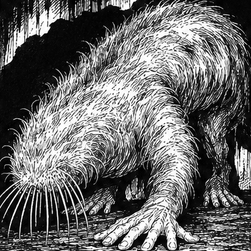
  - 【原典外貌】頭戴金盔幌日、身披金甲披霞與皂羅袍、足踏烏皮靴、手執亮銀「三股鋼叉」，威儀宛若一方雄主；遭法寶鎮壓現出原形時，乃一隻眼神狡黠、身軀碩大的「黃毛貂鼠」。
  - 【本作克蘇魯／昆蟲寄生／偽人重構】徹底剝離毛絨貂鼠與金甲將軍外殼，重塑為卷一終極黑暗地牢生物災厄——**「浸透陳年腐油、整具腹腔掏空化作活體風箱寄生蟲巢的不可名狀巨怪」**！它雖保留著佝僂狹長的巨鼠脊骨輪廓與上顎兩根不斷增生、浸滿黑黃陳年油垢並刺穿下唇的畸形門牙，但體表原本的鼠毛早已在千年神油腐蝕與寄生增生下潰爛脫落，化作一片濕滑反光、佈滿黃濁油泡與密集蜂窩狀呼吸氣孔的**腐油幾丁質膜皮**（覆蓋著被油脂熔焊在背上的殘破焦黑古甲碎片）；最令人掉 SAN 值的是它那過度膨脹下垂的巨型雙頰與整個胸腹腔——平時宛若一座沉重蠕動的腐敗皮囊，但只要它面向巽位深吸一口氣，整個**腹腔正面竟會如超巨型環形水蛭吸盤般無聲裂開直徑逾一公尺的漆黑巢口**，內壁密密麻麻鑲滿數十圈細密倒生幾丁質細齒、搏動如風箱的灰白寄生氣囊與無數正在瘋狂振翅的微細飛蟲幼體！隨著一聲令人耳膜滲血的尖銳抽風嘯鳴，這座活體腹巢便會噴吐出能把鋼筋大樓表皮刮出白骨的**「三昧神風」——實質為滾燙腐蝕黃沙、燃脂毒油霧與數以百萬計微米級鑽眼啃肉寄生細蟲孢子的滅絕級風暴**！手持之「三股鋼叉」則像是由巨型畸變尾椎骨與三根空心注油毒刺熔接而成的慘白骨叉，通體散發濃烈刺鼻的陳年油耗與腐敗乾屍惡臭。
- **特性**：
  - 【原典記載】西行路上**第一位憑硬實力正面擊潰齊天大聖、逼得大聖失明逃竄四處搬救兵的超級魔王**！1. **老謀深算、沉得住氣**：部下虎先鋒獻上唐僧時，它非但沒衝動開鍋，反而冷靜警示「那唐僧有個極難纏的徒弟，先綁在定風樁上觀望幾天再吃」；2. **武藝與神通雙絕**：三股鋼叉正面大戰大聖三十餘合不分勝敗，見久戰難下便轉向巽位猛吸一口吹出「三昧神風」，瞬息間天昏地暗，將數百猴毛分身全數吹散，更直擊大聖八卦爐留下的眼疾死穴，將其火眼金睛燻吹得酸痛流淚、近乎失明落敗！原典讚此風足以令山嶽崩塌、乾坤失色，連天庭西天諸神皆感棘手。
  - 【本作衍生】本作《02-招式修行篇》一流攻擊控場技「**三昧神風**」之正統災厄本源！在現代台灣都會戰場中，它是一頭能一口氣把整條商圈吹成能見度歸零的腐蝕黃沙蟲霧煉獄、同時直接讓所有依賴「開天眼符水／火眼金睛」的除妖師視網膜遭鑽眼細蟲孢子瞬間啃爛失明、並一舉吹熄所有凡火烈火符的**封城級環境災厄妖王**！
- **弱點**：
  - 【原典記載】1. **唯一絕對剋星：定風丹與飛龍寶杖（化八爪金龍）**——一旦神風遭定死無法肆虐、頭顱被金龍爪死鎖，立刻法力盡失縮回黃毛貂鼠原形；2. **心虛逃犯心理與洞中多嘴破綻**：因係偷喝靈山佛前琉璃盞清油畏罪潛逃之犯，心底對靈山與定風剋星存有極深陰影，竟在自認安全時於洞內向小妖親口洩露自己「唯懼靈吉」的致命底牌，被化作花腳蚊子的偵察者聽個正著！
  - 【本作衍生】正面遭遇這尊腹腔寄生風巢巨怪，**嚴禁開啟破妄瞳術直視風口（細蟲孢子會順眼淚與靈力通道直鑽視神經導致瞬間失明），亦不可徒勞拋擲凡火烈火符（只會被狂風吹熄甚至引燃其毒油霧反噬自身）**！實戰唯有三線生機：1. **必備防風護目與高階避風／定風法器**（配戴密封護目鏡並於領口胸前疊貼**淨氣符／避穢符**過濾鑽眼細蟲孢子，眼傷須以珍稀古藥「三花九子膏」搶救）；2. **搶攻「巽位吸氣蓄力」之二秒空窗**：發動三昧神風前其巨大腹腔巢口必須全開並向內劇烈抽氣，此時若能以**高階鎮妖定身符**或高速穿刺法器（如**五雷鎮煞符**綁附重矢）直接投進其張開的腹腔風箱引爆，便可從內部撕裂氣囊寄生巢並打斷蓄風；3. **利用其偷油逃犯的偏執戒心設局套話或以貓科／真龍威壓震懾**，迫其自亂陣腳。
- **習性**：
  - 【原典記載】盤踞八百里漫天黃沙的黃風嶺黃風洞，洞府深處立有「定風樁」捆縛要犯，麾下廣布巡山小妖與虎先鋒；生性多疑謹慎、輕易不親出山門，深怕過往偷油舊案暴露。
  - 【本作衍生】若現代台灣出現其血脈異變巨怪，極可能藏身於東北季風狂嘯的濱海廢棄火力發電廠鍋爐間、荒廢大型砂石場深井、或百年老廟地下室積滿陳年香油垢的廢棄油槽深處；平日貪婪舔舐老廟長明燈油與工業機油餵養腹腔寄生蟲巢，每逢強烈冷氣團沙塵暴或颱風外圍環流強風夜便會出洞大肆擴張風巢領域。
- **喜好**：
  - 【原典記載】酷嗜偷飲佛前「琉璃盞清油」（既因此成精亦因此逃亡），偶爾雖也打算享用人肉，卻比多數妖王更能克制食慾、凡事謀定而後動。
  - 【本作衍生】對寺廟神明燈油、重油工業潤滑液與發酵動物油脂有著如同重度毒癮般的生理依賴，其巢穴百公尺內總瀰漫著令人作嘔的陳年油耗焦味與細密磨牙的黃土沙塵。
- **擅長的招式／異能**：
  - 【原典記載】亮銀三股鋼叉（力敵萬斤金箍棒三十餘合）；終極王牌**「三昧神風」**（朝巽地吸氣吹出，破盡萬千分身、直剋火眼金睛與一切凡火，威力撼動乾坤）。
  - 【本作衍生】**三昧神風・腹巢細蟲腐蝕風暴**（腹腔環形裂口猛然轟出超高速強酸黃沙、腐油毒煙與億萬微米級鑽眼寄生細蟲孢子，瞬間掀翻街區車輛、剝蝕混凝土外牆並令所有未護目之敵雙眼潰爛失明）、**三股骨叉注油貫穿**（三根空心叉尖刺破護體金光後直接往傷口注入高黏度腐油與寄生幼蟲）、**油煙鼠道滑遁**（全身分泌大量滑膩腐油，連同臃腫腹巢強行壓扁擠入廢棄排油煙管與地下排水縫隙極速逃遁）。

---

## 🔚 卷一收束與下卷導覽

- **本卷統計摘要**：依 2026-11-21 定案「純妖怪怪獸零神明 × 黑暗地牢昆蟲寄生 × 恐怖谷偽人」規格，本卷完整涵蓋《西遊記》第 01～20 回（含第 21 回交界黃風嶺收束），共收錄 `XY1-01` 至 `XY1-20` 計 **20 條**純妖怪與怪獸公式書檔案（其中 `【類人偽人型】` **9 條**、`【非人生物恐怖型】` **11 條**），嵌入既有黑白墨線圖檔 **18 張**，保留待補繪圖位 **2 處**（`XY1-03` 七十二洞妖王、`XY1-18` 雲棧洞舊主・卵二姐），已 100% 剔除全部神佛仙官與凡俗人物。
- **下卷導覽**：跨越八百里黃風嶺腐蝕風沙後，西行之路將迎來八百里弱水流沙水怪、白虎嶺極致恐怖谷偽人標竿**白骨精**、碗子山波月洞黃袍怪、平頂山蓮花洞金銀角妖相與壓龍洞九尾狐族、烏雞國青毛獅子精，直至號山枯松澗火雲洞紅孩兒——請繼續查閱 **[卷二：第 21～40 回](./02-卷二_第21至40回.md)**，或返回 **[📖 西遊記純妖怪怪獸總錄](./00-西遊記妖怪怪獸總錄.md)** 與 **[👹 妖怪篇總綱](../00-妖怪篇總綱與圖鑑分級.md)**。
