# 🐒 《西遊記》純妖怪與怪獸圖鑑・卷二（第 21～40 回）

> **返回導覽**：[👹 妖怪篇總綱](../00-妖怪篇總綱與圖鑑分級.md) ｜ [📖 西遊記總錄](./00-西遊記妖怪怪獸總錄.md) ｜ [⬅️ 卷一](./01-卷一_第01至20回.md) ｜ [➡️ 卷三](./03-卷三_第41至60回.md)
>
> **插圖統計**：本卷共收錄 **12 條** 純妖怪與怪獸條目（涵蓋 19 名具名妖魔個體），全數配圖完成，共計嵌入 **13 張** 黑白墨線插圖（其中五大標竿核心條目 `[XY2-02] 白骨精` 雙圖並列）。
>
> **純妖怪收錄範圍與神佛剔除聲明（2026-11-21 定案）**：本卷嚴格依原書第 21～40 回（並完整銜接第 40～42 回前段號山枯松澗火雲洞妖魔陣容）之出場順序，僅收錄純粹的妖怪、魔怪、異變妖王、寄生蟲妖與腐屍擬態怪獸。原典本區段登場之一切神明、佛菩薩、道門地仙、天庭星官、地祇與凡人帝王（含第 21 回護教伽藍與靈吉菩薩、第 22 回惠岸行者、第 23 回黎山老母・文殊・普賢、第 24～26 回鎮元大仙・清風明月・五莊觀土地・福祿壽三星・東華帝君・瀛洲九老、第 29～31 回凡人百花羞公主與天庭二十七宿、第 32～35 回日值功曹・平頂山山神土地・哪吒・真武皂雕旗・太上老君、第 37～39 回夜遊神・烏雞國王凡人冤魂・井龍王、第 40～41 回枯松澗六十名山神土地與四海龍王）**一律徹底剔除不收**；涉及跨原典身份之妖魔（如流沙河水怪、黃袍怪、金銀角大王、青毛獅子精）亦僅嚴格取其**妖魔墮落相與生物恐怖本體**建檔。

---

## 📋 本卷純妖怪與怪獸速查表（共 12 條，依原典回目順序排列）

| 編號 | 名稱（別稱） | 出處回目 | 造型路線 | 物種／唯一性 | 稀有度 | 本作階位對應 | 配圖 |
| :---: | :--- | :--- | :---: | :--- | :---: | :--- | :---: |
| `XY2-01` | **流沙河噬人水怪**（捲簾墮落期水怪相） | 第 22 回 | `【非人生物恐怖型】` | `獨一無二` | `★★★★ 絕級（SSR）` | 一流頂～巔峰 | 🖼️ |
| `XY2-02` | **白骨精**（白虎嶺屍魔／白骨夫人）⚠️ **標竿** | 第 27 回 | `【類人偽人型】` | `物種特異個體` | `★★★ 珍級（SR）` | 二流頂～一流 | 🖼️×2 |
| `XY2-03` | **黃袍怪**（碗子山波月洞妖王） | 第 28～31 回 | `【類人偽人型】` | `獨一無二` | `★★★★ 絕級（SSR）` | 一流頂～巔峰 | 🖼️ |
| `XY2-04` | **金角大王**（平頂山蓮花洞大妖王） | 第 32～35 回 | `【非人生物恐怖型】` | `獨一無二` | `★★★★ 絕級（SSR）` | 一流頂（持寶巔峰） | 🖼️ |
| `XY2-05` | **銀角大王**（平頂山蓮花洞二妖王） | 第 32～35 回 | `【非人生物恐怖型】` | `獨一無二` | `★★★★ 絕級（SSR）` | 一流頂（持寶巔峰） | 🖼️ |
| `XY2-06` | **精細鬼與伶俐蟲**（蓮花洞執寶寄生小妖） | 第 33～34 回 | `【類人偽人型】` | `物種（群體）` | `★ 凡級（N）` | 三流（持寶異常） | 🖼️ |
| `XY2-07` | **巴山虎與倚海龍**（蓮花洞常隨妖將） | 第 34 回 | `【類人偽人型】` | `物種（群體）` | `★★ 稀級（R）` | 二流 | 🖼️ |
| `XY2-08` | **九尾狐狸精**（壓龍洞老奶奶） | 第 34 回 | `【類人偽人型】` | `物種特異個體` | `★★★ 珍級（SR）` | 一流 | 🖼️ |
| `XY2-09` | **狐阿七大王**（壓龍山多尾甲殼妖將） | 第 35 回 | `【非人生物恐怖型】` | `物種特異個體` | `★★ 稀級（R）` | 二流頂 | 🖼️ |
| `XY2-10` | **青毛獅子精**（烏雞國假君主／獅猁怪） | 第 37～39 回 | `【類人偽人型】` | `物種特異個體` | `★★★★ 絕級（SSR）` | 一流頂 | 🖼️ |
| `XY2-11` | **聖嬰大王・紅孩兒**（號山火雲洞火魔） | 第 40～42 回 | `【類人偽人型】` | `獨一無二` | `★★★★ 絕級（SSR）` | 一流頂～巔峰 | 🖼️ |
| `XY2-12` | **火雲洞六健將**（雲裡霧至掀烘興六妖） | 第 41～42 回 | `【類人偽人型】` | `物種（群體）` | `★★ 稀級（R）` | 二流 | 🖼️ |

> **逐回淨化備忘**：第 21 回《護法設莊留大聖 須彌靈吉定風魔》之黃風大聖已收錄於 [卷一](./01-卷一_第01至20回.md)，其餘皆為佛門護法與菩薩；第 23～26 回（四聖試禪心、五莊觀、三島求方）及第 36 回（寶林寺）全段皆無新妖魔怪獸登場，故依純妖怪鐵律直入各妖窟章節。

---

## 🪱 一、第 22 回：八百里流沙河（弱水底層寄生噬人水怪）

### [XY2-01] 流沙河噬人水怪（捲簾墮落期水怪相／弱水溺屍寄生水蛭巨怪）
- **出處順序**：第 22 回《八戒大戰流沙河 木叉奉法收悟淨》（第 8 回曾略敘其盤踞弱水噬人兇相；本條目僅取其徹底墮落成噬人水魔時期之怪物本相）
- **類別與造型路線**：`【非人生物恐怖型】`｜環節水蛭與弱水寄生溺屍巨怪
- **物種／唯一性**：`獨一無二`（僅此一尊長年沉積於八百里鵝毛不浮之弱水淤泥底層、日夜承受百劍穿胸異變而成的頂級噬人水怪）
- **稀有度與道行對照**：`★★★★ 絕級（SSR）`｜模糊道行：千年妖魔根基疊加弱水腐煞與血債怨氣｜本作階位：一流頂～巔峰（沉水淤泥領域內近乎巔峰，強制拖離水域後降至一流中上）
- **外貌與黑暗地牢／恐怖谷視覺改寫**：
  - 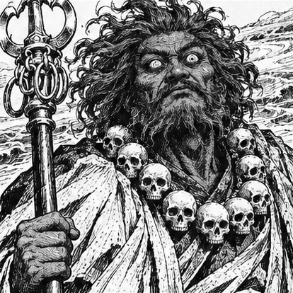
  - 【原典外貌】「一頭紅焰髮蓬鬆，兩隻圓睛亮似燈。不黑不青藍靛臉，如雷如鼓老龍聲。身披一領鵝黃氅，腰束雙攢露白藤。項下骷髏懸九個，手持寶杖甚崢嶸。」——盤踞流沙河底，赤髮藍靛面、雙目圓凸，頸間以白藤串掛九顆在弱水中居然漂浮不沉的取經人骷髏，手持兩端細、中段粗如鐵木擀麵棍般的降妖寶杖（五千零四十八斤重兵）。
  - 【本作克蘇魯／昆蟲寄生／偽人重構】徹底剝除慈厚和尚或威武神將光環，重塑為沉積於黑暗地牢深潭弱水底部的**巨型寄生溺屍水蛭巨怪**：露出水面截殺獵物時，僅上半身強行撐起一具發紫泡脹的巨人溺屍擬態——滿頭如腐爛濕海藻般糾結滴水的亂髮與鬍鬚，雙眼膨脹突出如泡爛的死魚白睛，渾身披著似破爛僧衣實為脫落半腐水蛭皮膜的灰黃黏膜；胸腹間佈滿百餘個每七日自動潰爛滲出黑泥血水的穿刺孔洞（每道肉洞內皆有成群細長吸血紅線蛭探頭蠕動）。腰部以下完全無人類雙腿，而是拖曳著一條長逾十公尺、體表濕亮反光且覆滿**環形齒狀吸盤**的肥碩軟體環節水蛭軀幹，能將整個身軀死死吸附在河底岩縫與箱涵水泥壁上；頸間所掛的**九顆人頭骷髏**實為掏空腦漿後被寄生卵絲封死的「**浮囊卵殼骷髏**」，空洞眼窩與牙縫裡密密麻麻爬滿半透明水蛭幼蟲，隨水波碰撞發出令人反胃的濕滑喀嗒聲，巨爪死攥一根宛如腐木與鐵環寄生的巨大降妖杖。
- **特性**：
  - 【原典記載】盤踞寬八百里、鵝毛飄不起、蘆花定底沉的流沙弱水之中，餓極便翻波湧浪衝出岸邊吞噬活人，曾接連吃掉九名取經人，卻發現唯獨這九顆骷髏死活沉不下去，遂串在脖子上把玩；水下作戰極度凶悍，單憑水勢與寶杖便與天蓬妖將豬八戒惡戰數十回合不分勝負，且極具狡猾的自保直覺，一見岸上強敵現身便立刻潛入漆黑河底拒不出戰。
  - 【本作衍生】具備極端致命的「**弱水浮力剝奪＋環節寄生吸附**」雙重災厄體質：其體表分泌的大量酸性黑水黏液能瞬間改變周遭積水張力，使誤入齊踝黑水的除妖師喪失浮力、像灌了鉛般被泥底無數水蛭吸盤死死拖向深淵；胸腹百餘個永不癒合的腐洞每逢農曆七日（逢七之夜）便會劇烈痙攣爆開，噴出大量具備吸血麻醉毒素的微米級寄生蛭卵，令觸及河霧的凡人不知不覺皮下腫脹出血、活活被吸乾全身精血。
- **弱點**：
  - 【原典記載】離水上岸後的正面機動與變化神通明顯偏弱（屢見孫悟空現身便急忙縮回弱水深處，絕不敢久戰於乾燥陸地）；且長期受限於每隔七日一次的穿胸酷刑折磨，精神處於極度煎熬動搖狀態。
  - 【本作衍生】1. **極度畏懼徹底脫水、強鹼高鹽與乾燥高熱**：環節軟體水蛭本體無法在缺乏濕氣的環境中久留，只要將其引出抽水站、河濱箱涵或滯洪池，迫入乾燥柏油路面並以**高溫烈火符**或大量生石灰／工業粗鹽炙烤，其黏液膜會劇烈萎縮翻捲、戰力驟降過半；2. **導電麻痺與胸口腐洞死穴**：通體含水率極高且佈滿滲血孔洞，以**五雷鎮煞符**或**掌心雷**沿著積水表面或直接打入胸腔寄生孔，可觸發毀滅性的連鎖電擊痙攣，強制震碎其頸間作為浮力與怨氣錨點的九顆卵殼骷髏。
- **習性**：
  - 【原典記載】長年潛伏流沙河底死水深處，晝伏夜出或候濃霧翻浪時驟然竄出吞食誤闖河岸的孤身旅人，非餓極不輕離弱水老巢。
  - 【本作衍生】若顯現於現代台灣都市，會盤踞於淡水河／基隆河廢棄舊防洪閘門底部淤泥、深達數十公尺的地下大型雨水箱涵匯流井，或長年積水發臭的廢棄水庫進水隧道；平時完全沉埋在黑泥裡毫無聲息，只讓九顆空心卵殼骷髏隨暗流浮上水面撞擊水門發出詭異輕響，專等深夜巡檢人員、落單釣客或探險者彎腰探頭查看時，突然噴出帶倒鉤的水蛭口器將獵物拖入弱水窒息吸乾。
- **喜好**：
  - 【原典記載】墮落為怪時嗜食過往行旅血肉，尤對沉不下去的奇異人頭骷髏抱有怪癖，必串於頸項隨身攜帶戲弄。
  - 【本作衍生】病態沉迷於收集具有靈根或高陽氣受害者的頭骨來培育新一代寄生蛭卵，極度厭惡強烈的正午曝曬與刺鼻的化學消毒水味。
- **擅長的招式／異能**：
  - 【原典記載】「降妖寶杖」（重五千零四十八斤、隨心伸縮之巨杖重擊）、「翻波捲沙弱水遁」（激起漫天陰風黑砂與吞沒浮力的惡浪）、「九骷髏不沉浮陣」。
  - 【本作衍生】**「弱水沉溺域」**（讓方圓數十公尺內所有積水路面瞬間喪失浮力並化作黏稠吸血黑泥沼）、**「百孔血蛭噴射」**（胸腹百道腐洞齊開，高壓噴吐成群帶麻醉抗凝血毒素的寄生水蛭群）、**「卵殼骷髏聲波誘捕」**（九顆頭骨在水下共振出近似溺水者求救的低頻嗚咽，誘騙除妖師跨入致命水域）。

---

## 🕷️ 二、第 27 回：白虎嶺白骨洞（⚠️ 五大標竿核心條目・偽人口器屍魔）

### [XY2-02] 白骨精（白虎嶺屍魔／白骨夫人｜⚠️ 五大標竿基準體）
- **出處順序**：第 27 回《屍魔三戲唐三藏 聖僧恨逐美猴王》
- **類別與造型路線**：`【類人偽人型】`｜脫殼寄生屍魔・節肢偽人（五大標竿核心基準體）
- **物種／唯一性**：`物種特異個體`（荒野陰屍寄生精怪本可隨腐骨滋生，然此魔於白虎嶺歷經數百年蛻殼異變，修成「解屍脫殼」與極致偽人擬態、脊梁刻有「白骨夫人」陰紋，乃獨步一方之頂尖高智商屍魔個體）
- **稀有度與道行對照**：`★★★ 珍級（SR）`｜模糊道行：數百年陰靈寄生屍魔（硬碰硬正面搏殺僅二流頂，但論偽人擬態、脫殼嫁禍與心理瓦解堪稱一流殺手）｜本作階位：二流頂～一流
- **外貌與黑暗地牢／恐怖谷視覺改寫**：
  - 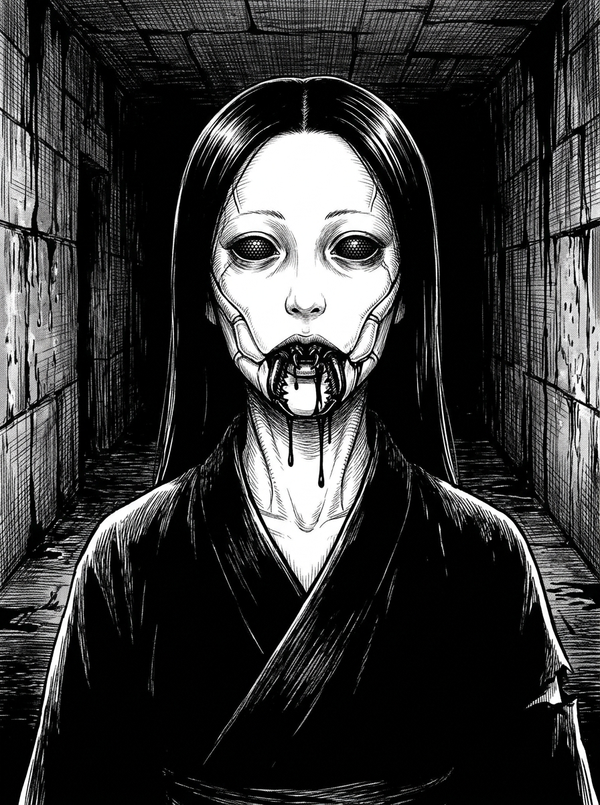
  - 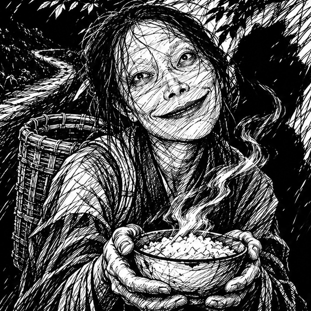
  - 【原典外貌】本體是一堆慘白「粉骷髏」，脊梁骨上赫然銘刻一行字「白骨夫人」；為誘食唐僧，憑「解屍法」先後化作三具活人皮囊：一變年方二八、月貌花容、手提青砂罐送齋飯（實為長蛆與蝦蟆）的**村姑**；二變年滿八旬、白髮蒼蒼、手拄竹杖哭尋愛女的**老婦人**；三變白髮如彭祖、手捻念珠唸佛的**老翁**。
  - 【本作克蘇魯／昆蟲寄生／偽人重構】**嚴格遵循五大標竿定案基準（嚴禁畫成美艷骷髏或性感狐狸精）！** 她是本作最純粹、最令人生理不適的**「恐怖谷偽人（Mimic）× 節肢寄生口器體」**：
    - **偽人顯相（如標竿圖《偽人口器態》）**：佇立在潮濕滴水的黑暗地牢石砌長廊或台灣老舊無窗公寓濕滑走廊中央，初看只是一名披著直長濕黑髮、身穿深色舊布袍的**蒼白女子**；然而走近兩步便會瞬間引爆強烈恐怖谷寒意——她的臉部膚色死白如泡水瓷偶，**蒼白皮膚底下從太陽穴沿著顴骨一路延伸至下顎，隱約浮現出對稱的昆蟲幾丁質節肢紋路與甲殼拼接接縫**；原本該是人眼的眼眶裡，鑲嵌著一對毫無眼白、漆黑深邃卻在微光下閃爍細密六角蜂巢微光的**昆蟲複眼**；最駭人的是她那張原本緊閉的女性嘴唇，會在逼近獵物咽喉的剎那向左右詭異撕裂，**裂開成四片濕亮漆黑、帶著倒鉤鋸齒的巨大節肢昆蟲口器**，不斷自口器縫隙垂滴出濃稠發黑、帶著腐屍酸臭的消化黏液！
    - **三變脫殼皮囊（如附圖《偽人送飯態》）**：原典的村姑、老婦與老翁三變，在本作徹底重構為**「脫殼式寄生皮囊」**——當她偽裝成夜路送飯的村姑（揹著舊竹簍、歪斜著不合人體工學的僵硬脖頸、張開過於寬大緊繃的乾裂假笑、雙手顫巍巍端出一碗冒著陰氣熱煙的腐蛆白飯），或是街角哭尋女兒的老婦、拄杖唸佛的老伯時，那層人皮實則是被她中空寄生後、從體內撐開的乾燥蛻殼外皮！每當被人識破或挨受致命打擊，她便如蟬蛻或毒蛛脫殼般，瞬間從「皮囊脊椎裂縫」抽出濕滑漆黑的節肢骨骸核心化陰風逃逸，原地只剩下一具幾可亂真、甚至保留著餘溫與皺紋的空心人皮死屍！
- **特性**：
  - 【原典記載】正面硬實力在《西遊記》諸妖中其實偏弱，絕不敢與孫悟空正面纏鬥，卻憑全書最陰毒的「家庭倫理連鎖苦肉計」與「解屍法（金蟬脫殼留下假屍）」，接連用少女、老母、老父三條無辜人命假象把孫悟空逼入百口莫辯的道德絕境，最終成功離間師徒、令唐僧親寫貶書逐走大聖。
  - 【本作衍生】現代都市裡最難纏的**「脫殼式寄生偽人 × 社會性抹殺專精屍魔」**！她專攻人類的同情心與現代法治盲區——偽裝成深夜端著便當問路的孤女、失智走失的阿嬤或佝僂拾荒阿伯，一旦路人停下腳步接過她手裡的「食物」或伸手攙扶，她嘴部瞬間裂開成節肢口器，以極高壓的消化酸液癱瘓獵物並將寄生幼卵灌入頸動脈；更致命的是，若除妖師貿然在有監視器或路人的社區樓梯間斬殺她，她只需啟動「脫殼解屍」，地上便會立刻多出一具連法醫初驗都以為是「無辜弱勢長者／少女遭銳器殺害」的完整人皮屍殼，直接讓除妖師陷入警方通緝與輿論萬劫不復的深淵！
- **弱點**：
  - 【原典記載】肉身防禦與正面武藝極低，一旦被看穿偽裝並封鎖周圍山谷退路（防其化清風逃竄），連一記重擊都扛不住即刻徹底碎成一堆銘刻「白骨夫人」的粉骷髏斃命。
  - 【本作衍生】1. **破妄辨複眼**：普通肉眼與監視器鏡頭極難分辨其初期偽人皮囊，必須提前服用**開天眼符水**或擊發**破障符**，鎖定她眼底閃現的六角複眼反光、顴骨皮下輕微開合的甲殼縫隙，以及遞出食物裡蠕動的腐蟲陰氣；2. **封鎖脫殼氣流路徑（破「解屍法」核心）**：切忌見面就一刀劈下（只會劈中空殼並替自己製造命案現場！），務必先以**鎮妖定身符**、**陷地符**或密閉結界死死封住樓梯間的通風井、排水孔與門縫，斷絕其節肢核心趁機蛻殼遁逃的氣流縫隙；3. **烈火焚骨銷真名**：其脫殼後的節肢白骨本體極脆且懼怕乾燥烈焰，唯有以**烈火符**與**五雷鎮煞符**直接貫穿轟碎她脊椎中央刻有「白骨夫人」陰紋的寄生主核，方能徹底斬殺且令所有假皮囊同時炭化蒸發，不留嫁禍屍證。
- **習性**：
  - 【原典記載】盤踞荒涼陰森的白虎嶺枯骨堆中，聞訊高靈氣行者經過便三次變換親屬皮囊截道誘殺，極具耐心與演戲天分，每回失敗立刻變換更無害、更易喚起同情的新身分再上。
  - 【本作衍生】偏好潛伏在老舊無管理員公寓的潮濕陰暗樓梯間、地下室發霉走廊、醫院太平間後巷、偏僻山區公車站與靈骨塔周邊步道；專門挑凌晨時段、路燈閃爍或監視器死角邊緣主動向單身夜歸者搭話（「先生，這碗飯還熱的，幫我拿一下好嗎？」「你看到我女兒了嗎？」），一邊不動聲色逼近至口器突襲距離，一邊用複眼鎖定獵物瞳孔裡是否浮現防備神色。
- **喜好**：
  - 【原典記載】極度垂涎「十世修行的好人肉（唐僧肉）」，執著於吞食高靈氣血肉以求跳出屍魔桎梏、長生不老。
  - 【本作衍生】病態執著於剝取並收藏「外貌最無害、最能激起旁人保護欲」的新鮮人皮外殼（少女、慈祥老婦、體弱老人），並特別偏愛體內陽氣純淨或剛完成超度、心懷悲憫的除妖師血肉。
- **擅長的招式／異能**：
  - 【原典記載】「解屍法」（真靈化清風提前脫身，原地留下以假亂真的假人屍身嫁禍敵手）、「三變畫皮偽裝」（精準擬態村姑、老婦、老翁與青砂罐齋飯幻象）、「攻心離間」。
  - 【本作衍生】**「蟬蛻解屍脫殼術」**（遭受重擊瞬間從人皮後背裂縫滑出節肢本體閃現遁走，原地留下完美假屍嫁禍警方與隊友）、**「複眼催眠與偽人聲線模擬」**（以微頻複眼反光誘發人類短暫恍惚，並精準模仿哭泣、氣喘與祈求語氣）、**「裂顎口器吐酸」**（嘴部驟然四裂成漆黑鋸齒口器，近距離咬碎喉管並噴吐強腐蝕黑液與腐蛆卵囊）、**「腐蟲幻饌」**（將活蛆、毒蠅幼蟲與死蟾蜍以障眼法偽裝成冒熱氣的便當或碗飯，誘騙目標誤食寄生）。

---

## 🕸️ 三、第 28～31 回：碗子山波月洞（嗜血狼蛛蟲顎偽人戰將）

### [XY2-03] 黃袍怪（碗子山波月洞大妖王／嗜血狼蛛蟲顎偽人戰將）
- **出處順序**：第 28 回《花果山群妖聚義 黑松林三藏逢魔》～第 31 回《豬八戒義激猴王 孫行者智降妖怪》（本條目嚴格純取碗子山波月洞妖魔本相，不涉天庭星官神格）
- **類別與造型路線**：`【類人偽人型】`｜偽人戰將皮囊・內藏嗜血巨型狼蛛與腐食蟲顎
- **物種／唯一性**：`獨一無二`（盤踞碗子山波月洞長達十三年、修成高濃縮血肉卵丹「舍利子玲瓏內丹」並能噴吐變異毒液化人為獸之絕級大妖王）
- **稀有度與道行對照**：`★★★★ 絕級（SSR）`｜模糊道行：千年嗜血大妖王修為（正面武力與妖法皆屬頂級，能單挑同時力壓數名高階強者）｜本作階位：一流頂～巔峰
- **外貌與黑暗地牢／恐怖谷視覺改寫**：
  - 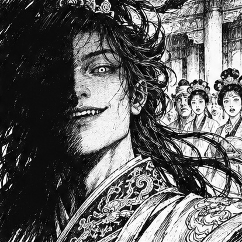
  - 【原典外貌】妖魔本相為「青靛臉，白獠牙，一張大口呀呀。兩隻眼睛亮如燈，一頭紅髮亂蓬鬆。身披一領淡黃袍，腳踏一雙鹿皮靴。腰束一條獅蠻帶，手執一口蘸鋼刀」；入寶象國宮殿時曾搖身化作風度翩翩的俊俏駙馬，卻在酒席之上獸性大發，當庭生咬侍女頭顱、鮮血淋漓地活啃生人。
  - 【本作克蘇魯／昆蟲寄生／偽人重構】徹底去哺乳動物化，將其「俊俏駙馬表相 × 朝堂生啖侍女兇相」轉譯為**極致恐怖谷偽人戰將＋嗜血巨型狼蛛／腐食蟲顎異變體**！如插圖所示，平時身披一件沾染陳年血垢與暗金繡紋的寬大發黃長袍，半張臉彷彿永遠浸在無法照亮的死黑墨影裡，露出的那半張俊美男臉卻僵冷得毫無生氣——單顆慘白反光的眼珠死死橫視著旁人，嘴角咧開一道違反人類咬合肌理的弧度，隱約露出尖銳交錯的細齒。然而那件寬大黃袍與白皙人皮底下，早已塞滿了**毛刺倒豎的嗜血巨型狼蛛胸腹與濕滑喀喀作響的腐食大蟲口顎**！一旦聞見鮮血或酒後失控，他臉頰兩側的偽人皮膚便如濕紙般橫向裂開至耳後，露出四片佈滿剛毛與毒腺的巨型狼蛛螯肢與腐食甲蟲鋸齒大顎，直接將整顆活人頭顱夾碎吮吸腦漿；寬大黃袍肩胛與肋側更會撕裂伸出三對關節反折、覆滿沾血絨毛的巨蛛步足，緊握一把刃面沁出暗黃神經毒液的沉重蘸鋼刀！
- **特性**：
  - 【原典記載】實戰硬實力極度恐怖——單憑一口蘸鋼刀與兇悍妖法便同時打敗豬八戒與沙僧聯手、重創現出龍身突襲的白龍馬，與齊天大聖激戰五六十合亦絲毫不落下風；更能一口妖水將唐僧活生生異變成一頭斑斕猛虎鎖進鐵籠，並自體內吐出一顆珍稀異常的「舍利子玲瓏內丹」。性情極度扭曲偏執：對擄囚於波月洞十三年的女子抱持病態佔有欲與盲目信任，對其餘活人與侍從則視若隨時可咬碎進食的血肉點心。
  - 【本作衍生】兼具**高階偽人滲透、巨蛛毒顎瞬殺與生物基因畸變詛咒**的頂級掠食者！他在波月洞中與受害女子強行孕育的「兩名怪童」，在本作設定中實為其以狼蛛寄生卵植入宿主子宮所產出的半人半蟲畸形幼體；而那顆性命交修的「舍利子玲瓏內丹」，則是從其巨蛛胸腔最深處分泌凝結、表面佈滿跳動血管與濕滑黏液的**活體母核囊珠**，不僅能為其提供源源不絕的強橫再生與毒霧妖力，更是他不惜為執念對象吐出口中獻寶的致命死穴。
- **弱點**：
  - 【原典記載】1. **執念伴侶的心理盲區**：對波月洞囚禁十三年的女子極度偏執輕信，竟因敵手假扮愛妻佯裝腹痛，便毫無戒心地親口吐出性命交修的「舍利子玲瓏內丹」給對方療傷，結果遭對手一口吞奪，頓時精氣大損、戰力暴跌；2. **過度嗜殺暴露偽裝**：在王宮酒宴中壓抑不住食人本能，當眾啃食侍女露出兇殘破綻。
  - 【本作衍生】正面硬拚對三流至二流除妖師近乎必死（其蘸鋼刀與巨蛛螯肢一擊即可斬斷鋼樑）；唯一可行的生路在於**「情報誘騙奪取母核內丹＋烈火濃煙焚毀蛛毛」**——切忌在其剛進食或醉酒狂化時近戰，應設法利用替身擬態或精準操弄其偏執佔有欲，誘使其主動吐出胸腔內的母核囊珠並以封禁容器搶先奪走／以**五雷鎮煞符**當場引爆；一旦失去內丹支撐，其偽人皮囊便會急速潰爛崩解，暴露出懼怕**高溫烈火符**灼燒絨毛與甲殼接縫的巨蛛本體破口。
- **習性**：
  - 【原典記載】於碗子山黑松林波月洞盤踞十三年，平日在陰暗潮濕的石洞內囚禁擄來的女子、豢養小妖，時常在黑松林外圍截殺過往旅人，亦偶爾化形混入繁華都城酒宴大快朵頤。
  - 【本作衍生】極善於在台灣郊山廢棄高級招待所、孤立山腰豪宅或廢棄採礦深坑中構築「外奢內腐」的囚禁巢穴——表層佈置得像體面溫暖的居家空間，天花板與牆壁夾層卻爬滿漆黑狼蛛絲囊與風乾人骨；平時穿著名牌發黃長風衣出入都會晚宴或高檔餐酒館，在微醺光影下用僵冷微笑鎖定落單女性服務生，隨後拖入無監視器的後巷或配電室裂顎啃食。
- **喜好**：
  - 【原典記載】極度偏執地迷戀所擄女子（囚禁十三年仍百依百順）、嗜飲烈酒、酷愛生啖活人鮮肉（尤其是酒興大發時直接咬破侍女頭顱吮血）。
  - 【本作衍生】沉迷於「控制與佔有特定單一目標」的扭曲獨佔快感，以及酒後咬碎人類顱骨時那聲清脆的骨裂與溫熱腦漿滋味。
- **擅長的招式／異能**：
  - 【原典記載】「蘸鋼刀」（厚重鋒利、可與萬斤神兵硬撼數十合）、「舍利子玲瓏內丹」（吐出可療重傷、蘊含千年修為本源）、「噴水變虎妖法」（一口妖水將凡人化作斑斕猛虎失去言語能力）、「呼風捲霧與土遁逃脫」。
  - 【本作衍生】**「腐顎裂面咬殺」**（偽人臉皮瞬間四向綻裂露出狼蛛毒螯，零距離咬碎目標頸椎並注入強效溶組織毒液）、**「畸變毒涎化獸術」**（噴吐富含寄生轉化酵素的暗黃酸液，將目標血肉骨骼強行扭曲成狂暴失智的畸形猛獸，誘發警方誤殺或隊友自相殘殺；唯高階淨穢符水可解）、**「蛛絲黃霧領域」**（自黃袍下擺噴灑無數沾滿麻痺毒液的隱形蛛絲與腐霧，封鎖整座建築逃生動線）。

---

## 🪲 四、第 32～35 回：平頂山蓮花洞與壓龍山壓龍洞（重甲爐蟲・寄生小妖・九尾老婦偽人）

### [XY2-04] 金角大王（平頂山蓮花洞大妖王／重甲爐蟲環齒吞噬怪）
- **出處順序**：第 32 回《平頂山功曹傳信 蓮花洞木母逢災》～第 35 回《外道施威欺正性 心猿獲寶伏邪魔》（本條目嚴格取平頂山蓮花洞妖王異變相，剔除仙童神籍背景）
- **類別與造型路線**：`【非人生物恐怖型】`｜重甲爐蟲・環形齒狀吸盤吞噬巨獸
- **物種／唯一性**：`獨一無二`（佔據六百里平頂山蓮花洞、身懷五件詭異收容煉化禁物之大妖王主體）
- **稀有度與道行對照**：`★★★★ 絕級（SSR）`｜模糊道行：千年妖王異變體＋五件絕級至神級規則吞噬妖器｜本作階位：一流頂（純本體約一流中上，持全套收容器與焚山器時具巔峰級因果抹殺威脅）
- **外貌與黑暗地牢／恐怖谷視覺改寫**：
  - 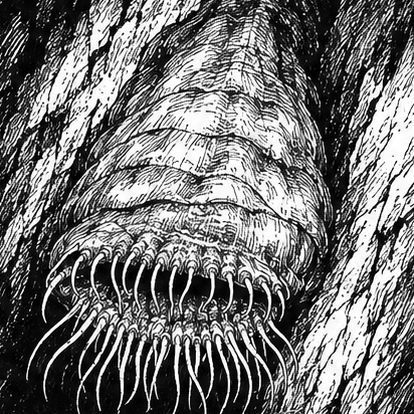
  - 【原典外貌】平頂山蓮花洞大魔王，原典為頭戴金盔、身穿金甲、面容兇悍老辣之妖王，手持七星劍、芭蕉扇，掌握紫金紅葫蘆、羊脂玉淨瓶與幌金繩等五件絕世寶貝，思慮深沉且畫下唐僧師徒「影神圖」按圖索驥。
  - 【本作克蘇魯／昆蟲寄生／偽人重構】徹底粉碎「穿金甲的威風仙童魔王」套路，嚴格對應插圖呈現為黑暗地牢最駭人的**巨型重甲爐蟲與環齒吸盤吞噬怪物**！其真身如一截長逾五公尺、緊緊攀附在潮濕發黑溶洞岩壁上的巨型腐食甲蟲幼蟲／環節重甲巨蛆，軀體由七、八節厚重如氧化熔銅般的凹凸**幾丁質硬甲殼**層層套疊而成，每道甲殼縫隙皆滲出灼熱焦臭的暗金色油脂黏液；最令人反胃的是牠毫無人類五官的前端，整顆頭部直接向內塌陷成一張深不見底的漆黑**環形齒狀吸盤巨口**，唇緣整齊排列著三十餘根細長彎曲、不斷向內抽動刮擦的慘白鉤齒與肉鬚，宛如一具長在活體甲蟲身上的血肉葫蘆！平時與洞中妖將或壓龍洞親眷交談時，僅從甲縫前緣擠出一具焦黑僵硬的雙角金屬戰將偽軀充當發聲傀儡，手握佈滿焦油裂紋的七星直劍與炭化肋骨般的陽火芭蕉扇。
- **特性**：
  - 【原典記載】蓮花洞二魔中的頭腦核心，生性極度多疑冷靜——不僅提前繪製目標畫像分發巡山妖眾核對，更能一眼識破敵手假扮自家老母親與小妖的微小破綻，面對強敵時擅長以七星劍近身纏鬥、芭蕉扇捲起漫天狂火壓制，再伺機祭出「叫真名應聲即化膿水」的恐怖收容器一擊絕殺。
  - 【本作衍生】代表現代除妖界最致命的**「情報建檔＋真名因果吞噬型重甲巢主」**！牠不像低階野獸盲目撲咬，而是習慣先透過小妖竊取監視器截圖與身分資料，在潮濕爐窯洞窟內用腐液描繪出獵物的「點名影神圖」；一旦鎖定目標，牠那張環形鉤齒巨口與所持的紫金紅葫蘆／羊脂玉淨瓶產生詭異共鳴——只要獵物在呼喊聲下本能吐出一個應答音節，空間便如強酸水蛭吸盤般驟然收縮，將目標活生生拖入狹窄黏稠的密閉腔體，在不到三刻鐘內以高濃度強酸消化液徹底融成一灘腥臭膿血！
- **弱點**：
  - 【原典記載】1. **收容禁物敵我不分（「認名不認主」）**：無論葫蘆或玉淨瓶，一旦落入敵手並反過來呼喊其真名「金角大王」，只要一時情緒失控開口應聲，連本尊都會被活活吸進去化作血水；2. **重情破防與心神動搖**：得知弟弟銀角被收、乾娘與舅舅皆遭斬殺後徹底方寸大亂，露出搶寶與誤答真名的致命破口。
  - 【本作衍生】1. **絕對靜默鐵律＋假名反制**：遭遇蓮花洞妖脈時，全隊除妖師必須佩戴隔音耳塞或改以手勢溝通，嚴禁在戰場上報出真實姓名、回應任何問話；2. **奪器反殺與甲殼底腹破口**：其背甲厚重堪比鋼板，普通刀劍與低階雷符難以擊穿，卻可利用**替身紙人符／障眼法**搶先調包或奪走其無主綁定的收容器反喚其名，或以**陷地符**逼其翻轉露出柔軟濕滑、缺乏甲片覆蓋的腹側呼吸氣孔，直接貫入**五雷鎮煞符**引爆內腔。
- **習性**：
  - 【原典記載】盤踞六百里平頂山蓮花洞，麾下統率數百大小妖卒，講究盤查畫像與按部就班烹食獵物，且極重與壓龍洞九尾老狐的結盟情誼。
  - 【本作衍生】潛伏於台灣偏鄉廢棄煉銅窯址、深山大型廢棄鐵路隧道或高溫潮濕的地下蒸汽管線通道深處；巢穴四壁黏滿了被消化一半的人類衣物與沾泥證件照，每逢悶熱夏夜便驅使手下小妖帶著發臭葫蘆與玉瓶出去「按名單收貨」。
- **喜好**：
  - 【原典記載】嗜好蒐集與炫耀各式絕世收容法器、極重手足與乾娘情分、垂涎高靈氣血肉。
  - 【本作衍生】病態沉迷於傾聽獵物被吸入狹窄瓶腹後逐漸微弱的拍打求救聲，以及高溫腐蝕液溶解骨骼時發出的滋滋泡聲。
- **擅長的招式／異能**：
  - 【原典記載】1. **紫金紅葫蘆／羊脂玉淨瓶**（底朝天、口朝地喚人真名，應聲即吸入並貼符封口，一時三刻化作膿水）；2. **幌金繩**（唸緊繩咒自動縛殺，唸鬆繩咒方解）；3. **七星劍與陽火芭蕉扇**（劍氣凌厲，芭蕉扇一搧即捲起焚山烈焰）。
  - 【本作衍生】**「環齒真名真空吸噬」**（口部鉤齒震顫發出扭曲的熟人聲線呼喚目標本名，與手中收容器形成雙重因果鎖定）、**「焦油酸火扇風」**（扇動骨質焦黑巨扇，將甲縫分泌的易燃油脂氣霧瞬間點燃成掃蕩整個地下隧道的爆燃火浪）、**「影神點名追蹤」**（以受害者照片或毛髮標記氣味，鎖死方圓十公里逃逸方位）。

---

### [XY2-05] 銀角大王（平頂山蓮花洞二妖王／人肢銀甲蟲與瘸腿老道偽人）
- **出處順序**：第 32 回《平頂山功曹傳信 蓮花洞木母逢災》～第 35 回《外道施威欺正性 心猿獲寶伏邪魔》（本條目嚴格取平頂山蓮花洞妖王異變相，剔除仙童神籍背景）
- **類別與造型路線**：`【非人生物恐怖型】`（兼擅`【類人偽人型】`瘸腿老道擬態）｜人肢銀甲鼠婦蟲・重力寄生甲蟲怪
- **物種／唯一性**：`獨一無二`（與金角並踞平頂山蓮花洞、精擅苦肉計偽人誘背與三山重力碾壓之二妖王個體）
- **稀有度與道行對照**：`★★★★ 絕級（SSR）`｜模糊道行：千年妖王異變體＋移山壓頂重壓邪術與絕級收容器｜本作階位：一流頂（啟動重力鎖殺與收容器時直逼巔峰）
- **外貌與黑暗地牢／恐怖谷視覺改寫**：
  - 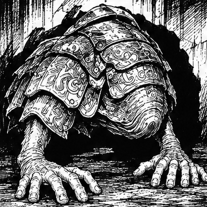
  - 【原典外貌】蓮花洞二魔王，原典作銀盔銀甲、使七星劍之狡詐妖王；第 33 回搖身化作一名跌折右腿、衣衫襤褸、躺在山道旁哭喊呻吟求救的「瘸腿老道士」，成功誘使心軟的唐僧逼迫孫悟空親自背負上山，趁機發動移山大法。
  - 【本作克蘇魯／昆蟲寄生／偽人重構】嚴格結合插圖與偽人苦肉計，構築出極度掉 SAN 值的**「人肢銀甲蟲 × 瘸腿老道偽人」雙相恐怖怪物**！其本體如插圖所示，是一頭趴伏於潮濕黑暗石階上的**無眼銀甲巨型鼠婦／三葉蟲甲蟲怪**——背上層疊覆蓋著刻滿扭曲詭異古紋的泛冷灰銀色厚重幾丁質硬殼，殼前探出的並非眼睛或獸臉，而是一截不斷蠕動收縮、佈滿同心圓皺褶的**盲目蠕蟲狀吸盤肉吻**；最令人毛骨悚然的是，從牠那副沉重冰冷的蟲甲下方竟直接長出**兩條異常細長、佈滿蒼白皺紋與真實人類指甲的五指人手**，如畸形爬行屍般死死摳住濕滑地面！獵殺人類時，牠會將整具銀甲折疊藏進破爛道袍或沾泥舊夾克裡，撐起一具滿臉皺紋淚痕、右腿刻意反折成斷骨狀的**「瘸腿老道偽人」**皮囊倒在夜路求救；一旦善心路人或除妖師彎腰把牠背上肩頭，那兩隻冰冷濕黏的人手立刻死死勒進背負者頸肉，後背破袍底下的銀色重甲瞬間膨脹出萬噸山石般的恐怖壓迫重力，無眼吸盤肉吻則悄無聲息貼向受害者後腦勺！
- **特性**：
  - 【原典記載】比兄長金角更主動、狡詐且敢於近身豪賭——先設伏擒下巡山探路的豬八戒，接著親自下場演了一齣極致逼真的「瘸腿老道求背」苦肉計，在敵手毫無防備背起自己的瞬間連續唸動移山咒，搬來**須彌山、峨眉山、泰山**三座巨嶽壓得齊天大聖七竅噴紅、三屍神咋，順勢一網打盡取經僧徒；堪稱蓮花洞真正製造絕境的核心戰術發動者。
  - 【本作衍生】現代都市靈異界最陰毒的**「偽人傷患誘背 × 接觸式超重力壓殺型」**大妖！牠專門利用人類不敢見死不救的道德慣性，偽裝成車禍骨折老人、山路跌斷腿的孤獨登山客或倒在地下室逃生梯口的老人；只要除妖師一時心軟產生肢體攙扶或背負接觸，其甲殼內的重力壓縮腺體就會瞬間過載爆發，將整條走廊的天花板與重力場壓成足以把鋼骨壓斷的「三山重壓區」，讓目標連抬指捏訣與拔符都徹底無能為力！
- **弱點**：
  - 【原典記載】1. **急躁自負、輕信假名與低階手下**：誤派愚蠢的精細鬼與伶俐蟲攜帶國寶出門導致至寶被騙走，又輕易遭對手用「者行孫／行者孫」等換字假名戲弄；2. **本能應聲自投羅網**：第 34 回因過分迷信自家紫金紅葫蘆，在寶貝被反搶後聽到對方高喊「銀角大王」竟下意識答了一聲「在」，瞬間被吸入瓶中化為膿水。
  - 【本作衍生】1. **嚴禁近身肢體接觸（「拒背鐵律」）**：凡在荒僻山道、暗巷或廢棄大樓內遇見腿骨反折角度過於對稱、眼白渾濁無焦點卻苦苦哀求「背我出去」的陌生傷患，切忌伸手攙扶，務必先以遠距**破障符**或**尋蹤紙鶴**試探其體重與甲殼陰氣；2. **重壓脫殼與語言反套路**：若不慎觸發其重力壓頂，須在第一秒內發動**替身紙人符**金蟬脫殼跳出壓殺半徑，並利用牠急於嘲諷炫耀的暴躁性格設局奪取收容器、誘導牠開口自報真名或應答反殺；其無眼吸盤口吻對高頻尖嘯與**掌心雷**近距離電擊極度敏感。
- **習性**：
  - 【原典記載】喜愛親率小妖外出設局獵捕，抓到獵物後愛擺排場，堅持迎請壓龍洞老奶奶前來共享盛宴。
  - 【本作衍生】常於濃霧籠罩的北宜／陽明山夜間產業道路、無監視器的社區地下停車場斜坡，以及醫院舊館廢棄連通道口偽裝成跌傷摔斷腿的落魄老人「釣魚執法」，享受獵物背起自己瞬間表情從善意轉為極度窒息恐懼的瞬間。
- **喜好**：
  - 【原典記載】酷愛鬥智設套、炫耀移山壓頂絕技與收人法寶的壓倒性威力，對親眷（兄長與老奶奶）抱有扭曲的家族依附感。
  - 【本作衍生】病態沉迷於聽見獵物脊椎在超重力壓迫下寸寸碎裂的悶響，以及銀甲沾滿潮濕苔蘚與冷霧的幽暗洞壁環境。
- **擅長的招式／異能**：
  - 【原典記載】「遣山倒海法」（唸咒壓下須彌、峨眉、泰山三座巨嶽之恐怖重壓）、「紫金紅葫蘆與羊脂玉淨瓶」（叫真名應聲即化膿水）、「瘸腿老道擬態術」、「七星劍」。
  - 【本作衍生】**「三嶽重力壓縮域」**（透過人手接觸傳導巨型銀甲的異化質量，分三段疊加重力倍數，足以在十秒內壓爆防彈玻璃與承重樑柱）、**「斷肢苦肉偽人擬態」**（精準控制骨骼關節脫臼發聲與虛弱哀嚎，欺騙普通感官與基礎探測）、**「盲吻寄生吸噬」**（銀甲前端同心圓肉吻驟然伸長，吸附在無法動彈的獵物後頸直接抽取脊髓液）。

---

### [XY2-06] 精細鬼與伶俐蟲（平頂山蓮花洞低階寄生小妖）
- **出處順序**：第 33 回《外道迷真性 元神助本心》～第 34 回《魔王巧算困心猿 大聖騰挪騙寶貝》
- **類別與造型路線**：`【類人偽人型】`｜低階寄生幼蟲偽人・攜器山精
- **物種／唯一性**：`物種（群體）`（平頂山蓮花洞數百隻低階山野寄生精怪之中、因自誇名號而受銀角派去執寶拿人的兩隻代表個體）
- **稀有度與道行對照**：`★ 凡級（N）`｜模糊道行：數年至數十年微末雜魚妖氣（自身搏殺極弱，但因揹負絕級真名收容器而成為致命移動地雷）｜本作階位：三流（持寶時具備跨階秒殺一流之異常風險）
- **外貌與黑暗地牢／恐怖谷視覺改寫**：
  - 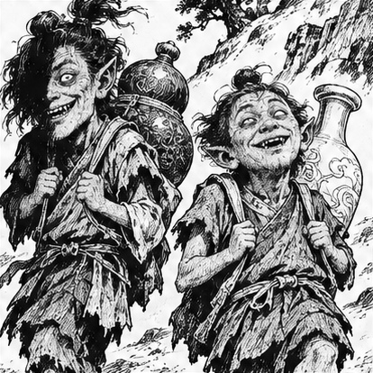
  - 【原典外貌】蓮花洞下屬兩名憨傻愚鈍的山精小妖，名喚「精細鬼」與「伶俐蟲」，實則名實完全顛倒；二人身穿破舊妖卒服飾，精細鬼背著紫金紅葫蘆、伶俐蟲背著羊脂玉淨瓶，大搖大擺下山叫名拿人。
  - 【本作克蘇魯／昆蟲寄生／偽人重構】剝除諧星可愛感，如插圖精準定調為**兩隻眼神失焦、滿口尖牙、皮下蠕動寄生蟲的畸形矮小偽人雙胞胎**！兩人身形瘦小佝僂，披著發霉破爛的粗布短衫，雙耳異常尖長如腐蝠耳廓，蒼白凹陷的臉頰上掛著極度神經質且永遠合不攏的誇張裂嘴呆笑——**精細鬼**半張臉被如濕草般雜亂的黑髮遮蔽，單隻過大翻白的眼珠死死直盯陌生人，細瘦背脊上用發黑腐繩死死勒綁著一顆刻滿人臉紋理、隱約傳出微弱拍打求救聲的暗沉紫金紅葫蘆；**伶俐蟲**雙目完全翻白無神、額頂歪綁一撮乾枯髮髻，嘴角不斷流淌帶著死蟲腥味的透明黏涎，背後背著一隻泛著太平間瓷釉冷光的羊脂玉淨瓶。細看他們裸露的頸部與鎖骨薄皮下，無數細小灰白寄生幼蟲正沿著靜脈鼓包鑽動，每跨出一步便從破爛衣袖掉落乾癟蟲殼與惡臭碎屑！
- **特性**：
  - 【原典記載】雖只具備最低階的小妖修為與令人發笑的蠢鈍智商，卻因受主子信任而親手扛著三界最狠毒的兩件真名收容至寶下山；結果遇上敵手隨便拿一根毫毛變出的巨大假葫蘆吹噓「能裝天」，加上半個時辰天黑幻象便信以為真，竟喜滋滋用兩件真仙寶換了一只空心假貨回去交差。
  - 【本作衍生】本作世界觀裡最標準的**「底層寄生雜魚手握高危禁物（低階高危地雷）」**典型！他們本身連許家銘開局時期的三流符法都扛不住一擊，但因為背上那兩件無差別應聲收容器毫無施法門檻，只要他們在深夜巷口像失智怪人一樣嘻皮笑臉湊近路人反覆追問「喂，你叫什麼名字啊？應我一聲好不好？」，無知凡人或分心法師只要隨口回一句「幹嘛？」或報出本名，瞬間就會化作一灘膿血被吸進瓶裡！
- **弱點**：
  - 【原典記載】智商極低、極度貪小便宜、愛慕虛名且毫無鑑寶能力，三兩句浮誇話術搭配低級聲光魔術便能把牠們手裡最珍貴的禁物整套騙走；一旦失去收容器，赤手空拳脆弱得不堪一擊。
  - 【本作衍生】1. **絕不搭話應聲**：聽見任何語調怪異的陌生矮小男女在暗處追問姓名時，務必緊閉雙唇、切斷對話互動；2. **業務話術詐欺＋偽裝高階贗品置換**：對付這對蠢妖最安全且零風險的破法根本不是硬拚（怕驚動牠們胡亂拔塞），而是發揮現代市井話術與障眼法，拿出體積浮誇、發光冒煙的廉價改裝道具假稱「更高階的裝大樓法寶」，輕鬆把牠們背上的恐怖禁物整組忽悠到手，繳械後隨手一張**烈火符**或**掌心雷**即可瞬間將兩隻寄生蟲妖連皮帶幼蟲燒成焦炭。
- **習性**：
  - 【原典記載】長年待在蓮花洞跑腿巡山、替大王搬運法器與押解獵物，出洞辦事時愛大聲吹噓自家洞府機密。
  - 【本作衍生】常於深夜空曠的陸橋人行道、老夜市收攤後的積水巷口或捷運末班車外圍徘徊，像神智異常的怪異推銷員般邊傻笑邊尾隨落單路人搭訕套名字，得手後便扛著晃蕩作響的膿水瓶罐奔回地下巢穴邀功。
- **喜好**：
  - 【原典記載】極愛被吹捧聰明（故自取「精細」「伶俐」這類反諷大名），盲目崇拜體積巨大、看起來威風炫目的誇張法寶。
  - 【本作衍生】沉迷於廉價閃光物品、花俏包裝、浮誇馬屁話，以及偶爾從主子瓶底舔食殘留的人血膿渣。
- **擅長的招式／異能**：
  - 【原典記載】個人並無拿得出手的武藝與法術，一切威脅全數來自奉命攜帶的「紫金紅葫蘆」與「羊脂玉淨瓶」。
  - 【本作衍生】**「神經質搭訕誘導」**（反覆用無害傻笑與荒謬問句降低路人戒心，誘發對方開口應聲觸發收容器）、**「垂死蟲囊爆裂」**（遭到物理劈殺時，胸腹腫脹的寄生幼蟲囊會噴濺出帶有輕微皮膚潰爛毒性的黑黃汁液，須保持兩公尺以上距離遠程雷火擊殺）。

---

### [XY2-07] 巴山虎與倚海龍（平頂山蓮花洞常隨妖將）
- **出處順序**：第 34 回《魔王巧算困心猿 大聖騰挪騙寶貝》
- **類別與造型路線**：`【類人偽人型】`｜虎紋螳螂甲蟲與水蛭鱗寄生妖將
- **物種／唯一性**：`物種（群體）`（平頂山蓮花洞數百妖眾裡較為精明兇狠、負責核心聯絡與迎親差事的中階妖將骨幹）
- **稀有度與道行對照**：`★★ 稀級（R）`｜模糊道行：數十年至百年妖氣骨幹妖將｜本作階位：二流
- **外貌與黑暗地牢／恐怖谷視覺改寫**：
  - 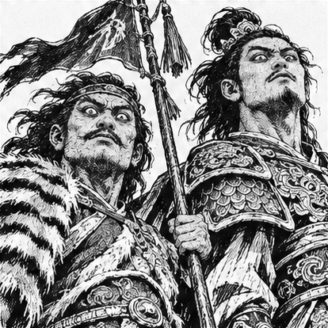
  - 【原典外貌】平頂山蓮花洞常隨健將，並非真虎真龍，乃受金銀角重用之精細小頭目；二人手舉妖洞令旗、奉命前往百里外壓龍山壓龍洞恭請九尾老奶奶赴宴，途中慘遭埋伏擊殺並被對手變身頂包潛入壓龍洞。
  - 【本作克蘇魯／昆蟲寄生／偽人重構】如插圖所示，初看是兩名身穿厚重獸皮與鱗甲、高舉破爛黑底妖旗的兇悍古代武將，但細看五官與鎧甲縫隙便立刻浮現令人極度不安的**偽人節肢畸變感**——兩張滿佈鬍渣的僵硬男臉上，雙眼永遠瞪得極大、眼白血絲密佈且完全沒有眨眼生理反射，像兩具被人從顱內以細線拉緊眼皮的剝製標本！剝開表層衣甲更顯生物恐怖：**巴山虎**肩上披掛的「虎皮披肩」實是直接長在鎖骨血肉上的**虎斑毒蜂與巨型螳螂剛毛甲殼**，戰鬥時雙臂手肘向後逆折裂開，伸出沾滿黑血的鋸齒捕食鐮肢；**倚海龍**身披的「魚鱗鐵甲」根本無法脫下，全是一片片濕滑滲水的**巨型馬陸與海蛭幾丁質重鱗**，領口與指縫不斷分泌腥臭透明的黏液，每走一步皆在潮濕地上拖出濃烈腐水臭跡！
- **特性**：
  - 【原典記載】相比蠢笨的精細鬼與伶俐蟲，巴山虎與倚海龍屬於蓮花洞真正辦正事的精幹親信，掌握著蓮花洞與壓龍洞之間的機密通關口令、老奶奶出行規矩以及「請寶幌金繩」的關鍵情資；然而在大敵伏擊下仍缺乏反應時間，被瞬間滅口並頂替身分，直接釀成壓龍洞全線淪陷。
  - 【本作衍生】現代都市大型妖巢裡典型的**「外勤機密快遞兼武鬥聯絡官」**——具備標準二流妖物的近身絞殺戰力與基礎蔽氣偽裝，更手握各大妖窟之間的暗號、門禁鑰匙與高危禁物運送路線；對於善於策劃伏擊的除妖師而言，他們正是「斬殺奪密、假扮滲透」瓦解高階妖魔聯盟的最佳中段突破口。
- **弱點**：
  - 【原典記載】單體實力與神識警覺遠不及頂級強者，在孤立野外行軍時遭伏擊竟連求救暗號都來不及發出便雙雙喪命，且外貌特徵與言行規矩單純，極易遭高明變身術完美頂替。
  - 【本作衍生】1. **路線固定極易設伏**：兩妖往返巢穴之間習於走固定無監視器的山道、舊鐵路涵洞或廢棄排水溝，除妖師提前透過**尋蹤紙鶴**摸清時辰，在狹窄空間佈設**陷地符**卡死其節肢突進，即可打亂其雙人合擊；2. **分屬性破甲**：巴山虎的剛毛甲殼極怕**烈火符**瞬間點燃爆燒，倚海龍滿身導電濕鱗則在**掌心雷／五雷鎮煞符**的電流竄流下會立刻陷入全身甲片麻痺抽搐。
- **習性**：
  - 【原典記載】常駐蓮花洞聽候差遣，奉大王急令便星夜兼程往返百里外壓龍山傳信並抬轎迎請老奶奶。
  - 【本作衍生】常於凌晨兩點至四點並肩出沒於台灣山區荒廢隧道、河濱防洪疏散暗門與廢棄工業區窄巷，扛著一具用發黑竹竿與沾血舊紅布紮成的詭異空轎架或密閉冷鏈箱，專門運送高階禁物與活人祭品。
- **喜好**：
  - 【原典記載】原典未載私人喜好，唯見其忠於洞主、渴望辦完差事後分得一口唐僧肉湯。
  - 【本作衍生】嗜好在低階小妖面前炫耀自己是妖王心腹，並趁運送血食途中偷偷吮吸受害者斷肢滲出的腐血。
- **擅長的招式／異能**：
  - 【原典記載】尋常妖兵刀槍武藝、山路疾行與妖旗號令，無個人專屬仙寶。
  - 【本作衍生】**「鐮肢絞殺突刺（巴山虎）」**（前臂逆折綻出巨型螳螂鋸齒鐮刃，於狹窄暗巷施展極高速雙向剪斬）、**「腐鱗黏液吐息（倚海龍）」**（領口甲縫噴出帶強滑膩與輕微神經麻痺效果的腐臭海蛭黏液，弄濕除妖師符紙並令其站立不穩）、**「雙將死角夾擊」**（一人噴霧遮蔽視線、一人高舉破旗突襲咽喉）。

---

### [XY2-08] 九尾狐狸精（壓龍山壓龍洞老奶奶／九尾節肢產卵老婦偽人）
- **出處順序**：第 34 回《魔王巧算困心猿 大聖騰挪騙寶貝》
- **類別與造型路線**：`【類人偽人型】`｜偽人老婦皮囊・九尾節肢寄生尾與產卵母體
- **物種／唯一性**：`物種特異個體`（天下九尾寄生狐妖一脈中修煉數百年以上、退化衰老卻盤踞壓龍山壓龍洞為母巢族長並代管幌金繩之獨霸老狐個體；洞內尚豢養百餘隻依附母體存活之低階女狐幼蟲僕役）
- **稀有度與道行對照**：`★★★ 珍級（SR）`｜模糊道行：數百年至千年衰老狐妖母體（肉身衰退而極懼突襲，但手握絕級拘束妖繩）｜本作階位：一流（單體硬戰約二流頂，啟動幌金繩時具一流頂封鎖威脅）
- **外貌與黑暗地牢／恐怖谷視覺改寫**：
  - 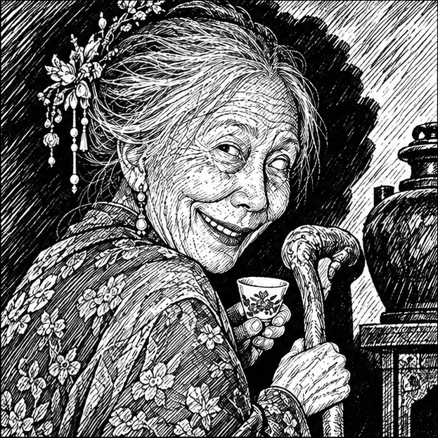
  - 【原典外貌】盤踞壓龍洞深處，化作一位「白髮蒼蒼、形容枯槁、受數十名女狐侍奉」的老奶奶，原形為九尾老狐；外出赴蓮花洞吃唐僧肉時乘雙人小轎，半路遭敵手偽裝使者襲殺現形。
  - 【本作克蘇魯／昆蟲寄生／偽人重構】完全捨棄傳統毛絨老狐印象，承襲本作「九尾狐（偽人×節肢尾與產卵管）」恐怖谷美學並緊密結合插圖！表面上看，她是一張令人毛骨悚然的**「過度熱情慈祥的碎花布衫阿嬤偽人」**——滿頭灰白髮髻插滿叮噹作響的繁複珠花步搖，臉上密密麻麻爬滿深刻皺紋卻僵硬地裂開一道過於標準、毫無溫度的慈愛微笑，左右雙眼瞳孔呈現詭異不對稱的渾濁白內障反光；一隻滿是老年斑的枯手死死拄著一根看似木頭、實則表面隱隱搏動著細微蟲紋的彎曲拐杖，另一隻手熱情地遞出一只繪滿花紋、杯底卻浮動著極細微肉色寄生卵絲的瓷茶杯。然而只要順著她花布寬衫下襬與後腰裂縫窺視，便會撞見足以擊潰理智的黑暗地牢異象——她枯瘦脊椎正後方整個剖開，拖曳出**九條濕亮反光、由密實幾丁質甲節拼疊而成的巨大蠍尾狀節肢寄生尾**，每條尾端皆分化出不斷開合、滴淌黏稠金黃麻痺黏液的**搏動產卵管**！就連她袖口裡盤繞代管的「幌金繩」，看起來都像一條隨時能自動彈射勒入人體皮肉的活體金色寄生筋索。
- **特性**：
  - 【原典記載】身為壓龍洞老巢之主，被平頂山蓮花洞金銀角二魔奉為乾娘，並獲託付保管「幌金繩」此等強大拘束禁物；坐擁百餘名女狐小妖日夜服侍與胞弟狐阿七在外撐腰。然其年邁自負又輕信「自家派來的熟面孔使者（巴山虎、倚海龍）」，竟毫無防備地獨自乘轎離開堅固老巢，最終連咒語都來不及唸出便遭近身一擊斃命。
  - 【本作衍生】現代都會裡最難察覺的**「老宅深居型寄生母巢族長」**！她絕不親自上街奔波狩獵，而是隱居在老舊透天宅或郊山廢棄溫泉旅社頂樓，由十餘名化作年輕女護工、外籍看護或房仲小姐的低階寄生女狐代為物色獵物並誘入老宅喝一杯「阿嬤親手泡的熱茶」；凡人喝下帶有隱形幼卵的茶水後數分鐘內四肢僵軟，老奶奶隨即掀開碎花長裙，以九條節肢產卵管將大量狐蠱幼蟲直接注入獵物脊椎，把對方轉化成行走的溫床母體！
- **弱點**：
  - 【原典記載】因極度衰老而反應遲鈍、近戰肉身防禦脆弱不堪，且過度依賴熟人信使與「幌金繩」唸咒發動；只要在咒語脫口前近身奇襲，一擊便足以令其當場現出原形斃命。
  - 【本作衍生】1. **極懼截殺通訊與先手打斷施法**：所有頂級威脅高度集中在「開口唸動緊繩咒啟動幌金繩」以及九尾產卵管的近距離突刺；除妖師只要先斬斷其外圍聯絡小妖（如巴山虎、倚海龍），再以偽裝滲透或**鎮妖定身符**搶先鎖喉封口，其衰老脆化的軀殼完全扛不住正面爆殺；2. **乾燥甲殼與寄生黏液懼火怕雷**：她滿身濃烈樟腦丸味與含脂產卵黏液遇火極易轟燃，於狹窄老宅以**烈火符**焚燒九條節肢尾並補上**五雷鎮煞符**直擊後背產卵總腔，可連同周圍寄生幼蟲一次清空。
- **習性**：
  - 【原典記載】長年深居壓龍山壓龍洞養老，受眾女狐伺候，非逢重大誘惑（如共享長生血肉）絕不輕易出洞，外出必講究派頭乘坐雙人小轎。
  - 【本作衍生】盤踞在台灣郊山老式日式木造別墅、荒廢多年的老溫泉舊館或市郊門禁森嚴的老舊洋樓頂樓，屋內長年緊閉窗簾，瀰漫著發霉樟腦丸、陳年線香與刺鼻腐酸狐臊交織的窒息氣味；逢人進門便笑瞇瞇端茶遞水、頻頻打聽對方生辰八字與家人近況。
- **喜好**：
  - 【原典記載】極度執迷於吞食高靈氣長生血肉以求延壽返老還童，好講老輩派頭與前呼後擁的排場。
  - 【本作衍生】對「新鮮年輕人的溫熱骨髓」與「維持偽人老婦皮囊不致徹底腐爛」懷有瘋狂偏執，極度厭惡旁人打翻她遞出的茶杯或直視她裙底蠕動的節肢暗影。
- **擅長的招式／異能**：
  - 【原典記載】「幌金繩」（代為保管之拘束妖繩，唸緊繩咒即自動發光飛出鎖縛強敵，唸鬆繩咒方能解開；然原典中尚未發動即遭伏殺）、「老狐化形幻術」。
  - 【本作衍生】**「九尾節肢產卵突刺」**（花布衫下驟然綻開九條高速揮舞的蠍節長尾，以帶倒鉤產卵管連環穿刺並注射麻痺毒素）、**「寄生茶湯迷香」**（以看似尋常的老人茶與老宅香火掩蓋強烈迷幻催眠孢子）、**「幌金繩緊急敕縛」**（一旦唸完緊繩咒，金色活體筋索無視掩體穿透房門自動勒斷法師手腳筋骨）。

---

### [XY2-09] 狐阿七大王（壓龍山多尾甲殼寄生狐妖將）
- **出處順序**：第 35 回《外道施威欺正性 心猿獲寶伏邪魔》
- **類別與造型路線**：`【非人生物恐怖型】`｜多尾重甲寄生節肢狐妖將
- **物種／唯一性**：`物種特異個體`（壓龍洞九尾老狐之胞弟、於狐妖寄生族群裡罕見向「重甲多足節肢武鬥型」極端特化異變之獨領一方妖將）
- **稀有度與道行對照**：`★★ 稀級（R）`｜模糊道行：數百年武鬥派寄生狐妖將（無高階因果法寶護身，單體實力不及蓮花洞二魔，屬標準中階戰將）｜本作階位：二流頂
- **外貌與黑暗地牢／恐怖谷視覺改寫**：
  - 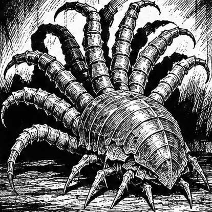
  - 【原典外貌】「玉面長髯，鋼眉刀耳，頭戴金煉盔，身穿鎖子甲，手執方天戟。」——原典初登場貌似俊朗威風的長髯武將，率領二百餘名小妖浩浩蕩蕩趕往蓮花洞替外甥與胞姊報仇，實則外強中乾，沒撐過幾合便敗逃遭一鈀築斃、現出老狐原形。
  - 【本作克蘇魯／昆蟲寄生／偽人重構】徹底撕碎「俊美武將狐狸精」的濾鏡，嚴格以插圖為本體基準重構為**多尾重甲寄生節肢巨蟲怪**！平時率領小妖巡行時雖能勉強披上一層極為薄脆、長滿鋼針般硬眉鬚的「玉面武將」偽人外殼，但只要一進入搏殺或情緒暴怒，整層人皮盔甲便會喀啦爆碎剝落，顯露出插圖中那頭令黑暗地牢探險者絕望的怪物真身——一頭體長逾三公尺、通體覆蓋厚重濕亮蒼白**幾丁質重甲殼板**的巨型寄生鼠婦與蠍蛛融合體！圓拱形背甲由十餘片鋒利如鐵甲般的厚實節片緊密疊合，腹部兩側探出數對尖銳如鋼釘、節節帶著慘白骨刺的節肢步足，死死鑿進潮濕發黑的地面石磚；最駭人的是其背甲後方猛然豎起**七至九條極為粗大、關節分明且尾端彎成漆黑毒鉤的巨型節肢寄生尾**（原典「方天畫戟」的生物恐怖化異變），隨其嘶鳴如一片森冷的活體戟林狂亂揮砸，每道甲縫皆滴落惡臭的酸腐體液！
- **特性**：
  - 【原典記載】性情暴躁重面子、極度高估自身武力——聽聞姊姊壓龍洞老奶奶被殺、外甥銀角出事，立刻點齊二百小妖殺上門叫陣；雖略具軍陣統領力與兇狠衝鋒架勢，卻既無紫金紅葫蘆等頂級法寶、亦缺保命遁法，正面硬碰硬迅速潰不成軍，逃竄途中直接被追上一鈀敲碎天靈蓋身亡。
  - 【本作衍生】現代都市除妖戰裡最常見、也最危險的**「家族幫派尋仇型重甲突擊妖將」**！只要除妖師剛端掉一處寄生母巢（例如斬殺九尾老婦或外勤小頭目），不到二十四小時內，這頭脾氣火爆、愛擺排場的重甲多尾妖將便會帶著數十隻低階寄生幼蟲小妖蜂擁反撲尋仇；其厚重穹頂背甲能正面彈開普通利刃與輕武器，七至九條節肢戟尾在空曠場地揮舞起來覆蓋面積極大，是檢驗二流法師能否靠腦力與地形反殺的絕佳硬仗目標。
- **弱點**：
  - 【原典記載】完全缺乏高階法寶與保命變化神通，面對頂尖武力正面潰敗，且撤退速度笨拙遲緩（連豬八戒都能輕鬆追上將其一鈀築死）。
  - 【本作衍生】1. **轉身遲鈍與狹窄空間限制**：牠那七至九條巨型節肢尾需要極大揮展半徑，只要除妖師主動退入老舊公寓的狹窄走廊、樓梯轉角或堆滿雜物的廢棄鐵皮工廠通道，其多尾戟陣便會互相卡死纏結，無法施展全力；2. **激將法引離小妖群＋掀甲直擊腹軟**：牠極度好面子且暴躁易怒，只要當面羞辱其姊姊老狐與外甥名號，牠就會失智衝鋒脫離小妖掩護；此時發動**陷地符**死死卡住牠那幾對細長尖足，再以**五雷鎮煞符**或**掌心雷**沿著甲殼下緣縫隙往柔軟無甲的腹部猛灌雷壓，即可瞬間將整具重甲掀翻炸碎。
- **習性**：
  - 【原典記載】平日盤踞壓龍山外圍聚眾練兵、依附姊姊與蓮花洞勢力作威作福，遇變故必親率兩百小妖大張旗鼓出動尋仇。
  - 【本作衍生】若潛伏於現代台灣，偏好佔據郊區廢棄重機械維修廠、荒廢鐵皮物流倉儲或山腳無人隧道群作為前哨營地，聚集數十隻低階甲殼寄生小妖充當打手，專替高階妖魔處理討債、清場與報復追殺等髒活。
- **喜好**：
  - 【原典記載】愛擺武將威風排場、極重視家族顏面與成群結隊的聲勢壓迫。
  - 【本作衍生】酷愛在潮濕水泥地上以多足步足敲出整齊震耳的喀喀金屬聲威嚇獵物，並嗜食剛被尾鉤刺穿內臟的新鮮腐肉。
- **擅長的招式／異能**：
  - 【原典記載】「方天戟近戰衝殺」、「統領二百妖兵列陣圍攻」。
  - 【本作衍生】**「九尾骨戟輪斬」**（背後多條粗壯節肢尾同步高速鞭掃與俯衝突刺，威力足以直接鑿穿磚牆與鐵捲門）、**「重甲碾壓衝鋒」**（縮起頭足化作佈滿倒刺的巨型裝甲蟲球猛撞障礙物，正面撞擊力媲美失控貨車）、**「寄生妖群狂躁號令」**（摩擦背甲發出高頻刺耳蟲鳴，令方圓百公尺內的低階寄生小妖集體進入不畏生死的嗜血圍毆狀態）。

---

## 🪲 五、第 37～39 回：烏雞國王宮（頂替國王三年的完美「偽人君主」腐食大蟲）

### [XY2-10] 青毛獅子精（烏雞國假君主・獅猁怪／偽人帝王與腐食甲蟲巨怪）
- **出處順序**：第 37 回《鬼王夜謁唐三藏 悟空神化引嬰兒》～第 39 回《一粒金丹天上得 三年故主世間生》（註：此怪日後二度下界盤踞獅駝嶺之更強異變相詳見 [卷四](./04-卷四_第61至80回.md)；本條目嚴格剔除佛門坐騎神光，專寫烏雞國奪舍三年之偽人妖魔與腐食巨蟲本相）
- **類別與造型路線**：`【類人偽人型】`｜偽人君主皮囊・內藏腐食大蟲甲殼與寄生觸鬚巨怪（顯相轉入`【非人生物恐怖型】`）
- **物種／唯一性**：`物種特異個體`（腐食甲蟲異獸脈絡中極罕見修成「零破綻頂級偽人奪舍」且天生無生殖腺、性情冷峻自律之「獅猁怪」特異大妖個體）
- **稀有度與道行對照**：`★★★★ 絕級（SSR）`｜模糊道行：千年大妖根基（擅極致長期社會寄生擬態、呼風喚雨與高階變化術，然烏雞國時期赤手空拳且心虛防備，故正面硬實力略遜於日後全盛態）｜本作階位：一流頂
- **外貌與黑暗地牢／恐怖谷視覺改寫**：
  - 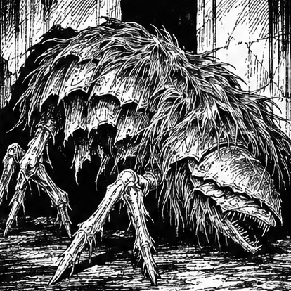
  - 【原典外貌】初抵烏雞國時化作一名自稱來自終南山、能呼風喚雨點石成金的「全真道士」誘騙國王結拜；將真國王推入八角琉璃井溺斃後，搖身變成與真國王分毫不差的帝王長相霸佔龍椅整整三年（唯獨宮中妃嬪察覺他這三年「身體冰冷如鐵、絕不近女色」）；敗露逃竄時臨時奪取鎮殿將軍寶刀硬戰，更一度化作第二個連「火眼金睛」都難以單憑外觀分辨的「假唐僧」；最終在照妖鏡強光下現出「眼似琉璃盞，頭若煉銀盆。渾身青靛毛，利齒尖牙噴」之青毛閹獅（獅猁怪）原形。
  - 【本作克蘇魯／昆蟲寄生／偽人重構】打造本作最令人細思極恐的**「社會頂層完美偽人君主 × 皇袍下腐食大蟲甲殼巨怪」**雙重恐怖結構！
    - **三年完美偽人表相**：端坐於莊嚴王座或現代跨國財團頂樓董事長皮椅上的威嚴中年男子，五官、聲紋、簽名筆跡與處理政務的果斷決策皆與被害本尊 100% 吻合，甚至把國政與企業治理得比真身更井井有條、風調雨順！唯一的致命恐怖谷違和感藏在無人看見的私密處——他的體溫常年停留在攝氏十度以下、觸摸起來**冰冷堅硬如泡過井水的潮濕屍鐵**，徹夜不眠且徹底缺乏人類的一切食慾與情慾；若在極靜的深夜靠近他龍袍或高訂西裝領口，竟會聽見布料底下傳出極輕微、潮濕幾丁質甲片緩慢滑動摩擦的「沙……沙……」聲，以及一陣若有似無的深井霉腐味。
    - **本體顯相（嚴格對應插圖《青毛獅子精》）**：一旦偽人皮囊在破妄強光下剝落撕裂，從帝王華服裡爆綻爬出的絕非威風雄獅，而是一頭令人本能生理反胃的黑暗地牢**巨型腐食甲蟲與寄生觸鬚怪**——整副拱起如小山般的龐大軀幹由一片片參差剝裂、沾滿濕黑泥垢的**厚重腐食甲蟲幾丁質甲殼**層層疊覆，甲縫間密密麻麻披覆著宛如發霉潮濕青黑死人亂髮般的細長**寄生絨絲與觸鬚**（異化的「青毛」鬃鬚）；支撐身軀的四條多節肢步足竟**清晰嵌合著慘白關節與殘留人骨肌理**，鋒利足尖刮裂冰冷石磚；前端根本沒有正常獅臉，而是覆蓋著一層盲眼厚重甲殼頭盔，甲殼下方裂開一張排滿針刺狀交錯尖牙的漆黑腐食蟲顎，不斷垂滴著冷冽腐臭的井水黏液！
- **特性**：
  - 【原典記載】1. **《西遊記》天花板級的長期社會奪舍擬態**：頂替真國王坐江山整整三年，非但滿朝文武與親生太子毫無察覺，連國勢都治理得「風調雨順、國泰民安」，甚至在危急關頭秒變「假唐僧」讓孫悟空的火眼金睛一時真假莫辨；2. **反常識的冷酷克制**：因自身已去勢（剗獅／無生殖慾望），三年深宮絲毫不貪戀女色、亦不濫殺無辜百姓，僅對「佔據上位權力秩序」抱有詭異執念。
  - 【本作衍生】現代都市單元劇裡最具懸疑壓迫感的**「完美社會替代者（高階權力寄生偽人）」**！牠不像低階妖魔躲在下水道吃人，而是專挑知名企業總裁、地方大家長或掌權高官，先化身神通廣大的風水顧問取得信任，趁獨處時一腳把本尊推落深井或密封暗渠，隨即披上對方的身分完美接手豪宅、公司與家庭長達數年！因為牠把事業經營得蒸蒸日上、從不酒駕外遇也不揮霍，導致周遭親信根本沒人懷疑，唯有朝夕相處的枕邊人或年幼子女會在深夜被那具「冰冷如鐵、不呼吸也沒有體溫、領口還爬出細小青黑觸鬚」的假父親嚇得魂飛魄散！
- **弱點**：
  - 【原典記載】1. **「靈魂私密密鑰」知識破綻**：偽裝成假唐僧時雖外貌氣息毫無瑕疵，卻因根本不知道真唐僧獨門掌握的私密咒語《緊箍兒咒》，遭豬八戒靈機一動設考當場露餡潰逃；2. **烏雞國時期無專屬兵器**：敗露時手無寸鐵，只能倉皇硬搶鎮殿將軍的一口凡間寶刀充數，硬戰落入下風；3. **高階破妄鏡光絕對剋制**：遭「照妖鏡」直射即徹底剝離偽人皮囊、顯露本體並喪失反抗力。
  - 【本作衍生】1. **絕不可在大庭廣眾直接動手**：面對已無縫嵌入人類權力頂層的偽人君主，除妖師貿然亮符襲擊只會被保鑣當場制伏、背上刺殺政商名流的重罪！唯一正攻法是先深入陰暗井底或暗渠打撈本尊遺骸取得物證，再設局拋出**「唯獨本尊與至親知曉的私密記憶／暗號／生理習性考驗」**（如緊箍咒破局法）當眾拆穿其語言邏輯盲區；2. **破障強光逼形＋燥火斷鬚**：一旦逼其心理防線崩潰撕皮現形，立即以**高階破障符／開光銅鏡**強光定身剝離幻象，隨即以**烈火符**燒焦其覆滿背甲的濕冷寄生觸鬚，切忌讓其近身奪取周圍警衛的長柄金屬武器或逃入地下水脈。
- **習性**：
  - 【原典記載】慣於先扮作道法高深的江湖異人，以呼風喚雨小術博取目標敬重結義，再藉口共賞花園深井冷不防推人入井奪舍；掌權後作息極端規律刻板，刻意與皇后、太子保持冰冷距離以防親密接觸露餡。
  - 【本作衍生】偏愛空調開到極低溫（攝氏十六度以下）、光線森冷潔淨的高樓頂層總裁辦公室與老宅陰濕書房；白天披著無瑕西裝冷靜批閱文件、精準佈局商戰，深夜獨處時則鎖死大門，將上衣脫去讓背脊的腐食甲蟲甲殼與寄生觸鬚在黑暗中舒張呼吸、舔舐空調管線滴落的冰冷冷凝水。
- **喜好**：
  - 【原典記載】毫無男女情慾（因已去勢無慾），不嗜血濫殺，唯獨極度迷戀「高居廟堂之上掌控秩序、受百官跪拜」的帝王尊榮感（敗露時甚至理直氣壯反嗆「我來佔別人的帝位，與你何干」）。
  - 【本作衍生】病態沉迷於人類頂層社會的精密權力階級、冰冷整潔的會議長桌與眾人敬畏服從的眼神，對底層滿身腥臭、只知躲在暗巷茹毛飲血的野蠻小妖充滿居高臨下的鄙夷。
- **擅長的招式／異能**：
  - 【原典記載】「零破綻頂級擬態變化術」（先變終南全真道士、再頂替真國王三年、甚至瞬變假唐僧連火眼金睛亦一時難辨）、「祈晴禱雨點石幻術」、「臨時奪兵近戰快刀」、「獅猁怪本體撲咬」。
  - 【本作衍生】**「三年完美偽人奪舍」**（連指紋、聲紋、行為習慣與基礎開天眼都極難看穿的高階生物擬態，唯體溫異常低冷與私密記憶空白為破綻）、**「寄生觸鬚絞奪」**（華服袖口與領縫驟然射出數十條細如青絲、韌如鋼線的潮濕觸鬚，瞬間奪取敵手兵器並拉裂法衣）、**「腐食重甲骨足踐踏」**（徹底撕裂偽人皮囊顯露腐食大蟲真身，以嵌帶人骨的細長多節肢步足高速壁行撲殺並張開針齒蟲顎咬碎顱骨）。

---

## 🔥 六、第 40～42 回前段：號山枯松澗火雲洞（偽人孩童火蟻巢穴與毒霧群妖）

### [XY2-11] 聖嬰大王・紅孩兒（號山枯松澗火雲洞火魔／偽人孩童與活體火蟻爆甲巢穴）
- **出處順序**：第 40 回《嬰兒戲化禪心亂 猿馬刀圭木母空》～第 42 回《大聖慇懃拜南海 觀音慈善縛紅孩》（本條目嚴格取號山枯松澗火雲洞妖魔本相，剔除後續佛門童子神籍）
- **類別與造型路線**：`【類人偽人型】`｜極致偽人孩童皮囊・體內燃燒火蟻與爆裂甲蟲活體巢穴
- **物種／唯一性**：`獨一無二`（承襲頂級妖聖牛魔血脈、於火焰山苦練三百年異變出凡水不滅之強酸三昧真火的絕世獨尊火魔童子）
- **稀有度與道行對照**：`★★★★ 絕級（SSR）`｜模糊道行：火焰山三百年異火苦修＋頂級妖魔血脈（憑毒煙與真火連齊天大聖都險些喪命，單體災害規模逼近巔峰）｜本作階位：一流頂～巔峰
- **外貌與黑暗地牢／恐怖谷視覺改寫**：
  - 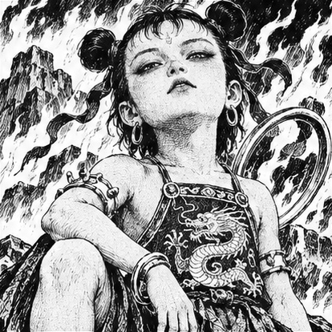
  - 【原典外貌】「面如傅粉三分白，唇若塗朱一表才。鬢挽青雲欺靛染，眉分新月似刀裁。戰裙巧繡盤龍鳳，形比哪吒更富胎。」——看似年僅七歲、赤腳穿繡龍紅肚兜與金環的粉嫩孩童，實則已有三百年老魔修為；第 40 回竟赤裸身軀被麻繩高吊於荒山枯松樹梢，扯開嗓子假裝遭強盜劫掠的落難幼童嚎啕大哭誘騙唐僧；交戰時手執丈八火尖槍，先抬起小拳頭猛捶自己鼻尖兩下，口鼻眼中便瘋狂噴出焚山三昧真火與滾滾毒煙。
  - 【本作克蘇魯／昆蟲寄生／偽人重構】打造本作最令人心寒的**「倒吊樹梢啼哭誘殺的極致『偽人孩童』× 體內活體燃燒火蟻／爆裂甲蟲巢穴」**！如插圖精準定調，表面上看是一個扎著雙髻、戴著圓耳環與沉重手環、身披繡龍肚兜的瓷白幼童，居高臨下俯視著生人——然而那張精緻粉嫩的七歲臉蛋上，卻浮現出毫無一絲童真、充滿殘虐輕蔑且眼波死寂不動的**三百年老魔恐怖谷神情**！更令人作嘔的生物恐怖藏在他那層異常滾燙、薄如蟬翼的童膚之下：細看他的頸窩、眼瞼與小腹薄皮，隱約可見密密麻麻細小黑點正高速爬動鼓包並透出燒紅炭火般的微光——**這具孩童軀殼的胸腹腔早已被徹底掏空異化，裡面實為一座沸騰蠕動的「燃燒火蟻與高壓爆裂甲蟲（放屁蟲／芫菁毒甲）活體蜂巢」**！每當他假扮遭虐待的無助男童倒吊在荒山枯松樹梢或公園鐵架上哭喊「叔叔救命、幫我解繩子」並成功貼近獵物後，臉上哭容一秒凝固成冰冷邪笑；只見他抬起慘白小拳頭朝自己鼻樑「咚、咚」重擊兩下，直接壓爆鼻腔內的化學混合腺囊與爆裂甲蟲母腔——剎那間，他的鼻孔、耳道與裂開的童口像高壓工業酸液噴槍般，朝目標噴吐出夾雜無數燃燒火蟻與劇毒濃煙的**強酸滾油火液（三昧真火）**，所觸血肉與鋼筋瞬間腐蝕碳化！
- **特性**：
  - 【原典記載】1. **凡水不滅之三昧真火與窒息毒煙**：苦修三百年而成的本命真火遇凡水非但不滅，反而火上澆油爆發出遮天蔽日的劇毒濃煙，直接把極怕煙燻的齊天大聖燻得雙目流淚、墜入冷水澗火氣攻心險些丟命；2. **極端狡詐的心理戰與反偵察智商**：先以「吊樹哭童」逼得聖僧不顧勸阻強行救援、趁敵手背負時施展千斤重身法壓垮對手並化狂風擄人；隨後不但憑盤問「親爹生辰八字」一秒識破敵手變身假父，更膽大包天自己變作高階聖像端坐蓮台，把急於搬救兵的豬八戒直接騙進麻袋活擒！3. **暴虐的領地獨裁者**：霸佔六百里號山枯松澗，將轄區所有弱小生靈與地祇當成燒火納糧的奴隸壓榨虐打。
  - 【本作衍生】本作現代除妖界拉響最高級禁火警報的**「活巢強酸火液型偽人災厄」**！他的三昧真火本質上是高濃度生物強酸、可燃磷脂與億萬隻活體燃燒火蟻混合噴射的「**活體凝固汽油酸液**」——這意味著任何現代消防水柱、大樓灑水系統、甚至動用高階水系符法強行滅火，都會因為水分子與強酸磷脂劇烈放熱反應而瞬間引爆毀滅性的**轟燃毒氣雲**，不但當場致盲所有依賴「火眼金睛／開天眼」的除妖師，還會把整棟逃生大樓化作窒息高溫毒氣煉獄！
- **弱點**：
  - 【原典記載】1. **真火極怕先天淨化聖液（非尋常凡水）**：凡雨與凡水只會引爆更猛烈毒煙，唯具先天滅火法則之淨水（原典為甘露聖水）方能徹底澆滅；2. **傲慢童心與迷信威權而踩中刀陣陷阱**：因極度自負愛逞威風，見敵手遺棄的華麗蓮花寶座便忍不住囂張爬上去打坐模仿，結果瞬間觸發暗藏其中的三十六把利刃（天罡刀）貫穿雙腿釘死於原地，隨即遭五道生根金箍死鎖頭肢伏誅。
  - 【本作衍生】1. **絕對禁水鐵律與呼吸防護**：遭遇紅孩兒火毒時嚴禁啟動灑水或用水符滅火（絕對自殺行為！），必須第一時間貼上**淨氣符／避穢符**隔絕強酸蟲煙燻眼，並以乾燥二氧化碳滅火、厚土沙塵封堵或高階淨化法水切斷氧氣與化學反應；2. **打斷「捶鼻引爆」起手式＋誘踏固定刀陣**：其致命噴火必須依靠拳擊鼻樑擊破腺膜或驅動五輛火車助燃，除妖師絕不能心軟去抱路邊倒吊啼哭的紅衣幼童，反須看準他傲慢貪玩、極愛坐上高台炫耀的扭曲童心，預先以**高階鎮妖定身符＋破甲貫穿鐵釘陣**偽裝成奢華寶座誘其自行踏入鎖死四肢，再以高壓低溫液氮或極陰寒符徹底凍死他體內的火蟻爆甲活巢。
- **習性**：
  - 【原典記載】盤踞六百里號山枯松澗火雲洞，驅使洞中六健將與六十名奴役雜役替自己燒火看門、外出傳信；雖性情兇殘暴戾，卻極重對親父牛魔王的孝心，抓獲高階獵物必第一時間派使者請父親共享。
  - 【本作衍生】若顯化於現代台灣，極可能盤踞在廢棄大型焚化爐煙囪底層、常年悶熱散發硫磺酸味的地下鍋爐房或深山無人高壓變電站；平日極愛在深夜偏僻山道枯樹枝、老舊社區無人公園的鞦韆架或廢棄遊樂園高台上，故意用麻繩將自己赤身倒吊起來放聲啼哭，引誘愛心氾濫的夜歸路人或基層巡警上前解繩抱他，一旦被人抱入懷中便驟然暴增千斤死重壓斷對方脊椎，再貼著獵物臉頰捶鼻噴出沸騰火蟻酸液！
- **喜好**：
  - 【原典記載】熱衷玩弄五行火車焚山、假扮尊貴上位者過乾癮、欺凌奴役轄區弱小，同時對親生父母懷有深厚敬畏與討好心態。
  - 【本作衍生】病態迷戀高溫焚燒時甲蟲爆裂的「噼啪」聲、聽見受害者眼睛被強酸濃煙燻瞎時的慘叫，以及收集沾滿焦炭灰的兒童紅色衣物與金屬鐵環。
- **擅長的招式／異能**：
  - 【原典記載】1. **三昧真火與毒煙**（拳擊鼻尖兩下即從口鼻眼噴出凡水不滅之真火與致命濃煙）；2. **五行火車陣**（佈列金木水火土五輛小車助燃，化方圓數十里為焦土火海）；3. **丈八火尖槍**（長槍迅疾猛烈，力敵多名強敵不落下風）；4. **重身壓頂、狂風攝人與高階變化術**（逼真偽裝落難幼童與端坐蓮台之大能騙擒敵手）。
  - 【本作衍生】**「捶鼻強酸火液噴射」**（壓爆鼻腔爆裂甲蟲囊，高壓噴射達上千度且具強腐蝕性的火蟻酸火，遇凡水立即轟燃爆出遮天致盲黑煙）、**「活巢蟻潮鑽膚」**（隨火液一同噴出的數萬隻熾紅耐高溫火蟻，順著敵人衣領毛孔鑽入皮下自體內引燃灼燒）、**「倒吊哭童偽人誘殺＋千斤重壓」**（完美模擬孩童哭嚎，於接觸瞬間切換巢穴密度將獵物活活壓垮於原地）。

---

### [XY2-12] 火雲洞六健將（雲裡霧・霧裡雲・急如火・快如風・興烘掀・掀烘興）
- **出處順序**：第 41 回《心猿遭火敗 木母被魔擒》～第 42 回《大聖慇懃拜南海 觀音慈善縛紅孩》
- **類別與造型路線**：`【類人偽人型】`｜煙霧飛蚋・火蟻芫菁與鼓風甲蟲寄生群妖
- **物種／唯一性**：`物種（群體）`（號山枯松澗火雲洞紅孩兒麾下最核心之六名親信寄生妖將，全數六名原典名號無一省略：**雲裡霧、霧裡雲、急如火、快如風、興烘掀、掀烘興**）
- **稀有度與道行對照**：`★★ 稀級（R）`｜模糊道行：數十年至百年妖氣小頭目（單體二流中下，六妖集結聯動推動火車與噴霧時威脅大幅飆升）｜本作階位：二流
- **外貌與黑暗地牢／恐怖谷視覺改寫**：
  - 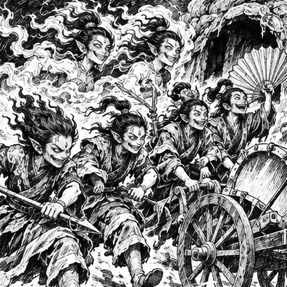
  - 【原典外貌】火雲洞聖嬰大王座下六員精靈妖將，各自冠以對偶風火煙霧之名——**雲裡霧、霧裡雲、急如火、快如風、興烘掀、掀烘興**；平日負責推轉洞前五行火車、放哨把門與看守俘虜，第 41 回六妖集結奉命遠赴翠雲山芭蕉洞恭請牛魔王前來吃唐僧肉，半途卻輕易被敵手假扮的牛魔王騙得團團轉。
  - 【本作克蘇魯／昆蟲寄生／偽人重構】嚴格對應插圖中六具裂嘴狂笑、尖耳焦眉的詭異身影，拒絕臉譜化偷懶，依其三對名號分別重構為依附紅孩兒火蟻母巢進化的**六名昆蟲／寄生異變偽人戰將**：
    - **雲裡霧 & 霧裡雲（上空溶霧雙妖）**：如插圖上方飄浮於黑煙中的對稱尖耳狂笑面孔，看似長髮飄散的人形半身，實則腰部以下徹底崩解成億萬隻密密麻麻、不斷發出高頻嗡鳴的**嗜血黑蠓、煙霧飛蚋與腐蝕孢子蠅集群**！兩人每咧嘴大笑一次，蒼白人皮嘴縫便狂湧出令人肺部灼痛的滾滾灰白蟲霧。
    - **急如火 & 快如風（前排衝鋒雙妖）**：插圖左下方手持尖矛、眼神瘋狂且頭髮如黑焰倒豎的瘦削高速前鋒——**急如火**裸露的四肢關節與鎖骨縫隙覆滿高溫滲油的**芫菁毒甲與燃燒火蟻巢孔**，腳步踩過處柏油路直接起泡冒煙；**快如風**臉頰兩側裂開數道如螳螂氣門般的細長風裂口，肋下藏著高頻震動的半透明蝗翼鞘翅，衝刺時掀起的銳利風壓足以割裂凡人皮膚。
    - **興烘掀 & 掀烘興（右側推車搧風雙妖）**：插圖右下方一妖死命推動焦黑巨輪木鐵火車、一妖高舉白扇狂笑助威的鼓風組——兩人看似體格壯實的怪笑漢子，雙頰與胸腹皮膚底下卻塞滿了膨脹搏動的**巨型爆裂甲蟲氣囊與巨蝗鼓風腔**，每吸一口氣臉頰便如皮囊般詭異脹大兩倍，隨即朝火車爐口猛力噴出富氧助燃毒氣；高舉的扇骨實為慘白人手指骨串連成排的腐膜翼扇！
- **特性**：
  - 【原典記載】身為紅孩兒最信賴的洞府骨幹與外聯特使，擅長團隊協作推動五行小車助長三昧真火並輪值看守洞口；但六名妖將雖名號響亮，智商與防偽辨識力卻極度低劣——見了敵手假扮的牛魔王連半句暗號都不盤查便納頭便拜，不但將洞內抓捕唐僧的機密細節全盤托出，還高高興興一路帶路把強敵請進洞府核心，堪稱最致命的豬隊友內應突破口。
  - 【本作衍生】現代都市裡極具特色的**「六妖連攜昆蟲縱火特勤隊」**！單獨抓出任一隻僅是二流中下的蟲妖（具經驗的二流除妖師可單挑斬殺），然而六妖一旦聯手展開「飛蚋盲霧＋鼓風氣囊＋火蟻高速突刺＋五行火車推進」的連攜陣型，就能在三分鐘內把整條台灣老舊工業區暗巷化作無能見度的高溫毒蟲火海；但反過來，牠們愚忠好騙的階級服從本能，也讓牠們成為除妖師施展「假扮上司滲透套情報」的頭號軟肋。
- **弱點**：
  - 【原典記載】毫無識偽警覺與核查能力（輕信假扮大王生父的敵人、主動洩密引狼入室），且缺乏個人高階法寶護身，主子紅孩兒一遭收伏便全盤崩散。
  - 【本作衍生】1. **極易遭受「社工偽裝詐欺」**：只要偽造高階妖王氣息、信物或嚴厲模仿上司斥責口吻，這六個愛搶功的笨腦袋就會爭先恐後招出巢穴機關、巡邏漏洞與主子真身位置；2. **分組精準點殺破口**：對付**雲裡霧、霧裡雲**不可近身揮砍，須直接祭出**破障符／強烈除蟲煙燻火符**配合強風將飛蚋蟲群吹散燒盡；對付**急如火、快如風**須在通道先鋪設**陷地符**卡死高速衝鋒動線，趁其失速失衡時以**掌心雷**瞬殺；對付**興烘掀、掀烘興**則須趁其雙頰氣囊鼓脹蓄氣的剎那，以遠程飛刃或**五雷鎮煞符**直擊腫脹腮幫引爆體內富氧毒氣，可瞬間連人帶火車一併炸毀！
- **習性**：
  - 【原典記載】駐守枯松澗火雲洞前後門巡哨、推轉五行小車，奉主命外出跑腿傳信時總愛六妖成群結隊、一路喧嘩大聲談論洞內私密大事。
  - 【本作衍生】常於凌晨兩兩配對或六人成群，推著改裝生鏽推車、沿著台灣郊山高壓電塔保線道路或廢棄化工廠排煙管線外圍巡邏放哨，嘴裡不住彼此吹噓大王又抓到哪個倒楣路人，吵雜尖銳的笑聲往往比妖氣更早暴露行蹤。
- **喜好**：
  - 【原典記載】酷愛在洞主面前搶功邀賞、成群起鬨助威，垂涎沾光分食長生肉湯。
  - 【本作衍生】沉迷於在廢墟裡點燃廢棄輪胎與腐肉欣賞滾滾黑煙，以及結伴虐打羞辱當地失去反抗力的弱小精怪與流浪野犬。
- **擅長的招式／異能**：
  - 【原典記載】「六妖協同推轉五行小車助火」、「煙霧蔽日（雲裡霧、霧裡雲）」、「高速奔襲傳令（急如火、快如風）」、「鼓風扇火助勢（興烘掀、掀烘興）」；皆使尋常妖兵長矛刀扇，無個人先天法寶。
  - 【本作衍生】**「六妖風火蟲煙連攜陣」**（雲裡霧、霧裡雲先釋放億萬嗜血飛蚋毒霧遮蔽開天眼視野與堵塞法師口鼻；興烘掀、掀烘興以體內甲蟲鼓風氣囊配合骨扇將火車毒焰瞬間吹爆成高壓火柱；急如火、快如風借濃煙與火光掩護發動高速鐮矛死角絕殺——對缺乏**淨氣符**與團隊默契的散修極具滅團威脅）。

---

> **本卷純妖怪檔案收束與下卷導覽**：本卷已依 2026-11-21 定案鐵律，徹底剔除第 21～40 回全部神佛仙官、地祇龍王與純人類譜系，完整重構收錄本區段內全部 **12 條**（19 名具名妖魔）純妖怪與怪獸之「黑暗地牢昆蟲寄生 × 恐怖谷偽人」圖鑑檔案並全數嵌入 **13 張** 黑白墨線插圖。後續自第 41～60 回黑水河鼉龍、車遲國虎鹿羊三妖、通天河靈感大王、金兜洞獨角兕、琵琶洞蠍子精、六耳獼猴至火焰山牛魔王與鐵扇公主，請續閱卷三。  
> **返回導覽**：[👹 妖怪篇總綱](../00-妖怪篇總綱與圖鑑分級.md) ｜ [📖 西遊記總錄](./00-西遊記妖怪怪獸總錄.md) ｜ [⬅️ 卷一](./01-卷一_第01至20回.md) ｜ [➡️ 卷三](./03-卷三_第41至60回.md)
