# 🐒 《西遊記》純妖怪與怪獸圖鑑・卷三（第 41～60 回）

> **返回導覽**：[👹 妖怪篇總綱](../00-妖怪篇總綱與圖鑑分級.md) ｜ [📖 西遊記總錄](./00-西遊記妖怪怪獸總錄.md) ｜ [⬅️ 卷二](./02-卷二_第21至40回.md) ｜ [➡️ 卷四](./04-卷四_第61至80回.md)

> **本卷編纂與純妖篩選說明（2026-11-21 定案規格）**：
> - **收錄範圍與卷次銜接**：本卷涵蓋原典第 41～60 回全段（並完整收束火焰山牛魔王與鐵扇公主終局至第 61 回，確保單元首尾不斷裂）。第 41～42 回「號山枯松澗火雲洞・聖嬰大王紅孩兒與火雲洞六健將」因起於第 40 回，已完整併入 [卷二（第 21～40 回）](./02-卷二_第21至40回.md) 建檔，本卷不重複列號。
> - **嚴格剔除所有神佛仙官**：依本作純妖怪怪獸圖鑑鐵律，本卷範圍內所有神明、佛菩薩、天庭星官、道門正神與地方神祇（包含**惠岸行者、善財童子、黑水河神、西海龍王敖順、摩昂太子、三清道祖、車遲國風雲雷電諸神、托塔李天王、哪吒三太子、火德星君、水德星君與黃河水伯、十八羅漢、昴日星官、地藏王菩薩、燃燈古佛、火焰山土地、佛門過海四大金剛**等）**一律徹底剔除，絕不收錄**。其中「諦聽」剝離神明位格，純以幽冥伏地辨真之節肢聽覺怪獸收錄。
> - **無遺漏補註**：第 53 回「子母河寄生胎水脈與落胎泉」屬寄生水生態異象而非獨立個體，詳併於 `[XY3-10] 如意真仙`；第 60 回僅口述提及而未在世登場之「萬歲狐王」及各洞府無名雜兵（鼉龍水府巡水夜叉、靈感大王蝦兵蟹將、金兜洞小妖、琵琶洞丫鬟、摩雲洞狐僕），皆於對應主妖檔案中完整交代，全卷共計 **19 筆**純妖怪與怪獸檔案，**19 張**既有黑白墨線圖檔全數嵌入。

---

## 📋 本卷純妖怪與怪獸速查表（共 19 筆，依回目順序排列）

| 編號 | 名稱（別稱／本作重構本體） | 出處回目 | 造型路線 | 物種／唯一性 | 稀有度｜本作階位 | 配圖 |
| :---: | :--- | :--- | :---: | :--- | :--- | :---: |
| `XY3-01` | **黑水河・鼉龍怪**（深水巨型節肢鱷蛭怪） | 第 43 回 | `【非人生物恐怖型】` | `物種特異個體` | `★★★ 珍級（SR）`｜二流頂～一流 | ✅ |
| `XY3-02` | **車遲國・虎力大仙**（斷頸線蟲縫頭偽人道士） | 第 44～46 回 | `【類人偽人型】` | `物種特異個體` | `★★★ 珍級（SR）`｜一流 | ✅ |
| `XY3-03` | **車遲國・鹿力大仙**（剖腹空腔節肢蟲臟偽人） | 第 44～46 回 | `【類人偽人型】` | `物種特異個體` | `★★★ 珍級（SR）`｜二流頂～一流 | ✅ |
| `XY3-04` | **車遲國・羊力大仙**（寄生冷蟲護體偽人妖道） | 第 44～46 回 | `【類人偽人型】` | `物種特異個體` | `★★★ 珍級（SR）`｜二流頂～一流 | ✅ |
| `XY3-05` | **冷龍**（沸油鍋底蒼白寒冰水蛭／環節凍蟲） | 第 46 回 | `【非人生物恐怖型】` | `物種（群體）` | `★★ 稀級（R）`｜二流 | ✅ |
| `XY3-06` | **通天河・靈感大王**（鰓寄生吸盤卵囊巨魚怪） | 第 47～49 回 | `【非人生物恐怖型】` | `物種特異個體` | `★★★ 珍級（SR）`｜一流 | ✅ |
| `XY3-07` | **斑衣鱖婆**（通天河水下老嫗偽人魚怪） | 第 48～49 回 | `【類人偽人型】` | `物種（群體）` | `★★ 稀級（R）`｜二流 | ✅ |
| `XY3-08` | **通天河・老黿**（背甲寄生藤壺水螅觸手巨獸） | 第 49 回 | `【非人生物恐怖型】` | `物種特異個體` | `★★★ 珍級（SR）`｜二流頂～一流 | ✅ |
| `XY3-09` | **金兜洞・獨角兕大王**（重甲獨角犀金龜／腐牛魔獸） | 第 50～52 回 | `【非人生物恐怖型】` | `獨一無二` | `★★★★★ 神級災厄（UR）`｜巔峰 | ✅ |
| `XY3-10` | **解陽山破兒洞・如意真仙**（寄生胎水偽人道士） | 第 53 回 | `【類人偽人型】` | `物種特異個體` | `★★★ 珍級（SR）`｜二流頂～一流 | ✅ |
| `XY3-11` | **毒敵山琵琶洞・蠍子精**（黑暗地牢倒馬毒產卵母蠍） | 第 54～55 回 | `【類人偽人型】` | `物種特異個體` | `★★★★ 絕級（SSR）`｜一流頂～巔峰 | ✅ |
| `XY3-12` | **混世四猴怪譜**（不入十類四大變異靈長怪獸總覽） | 第 58 回 | `【非人生物恐怖型】` | `獨一無二` | `★★★★★ 神級災厄（UR）`｜巔峰～規格外 | ✅ |
| `XY3-13` | **六耳獼猴**（終極偽人鏡像替身・六膜聽覺怪） | 第 56～58 回 | `【類人偽人型】` | `獨一無二` | `★★★★★ 神級災厄（UR）`｜巔峰 | ✅ |
| `XY3-14` | **假取經團猴精群**（劣質偽人傀儡仿冒小隊） | 第 57～58 回 | `【類人偽人型】` | `物種（群體）` | `★ 凡級（N）～★★`｜三流～二流 | ✅ |
| `XY3-15` | **諦聽**（幽冥伏地辨真・多耳節肢觸角怪獸） | 第 58 回 | `【非人生物恐怖型】` | `獨一無二` | `★★★★ 絕級（SSR）`｜一流頂～巔峰 | ✅ |
| `XY3-16` | **芭蕉洞・鐵扇公主／羅剎女**（枯葉螳螂鐮肢震風偽人） | 第 59～61 回 | `【類人偽人型】` | `獨一無二` | `★★★★ 絕級（SSR）`｜一流頂 | ✅ |
| `XY3-17` | **積雷山・玉面狐狸精**（皮下吸血纖毛節肢尾偽人） | 第 60～61 回 | `【類人偽人型】` | `物種特異個體` | `★★ 稀級（R）`｜二流 | ✅ |
| `XY3-18` | **大力牛魔王**（數百丈多足甲殼黑泥腐蟲牛魔） | 第 60～61 回 | `【非人生物恐怖型】` | `物種特異個體` | `★★★★★ 神級災厄（UR）`｜巔峰 | ✅ |
| `XY3-19` | **辟水金睛獸**（水陸兩棲節肢鱗甲坐騎怪獸） | 第 60～61 回 | `【非人生物恐怖型】` | `獨一無二` | `★★★ 珍級（SR）`｜二流頂～一流 | ✅ |

---

## 🌊 一、第 43 回：黑水河篇

### [XY3-01] 黑水河・鼉龍怪（小鼉龍／深水巨型節肢鱷蛭怪）
- **出處順序**：第 43 回《黑河妖孽擒僧去 西洋龍子捉鼉回》
- **類別與造型路線**：`【非人生物恐怖型】`｜深水巨型節肢鱷蛭怪（具「偽人老船夫」前端誘餌皮囊）
- **物種／唯一性**：`物種特異個體`（原典為揚子鱷類鼉龍族群中承襲涇河水脈血統之特異個體；本作中為盤踞深水汙泥、能分泌擬人殼膜誘殺渡客的巨型節肢鱷蛭霸主，座下亦聚有巡水夜叉與腐甲水卒群）
- **稀有度與道行對照**：`★★★ 珍級（SR）`｜模糊道行：數百年深水沉潛成精氣候｜本作階位：二流頂～一流（深水汙泥主場具一流壓迫力，離水跌至二流）
- **外貌與黑暗地牢／恐怖谷視覺改寫**：
  - 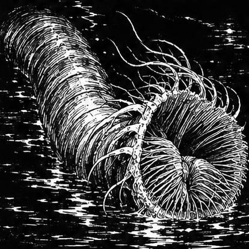
  - 【原典外貌】身穿烏金鎧甲、頭戴鐵盔、面如鼉鱷、口闊牙尖，手持一根「竹節鋼鞭」；平時化身為撐船擺渡的梢公將唐僧與豬八戒誘上木船，行至河心掀翻沉溺，被擒鎖穿琵琶骨後現出鼉龍本相。
  - 【本作克蘇魯／昆蟲寄生／偽人重構】徹底剝離傳統鱗甲神龍將軍感，重構為一頭潛伏在腐臭黑水中的**深水巨型節肢鱷蛭怪**。其最陰毒的構造是長在口器前緣的「偽人船夫誘餌殼」——遠看宛如一名披著發霉黑色雨衣、駝背低頭撐篙的枯瘦老人，一旦目標踏上浮台或靠近積水暗巷，老船夫的斗笠與雨衣會沿著中軸線「喀嚓」縱裂，露出的根本不是人臉，而是雙唇硬生生外翻撕開、密排三列倒鉤針齒的狹長濕亮鱷蛭口盤！整具軀幹由數十節漆黑濕滑、滿布幾丁質甲殼接縫與細密腐泥剛毛的巨型環節水蛭段構成，腹側長滿八對用來摳抓河床混凝土與溺屍骨骼的尖銳節肢步足，每塊背甲縫隙裡都嵌著密密麻麻的圓形吸血吸盤；牠拖曳的「竹節鋼鞭」實為一節節外生鈣化、沾滿腐藻與人類指骨殘渣的畸形脊椎鞭尾。黑白墨線重點聚焦在雨衣下層層滑動反光的濕黑環節、不斷滴落瀝青狀黑泥的口盤吸齒，以及斗笠暗影裡那兩顆無眼瞼的死白複感濁眼。
- **特性**：
  - 【原典記載】水性極精，能以假船載客於黑水河心驟起大風浪覆船擒人；皮堅力大，於水下以竹節鋼鞭力敵豬八戒與沙悟淨聯手不落下風，且看準孫悟空不擅水戰而死守水府不出。洞府內養有巡水夜叉（曾奉命持請帖報信）與成群水卒。
  - 【本作衍生】擁有極高欺騙性的**「誘餌偽人＋環節沉溺拖曳」雙重獵食結構**——偽人船夫只是牠像深海鮟鱇魚般伸出水面的擬態肉瓣，真正本體早已如巨型水蛭般貼伏在積水底層的泥漿裡。其體表分泌的黏稠黑水含有強效抗凝血與神經麻醉毒素，凡人與低階法師只要腳踝被牠腹側的吸盤沾到，肌肉會瞬間僵冷失力、浮力盡失，無聲無息被捲進汙水深處。
- **弱點**：
  - 【原典記載】離水陸戰遠遜於水中，一旦失去深水主場便無法施展覆浪優勢；血脈與階位遭純正高階海龍壓制（遭表兄擊敗並以鐵索穿鎖琵琶骨擒走）；另因其愛寫請帖邀宴炫耀，留下鐵證斷送後路。
  - 【本作衍生】1. **高壓電流與雷法水中傳導**：節肢外殼雖能硬抗普通刀刃與鈍擊，但腹側裸露的軟體環節與濕滑黏液是極佳導體，二流法師若抓準牠掀開偽人雨衣撲咬的一瞬，將「五雷鎮煞符」投入其口盤或貼身釋放強化「掌心雷」，能引發整條環節軀體劇烈痙攣抽搐。2. **脫水與高溫強光**：只要以「避水訣」配合大型抽水排空、或誘離積水箱涵至乾燥柏油路面並投擲「烈火符」烤乾其黏液層，牠的甲殼關節會瞬間乾裂卡死、機動性暴跌。
- **習性**：
  - 【原典記載】父遭天刑後流落無依，強佔黑水河原本水府、殺傷水卒自立為王；平素深伏河底衡陽峪水府，見有過客便化船夫擺渡掀船捉人。
  - 【本作衍生】在台灣現代都市多盤踞於防洪大排深槽、廢棄工業區地下抽水站、河濱公園深夜無人的渡船頭或暴雨淹水的地下車行箱涵。專挑颱風夜、豪雨積水時段偽裝成「熱心招手引路的穿雨衣老伯」或「停在積水邊的暗色老舊接駁車司機」，等受害者涉水靠近，水底環節尾鞭與吸盤步足便同時纏住雙腿往暗渠拖曳；巢穴最深處常堆滿被吸乾血液卻還沒腐爛完的浮腫溺屍，作為幼蛭與寄生巡水夜叉的活體育床。
- **喜好**：
  - 【原典記載】好擺排場邀宴攀附權貴（捉到唐僧後不急著先吃，反派巡水夜叉送請帖邀親戚共享「蒸唐僧肉」），嗜佔現成豪華洞府而不願苦修。
  - 【本作衍生】酷愛富含重金屬與腐魚屍臭的漆黑厭氧淤泥、溫熱且陽氣旺盛的新鮮活血；對人類身上發亮的金屬飾品、名錶與酒瓶有病態收集癖，習慣像炫耀戰利品般把這些雜物鑲嵌在巢穴濕牆的黏液裡。
- **擅長的招式／異能**：
  - 【原典記載】「化船覆浪術」（幻化木船渡客至河心驟掀黑浪沉溺）、「竹節鋼鞭重擊」、「水府蝦兵與巡水夜叉圍攻」。
  - 【本作衍生】「偽人擺渡誘餌」（操縱前端雨衣老者皮囊重複僵硬招呼語吸引獵物踩入水線）、「瀝青黏液沉溺場」（噴吐大量增稠黑蛭黏液，令積水化為吞噬浮力的半固體黑泥，連低階避水訣都被堵死）、「脊椎鋼鞭絞骨抽擊」（甩動鈣化尾鞭高速鞭打，尾節吸盤沾肉即撕下一大塊皮肉）。

---

## ⛩️ 二、第 44～46 回：車遲國篇

### [XY3-02] 車遲國・虎力大仙（車遲國大國師／寄生線蟲縫頭偽人道士）
- **出處順序**：第 44 回《法身元運逢車力 心正妖邪度脊關》、第 45 回《三清觀大聖留名 車遲國猴王顯法》、第 46 回《外道弄強欺正法 心猿顯聖滅諸邪》
- **類別與造型路線**：`【類人偽人型】`｜寄生鐵線蟲群／節肢虎紋偽人妖道
- **物種／唯一性**：`物種特異個體`（原典為黃毛猛虎修煉成精並習得正統五雷天心法的特例妖王；本作重構為以數千條粗韌鐵線寄生蟲纏結操縱一具道袍虎屍偽人皮囊的高階妖道）
- **稀有度與道行對照**：`★★★ 珍級（SR）`｜模糊道行：數百年～近千年成精道行（兼通正統道門祈雷文檄）｜本作階位：一流
- **外貌與黑暗地牢／恐怖谷視覺改寫**：
  - 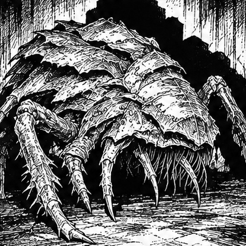
  - 【原典外貌】身穿道門鶴氅法衣、頭戴星冠、手持令牌與法劍的威嚴大國師；第 46 回與孫悟空賭「砍頭復生」時，人頭被劊子手斬落後因遭黃犬叼走無法接回，腔中血湧而斃，現出「一隻無頭黃毛老虎」死屍原形。
  - 【本作克蘇魯／昆蟲寄生／偽人重構】摒棄毛絨虎頭壯漢，打造出令人頭皮發麻的**「線蟲縫合偽人道長」**！平日是一尊身高逾兩公尺、穿著寬大卻異常僵硬挺括的高級道袍的中年道師，國字臉白得像泡過福馬林，眼眸在陰影裡閃著細密節肢複眼微光，皮下若隱若現浮動著黑黃交錯的腐蟲條紋——那根本不是虎斑，而是無數條漆黑油亮、如電線般在表皮底下緩慢蠕動的巨型寄生鐵線蟲！最徹底引爆生理恐懼的是其頸部：衣領下繞著一圈滲出黑黃膿液的環形斷裂縫線，當他啟動「斷首邪法」或頭部遭重擊斬落時，脖腔裡噴出的不是單純鮮血，而是數百條瘋狂扭動甩動、末端生有倒鉤吸齒的濕亮蒼白寄生蟲絲，在空中發出濕黏「嘶嘶」聲瘋狂搜尋滾落的頭顱，像活體縫合針線般硬生生鑽進頭顱切口、將眼珠歪斜卻仍在獰笑的人頭硬扯回脖頸縫緊復位！黑白墨線強調斷頸處爆裂噴湧的密集線蟲群、道袍褶皺下的潮濕腐蝕污漬與毫無活人氣息的僵冷神情。
- **特性**：
  - 【原典記載】車遲國三妖之首，確實習得道門正統「五雷天心法」（書符、燒文檄、拍令牌皆按古制，能令天象風雲雷電依法響應），並精於高臺雲梯坐禪、隔板猜枚與「砍頭復生」秘術；二十年來藉求雨奇功把持一國朝政、興道滅僧。
  - 【本作衍生】極具欺騙性的**「掌握正統法印卻內藏寄生蟲巢的高階偽人國師」**。因為他的頭顱與軀幹完全由密集的共生鐵線蟲叢維繫神經與肌肉連結，常規斬首、刺穿咽喉或切斷脊椎對他幾乎無效——只要頭顱還在十公尺範圍內，斷頸湧出的寄生蟲線便會在兩秒內強行拉回縫合，甚至能讓脫離的頭顱拖著長長的線蟲束在半空高速飛撲撕咬！
- **弱點**：
  - 【原典記載】1. **「砍頭復生」並非憑空長出新頭，必須喚回原頭接上**——只要原頭被奪走、遠離或徹底銷毀（原典遭黃狗叼入御水河），脖腔便再無依附、立刻流血暴斃現原形。2. **五雷法仰賴外部法壇與上界響應**，一旦法壇連線被高階存在截胡或破壞，便滴雨不下。3. 貪名好賭、迷信三清聖水（誤飲悟空尿液），容易被言語激將押命對賭。
  - 【本作衍生】實戰破口極為明確——**「斷頭即封、奪首焚蟲」**！一旦將其斬首或擊裂頸部縫線，必須在 1.5 秒內以「烈火符」直接炙燒斷頸湧出的潮濕線蟲束（寄生線蟲群極度畏懼高溫乾燥明火，遇火即焦捲爆裂），同時以「鎮妖定身符」釘死滾落的頭顱或投入強酸／烈焰銷毀；此外，以「破障符」炸碎他手中法壇令牌與文檄，即可立刻中斷其借來的雷雨異象。
- **習性**：
  - 【原典記載】於車遲國大旱時現身求雨建功，獲封大國師並建宏偉三清觀，長期奴役城內兩千餘名和尚剃頭拉車、蓋造道觀充當苦役。
  - 【本作衍生】在現代台灣都市多以「政商御用風水大國師」或深山違法大型道場掌門人的偽人身分活動，盤踞於潮濕多霧的山腰豪華違建道觀地下密壇，外表衣冠楚楚替政商權貴祈福消災，暗地將失蹤的落單散修與信眾關押在潮濕水牢裡當作繁衍鐵線蟲卵的活體溫床。
- **喜好**：
  - 【原典記載】極度迷戀皇家尊榮、道門正統名分與長生幻想，熱衷在君王百官面前藉鬥法立威。
  - 【本作衍生】偏愛潮濕陰涼的古廟木結構、線香煙霧與高檔絲綢道袍（用以遮掩皮下寄生蟲蠕動的輪廓與腐臭），並享受受人跪拜時那種凌駕凡人的偽神虛榮。
- **擅長的招式／異能**：
  - 【原典記載】「五雷祈雨法」（書符燒檄、拍令牌召風雲雷雨）、「高臺雲梯坐禪」、「砍頭復生術」（頭落喊「頭來」令首級飛回接頸）。
  - 【本作衍生】「線蟲縫合斷頭殺」（主動將頭顱沿環頸裂口彈射出十餘公尺，由數百條堅韌如鋼絲的寄生蟲線牽引咬斷目標喉管，再拉回縫合）、「邪壇偽雷轟」（借偷學的五雷符檄引動高壓落雷，轟碎都市建築與掩體）。

---

### [XY3-03] 車遲國・鹿力大仙（車遲國二國師／剖腹空腔節肢蟲臟偽人）
- **出處順序**：第 44 回《法身元運逢車力 心正妖邪度脊關》、第 45 回《三清觀大聖留名 車遲國猴王顯法》、第 46 回《外道弄強欺正法 心猿顯聖滅諸邪》
- **類別與造型路線**：`【類人偽人型】`｜腹腔寄生節肢蟲巢偽人妖道
- **物種／唯一性**：`物種特異個體`（原典為白鹿修煉成精之二國師；本作重構為胸腹徹底中空、內臟全面異化為共生甲蟲與蜈蚣狀節肢蟲團的極致恐怖谷偽人道士）
- **稀有度與道行對照**：`★★★ 珍級（SR）`｜模糊道行：數百年成精道行｜本作階位：二流頂～一流
- **外貌與黑暗地牢／恐怖谷視覺改寫**：
  - 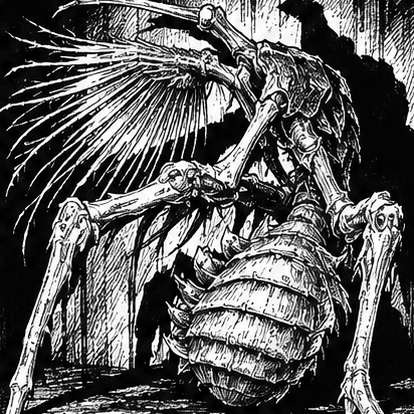
  - 【原典外貌】車遲國二國師道士，陰狠多計，善出毒招暗算對手；第 46 回與孫悟空賭「剖腹剜心」，自剖肚腹掏洗五臟時被悟空變作餓鷹一口抓走全部內臟，倒地氣絕現出「一隻無腸白毛鹿」死相。
  - 【本作克蘇魯／昆蟲寄生／偽人重構】徹底捨棄溫順白鹿元素，推向極致醫療獵奇與黑暗地牢昆蟲解剖恐怖！表面是一名極度削瘦、頸項過長且雙眼間距異常寬闊的蒼白陰柔道士，瞳孔如發白橫裂的腐屍反光，兩鬢太陽穴表皮下隱約頂出如畸形甲蟲大顎般分叉的蒼白骨刺（擬態鹿角）。當他慢條斯理掀開道袍、以生鏽牛角刀劃開毫無血色的肚皮時，裡頭並無溫熱人類血肉，而是一座漆黑潮濕、散發福馬林與腐肉臭氣的**中空肋骨牢籠**——原本該是心肝肺腸的位置，竟然盤纏著成團如濕亮白蛆與多足蜈蚣交織而成的**「節肢蟲臟」**！肺葉是兩片不停開合摩擦的蒼白蟲翼囊、心臟是一枚搏動著數十根細小步足的甲蟲卵球、腸道則是一串長滿口器與吸盤的環節寄生長蟲；他面帶毫無溫度的僵硬微笑，用指骨過長的手將這團淅瀝滴著黑水的節肢蟲臟捧出胸腔洗濯展示，胸肋陰影裡還有無數隻七寸暗褐臭蟲與寄生幼蟲正沿著白骨爬出！黑白墨線精雕中空胸腔的深黑陰影、濕滑蟲體的高光反差與冰冷無情的偽人側臉。
- **特性**：
  - 【原典記載】三兄弟中最陰險狡詐的軍師，擅長暗中使陰招（雲梯坐禪時暗拔腦後短髮變七寸臭蟲／蜈蚣鑽入唐僧衣領咬傷破定），並精於「剖腹剜心洗濯復原」之駭人旁門拆解術。
  - 【本作衍生】極度棘手的**「活體蟲巢偽人＋干擾型毒蟲暗算者」**。因為體內實為可自由拆卸重組的節肢蟲臟，他幾乎不懼怕刺穿腹部的物理致命傷（刺進空腔只會驚醒大量護主腐蟲反撲啃咬法師手腕）；更能隨時從袖口、耳洞與剖開的腹腔釋出極難察覺的微小吸血寄生蟲，專門打斷除妖師掐訣、閉氣訣或畫符專注。
- **弱點**：
  - 【原典記載】「剖腹剜心」的核心致命破口在於**「一旦體內臟器遭外力奪走或毀滅，便完全無法再生」**——原典中餓鷹一口抓走其心肝腸肚後，他立即失魂倒地現出無腸白鹿屍骸。
  - 【本作衍生】正面近戰與硬體防禦不如虎力大仙；當他打開腹腔施展「剖腹驅蟲」或「蟲臟外置療傷」時，正是最暴露核心的破防瞬間！法師須先以「開天眼符水」鎖定他胸腔內那枚不斷搏動的**甲蟲母核（偽心臟）**，絕不可讓其合攏肚皮，立即以「烈火符」直接往空腔內投擲引爆，或用「掌心雷」燒斷蟲臟神經束，只要毀掉母核，整具偽人空殼便會瞬間乾癟塌陷。
- **習性**：
  - 【原典記載】常駐車遲國三清觀輔佐虎力大仙，專職策劃毒計、設計賭局與監視苦役和尚。
  - 【本作衍生】在現代台灣都市多潛伏於地下醫美診所、老舊中醫養生館、醫院廢棄解剖標本室或非法地下器官交易暗線周邊；平日偽裝成語氣斯文、總在白袍下多穿一件長袖襯衫的古怪顧問或中醫師，暗中把宿主內臟替換成可遠端操縱的寄生蟲囊。
- **喜好**：
  - 【原典記載】原典未載飲食私好，唯顯其酷愛陰謀詭計、破壞他人修行定力與追逐國師權勢。
  - 【本作衍生】迷戀冷冽銳利的不鏽鋼手術器械反光、浸泡在玻璃罐裡的潮濕標本與看著獵物因皮下鑽入蟲卵而抓爛自己皮膚的崩潰神情。
- **擅長的招式／異能**：
  - 【原典記載】「剖腹剜心復原術」（以牛角刀破肚掏洗內臟後合口如初）、「拔髮變七寸臭蟲暗襲」（干擾坐禪入定）、「雲梯坐禪」。
  - 【本作衍生】「千蟲斷訣」（自空腔釋出幾乎隱形的微小寄生扁蝨與腐蠅幼蟲，專門鑽入法師耳鼻與衣領噬咬神經，瞬間打斷金光咒與避氣訣）、「蟲腸絞索」（剖開腹部驟然彈出滿布倒鉤吸盤的環節蟲腸，如鎖鏈般捲住近身敵人拖入空腔啃噬）。

---

### [XY3-04] 車遲國・羊力大仙（車遲國三國師／寄生冷蟲護體偽人妖道）
- **出處順序**：第 44 回《法身元運逢車力 心正妖邪度脊關》、第 45 回《三清觀大聖留名 車遲國猴王顯法》、第 46 回《外道弄強欺正法 心猿顯聖滅諸邪》
- **類別與造型路線**：`【類人偽人型】`｜共生寒冰寄生蟲宿體偽人妖道
- **物種／唯一性**：`物種特異個體`（原典為羚羊成精並私自驅使冷龍護體的三國師；本作重構為將極寒寄生水蛭群（冷龍）深埋於脊椎皮下、藉此在沸油與烈火中安然無恙的共生偽人妖道）
- **稀有度與道行對照**：`★★★ 珍級（SR）`｜模糊道行：數百年成精道行｜本作階位：二流頂～一流（有冷龍共生時免疫火攻，失去冷龍則防禦暴跌至二流下）
- **外貌與黑暗地牢／恐怖谷視覺改寫**：
  - 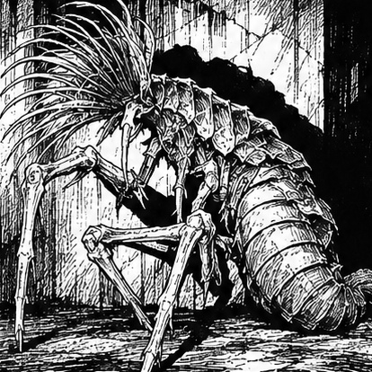
  - 【原典外貌】車遲國三國師道士，精瘦狂妄，明知兩位兄長慘死仍執意押命對賭「下油鍋洗澡」；待鍋底護體冷龍遭捉走後，瞬間在滾油中皮焦肉爛、化骨抽筋，翻出「一隻焦枯羚羊骨骸」原形。
  - 【本作克蘇魯／昆蟲寄生／偽人重構】拋棄單純山羊精形象，塑造成一座**「沸油中皮下蠢動著蒼白冰蟲的極致恐怖谷活體培養皿」**！外貌是一名乾瘦蠟黃、下巴吊著幾縷僵硬灰白長鬚的中年怪道人，雙眼呈毫無人類情緒波動的慘白橫瞳，兩側太陽穴深處頂出如腐蝕鈣化蟲鞘般向後彎折的環紋骨角。最令人作嘔的是他渾身皮膚常年冒著一層油膩發亮且結著細霜的冷黏液——只要湊近細看，就能驚恐地發現他後頸、肩胛與雙臂皮膚底下，正有好幾條蒼白半透明的環節寒冰寄生蟲（冷龍）緩慢爬行隆起，表皮還布滿密密麻麻用以排冷氣的微細呼吸氣孔！當他跳進滾燙沸油鍋狂笑洗澡時，油面咕嘟冒煙，鍋底卻有一條巨型蒼白凍蛭從他脊椎鑽出盤成吸熱冰環；一旦護體冷蟲被剝離，他整張偽人人皮會在高溫下像塑膠袋般劇烈起泡焦融剝落，露出裡頭燒得發黑爆裂的畸形長顎骨骸與滿是蟲洞的焦枯脊骨。
- **特性**：
  - 【原典記載】憑藉驅使「冷龍」潛伏沸油鍋底化熱為寒，能在千度滾油中如浴溫水般戲水搓洗，營造出「金身水火不侵」的震撼假象迷惑君王百姓。
  - 【本作衍生】現代都市除妖戰中最惡毒的**「火攻陷阱反制型共生偽人」**！凡是像主角許家銘這類仰賴「烈火符」、火攻或高溫爆破作為主力輸出的基層散修，只要一頭撞上羊力大仙，所有烈火符都會在他體表一寸處被皮下冷蟲釋出的極寒黏膜瞬間吸乾熄滅，反過來遭到他潑出的滾燙沸油與極寒腐液雙重重創。
- **弱點**：
  - 【原典記載】肉身本質**完全不耐高溫**，所有水火不侵皆全賴體外／鍋底的「冷龍」苦撐；只要護體冷龍遭強行捉離（原典被北海龍王化旋風收走），他立刻連普通沸油都扛不住，數秒內化骨抽筋焦爛斃命。
  - 【本作衍生】破局鐵律為**「先逼離共生冷蟲，再行烈火焚殺」**！開天眼下可清楚看見沿著他脊椎與腳底延伸而出的濃白寒氣蟲脈；法師必須先用陽剛雷電系術法（「掌心雷」或「五雷鎮煞符」）猛擊其後背寄生孔洞，震麻並迫使冷龍脫離宿主，只要出現短短兩秒的寒膜破口，哪怕是最廉價的自製三流「烈火符」也能把他整副乾癟偽人皮囊燒成焦炭。
- **習性**：
  - 【原典記載】與兩位兄長同佔車遲國三清觀，靠外道雜技神蹟掌控朝廷、打壓僧眾。
  - 【本作衍生】在現代台灣都市最常盤踞於大型冷鏈倉儲、冷凍屠宰場、廢棄傳統製冰廠或違法偏鄉神壇，平時愛在零下低溫的冰庫裡赤身飼養脊椎上的冷蟲，每隔一段時間便舉辦駭人聽聞的「下油鍋、過火炭」邪教法會，藉假神蹟收割鉅額獻金與狂熱信徒。
- **喜好**：
  - 【原典記載】原典未載明確私好，唯顯其剛愎自用、賭性極重（見兩兄接連慘死仍盲信自身冷龍秘技可翻盤）。
  - 【本作衍生】病態沉迷於極端冷熱溫差撕裂皮膚的快感——總喜歡坐在滾燙大油鍋或工業鍋爐旁，任憑皮下冷蟲分泌冰霜抵銷灼痛，同時狂熱收集信徒受驚顫抖的恐懼表情。
- **擅長的招式／異能**：
  - 【原典記載】「冷龍護鍋術」（驅使冷龍盤伏沸油底部吸收熱能）、「道門小術合擊」。
  - 【本作衍生】「沸油濺面」（藉冷蟲黏膜隔熱，直接徒手捧起滾燙工業廢油或強酸高溫溶劑朝法師臉部猛潑，同時毀去對方的開天眼視力）、「寒毒氣孔噴霜」（從皮膚上數十個寄生呼吸孔驟然噴射出混雜冰渣與黏液的零下寒霧，瞬間凍裂法師指節使其無法掐訣）。

---

### [XY3-05] 冷龍（油鍋護體寒蛟／蒼白寒冰水蛭・環節凍蟲怪獸）
- **出處順序**：第 46 回《外道弄強欺正法 心猿顯聖滅諸邪》
- **類別與造型路線**：`【非人生物恐怖型】`｜蒼白寒冰巨型水蛭／環節凍蟲怪獸
- **物種／唯一性**：`物種（群體）`（原典中屬正統四海龍族之外、修煉旁門陰寒之法脫殼而成的異種寒蛟群類；本作中為棲息於極寒暗水與地下冰管中、可與高階妖怪形成共生關係的環節凍蟲物種）
- **稀有度與道行對照**：`★★ 稀級（R）`｜模糊道行：數十年至百餘年旁門陰寒氣候｜本作階位：二流
- **外貌與黑暗地牢／恐怖谷視覺改寫**：
  - 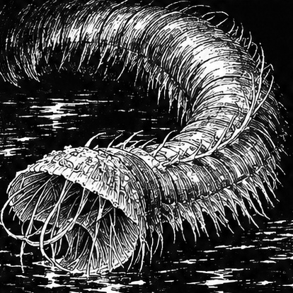
  - 【原典外貌】原典未詳描尺寸鱗色，僅透過北海龍王之口點出其「苦修行了一場，脫得本殼，卻只是五雷法真受，其餘都屣了傍門，難歸仙道」；潛伏滾油鍋底以極寒護住羊力大仙，遭旋風抓起現出冰涼蜷曲小龍原形。
  - 【本作克蘇魯／昆蟲寄生／偽人重構】徹底剝除傳統龍角龍鬚，將其極端降維為一條長約兩公尺、通體蒼白半透明的**深淵寒冰巨型水蛭與環節凍蟲融合體**！牠沒有眼睛與四肢，表皮覆滿一層滑膩滲霜的死白色軟膜，從半透明肉壁可直接窺見裡頭一節節緩慢抽搐的漆黑冰結晶內臟與墨黑色吸熱脈管；頭端並無顎骨，而是一具呈放射狀綻開、密生五圈細碎透明冰針倒齒的圓盤狀吸血吸盤，尾巴則分岔出數條如水螅觸手般的感溫細絲。當牠吸附於滾沸油鍋底部或大妖脊背上時，每一個環節縫隙都會不斷噴出沉重下墜的刺骨白霜毒霧，把沸騰液體強行鎖在零度臨界點；在黑白高對比墨線裡，牠像一條浸在黑油裡的巨大蒼白肥蛆水蛭，全身泛著濕冷反光與細密霜晶，令人一瞥便起強烈生理作嘔感。
- **特性**：
  - 【原典記載】具強大陰寒吸熱之能，可將千度沸油核心瞬間冷卻護體，且擅長隱匿氣息潛伏鍋底不為凡人所察；本身道行淺薄、走入旁門。
  - 【本作衍生】典型的**「活體防火衣／共生吸熱寄生怪獸」**。單獨作戰時攻擊慾望與機動性皆偏低，一旦吸附在大型宿主（或邪修法師）背脊，其圓盤冰齒會直接咬穿表皮接入宿主微血管，一邊汲取宿主微溫精血維生，一邊向體表外層持續泵出吸熱寒膜，讓宿主瞬間獲得近乎絕對的火攻免疫。
- **弱點**：
  - 【原典記載】實力低微且出身旁門，遇高階正統水脈威壓毫無反抗餘地（一陣旋風即遭生擒抓走）。
  - 【本作衍生】極度畏懼**高壓雷電（「掌心雷」「五雷鎮煞符」）與極度乾燥的曝曬強光**；作為軟體環節水蛭構造，牠完全缺乏硬質幾丁質甲殼保護，一旦被迫鬆口脫離宿主或被拖出液體環境，暴露在正午陽光、工業熱風或高濃度粗鹽／烈陽硃砂下，會在十幾秒內劇烈起泡溶解成一灘腥臭黑冰水。
- **習性**：
  - 【原典記載】原為山野苦修脫殼之旁門異物，受羊力大仙感召驅役，長伏沸油鍋下替主護體。
  - 【本作衍生】在現代台灣都市多蜷縮在大型冷凍庫排水槽、老舊冰廠冷凝管深處、或終年不見陽光的山區深層冷泉涵洞裡；容易被熟諳馭蟲術的二流邪修用冷血動物心臟餵養收編，當作專門反制火系除妖師的貼身暗牌。
- **喜好**：
  - 【原典記載】原典未載明確喜好。
  - 【本作衍生】嗜吸外洩的工業冷媒氣體、低溫汙水與新鮮冷血（蛇、蛙或爬行類生血），本能渴望吸附在體表微溫的宿主身上汲取生機。
- **擅長的招式／異能**：
  - 【原典記載】「極寒護鍋」（潛伏沸油鍋底中和劇烈高溫，令宿主在滾油中毫髮無傷）。
  - 【本作衍生】「吸熱寒膜結界」（強制吞噬三流至二流烈火符的爆燃熱量使其啞火）、「冰齒吸盤強附」（受威脅時猛然彈射吸附在敵人小腿或頸動脈，注入極寒凍血黏液造成局部組織瞬間壞死凍傷）、「黑冰滑溜吐液」（噴吐瞬間結冰的透明黏液覆蓋地面，使近戰法師重心崩潰）。

---

## 🐟 三、第 47～49 回：通天河篇

### [XY3-06] 通天河・靈感大王（蓮池金魚精／深水鰓寄生吸盤卵囊巨魚怪）
- **出處順序**：第 47 回《聖僧夜阻通天水 金木垂慈救小童》、第 48 回《魔弄寒風飄大雪 僧思拜佛履層冰》、第 49 回《三藏有災沉水宅 觀音救難現魚籃》
- **類別與造型路線**：`【非人生物恐怖型】`｜深水鰓寄生巨魚怪（覆甲吸盤與搏動卵囊母體）
- **物種／唯一性**：`物種特異個體`（原典為南海蓮花池逃逸聽經成精之金魚怪；本作中為長期盤踞深層黑水箱涵與大河底、體表寄滿縮頭魚蝨與產卵囊泡的獨霸巨型深水寄生魚怪，麾下豢養無數腐甲蝦兵蟹將水蟲卒）
- **稀有度與道行對照**：`★★★ 珍級（SR）`｜模糊道行：數百年深水成精氣候（具大範圍降雪結冰異能）｜本作階位：一流（水域主場一流，離水跌至二流頂）
- **外貌與黑暗地牢／恐怖谷視覺改寫**：
  - 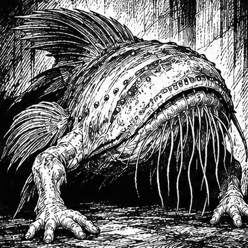
  - 【原典外貌】出戰時頭戴金盔、身披金甲、鼻準高隆、雙眼暴凸圓瞪、牙齒如鋼鋒尖齊、口咬青嫩水藻，手持一朵未開荷花煉成的「九瓣赤銅錘」；被竹籃收伏時縮回數寸金鱗金魚本相。
  - 【本作克蘇魯／昆蟲寄生／偽人重構】徹底推翻華麗觀賞金魚或鎧甲武將，重構為一頭在漆黑深水裡緩緩蠕動的**深水鰓寄生巨魚怪**！牠擁有近三公尺高、腫脹失衡且覆滿發黑濕亮厚鱗的巨型魚形肉軀，但那些看似盔甲的粗糙魚鱗每一片都微微翻翹——掀開鱗縫竟密密麻麻嵌滿數百個正在劇烈抽縮的**環形齒狀吸血吸盤**與一串串半透明、內裡清晰可見幼蟲蜷曲蠕動的**搏動卵囊**！牠頭顱兩側暴凸出兩顆如腐敗氣泡般無眼瞼的慘白腫瘤眼球，胸口與頸側裂開六道深不見底、不斷噴湧冰冷血泥的巨大血紅鰓裂，鰓瓣之間爬滿宛如巨型縮頭魚蝨與水蛭般的共生寄生甲殼蟲（甚至牠圓筒狀張開的嘴裡，舌頭位置赫然是一隻張開多排尖細倒牙的巨型寄生口器！）。手中緊握的「九瓣赤銅錘」則像一顆生滿九片鈣化黑殼、會自體開合滴落強酸冰涎的深海寄生物母莢。黑白墨線放大其層層翻開的鱗下卵囊密集恐懼、濕冷反光的腫脹魚泡臉與滲出血水冰霧的裂鰓。
- **特性**：
  - 【原典記載】極擅水戰並掌握「呼風喚雨、飄雪凍河」的大範圍寒潮術法（一夜冰封八百里通天河，再震裂冰面將踏冰者拖入水底石匣）；每年強迫附近陳家莊活祭一對童男童女以換取風調雨順。洞府「水黿之第」中統率大批蝦兵蟹將雜魚精（戰敗後遭八戒、沙僧清剿）。
  - 【本作衍生】極度陰森的**「活童產卵育床 × 低溫封鎖獵場」**雙重災厄型妖怪！牠索食幼童絕非單純飽腹，而是因為孩童柔嫩且陽氣純淨的軀體最適合塞入牠鱗片底下的寄生卵囊、在低溫石匣或冷凍水閘裡慢慢「孵化」下一代深水寄生魚蝨與水卒；其鰓裂持續散發的極寒潮濕氣場，能在數分鐘內把整條河濱或地下室凍成濕滑黑冰，封死所有逃生動線。
- **弱點**：
  - 【原典記載】1. **陸戰與正面硬攻能力遠遜水下**（於陳家莊廟中遭假扮童男童女的悟空與八戒偷襲痛打，立刻狼狽遁回水底躲藏不出）。2. **極懼原主所施之紫竹魚籃與特定收魚法咒**，一聞咒聲便毫無反抗之力乖乖現出魚形自投羅網。
  - 【本作衍生】1. **離水脫液與高溫爆破**：牠的鰓部寄生群與鱗下卵囊極度依賴低溫冷水維持活性，法師切忌踏上牠製造的冰面或貿然下水，應以高溫「烈火符」連發蒸發寒霧、將其誘出至乾燥高處並以「指地成鋼符」封死地下排水口切斷退路。2. **鰓裂軟點重創**：鱗甲厚實但六道外翻鰓裂毫無防禦，以精準投擲的「五雷鎮煞符」或高壓「掌心雷」直接灌入鰓縫，能同時電斃鰓內共生魚蝨並引爆卵囊造成重創。
- **習性**：
  - 【原典記載】趁海潮溜出蓮花池，強搶通天河老黿的水底宮殿「水黿之第」；與陳家莊立下血祭惡約，每年固定奪食一對活童（原典中輪到陳澄之女「一秤金」與陳清之子「陳關保」），並慣將活捉的高價值獵物（唐僧）封入六尺石匣待客。
  - 【本作衍生】在現代台灣都市多潛伏於年久失修的大型水庫底層涵管、廢棄海洋水族館地下維生巨槽、或海線偏鄉荒廢陰廟連通的潮濕防洪蓄水池；暗中以反常暴雨淹田或區域低溫威脅偏遠聚落與地下邪教，誘騙獻上失蹤孩童，並把尚未吞食的活體獵物塞進積水廢棄冷庫或混凝土水閘箱內活活保鮮產卵。
- **喜好**：
  - 【原典記載】嗜吃活生生的「童男童女」（而且極為挑嘴貪肥，專揀胖大者先下手），喜霸佔寬敞現成水府享福。
  - 【本作衍生】迷戀極冷發臭的深層死水、潮濕發霉的紙錢香灰、以及幼童在冰冷黑暗中被吸盤緩慢貼附時的微弱哭泣震動；喜歡在進食前用舌位寄生口器細細舔舐獵物皮膚檢驗脂肪厚度。
- **擅長的招式／異能**：
  - 【原典記載】「九瓣赤銅錘」（未開荷花煉就之沉重妖兵）、「寒風降雪凍河術」（一夜冰封八百里大河）、「碎冰沉底陷阱」（自水底震裂冰層拖人入水）。
  - 【本作衍生】「瞬凍黑冰箱涵」（自裂鰓狂噴零下腥寒水霧，三秒內將積水地面結成脆裂黑冰，引誘敵人踏上再從底層爆裂拖入）、「卵囊爆裂飛蝨」（受創時主動擠破鱗下卵囊，噴射出數十隻如巴掌大的吸血寄生水蝨撲臉咬斷氣管）、「赤銅寄生物母莢重砸」（揮錘時九瓣張開甩出腐蝕性極寒魚涎，沾身即令肌肉凍僵無法結印）。

---

### [XY3-07] 斑衣鱖婆（班衣鱖婆／通天河水下老嫗偽人魚怪）
- **出處順序**：第 48 回《魔弄寒風飄大雪 僧思拜佛履層冰》、第 49 回《三藏有災沉水宅 觀音救難現魚籃》
- **類別與造型路線**：`【類人偽人型】`｜寄生毒鰭斑紋魚嫗偽人怪
- **物種／唯一性**：`物種（群體）`（淡水斑紋鱖魚修成精怪的水妖支系；此為盤踞通天河水府、替靈感大王獻上冰河絕毒陷阱的老謀雌妖）
- **稀有度與道行對照**：`★★ 稀級（R）`｜模糊道行：數十年至百餘年水妖氣候｜本作階位：二流（實戰偏弱，設局陰險度達二流頂）
- **外貌與黑暗地牢／恐怖谷視覺改寫**：
  - 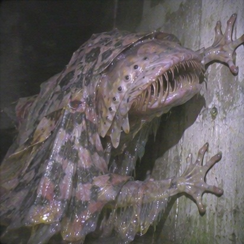
  - 【原典外貌】於水府眾妖中閃身而出，身披如斑紋鱖魚鱗皮般花哨衣飾，滿臉堆笑、「跬跬拜拜」極盡諂媚陰毒老嫗之態；靈感大王被收走後，與滿洞水怪皆被八戒、沙僧打死現出鱖魚死屍原形。
  - 【本作克蘇魯／昆蟲寄生／偽人重構】極具台灣菜市場暗巷與潮濕水產地牢恐怖谷氣息的**「水下老嫗偽人魚怪」**！遠看是一名駝背矮胖、披著一件陳舊發霉碎花雨披的怪異歐巴桑，但走近便會發現那件「碎花斑衣」根本是直接從她脊椎肉膜長出來、緊緊黏在潰爛皮肉上的**濕滑斑點鱖魚皮與十幾根尖銳毒骨背鰭**！她那張過度蒼白浮腫、泡水發皺如百歲溺屍的老婦人臉上，永遠掛著誇張到嘴角撕裂至耳根的討好假笑，一旦笑開，嘴裡滿是如砂紙般細密向內倒鉤的透明魚牙與幾條垂在唇縫間緩慢擺動的寄生線蟲；雙手枯指泡得發紫膨大，指縫連著黏滑半透明肉蹼，關節處凸出尖銳硬鰭骨刺，頸部暗褶間隱約開合著滴落腥臭黃水的細小鰓縫。黑白墨線重點表現她陰險卑微的彎腰剪影、皮肉與斑點魚皮無縫長合的噁心褶皺，以及永遠濕答答拖在地上的發霉裙尾與死魚黏液。
- **特性**：
  - 【原典記載】武藝平庸但**城府極深、極善揣摩人心設局**——正是她洞悉唐僧急於求經的心理與靈感大王的控冰本領，獻出「起風降雪凍通天河、誘僧履冰再碎冰活捉」的絕殺毒計，差點一舉團滅西行團隊，因而獲靈感大王許諾「拜為兄妹、共食唐僧肉」。
  - 【本作衍生】典型的**「偽人引路誘殺者 × 水妖集團幕後軍師」**。她絕不與除妖師正面火拚，專精利用台灣日常街巷裡「看似熱心多嘴、愛指捷徑的菜市場老婦人」偽裝降低獵物戒心，再將落單的凡人或三流法師一步步引導進積水地下道、廢棄魚市場冷庫或更強大水怪的伏擊圈裡。
- **弱點**：
  - 【原典記載】單體近戰能力與防禦極度薄弱，一旦失去強大主子（靈感大王）庇護，水府遭破時毫無還手之力便被直接打死現出原形。
  - 【本作衍生】皮表黏液與背鰭毒腺極度畏懼**高溫明火（「烈火符」）與近身雷擊（「掌心雷」）**；一旦開天眼識破她偽人皮囊下的細鰓與斑點魚皮，只要搶在她縮回深水或釋放魚腥瘴霧前貼身強攻斷其脊椎，連三流頂法師配合幾張自製烈火符都有機會一戰斬殺。
- **習性**：
  - 【原典記載】依附強橫大水妖生存，在水底宮殿裡察言觀色、專門替主子出陰招謀害過路人以換取酒肉賞賜與地位攀升。
  - 【本作衍生】在現代台灣都市多潛伏於深夜休市後的傳統魚市場排水明溝、大型海產批發市場地下汙水槽或河濱抽水站陰影處；習慣在凌晨三、四點偽裝成撿拾爛魚內臟的佝僂老婦，向路過失魂者或查案散修遞出似是而非的線索，實則把對方推入必死地形陷阱。
- **喜好**：
  - 【原典記載】嗜酒貪肉，對分食「唐僧肉」與攀附大妖結為兄妹極為狂熱。
  - 【本作衍生】嗜吞腐敗生魚內臟、魚市場地溝油渣與劣質米酒，尤其迷戀躲在潮濕牆角偷窺比自己強壯許多的獵物掉進自己設計的陷阱裡掙扎溺斃。
- **擅長的招式／異能**：
  - 【原典記載】「獻計設局（冰河活捉計）」、水下成群偷襲。
  - 【本作衍生】「躬身毒鰭暗刺」（假裝謙卑彎腰靠前說話的瞬間，肩背斑點魚皮猛然裂開豎起十餘根灌滿麻痺黏液的毒骨硬鰭，貼臉刺向目標咽喉）、「腐魚瘴氣障眼」（自嘴縫噴出濃濁刺鼻的腐魚腥霧，瞬間干擾開天眼視野並引發劇烈嘔吐失能）。

---

### [XY3-08] 通天河・老黿（千三百年修道白黿／背甲寄生藤壺水螅觸手巨獸）
- **出處順序**：第 49 回《三藏有災沉水宅 觀音救難現魚籃》（後續復出於第 99 回，詳見卷五）
- **類別與造型路線**：`【非人生物恐怖型】`｜上古巨型背甲水螅寄生怪獸
- **物種／唯一性**：`物種特異個體`（原典為於通天河苦修一千三百餘年、能通人言並建有水黿之第的巨型白賴頭黿；本作保留其中立載具定位，外觀徹底轉化為覆滿寄生藤壺與水螅觸手的太古深淵移動生態島巨獸）
- **稀有度與道行對照**：`★★★ 珍級（SR）`｜模糊道行：一千三百餘年延壽清修道行（重防禦與載重，乏鬥殺之能）｜本作階位：二流頂～一流（防禦力逼近一流頂，攻擊力僅二流）
- **外貌與黑暗地牢／恐怖谷視覺改寫**：
  - 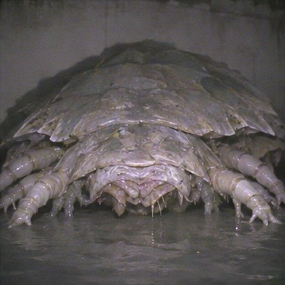
  - 【原典外貌】體型如島嶼般龐大的「白賴頭黿」，寬闊背甲能一次安穩馱負唐僧師徒四人、白龍馬與全部行李橫渡八百里通天河；雖修煉一千三百餘年延壽身輕且通人言，卻始終「難脫本殼」，無法褪殼化為人形。
  - 【本作克蘇魯／昆蟲寄生／偽人重構】徹底去除慈祥老龜神獸感，呈現極致**黑暗地牢深淵巨物恐懼（Megalophobia）× 潮濕群體寄生生物生態**！牠是一座緩慢浮出漆黑腐水、寬逾十五公尺的慘白濕軟巨型背甲肉山：灰白龜甲早已嚴重鈣化龜裂，每一寸殼面都密密麻麻長滿如火山口般層層堆疊的**灰黑寄生巨型藤壺**，藤壺孔洞裡無時無刻伸出成千上萬條蒼白半透明、隨水流詭異搖擺吸附的**水螅毒觸手與細長管蟲**，背殼邊緣垂掛著厚重起皺、彷彿巨型溺屍爛皮般的蒼白肉裙！當牠從黑水裡緩緩伸出卡車頭般巨大的慘白「賴頭」時，整張軟皮頭顱布滿發膿白斑、濕冷肉瘤與吸附其上的水蛭群，深陷在肉褶裡的兩顆極小死黑瞳孔毫無溫度地凝視著岸上活人，無齒角質硬顎張開時伴隨沉悶如地底涵洞回音般的濕滑氣泡聲吐出沙啞人語：「……我幾時，得脫這身蟲殼……」——明明毫無惡意，光是踏上牠長滿蠕動水螅與喀嗒咬合藤壺的背甲，就足以讓人理智瀕臨崩潰。
- **特性**：
  - 【原典記載】壽命悠長、水性穩重如平地，能無視八百里通天河險惡水勢平穩渡河；本性知恩圖報（因孫悟空替牠趕走搶房子的靈感大王而主動免費馱師徒渡河），但對約定極端固執記仇（第 99 回因唐僧忘記幫牠向如來代問脫殼之期，便毫不猶豫當場沉水掀翻全隊與經卷）。
  - 【本作衍生】極為罕見的**「中立太古渡水活體生態艦 × 絕對執拗契約巨獸」**。牠厚實的鈣化背甲與表層水螅群能自動過濾、吞噬周遭水域的弱水浮力剝奪與陰煞毒霧，讓背上乘員安然穿越凡船必沉的極端靈異死水；但牠的「誠信執念」近乎規則法則，一旦乘員毀約失信，牠會面無表情地直接在最深處縮頭翻殼，放任背甲上數萬隻寄生藤壺與水螅把違約者扯入水底。
- **弱點**：
  - 【原典記載】雖活了一千三百多年，卻**幾乎沒有正面搏殺神通**——連數百年道行的靈感大王來搶「水黿之第」都打不過，只得窩囊退讓流落河底；同時因「難脫本殼」的修行死劫，內心對「化為人形」抱有極深執念與脆弱期盼。
  - 【本作衍生】龐大身軀一旦離水便重如山嶽、幾乎完全喪失移動力；背甲上共生的寄生藤壺與水螅雖能防禦低階物理與毒水，卻極度畏懼大範圍高溫乾燥與強效除蟲雷法；對現代除妖師而言，與牠打交道最致命的破口不是武力衝突，而是**絕不可輕易對牠許下做不到的口頭承諾**。
- **習性**：
  - 【原典記載】千年來深伏通天河底「水黿之第」靜修延壽，從不主動害人吃人；奪回洞府後便日復一日在深淵等待西行者從西方帶回脫殼答案。
  - 【本作衍生】在台灣現代極可能長眠於東部外海深水斷層溝槽、高山百年大潭或超深廢棄水庫底部的厭氧泥層裡，每隔數十年才浮出水面換氣一次，偶爾被深夜作業漁船聲納掃描成「長滿不明觸鬚的移動海底沉船」。
- **喜好**：
  - 【原典記載】唯一畢生執念是**「褪去千年老殼、修得人身」**；不貪血食金銀，只求一個真實不欺的承諾答覆。
  - 【本作衍生】偏愛極度陰冷安靜、無人騷擾的深淵淤泥床；雖痛恨背甲上越長越厚的寄生藤壺與水螅（象徵牠擺脫不了的畜生硬殼），卻又不得不與之共生千年，對信守諾言的真誠之人會展現笨拙而沉重的善意。
- **擅長的招式／異能**：
  - 【原典記載】「八百里通天渡水」（穩載人馬橫渡險河）、「縮頭翻背沉淵」（震怒時驟然下潛，令背上乘員連人帶物悉數落水）。
  - 【本作衍生】「藤壺水螅活甲」（硬吃數發高階雷火符與物理重擊仍不動如山，並由殼表水螅觸手主動吸收中和腐蝕毒水）、「深淵無聲下潛」（毫無預兆地驟降數十公尺深淵，讓違約者在極端水壓與觸手纏繞中徹底溺斃）。

---

## 🪲 四、第 50～52 回：金兜山金兜洞篇

### [XY3-09] 金兜洞・獨角兕大王（板角青牛精／重甲獨角犀金龜・腐牛魔獸）
- **出處順序**：第 50 回《情亂性從因愛慾 神昏心動遇魔頭》、第 51 回《心猿空用千般計 水火無功難煉魔》、第 52 回《悟空大鬧金兜洞 如來暗示主人公》
- **類別與造型路線**：`【非人生物恐怖型】`（具偽人魁梧壯漢外殼態）｜重甲獨角犀金龜／腐牛魔獸
- **物種／唯一性**：`獨一無二`（原典為離恨天兜率宮太上老君唯一坐騎「板角青牛」，盜走先天至寶金剛琢下界為妖，麾下盤踞大批金兜洞雜妖小卒；本作重構為兼具壓迫偽人壯漢態與巨型重甲犀金龜／腐牛節肢魔獸真身的規格級繳械災厄）
- **稀有度與道行對照**：`★★★★★ 神級災厄（UR）`｜模糊道行：數萬年伴道太古魔獸根腳（本體肉搏平肩齊天大聖，持金剛琢更達近乎無解之境）｜本作階位：巔峰
- **外貌與黑暗地牢／恐怖谷視覺改寫**：
  - 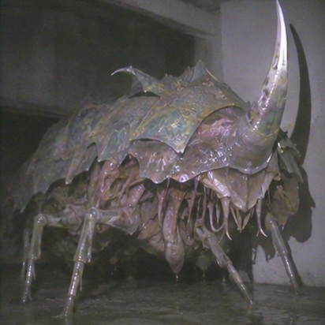
  - 【原典外貌】化形為獨生衝天怪角、銅筋鐵骨、面色青黑的巨漢魔王，手持丈二「點鋼槍」，腕間暗藏白森森的套物圓環「金剛琢」；最終受老君芭蕉扇與穿鼻繩收伏，現出巨型「板角青牛」原形。
  - 【本作克蘇魯／昆蟲寄生／偽人重構】徹底揚棄傳統威武仙牛，打造為結合**「巨型重甲獨角犀金龜（兜蟲）× 腐朽牛骸節肢魔獸」**的壓倒性黑暗地牢重裝巨災！
    1. **偽人壯漢態**：高近三公尺、肩寬如推土機般的畸形魁梧壯漢，看似披掛厚重青銅古甲，實則皮膚表面已全面角質化為泛著暗沉鐵青光澤的**厚重甲蟲鞘翅甲殼**，關節接縫滲出鐵鏽色腐油與細密幾丁質剛毛；前額正中硬生生撕裂額皮、頂出一根扁平寬厚且表面布滿鋸齒卡榫的**巨型獨板犀金龜大角**，雙眼如無眼瞼的灰白複眼反光，左手腕套著一枚如白骨熔鑄般光滑慘白、正將周遭空氣與鐵屑扭曲捲入其中的怪異圓環（金剛琢）。
    2. **巨型甲殼魔獸態**：一旦撤去偽人外殼，整具軀幹膨脹為如裝甲列車般龐大的多足重甲腐牛犀金龜巨獸——背脊裂開厚重甲蟲硬翅，翅下密布不斷開合噴出硫磺黑霧的巨型氣孔與寄生腐甲蟲群；牛首般的畸形頭甲無肉僅餘包覆漆黑幾丁質的森白巨顎與數排咬碎鋼筋的鋸齒口器，六條如攻城錘般粗壯的多節甲殼巨肢踏碎地面，每一道甲縫都黏附著遭其吞噬吸收的斷劍、生鏽齒輪與人骨殘片！黑白墨線極度強化厚重甲蟲外骨骼的金屬光澤、裂縫間湧動的腐泥與金剛琢扭曲萬物的黑洞吸力線。
- **特性**：
  - 【原典記載】**全書硬實力最駭人的巔峰妖王之一**：不靠法寶亦能持點鋼槍與孫悟空正面大戰數十回合不分軒輊；更可怕的是執掌先天至寶「金剛琢」，一口氣套光孫悟空的金箍棒、哪吒六般兵器、火部全部火器與火龍火馬火鴉火鼠、雷部法具以及靈山十八粒金丹砂，並單以白環撐住洞門硬生生擋回半條黃河洪水，連西天高層都忌憚三分、不敢公開點名。洞府中尚驅使大批金兜洞小妖（曾替其穿納錦背心設局看守）。
  - 【本作衍生】本作現代都市裡的**「絕對繳械型滅城重甲災厄」**！除了自身重甲犀金龜外殼擁有近乎免疫普通砲火與二流雷火符的恐怖物理防禦外，其腕間／角間懸浮的「金剛琢」更會展開半徑百公尺的**「金屬與外物強制收繳場」**——所有除妖師的桃木劍、銅錢劍、法鈴、護身法器、乃至現代軍警的槍械彈藥、裝甲車鋼板、高壓電纜與元素符爆造物，只要踏入範圍一聲令下，瞬間便會像被無形磁暴扯碎般脫手吸入白環消失無蹤！
- **弱點**：
  - 【原典記載】1. **唯受原主與特定先天芭蕉扇口訣徹底剋制**（原主親言若連扇子也被偷走，自己亦束手無策）。2. **金剛琢不收純粹血肉軀體與無器械赤手搏鬥**（孫悟空失去金箍棒後改以空手肉搏，青牛精只能持點鋼槍硬打，無法直接用圓環套走悟空本人）。3. **熟睡打鼾時看守有隙**（夜間曾被變作促織與跳蚤的悟空潛入洞內偷回兵器，惟白天開戰仍遭重新套走）。
  - 【本作衍生】面對這尊巔峰災厄，任何依賴實體法寶、兵刃、熱兵器、甚至含金屬礦粉（硃砂、銅粉、鐵釘）的除妖流派全數形同送裝備；理論上唯一的周旋與逃生思路，是**徹底拋棄一切外物與器物，純靠無器械肉身秘術（純氣血掌心雷、步法遁逃）撤出戰區**，並趁其夜間進入甲蟲擬死休眠（沉睡打鼾、背甲氣孔敞開散熱）時切斷其與金剛琢的連結或設法尋求原主級別壓制。
- **習性**：
  - 【原典記載】盤踞金兜山金兜洞，極擅心機設局——故意在荒野幻化一座富麗樓臺、桌上擺放三件「納錦背心」當誘餌，精準釣出貪小便宜的豬八戒領著唐僧踏出悟空所畫的「安全圈」自投羅網；捉人後亦不急著烹食，喜在洞中聚眾飲酒高臥、把玩搜刮來的滿洞神兵。
  - 【本作衍生】若現蹤台灣現代都會，絕非只會橫衝直撞的野獸，而是會在偏僻重劃區空地或荒廢百貨商場內，利用甲殼分泌的致幻腐霧營造出「燈火通明、貨架擺滿免費高價名牌衣飾與法器珍寶的詭異無人樣品屋／高級賣場」，靜靜蹲伏在陰暗天花板樑柱上，等待貪念發作踏出結界防線的凡人與散修上鉤。
- **喜好**：
  - 【原典記載】嗜飲美酒、對收藏繳獲的頂級兵器法寶有著病態成就感（將收來的神兵火具擺滿洞府兩側炫耀），並熱衷吃唐僧肉。
  - 【本作衍生】酷愛吞啃高純度工業金屬、生鏽鋼筋與沾染強烈法力的除妖法器（用以修補增厚其犀金龜重甲），極度輕蔑只靠外掛道具撐場面的弱小人類法師。
- **擅長的招式／異能**：
  - 【原典記載】「金剛琢」（呼聲「著！」收盡天下兵刃、水火造物與金丹砂，且能抵擋半條黃河洪流）、「丈二點鋼槍」（正面硬撼金箍棒的絕頂近戰槍術）、「幻樓納錦背心誘餌局」。
  - 【本作衍生】「萬物繳械白環」（強制剝奪半徑百公尺內一切金屬兵器、法寶、符具與元素造物）、「犀角裂地甲衝」（現出巨型犀金龜腐牛魔獸態，頂起獨板鋸齒大角直線碾壓，一撞即可將高架橋墩與整排鋼筋水泥建築犁成廢墟）、「背甲腐霧噴發」（張開鞘翅噴出大量酸蝕黑煙與食鐵小甲蟲，在繳械後直接淹沒手無寸鐵的獵物）。

---

## 🤰 五、第 53 回：解陽山破兒洞篇

### [XY3-10] 解陽山破兒洞・如意真仙（牛魔王胞弟／寄生胎水偽人道士妖怪）
- **出處順序**：第 53 回《禪主吞餐懷鬼孕 黃婆運水解邪胎》
- **類別與造型路線**：`【類人偽人型】`｜寄生胎水操控者・幾丁質鉤肢偽人道士
- **物種／唯一性**：`物種特異個體`（原典為大力牛魔王親胞弟、紅孩兒親叔父，屬牛魔妖族血脈修成道士架勢霸佔落胎泉之特異個體；本作重構為以「子母河寄生水蟲胚胎」為斂財工具、雙臂皮下藏有產鉗狀幾丁質長鉤的陰森偽人道士妖怪）
- **稀有度與道行對照**：`★★★ 珍級（SR）`｜模糊道行：數百年妖仙道行（實戰遜於牛魔王與孫悟空，但遠勝尋常山妖）｜本作階位：二流頂～一流
- **外貌與黑暗地牢／恐怖谷視覺改寫**：
  - 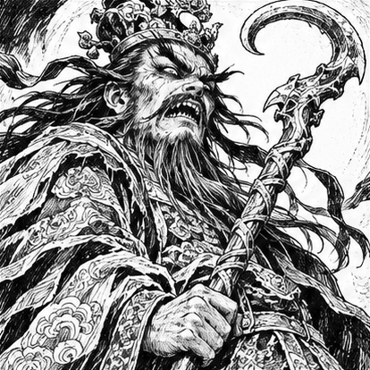
  - 【原典外貌】頭戴彩艷星冠、身穿紅金縷法衣、腰繞玲瓏寶帶，面相極為兇惡——「鳳眼光明眉倒豎，鋼牙尖利口翻紅，額下髯飄如烈火，鬢邊赤髮短蓬鬆，形容惡似溫元帥」，手持一根長柄鋒利的「如意金鉤子」。
  - 【本作克蘇魯／昆蟲寄生／偽人重構】保留其華貴大紅道士的偽善門面，但將表皮底下徹底改寫為**「靠地下寄生胚胎暴利維生的黑暗地牢偽人產婆道士」**！他看似身著沾染潮濕井苔與暗紅乾涸羊水污漬的繁複刺繡道袍，兩鬢炸開的「赤紅短髮」細看竟是一根根會隨濕度微微蜷曲擺動的赤褐觸毛剛刺，臉龐慘白如浸水蠟像，嘴唇外翻合不攏、露出兩排泛著金屬冷光的鋸齒銳牙，眼球佈滿血絲與微弱節肢複眼裂光。最毛骨悚然的是他那把「如意金鉤子」——實戰撕破道袖時，可見他右前臂皮膚沿著尺骨縱裂，直接伸出一段漆黑濕亮、前端彎折成宛如**婦產科冰冷金屬產鉗與昆蟲鉤爪合體**的幾丁質長鉤骨肢，鉤尖不停滴落微帶胎盤血腥味的黏稠泉水；在他身後破兒洞幽暗濕壁與古井邊沿，密密麻麻爬滿自落胎井水沖洗下來、還在無聲蠕動抽搐的半透明蒼白畸形小胎蟲（子母河寄生體殘骸）！黑白墨線緊扣華麗道袍與井口胎蟲黏液的噁心反差、陰森貪婪的偽人神態與反折骨鉤的銳利黑影。
- **特性**：
  - 【原典記載】精明狠毒、貪財好利且極護短記仇：見西梁女國境內「子母河」水能令不分男女的飲水者立時腹脹結胎（原典唐僧與豬八戒誤飲皆即刻懷上「鬼孕血胎」腹痛欲死），便強佔世間唯此一口能化邪胎的解陽山破兒洞「落胎泉」，把「破兒洞」改裝雅稱「聚仙庵」，坐地起價強徵「花紅表禮、羊酒果盤與銀錢」壟斷解藥；因懷恨孫悟空害姪兒紅孩兒骨肉分離，寧可死戰也一滴不賣。
  - 【本作衍生】在本作中完整整合**「子母河寄生水蟲胚胎 × 落胎泉壟斷黑市」**生態鏈——所謂「子母河懷鬼孕」，在生物恐怖設定裡實為水中密布極微小的半透明**「水生寄生卵胎蟲」**，一旦被活人（無論男女）喝下，卵蟲便會用吸盤咬住胃壁與腹膜血管，數小時內瘋狂吸乾宿主精氣並鼓脹出一顆撐破腹皮、裡頭隱約頂出無臉畸形小手與細長臍帶觸手的巨大寄生囊胎，三天內不解便會破腹而出吞噬母體！而如意真仙正是壟斷唯一能瞬間溶解這種寄生囊胎的強鹼寒性「落胎泉」並暗中放任甚至引流子母河水滲入周邊水源藉此大發災難財的黑心妖道。
- **弱點**：
  - 【原典記載】1. **正面硬實力遠不如頂尖大妖**（與孫悟空交手僅數合便招架不住、金鉤差點被打飛；第二回更遭一棒撂倒在地爬不起身）。2. **洞府防備人手極度薄弱**（僅靠一名看井道童與井柵看守，極易中調虎離山之計被繞後偷泉取水）。3. **暴躁記仇**，一提親族舊恨（紅孩兒）便理智失控露出防守大洞。
  - 【本作衍生】極度依賴「破兒洞井口主場」與幾丁質鉤肢的鎖腕牽制；二流頂法師若採雙人夾擊（一人以「金光護身符」與「烈火符」遠距壓制其鉤肢，另一人以「輕身符」或土行小遁繞進後井搶水並以「五雷鎮煞符」轟毀其聚仙庵壇場），便能輕易破局；至於誤飲子母河水者，除搶奪落胎泉冷飲排蟲外，在寄生囊胎尚未徹底成形前，緊急飲服極高純度「烈陽硃砂符水」配合強力催吐亦有一線生機（但內臟將受嚴重灼傷）。
- **習性**：
  - 【原典記載】霸佔解陽山破兒洞改稱「聚仙庵」，平日假裝風雅臥於琴床撫琴，實則死死盯緊井口、只認厚禮花紅不認人情。
  - 【本作衍生】在現代台灣都市多潛伏於郊區半山腰隱秘的非法「古法靜修精舍」、偏僻廢棄婦產科舊址改建的無照秘方草藥館，或長年封閉的日治古井深巷旁；對外偽裝成「專治無名陰胎、卡陰奇病」的神祕高人，實則暗中把混有子母河寄生卵的井水滲進老舊社區水塔或山泉取水點，再向腹部怪異隆起、走投無路的受害者漫天開價收割鉅額現金與活人精氣。
- **喜好**：
  - 【原典記載】極度貪婪「花紅表禮、羊酒果盤與銀錢」，重視妖族宗親血海深仇，亦喜附庸風雅（改洞名、擺古琴裝道門清高）。
  - 【本作衍生】嗜飲烈酒、愛把玩帶著絕望者汗臭與血味的厚疊現金紅包，並喜歡收集從受害者腹中排出的畸形寄生死胎，裝在泡滿冷泉水的玻璃罐裡排滿陰暗書架。
- **擅長的招式／異能**：
  - 【原典記載】「如意金鉤子」（長柄銳鉤，善勾鎖敵方兵刃與關節）、「霸佔落胎泉鎖井陣」。
  - 【本作衍生】「產鉗骨鉤斷筋鎖」（右臂裂皮彈出幾丁質巨鉤，專勾鎖法師雙腕與手指筋脈使其無法掐訣點符）、「子母毒水噴濺」（從腰間葫蘆甩出高濃度子母河卵蟲濃液，沾破皮膚傷口即可直接鑽入皮下血管數分鐘內催生畸形血囊）、「赤鬚炎煞斬」（承襲牛魔血脈之暴戾近戰斬擊）。

---

## 🦂 六、第 54～55 回：毒敵山琵琶洞篇

### [XY3-11] 毒敵山琵琶洞・蠍子精（琵琶巨蠍怪／黑暗地牢倒馬毒產卵母蠍）
- **出處順序**：第 54 回《法性西來逢女國 心猿定計脫煙花》、第 55 回《色邪淫戲唐三藏 性正修持不壞身》
- **類別與造型路線**：`【類人偽人型】`｜劇毒琵琶巨蠍・倒馬毒產卵刺母怪（偽人溫婉女體 × 背臀裂開母蠍節肢毒尾雙態）
- **物種／唯一性**：`物種特異個體`（原典為潛伏雷音寺聽經成精、憑本命倒馬毒樁連傷如來與悟空金身的劇毒巨蠍特例，琵琶洞內亦養有數名低階小妖侍女；本作重構為將「恐怖谷偽人美婦」與「黑暗地牢濕亮產卵母蠍」推向生理極限的絕級毒母怪）
- **稀有度與道行對照**：`★★★★ 絕級（SSR）`｜模糊道行：千年聆佛成精劇毒大妖（論近戰破甲與劇毒威脅直逼巔峰）｜本作階位：一流頂～巔峰
- **外貌與黑暗地牢／恐怖谷視覺改寫**：
  - 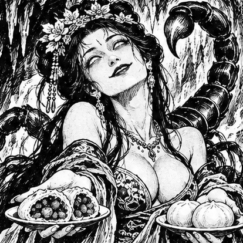
  - 【原典外貌】平時化為軟語溫存、風情萬種的絕色妙齡美人，在琵琶洞內端出「人肉餡饃饃」與素食饅頭百般色誘唐僧；臨陣則口鼻噴煙冒火、雙鉗化「三股鋼叉」、尾甩劇毒「倒馬毒樁」；死於高頻雞鳴聲波後，現出「一個琵琶來大的蠍子精」本相，遭豬八戒築成肉泥。
  - 【本作克蘇魯／昆蟲寄生／偽人重構】堪稱全卷**「黑暗地牢母蠍怪 × 恐怖谷偽人」**的終極視覺巔峰！初見時，她是一名穿著復古黑絲長裙、語氣柔婉靜謐、端坐於潮濕陰暗舊宅裡輕撫古琵琶的蒼白纖細女子——然而這具溫婉女體只是她用來誘捕高純度宿主的「擬人前腹誘餌」：只要屋內光線暗下，她過度精緻平滑的臉皮便沿鼻側裂出細黑幾丁質縫線，柔情眼瞳瞬間化為兩排冰冷無淚的漆黑濕亮複眼，纖細雙臂在肘關節爆皮反折、彈出兩支泛著暗黑金屬冷光且內緣密生鋸齒的巨型**三股鋼叉毒蠍螯肢**！最令人窒息的是她的背部與臀部——整片脊椎與骨盆皮肉如濕軟花瓣般轟然向兩側撕裂翻開，從她纖細腰臀後方猛然展開一條足有兩層樓長、通體覆滿濕亮漆黑幾丁質環節、每節背甲縫裡都緊嵌著人骨指節與鼓脹半透明卵胞的**巨型毒蠍節肢尾弧**！高懸在她頭頂正上方的尾端並非普通尖刺，而是一根如粗長醫用骨針般不停滴落強酸墨液、內部中空且劇烈搏動的**「倒馬毒產卵刺」**——既能瞬間貫穿最堅硬的護身金身注入滅魂神經劇毒，更能直接透過空心毒針將數十枚蠍卵壓入麻痺獵物的脊椎與胸腔深處！黑白墨線極力刻畫溫婉偽人蒼白臉龐與身後龐大濕亮母蠍節肢毒尾的極致反差、尾囊鼓動的黏液高光與琵琶洞般的潮濕暗磚地牢壓迫感。
- **特性**：
  - 【原典記載】**全書破防與劇毒刺殺最恐怖的女魔頭**：1. 近戰武藝極高，以三股鋼叉獨鬥孫悟空、豬八戒聯手二十餘合絲毫不落下風。2. **本命「倒馬毒樁」具備無視常規金剛不壞之軀的絕對劇痛破防屬性**——連刀砍斧劈雷打火燒無傷的孫悟空銅頭鐵額都被扎破頭皮疼得冷汗直冒抱頭敗退，豬八戒厚唇亦被扎得劇痛腫脹；早年甚至在雷音寺一尾扎得如來佛祖左手中拇指疼難禁，連觀音菩薩亦明言「我也是近他不得」。
  - 【本作衍生】本作規則裡最駭人的**「破金身・注射型寄生產卵刺客」**！無論除妖師貼了幾張「金光護身符」、練成多硬的局部金剛身，倒馬毒產卵刺那枚經千年毒液淬鍊的幾丁質空心針都能像刺穿濕紙般貫入防線；毒素會在 0.5 秒內鎖死目標運動神經卻讓痛覺神經放大百倍（使法師痛到無法提氣點符、眼睜睜動彈不得），緊接著母蠍便會從容將受精毒卵打入目標胸腹，讓獵物在清醒劇痛中淪為下一批幼蠍的活體孵育囊。
- **弱點**：
  - 【原典記載】**極致單一的天敵音煞剋制**：不畏刀兵水火與頂尖武力，唯獨天生畏懼至陽雙冠大公雞（原典中受二十八宿之昴日星官現出大公雞本相連鳴兩聲）之高頻破曉啼鳴——聞第一聲即法力崩潰現出琵琶大蠍原形，聞第二聲即渾身酥軟僵縮當場斃命。洞內除少數小妖丫鬟外，缺乏大規模強援。
  - 【本作衍生】常規近戰搏殺、火攻或普通「掌心雷」在她濕亮厚實的幾丁質尾甲與三股叉格擋面前幾乎形同送死（而且一旦拉近至五公尺內就必中倒馬毒尾偷襲）。現代除妖師遭遇此類母蠍血脈的唯一生路是**絕對拉開二十公尺以上距離、切忌直視或落單進其室內密室**，並動用**「至陽高頻禽鳴共振音煞」**（如古法煉製的雄雞冠血破毒音鈴、寅卯破曉時分的至陽破煞聲波符陣或高頻超聲波共振震盪器）——這類特定頻率的至陽聲波會直接引起她體內空心產卵尾針與幾丁質聽覺剛毛劇烈共振碎裂，令她瞬間神經癱瘓、卵囊爆裂失能。
- **習性**：
  - 【原典記載】逃離雷音寺後盤踞西梁女國邊界毒敵山琵琶洞，平日深居簡出、頗講究生活情調（能做素齋饅頭給唐僧、又自己吃人肉餡饃饃），趁隙捲走唐僧欲與其成親採補元陽。
  - 【本作衍生】在現代台灣都市最常隱藏於老城區氣氛詭異卻裝潢幽雅的獨棟磚造老洋房、深夜旗袍私廚酒吧、百年古董樂器行（國樂琵琶專賣店）地下室或潮濕陰冷的廢棄磚窯密道；專挑陽氣純淨、修為不凡的男性除妖師或高能量凡人，先以無懈可擊的溫婉女房東／知性女店主偽人皮囊端茶款待誘入暗室，待獵物喝下微帶麻痺毒涎的熱茶或背對她時，背後巨蠍毒尾便無聲從天花板陰影倒掛刺落。
- **喜好**：
  - 【原典記載】執意追求純陽俊美聖僧（不殺唐僧而百般溫存逼婚），自食「人肉餡饃饃」卻貼心為心儀對象備素食饅頭；早年亦好聽講經論道，膽色與狡慧俱屬一絕。
  - 【本作衍生】迷戀陰濕磚牆地牢裡彈奏尖銳哀怨的古琵琶聲、觸感冰涼的純黑絲綢衣料，以及挑選血脈強壯的活體法師當作「能承受最多枚毒卵而三天不死」的極品溫床；本能極度憎惡刺眼的破曉晨光與公雞啼鳴。
- **擅長的招式／異能**：
  - 【原典記載】「倒馬毒樁」（蠍尾致命毒針，無聲偷襲、破一切護體金身）、「三股鋼叉」（雙螯所化之絕頂近戰兵器）、「口鼻噴煙冒火」、「攝人旋風」。
  - 【本作衍生】「倒馬毒產卵破甲針」（從背部視覺死角以音速彈出空心毒刺，穿透金光護身符同步注入百倍放大痛覺的麻痺神經毒與母蠍卵囊）、「琵琶斷弦音幻」（輕撥由節肢韌帶繃緊的妖化琵琶弦，製造讓人耳鳴暈眩與判斷錯位的微頻幻覺掩護螯肢合剪）、「母蠍煙火毒霧」（自偽人口鼻噴出混合強酸腐煙與高熱火星的障目黑霧）。

---

## 🐒 七、第 56～58 回：真假美猴王・混世四猴與幽冥聽獸篇

### [XY3-12] 混世四猴怪譜（不入十類・四大規格外變異靈長怪獸總覽）
- **出處順序**：第 58 回《二心攪亂大乾坤 一體難修真寂滅》
- **類別與造型路線**：`【非人生物恐怖型】`（含高階偽人擬態特化變異體）｜不入十類之太古規格外變異靈長怪獸譜系（石殼寄生猿・腐水赤尻陰陽怪・多節無關節通臂巨怪・六膜擬態獼猴）
- **物種／唯一性**：`獨一無二`（原典由如來佛祖於第 58 回親自點破之天地唯四超脫「五仙・五蟲」十類名冊與《生死簿》戶籍之規格外異靈——靈明石猴、赤尻馬猴、通臂猿猴、六耳獼猴）
- **稀有度與道行對照**：`★★★★★ 神級災厄（UR）`｜模糊道行：太古開天異變規格外・不入輪迴與十類名冊｜本作階位：巔峰～規格外
- **外貌與黑暗地牢／恐怖谷視覺改寫**：
  - 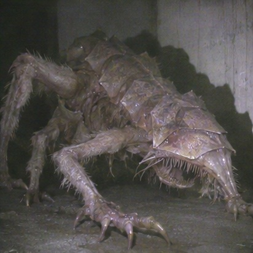
  - 【原典外貌】第 58 回原典以十六字總評定性天地間不入十類之種的四類神猴：
    1. **靈明石猴**：「通變化，識天時，知地利，移星換斗。」（即花果山仙石迸裂所出之石猴本源，詳見卷一）
    2. **赤尻馬猴**：「曉陰陽，會人事，善出入，避死延生。」（原典未詳描全貌，僅從名號見其臀赤面長似馬，精於陰陽生死與水陸出入；註：花果山馬、流二元帥雖同名類，位格遠不及先天本尊）
    3. **通臂猿猴**：「拿日月，縮千山，辨休咎，乾坤摩弄。」（原典未詳描形貌，僅知雙臂相通力可縮山拿月；註：花果山崩、芭二將軍亦僅同類低階老猴，非本尊）
    4. **六耳獼猴**：「善聆音，能察理，知前後，萬物皆明。」（詳見下一專條 `[XY3-13]`）
  - 【本作克蘇魯／昆蟲寄生／偽人重構】徹底洗去威風神猴仙氣，將「不入十類（不屬天地神人鬼，亦非蠃鱗毛羽昆）」重構為**連生物分類樹與陰陽法則都無法定義的四尊克蘇魯級太古靈長異形怪獸**！
    - **靈明石猴原相**：宛如從風化花崗岩與熔融礦脈縫隙中強行剝離出的**幾丁質石殼寄生猿魔**——瘦削畸長的雷公凹面骨顱覆滿焦黑板岩狀硬殼與灼裂血瞳，關節如多足甲蟲般能無視骨骼極限任意變形重組。
    - **赤尻馬猴**：棲息於陰陽交界腐水裡的**無皮水蛭馬面猿怪**——狹長慘白如馬骷髏般的頭顱長著縱裂吸盤口器，腰臀部完全沒有毛皮，反而綻開成一片鮮紅濕亮、如巨型海葵水螅般不斷搏動吐納陰陽腐霧與生死瘴氣的「赤尻器官」，踏過水面能令生者瞬間腐化、死者抽搐起屍。
    - **通臂猿猴**：胸膛橫向完全中空貫通、兩條手臂長達數十公尺且由無數段**馬陸般密密麻麻的滑動節肢關節**拼合而成的無定形白骨巨猿——牠能像拉動滑輪般將左臂從右肩抽長數百公尺，雙掌合攏時連天空月影與整座都會高樓群都會像揉皺的潮濕紙團般坍縮進牠滿布吸盤的指縫裡。
    - **六耳獼猴**：將極致生物變異完全內斂於皮囊之下、演化為 100% 複製目標的終極偽人聽覺魔怪（詳見下條）。
    黑白墨線以高密度焦墨交叉排線呈現四尊巨影佇立於漆黑潮濕地牢祭壇邊緣的窒息壓迫感，象徵「自然界不該存在的四大原初異常」。
- **特性**：
  - 【原典記載】最大共性為**「不入十類之種，不達兩間之名」**——連天庭戶籍、陰司生死簿與照妖鏡都難以常規歸檔約束，天生擁有突破凡俗物種極限的逆天悟性與改寫天時、陰陽、乾坤、萬物情報的法則級天賦。
  - 【本作衍生】在本作設定裡代表**「宇宙法則之外的四大原初系統漏洞（Anomaly Beasts）」**——牠們完全不屬於一般獸妖、蟲妖或鬼魅血統，所有依賴「物種剋制、真名咒殺、生辰八字或陰司拘魂」的道門常規符法，對四猴血脈皆徹底失效；甚至只要這四脈在現代都市留下一滴腐血或一片蛻殼，就能催化出遠超常理的變異怪胎。
- **弱點**：
  - 【原典記載】雖跳出三界十類不受常規生死簿管轄，仍無法正面硬抗至高覺者（如來佛祖）之先天壓制法寶（金缽盂、掌中佛國）；且四猴彼此同源相剋，最終出現同脈相殘（靈明石猴親手棒殺六耳獼猴）。
  - 【本作衍生】四猴本尊皆屬滅世級「規格外～巔峰」怪獸，現代台灣除妖界無人具備單殺或收容能力；唯一應對原則是「不立牌位、不念真名、不以常規道法挑釁，立刻封鎖現場並向最頂層隱世宗師群回報」。
- **習性**：
  - 【原典記載】除靈明石猴與六耳獼猴正面貫穿劇情外，原典未載赤尻馬猴與通臂猿猴本尊之具體洞府與日常行蹤。
  - 【本作衍生】赤尻馬猴之異影偶見於大地震或海嘯前夕的陰陽斷層暗渠與深海沉箱，吞吐生死二氣；通臂猿猴則蟄伏於高海拔長年雲霧封鎖的無人絕壁深洞，偶爾將整片山嵐與誤闖山區的無線電訊號如玩物般揉捏折疊。
- **喜好**：
  - 【原典記載】原典未載赤尻馬猴、通臂猿猴本尊之飲食私好；唯從四猴神通可見牠們天生渴望凌駕規則、超脫壽數束縛與改寫天地秩序。
  - 【本作衍生】對凡俗金銀肉食毫無興趣，唯獨對「撕裂既定因果」「竊取或顛覆他者命運」與「試探同級規格外怪獸的極限」抱持冰冷而狂熱的執念。
- **擅長的招式／異能**：
  - 【原典記載】靈明石猴：「變化、識天時地利、移星換斗」；赤尻馬猴：「曉陰陽、會人事、善出入、避死延生」；通臂猿猴：「拿日月、縮千山、辨休咎、乾坤摩弄」；六耳獼猴：「善聆音、察理、知前後、萬物皆明」。
  - 【本作衍生】「十類脫籍被動」（徹底免疫依賴生辰、陰司簿冊與低階物種相剋之符咒）、「赤尻生死逆轉瘴」（赤尻馬猴噴發讓周遭活體器官迅速腐壞卻無法斷氣的陰陽腐霧）、「通臂千山折疊抓」（通臂猿猴拉長多節長臂隔空壓垮整條街區空間結構）。

---

### [XY3-13] 六耳獼猴（假孫悟空／終極偽人鏡像替身・六膜聽覺怪）
- **出處順序**：第 56 回《神狂誅草寇 道昧放心猿》、第 57 回《真行者落伽山訴苦 假猴王水簾洞謄文》、第 58 回《二心攪亂大乾坤 一體難修真寂滅》
- **類別與造型路線**：`【類人偽人型】`｜終極偽人鏡像替身怪（顱側摺疊六片昆蟲聽覺鼓膜之變異靈長魔怪）
- **物種／唯一性**：`獨一無二`（混世四猴之第四尊，天地間唯一「善聆音，能察理，知前後，萬物皆明」的終極鏡像替身魔怪；原典於第 58 回遭孫悟空於靈山一棒打殺絕種）
- **稀有度與道行對照**：`★★★★★ 神級災厄（UR）`｜模糊道行：並肩齊天大聖之太古規格級妖聖｜本作階位：巔峰
- **外貌與黑暗地牢／恐怖谷視覺改寫**：
  - 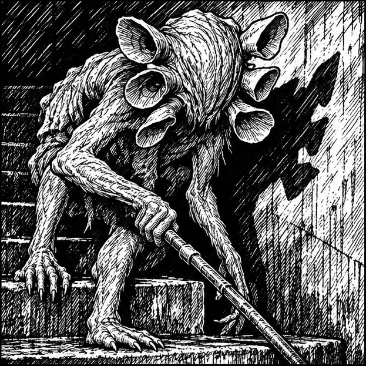
  - 【原典外貌】偽裝為假孫悟空時，與真大聖「同像同音、毛色神通武藝分毫不差」，手持同等級「隨心鐵桿兵」，連唸緊箍咒兩人皆同步滾地喊疼，連觀音法眼、天庭照妖鏡與地府生死簿全數分辨不出；直到遭金缽盂罩住揭開後，方現出頭生六耳之獼猴原形，旋即被一棒打殺。
  - 【本作克蘇魯／昆蟲寄生／偽人重構】本作「**終極恐怖谷偽人（Apex Mimic / Alternate）**」的最高傑作！平時在日光或街燈下，牠能將目標的外觀、指紋、傷疤、聲紋、習慣小動作乃至體味做到 **99.99% 完美鏡像複製**——你即使跟牠面對面坐著喝同一壺茶、並肩熬夜畫符，開了「開天眼」也只會看見跟正主一模一樣的氣脈輪廓！唯獨當光線徹底熄滅、在暴雨傾盆的潮濕暗巷或無窗頂樓陰影裡，那股令所有哺乳動物骨髓發冷的唯一破綻才會悄然現形：**在牠顱骨左右兩側髮際與皮下摺縫間，緩慢彈開並展開各三片（共六片）極度薄濕、半透明宛如蟬翼與螳螂胸部聽覺鼓膜（Tympanal Organ）混生著活體人耳血管紋路的昆蟲聽覺膜片**！那六片滲出透明淋巴黏液的巨大薄濕膜片會在暗處隨空氣中最細微的聲波、心跳與電流聲高頻微顫，耳廓邊緣還密生著感測氣流震動的細微節肢剛毛；瘦骨嶙峋如絞緊鋼索的四肢死死摳進潮濕水泥女兒牆，凹陷炭黑眼窩裡亮著兩點針孔般瘋狂冷靜的慘白死瞳，唇縫僵硬上勾，彷彿正透過六片濕膜一字不漏地偷聽你此刻腦海中還沒說出口的下一句話。
- **特性**：
  - 【原典記載】**全書最駭人的「絕對鏡像複製 × 全知竊聽」魔怪**：1. 憑「善聆音，能察理，知前後，萬物皆明」天賦，立於原地即可竊聽千里之外神仙凡人一切密謀與過往細節，因此對取經團內部矛盾瞭若指掌。2. 變化後連照妖鏡、觀音菩薩、十殿閻羅都辨不出真偽，唯有伏地聽音的諦聽察覺真相卻因懼其戰力等同大聖而不敢點破。3. **最扭曲的是其動機——牠不為吃肉，而是狠打唐僧奪走行李關文、自組假取經團，一心要徹底「取代正主身分」去修成正果、名垂青史**！
  - 【本作衍生】現代台灣都市除妖圈最令人精神崩潰的**「完美身分取代型竊聽魔怪」**！只要你在方圓數十公里內曾口頭討論過作戰計畫、底牌符咒、甚至在深夜空無一人的租屋套房裡對自己嘆過一口氣，牠顱側那六片薄濕昆蟲聽覺膜片早已把一切震動精準還原成你的完整人格資料庫。牠會趁你與戰友爭執落單的瞬間悄然現身，以比你自己還像你的笑容接管你的手機、工作、存款與人際關係，並讓所有認識你的人反過來把真正的你當成瘋子驅逐抹殺！
- **弱點**：
  - 【原典記載】1. **本源真名遭最高階覺者當眾點破時會瞬間心神失守、露出馬腳企圖變作小蜜蜂逃遁**，隨即被先天收容法寶（金缽盂）壓回原形。2. **雖模擬出與孫悟空同等的武藝神通，卻沒有孫悟空歷經八卦爐煉就、吞服蟠桃金丹而成的真正不死金身與天命護持**——一旦被迫顯出原形卸去擬態防禦，竟扛不住真悟空全力一棒便腦漿迸裂當場斃命。
  - 【本作衍生】對付六耳獼猴，一切「事前口頭開會」「無線電通訊」「埋伏設陷阱」全數等同把劇本直接雙手奉上！理論上唯一能撕開牠 100% 偽裝、干擾牠預判的實戰破口是**「極限高分貝感官過載＋全靜默無計畫盲打」**——以多張連環「五雷鎮煞符」配合工地超高頻爆鳴與尖銳金屬刮擦聲，強行把聲壓震波灌進牠那六片極端敏感薄脆的昆蟲聽覺膜片，讓其鼓膜爆裂滲血、被迫縮回摺縫並暫時喪失鏡像預判能力；同時全員嚴禁交談、連心中默唸咒訣都要省去，靠純肌肉反射突圍求生。
- **習性**：
  - 【原典記載】平時極度深藏不露（在被點破真名前三界無人知曉其存在），長年暗中監聽目標動向，精準抓準第 56 回唐僧因草寇事件狠心驅逐悟空、心神最分裂孤立的空檔出手頂替，佔領花果山水簾洞謄寫假關文。
  - 【本作衍生】偏愛在傾盆大雨、強風呼嘯或雷鳴交加的深夜，像巨型濕冷壁虎般蹲伏在老舊公寓頂樓女兒牆、高壓變電站鐵塔或密集電信基地台之間——暴雨與城市萬千雜訊對牠而言非但不是干擾，反而能像擴大機般透過六片薄濕昆蟲膜片折射出方圓數十公里內每棟隔間套房裡的低語、哭聲與心跳；專門狩獵剛陷入孤立、遭信任之人誤解的高階修行者。
- **喜好**：
  - 【原典記載】不貪普通財帛酒色，唯一執念是極度病態的**「取代正主・奪取正統名分與功果」**。
  - 【本作衍生】病態沉迷於竊聽人類獨處時最羞恥、最嫉妒、最見不得光的秘密自語，以及在完美替代對方人生後，冷眼旁觀真正的正主百口莫辯、徹底精神崩潰的瞬間。
- **擅長的招式／異能**：
  - 【原典記載】「隨心鐵桿兵」（與如意金箍棒完全同級之長棒）、「六耳萬物聆音」（聽千里語、知前後因果）、「無破綻鏡像七十二變與筋斗雲」（連緊箍咒劇痛反應都能同步模擬）。
  - 【本作衍生】「六膜全城聲納讀心」（數十公里內任何心跳加速、捏訣關節響、黃符紙摩擦聲皆無所遁形，實現 100% 攻擊預判）、「完美偽人鏡像覆寫」（徹底複製目標肉體特徵、戰鬥習慣與所有三流至巔峰術法，並以更冷酷無破綻的角度反殺正主）、「脫殼化蜂遁逃」（身分徹底曝光遭絕境圍殺時，瞬間收縮成一隻長著六片微膜的高速毒蜂企圖鑽隙遁走）。

---

### [XY3-14] 假取經團猴精群（假唐僧・假八戒・假沙僧・假白馬／劣質偽人傀儡仿冒小隊）
- **出處順序**：第 57 回《真行者落伽山訴苦 假猴王水簾洞謄文》、第 58 回《二心攪亂大乾坤 一體難修真寂滅》
- **類別與造型路線**：`【類人偽人型】`｜劣質皮囊寄生傀儡猴精群
- **物種／唯一性**：`物種（群體）`（原典為六耳獼猴盤踞花果山水簾洞時，驅使山中四名低階猴精強行幻化而成的山寨取經小隊，外加滿山受矇騙的雜毛猴妖群；本作重構為以粗糙寄生黏膜硬撐起變形人皮與馬皮的詭異劣質偽人仿冒小隊）
- **稀有度與道行對照**：`★ 凡級（N）～★★ 稀級（R）`｜模糊道行：數年至數十年淺薄猴妖修為｜本作階位：三流～初級二流
- **外貌與黑暗地牢／恐怖谷視覺改寫**：
  - 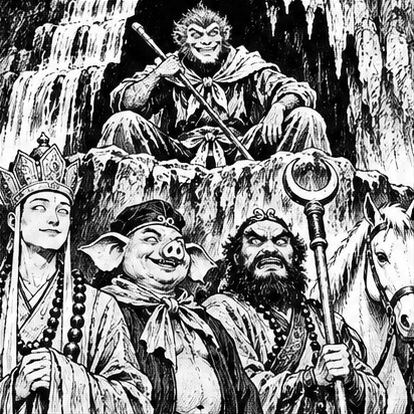
  - 【原典外貌】列立於水簾洞外高臺之下的山寨隊伍，表面模仿唐僧、豬八戒、沙僧與白龍馬扛著搶來的真行李準備出發；但變化火候極差，沙悟淨一怒掣出降妖寶杖打殺假沙僧，當場便被打碎幻相現出「一隻死猴精」原形。
  - 【本作克蘇魯／昆蟲寄生／偽人重構】與六耳獼猴那種 100% 毫無破綻的頂級偽人形成毛骨悚然的對比——這一整支小隊全是**「還沒演化完成、關節與五官處處錯位滲液的劣質偽人傀儡」**！四隻乾瘦、脊背長滿寄生禿癬的病態野猴，靠著六耳獼猴分予的粗糙黏液妖膜，硬生生把自己的血肉與骨骼拉扯膨脹、套進四層快要融化滑落的蠟黃仿冒皮囊裡：**假唐僧**的寬大僧袍下脖頸不自然地反折歪斜，慘白笑臉嘴角僵住不動，雙眼卻像受驚野猴般在眼眶裡瘋狂滴溜亂轉、眼白佈滿血絲與蟲絲；**假八戒與假沙僧**的臉頰像受潮膨脹起泡的劣質矽膠面具，縫隙不斷往外滲出透明黏滑屍涎，說話時下巴脫臼開合、重複著斷續走音的機械模仿語調；最詭異的**假白馬**則是四條馬腿關節全部反折向內、走起路來發出喀嗒骨響，濕黑馬蹄的裂縫裡赫然伸出幾根緊抓地面的發黑帶爪猴指！一旦遭到致命重擊，那層充氣般的劣質偽人皮囊便會「噗滋」一聲爆裂塌陷，噴出腥臭腐水並露出一具骨折扭曲的乾瘦猴妖屍體。
- **特性**：
  - 【原典記載】完全沒有六耳獼猴的頂尖變化神通，純粹是拿來撐場面的廉價贗品；但勝在成群結隊且背後有漫山遍野猴群助陣，能靠人數蜂擁纏住落單對手（曾圍攻逼退前來討行李的沙僧）。
  - 【本作衍生】高階大妖（特別是擅長心理操控與資訊戰的偽人巨怪）在現代都市裡最常用的**「低成本人質誘餌／監視器混淆傀儡小隊」**。在陰暗巷道、濃霧山路或遠距離街頭監視畫面下，這批劣質偽人足以騙過一般路人、警察與沒有開天眼的菜鳥法師，藉此製造假不在場證明或引誘除妖師因誤以為是無辜凡人／自己隊友而猶豫遲疑。
- **弱點**：
  - 【原典記載】單體實力與防禦極為脆弱，連沙僧一記普通降妖寶杖便當場打殺現原形，毫無硬抗正統法器之力。
  - 【本作衍生】只要抹上「開天眼符水」或甩出「破障符」，牠們粗糙搖晃的偽人皮囊立刻就會出現大面積重疊破圖與蠕動猴影；體魄僅三流至初級二流，單張「烈火符」即可把牠們渾身易燃黏液與劣質皮囊燒得鬼哭狼嚎，近身「掌心雷」或鈍器重擊更能一擊爆殼擊殺。
- **習性**：
  - 【原典記載】盲目服從強大猴王號令，披上搶來的僧衣、牽著假馬扛著真行李在水簾洞前排演取經鬧劇。
  - 【本作衍生】在台灣現代都市裡，常於深夜末班捷運站出口、偏遠登山步道涼亭或廢棄學校走廊裡三五成群出現——偽裝成**「步伐完全同步、臉上掛著同一種僵硬空洞微笑、不管問什麼都只會重複同一兩句日常寒暄的詭異登山團／加班小隊」**，專門把落單誤認熟人的目標一步步引進包圍死角。
- **喜好**：
  - 【原典記載】原典未載飲食私好，唯顯野猴天性酷愛胡亂模仿人類衣冠舉止、狐假虎威。
  - 【本作衍生】病態沉迷於翻找廢棄公寓衣櫃與垃圾場裡的人類西裝、制服、眼鏡與假髮，一邊發出尖銳刺耳的吱吱怪笑、一邊像蟲子套殼般強行塞進不合尺寸的衣服裡對著破鏡子排練人類表情。
- **擅長的招式／異能**：
  - 【原典記載】「劣質畫皮仿冒變化」、「猴群蜂擁擲石圍毆」。
  - 【本作衍生】「僵硬偽人遲疑陷阱」（模仿除妖師身邊同事、主管或無辜路人站在死角呼喚名字，趁對方猶豫不敢丟符的那半秒鐘，整隊同時撕開蠟黃假臉四面撲咬頸動脈）、「爆囊腐涎噴濺」（被打死爆殼時飛濺出的腥臭黏液具輕微眼部刺激性，用以掩護後方同夥或真身撤退）。

---

### [XY3-15] 諦聽（善聽／幽冥伏地辨真・多耳聽覺節肢觸角怪獸）
- **出處順序**：第 58 回《二心攪亂大乾坤 一體難修真寂滅》
- **類別與造型路線**：`【非人生物恐怖型】`｜幽冥伏地辨真怪獸（多耳節肢聽覺觸角與聲納鼓膜異獸）
- **物種／唯一性**：`獨一無二`（原典為常伏幽冥經案之下、須臾間俯地即辨真假美猴王的無雙聽音怪獸；**本作嚴格剝離神佛仙獸神格，純作幽冥陰暗地穴中演化出極致聽覺節肢器官的太古辨真怪獸建檔**）
- **稀有度與道行對照**：`★★★★ 絕級（SSR）`｜模糊道行：無量歲月幽冥棲息異獸（**情報辨偽與聽覺感知達「規格外」頂點**，正面肉搏則遠遜巔峰妖王）｜本作階位：一流頂～巔峰（純感知特化型怪獸；亦為本作巔峰感知技「諦聽因果」之生物原型）
- **外貌與黑暗地牢／恐怖谷視覺改寫**：
  - 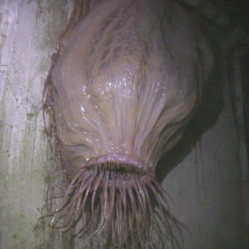
  - 【原典外貌】《西遊記》原典第 58 回僅載其名「諦聽（善聽）」、常俯伏於幽冥經案之下，將耳緊貼地面須臾之間便可照鑒三界善惡賢愚與妖魔真身，原典並未描寫其肢體拼合外觀（虎頭獨角犬耳龍身等細節屬後世民俗傳說）。
  - 【本作克蘇魯／昆蟲寄生／偽人重構】徹底推翻民俗吉祥白犬瑞獸，重構為一頭盤踞在潮濕陰冷幽冥地牢石板縫隙間、令人直視便毛骨悚然的**「多耳節肢聽覺觸角怪獸」**！牠完全沒有眼睛（原本眼窩處徹底被慘白厚實的鈣化幾丁質骨甲封死，呈現盲眼洞穴生物的死寂蒼白），臃腫低伏的蒼白環節軀幹由八對細長反折、末端生有微細震動感應毛的節肢步足撐在濕冷石面上；最令觀者理智震顫的是牠頭部與整條脊背——從顱側一路蔓延至肩胛，密集生長並平貼地面展開了**十二對（二十四片）宛如巨大蛾類羽狀觸角、濕滑環節肉葉與細密人耳迷宮軟骨融合而成的巨型「聽覺節肢觸耳」**！當牠進入「伏地辨真」狀態時，整具軀體如變形蟲般壓扁緊貼冰冷地面，數十條濕亮半透明的聽覺觸鬚與耳膜片如扇面般無聲輻射鋪開、貼死每一條地板裂縫，表面浮現密密麻麻隨地底次聲波劇烈高頻顫動的細黑血管網，甚至從腹側垂下數根如水螅觸手般的震動探針直接鑽進石縫吸取地脈微震——宛如一台長滿耳朵與昆蟲觸角的活體克蘇魯幽冥測謊巨怪！
- **特性**：
  - 【原典記載】**全書最強「資訊偵測與絕對破偽怪獸」**——連照妖鏡照不出、觀音分不清、緊箍咒辨不得、生死簿查不到的「六耳獼猴」，唯獨諦聽俯伏貼地須臾一聽便立刻洞悉其「不入十類・混世四猴」的全部底細！同時具備極冷靜的生存理性：深知自己與幽冥眾鬼皆擒不住戰力等同大聖的瘋猴，若當場揭穿只會招來滅頂之災，遂絕口不吐實情，只吐露四字提示將災星引離幽冥。
  - 【本作衍生】本作 [02-招式修行篇](../../02-招式修行篇.md) 巔峰感知技「**諦聽因果**」的終極生物原型！牠貼地展開的節肢觸耳網能直接感應並解碼跨越數百公里的地殼震動、空氣次聲波、物體血脈頻率與殘留於空間中的「罪業聲紋」——無論偽人怪物的皮囊有多完美、障眼法有多厚重，只要牠雙足站過地面、心臟跳動過哪怕一下，在諦聽的聽覺觸角裡就像黑夜裡的一盞強光探照燈般赤裸無遺。
- **弱點**：
  - 【原典記載】**極致偏科的「零擒拿軟肋」**——諦聽自己坦承「若論妖邪，能辨認，但不能擒拿」，面對六耳獼猴這等正面頂尖戰力毫無硬扛與壓制手段，只能靠沉默避禍保命。
  - 【本作衍生】1. **近戰防禦與攻擊薄弱**：沒有劇毒尾針、也沒有撕裂鋼筋的蠻力，龐大脆弱的外部聽覺節肢觸耳與半透明鼓膜一旦遭高強度爆裂物、近身「烈火符」直接灼燒或極端超高分貝音爆轟炸，便會劇烈蜷縮滲液、陷入嚴重感官休克。2. **離地失聰**：若目標完全懸空飛行、隔絕地面固體傳導介質並以頂級靜音結界封閉氣流，其伏地探測精度會顯著下降。
- **習性**：
  - 【原典記載】常年溫順卻孤僻地俯伏在幽冥陰暗案下閉目貼地聽音，極少離開老巢，奉旨辨偽卻絕不主動捲入無勝算的血戰。
  - 【本作衍生】絕不現身光亮嘈雜的現代地表都市，唯獨潛伏在深層廢棄防空洞、地底陰冷古墓、跨海隧道深處的乾燥岩石裂隙或百年古老地藏陰廟正下方百公尺的潮濕暗穴裡；平時如一團慘白多耳化石般一動不動地「收聽」整座城市地下管線裡傳來的每一次謊言、謀殺與妖怪爬行聲。
- **喜好**：
  - 【原典記載】原典未載飲食嗜好，唯顯其性情審慎明哲保身、重安穩秩序而厭惡血腥大亂。
  - 【本作衍生】嗜吸極度陰冷安靜的地下礦脈濕氣，本能厭惡一切嘈雜無意義的工業噪音、工地打樁機震動以及任何企圖用假皮囊欺騙聽覺的偽人怪物（卻極聰明地只在安全距離外標記牠們，絕不親自搏命）。
- **擅長的招式／異能**：
  - 【原典記載】「伏地聽三界」（雙耳貼地須臾間辨明四大部洲一切妖魔真身、原形與來歷因果，連混世四猴皆無法隱瞞）。
  - 【本作衍生】「地脈觸耳聲納網」（二十四片節肢聽覺觸耳緊貼地縫鋪展，無視牆壁、鋼筋與任何一～巔峰階障眼法／偽人擬態，精準讀取目標真實物種原型、過去殺業紀錄與肉身致命破口）、「次聲波靜默警訊」（不開口出聲，僅透過微弱地底頻率把情報直接震入指定對象的耳骨裡，避開被高階竊聽妖物截獲）。

---

## 🌋 八、第 59～61 回：火焰山・翠雲山芭蕉洞與積雷山摩雲洞篇

### [XY3-16] 芭蕉洞・鐵扇公主／羅剎女（鐵扇仙／枯葉螳螂鐮肢震風偽人貴婦）
- **出處順序**：第 59 回《唐三藏路阻火焰山 孫行者一調芭蕉扇》、第 60 回《牛魔王罷戰赴華筵 孫行者二調芭蕉扇》、第 61 回《豬八戒助力敗魔王 孫行者三調芭蕉扇》
- **類別與造型路線**：`【類人偽人型】`｜偽人貴婦皮囊・巨型枯葉螳螂鐮肢與震風蟲翼妖
- **物種／唯一性**：`獨一無二`（原典為翠雲山芭蕉洞修道羅剎女、牛魔王結髮正妻、紅孩兒生母，執掌唯一先天太陰芭蕉扇；本作重構為在端莊怨毒偽人貴婦皮囊下暗藏巨型枯葉螳螂捕食鐮肢與高頻震風巨大蟲翼的絕級氣象妖母）
- **稀有度與道行對照**：`★★★★ 絕級（SSR）`｜模糊道行：千年得道羅剎女妖（近戰遜於孫悟空，執掌芭蕉扇具準巔峰戰略毀滅力）｜本作階位：一流頂（持扇／全展蟲翼時具準巔峰級區域滅絕風壓）
- **外貌與黑暗地牢／恐怖谷視覺改寫**：
  - 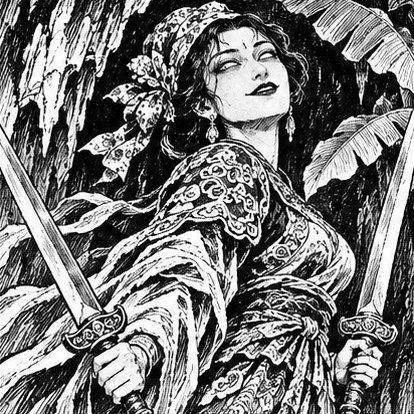
  - 【原典外貌】頭裹團花手帕、身穿納錦雲襖、腰繫雙彩霞裙、足踏鳳頭繡鞋，容貌俊俏卻煞氣凌人；手提兩口「青鋒寶劍」，口中含藏一枚如杏葉般細小、唸訣即暴漲成一丈二尺的先天太陰「芭蕉扇」；終局為保夫君牛魔王性命，素衣赤足跪獻真扇。
  - 【本作克蘇魯／昆蟲寄生／偽人重構】徹底剝除傳統仙俠古裝美婦感，以**「巨型枯葉螳螂（Dead Leaf Mantis）× 恐怖谷怨婦偽人」**重新鑄骨！遠看是一位身材過度纖細瘦長、身穿深色高領絲絨古式長襖、靜立於悶熱玄武岩洞窟陰影中的蒼白貴婦——然而她那張無瑕的偽人臉龐雙頰極度凹陷、頸部與手腕細得像快要折斷的枯枝，雙瞳深處閃著螳螂特有的冰冷偽瞳黑點（無論你走到哪個角度，黑點都像鎖死獵物般直盯著你的咽喉！）。一旦暴怒動武，她雙袖與華美背衣轟然裂開，藏於偽人雙臂皮下的根本不是人類骨骼與普通鐵劍，而是兩對泛著青黑枯葉脈紋、內緣密排雙列剃刀倒棘的**巨型枯葉螳螂捕食鐮肢**（即原典「青鋒雙劍」之生物恐怖實體化）！更駭人的是她從喉口吐出那枚青黑濕滑的「杏葉」並與背後裂開的肩胛甲縫合鳴的瞬間——肩背劇烈撕裂，猛然展開兩對高過兩層樓、佈滿深邃焦黑血管葉脈、半透明乾脆得像風乾枯萎芭蕉葉的**巨型震風昆蟲鞘翼（太陰芭蕉扇原型）**！蟲翼高頻劇烈震顫扇動之際，刺耳的昆蟲翅膜尖鳴震碎耳膜，捲出足以將整條馬路與高架橋掀翻抽空的漆黑陰冷颶風洞！黑白墨線強調枯葉脈絡般的焦黑蟲翼網格、細長偽人鎖骨下翻開的鐮肢刀棘，以及嘴角滲出冷茶泡沫與暗紅唇印的怨毒眼神。
- **特性**：
  - 【原典記載】1. 壟斷八百里火焰山周遭十年間的滅火祈雨權柄，享百姓四時八節豬羊果品香火奉獻，形同地方氣候霸主。2. 懷抱極深母子離散之恨（記恨悟空害獨子紅孩兒遭收走）與丈夫背叛積怨（牛魔王拋下她兩年去積雷山陪玉面狐狸精），剛烈怨毒（一扇搧飛悟空五萬四千里，被鑽入腹中痛極求饒時仍寧死掏假扇陰他）。3. 雖怨恨薄倖夫君，卻外剛內柔、終究捨命護夫。
  - 【本作衍生】極度危險的**「區域氣象壓制 × 高頻震翼鐮殺偽人妖母」**。她背後的枯葉震風蟲翼不只是單純吹風，而是透過極高頻率拍動製造定向「真空切變陰風暴」與零下冷壓氣旋，能瞬間把數百公尺內的一切明火連同氧氣一併抽乾撕碎，同時以兩對螳螂鋸齒鐮肢在暴風眼內進行高速斬首捕食。
- **弱點**：
  - 【原典記載】1. **近身正面武藝與法力遜於頂尖大聖**（雙劍交手數合即臂軟筋麻，全靠芭蕉扇鎮場）。2. **芭蕉扇遭「定風丹」絕對剋制**（遇服下定風丹者連扇數下紋絲不動，反致自己慌亂敗走）。3. **腹腔防禦空虛與情感盲點**（喝熱茶時被化蟲鑽腹折磨得死去活來；又因思夫心切被假牛魔王輕易騙出收放口訣與真扇）。
  - 【本作衍生】在空曠街區、天台或大馬路與她開戰無異於自殺（震風蟲翼一扇即把法師捲上百米高空摔成肉泥）；實戰破局必須**將戰場壓縮至狹窄無風的地下密室／混凝土防空洞（迫使她龐大的枯葉震風蟲翼無法完全張開拍振）**，並提前以高階「指地成鋼符」死死錨定腳下水泥避免遭氣流捲飛；此外，她的枯葉蟲翼極度乾燥薄脆，一旦在其振翼間隙以連環高溫「烈火符」或黏稠工業瀝青／強膠噴霧沾重其翅膜，便能徹底破壞其高頻震動平衡，隨後專攻其缺乏甲殼保護的細長偽人腹腔。
- **習性**：
  - 【原典記載】長居距火焰山一千四百五十里之翠雲山芭蕉洞（洞中清靜幽雅，僅有少數小丫鬟服侍），平日孤寂清修、待十年輪祭期滿才出面借風滅火。
  - 【本作衍生】在現代台灣都市多潛居於陽明山深處終年濃霧強風吹襲的荒廢老派獨棟洋房、或北海岸背山面海的陰冷舊別墅裡；平時極少出門，整棟宅邸周邊百公尺常年刮著陰寒刺骨的詭異陣風，連盛夏三十八度酷暑也會在門口驟降十幾度，地面鋪滿永不清掃、在暗處微微抽動如昆蟲殘翼的潮濕枯蕉葉。
- **喜好**：
  - 【原典記載】酷愛飲用滾燙熱茶（連日惡戰口渴索茶反被化作蟭蟟蟲的悟空混進茶沫鑽肚）、看重地方百姓隆重祭祀禮數，並深愛丈夫牛魔王與獨子紅孩兒。
  - 【本作衍生】病態嗜飲剛沖泡、冒著濃厚白煙的炭焙老烏龍熱茶（用以舒緩高頻震翼導致乾裂發痛的蟲膜與咽喉）；厭惡嘈雜高溫與任何背叛誓約的薄情雄性，偶爾像雌螳螂般在潛意識裡懷有「啃下背叛伴侶頭顱」的殘酷衝動。
- **擅長的招式／異能**：
  - 【原典記載】「太陰芭蕉扇」（一扇熄火、二扇生風、三扇下雨，唸七字口訣變大、唸「𠼭」字縮如杏葉藏口中；一扇可將無防備者搧飛五萬四千至八萬四千里）、「青鋒雙劍」、「假扇引火反噬計」。
  - 【本作衍生】「枯葉震風真空暴」（全開兩對枯葉巨型蟲翼高頻猛拍，瞬發撕裂柏油與玻璃幕牆的定向零下陰颶風並瞬間抽空周遭氧氣，令敵人窒息失衡）、「螳螂雙鐮剪首殺」（藉逆風壓制對手視線，皮下彈出兩對帶倒棘鋸齒鐮肢交叉合剪腰斬目標）、「假扇焦炭陷阱」（故意拋出能引爆高熱的偽造火脈蟲翼誘餌，讓企圖反奪法寶的敵人反被烈火焚身）。

---

### [XY3-17] 積雷山・玉面狐狸精（玉面公主／吸血纖毛節肢尾偽人嬌妻）
- **出處順序**：第 60 回《牛魔王罷戰赴華筵 孫行者二調芭蕉扇》、第 61 回《豬八戒助力敗魔王 孫行者三調芭蕉扇》
- **類別與造型路線**：`【類人偽人型】`｜寄生吸血纖毛與節肢尾根偽人狐怪
- **物種／唯一性**：`物種特異個體`（原典為亡故千年大妖「萬歲狐王」獨生愛女、繼承百萬家私招贅牛魔王為護衛的積雷山摩雲洞女妖，洞中尚有成群低階狐僕小妖；本作重構為在過分甜膩奢華的偽人嬌妻皮囊底下密布吸血纖毛與多節濕亮尾根的寄生財閥女妖）
- **稀有度與道行對照**：`★★ 稀級（R）`｜模糊道行：數百年狐妖修為（家財萬貫但自身近戰實力薄弱）｜本作階位：二流
- **外貌與黑暗地牢／恐怖谷視覺改寫**：
  - 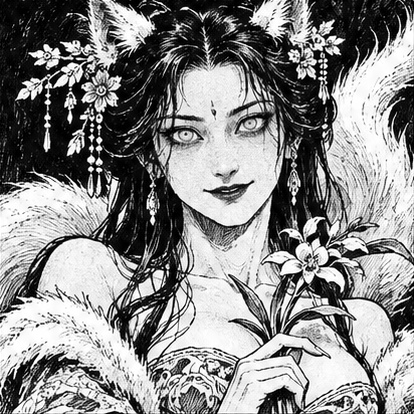
  - 【原典外貌】第 60 回手折一枝香蘭嬝嬝行來，「嬌嬌傾國色，緩緩步移蓮，貌若王嬙，顏如楚女」，極盡富貴嬌美之態；第 61 回摩雲洞遭攻破時挺劍救夫，被豬八戒順手一釘鈀築死，剝開衣裙現出「一隻白面狐狸精」死屍。（*原典補註*：其亡父**萬歲狐王**早逝未正面出場，僅由他人交代其遺留百萬家私予獨女。）
  - 【本作克蘇魯／昆蟲寄生／偽人重構】徹底消滅毛絨可愛狐狸精刻板印象，將其打造為**「高訂名媛偽人皮囊 × 吸血纖毛寄生節肢尾怪」**的陰濕恐怖谷標本！外表是一位過度精修、白皙得像剛打了過量玻尿酸與慘白蠟粉的高級名媛嬌妻，裹著昂貴厚重的絲絨皮草大衣、指尖塗著如乾血般發黑的亮面指甲油、手裡總折著一枝散發過濃腐甜香氣的蘭花。但只要她受驚尖叫或發動進食本能，那張完美無瑕的「玉面」便會沿下顎與耳際如發濕宣紙般繃裂外翻——細看才赫然驚覺，她皮膚表層與皮草大衣內裡根本不是狐毛，而是**密密麻麻數以萬計、宛如蚊蟲口針與海葵微纖毛般細長蠕動、尖端不斷滴落抗凝血透明涎液的蒼白「吸血纖毛」**！而她纖細尾椎處裂開的絲綢裙擺之下，並無蓬鬆毛尾，而是猛然抽出三根關節卡響、佈滿濕亮黑紅幾丁質甲節、末端裂開如吸血水蛭口盤般吸附滿金銀碎屑與人血痂的**粗長節肢尾根**！一旦遭重擊破防，整副昂貴名媛外殼便會像洩氣的人皮氣球般垮成一灘腐臭毛纖維與斷裂的慘白細長節肢尾骨。
- **特性**：
  - 【原典記載】**全書最標準的「超高財力、超低武力、重金雇傭頂級打手」型富家女妖**：深知自己繼承亡父萬歲狐王百萬家私卻無力自保，遂精明地以全部家財招贅平天大聖牛魔王當貼身保鑣兼夫君（甚至容忍牛魔王定期送錢安撫原配鐵扇公主）；卻因長期被巨富與強權寵壞、眼界狹窄，竟敢當面怒罵齊天大聖「潑猴」自招滅門。摩雲洞小妖亦毫無戰力，洞破即滅。
  - 【本作衍生】在現代台灣都市代表**「握有龐大黑產靈材庫藏、專靠砸錢包養頂級雄性大妖替自己殺人清場的寄生千金偽人」**！她的吸血纖毛能悄無聲息地透過肌膚親密接觸、或藏在高級訂製衣物與香蘭花瓣裡，長期緩慢吸取周遭凡人與強大妖王溢出的精氣來維持自己不腐不老的「玉面偽人殼」，同時用取之不盡的財富與古董法寶懸賞追殺任何敢擋她路的除妖師。
- **弱點**：
  - 【原典記載】**自身正面近戰與防禦極度脆皮**——一旦牛魔王被調離身邊，她面對豬八戒連一個回合都撐不住，當場被一釘鈀築死現出白狐死屍原形，滿洞小妖與豪華摩雲洞更被一把大火燒成白地。
  - 【本作衍生】典型的**「調虎離山後的極脆斬首目標」**！她全身密布的皮下吸血纖毛與沾滿高濃度香水的偽人蠟皮**極度易燃**——只要先設局引開她身邊的高階護衛大妖，二流（甚至做足準備的三流頂）法師只要以「開天眼符水」看穿她濃烈香蘭味背後的腐血狐騷，連續甩出數張自製「烈火符」即可瞬間點燃她整層吸血纖毛大衣，令她節肢尾根焦捲斷裂、毫無還手之力便化作焦屍。
- **習性**：
  - 【原典記載】盤踞富麗堂皇的積雷山摩雲洞，終日折香蘭在松陰石畔閒遊享樂，憑萬貫家財供養牛魔王並極力排斥正房鐵扇公主。
  - 【本作衍生】在台灣現代最可能潛伏於信義區或七期豪宅頂層空中花園、封閉式高端私人珠寶拍賣會所與頂級醫美抗老俱樂部；名下透過層層人頭公司掌控地下典當、古董洗錢與黑市靈材流轉，習慣將貼身男寵或失蹤模特兒鎖在恆溫地下衣帽間裡，用皮下吸血纖毛慢慢吸乾青春精血。
- **喜好**：
  - 【原典記載】喜愛折採香蘭鮮花、奢華珠翠衣飾與受絕世強者庇護的虛榮安全感，極度鄙視容貌醜陋粗鄙之徒。
  - 【本作衍生】酷愛濃烈到令人頭暈的玫瑰麝香與蘭花香精（用以蓋住吸血纖毛吸飽血後的鐵鏽腥臭）、閃耀冷光的鑽石名錶，以及用鉅額現金操縱暴戾雄性大妖彼此撕咬的病態控制感。
- **擅長的招式／異能**：
  - 【原典記載】原典未載特異法寶，僅能提普通寶劍自衛（一擊即潰）；真正殺招實為亡父萬歲狐王所遺「百萬家私」的鈔能力與靠山召喚。
  - 【本作衍生】「千金懸賞圍殺網」（瞬間砸出鉅額現金與高階妖丹，動員整片都會區數十隻二三流地下惡妖同時獵殺目標）、「吸血纖毛擁抱」（偽裝驚慌柔弱撲入獵物懷裡，皮下數萬根微細吸血口針瞬間刺穿衣物與皮膚同步吸乾血氣並注入麻醉腐香）、「節肢尾根偷襲」（裙擺下三條漆黑多節吸盤尾猛然甩出纏絞腳踝）。

---

### [XY3-18] 大力牛魔王（平天大聖／數百丈多足甲殼黑泥腐蟲牛魔怪獸）
- **出處順序**：第 60 回《牛魔王罷戰赴華筵 孫行者二調芭蕉扇》、第 61 回《豬八戒助力敗魔王 孫行者三調芭蕉扇》（早於第 3～4 回與悟空等七大聖結義居首稱「平天大聖」，於本卷展現全書最震撼之巔峰本相與終局）
- **類別與造型路線**：`【非人生物恐怖型】`（常態披掛魁梧黑幫教父偽人外殼，破甲即現數百丈多足甲殼牛魔真身）｜太古巨型多足甲殼腐蟲牛魔怪獸
- **物種／唯一性**：`物種特異個體`（原典為苦修數千載之太古大白牛精、妖界七大聖之首「平天大聖」，全書極少數**完全不靠偷盜先天至寶、純憑自身硬體神通打到滿天神佛跨界合圍方伏法**的無雙妖王；本作重構為體長數百丈、滿身厚重裂甲與關節噴湧黑泥腐蟲的移動生物災厄巨獸）
- **稀有度與道行對照**：`★★★★★ 神級災厄（UR）`｜模糊道行：數千年～萬年太古妖聖（純肉身、棍法、七十二變與法天象地全數並肩齊天大聖）｜本作階位：巔峰
- **外貌與黑暗地牢／恐怖谷視覺改寫**：
  - 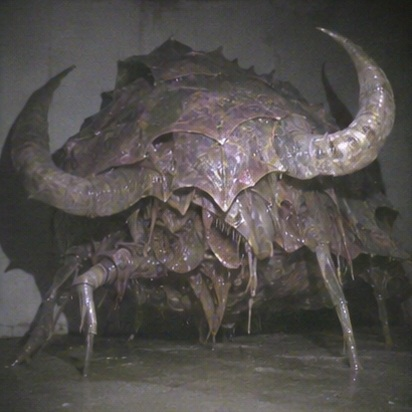
  - 【原典外貌】
    1. **人形戰將態**：頭戴水磨熟鐵盔、身穿黃金甲（赴宴時換穿「鴉青剪絨襖子」）、眼光如明鏡、眉艷似紅霓、口若血盆、齒排銅板，手持沉重無比的「渾鐵棍」（詩讚亦見雙刃青鋒寶劍）。
    2. **法天象地原形（第 61 回壓軸巨獸相）**：一頭「頭如峻嶺，眼若閃光，兩隻角似兩座鐵塔，牙排利刃；連頭至尾，有千餘丈長短；自蹄至背，有八百丈高下」的遮天大白牛；遭利刃連斬十餘顆巨頭，竟從斷頸腔子裡湧出黑氣隨砍隨長、頭顱再生不絕！
  - 【本作克蘇魯／昆蟲寄生／偽人重構】徹底揚棄傳統厚毛大白牛或漫畫肌肉牛頭人，昇華為**「克蘇魯級黑暗地牢・數百丈多足重甲腐蟲牛魔怪獸」**！
    - **偽人黑幫巨漢態**：平日披著一具高逾兩米五、身穿厚重鴉青大衣的魁梧教父外殼，但細看他寬闊頸項與衣領縫隙，皮膚已呈慘白死硬的層疊甲殼質地，每一次粗重鼻息都噴出帶有濃烈沼澤腐泥臭氣的黑灰煙霧，張嘴大笑時整排寬厚扁平如生鏽銅板的巨齒縫隙裡竟爬動著細小食腐黑甲蟲。
    - **數百丈多足甲殼牛魔真身**：一旦全面暴走解放法天象地，整片都會夜空徹底陷入窒息死寂——一頭連頭至尾蔓延數百丈、高聳超過摩天大樓群的**慘白巨型多足甲殼牛魔巨獸**硬生生撞碎雷雲與高架橋！牠全身並非柔軟牛毛，而是由無數塊慘白如巨大風化獸骨與暗黑濕亮幾丁質堆疊而成的**重型腐蝕甲殼板塊**；原本四蹄位置裂化衍生出**六對（十二條）宛如攻城巨柱與巨型馬陸／步行蟲肢節融合而成的慘白多足甲殼巨肢**，每一道粗大關節接縫在邁步彎折時都會發出鋼樑斷裂般的巨響，並從關節裂縫與背脊氣孔裡**狂湧出滾滾漆黑黏稠的瀝青黑泥、成團翻湧的蒼白腐蛆與遮天蔽日的噬肉腐食甲蟲群**！頭頂兩根如扭曲高壓電塔鐵架般直插雷雲的漆黑巨角布滿寄生瘤結與鈣化尖刺；最恐怖的是當牠龐大的牛骸巨頭遭強敵斬斷時，粗大斷頸腔裡不會噴紅血，而是如深海火山口般狂噴沖天黑泥與數以萬計的高速蠕動腐蟲，無數腐蟲在半秒內彼此咬合鈣化成骨骼與新甲殼，硬生生重新拼築出一顆張開血盆口器咆哮的嶄新巨型牛魔頭顱！
- **特性**：
  - 【原典記載】**《西遊記》妖界最純粹、最硬派的無外掛巔峰霸主**：
    1. **硬實力平肩齊天大聖**：憑一根渾鐵棍正面力戰孫悟空一百餘回合絲毫不落下風，直到豬八戒加入合圍百餘合方漸處劣勢。
    2. **精通「地煞七十二變」與「法天象地」**：與悟空展開連環禽獸變化死鬥（天鵝、黃鷹、白鶴、香獐、金錢豹、人熊逐一相剋變換），最後更現千丈原形正面硬撼。
    3. **駭人的黑氣斷頭再生**：被連斬十餘顆巨頭仍能從腔中冒黑氣隨砍隨長，唯有照妖鏡定住元神本相、三昧真火直烤牛角，加上天羅地網四面死鎖，方才被迫屈服。
    4. **極高智商與龐大妖界人脈**：發現真扇被假牛魔王騙走後，立時冷靜反手**變作豬八戒**把芭蕉扇重新騙回來！家勢橫跨翠雲山、解陽山、火雲洞、積雷山，並與碧波潭萬聖龍王、九頭蟲交好。
  - 【本作衍生】在本作設定裡代表**「脫離一切正統秩序體系、以自身絕對暴力與龐大地下家族網路割據一方的終極災厄級怪獸教父」**！他關節不斷溢出的黑泥與腐蟲所經之處，整條都市柏油路會迅速腐爛泥化為吞噬車輛與人員的暗黑泥沼地牢，且憑「黑泥腐蟲再生機制」徹底無視一般斬首與物理重創。
- **弱點**：
  - 【原典記載】1. **孤身難敵跨界頂級群雄合圍**（悟空＋八戒夾擊已顯吃力，遭四面封死全部退路即成困獸）。2. **畏懼「照妖鏡」鎖定元神本相**（一旦本相遭定死，無法再憑七十二變脫身或化小逃匿）。3. **畏懼高階真火直灼雙角靈樞**（斬首斬不死，但用真火套燒雙角便劇痛難忍、徹底失去戰鬥意志）。4. **重江湖面子愛赴宴、且背負龐大家族因果弱點**（第 60 回打到一半因不肯失約碧波潭老友酒宴而停戰赴會，竟給悟空留下偷騎辟水金睛獸直搗芭蕉洞的致命空窗）。
  - 【本作衍生】凡人除妖師（從三流至一流）遇見大力牛魔王沒有任何正面單挑或存活機會；理論上唯有同時滿足三項嚴苛條件的「聯合圍剿」方能壓制其不死腐甲再生：**1. 頂級定形破妄法寶鎖死其巨型甲殼本相（斷其七十二變）**；**2. 切斷四面地下水道與空中退路**；**3. 以連綿不絕的高階真火（非普通三流烈火符凡火）集中焚燒其雙角根部與關節黑泥噴口**，把所有負責修補頭顱的腐蟲群直接燒成乾灰，方能終結其斷頭再生。
- **習性**：
  - 【原典記載】原居翠雲山芭蕉洞，兩年前招贅積雷山摩雲洞坐享玉面公主家產（但仍定期命小妖送珠翠米油回翠雲山安撫原配）；極重兄弟交情與江湖排場，一有龍宮或大妖酒局便穿戴體面騎獸赴宴。
  - 【本作衍生】在現代台灣都市最常化身為掌控跨縣市龐大地下物流、土方黑道與跨界妖脈的「神祕老牌重工財團教父」——北台灣有陰冷老家宅邸（正房芭蕉洞）、中南部豪奢新歡會館（摩雲洞），平日愛穿深色剪絨長大衣出席各大水域與深山妖頭的深夜私廚酒局；只要沒人觸犯他的家族逆鱗或擋他酒局財路，他多半懶得對底層散修出手。
- **喜好**：
  - 【原典記載】酷愛結交豪傑大妖飲酒赴華筵（跟悟空血戰中途聽到碧波潭請吃飯立刻休戰換衣服）、好美色與巨富財力、極愛擺大哥威風並極度護短親人（為兒紅孩兒與弟如意真仙決意血戰結拜兄弟悟空）。
  - 【本作衍生】嗜飲烈度極高的陳年老酒、沉迷老派江湖輩分禮數、偏愛極濕潤富含腐植質的深層暗泥（用來滋養關節裡共生的黑泥腐蟲），忌食同類牛肉且極度痛恨背後耍陰招算計他妻兒的敵手。
- **擅長的招式／異能**：
  - 【原典記載】「渾鐵棍」（力敵金箍棒百餘合之頂級妖兵；兼通青鋒雙劍）、「地煞七十二變」（禽獸萬物連環對變，亦能精準偽裝他人反騙法寶）、「法天象地・千丈白牛真身」、「黑氣斷頭再生」。
  - 【本作衍生】「百丈多足崩城踏」（徹底現出數百丈多足甲殼牛魔真身，十二條巨肢踏過處地殼龜裂、整片都會街區在震波下夷為平地）、「關節黑泥腐蟲潮」（自所有甲殼關節縫隙高壓噴湧漫街黑泥與數十萬隻噬骨腐甲蟲，將現代街道瞬間轉化為令人寸步難行的黑暗地牢腐沼）、「腐蟲擬骨斷頭再生」（遭斬首或炸毀半身後，瞬間由噴湧黑泥與腐蟲群強行咬合凝結出全新牛魔頭甲，唯高階真火持續燒灼角根可止）。

---

### [XY3-19] 辟水金睛獸（避水金睛獸／水陸兩棲節肢鱗甲坐騎怪獸）
- **出處順序**：第 60 回《牛魔王罷戰赴華筵 孫行者二調芭蕉扇》、第 61 回《豬八戒助力敗魔王 孫行者三調芭蕉扇》
- **類別與造型路線**：`【非人生物恐怖型】`｜水陸兩棲重殼節肢鱗甲斥液怪獸
- **物種／唯一性**：`獨一無二`（原典為大力牛魔王專屬神駿坐騎，可半雲半霧跨山越海並自動分開萬丈深潭潭水；本作重構為完全去獅虎毛皮化、披覆滑膩幾丁質流體鱗甲與六對半隱藏游水節肢的兩棲斥液重裝怪獸）
- **稀有度與道行對照**：`★★★ 珍級（SR）`｜模糊道行：千年異獸靈騎（極端特化於水陸空全領域高速機動與斥液防禦）｜本作階位：二流頂～一流
- **外貌與黑暗地牢／恐怖谷視覺改寫**：
  - 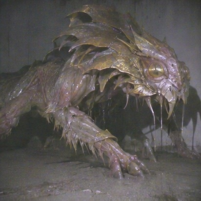
  - 【原典外貌】原典未詳寫毛色骨節，僅從名號與情節可見其**雙目灼灼如黃金精光、體格壯碩足以穩載魁梧牛魔王**，平時拴於潭邊或洞口大樹之下；縱身躍入萬丈碧波潭能自然分開潭水直抵水府滴水不沾，亦能「半雲半霧」凌空奔馳千里。
  - 【本作克蘇魯／昆蟲寄生／偽人重構】徹底洗去傳統麒麟獅子坐騎造型，重構為一頭介於**深海巨型等足蟲（大王具足蟲）、甲冑龍蝦與盲鎧兩棲節肢爬獸**之間的極致黑暗地牢重裝坐騎怪獸！牠體型如一輛低矮寬厚的裝甲休旅車，通體不見一根毛髮，而是披覆著層層如瓦片般精密疊合、泛著暗黑油亮金屬光澤的**流體疏水幾丁質節肢鱗甲**；鱗甲邊緣密布微細疏水剛毛與脈動氣囊，只要踏入狂風暴雨或萬丈深潭，氣囊便會高頻噴射斥水油霧氣泡，在牠身周硬生生撐開一圈將所有雨水、黑泥與液態強酸彈開的「無水真空膜」！四條主足粗壯如帶棘關節蟹螯柱（腹甲側緣另摺疊著六對用於深水高速划水的鐮刀狀節肢泳足），足底生有可死死摳進濕滑礁岩與垂直高樓玻璃的吸附棘爪；最震撼的是牠無皮無唇的漆黑甲殼頭顱——前端裂開兩對層層咬合的鋸齒大顎，額側卻嵌著兩顆大如探照車燈、完全沒有眼瞼卻泛著詭異慘白高光反光紋的**巨大昆蟲複眼「金睛」**，在暴雨漆黑夜裡疾奔掠過時，僅見兩團死白強光撕開雨幕，周遭雨水憑空飛散避讓。
- **特性**：
  - 【原典記載】1. **極致水陸空全地形機動**：半雲半霧日行千里，一入深海萬丈龍潭便自帶「辟水結界」分開水流，讓陸地巨霸牛魔王也能滴水不沾進出深淵水府赴宴。2. **忠誠卻極易受頂級變化蒙蔽**：認主載行卻毫無破妄慧眼，竟完全沒察覺背上坐著的是孫悟空變成的假牛魔王，乖乖一路把敵人送到芭蕉洞門口，直接導致牛魔王滿盤皆輸！
  - 【本作衍生】在現代都市奇幻裡屬於極度罕見的**「絕對斥液防禦 × 全地形突圍活體節肢坐騎」**！牠體表疏水幾丁質甲殼與斥液氣囊形成的力場，不僅能排開一般河川海水，更能在實戰中**自動彈開一切液態毒素、強酸腐液、水系符法、汙水黑泥、甚至消防高壓水柱與毒血噴濺**，讓背上騎乘者處於近乎無敵的移動防禦殼內。
- **弱點**：
  - 【原典記載】1. **極度缺乏辨偽靈覺**（先是被變作螃蟹的悟空摸近解開韁繩渾然不覺，隨後又被假牛魔王騎著滿世界跑毫無警覺）。2. **離主拴禁時欠缺獨立遠程大招**，面對頂級強者強行劫持毫無反制之力。
  - 【本作衍生】1. **全面免疫水攻與液體毒素，卻毫無抗電與固體物理陷阱抗性**：遇見無主暴走的金睛獸，絕不可浪費水系或液態毒物術法，應改用「指地成鋼符」硬化地面卡死其吸附棘爪，或以「五雷鎮煞符」直接電擊其裸露於甲縫的敏感泳足與巨型複眼。2. **感官單一易遭聲光與擬態誤導**：因其辨偽靈覺極低，法師只要利用「障眼法」模擬高階大妖威壓氣味或以高強度閃光彈／烈火符強光致盲其巨型複眼金睛，即可干擾其衝鋒方向並伺機脫身。
- **習性**：
  - 【原典記載】平時拴養於積雷山摩雲洞或隨牛魔王奔赴各處大妖酒局，主人進殿飲酒時便乖順伏於洞府外大樹下靜候。
  - 【本作衍生】若其遺脈或類似斥液節肢巨獸潛伏於現代台灣，多半像深海等足蟲般緊貼在豪宅地下三層陰濕無人的機房牆角、廢棄跨海大橋沉箱基座或港口防波堤消波塊深隙裡休眠；偶爾在強颱豪雨夜沿著無人的濱海公路或河濱快車道狂奔，留下一條雨水完全不落地的怪異乾燥輪胎印與如車頭燈般的慘白複眼殘影。
- **喜好**：
  - 【原典記載】原典未載明確飲食偏好，唯見其極度馴服於絕世強者主人（牛魔王）並喜騰雲破水疾馳。
  - 【本作衍生】喜愛在狂風暴雨的漆黑海堤與深水暗渠間高速奔襲，嗜啃蘊含濃厚礦物質的深海甲殼殘骸與乾燥靈草，並本能臣服於氣場最霸道強烈的巔峰級主宰妖魔。
- **擅長的招式／異能**：
  - 【原典記載】「辟水結界」（入萬丈深潭自動排開潭水、滴水不沾）、「半雲半霧千里奔馳」（高速水陸空穿梭坐騎能力）。
  - 【本作衍生】「疏水氣囊絕對斥液場」（自節肢鱗甲氣孔噴射高壓微氣膜，彈開周身一公尺內一切液體攻擊——含毒血、腐酸、黑泥與暴雨洪流）、「金睛強光眩衝」（兩枚巨型複眼驟然反射刺目白光致盲開天眼法師，同時低頭以漆黑鋸齒大顎與重甲正面撞碎水泥掩體）、「六對泳足深淵急潛」（瞬間鑽入積水地下道或海港深處高速逃遁）。

---

## 📌 卷三結語與下卷導覽

至此，《西遊記》純妖怪與怪獸圖鑑・**卷三（第 41～60 回，完整涵蓋至第 61 回火焰山三調芭蕉扇・牛魔王終局）**已全數依 2026-11-21「黑暗地牢昆蟲／節肢／寄生／環節生物恐怖 × 克蘇魯不可名狀 × 恐怖谷偽人」規格重構編纂完畢，共收錄 **19 筆**純妖怪與怪獸檔案（徹底剔除全部神佛仙官與地方正神），**19 張**對應黑白墨線圖檔全數嵌入。

- 本卷濃縮了西遊中段最令人背脊發涼的「偽人與寄生災厄」譜系：從披雨衣載客沉溺的深水節肢鱷蛭**鼉龍怪**、斷頸噴線蟲縫頭與剖腹現蟲臟的**車遲三偽人妖道**、鱗下藏滿吸盤卵囊的**靈感大王**、重甲獨角犀金龜**獨角兕大王**、背臀展開倒馬毒產卵尾針的黑暗地牢母蠍**蠍子精**、顱側微顫六片薄濕昆蟲聽覺膜片的終極鏡像偽人**六耳獼猴**，到數百丈多足甲殼關節狂湧黑泥腐蟲的**大力牛魔王**。
- 牛魔王於第 60 回赴宴的亂石山碧波潭舊友——**九頭蟲（九頭駙馬）**，連同**木仙庵七樹精、黃眉、盤絲洞七寄生蜘蛛精、百眼魔君巨型蜈蚣與獅駝嶺三大魔獸**，將於卷四全數登場！

> **繼續閱讀**：[👹 妖怪篇總綱](../00-妖怪篇總綱與圖鑑分級.md) ｜ [📖 西遊記總錄](./00-西遊記妖怪怪獸總錄.md) ｜ [⬅️ 卷二](./02-卷二_第21至40回.md) ｜ [➡️ 卷四](./04-卷四_第61至80回.md)
