# 🐒 《西遊記》純妖怪與怪獸圖鑑・卷四（第 61～80 回）

> **導覽返回**：[👹 妖怪篇總綱](../00-妖怪篇總綱與圖鑑分級.md) ｜ [📖 西遊記總錄](./00-西遊記妖怪怪獸總錄.md) ｜ [⬅️ 卷三](./03-卷三_第41至60回.md) ｜ [➡️ 卷五](./05-卷五_第81至100回.md)

> **本卷定位與純妖怪收錄鐵律（2026-11-21 定案改版）**：  
> 本冊嚴格依《西遊記》百回本順序，收錄自**第 61 回**起至**第 80 回（並完整收束第 80～83 回陷空山無底洞全案）**止之全部**純妖怪、妖蟲、精魅與怪獸**，共計 **25 則獨立公式書詳卡**（嵌入既有真實圖檔 **25 張**，未配圖條目附圖位預留）。  
> - **絕對剔除神佛仙官**：原典於本卷範圍登場之火焰山土地、西方四大金剛、二郎神與梅山六兄弟、哮天犬、二十八宿、北極真武大帝、龜蛇二將與五大神龍、國師王菩薩、小張太子與四大神將、彌勒佛、紫陽真人、黎山老母、毗藍婆菩薩、南極仙翁、托塔李天王與哪吒三太子等所有神明、佛菩薩、道門正神與天界神獸，**一律不收錄**。  
> - **跨卷銜接備忘**：第 61 回《豬八戒助力敗魔王 孫行者三調芭蕉扇》屬火焰山戰局終章，牛魔王、鐵扇公主、玉面狐狸精與辟水金睛獸之純妖檔案已歸檔於[卷三（第 41～60 回）](./03-卷三_第41至60回.md)；本冊正文自第 62 回祭賽國亂石山碧波潭起無縫接續，並含兩大**五大標竿核心條目**（`XY4-16` 盤絲洞七蜘蛛精、`XY4-18` 黃花觀百眼魔君）。  
> - **雙軌重構原則**：每條皆採【原典記載】×【本作黑暗地牢昆蟲／節肢／寄生／環節動物 × 恐怖谷偽人改寫】雙軌撰寫，徹底捨棄美型妖精與威風神獸套路。

---

## 📋 本卷純妖怪與怪獸速查表（第 61～80 回含無底洞・全 25 條目）

| 編號 | 名稱（別稱／本體） | 出處回目 | 造型路線｜生物重構原型 | 物種／唯一性 | 稀有度｜本作階位 | 插圖狀態 |
| :---: | :--- | :---: | :--- | :---: | :--- | :---: |
| `XY4-01` | **奔波兒灞與灞波兒奔**（鯰魚・黑魚寄生怪） | 第 62–63 回 | `非人生物恐怖型`｜腐敗沼澤兩棲寄生魚怪 | `物種（群體）` | `★ 凡級（N）`｜三流 | 1 張已嵌 |
| `XY4-02` | **萬聖龍妖**（碧波潭墮落老龍妖） | 第 62–63 回 | `類人偽人型`｜墮落深潭魚龍寄生主 | `物種特異個體` | `★★★ 珍級（SR）`｜二流頂～一流 | 1 張已嵌 |
| `XY4-03` | **萬聖公主與龍婆**（碧波潭雌龍妖・老龍母） | 第 62–63 回 | `類人偽人型`｜寄生雌魚龍・腐爛穿骨龍母 | `物種特異個體` | `★★ 稀級（R）`｜二流 | 1 張已嵌 |
| `XY4-04` | **九頭蟲**（九頭駙馬／鬼車水蛭怪獸） | 第 62–63 回 | `非人生物恐怖型`｜九頸吸血巨蛭×禽喙融合怪 | `獨一無二` | `★★★★ 絕級（SSR）`｜一流頂 | 1 張已嵌 |
| `XY4-05` | **勁節十八公**（荊棘嶺老松樹精） | 第 64 回 | `類人偽人型`｜枯松菌絲×樹皮甲蟲寄生偽人 | `物種特異個體` | `★★ 稀級（R）`｜二流 | 1 張已嵌 |
| `XY4-06` | **孤直公**（荊棘嶺老柏樹精） | 第 64 回 | `類人偽人型`｜棺柏腐真菌×僵硬節肢偽人 | `物種特異個體` | `★★ 稀級（R）`｜二流 | 1 張已嵌 |
| `XY4-07` | **凌空子**（荊棘嶺老檜樹精） | 第 64 回 | `類人偽人型`｜枯檜竹節蟲節肢寄生偽人 | `物種特異個體` | `★★ 稀級（R）`｜二流 | 1 張已嵌 |
| `XY4-08` | **拂雲叟**（荊棘嶺老竹精） | 第 64 回 | `類人偽人型`｜空心老竹×巨型竹節蟲偽人 | `物種特異個體` | `★★ 稀級（R）`｜二流 | 1 張已嵌 |
| `XY4-09` | **赤身鬼**（荊棘嶺老楓樹精／丹楓） | 第 64 回 | `類人偽人型`｜剝皮紅楓菌絲×食蟲蔓肢偽人 | `物種特異個體` | `★★ 稀級（R）`｜二流 | 1 張已嵌 |
| `XY4-10` | **杏仙**（荊棘嶺老杏樹精） | 第 64 回 | `類人偽人型`｜偽人美人×捕蠅草食蟲口器 | `物種特異個體` | `★★ 稀級（R）`｜二流 | 1 張已嵌 |
| `XY4-11` | **丹桂女侍與臘梅女童**（木仙庵雙生花精） | 第 64 回 | `類人偽人型`｜雙生紙偶偽人×腐花幼蟲囊 | `物種（群體）` | `★ 凡級（N）`｜三流 | 1 張已嵌 |
| `XY4-12` | **黃眉老怪**（小雷音寺偽佛／黃眉大王） | 第 65–66 回 | `類人偽人型`｜腫脹消化囊偽佛×活體寄生肉囊 | `獨一無二` | `★★★★ 絕級（SSR）`｜一流頂～巔峰 | 1 張已嵌 |
| `XY4-13` | **紅鱗大蟒**（七絕山深洞大蟒怪獸） | 第 67 回 | `非人生物恐怖型`｜紅甲環節蠕蟲×吸血巨蛭怪 | `物種特異個體` | `★★★ 珍級（SR）`｜二流頂～一流 | 1 張已嵌 |
| `XY4-14` | **賽太歲**（麒麟山金毛犼魔獸） | 第 68–71 回 | `非人生物恐怖型`｜無目棘毛腐食重甲噴煙巨獸 | `獨一無二` | `★★★★ 絕級（SSR）`｜一流頂 | 1 張已嵌 |
| `XY4-15` | **先鋒怪與心腹小校有來有去**（獬豸洞妖校） | 第 68–70 回 | `類人偽人型`｜低階寄生山妖偽人哨卒 | `物種（群體）` | `★ 凡級（N）`｜三流 | 1 張已嵌 |
| `XY4-16` | ⚠️ **盤絲洞・七蜘蛛精**（七姊妹・**標竿**） | 第 72–73 回 | `非人生物恐怖型`×`類人偽人型`｜人骨產卵巨蛛／僵笑偽人 | `物種（群體）` | `★★★ 珍級（SR）`｜二流頂～一流 | **2 張已嵌** |
| `XY4-17` | **盤絲洞七個乾兒子蟲妖**（七脈昆蟲軍團） | 第 72 回 | `非人生物恐怖型`｜純血黑暗地牢食人昆蟲軍團 | `物種（群體）` | `★★ 稀級（R）`｜三流頂～二流 | 1 張已嵌 |
| `XY4-18` | ⚠️ **黃花觀・百眼魔君**（蜈蚣精・**標竿**） | 第 73 回 | `非人生物恐怖型`｜吸盤產卵管多眼巨型蜈蚣母體 | `物種特異個體` | `★★★★ 絕級（SSR）`｜一流頂 | **2 張已嵌** |
| `XY4-19` | **小鑽風與獅駝嶺萬妖群**（四萬八千妖兵） | 第 74–75 回 | `類人偽人型`×`非人生物恐怖型`｜巡山寄生小怪群 | `物種（群體）` | `★ 凡級（N）`｜未入流～三流 | 圖位預留 |
| `XY4-20` | **大大王・青毛獅子怪**（獅駝嶺大王） | 第 74–77 回 | `非人生物恐怖型`｜巨型裂顎重甲寄生獅甲蟲怪獸 | `獨一無二` | `★★★★ 絕級（SSR）`｜一流頂～巔峰 | 1 張已嵌 |
| `XY4-21` | **二大王・黃牙老象**（獅駝嶺二王） | 第 74–77 回 | `非人生物恐怖型`｜厚甲吸血捲吸口管腫脹巨怪 | `獨一無二` | `★★★★ 絕級（SSR）`｜一流頂 | 1 張已嵌 |
| `XY4-22` | **三大王・金翅大鵬雕**（獅駝國大王） | 第 74–77 回 | `非人生物恐怖型`｜嗜血食腐巨蚊鷲×鐮肢猛蟲巨獸 | `獨一無二` | `★★★★★ 神級災厄（UR）`｜巔峰 | 1 張已嵌 |
| `XY4-23` | **白鹿精**（比丘國假國丈／清華洞妖鹿） | 第 78–79 回 | `類人偽人型`｜育蟲挖心宮廷道士偽人 | `物種特異個體` | `★★★ 珍級（SR）`｜一流 | 圖位預留 |
| `XY4-24` | **白面狐狸精**（比丘國假美后／清華洞狐妖） | 第 78–79 回 | `類人偽人型`｜瓷面宮廷偽人×節肢尾與產卵管 | `物種（群體）` | `★★ 稀級（R）`｜二流 | 1 張已嵌 |
| `XY4-25` | **金鼻白毛老鼠精**（半截觀音／地湧夫人） | 第 80–83 回 | `類人偽人型`｜鼠疫弱女偽人×寄鼠蚤與啃骨門牙 | `物種特異個體` | `★★★★ 絕級（SSR）`｜一流 | 1 張已嵌 |

---

## 🌊 第一部：第 62～63 回・祭賽國金光寺與亂石山碧波潭

> **單元背景**：祭賽國金光寺十三層寶塔頂原供奉佛寶舍利子，三年前突遭亂石山碧波潭墮落魚龍家族與外來怪獸「九頭蟲」降下血雨竊走。全案呈現「底層腐沼寄生魚怪把風 → 墮落魚龍偽人家族窩藏 → 克蘇魯九頸吸血水蛭怪獸壓陣」的典型地下濕地巢穴生態鏈。

### [XY4-01] 奔波兒灞與灞波兒奔（腐敗沼澤鯰魚與黑魚寄生小怪）
- **出處順序**：第 62 回《滌垢洗心惟掃塔 縛魔歸主乃修身》、第 63 回《二僧蕩怪鬧龍宮 群聖除邪獲寶貝》
- **類別與造型路線**：`【非人生物恐怖型】`｜腐敗沼澤兩棲寄生魚怪（奔波兒灞本體為**鯰魚寄生怪**，灞波兒奔本體為**黑魚／烏鱧寄生怪**）
- **物種／唯一性**：`物種（群體）`（屬深潭汙泥大魚吞食腐屍、遭水生寄生蟲與陰煞侵蝕異變而成的基層水妖群體，各地汙水暗渠與廢棄魚塭皆可能重複孵化）
- **稀有度與道行對照**：`★ 凡級（N）`｜模糊道行：數年至數十年淺薄水煞｜本作階位：三流（前期極佳之偵察哨兵與活捉審訊突破口）
- **外貌與黑暗地牢／恐怖谷視覺改寫**：
  - 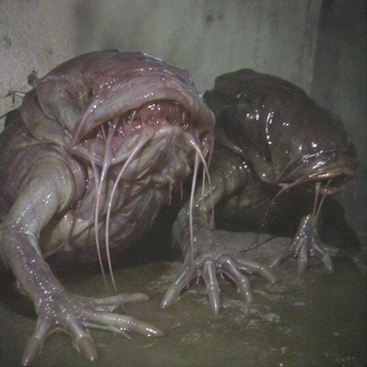
  - 【原典外貌】於金光寺第十三層塔頂擺酒划拳的兩名魚卒：奔波兒灞口闊鬚長為鮎魚怪，灞波兒奔身黑滑膩為黑魚精；化人形時歪瓜裂棗、貪杯吹牛，遭孫悟空割去下唇、穿破琵琶骨牽去指路，逃入水中則現大鮎魚、大黑魚原形。
  - 【本作克蘇魯／昆蟲寄生／偽人重構】徹底剝除滑稽小兵感，改寫為兩頭蹲伏在發霉積水水泥地上的**腫脹無毛兩棲腐沼魚怪**：渾身毫無乾燥皮膚，只剩一層覆滿灰黑爛泥與油亮魚膠黏液的半透明鬆垮腐肉，皮下隱約可見如白色線蟲般蠢動的寄生幼體；奔波兒灞的扁平巨口自頰側裂至鰓蓋，軟爛上唇垂下六條如浸水寄生蠕蟲般不斷抽搐甩動的長肉鬚，口內擠滿細密倒鉤骨刺；灞波兒奔則身形較窄黑、背脊佈滿膿泡與魚蝨噬咬孔洞，兩怪前端竟長出帶半透明腐膜蹼趾、酷似畸形溺屍手掌的爬行前肢，五指扣住濕滑地磚發出黏膩吸吮聲，蹲在廢棄大樓頂樓水塔旁啃食生魚並吐出腥臭氣泡。
- **特性**：
  - 【原典記載】擅長潛水閉氣、體表極度滑膩難抓；性情怯懦嘴碎，愛在值班時喝酒吹噓自家老大的盜寶內幕，一受皮肉苦便將潭底部署全盤供出。
  - 【本作衍生】體表分泌高黏度「腐沼蛋白黏液」並混雜大量水中寄生吸蟲卵，不但能讓普通繩索與徒手擒拿徹底打滑，沾染凡人傷口更會引發劇烈蜂窩性組織炎與皮膚下寄生幼蟲鑽動；能沿著直徑僅三十公分的雨水排水管悄無聲息爬進十幾層樓高的建築物水塔偷竊法器與靈物。
- **弱點**：
  - 【原典記載】法力低微、毫無忠誠骨氣，離水越久氣力越衰，遭孫悟空按地割唇穿骨即徹底崩潰求饒。
  - 【本作衍生】濕亮黏液反而是絕佳導體——許家銘一記三流「掌心雷」貼水轟下，高壓電弧瞬間順著濕皮貫穿中樞神經令兩怪翻肚抽搐；另外撒下生石灰、工業鹽或自製烈火符急速烤乾其體表黏液，即可剝奪其逃脫力與再生滑膜。
- **習性**：
  - 【原典記載】奉萬聖龍王與九頭蟲之命，夜半潛赴祭賽國金光寺寶塔頂層巡查，卻躲在塔頂擺酒划拳摸魚。
  - 【本作衍生】現代台灣都市地下箱涵、河濱抽水站、廢棄魚市場排水溝與老舊公寓無人清洗的頂樓水塔，正是這類低階腐沼寄生魚怪的集散地；牠們常成雙成對替深層水域大妖放哨搬運贓物，半夜會鑽出來啃咬釣客遺落的生魚內臟與開過的罐裝啤酒。
- **喜好**：
  - 【原典記載】嗜好偷懶飲酒、猜拳吹牛與炫耀主子威風。
  - 【本作衍生】極度迷戀發酵酒氣、腐爛動物內臟與閃亮濕冷的小金屬片；以滲入麻醉草藥的廉價米酒置於下水道蓋口，往往不費一張符就能引其上鉤活擒逼供。
- **擅長的招式／異能**：
  - 【原典記載】粗淺水遁潛行、短刀雜兵武藝，無任何專屬法寶。
  - 【本作衍生】`腐膜脫身滑液`（遇擒拿時瞬間蛻下一層腥臭黏膜滑出束縛）、`寄生淤泥噴吐`（自膨脹鰓裂噴出夾雜魚蝨幼蟲與硫化氫惡臭的黑泥液柱干擾視線與呼吸）。

---

### [XY4-02] 萬聖龍妖（亂石山碧波潭墮落深潭魚龍寄生主）
- **出處順序**：第 60 回（牛魔王赴宴初提及）、第 62 回《滌垢洗心惟掃塔 縛魔歸主乃修身》、第 63 回《二僧蕩怪鬧龍宮 群聖除邪獲寶貝》
- **類別與造型路線**：`【類人偽人型】`｜墮落深潭魚龍寄生主（原著為雜龍水主墮落成妖；本作定性為被深淵寄生蟲腐化的水府偽人老龍妖）
- **物種／唯一性**：`物種特異個體`（深潭蛟龍一脈中私建水窟、縱婿盜寶而徹底腐化墮落為寄生老妖的特定霸主）
- **稀有度與道行對照**：`★★★ 珍級（SR）`｜模糊道行：數百年至千年墮落地方妖龍｜本作階位：二流頂～一流（水下血雨領域強悍、離水破綻顯著）
- **外貌與黑暗地牢／恐怖谷視覺改寫**：
  - 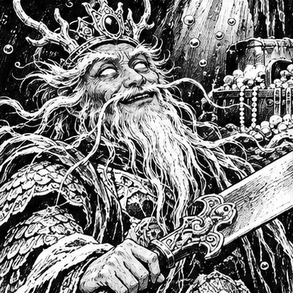
  - 【原典外貌】白鬚老龍王模樣，頭戴龍冠、披水府蟒袍、手持大刀；性情貪婪狡黠，結交牛魔王並招九頭蟲為婿，最終在碧波潭大戰中遭孫悟空一棒擊斃現出老龍屍身。
  - 【本作克蘇魯／昆蟲寄生／偽人重構】絕非威嚴正神龍王，而是浸泡在黑水潭底數百年、皮肉早已被寄生菌與深水藤壺吃空大半的**腐敗魚龍偽人老翁**：表面仍套著寬大龜裂的漆黑魚鱗古甲與生鏽畸形鹿角冠，兩顆徹底失去瞳孔、如煮熟死魚眼球般的慘白眼珠向上翻凸，嘴角僵硬扯出極致病態的狂喜冷笑；長達胸腹的慘白鬚髮其實是一簇簇隨暗流不斷捲曲試探的**水螅狀寄生觸絲**，衣領與甲冑接縫間不斷冒出腐敗沼氣泡並探出半透明節肢魚蝨；身旁堆滿以人頭骨與混濁珍珠混雜的潮濕贓物箱，一旦激怒，人皮老臉便從鼻梁縱裂翻開，露出滿口環狀倒鉤魚牙與沾滿血藻的長條寄生腐龍身軀。
- **特性**：
  - 【原典記載】能降下漫天詭異「血雨」遮蔽凡人眼目，藉機掩護九頭蟲盜取祭賽國金光寺佛寶舍利；善於鑽營妖脈人情，既攀附牛魔王又招攬絕世野妖九頭蟲入贅看家。
  - 【本作衍生】掌控整片死水潭與都市地下管網的**「血雨腐蝕結界」**——能將含大量鐵鏽、寄生孢子與屍毒的腥紅酸雨灌滿方圓數公里，直接鏽蝕電子監視器、遮蔽肉眼與普通開天眼，宛如躲在深水區洗贓法寶、僱用外來重犯大妖當打手的地下黑幫老狐狸。
- **弱點**：
  - 【原典記載】正面硬戰遠不如頂尖大妖王，又過度倚賴水府地利與女婿庇護，一旦落單近身便被孫悟空一棒打碎顱骨斃命。
  - 【本作衍生】高度依賴潮濕積水維持寄生鱗膜與血雨領域；若除妖師能將戰線強行引離水域（例如逼進高溫乾燥機房或無水地庫），其體表寄生觸絲會迅速乾縮龜裂，鱗甲縫隙更極度畏懼剛陽雷法（五雷符／強化掌心雷）直擊咽喉逆鱗。
- **習性**：
  - 【原典記載】盤踞亂石山碧波潭底水晶宮，廣邀山野妖王赴華筵炫富，暗中策劃盜竊人間佛寶與天界靈草。
  - 【本作衍生】在現代台灣會潛伏於郊區深山廢棄大型蓄水潭、長年荒廢的水族館深水巨缸或淹水礦坑底層，暗中透過魚怪跑腿收購各地古廟失竊法器與陰物，藉外來凶妖壯大聲勢。
- **喜好**：
  - 【原典記載】貪戀稀世奇珍（佛寶舍利、九葉靈芝草），好擺宴排場結交各方豪強大妖。
  - 【本作衍生】病態沉迷於把偷來的發光法器、古玉與人骨堆成濕漉漉的潭底寶山，享受浸泡在血水與寄生藻中盤點贓物的腐朽快感。
- **擅長的招式／異能**：
  - 【原典記載】`降血雨蔽天妖法`（於祭賽國降下三日血雨掩護行竊）、大刀水戰、水府捲浪。
  - 【本作衍生】`腥紅孢子盲雨`（降下帶有致盲微刺蟲卵與腐蝕酸性的紅黑暴雨，令除妖師符紙浸濕失效）、`水螅鬚絞殺`（慘白長鬚驟然暴長十公尺，如千條帶吸盤水蛭纏死獵物拖入潭底）。

---

### [XY4-03] 萬聖公主與龍婆（碧波潭寄生雌龍女・穿骨老龍母）
- **出處順序**：第 62 回《滌垢洗心惟掃塔 縛魔歸主乃修身》、第 63 回《二僧蕩怪鬧龍宮 群聖除邪獲寶貝》
- **類別與造型路線**：`【類人偽人型】`｜寄生雌魚龍偽人（萬聖公主）× 腐爛穿骨老龍母偽人（龍婆）
- **物種／唯一性**：`物種特異個體`（碧波潭墮落魚龍家族直系母女，萬聖公主為膽敢孤身竊走九葉靈芝草之悍女龍妖，龍婆則為遭穿琵琶骨活囚塔心之老龍母）
- **稀有度與道行對照**：`★★ 稀級（R）`｜模糊道行：數百年魚龍雌妖與衰朽老妖｜本作階位：二流（公主專精無聲滲透竊盜，龍婆偏重守庫與寄生菌養護）
- **外貌與黑暗地牢／恐怖谷視覺改寫**：
  - 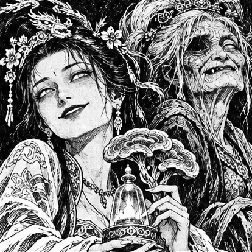
  - 【原典外貌】萬聖公主容貌妖嬈卻心狠膽大，竊得九葉靈芝草以溫養盜來的舍利子，事敗逃出取寶時遭豬八戒一釘耙築死；龍婆則為老龍王之妻，戰敗遭擒後被孫悟空穿破琵琶骨鎖於伏龍寺塔心柱上終身看守佛寶以換活命。
  - 【本作克蘇魯／昆蟲寄生／偽人重構】母女皆具令人生理不適的**水生寄生偽人特徵**：**萬聖公主**披著華麗濕透的宮裝與頭冠，仰頭展露極致冷傲的僵硬微笑，兩顆眼眶卻全無黑瞳、只剩泛著死魚膠質光澤的慘白盲眼；她纖長指尖其實已異化為透明節肢骨爪，正病態珍愛地托著一只封存微光舍利的玻璃罩與一株如腐敗肉菌傘蓋般滲出黏液的寄生靈芝草，華服底下頸側裂開一排排會隨呼吸吐出寄生黑蝦與紅線蟲的魚鰓；身後的**龍婆**則是半張臉已潰爛成漆黑空洞眼窩、滿嘴斷裂黑牙與乾癟濕皮的腐朽老嫗，肩胛琵琶骨被生鏽鐵鉤硬生生貫穿，傷口不斷爬出細小食腐水蛆卻永遠死不透，散發濃烈的陳年淤泥與死魚腐味。
- **特性**：
  - 【原典記載】萬聖公主擅長無聲潛行與跨界神偷之術（連大羅天上靈芝草皆能盜手），且極度護夫藏贓；龍婆熟知水府密室機關，大勢已去時極能忍辱苟活。
  - 【本作衍生】萬聖公主具備**「水霧滲透與氣味屏蔽」**異能，能化作冷氣排水管或衛浴地漏滲出的腥冷細霧鑽進密閉保險室盜取法器，並以自身寄生黏液包裹贓物隔絕追蹤；龍婆則擅長在腐朽體腔內培育「水菌靈芝」，能持續溫養失竊陰物並感知方圓百公尺內任何潛入者的足音。
- **弱點**：
  - 【原典記載】萬聖公主正面硬戰極脆，一脫離九頭蟲掩護即被豬八戒一鈀築斃；龍婆年邁怯死，肩胛琵琶骨一被鐵鎖貫穿便徹底喪失化形與逃遁力。
  - 【本作衍生】兩人偽人皮囊之下的軟骨與魚鰓極度畏懼銳器重擊、高熱烘烤與陽鐵穿骨鎖（以桃木釘或硃砂鎮魂釘貫穿雙肩琵琶骨即可徹底封死其水霧遁法與寄生活性）。
- **習性**：
  - 【原典記載】萬聖公主長居碧波潭後宮密室，將佛寶與靈芝草同置匣中溫養；龍婆事敗後被鎖在伏龍寺高塔頂層終身看守佛寶。
  - 【本作衍生】萬聖公主常在暴雨夜偽裝成出入老舊古董商行、私人佛堂與珠寶拍賣會的蒼白貴女踩點行竊；龍婆則宛如被除妖界暗中鎖在廢棄高塔或陰濕地下室裡、靠一口混濁井水維生的活體贓物辨識囚妖。
- **喜好**：
  - 【原典記載】萬聖公主貪戀發光靈寶與九頭蟲之兇悍依仗；龍婆唯求苟活保命。
  - 【本作衍生】萬聖公主對散發高階靈力的舍利、老玉與陰濕珠寶櫃有偏執佔有慾，並酷愛以活人指甲餵養她手上的寄生靈芝；龍婆只渴求陰暗潮濕的角落與半碗血水續命。
- **擅長的招式／異能**：
  - 【原典記載】盜來之`九葉靈芝草`（溫養佛寶萬載不枯）、隱匿神偷潛行術、水府障眼法。
  - 【本作衍生】`地漏腥霧滲透`（將軀體液化成混濁寄生水霧鑽過門縫與水管竊寶）、`肉芝孢子屏蔽`（釋放無色菌絲覆蓋失竊法器，令原主尋物符徹底失效）、`琵琶穿骨怨哭`（龍婆遇襲時發出高頻濕溺尖嚎干擾法師持咒）。

---

### [XY4-04] 九頭蟲（九頭駙馬／鬼車九首吸血水蛭怪獸）
- **出處順序**：第 62 回《滌垢洗心惟掃塔 縛魔歸主乃修身》、第 63 回《二僧蕩怪鬧龍宮 群聖除邪獲寶貝》
- **類別與造型路線**：`【非人生物恐怖型】`｜九頸吸血巨蛭 × 食腐禽喙融合怪獸（上古鬼車／九頭鳥妖脈的極致黑暗地牢環節寄生重構）
- **物種／唯一性**：`獨一無二`（無任何仙佛靠山卻能獨抗悟空、八戒夾擊，更在被咬斷一首後帶血遠遁北海生死未卜，為全書最駭人的漏網絕級怪獸）
- **稀有度與道行對照**：`★★★★ 絕級（SSR）`｜模糊道行：數千年野生太古異種大妖王｜本作階位：一流頂（全書最危險之在逃重傷災厄怪獸）
- **外貌與黑暗地牢／恐怖谷視覺改寫**：
  - 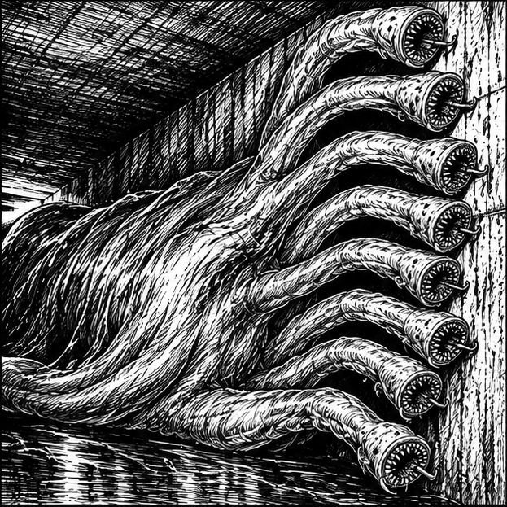
  - 【原典外貌】化形時戴爛銀盔、披金甲、使月牙鏟，看似英武駙馬；現真身則「毛羽鋪錦，團身結絮，方圓丈二、長短似駝鳥，長頸九頭」，腰間更能突然探出利嘴鳥首襲人，終遭細犬咬斷一首，淋漓帶血逃往北海。
  - 【本作克蘇魯／昆蟲寄生／偽人重構】**徹底拋棄傳統九頭大鳥印象，重構為盤踞淹水地下排水箱涵的克蘇魯環節寄生巨獸**：一團臃腫如卡車車體、覆滿濕透漆黑腐爛羽纖維與黏液筋膜的畸形肉塊，從箱涵漆黑深處蠕動擠出 **九條粗如工業污水管、佈滿環形褶皺與膿孔的灰白巨型吸血水蛭長頸**；每條長頸末端既非普通鳥頭也無溫馴眼眸，而是直接裂開成一座 **融合七鰓鰻環形倒鉤利齒與漆黑禽喙骨刺的圓筒狀吸血口盤**，口盤深處各吐出一條沾滿腐液的硬質細長吸血口針，正密密麻麻貼在潮濕水泥牆面上瘋狂刮擦吮吸！更駭人的是軀幹正下方一截永不癒合的**第十根（或第九根）殘缺斷頸肉樁**，裂口翻捲如黑肉爛花，永無止境地向漆黑積水噴湧瀝青般濃稠的腐黑劇毒體液，水面泛起死寂油光。
- **特性**：
  - 【原典記載】野生出身無背景，卻憑實打實的妖力水陸雙棲硬抗孫悟空與豬八戒聯手，甚至一度反擒豬八戒入龍宮；九首各自獨立索敵、半腰突襲防不勝防，最可怕的是**斷首重傷竟不死而遁入北海**，留下一段無解凶兆。
  - 【本作衍生】具備**「九重分散神經節」**——每條水蛭長頸都擁有獨立視覺感應孔與神經反應，完全沒有背後死角，單體定身符與迷魂術無法同時封鎖全部九首；其斷頸創口持續滴落的「鬼車腐黑體液」具強烈生物腐蝕性與厄運污染，凡滴落之處混凝土龜裂生蛆、凡人沾之三日內全身敗血暴斃。
- **弱點**：
  - 【原典記載】多首協同雖強卻難以同時防護腹腰伸出之頸項，遭冷箭射傷羽膜、復遭利齒狠咬斷頸便劇痛失序而潰逃；失去碧波潭水府掩護後孤立無援。
  - 【本作衍生】正面硬扛九張環齒吸盤等於送死，**唯一的物理與法力破口就是那截永不癒合的「斷頸黑血創口」**——該處神經裸露且持續流失妖元，若除妖師能冒死將高濃縮烈火符、五雷破甲釘或黑狗血封煞錐直接打入斷頸肉腔內引爆，會瞬間引發九條長頸的連鎖神經痙攣與體液逆流；此外其濕黏環節肉體極畏烈日強光、工業強鹼與高頻金屬震波。
- **習性**：
  - 【原典記載】原為流竄野妖，憑絕世凶力入贅碧波潭享受榮華並協助盜取佛寶，遭斷首重創後遠逃極北苦寒北海深淵潛伏療傷。
  - 【本作衍生】若流竄至現代台灣，最契合的巢穴是**基隆北海岸廢棄海防坑道、大型都會區地下雨水滯洪巨型箱涵與長年積水的廢棄地下鐵路隧道**；每逢寒流陰雨深夜便拖著九條巨蛭長頸沿排水渠貼壁爬行，捕食落單巡檢人員與探險者，沿途水泥地面必定留下一道散發鐵鏽屍臭的漆黑腐液滴痕。
- **喜好**：
  - 【原典記載】嗜愛奇珍寶物（舍利子）、水府榮華，且對結髮之妻萬聖公主頗有護短之情。
  - 【本作衍生】因斷頸長痛與大量失血，對高濃度溫熱人血、能止血續骨的千年靈藥以及陽氣充沛的法師精血呈現病態飢渴。
- **擅長的招式／異能**：
  - 【原典記載】兵器`月牙鏟`（正面力敵金箍棒與九齒釘耙）、`九首四面狂噬`、`半腰偷襲探首`、`水陸兩棲遁逃`。
  - 【本作衍生】`九蛭環齒齊吸`（九條水蛭長頸同時射出吸盤扣死目標四肢與頭顱，三秒內抽乾全身血液）、`斷頸腐黑毒液噴湧`（甩動殘缺斷頸向四周狂噴高腐蝕瀝青黑液，沾上護身符即刻起泡碳化）、`箱涵音爆月牙劈`（化人態時以沾滿黏液的巨型破拆鋼鏟劈裂鋼筋牆柱）。

---

## 🌲 第二部：第 64 回・荊棘嶺木仙庵（七樹精：偽人皮囊下的枯木菌絲與食蟲口器）

> **單元背景**：八百里荊棘嶺古廟「木仙庵」看似風雅高士談詩夜宴，實為七株吸納深山屍肥與陰濕瘴氣的千年樹精披上儒雅文人與美人偽人皮囊設下的捕食局。本作徹底剝去文藝濾鏡：**所有詩客與花仙的蒼白人皮之下，皆是密布白色枯木菌絲、倒折竹節蟲節肢與食蟲捕蠅草鋸齒口器的植物寄生恐怖體**！

### [XY4-05] 勁節十八公（老松樹精・荊棘嶺四老之首）
- **出處順序**：第 64 回《荊棘嶺悟能努力 木仙庵三藏談詩》
- **類別與造型路線**：`【類人偽人型】`｜枯松菌絲 × 樹皮甲蟲寄生偽人（千年老松精）
- **物種／唯一性**：`物種特異個體`（松精族群中以「松」字拆作「十八公」自號、統領荊棘嶺木仙庵夜宴之首領個體）
- **稀有度與道行對照**：`★★ 稀級（R）`｜模糊道行：數百年至千年草木陰靈（重陰風攝人與幻境、輕正面搏殺）｜本作階位：二流
- **外貌與黑暗地牢／恐怖谷視覺改寫**：
  - 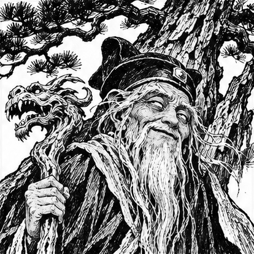
  - 【原典外貌】頭戴黑角帽、穿大袖寬袍、拄龍頭拐杖之古貌老者，自稱「勁節」，天明破幻後現為一株盤根老松。
  - 【本作克蘇魯／昆蟲寄生／偽人重構】乍看是位掛著和藹乾笑的古裝老文士，走近三步卻令人胃部翻絞：他眼眶裡沒有人類虹膜，只有兩團如發霉樹脂般泛白的空洞盲眼；滿臉皺紋並非皮褶，而是佈滿深黑龜裂樹皮縫隙與白色絨毛菌絲的枯木死皮，每說一句詩詞，臉皮裂縫裡就有細小的漆黑松樹皮甲蟲探頭蠕動；他手中那根「龍頭拐杖」實為與右掌神經融合的**活體枯木蟲顎器官**，龍口尖牙不停滲出黏稠發臭的黃褐松脂消化液；寬大黑袍底下沒有雙腿，而是無數條與竹節蟲肢體般彎折喀響的寄生氣根正悄然刺入地板縫隙。
- **特性**：
  - 【原典記載】能化作陰風神不知鬼不覺捲走唐僧數十里，並與其餘三老聯手幻化出燈火輝煌的木仙庵設宴談詩，表面斯文客套，實則極力慫恿目標破戒留駐。
  - 【本作衍生】擅長以大量松樹寄生菌絲孢子構築**「懷舊茶樓／古書店文雅幻境」**——透過溫和奉茶、談詩論史誘使獵物放鬆防備，同時間地面暗根與松脂黏液已將受害者雙腳黏死於椅腳，等獵物察覺異常時菌絲早已鑽入腳底靜脈將其轉化為活體堆肥。
- **弱點**：
  - 【原典記載】正面護身武力薄弱，極度畏懼黎明陽氣與利器伐本；天明被尋獲老松原形後，遭豬八戒連根築斷出血而亡。
  - 【本作衍生】老松木與高油脂松脂皆為極度易燃物——**自製烈火符一張即可引燃整具枯木皮囊引發爆燃**；除妖師只要先點開天眼符水看穿菌絲幻景，鎖定周圍最粗大的主幹樹心釘入陽木釘或澆灑高濃度助燃物點火，其偽人幻體立刻碳化崩裂。
- **習性**：
  - 【原典記載】長年盤踞荊棘嶺深山古廟，晝伏夜出，月夜方才化人設宴攔截高僧與文士。
  - 【本作衍生】潛伏於陽明山、坪林或阿里山荒廢日式木造茶寮與百年黑松林道，專挑深夜失意獨行或迷路的登山客與文職上班族拉進溫暖茶席「陪聊到天亮」。
- **喜好**：
  - 【原典記載】酷愛吟詩作對、烹茶談禪與附庸風雅。
  - 【本作衍生】對古典詩詞與焦慮疲憊的知識分子靈魂有奇特執念；若誤陷其茶局時實力不足，順著語氣對上幾句工整舊詩拖延至天亮，反而能換得脫身破口。
- **擅長的招式／異能**：
  - 【原典記載】`陰風攝人術`（無聲捲走唐僧）、`木仙庵化景幻術`。
  - 【本作衍生】`松脂消化黏縛`（椅面與茶杯滲出強酸性松脂消化膠鎖死雙手雙腳）、`甲蟲松針齊射`（自枯木袖口與龍頭杖口狂噴混雜寄生甲蟲與鋼針松葉的毒霧）。

---

### [XY4-06] 孤直公（老柏樹精・荊棘嶺四老之二）
- **出處順序**：第 64 回《荊棘嶺悟能努力 木仙庵三藏談詩》
- **類別與造型路線**：`【類人偽人型】`｜棺柏腐真菌 × 僵硬節肢偽人（千年老柏精）
- **物種／唯一性**：`物種特異個體`（古柏精一脈於荊棘嶺修成孤傲老儒偽人、並列四老之特定個體）
- **稀有度與道行對照**：`★★ 稀級（R）`｜模糊道行：數百年至千年草木陰靈｜本作階位：二流（擅長棺木腐氣催眠與幻陣協同）
- **外貌與黑暗地牢／恐怖谷視覺改寫**：
  - 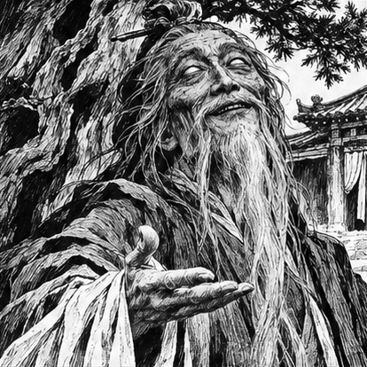
  - 【原典外貌】清癯蒼老、寬袍大袖之孤傲老者，自誇耐歲寒傲霜雪，原形為一株古柏樹。
  - 【本作克蘇魯／昆蟲寄生／偽人重構】站姿筆直得徹底違背人體脊椎曲線，宛如一塊被硬生生削成老翁輪廓的**發霉墓地柏木棺材板**：臉部瘦長蒼白如蠟，兩頰皮膚呈現乾燥剝落的灰白木鱗與屍斑狀黑黴，眼珠像卡死在木槽裡的玻璃珠般無法自由轉動；雙臂關節完全反折如枯枝螳螂前肢，袖口底下隱約伸出帶倒刺的細長木質節肢；每當他僵直鞠躬致敬時，胸腔縫隙間會飄出一股濃烈到令人頭暈嘔吐的陳年墳場柏木棺香與腐敗白蟻粉塵。
- **特性**：
  - 【原典記載】能言善辯，於木仙庵詩會中一唱一和附和十八公勸誘唐僧動凡心，與眾樹精共享整座荊棘嶺地下根脈。
  - 【本作衍生】其散發的「墳場古柏揮發瘴氣」具有強烈神經鎮靜與恐懼麻痺作用，讓誤入者明明看見他臉皮裂開滲出白蟻與真菌，大腦卻詭異地感到安心順從，任由其地下白根纏住腳踝抽取血水。
- **弱點**：
  - 【原典記載】缺乏實戰武藝，天明現出古柏原形後遭豬八戒連根掘斷斃命。
  - 【本作衍生】柏木含有高濃度易燃柏木油，遇見三流烈火符即刻轟然自燃成猛烈火柱；同時只要屏住呼吸（閉氣訣）切斷棺香吸入並以破障符水潑面，即可瞬間掙脫精神麻痺。
- **習性**：
  - 【原典記載】紮根荊棘嶺古柏林，深宵與十八公等人聚會吟詩。
  - 【本作衍生】常依附於台灣百年公墓邊緣或荒廢古厝宗祠庭院裡的老柏樹，濃霧深夜化作穿著褪色舊長衫的僵硬老人站在路口攔問古詩。
- **喜好**：
  - 【原典記載】好聯句清談、自我標榜孤高節操。
  - 【本作衍生】極度厭惡粗魯喧嘩與現代搖滾噪音，反而偏好彬彬有禮、神色拘謹的西裝上班族，視其為最上等的「清雅花肥」。
- **擅長的招式／異能**：
  - 【原典記載】`古木幻境協同`、`文墨迷心勸誘`。
  - 【本作衍生】`棺柏致幻腐霧`（釋放高濃度神經麻痺木醇霧氣令獵物呆坐不動）、`墓根纏踝拖殺`（自地縫彈出沾滿白黴菌絲的蒼白柏根將獵物活生生拽進泥土窒息）。

---

### [XY4-07] 凌空子（老檜樹精・荊棘嶺四老之三）
- **出處順序**：第 64 回《荊棘嶺悟能努力 木仙庵三藏談詩》
- **類別與造型路線**：`【類人偽人型】`｜枯檜竹節蟲節肢寄生偽人（千年老檜精）
- **物種／唯一性**：`物種特異個體`（檜木精族群中化形道士長老、率先替杏仙說媒之特定個體）
- **稀有度與道行對照**：`★★ 稀級（R）`｜模糊道行：數百年至千年草木陰靈｜本作階位：二流
- **外貌與黑暗地牢／恐怖谷視覺改寫**：
  - 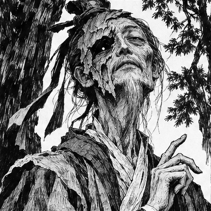
  - 【原典外貌】骨秀神清、步履輕盈的清瘦老道士形象，在夜宴上巧舌如簧力勸唐僧破戒成親，原形為一株老檜樹。
  - 【本作克蘇魯／昆蟲寄生／偽人重構】身高詭異突破兩米三、四肢細長多節得宛如**披著破爛道袍的人形巨型枯枝竹節蟲**：頸部過長並生出三個不正常的軟骨關節，頭顱可像昆蟲般一百八十度緩慢旋轉；半敞的灰黑道袍胸口下根本沒有心肺，而是由赤紅剝皮檜木條與密密麻麻爬行的白色枯木菌絲交織成的鏤空蟲巢胸腔；兩隻垂過膝蓋的枯瘦手臂隨時能彈開成帶鋸齒的螳螂捕食木肢，走路時雙腳根本不著地，而是靠袍底六條細長木質節足無聲點地飄行於濃霧之中。
- **特性**：
  - 【原典記載】最擅長以似是而非的玄談話術動搖道心，替杏仙說媒步步進逼。
  - 【本作衍生】具備**「心理破口讀取與霧中誘捕」**能力——能從獵物微弱的呼吸與腦波波動窺見其內心最脆弱的疲憊與執念（如房貸、病親、孤獨），以溫和長輩偽人聲線瓦解戒備，引導目標自願簽下陰契或走進霧中捕食網。
- **弱點**：
  - 【原典記載】見悟空等人天明尋來立即遁走現形，本體老檜樹全無抗擊力，被豬八戒一耙築倒流血身死。
  - 【本作衍生】檜木油脂豐富極度畏火，烈火符與掌心雷高溫電弧都能瞬間將其細長竹節蟲肢體燒脆折斷；一旦痛覺打破其芬多精霧幻，偽人面皮立刻裂開露餡。
- **習性**：
  - 【原典記載】紮根荊棘嶺山坡高處，夜間與同夥會聚木仙庵。
  - 【本作衍生】台灣中高海拔神木步道、荒廢伐木工寮與被山老鼠盜伐後殘留的巨型檜木樹頭正是其溫床，每逢午後濃霧起時便現身迷霧步道攔截落單山友。
- **喜好**：
  - 【原典記載】嗜好玄談、吟詩與作媒拉皮條。
  - 【本作衍生】喜愛陰冷潮濕的高山濃霧與陳舊線裝書的霉味，極度痛恨電鋸聲與汽油味。
- **擅長的招式／異能**：
  - 【原典記載】`幻境玄談迷心`、`化霧遁形`。
  - 【本作衍生】`檜霧鬼打牆`（釋放致幻芬多精孢子霧扭曲方向感令獵物原地打轉至失溫）、`竹節鋸肢鎖喉`（細長多節木臂驟然暴長十公尺，從霧裡無聲絞碎目標氣管）。

---

### [XY4-08] 拂雲叟（老竹精・荊棘嶺四老之四）
- **出處順序**：第 64 回《荊棘嶺悟能努力 木仙庵三藏談詩》
- **類別與造型路線**：`【類人偽人型】`｜空心老竹 × 巨型竹節蟲寄生偽人（千年老竹精）
- **物種／唯一性**：`物種特異個體`（竹精族群中於荊棘嶺木仙庵修成瀟灑文士偽人、名列四老之特定個體）
- **稀有度與道行對照**：`★★ 稀級（R）`｜模糊道行：數百年至千年草木陰靈｜本作階位：二流（四老中最具彈性機動與穿刺威脅者）
- **外貌與黑暗地牢／恐怖谷視覺改寫**：
  - 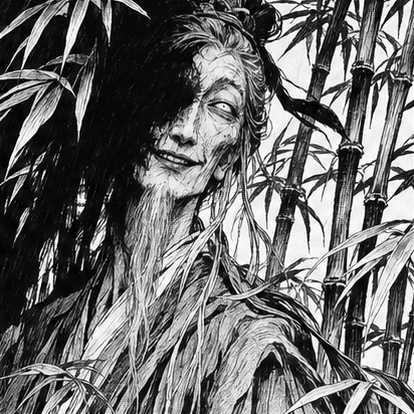
  - 【原典外貌】衣衫青翠、姿態修長瀟灑之儒雅高士，嘴皮滑溜最善附和談禪，原形為一叢蒼翠老竹。
  - 【本作克蘇魯／昆蟲寄生／偽人重構】一名瘦得只剩骨架輪廓、皮膚泛出死屍青灰竹膜反光的詭異高瘦偽人：頸骨、肋骨與指骨全部呈現一節一節膨大凸起的**竹節與巨型竹節蟲節肢構造**；青衣前襟破裂處赫然可見他整個胸腹內部是漆黑潮濕的**中空竹腔**，腔壁掛滿濕滑反光的幼蟲卵囊與吸盤蟲鬚；山風貫穿他中空的胸膛與微張的嘴裂時，會發出宛如老舊尺八混合厲鬼吹哨的詭異共鳴音，十根削尖如竹籤的節肢指尖則滴著麻痺毒液。
- **特性**：
  - 【原典記載】在四老中最顯輕靈油滑，卻同樣外強中乾、無力硬抗正統強者。
  - 【本作衍生】中空幾丁質化竹軀具備驚人韌性，能像活體竹節蟲般向後彎折九十度閃過鈍器與刀劈；更致命的是牠能透過**地下縱橫數十公尺的活體竹鞭根系**在整片竹林間瞬間轉移寄宿主幹，斬斷一具空殼並不能殺死牠。
- **弱點**：
  - 【原典記載】原形竹叢被豬八戒連根盡數築斷、斬草除根即亡。
  - 【本作衍生】密閉中空竹腔遇上高溫會因內部氣壓劇烈膨脹而發生**「爆竹式炸裂」**——將烈火符直接貼進其胸腔孔洞或焚燒主竹叢，會觸發雙倍爆裂傷害；斬殺後務必翻掘並焚毀周遭地下橫向竹鞭，否則梅雨季一到便會從腐根重新長出新偽人。
- **習性**：
  - 【原典記載】棲身荊棘嶺老竹林，月夜赴木仙庵詩會。
  - 【本作衍生】潛伏於台灣中南部偏鄉荒廢三合院後的幽暗桂竹林與麻竹林，深夜藉風吹空腔發出似洞簫似人吟的低吟，誘騙夜歸人步入竹林深處失蹤。
- **喜好**：
  - 【原典記載】好清風朗月、吟詩論禪。
  - 【本作衍生】偏好陰雨潮濕的竹林腐土與高頻管樂聲，極懼柴油、除草劑與乾燥烈火。
- **擅長的招式／異能**：
  - 【原典記載】`陰風協同攝人`、`木仙庵幻象維持`。
  - 【本作衍生】`空腔攝魂竹哨`（藉中空胸腔吹出引發內耳眩暈與幻覺的低頻哨音）、`地底竹鞭穿心刺`（自腳下裂縫瞬間彈出數十根鋼硬尖筍貫穿鞋底與小腿）、`竹鞭替身轉移`。

---

### [XY4-09] 赤身鬼（老楓樹精／丹楓鬼使）
- **出處順序**：第 64 回《荊棘嶺悟能努力 木仙庵三藏談詩》
- **類別與造型路線**：`【類人偽人型】`｜剝皮紅楓菌絲 × 吸血寄生蔓肢偽人（千年丹楓樹精）
- **物種／唯一性**：`物種特異個體`（丹楓成精一脈中，專為荊棘嶺木仙庵充任提燈鬼使與護衛打手之特定個體）
- **稀有度與道行對照**：`★★ 稀級（R）`｜模糊道行：數百年草木鬼魅｜本作階位：二流（七樹精中少數偏重物理威嚇與近身追殺者）
- **外貌與黑暗地牢／恐怖谷視覺改寫**：
  - 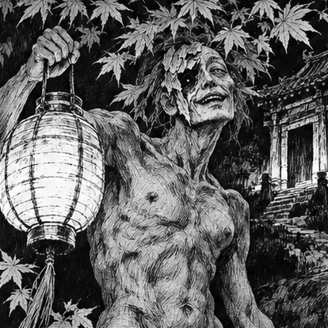
  - 【原典外貌】赤身露體、通紅如血火、手提大紅燈籠之詭異鬼使，深夜於荊棘嶺荒廟前率先現身接引唐僧入庵；天明現形為一株丹楓老樹。
  - 【本作克蘇魯／昆蟲寄生／偽人重構】一具彷彿剛被人活生生剝掉整張表皮、直接裸露出鮮紅滲液木質肌理與細密白色寄生菌絲的赤裸乾屍偽人：胸背與四肢表面倒插著數百片暗紅發黑、邊緣帶鋸齒的乾枯楓葉甲片，葉片縫隙間不停鑽出如血紅蚜蟲與赤色樹蝨般的細小寄生蟲；牠無唇無眼瞼，眼窩只剩兩道滲出鐵鏽紅汁的狹縫，手中死死提著一盞其實是**半透明膨脹植物消化囊（豬籠草狀紅燈籠）**的活體器官，囊內燃燒慘白磷火並浸泡著細碎人指骨，所行之處泥地留下一排排血紅黏膩的汁液腳印。
- **特性**：
  - 【原典記載】行動極為迅捷，負責充當木仙庵前哨放哨、提燈引路與替四老通風報信，以駭人鬼使外表先行震懾過客心神。
  - 【本作衍生】充當草木精怪集團的**「夜間鬼燈誘捕手」**——牠提著的活體紅燈囊能散發扭曲空間距離感與干擾電子羅盤／手機 GPS 的低頻磷光孢子，讓誤入山道的駕駛或行人在濃霧中把深山廢墟誤看成前方十公尺的公路便利商店燈箱。
- **弱點**：
  - 【原典記載】缺乏正面硬抗高階戰力之能耐，天明現回老楓樹原形後被豬八戒一耙築成兩段、流出鮮血身死。
  - 【本作衍生】本體丹楓無重裝甲，極懼烈火符點燃身上乾燥楓葉甲片引發連鎖燃燒；此外只要以掌心雷或銳器率先擊破牠手裡那盞「活體消化紅燈囊」，整座山谷的迷路霧障便會立即消散。
- **習性**：
  - 【原典記載】常守候於荊棘嶺木仙庵前門放哨，聽從十八公四老與杏仙差遣。
  - 【本作衍生】深秋起霧的北部山區公路（如陽明山巴拉卡公路、北宜舊道廢棄涼亭）深夜常有其蹤影，常偽裝成舉著紅光指揮棒的詭異夜間修路工，將疲勞駕駛與夜騎族引進荒廢林道深處。
- **喜好**：
  - 【原典記載】原典未載私人喜好，唯忠實替四老與杏仙把風引客。
  - 【本作衍生】偏好深秋潮濕陰雨、腐爛落葉堆，嗜吸迷途獵物陷入極度驚恐時分泌的冷汗與溫熱血液。
- **擅長的招式／異能**：
  - 【原典記載】`紅燈鬼霧引路`、`陰風傳訊`。
  - 【本作衍生】`迷途磷囊紅燈障`（干擾電子導航與肉眼空間感）、`剝皮楓葉鋸鞭`（自手臂剝離出長條沾滿強酸紅樹液與倒刺楓葉的活體筋鞭高速抽割目標）。

---

### [XY4-10] 杏仙（老杏樹精・木仙庵食人捕蠅草花妖）
- **出處順序**：第 64 回《荊棘嶺悟能努力 木仙庵三藏談詩》
- **類別與造型路線**：`【類人偽人型】`｜偽人美人 × 食蟲捕蠅草與花蕊寄生口器（千年老杏樹精）
- **物種／唯一性**：`物種特異個體`（草木花妖中色藝文采冠絕木仙庵、以詩詞與逼婚試圖吞噬高僧之核心女妖）
- **稀有度與道行對照**：`★★ 稀級（R）`｜模糊道行：數百年至千年花木魅妖｜本作階位：二流（高偽裝度精神魅惑 × 近身食蟲捕殺型）
- **外貌與黑暗地牢／恐怖谷視覺改寫**：
  - 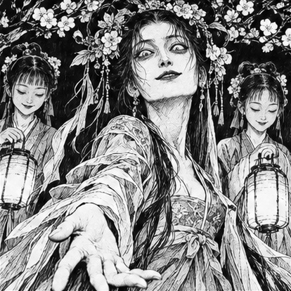
  - 【原典外貌】「青姿妝翡翠，丹臉賽胭脂」，穿五色梅淺紅裙與煙裡火輕衣，攜兩名青衣捧燈女童款步赴宴，先吟〈雨潤紅姿嬌且嫩〉撩撥唐僧，見被拒後便不顧禮數上前強拉逼婚；天明現形為老杏樹，遭豬八戒連根築倒流血而亡。
  - 【本作克蘇魯／昆蟲寄生／偽人重構】**徹底撕碎古典美女花仙幻想，展現「恐怖谷偽人美人 × 食蟲植物捕蠅草口器」的極致噁心感**：表面是一位仰著慘白纖細脖頸、眼白上翻露出病態迷離冷笑的華服女子，主動向獵物攤開五指修長的慘白手掌邀約同行；但拉近細看，她的掌紋與頸側皮下佈滿淡黃色蛛網狀枯木菌絲，眼眶邊緣寄生著細小枯萎花萼，頭上繁茂的杏花髮飾實為自顱骨鑽出的活體花莖！當獵物心神動搖靠近擁抱的剎那，她那張看似柔美的櫻唇會從耳根橫向縱裂四瓣，整個下顎翻開成一張**佈滿兩排硬質刺毛與滲出甜腥消化酵素的巨型食蟲捕蠅草肉萼口器**，咽喉深處更彈出數十根沾滿寄生孢子的白色細長花蕊口針，直接鑽進獵物眼耳口鼻吸乾腦髓與血肉！
- **特性**：
  - 【原典記載】深諳情慾試探與溫柔陷阱，不靠刀兵強攻而以詩酒歌舞配合四老起鬨步步進逼；一遭嚴詞拒絕立刻撕下優雅假面直接上手拉扯。
  - 【本作衍生】極為危險的**「高偽裝度溫柔陷阱食人花妖」**——能釋放高濃度神經致幻杏花腐香，放大孤獨都市人的情感空虛與依戀幻覺，誘使目標主動投入懷抱，隨即以捕蠅草顎口與袖中竹節蟲狀枯木利爪將獵物活生生夾碎消化成養花屍肥。
- **弱點**：
  - 【原典記載】正面鬥法防禦近乎為零、見意志堅定不受色誘者則計窮；天明現回老杏樹本體後輕易遭豬八戒連根斬絕。
  - 【本作衍生】極度畏懼烈火焚花——一張三流自製烈火符便能點燃她滿身乾燥花粉與菌絲引起爆燃；實戰中先掐閉氣訣隔絕甜膩腐香，再以開天眼符水看穿她裂開的捕蠅草口器真容，即可破除精神魅惑並一舉反殺。
- **習性**：
  - 【原典記載】藏身木仙庵後院深處，平素極少露面，唯見氣血純淨之高僧或俊秀書生誤入山嶺方盛裝現身誘殺。
  - 【本作衍生】常盤踞於荒廢深山度假村庭園、廢棄婚紗外拍園區或老舊旅社中庭的枯死老果樹下，雨夜化作撐傘招手的蒼白女子，專挑加班返家神情恍惚的單身男女搭訕。
- **喜好**：
  - 【原典記載】嗜好雅詩豔詞、美男子與強求露水姻緣。
  - 【本作衍生】癡迷溫熱鮮活的人血體溫與充斥悲傷孤寂情緒的靈魂氣息，極度排斥刺鼻菸臭與油膩酒氣。
- **擅長的招式／異能**：
  - 【原典記載】`詩詞魅惑試心`、`草木幻衣化形`。
  - 【本作衍生】`落英腐香迷魂霧`（釋放甜膩神經致幻花粉麻痺警戒）、`捕蠅草顎裂噬吻`（臉龐四瓣綻開成鋸齒食蟲植物口器咬斷喉管）、`花蕊寄生吸髓`（數十條細絲鑽入血管注入消化酸液）。

---

### [XY4-11] 丹桂女侍與臘梅女童（木仙庵雙生紙偶花樹女童）
- **出處順序**：第 64 回《荊棘嶺悟能努力 木仙庵三藏談詩》
- **類別與造型路線**：`【類人偽人型】`｜雙生紙偶偽人 × 腐花菌絲與寄生幼蟲囊（丹桂樹精・臘梅樹精）
- **物種／唯一性**：`物種（群體）`（庭園常見花樹沾染主妖陰煞初成氣候的底層花木小精群體，原典明載兩名青衣女童本體為一株丹桂、一株臘梅）
- **稀有度與道行對照**：`★ 凡級（N）`｜模糊道行：數十年至百年底層花木小妖｜本作階位：三流（輔助型低階偽人童妖，許家銘單人可破）
- **外貌與黑暗地牢／恐怖谷視覺改寫**：
  - 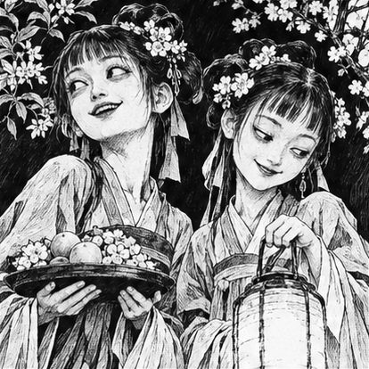
  - 【原典外貌】身穿青衣、手提紗燈、捧茶奉果隨侍杏仙左右的一對嬌俏女童；天明現形為丹桂與臘梅二樹，連同杏樹遭豬八戒築倒。
  - 【本作克蘇魯／昆蟲寄生／偽人重構】兩名面容完全複製貼上、低眉垂目掛著詭異同步慈笑的**慘白紙紮雙生女童偽人**：眼睛永遠像縫死般只留一條微弧黑線，臉皮緊繃反光猶如塗滿防腐蠟的死童假人；丹桂女侍的耳道與髮髻縫隙間不停簌簌掉落腐黑發霉的細碎桂花與寄生小花薊馬，臘梅女童雙手袖口探出的腕骨實為枯黑多刺的扭曲梅枝節肢；兩人手中各提著一只滲出黏液的昏黃紙燈，端上的熱茶表面看似漂浮花瓣，在開天眼下實為一碗密密麻麻蠕動的白色花蠅幼蟲與發酵樹汁。
- **特性**：
  - 【原典記載】毫無獨立主見，完全依附杏仙與四老存活，負責提燈引導、斟茶勸飲與烘托仙境假象。
  - 【本作衍生】擅長**「雙聲道童音迴響催眠」**——兩人一左一右貼近目標耳畔以極輕柔同步的童聲呢喃「喝一口茶嘛、好香喔」，削弱法師精神定力並誘其喝下含寄生蟲卵與致幻樹液的毒花茶。
- **弱點**：
  - 【原典記載】法力極為低微，遇強襲毫無招架之力，本體丹桂與臘梅頃刻遭連根築絕。
  - 【本作衍生】典型的脆弱三流草木偽人：一張自製烈火符、一潑陽氣硃砂水，或直接一腳踹碎手中燈籠與茶碗並衝離花霧範圍，即可令其尖叫崩裂成一地乾枯焦黑的腐枝敗葉。
- **習性**：
  - 【原典記載】依附杏仙棲身木仙庵深處，隨主夜出掌燈捧茶。
  - 【本作衍生】潛伏於台灣廢棄古蹟茶屋、老舊別墅荒園的百年桂花與梅樹陰影下，深夜發出小女孩拍手嬉笑聲誘拐孩童與迷途路人進入庭院死角。
- **喜好**：
  - 【原典記載】原典未載私好，僅見其恭順侍奉杏仙。
  - 【本作衍生】喜好發酵腐爛的糖水、被丟棄在廢墟中的殘缺洋娃娃與褪色紅紙燈籠。
- **擅長的招式／異能**：
  - 【原典記載】`青燈助幻`、`迷魂茶果侍奉`。
  - 【本作衍生】`雙童迴音迷神`（左右重疊的稚嫩迴音干擾唸咒專注度）、`腐花幼蟲昏睡茶`（凡飲下者三分鐘內四肢發軟、氣管遭花菌絲麻痺無法出聲）。

---

## 🏮 第三部：第 65～66 回・小西天小雷音寺（終極偽佛偽人與活體寄生肉囊）

> **單元背景**：卷四最具褻瀆恐怖感與絕望壓迫力的劫局。黃眉老怪膽大包天於小西天築起山寨「小雷音寺」自居如來，蓄養數百小妖假扮羅漢比丘，憑藉金鐃與後天人種袋將各方救援全數吞沒收袋，堪稱以宗教崇拜為餌的「終極偽人邪教巢穴」。

### [XY4-12] 黃眉老怪（黃眉老佛／小雷音寺終極偽佛偽人）
- **出處順序**：第 65 回《妖邪假設小雷音 四眾皆遭大厄難》、第 66 回《諸神遭毒手 彌勒縛妖魔》
- **類別與造型路線**：`【類人偽人型】`｜腫脹消化囊偽佛偽人 × 活體伸縮寄生肉囊（原典為叛逃司磬黃眉童兒；本作重構為吞噬萬物之終極「偽佛偽人怪」）
- **物種／唯一性**：`獨一無二`（全書唯一膽敢直接冒充如來佛祖、建立假雷音寺並揚言「自組取經班底取代真經」的狂妄僭越妖王）
- **稀有度與道行對照**：`★★★★ 絕級（SSR）`｜模糊道行：數千年叛逃妖童＋先天級空間收容器加持（硬戰堪比絕頂妖王，祭出肉囊後近乎橫掃）｜本作階位：一流頂～巔峰（規則級吞噬收容災厄 Boss）
- **外貌與黑暗地牢／恐怖谷視覺改寫**：
  - 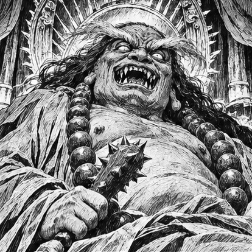
  - 【原典外貌】坐殿冒充如來時金光萬丈，露相後則「蓬頭垢面、兩道濃黃長眉、眼如銅鈴、口似血盆獠牙」，執短軟狼牙棒，腰藏一塊看似不起眼的舊白布搭包兒（後天人種袋）。
  - 【本作克蘇魯／昆蟲寄生／偽人重構】**端坐於廢棄巨型百貨中庭或違法爛尾靈骨塔神壇高台上的終極「偽佛偽人怪」**：表面維持著一尊肌肉發脹、袒胸露肚的巨大假佛輪廓，身後豎著由腐朽尖刺木架與人骨金箔拼湊的畸形背光，頸間掛著一串大如人頭、表面滲出油脂汗斑的漆黑念珠；他兩道過長而僵硬如黃褐黴菌觸鬚般的粗眉底下，嵌著兩顆純白無情、瞳孔縮成針尖的死魚凸眼，血盆巨口裂至腮幫露出交錯食肉獠牙！最令人生理作嘔的是他看似圓滾滾的「大佛肚腩」——**皮膚底下其實擠滿了十幾個隨呼吸彼此擠壓蠕動的半透明腫脹消化囊**，隱約透出未完全溶化的人臉與抽搐手掌輪廓；而他從腰間甩出的所謂「人種袋」，根本不是普通麻布袋，而是一條自他體腔撕裂延展出的**活體伸縮灰白寄生肉囊**，袋口邊緣長滿一圈環形肉瓣吸盤，張開瞬間瘋狂膨脹如深海吞噬變形蟲，將整隊敵人連同法器一口吸入滿是酸液黏液的黑暗囊腔！ *(註：小雷音寺內數百名假扮羅漢、揭諦、比丘尼的附庸小妖，亦為其吞吐出的腐爛偽人傀儡群。)*
- **特性**：
  - 【原典記載】野心與心計冠絕群妖——公然造假佛寺收割虔誠信徒，狂言要另尋徒弟替代取經；自身近戰武藝亦極強橫，持短軟狼牙棒硬抗金箍棒五十回合不敗，搭配金鐃與人種袋更是令無數強援全軍覆沒。
  - 【本作衍生】在現代台灣會化作極度恐怖的**「山寨大型佛寺／邪教精舍偽活佛」**——透過扭曲佛理洗腦與實打實的肉囊收容異象，將整棟大樓信眾與前來查案的除妖小隊盡數吞進活體人種肉囊中慢慢消化榨取道行；其「偽佛光」會強迫三流以下除妖師與凡人雙膝發軟跪地膜拜，喪失反抗意志。
- **弱點**：
  - 【原典記載】極度貪吃清甜熟瓜（西瓜），過度迷信人種袋無敵而不防入口暗算，結果吞下化作熟西瓜的孫悟空，在體內被扯爛心肝被迫繳械投降。
  - 【本作衍生】正面迎戰他的活體寄生肉囊與金鐃無異於團滅送菜；唯一實戰破口在於**「從消化囊內部瓦解＋打斷肉囊張口手勢＋針對嗜甜瓜本能設毒餌」**——其皮下腫脹的消化囊壁極薄，一旦能將延遲引爆的烈火符、爆裂雷丸或縮身毒蠱藏入甜瓜誘餌送進他體內引爆，即可從內部炸穿所有消化囊令其活體肉囊徹底萎縮失靈。
- **習性**：
  - 【原典記載】盤踞小西天私建小雷音寺，命數百小妖假扮諸佛羅漢坐殿迎客，專等誠心求佛者上門自投羅網，擒獲後全數捆入陰濕地窖。
  - 【本作衍生】盤踞於台灣偏鄉荒廢巨型宮廟工地、山腰爛尾溫泉會館或老舊百貨公司廢棄頂樓，將整層空間布置成燈火過曝、燃燒致幻劣質檀香的「假極樂殿」，地底防空避難層則吊滿從寄生肉囊吐出的乾癟人皮空殼。
- **喜好**：
  - 【原典記載】極度迷戀成佛作祖的虛榮權位、打勝仗設宴炫耀，以及生吃清甜爽口的西瓜果品。
  - 【本作衍生】病態沉迷於被萬人磕頭膜拜的優越感，對冰鎮熟甜瓜果香毫無抗拒力（會瞬間壓過警惕心）。
- **擅長的招式／異能**：
  - 【原典記載】1. `金鐃`（雙鈸合籠重逾泰山，三晝夜化敵為膿血）；2. `後天人種袋`（拋出迎風暴長，強行吸入敵人與法寶令其骨軟筋麻）；3. `短軟狼牙棒`（剛柔並濟硬撼金箍棒）。
  - 【本作衍生】`活體寄生肉囊吞噬`（自腰腹甩出可覆蓋整條走廊的伸縮肉膜大袋，觸及袋口即被強酸消化液剝奪法力與肌肉控制權）、`偽佛光膝軟靈壓`（迫使低階法師產生宗教狂熱幻覺棄械下跪）、`金鐃銅棺密閉熔殺`、`倒刺狼牙骨棒重擊`。

---

## 🐍 第四部：第 67 回・七絕山駝羅莊與稀柿衕

> **單元背景**：七絕山滿山腐爛野柿長年發酵堆積成八百里惡臭「稀柿衕」，深穴中盤踞著全書極少數**完全不化人形、不通人言**的純正吞噬巨獸——紅鱗大蟒。

### [XY4-13] 紅鱗大蟒（七絕山深洞環節蠕蟲巨蛭怪獸）
- **出處順序**：第 67 回《拯救駝羅禪性穩 脫離穢污道心清》
- **類別與造型路線**：`【非人生物恐怖型】`｜紅甲環節巨型蠕蟲 × 吸血巨蛭怪獸（深洞赤鱗大蟒的黑暗地牢異變重構）
- **物種／唯一性**：`物種特異個體`（深山巨蟒與巨蛭寄生融合之異變大怪，在七絕山長年吞噬發酵腐肉與活畜修成特大號凶獸）
- **稀有度與道行對照**：`★★★ 珍級（SR）`｜模糊道行：數百年純野生蠻荒巨獸（欠缺法寶與智計，全憑極端巨軀與吞噬壓制）｜本作階位：二流頂～一流（重裝物理吞噬型地下巨獸）
- **外貌與黑暗地牢／恐怖谷視覺改寫**：
  - 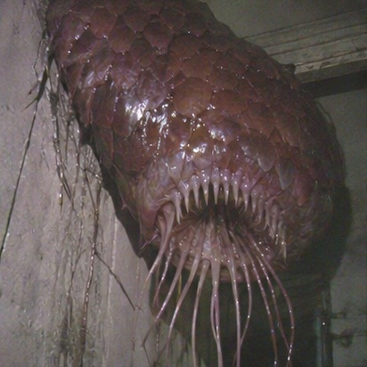
  - 【原典外貌】不化人形亦不口吐人言之赤鱗巨蟒，身粗如柱、長逾數十丈，披鐵瓦般紅鱗、雙目如懸掛夜空之大紅燈籠，乘腥風撲食駝羅莊人畜；終因生吞孫悟空遭金箍棒自腹中撐破脊背慘死。
  - 【本作克蘇魯／昆蟲寄生／偽人重構】**徹底去除優雅蛇頭輪廓，改寫為自潮濕發霉地下室天花板破牆鑽出的「巨型紅鱗環節蠕蟲與吸血巨蛭融合體」**：直徑逾兩公尺的臃腫筒狀巨軀表面覆蓋著一層層如瓦片疊壓、濕潤油亮且滲出暗紅腐血的深褐赤甲硬鱗，鱗片縫隙間垂掛著數十條沾滿發酵泥沼與屍油的枯黑氣根狀寄生絲線；牠根本沒有傳統蛇類的上下顎與眼瞼，前端整片盲目肉團直接凹陷成一座**黑洞洞的圓形七鰓鰻／巨蛭環形口盤**，口緣密密麻麻長滿一圈向內彎曲的慘白骨質針牙，下唇則懸垂著十餘條不斷滴淌黏涎、隨獵物體溫微微擺動探測的粉紅長條肉質感覺觸鬚！每次蠕動擠進老舊走廊，空氣裡便充滿令人窒息的爛柿發酵沼氣與消化胃酸惡臭。
- **特性**：
  - 【原典記載】外甲極厚、力大無窮且毫無多餘廢話，見活物即捲起惡風直接生吞，與悟空、八戒在亂石山谷硬撼多合竟一度生吞悟空入腹。
  - 【本作衍生】極難纏的**「全裝甲盲目地下隧道掘進巨怪」**——外層疊壓赤甲堪比鋼板，普通冷兵器與三流自製符咒打上去宛如撓癢；同時體表發酵腐果甲烷沼氣隨時環繞，令法師不敢在密閉地下空間貿然使用大範圍明火，否則極易引發空間氣爆同歸於盡！
- **弱點**：
  - 【原典記載】完全缺乏心機智謀、外堅內脆且極度貪吞活物——毫無防備將孫悟空生吞進肚，反被從柔軟腹腔撐破脊背斃命。
  - 【本作衍生】體表疊甲雖厚，但**口盤內壁黏膜、粉紅感覺觸鬚與柔軟的環節消化腸腔毫無防禦力**；實戰中先以高強度探照燈或乾粉稀釋環境沼氣防爆，再誘使其吞下包裹「延遲爆燃烈火符＋鎮魂鐵釘」的溫熱血肉誘餌，從腹腔內部炸爛內臟，是低階除妖師唯一能以小搏大的斬殺戰法。
- **習性**：
  - 【原典記載】盤踞七絕山稀柿衕臭氣薰天的深洞，夜深則化紅腥怪風襲擊駝羅莊掠食豬羊與百姓，令當地雇請的道士和尚盡皆束手。
  - 【本作衍生】常潛伏於台灣偏鄉荒廢垃圾掩埋場地底滲濾溝、長年棄置的高速公路舊隧道或山谷腐果沼澤深洞，依靠發酵堆肥的高溫維持變溫巨軀活性，深夜沿排水箱涵爬出吞食流浪動物與失蹤登山客。
- **喜好**：
  - 【原典記載】純粹嗜食溫熱活體血肉（人畜不拘、連皮帶骨整隻生吞），嗜居陰濕腐爛山洞。
  - 【本作衍生】極度敏感於活體恆溫動物的紅外線體溫與腳步震動，嗜好悶熱發酵的酸腐環境。
- **擅長的招式／異能**：
  - 【原典記載】`腥紅惡風捲地`、`巨口活吞`、`巨尾掃山`（無兵器法寶，純粹肉身凶威）。
  - 【本作衍生】`環齒巨蛭吸吞`（口盤內腔驟然產生負壓，配合十餘條觸鬚將整輛機車或活人拖入口腔絞碎）、`稀柿甲烷腐氣吐息`（噴吐高濃度可燃沼氣與強酸腐液，專剋火系法師）、`紅甲重壓絞殺`。

---

## 🔥 第五部：第 68～71 回・朱紫國與麒麟山獬豸洞

> **單元背景**：麒麟山獬豸洞盤踞著一頭披掛棘毛重甲、以劇毒煙火黃沙橫掃一方的凶暴魔獸「賽太歲」，麾下蓄養先鋒怪與腰掛防偽識別牙牌的低階小校「有來有去」替其跑腿索女，展現了高階噴煙魔獸與底層妖卒的壓迫式黑幫結構。

### [XY4-14] 賽太歲（麒麟山金毛犼腐食重甲噴煙魔獸）
- **出處順序**：第 68 回《朱紫國唐僧論前世 孫行者施為三折肱》、第 69 回《心主夜間修藥物 君王筵上論妖邪》、第 70 回《妖魔寶放煙沙火 悟空計盜紫金鈴》、第 71 回《行者假名降怪犼 觀音現像伏妖王》
- **類別與造型路線**：`【非人生物恐怖型】`｜無目棘毛腐食重甲噴煙巨獸（原典為逃逸之金毛犼；本作徹底去神獸化，重構為濕黏鋼針毒毛與排煙肉腺覆體的腐食魔獸）
- **物種／唯一性**：`獨一無二`（身負斷裂金鎖、竊走太上老君鍛造之紫金鈴並擄走朱紫國娘娘三年的唯一級煙火魔獸）
- **稀有度與道行對照**：`★★★★ 絕級（SSR）`｜模糊道行：數千年凶暴異獸＋頂級煙火法寶加持｜本作階位：一流頂（大範圍窒息毒煙與灼燒災難型 Boss）
- **外貌與黑暗地牢／恐怖谷視覺改寫**：
  - 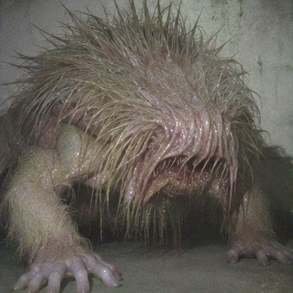
  - 【原典外貌】化人形面如藍靛、紅髮獠牙、披銀甲執宣花大斧；現本相乃頸掛斷裂金鎖、威猛如獅之金毛犼，仗三個紫金鈴放三百丈紅火、青煙、黃沙。
  - 【本作克蘇魯／昆蟲寄生／偽人重構】**拋棄威風金獅形象，還原為伏在潮濕陰暗水泥地窟裡的無眼濕黏棘毛腐食巨獸**：膨脹如裝甲推土機的背脊與頭顱表面根本沒有雙眼與溫順皮毛，而是密密麻麻炸立著數萬根浸泡在黃褐油汗與硫磺黏液中的**中空幾丁質毒棘剛毛**（狀如巨型腐食豪豬與毒毛毛蟲的綜合體），每根中空棘毛末端都在嘶嘶噴吐高溫焦煙與黃色火藥味硫沙；整顆頭部正面是一團深陷肉褶與放射狀骨刺構成的**無目裂口巨顎**，下顎滴淌腐臭屍油；最令人毛骨悚然的是牠支撐沉重軀幹的兩隻前肢——竟然不是獸蹄，而是五指張開、關節腫脹泛白、佈滿潰爛毒刺紅斑的**畸形巨型人類手掌**，緊緊死扣著三枚已半嵌進掌肉之中、表面刻滿扭曲人面裂紋的焦黑銅鈴（紫金鈴）！
- **特性**：
  - 【原典記載】暴戾好色、動輒揚言踏平朱紫國；自身近戰武藝不及孫悟空，但紫金鈴三晃齊發（紅火、青煙、黃沙）威力驚天，尤其青煙直攻瞳術弱點，令孫悟空淚流滿面狼狽敗走。
  - 【本作衍生】所有依賴視覺瞳術（如開天眼、火眼金睛）之除妖師的**絕對天敵**——牠只要晃動嵌在掌肉裡的紫金鈴並配合背部棘毛排氣孔同時爆發，三秒內就能將整條地下街灌滿含高溫火星、玻璃碴般利沙與神經腐蝕青煙的「三災死霧」，直接燒瞎除妖師眼角膜並引發呼吸道重度灼傷窒息！
- **弱點**：
  - 【原典記載】極度依賴紫金鈴（一旦遭掉包即戰力暴跌）、迷戀美色且防備心低，曾因三年碰不得毒刺仙衣而鬱躁分神，反被潛入洞府假扮侍女者以假鈴換走真鈴徹底落敗。
  - 【本作衍生】正面硬衝三百公尺煙火沙暴等於送死，唯一破局法為**「奪取小校識別牌潛入＋色酒麻痺掉包紫金鈴」**；一旦剝離嵌在掌中的三枚銅鈴，牠便失去遠程領域優勢，只剩無目棘毛肉搏——此時以大量泡沫滅火劑／高壓水陣壓制體表硫磺油層，再以雷法貫穿其裂開的無目巨顎即可擊潰。
- **習性**：
  - 【原典記載】佔據麒麟山獬豸洞為王，囚禁金聖宮娘娘三年卻始終觸之劇痛難忍，惱羞成怒之餘頻繁向鄰國強索活人侍女，折磨數月即虐殺棄屍。
  - 【本作衍生】潛伏於深山廢棄煉鋼廠高爐地下室或偏遠爛尾豪宅招待所，周邊常年瀰漫異常乾燥的焦炭與硫磺味，動輒派低階妖校向外勒索活人供其折磨發洩；牠畸形巨掌上仍留有長年無法癒合的密密麻麻黑洞刺傷。
- **喜好**：
  - 【原典記載】執念於強佔絕色女子、酷愛飲烈酒與聽人唱道情詞解悶。
  - 【本作衍生】嗜飲高度工業酒精與滾燙血酒，享受把反抗者烤成半焦後再慢慢撕扯吞食的殘虐快感。
- **擅長的招式／異能**：
  - 【原典記載】1. `紫金鈴`（三鈴分放三百丈紅火、三百丈青煙、三百丈黃沙，三晃齊發遮天蔽日）；2. `宣花大斧`與猛獸撲咬。
  - 【本作衍生】`三災毒煙沙火暴`（紫金鈴結合背部中空棘毛同步引爆，同時造成盲目、窒息、高熱爆燃與高速沙粒剝皮）、`棘毛針雨噴射`（甩動濕黏黃棘將帶硫磺劇毒的剛毛釘滿牆壁）、`巨掌肉鈴碾壓`。

---

### [XY4-15] 先鋒怪與心腹小校有來有去（獬豸洞巡山低階妖校）
- **出處順序**：第 68 回《朱紫國唐僧論前世 孫行者施為三折肱》、第 69 回《心主夜間修藥物 君王筵上論妖邪》、第 70 回《妖魔寶放煙沙火 悟空計盜紫金鈴》
- **類別與造型路線**：`【類人偽人型】`｜低階寄生山妖偽人哨卒（原著未指定單一獸形，為獬豸洞急先鋒與傳令小校）
- **物種／唯一性**：`物種（群體）`（大妖巢穴常見之底層跑腿山妖哨卒；唯「有來有去」憑藉詳細識別牙牌描寫與罕見良知，成為全書最令人唏噓之具名底層妖卒）
- **稀有度與道行對照**：`★ 凡級（N）`｜模糊道行：數年至數十年淺薄雜妖｜本作階位：三流（極低威脅度，卻是潛入情報與牙牌通行證的核心突破口）
- **外貌與黑暗地牢／恐怖谷視覺改寫**：
  - 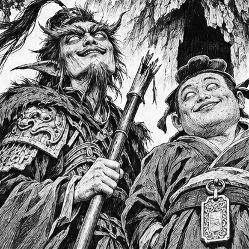
  - 【原典外貌】**先鋒怪**駕陰風持長槍索要宮女，遭孫悟空一棒打斷槍桿抱頭鼠竄；**有來有去**腰間掛鑲金牙牌明寫「五短身材，扢撻臉，無鬚。長川懸掛，無牌即假」，提銅鑼插黃旗笑嘻嘻送戰書，慘死悟空悶棍之下。
  - 【本作克蘇魯／昆蟲寄生／偽人重構】兩具穿著破爛沾泥古舊軍甲與粗布短褂、卻長著令人毛骨悚然「無瞳翻白僵笑臉」的低階寄生偽人卒：**先鋒怪**身形瘦長尖耳、濃眉倒豎如枯蟲觸角，眼眶泛起死魚般的慘白無瞳冷光，手裡死死攥著一根剛被折斷、斷口滲出木蟲黏液的破竹長槍，耳後皮下隱約可見幾條細長山蛭鑽動鼓包；矮胖的**有來有去**則是一張皮肉浮腫凹凸不平的「扢撻臉」，同樣翻著毫無眼黑的慘白雙眼掛著卑微討好的僵硬蠢笑，胸前吊掛著一塊由死人腿骨磨製、刻滿「無牌即假」蟲蛀陰文的門禁骨牌——像極了在深山毒窟裡被妖王壓榨、皮膚底下早已被老大種下控制蟲卵卻仍得笑臉跑腿的底層外包小弟。
- **特性**：
  - 【原典記載】先鋒怪欺軟怕硬、遇強即潰；有來有去則是《西遊記》極罕見具是非同情心的小妖，私下痛斥賽太歲強佔人妻、虐殺宮女「天理難容」，惜因懷璧（牙牌）遭殺。
  - 【本作衍生】呼應本作都市夜界最寫實的灰色地帶——**「被大妖寄生控制的底層妖卒線人」**。他們戰力低下卻掌握大妖巢穴最要命的巡邏班表、門禁牙牌與主子私下軟肋，對許家銘這類沒背景的三流除妖師而言，活捉審問或暗中交易遠比直接滅口更有價值。
- **弱點**：
  - 【原典記載】武藝法力極弱、嘴碎毫無防備心——有來有去三言兩語就把賽太歲三年碰不得娘娘與法寶秘密全數抖出，連背後偷襲都毫無察覺。
  - 【本作衍生】肉身防護僅略強於普通成年人，一記三流掌心雷或定身符即可輕鬆放倒；且兩人體內皆被賽太歲種有防叛逃的火毒蟲卵，只要威脅捏碎或以符紙假裝能幫他們拔蟲，往往不必動武就能拿到通行牙牌與情報。
- **習性**：
  - 【原典記載】駐守獬豸洞外圍巡山敲鑼、跑腿遞戰書與索要貢品。
  - 【本作衍生】深夜騎著無牌破機車或徒步穿梭於郊區便利商店、廢棄工寮與產業道路替大妖採買物資、遞送恐嚇信件，身上隨時佩掛識別骨牌防妖盟盤查。
- **喜好**：
  - 【原典記載】有來有去愛聽道情詞兒、好與路人閒聊吐苦水；先鋒怪好仗勢欺負弱小凡人。
  - 【本作衍生】有來有去喜歡趁跑腿空檔躲在路燈下喝超商便宜麥茶、聽老電台廣播吐槽上司喜怒無常。
- **擅長的招式／異能**：
  - 【原典記載】先鋒怪使普通長槍與低階陰風；有來有去配銅鑼、黃旗與`鑲金防偽牙牌`（無戰鬥法寶）。
  - 【本作衍生】`防偽骨質門禁牙牌`（潛入絕級大妖巢穴的關鍵通行道具）、`銅鑼喚群警報`（遇敵猛敲銅鑼招喚外圍小妖圍堵）。

---

## 🕷️ 第六部：第 72～73 回・盤絲嶺盤絲洞與黃花觀（⚠️ 五大標竿雙核心章節）

> **單元背景**：卷四最契合本作「黑暗地牢 × 節肢昆蟲寄生 × 恐怖谷偽人」核心美學的雙標竿絕境！盤絲洞七蜘蛛精（**標竿其一**）、外圍七脈純血食人昆蟲乾兒子軍團，與黃花觀巨型寄生母體百眼魔君（**標竿其二**），共同構築出一座橫跨廢棄溫泉洞穴、潮濕地牢拱廊與舊道觀地底的完整節肢寄生生態網。

### [XY4-16] 盤絲洞・七蜘蛛精（七姊妹・⚠️ 五大標竿核心條目）
- **出處順序**：第 72 回《盤絲洞七情迷本 濯垢泉八戒忘形》、第 73 回《情因舊恨生災毒 心主遭魔幸破光》
- **類別與造型路線**：`【非人生物恐怖型】`（核心本相：巨大寄生人骨產卵巨蛛）× `【類人偽人型】`（誘殺偽裝態：七名同步僵笑偽人女子）｜節肢寄生巨蛛母體群
- **物種／唯一性**：`物種（群體）`（高階寄生巨蛛族群之古典母型與集體巢穴樣本；本作正本序章廢棄醫院地下室 `01-蜘蛛精` 即屬此一龐大族群之都市低中階變異株）
- **稀有度與道行對照**：`★★★ 珍級（SR）`（七姊妹聯手結巢；單體約 `★★ 稀級（R）` 頂至 `★★★ 珍級（SR）` 初）｜模糊道行：數百年氣候高階節肢母體群｜本作階位：二流頂～一流
- **外貌與黑暗地牢／恐怖谷視覺改寫**：
  - 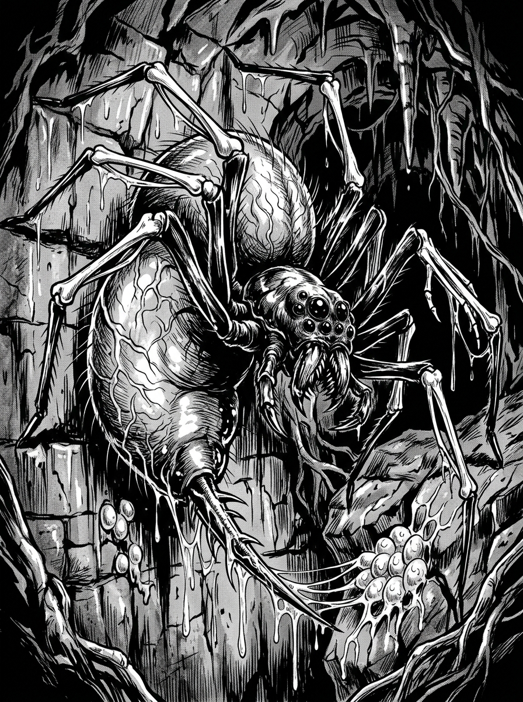
  - 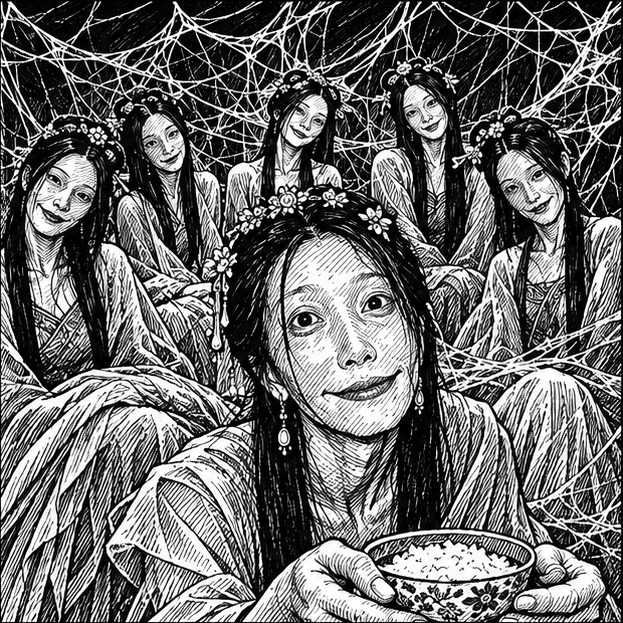
  - 【原典外貌】平時化作七名身著翠袖緗裙、於木香亭刺繡踢球並在熱泉「濯垢泉」每日三浴的妖豔女怪，烹煎人油人腦偽作素齋誘僧；動手時撩起衣裳自肚臍噴出鵝蛋粗雪白黏絲罩遍數里，遭擊斃後現出七個巴斗大的蜘蛛原形。
  - 【本作克蘇魯／昆蟲寄生／偽人重構】**⚠️ 嚴格遵循五大標竿定案：徹底拒絕一切「性感美女蜘蛛／網美半蛛人」套路！**
    1. **核心本相（標竿・寄生人骨巨蛛態）**：七頭盤踞在潮濕滴水鐘乳洞與廢棄溫泉管窟深處的**巨大寄生巨蛛**——通體濕潤反光、覆滿黏稠透明黏液與清晰暴起的青黑血管；極度膨脹的囊狀巨腹末端延伸出一根**覆滿倒刺、不斷劇烈搏動收縮的粗長幾丁質產卵器**，正持續往滴水石壁噴吐黏糊成串的半透明膠質卵囊！最令人生理反胃的是牠們的八條長腿——**每一條節肢關節處都森白殘留並嵌合著被吞噬獵物的真實人類股骨、脛骨、尺骨與痙攣外翻的白骨手指**，彷彿以受害者骸骨為內骨骼硬生生拼裝出的黑暗地牢畸形步足；前端無任何人臉美感，唯有一簇大小錯落、油亮純黑的複眼聚群與雙排滴滿強酸毒液的鋸齒彎鉤巨顎！
    2. **誘殺偽人態（恐怖谷僵笑七姊妹）**：唯有在引誘獵物端出「人肉蛆蟲偽齋」的短暫片刻，牠們才會披上七張極度僵硬的古裝女子皮囊——七名女子置身密密麻麻的發黑蛛網之間，**頭顱以毫釐不差的詭異角度同步歪斜，臉上掛著嘴角過度拉扯、雙眼空洞無焦距的完全一致僵笑**，最前方那名女子雙手端著一碗實為蠕動白蛆與人腦碎末的青花瓷碗直逼獵物鼻尖，只要目標露出半秒遲疑，七張人皮便同時從肚臍與鎖骨撕裂，翻出人骨巨腿與搏動產卵器展開集體產卵封殺！

- **📚 專題考據：標竿《盤絲洞七蜘蛛精》vs. 本作正本序章 `01-蜘蛛精` 同族變異關聯**

| 比較維度 | 卷四標竿本家：盤絲洞七蜘蛛精（第 72–73 回） | 本作正本序章定案：`01-蜘蛛精`（廢棄醫院地下室變異株） |
| :--- | :--- | :--- |
| **血脈與族群定位** | 寄生巨蛛大脈之**高階群居母體群**，懂結巢、集體產卵、圈養外圍蟲妖並聯手百眼魔君形成黑暗生態網。 | 同屬盤絲寄生蛛脈，但為流落現代都會、尚未修出完整人皮偽裝與集體巢穴的**低中階孤立游獵變異株**（正本已完稿斬殺，保留原定稿造型基準不倒改）。 |
| **道行與稀有度** | `★★★ 珍級（SR）`｜數百年成精母體（本作**二流頂～一流**）。 | `★★ 稀級（R）`｜數十年～百餘年成精初階（本作**初級二流**）。 |
| **外貌與生物特徵** | **本相完全非人**：巨大濕亮寄生蜘蛛、腹部具搏動倒刺產卵器、八腿關節嵌帶森白人骨殘留；**偽人態**為七名同步僵笑女子。 | 體長 `1.5m×1.2m` 剛毛捕鳥蛛軀幹，前端長出一顆刻意縮小一號的慘白無下巴近人頭顱、八顆純黑球面眼與雙彎螯牙（尚停留在半化形恐怖谷階段）。 |
| **核心獵食機制** | **七股肚臍粗白黏絲封死空間**＋**產卵器強行在活人胸腹注入寄生卵囊**＋外圍七脈昆蟲軍團圍殺。 | **全感官障眼法**＋**捕鳥蛛隱形踢毛**（誘騙法師誤捏閉氣訣）＋八足壁行突襲。 |
| **同族共通破口** | 極懼高階烈火焚絲焚卵、雷電痙攣與趁產卵／沐浴脫殼期突襲脆弱膨脹腹部。 | 極懼密閉烈火濃煙燃盡絨毛細毛＋掌心雷貼身麻痺破防。 |

- **特性**：
  - 【原典記載】七姊妹同氣連枝、分工極密（有人烹人腦人油偽作素齋誘敵、有人把風、戰時七道鵝蛋粗肚臍白絲交錯結成遮天大網），不僅強佔濯垢泉熱湯，更收伏七個昆蟲乾兒子與依附同門師兄百眼魔君。
  - 【本作衍生】高階盤絲母體群是現代都市最絕望的**「集體產卵封樓巢穴」**——七條母蛛的臍絲韌性媲美工業鋼纜且塗滿麻痺酸液與微小蛛卵，一旦被七股絲線同時封死大樓安全梯與逃生窗，受害者不會立刻被咬死，而是被包裹在溫熱潮濕的黏液繭中淪為活體溫床，遭腹部搏動產卵器直接貫入腹腔產下數十顆膠質寄生卵！
- **弱點**：
  - 【原典記載】極度畏懼烈火焚網（盤絲洞蛛網遭孫悟空一火燒絕）、每日定時下泉沐浴脫離偽裝戒備最鬆懈，且脫離大網與百眼魔君後單體肉身遠非絕頂強者之敵。
  - 【本作衍生】與序章變異株一脈相承，**高溫烈火與高壓雷法仍是絕對死穴**；但母體級的粗白臍絲濕潤耐燃，一張三流自製烈火符根本燒不穿，必須先切斷外圍蟲妖援軍、以「強化烈火符／工業噴火或大量助燃劑＋五雷連擊」優先炸毀牠們高度膨脹、缺乏外甲保護的**半透明搏動產卵腹囊**，同時嚴格避免觸碰牆面膠質卵串以免被初生幼蛛鑽入皮膚。
- **習性**：
  - 【原典記載】佔據盤絲嶺盤絲洞與天泉「濯垢泉」，每日三次於熱泉沐浴，以人油煎炒人肉偽裝素齋招待誤闖客旅。
  - 【本作衍生】極度偏愛高溫高濕、長年無人檢修的**台灣北投、烏來、礁溪或關子嶺廢棄老舊溫泉旅社與地熱管線暗窟**；她們會把廢棄湯屋偽裝成深夜燈火昏黃的「傳統家族民宿」，七姊妹端著熱騰騰的白飯微笑迎客，一旦住客入房便從排風口垂下人骨步足集體圍捕產卵。
- **喜好**：
  - 【原典記載】酷愛滾燙溫泉浴、穿著鮮豔女裝假扮凡俗女子，以及油煎活人腦髓與鮮肉。
  - 【本作衍生】病態嗜好攝氏四十度以上的硫磺濕熱水氣（極利於寄生蛛卵孵化），以及四肢健壯、體溫偏高、能撐過七天產卵孵化期仍不斷氣的活體宿主。
- **擅長的招式／異能**：
  - 【原典記載】`肚臍吐絲天羅網`（鵝蛋粗白黏絲封山罩谷、越掙越緊）、`人肉偽齋誘殺`、`七姊妹聯手結陣`、`喚出七乾兒蟲海`。
  - 【本作衍生】`七情臍絲封樓陣`（十秒內以強酸麻痺粗白蛛纜鎖死整棟建物所有出入口）、`人骨節肢穿刺`（以鑲嵌鋒利斷裂人骨的八條長腿高速突刺釘死目標四肢）、`搏動產卵器活體注卵`（將數十顆黏液寄生卵強行打入活體腹腔，三小時內即破腹孵化）。

---

### [XY4-17] 盤絲洞七個乾兒子蟲妖（蜜・螞・蠦・班・蜢・蠟・蜻・純血食人昆蟲軍團）
- **出處順序**：第 72 回《盤絲洞七情迷本 濯垢泉八戒忘形》
- **類別與造型路線**：`【非人生物恐怖型】`｜純血黑暗地牢食人昆蟲七脈集群（原典七隻被盤絲蛛網擄獲而認賊作母的毒蟲精全錄）：
  1. **蜜（蜜蜂精）**：巨顎利刺、分泌發酵屍蜜誘餌與群螫毒針之食肉蜂妖。
  2. **螞（螞蜂／馬蜂精；*註：原典實為與蜜蜂、蠦蜂並列之「螞蜂／黃蜂」，坊間通行亦常讀作「螞蟻精」，本作雙軌並存——將行軍肉食毒蟻與猛烈馬蜂之群體啃噬特質融為一脈*）**：最具侵略性、成群撕咬肌肉纖維與注射神經蜂酸之猛蟲妖。
  3. **蠦（蠦蜂精／大型虎頭蜂・土蜂精）**：體型最碩大、尾端伸縮產卵毒針可一擊引發過敏性休克溶血之重甲毒蜂妖。
  4. **班（班毛精／斑蝥精）**：濕亮斑紋甲殼滲出劇毒「斑蝥素」強酸，沾染皮膚瞬間起泡剝皮潰爛之腐食毒甲蟲妖。
  5. **蜢（牛蜢精／蜢蟲精）**：具鋸齒吸血口針、專撕扯動脈狂吸溫熱活血之巨型吸血牛虻妖。
  6. **蠟（抹蠟精／蠟嘴・白蠟蟲精）**：自腹腺狂噴黏稠慘白死屍蠟絲與致盲蠟粉封死口鼻眼瞼之異蟲妖。
  7. **蜻（蜻蜓精）**：四片半透明骨膜巨翼高速振動、下顎具伸縮折疊「面罩抓捕口器」凌空絞斷咽喉之食肉飛蟲妖。
- **物種／唯一性**：`物種（群體）`（七種常見毒蟲皆屬龐大自然昆蟲物種，於盤絲洞陰濕環境異變為純血食人母蟲並能分裂出遮天蔽日的同種幼蟲軍團）
- **稀有度與道行對照**：`★★ 稀級（R）`（七脈聯手蟲潮；單隻母蟲約 `★ 凡級（N）` 頂～`★★ 稀級（R）` 初）｜模糊道行：數十年至百餘年寄生蟲妖｜本作階位：三流頂～二流（單體脆但「七毒複合蟲潮」極度致命）
- **外貌與黑暗地牢／恐怖谷視覺改寫**：
  - 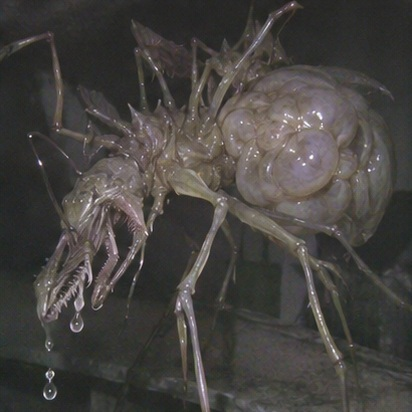
  - 【原典外貌】人形時為七名矮小醜怪的乾兒子，自稱「春采百花供怪物，夏尋諸卉孝妖精」；交鋒時脫衣抖身化為成千上萬隻蜜、螞、蠦、班、蜢、蠟、蜻七種毒蟲撲殺悟空八戒，終遭孫悟空毫毛所變七種猛鷹啄食殆盡。
  - 【本作克蘇魯／昆蟲寄生／偽人重構】**徹底拋棄可愛或卡通蟲人造型，重構為黑暗地牢最令人頭皮發麻的「半透明膿泡母蟲 × 億萬食人蟲海」**：七頭體型如大型獵犬的母體怪蟲毫無半分人類溫情臉孔，全由蒼白半透明、滴淌酸液黏涎的濕亮幾丁質節肢構成；長滿長刺的畸形細長步足扣死發霉牆角，拉長如鐮刀鋸齒般的口器不斷向下滴落會腐蝕水泥的清澈強酸口水；最駭人的是牠們身後那顆**嚴重畸形腫脹、佈滿大大小小半透明灰白水泡囊腫的巨型育幼腹球**——透過濕滑囊膜清楚可見成千上萬隻正在彼此啃食、劇烈蠕動準備破囊而出的虎頭蜂、斑蝥、吸血牛虻與食肉蜻蜓幼蟲！只要母蟲震顫甲殼，整顆膿泡腹球便當場爆裂湧出鋪天蓋地的黑暗食人昆蟲軍團，瞬間吞噬整條走廊的日光燈與活物！
- **特性**：
  - 【原典記載】原是誤落盤絲大網的俘虜，貪生怕死認七蜘蛛精作義母，負責替母蛛採集貢品與充當第一道消耗炮灰；核心威脅在於「七種昆蟲複合齊攻」令對手防不勝防。
  - 【本作衍生】極度克制所有單點近戰或缺乏範圍清場術法的除妖師——**七脈生化蟲潮同步發動**：先由蠟精噴吐白蠟粉糊住眼鏡與雙眼、斑蝥精以斑蝥素酸液令皮膚劇痛起泡打斷掐訣手勢，隨即牛虻、蠦蜂、螞蜂與蜻蜓一擁而上在二十秒內將法師啃成森白骸骨，並把殘餘血肉搬回盤絲洞餵養七母蛛的卵囊！
- **弱點**：
  - 【原典記載】天敵食物鏈壓制極為致命——遇見孫悟空變出的七種餓鷹猛禽毫無反抗之力，瞬間被啄得屍橫遍野、片甲不留。
  - 【本作衍生】蟲海雖駭人卻**單體極脆、極怕大範圍爆燃烈火、劇毒濃煙窒息與高壓電網連鎖放電**；許家銘這類低階散修遭遇時嚴禁赤手空拳亂拍，必須第一時間掐死「閉氣訣／避風訣」防毒霧，配合「連環自製烈火符＋點燃環境殺蟲氣溶膠／酒精噴霧製造空間爆燃」一次燒清空中蟲潮，同時鎖定並斬殺後方七頭拖著巨大膿泡腹球的母蟲，整支蟲軍即刻崩潰失控。
- **習性**：
  - 【原典記載】盤踞盤絲嶺百花叢深處，按時採擷山花野果進貢七蜘蛛精，聞訊即蜂擁護穴。
  - 【本作衍生】常依附於高階蛛妖或蜈蚣精巢穴外圍的廢棄花市溫室、郊區荒廢養蜂場、垃圾轉運站排水溝與舊公園枯樹洞，白天偽裝成異常密集的低鳴蜂巢與發黑積水蟲堆，一旦活人踏入警戒半徑便集體爆囊圍剿。
- **喜好**：
  - 【原典記載】嗜採百花蜜露、腐爛果實與溫熱牲畜鮮血（尤其牛蜢酷愛吸血）。
  - 【本作衍生】對甜膩含糖飲料、腐敗水果發酵味與強光探照燈有極強趨性（反而可作為除妖師架設高壓誘殺火網的絕佳餌點）。
- **擅長的招式／異能**：
  - 【原典記載】`七蟲化海撲殺`（七母蟲同時分裂成遮天蔽日之萬蟲大軍）。
  - 【本作衍生】`膿泡育幼腹爆裂`（撐破腫脹母腹釋放上萬隻食人毒蟲）、`斑蝥強酸潰皮霧`（接觸表皮即起大片水泡打斷符訣）、`白蠟盲目黏絲`（糊死口鼻與雙眼）、`牛虻蠦蜂嗜血溶血螫`。

---

### [XY4-18] 黃花觀・百眼魔君（多目怪／蜈蚣精・⚠️ 五大標竿核心條目）
- **出處順序**：第 73 回《情因舊恨生災毒 心主遭魔幸破光》
- **類別與造型路線**：`【非人生物恐怖型】`｜巨型多眼寄生吸盤產卵管蜈蚣母體（盤絲洞七蜘蛛精之同門師兄，全書節肢毒蟲妖力之終極巔峰）
- **物種／唯一性**：`物種特異個體`（蜈蚣毒蟲一脈歷經千年潮濕地牢寄生吞噬、修成千眼吸盤強光領域與萬蟲母體之極罕見絕級霸主）
- **稀有度與道行對照**：`★★★★ 絕級（SSR）`｜模糊道行：千年極惡毒蟲大妖（憑「千眼吸盤金光陣」硬生生困死齊天大聖，令其上天無路、只能鑽地逃生）｜本作階位：一流頂（密集恐懼 × 強光視覺污染 × 幼蟲寄生母體頂級 Boss）
- **外貌與黑暗地牢／恐怖谷視覺改寫**：
  - 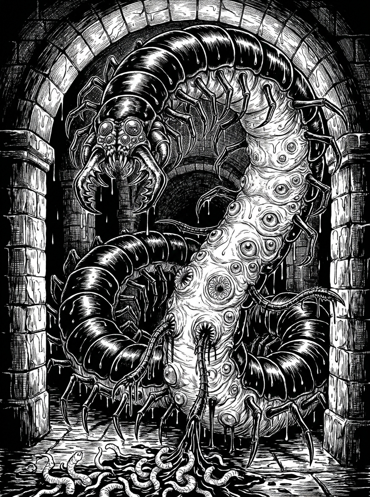
  - 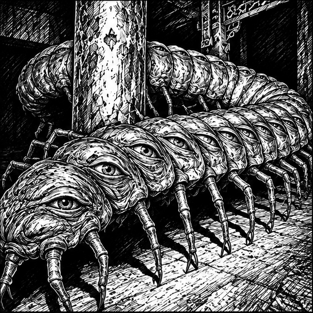
  - 【原典外貌】平時偽裝成穿葛布道袍、戴黃縐紗冠的黃花觀道士，先奉毒紅棗茶放倒唐僧師徒，戰至不利時突然敞開衣襟露出肋下密密麻麻上千隻妖眼，放出萬道刺目金光與窒息黃霧鎖死方圓數里；破光受伏後現出數丈大蜈蚣本相。
  - 【本作克蘇魯／昆蟲寄生／偽人重構】**⚠️ 嚴格遵循五大標竿定案：徹底廢除「穿道袍的帥道士／人首蜈蚣」套路，完全以巨型蜈蚣寄生母體為主體！**
    1. **核心母體態（標竿・黑暗地牢吸盤產卵巨蜈蚣）**：一條身長逾十五公尺、粗若捷運地下隧道樑柱的**巨型深淵濕亮幾丁質蜈蚣**，死死盤踞在黑暗地牢般滲水發霉的磚石拱門與積水廢棄古觀深處！牠背部披覆一節節閃著漆黑冷冽反光、不斷滴落油滑腐液的重甲黑殼，兩側爆伸出上百條如鐮刀般寒光凜冽、能輕易刺穿紅磚與鋼筋混凝土的多節尖銳步足；頭顱沒有絲毫人類面容，唯有成簇凸起的黑亮複眼與一對沾滿麻痺毒液的鋸齒狀巨型顎鉗！最令見者理智崩潰的是牠向敵人昂起翻轉的**蒼白肥厚柔軟腹面與體節兩側**——那裡密密麻麻、毫無縫隙地長滿了**數百上千個同心圓狀帶齒寄生吸盤，與鑲嵌在體節硬甲縫隙中、毫無眼瞼正死死轉動盯視的濕潤巨型眼球**！數條沾滿黏液的粗長黑色**搏動產卵管**正從腹側大吸盤孔洞裡猛然探出，直接向潮濕積水地磚瘋狂傾瀉出成堆翻滾扭動、慘白分節的寄生蜈蚣幼蟲！
    2. **金光千目本質重構**：原典令孫悟空頭痛欲裂、無處遁逃的「金光千目黃霧」，在本作實為**牠盤繞廟柱昂起身軀時，體節兩側上千個濕潤複眼與齒狀吸盤同步聚焦折射出的高頻生物強光閃爆，疊加自吸盤孔洞噴出的黃綠色高腐蝕神經毒霧**——直視者大腦與視神經會在零點一秒內遭密集恐懼資訊過載與強光灼燒徹底失明癱瘓！ *(註：遠距誘敵時，牠僅偶爾將剝下的腐朽舊道袍撐掛在前端節肢上躲在昏暗門簾後假扮駝背老道奉毒茶，一旦獵物跨進潮濕地牢便徹底捨棄布殼現出完整巨蜈蚣真身。)*
- **特性**：
  - 【原典記載】極度陰狠多謀且精於煉毒——先以三顆紅棗泡出見血封喉的劇毒茶湯一舉放倒唐僧、豬八戒與沙僧；正面作戰展開「千眼金光陣」，以有形強光黃霧把方圓數里壓縮成連金箍棒都撞不破的密閉牢籠，逼得孫悟空只能變作鯪鯉（穿山甲）往地下深挖二十里才保住一命。
  - 【本作衍生】全書節肢生物恐怖的終極集大成——兼具**「下毒暗算」**、**「密集千目強光致盲領域」**與**「產卵管幼蟲海鋪場」**三重絕望機制！在潮濕發霉的密閉地下觀宇中，只要牠一展開體節兩側的千目吸盤強光，開啟「開天眼」或「火眼金睛」的除妖師反而死得最快（視覺強化會把強光與密集精神污染放大十倍，當場七竅流血失明），隨即就被地上如潮水湧來的寄生幼蟲順著褲管鑽進血肉活活啃空！
- **弱點**：
  - 【原典記載】天生受「純陽金雞（昴日星官血脈）」食物鏈血脈絕對剋制——遭昴日星官眼中煉成之繡花針一擊刺破強光陣眼，瞬間筋骨酥軟、千目黯淡，毫無還手之力現出大蜈蚣原形；此外其強光領域對**極深地層鑽地潛逃**留有一線空隙。
  - 【本作衍生】三流～二流除妖師撞見百眼魔君**嚴禁直視其體節與腹面、更絕對不可開啟視覺瞳術**！實戰活命與破陣鐵律有三：其一，進入偏僻陰濕私壇道觀絕不喝任何奉茶與紅棗湯；其二，若千目強光已亮起，立刻雙眼緊閉改以聽覺定位，並迅速往深層排水溝或地下管廊深挖遁離其直視光域；其三，唯有備妥具備**「純陽金雞血煞／破光陽針」**性質的高階專剋法器，趁牠翻開蒼白軟腹噴吐產卵管與閃光的瞬間，一針貫入最前端主節複眼或最大母吸盤中樞，才能令整條巨型蜈蚣抽搐失能、千目爆裂！
- **習性**：
  - 【原典記載】長年盤踞黃花觀陰暗深處修道煉毒，與盤絲洞七蜘蛛精互為同門師兄妹、共享情報與活人獵物，一旦師妹遇難便不惜傾力設毒局報復。
  - 【本作衍生】在現代台灣必盤踞於**深山產業道路盡頭年久失修、地基長年滲水長滿青苔的廢棄古道觀地下室、荒廢中藥煉製廠陰濕水窖或地下古磚排水拱廊**；平時暗中庇護並串聯整座城市的蜘蛛精與毒蟲妖網，凡有除妖師斬殺了牠麾下盤絲蛛脈（如許家銘日後若引來同脈追查），便可能引來這位極度護短的巨型蜈蚣母體冷血追殺。
- **喜好**：
  - 【原典記載】嗜好煉製見血封喉的劇毒紅棗湯、設陰謀暗算仇家，極度護短同門師妹。
  - 【本作衍生】極度迷戀潮濕發霉、終年不見陽光的積水磚石地牢環境，嗜食活體鮮血與高階毒草精華以餵養腹腔內無數等待孵化的寄生幼蟲。
- **擅長的招式／異能**：
  - 【原典記載】1. `千眼金光陣（黃霧鎖空）`（體節肋下千眼齊放萬道強光與窒息黃霧，鎖死方圓數里，連金箍棒亦撞不破）；2. `黃花觀劇毒紅棗茶`（見血封喉之神經癱瘓奇毒）；3. `多足劍戰纏鬥`。
  - 【本作衍生】`千目吸盤閃爆領域`（體節兩側複眼與吸盤同步爆發高頻致盲閃光與黃色腐蝕神經毒霧，直接廢除開天眼並將空間壓成力場牢籠）、`腹側產卵管萬蟲傾瀉`（數根黑色粗管自腹盤探出，瞬間在積水地磚鋪滿數千條鑽皮寄生幼蟲）、`百足鐮刃穿壁絞殺`（上百條黑亮幾丁質步足刺進左右磚牆將走廊切碎）、`紅棗蠱毒湯`。

---

## 🦅 第七部：第 74～77 回・獅駝嶺獅駝洞與獅駝國（滅國養蠱巢穴與三大魔獸）

> **單元背景**：全書殺戮規模最慘烈、黑暗地牢絕望感攀至絕頂的「滅國養蠱妖域」。八百里獅駝嶺密布四萬八千隻巡山寄生小怪，由裂顎重甲獅甲蟲、吸血捲吸口管巨象與嗜血食腐巨蚊鷲三大魔獸統治；更駭人的是整座獅駝國五百年前已被吃盡活人，徹底異化成「人髮結氈、屍泥鋪路、萬妖叫賣活人血肉與幼蟲」的巨型活體養蠱食人巢穴！

### [XY4-19] 小鑽風與獅駝嶺萬妖群（四萬八千巡山寄生小怪群）
- **出處順序**：第 74 回《長庚傳報魔頭狠 行者施為變化能》、第 75 回《心猿鑽透陰陽竅 魔王還歸大道真》
- **類別與造型路線**：`【類人偽人型】`（巡哨頭目小鑽風）× `【非人生物恐怖型】`（四萬八千雜蟲腐獸小妖黑潮）｜巡山寄生小怪群
- **物種／唯一性**：`物種（群體）`（獅駝嶺四萬八千巡山妖兵與獅駝城妖市雜卒組成的龐大寄生小怪集群，「小鑽風」為其中最具代表性的哨兵個體）
- **稀有度與道行對照**：`★ 凡級（N）`｜模糊道行：數年至數十年底層寄生雜妖（單體脆弱如紙，靠四萬八千之巨型集群壓境）｜本作階位：未入流～三流
- **外貌與黑暗地牢／恐怖谷視覺改寫**：
  - <!-- 圖位預留：待補繪 -->
  - 【原典外貌】小鑽風頭戴尖角皮帽、腰束麻繩、肩扛「巡山」三角小令旗、左手敲打叮噹木梆子，逢人便高喊「大王叫我來巡山」並滔滔不絕炫耀三位大王本領；身後獅駝嶺與獅駝城則擠滿四萬八千名賣人肉、刮人骨的各色雜妖小卒。
  - 【本作克蘇魯／昆蟲寄生／偽人重構】**小鑽風**呈現為一名披著發霉反光背心與乾涸暗紅血漬碎布、背脊異常佝僂隆起的畸形巡山偽人小怪：臉皮薄如濕報紙且泛出灰綠屍斑，嘴角咧開掛著市井吹牛般的呆滯蠢笑，頸後隆起處其實藏著一顆半透明搏動的**寄主蟲囊**（三大王用來監控兵卒的寄生蟲腺），手裡拎著一根由人脛骨綁成、不停敲出「叩叩」骨響的破木梆與一面沾滿黑血的三角紅旗；而他身後漆黑的廢棄大型工業區山谷與高架橋底，則密密麻麻湧動著四萬八千隻由**腐食蒼蠅人、多足食腐鼠蟲、背負人頭骨殼的寄生甲蟲怪與爛皮小鬼**構成的黑色蟲海——彼此推擠搶食地上的碎肉、用人骨搭棚叫賣血肉包子，在黑暗裡亮起數十萬顆如飛蛾複眼般死白冰冷的微光！
- **特性**：
  - 【原典記載】極度迷信官階威權、愛吹捧上司（三位大王）的豐功偉績，但毫無真正戰意與忠誠——僅憑孫悟空杜撰的一個「總鑽風」虛銜就乖乖抖出全部軍機，聽到吃唐僧肉沒自己份還要上戰場送命，立刻嚇得全山巡哨人心潰散。
  - 【本作衍生】現代都市裡極具現實黑色幽默的**「大型妖魔黑幫基層外圍蟲群」**——單隻連剛入行的三流散修許家銘都能一符斬殺，但勝在四萬八千隻無孔不入的眼線網絡與人海消耗戰術；面對此群硬砍必被活活耗乾法力啃成白骨，最優解永遠是**「貼幻形符冒充上級妖官套取情報＋挑撥勞資矛盾散播大王要拿小妖當祭品／幼蟲飼料的恐慌」**，令萬妖黑潮瞬間自我瓦解！
- **弱點**：
  - 【原典記載】愚蠢輕信權威、單體戰力近乎為零，極度畏懼強者威壓與謠言恐嚇。
  - 【本作衍生】缺乏破妄眼力且精神防線脆弱；只要放出高階妖氣威壓符或冒充三大王派來的「總鑽風」檢查官大聲喝斥，往往一槍不發就能把全山布防圖與大妖作息騙個精光；群攻清場則極懼大範圍烈火、濃煙與高壓電弧。
- **習性**：
  - 【原典記載】日夜敲梆輪班巡邏八百里獅駝嶺，見落單旅人即蜂擁綁回獅駝洞進貢，平時在獅駝城街市吆喝買賣人肉乾、人血腸與碎骨湯。
  - 【本作衍生】成群結隊潛伏於偏遠荒廢工業區、廢棄大型貨運轉運站與山區高架橋涵洞充當放哨巡守，深夜拿著閃紅光的破損指揮棒與生鏽鐵棍假裝夜間保全攔截誤闖車輛。
- **喜好**：
  - 【原典記載】愛敲梆唱順口溜、愛吹牛炫耀三位大王威風、妄想跟著老大喝一口高僧肉湯。
  - 【本作衍生】愛聚在暗角吹牛摸魚、分食腐肉碎渣與路人掉落的零食，最恨沒分到好處卻要被妖王拿去填線餵蟲。
- **擅長的招式／異能**：
  - 【原典記載】巡山木梆子、三角小令旗與粗陋刀槍，無任何高深法術與法寶。
  - 【本作衍生】`骨梆喚群鳴警`（敲響人骨木梆引發方圓五百公尺內數百隻巡山雜蟲怪集體圍堵）、`腐蟲人海淹沒`（不計傷亡蜂擁撲上以純粹數量拖死孤立除妖師）。

---

### [XY4-20] 大大王・青毛獅子怪（獅駝嶺大王・裂顎寄生獅甲蟲巨獸）
- **出處順序**：第 74 回《長庚傳報魔頭狠 行者施為變化能》、第 75 回《心猿鑽透陰陽竅 魔王還歸大道真》、第 76 回《心神居舍魔歸性 木母同降怪體真》、第 77 回《群魔欺本性 一體拜真如》
- **類別與造型路線**：`【非人生物恐怖型】`｜巨型裂顎重甲寄生獅甲蟲怪獸（徹底摒棄毛絨雄獅形象，重構為濕亮幾丁質重甲與腐菌絲鬃毛覆體的吞噬巨蟲獸）
- **物種／唯一性**：`獨一無二`（昔年於南天門一口吞下十萬天兵、稱霸八百里獅駝嶺之絕頂吞噬巨怪，獅駝三魔之首）
- **稀有度與道行對照**：`★★★★ 絕級（SSR）`｜模糊道行：數千年太古級吞噬大妖（嚇退十萬兵、單體力撼孫悟空）｜本作階位：一流頂～巔峰（超巨型區域吞噬與重甲衝撞災厄 Boss）
- **外貌與黑暗地牢／恐怖谷視覺改寫**：
  - 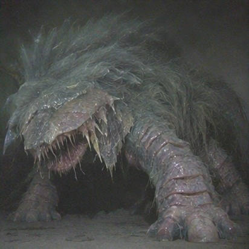
  - 【原典外貌】鑿牙鋸齒、圓頭方面、聲吼若雷、仰鼻朝天，使一把剛猛鋼刀；現出吞天法身時張口寬如城門，曾一口將十萬天兵與孫悟空盡數吸吞入腹。
  - 【本作克蘇魯／昆蟲寄生／偽人重構】**徹底抹殺百獸之王的威風毛絨感，改寫為盤踞廢棄巨蛋地底的「巨型裂顎重甲寄生獅甲蟲怪獸」**：整座卡車頭般龐大的軀幹由層層疊壓、泛出濕潤腐紫與鐵灰冷光的**重型幾丁質甲蟲節段**拼合而成，四條柱狀巨腿佈滿厚重裝甲環節與鈍重甲爪；覆蓋牠肩背與顱頂的所謂「青毛鬃毛」，實為數以萬計沾滿泥水與陰暗黴斑的**青灰色腐敗真菌絲與長節硬毛**，隨每一次沉重吐息揚起漫天致幻青黴孢子！整張臉龐毫無哺乳類鼻目輪廓，唯有一張從頭甲左右崩裂至咽喉深處的**超寬扁平裂顎深淵巨口**，上下密密麻麻倒懸著數排半透明骨質長針牙與拉絲滴落的強酸消化涎液——一旦牠將裂顎撐開至極限（寬逾十餘公尺如漆黑地下車道入口），內部腹腔其實是一座遍布蠕動寄生吸蟲的巨大真空胃囊，能將整排車輛、瓦礫與百名活人瞬間連根吸入溶化！
- **特性**：
  - 【原典記載】桀驁狂橫、戰意沸騰，曾因未獲邀赴宴便孤身大鬧南天門嚇得十萬兵緊閉門戶；性格卻較三弟大鵬直爽衝動，總急著一口吞敵反屢中孫悟空鑽肚奇計。
  - 【本作衍生】都市除妖界噩夢級的**「超重甲真空吞噬災獸」**——幾丁質節段裝甲對普通冷兵器、槍械與三流自製符咒近乎絕對免疫；伴隨裂顎開啟爆發的次聲波甲蟲鳴吼能瞬間震裂方圓五百公尺建築玻璃與二流以下護體金光，真空負壓吸力更會直接把整個街區抽空塞進胃囊。
- **弱點**：
  - 【原典記載】吞食過急且腹腔內部毫無防護——生吞孫悟空後反被大聖在腹內拿金箍棒頂撐肚皮、繩拴心肝折騰到跪地叫祖宗哀求吐人。
  - 【本作衍生】外部重甲無解，**唯有張開裂顎暴吸的瞬間，咽喉黏膜與空曠柔軟的腹腔消化囊毫無甲殼覆蓋**；對一流以下法師而言，嚴禁正面攔路，唯一的拼命破法是藉高強度掩體抗過吸力，或將藏有大量延遲高階雷火符／強腐蝕爆裂陣的誘餌送入其腹腔內從心肝要害引爆，迫使其胃囊翻轉喪失戰力。
- **習性**：
  - 【原典記載】與黃牙老象、金翅大鵬雕結義，統御四萬八千獅駝嶺妖兵稱霸一方，日日圖謀捕食高僧血肉。
  - 【本作衍生】若顯跡現代台灣，必盤踞於廢棄重工業區巨型鋼構廠房或山區大型廢棄防空地下庫，以絕對暴力整合數萬底層雜蟲小妖建立軍事化封鎖禁區，觸發最高等級表裏戒嚴。
- **喜好**：
  - 【原典記載】嗜好酒肉狂宴、重結義霸主排場、酷愛誇耀一口吞十萬兵的往日凶威。
  - 【本作衍生】迷戀大批量活體血肉一起灌進胃囊的飽脹感與萬妖呼喊的統治快感，極痛恨被任何勢力冷落無視。
- **擅長的招式／異能**：
  - 【原典記載】1. `法身吞天巨口`（張口如城門生吞十萬兵與敵人）；2. `剛猛鋼刀武藝`；3. `震天獅吼`。
  - 【本作衍生】`裂顎真空吞城`（裂顎脫臼擴張至十五公尺寬，引發龍捲級負壓吸力將整條街道活物與殘骸吸入消化囊）、`青黴孢子咆哮`（混合震碎耳膜的次聲波與腐敗真菌毒霧）、`重甲節肢崩山衝撞`。

---

### [XY4-21] 二大王・黃牙老象（獅駝嶺二王・吸血捲吸口管腫脹巨怪）
- **出處順序**：第 74 回《長庚傳報魔頭狠 行者施為變化能》、第 75 回《心猿鑽透陰陽竅 魔王還歸大道真》、第 76 回《心神居舍魔歸性 木母同降怪體真》、第 77 回《群魔欺本性 一體拜真如》
- **類別與造型路線**：`【非人生物恐怖型】`｜幾丁質軟體厚甲巨怪 × 環節吸血捲吸口管（獅駝嶺二大王，將大象長鼻徹底異化為巨型吸血捲吸口器與寄生觸鬚）
- **物種／唯一性**：`獨一無二`（體型如山嶽巨塔、嗓音卻詭異陰柔如美人的獅駝三魔二當家）
- **稀有度與道行對照**：`★★★★ 絕級（SSR）`｜模糊道行：數千年巨力魔獸（單憑長鼻一捲即生擒豬八戒與孫悟空）｜本作階位：一流頂（重裝破城與超長距捲吸絞殺型 Boss）
- **外貌與黑暗地牢／恐怖谷視覺改寫**：
  - 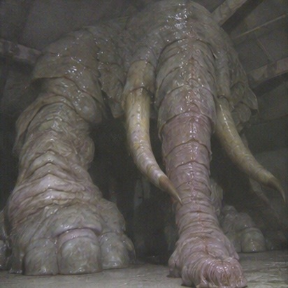
  - 【原典外貌】身長三丈、頭似山、身如巨塔，鳳目金睛、臥蠶眉、扁擔黃牙，口出陰柔「美人聲」，執點鋼槍，鼻似蛟龍一捲如鐵索扣身難以掙脫。
  - 【本作克蘇魯／昆蟲寄生／偽人重構】**捨棄動物園大象印象，重塑為將整間潮濕陰暗水泥地窖塞得滿滿當當的「幾丁質軟體厚甲腫脹巨怪」**：牠宛如一棟會緩慢蠕動的濕滑灰白水泥堡壘，全身包裹著一層層如巨大深海鼠婦甲殼與發脹軟體肉瓣交疊的油亮厚甲，四條粗逾兩公尺的畸形腫脹柱足末端膨大成泛紅肉趾，每踏一步便滲出腐敗膿水並壓裂地基！臉部兩側斜插著一對焦黃發黑、表面沾滿乾涸血痂與骨粉的巨大彎曲尖牙，而臉中央垂落至積水地面的不再是普通象鼻——而是一條**由數十節蠕動環節肉環與堅硬角質鱗片構成的巨型吸血捲吸口管**！口管末端腫脹翻開成一張**佈滿放射狀肉褶與隱蔽環形觸鬚的濕潤巨型吸盤嘴**，緊貼地面發出令人毛骨悚然的黏膩抽吸聲；更教人寒毛直豎的是，每當這團無比龐大的腐甲肉山從口管氣孔發聲時，迴盪在漆黑地庫裡的竟是極度陰柔嬌媚的**「年輕女子輕細呢喃聲」**！
- **特性**：
  - 【原典記載】力大無窮且皮糙肉厚，比大哥青毛獅更沉穩多智；招牌異能「長鼻捲縛」攻擊距離極長、絞殺剛力絕倫且越掙扎越緊，連豬八戒與孫悟空都曾一時著道被生擒。
  - 【本作衍生】極難應對的**「反差音誘騙 × 遠程環節口管抽血坦克」**——在伸手不見五指的地下大廳裡，牠會先用逼真的柔弱女聲引誘除妖師靠近確認「受困者」，隨即自十公尺外猛甩出巨型吸血捲吸口管捲斷目標肋骨，並用末端濕軟吸盤罩住獵物頭顱活活把腦漿與鮮血抽乾！
- **弱點**：
  - 【原典記載】**鼻孔內部柔軟黏膜乃全身唯一極端敏感痛穴**（遭孫悟空拿金箍棒捅進鼻孔猛攪，疼得這頭三丈巨怪哀嚎求饒、像水牛般被穿鼻牽著走），且身軀笨重缺乏高空追擊力。
  - 【本作衍生】外部疊層軟體厚甲幾乎免疫常規物理與低階符擊，但**巨型吸血口管末端的內腔吸盤黏膜與內部感受觸鬚極度怕痛、怕辣與怕高熱電流**——若除妖師不幸遭口管捲住，切勿浪費力氣掰開環節肉壁，必須趁吸盤張開貼近的半秒死命將掌心雷、自製烈火符或高濃度催淚辣椒精／強酸直灌進吸盤口孔深處，劇烈神經痛覺會瞬間令整條十公尺巨管痙攣鬆脫！
- **習性**：
  - 【原典記載】居獅駝洞二把交椅，素日沉穩策劃並替魯莽的大哥青毛獅善後，唯獨對三弟金翅大鵬雕的狠辣心懷忌憚。
  - 【本作衍生】盤踞於挑高逾二十公尺的大型廢棄貨櫃倉儲、荒廢火車維修車庫或大型深層地下儲水池中，平時一動不動宛如發霉的灰白巨型水塔，直到聽見活人足音才開始用溫柔女聲呼救。
- **喜好**：
  - 【原典記載】嗜好人肉盛宴、統御萬妖的權勢，愛以點鋼槍與長鼻碾壓對手。
  - 【本作衍生】極愛在徹底黑暗、迴音巨大的巨型鋼構空間內，用陰柔美人聲線戲弄即將被捲碎的絕望獵物，聆聽骨頭斷裂聲。
- **擅長的招式／異能**：
  - 【原典記載】1. `蛟龍長鼻鐵索捲`（一捲鎖死敵身，力壓悟空與八戒）；2. `點鋼槍武藝`；3. `巨軀踐踏`。
  - 【本作衍生】`環節口管捲吸抽髓`（十公尺巨型口管高速鞭擊纏繞，末端吸盤罩頭吸乾體液）、`美人細語聲源誤導`（在漆黑大廳用柔和女聲誘敵入陷阱）、`萬鈞壓地塌陷`（一足踏碎老舊地下室承重樑柱引發活埋）。

---

### [XY4-22] 三大王・金翅大鵬雕（獅駝國大王・嗜血食腐巨蚊鷲／鐮肢猛蟲巨獸）
- **出處順序**：第 74 回《長庚傳報魔頭狠 行者施為變化能》、第 75 回《心猿鑽透陰陽竅 魔王還歸大道真》、第 76 回《心神居舍魔歸性 木母同降怪體真》、第 77 回《群魔欺本性 一體拜真如》
- **類別與造型路線**：`【非人生物恐怖型】`｜嗜血食腐巨蚊鷲 × 鐮肢猛蟲太古災厄怪獸（全書《西遊記》殺戮最慘烈、智計最毒辣、將整座王國變作養蠱食人巢穴的終極魔王）
- **物種／唯一性**：`獨一無二`（混沌初分鳳凰嫡裔、三界唯一之雲程萬里金翅大鵬雕，五百年前一夜吃空整座獅駝國君臣百姓，兼備超越筋斗雲之極速與先天絕殺法寶陰陽二氣瓶）
- **稀有度與道行對照**：`★★★★★ 神級災厄（UR）`｜模糊道行：混沌開闢以來太古凶禽災體（戰力、速度、陰謀、法寶五維全滿之毀滅級怪獸）｜本作階位：巔峰（滅國級禁忌天災，三流至一流除妖師遇之唯有一死）
- **外貌與黑暗地牢／恐怖谷視覺改寫**：
  - 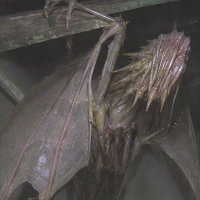
  - 【原典外貌】人形時金翅鯤頭、星睛豹眼、身穿赭黃袍執方天畫戟；本相則為翼展蔽日、一搧九萬里、才動爪即百鳥驚心之雲程萬里巨鵬，五百年前將整座獅駝國化作「骷髏若嶺、骸骨如林、人髮成氈、人肉爛泥」的死城。
  - 【本作克蘇魯／昆蟲寄生／偽人重構】**徹底拋棄金光閃閃的神鳥老鷹美學，重構為倒掛於黑暗大殿樑柱之上的「嗜血食腐巨蚊鷲 × 螳螂鐮肢猛蟲太古巨獸」**：牠展開那對足以覆蓋整座高樓天台的巨翼，根本不是美麗金羽，而是兩片**半透明油亮、佈滿暗紅腐血管脈與濕黏幾丁質骨筋的巨型昆蟲腐肉膜翼**！翼彎處高高支起一對長逾數公尺、如同巨型捕食螳螂與翼龍骨節融合的**銳利鐮鉤抓肢**，死死扣入發霉混凝土橫樑；最令凡人見之即瘋的，是牠毫無雙眼與正常鳥嘴的駭人頭顱——整張臉完全異化為**十餘根放射狀簇擁聚攏、尖銳如鋼製巨型蚊子吸血口針與禿鷲骨喙的慘白濕亮角質利錐**，錐管縫隙不斷滴淌混雜腐屍油與消化酸液的黏液，胸腹底下更密密麻麻倒懸著數排如寄生蜂幼蟲般的鋒利節肢！當牠振翅掠過城市上空，高頻巨蚊翅鳴與音爆瞬間撕碎整條街道的玻璃帷幕，把整座城變成牠的活體養蠱食人巢穴！
- **特性**：
  - 【原典記載】全書罕見的**「速度＋謀略＋法寶＋殘暴」全能頂點妖王**：一翅九萬里、兩翅十八萬里，生生從半空像抓小雞般一把攥住駕筋斗雲逃命的孫悟空；絕不魯莽蠻幹，先滅一國再以「金蟬脫殼與假傳唐僧已死」計謀徹底擊潰孫悟空心神；更握有三十六人方能抬動的絕殺至寶**陰陽二氣瓶**。
  - 【本作衍生】在本作現代除妖體系裡，屬於**「一旦甦醒即代表一座都會徹底淪陷」的神級災厄怪獸**——牠會在數小時內把整座城區的活人趕進地下巢穴當作「活體人肉養蠱缸」，放任四萬八千小妖在街頭搭棚叫賣鮮肉與骨粉，任何試圖靠速度遁逃的除妖師皆會被牠超越音速的巨蚊膜翼瞬間截殺，以簇狀吸血口針吸成一張扁平人皮！
- **弱點**：
  - 【原典記載】1. **陰陽二氣瓶之破口在於「絕對靜默不開口說話＋以極銳至寶自瓶底鑽孔洩氣」**（瓶內開口即冒火蛇鑽一時三刻化膿血，唯靜默並鑽穿瓶底氣眼可破）；2. **本體嗜血高傲、利爪狠抓鮮肉後收而不放**（遭引誘俯衝狠爪抓破目標血肉時，反被反鎖十爪與雙翅無法拔出而受制）。
  - 【本作衍生】對三流至一流除妖師而言，大鵬本體**不存在正面物理破口**（連逃都跑不過牠）；若不幸被捲進其仿製或本尊所執之「陰陽二氣瓶」空間，唯一生機是**死死咬住牙關絕不發出一絲尖叫或唸咒聲**（改採無聲手印運功），並傾盡全力以破甲尖銳法器往容器最底部中心氣眼猛鑽洩壓。
- **習性**：
  - 【原典記載】五百年前一口氣吃盡獅駝國君民並取而代之稱王，將城池經營成滿街賣人肉包、掛人血腸的恐怖妖國，並聯合青毛獅、黃牙象互成掎角。
  - 【本作衍生】對應表裏世界最高機密檔案裡的**「全面失陷鬼城養蠱區」**推演模型——所有進駐其中的人類與低階妖怪都只是牠巢穴裡的活體飼料與養蠱基質。
- **喜好**：
  - 【原典記載】極度嗜食鮮活人肉血髓（滅絕一國仍嫌不飽），酷愛權謀掌控、居高臨下碾壓強敵的傲慢快感。
  - 【本作衍生】嗜吸新鮮溫熱的動脈活血與高階修士骨髓，厭惡腐臭僵死多日的冷屍，偏愛把獵物活生生吊在養蠱巢壁上分日吸食。
- **擅長的招式／異能**：
  - 【原典記載】1. `雲程萬里翅`（一翅九萬里、生擒筋斗雲大聖）；2. `陰陽二氣瓶`（內含七寶八卦二十四氣，開口說話即冒孤拐烈火蛇鑽一時三刻化膿血）；3. `方天畫戟`。
  - 【本作衍生】`九萬里音爆鐮肢截殺`（超越音速掠空撕碎高樓與遁光，鐮鉤一合將獵物釘死半空）、`簇針巨蚊吸乾術`（十餘根骨質吸血口針同時刺入臟腑五秒內吸空全身血水）、`陰陽靜默煉獄瓶`（專殺一切須開口持咒法師的規則級空間殺器）。

---

## 🦌 第八部：第 78～79 回・比丘國與柳林坡清華洞（宮廷食童心肝養蟲偽人雙怪）

> **單元背景**：比丘國（小子城）滿城家家戶戶門前竟懸掛密不透風的鵝籠，囚禁一千一百一十一名無辜孩童！幕後黑手正是潛入王權核心的**白鹿精（假國丈）**與**白面狐狸精（假美后）**——一對披著最高雅醫道國師與傾城寵妃偽人皮囊、聯手榨乾統治者元陽並專門活挖孩童心肝餵養皮下幼蟲的極致宮廷偽人雙怪！

### [XY4-23] 白鹿精（清華洞假國丈・育蟲挖心宮廷偽人）
- **出處順序**：第 78 回《比丘憐子遣陰神 金殿識魔談道德》、第 79 回《尋洞擒妖逢老壽 當朝正主救嬰兒》
- **類別與造型路線**：`【類人偽人型】`｜宮廷老道偽人 × 皮下骨角與育蟲腔寄生體（柳林坡清華洞白鹿成精）
- **物種／唯一性**：`物種特異個體`（鹿精族群中盜得蟠龍拐杖下界、混跡皇宮受封國丈並策劃活剖千餘孩童心肝之罕見權謀妖鹿）
- **稀有度與道行對照**：`★★★ 珍級（SR）`｜模糊道行：數百年至千年仙座外逃妖獸（近戰實力中等偏上，極擅政治滲透與邪藥養蠱騙局）｜本作階位：一流
- **外貌與黑暗地牢／恐怖谷視覺改寫**：
  - <!-- 圖位預留：待補繪 -->
  - 【原典外貌】化形為穿道袍、戴星冠、白鬚飄飄如得道老神仙的比丘國國丈，手持蟠龍拐杖，滿嘴仁義延壽卻長著一顆世間最歹毒的「黑心」，索要一千一百一十一名孩童心肝煎藥；現原形則為渾身雪白雙角白鹿。
  - 【本作克蘇魯／昆蟲寄生／偽人重構】一名身穿筆挺雪白中式長衫與金絲眼鏡、常出入頂級私人長壽生技診所與兒科醫院陰暗走廊的**極致溫雅白髮老紳士偽人**：膚色如塗滿防腐蠟般死白毫無毛孔，臉上永遠掛著令人放心的慈祥微笑；但只要光影斜切過他的側臉，極致恐怖谷破綻便瞬間暴露——**他稀疏白髮底下硬生生頂出兩截剝皮帶血絲、佈滿蛀洞與寄生蛆孔的灰白骨質鹿角**，雙眼瞳孔會在微笑瞬間翻轉成草食獸那種毫無人類同理心的**漆黑橫向長方形羊鹿瞳**！解開白衫胸口更是駭人：他整副胸腔皮下其實是一座由腐朽鹿骨與蒼白肉膜構成的**「活體育蟲心巢」**，裡面蠕動著數百條以鮮活孩童心肝餵養才能維持偽人青春的漆黑食心幼蟲，左手緊拄那根鱗片滲血、彷彿活物纏繞的枯骨蟠龍拐杖！
- **特性**：
  - 【原典記載】極擅長利用上層統治者「貪色怕死求長生」的致命弱點——先獻出白面狐狸精在三年內掏空國王精元，再順理成章以國丈名義強徵全國一千一百一十一名小兒關入鵝籠準備活挖心肝，把整座國家機器變成自家妖洞的合法屠宰場。
  - 【本作衍生】現代都市裡最令人不寒而慄的**「高階長壽生技／政商權貴養生顧問偽人」**——不靠蠻力破門，而是先派假美后榨乾地方大老與金主健康，再藉「幹細胞回春／秘傳長壽藥引」之名誘使權貴動用金錢與黑勢力幫他暗中拐騙失蹤孩童，挖出最純淨的心肝血肉餵養自己與美后皮下的寄生母蟲！
- **弱點**：
  - 【原典記載】正面硬實力在卷四大妖中明顯偏弱、極度心虛怯戰——金殿一露餡跟孫悟空交手沒幾合便丟下國王化寒光逃回清華洞，毫無死戰骨氣。
  - 【本作衍生】缺乏因果律級防禦法寶，單憑一根蟠龍杖近戰火候有限，真正棘手的是他身邊密不透風的凡人權貴保護傘與隨時化光逃遁的狡猾退路；只要先設法切斷其政治與醫療掩護、以困陣封死「白霧寒光遁路」，二流頂至一流法師聯手以烈火與五雷轟穿其胸口「育蟲心巢」即可將其徹底重創殲滅。
- **習性**：
  - 【原典記載】明居比丘國皇宮享國丈尊榮，暗在七十里外柳林坡清華洞經營老巢，與假美后裡應外合。
  - 【本作衍生】白天在信義區頂級私人抗老診所與豪門宅邸談笑風生，入夜則化一道慘白寒光飛回郊山深處裝有數十只密閉鐵籠的地下冷庫清點活體「藥引」並餵食胸腔幼蟲。
- **喜好**：
  - 【原典記載】迷戀國丈權勢排場、溺愛護短白面狐狸精，嗜食純陽孩童心肝與修行者心臟。
  - 【本作衍生】嗜飲鮮熱幼童心血煎製的腥紅藥汁，病態享受被權貴尊稱為「國師／活神仙」的虛榮感。
- **擅長的招式／異能**：
  - 【原典記載】`蟠龍拐杖`（近戰周旋兵器）、`化寒光急遁術`、`偽長生丹藥惑主`。
  - 【本作衍生】`食心幼蟲奪陽丹`（給予權貴服用看似回春、實則將活人轉化為幼蟲寄主的透支邪藥）、`枯骨蟠龍杖重擊`、`胸巢黑蟲噴湧`（危機時扯開長衫放出數百隻鑽心寄生蟲斷後逃遁）。

---

### [XY4-24] 白面狐狸精（清華洞假美后・瓷面宮廷偽人與節肢產卵尾）
- **出處順序**：第 78 回《比丘憐子遣陰神 金殿識魔談道德》、第 79 回《尋洞擒妖逢老壽 當朝正主救嬰兒》
- **類別與造型路線**：`【類人偽人型】`｜極致瓷面宮廷美人偽人 × 皮下節肢狐尾與吸血產卵管（柳林坡清華洞白面狐妖，承襲九尾狐標竿偽人恐怖谷血脈）
- **物種／唯一性**：`物種（群體）`（狐妖族群中依附權謀大妖入宮禍國、以床笫採補配合挖心養蟲之典型魅惑狐妖，最終斃命於清華洞）
- **稀有度與道行對照**：`★★ 稀級（R）`｜模糊道行：數十年至百餘年野狐精｜本作階位：二流（高階宮廷偽裝採補型，正面防禦極脆）
- **外貌與黑暗地牢／恐怖谷視覺改寫**：
  - 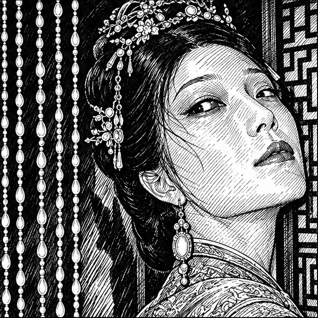
  - 【原典外貌】化形為年方十六、傾國傾城之美后，三年枕席採補令比丘國王病入膏肓；事敗逃回清華洞遭豬八戒一釘耙築死，現出白面狐狸屍身。
  - 【本作克蘇魯／昆蟲寄生／偽人重構】**比照九尾狐標竿恐怖谷規格，拒絕可愛狐耳娘，塑造成珠簾陰影後令人脊背發寒的「瓷面宮廷偽人」**：她頭戴繁複金步搖珠釵、側首回眸於晃動的冰冷珍珠簾旁，臉龐白得宛如停屍間石膏面具，細密眼波裡沒有半分人類體溫與情慾，只有冷酷打量獵物血管位置的爬蟲類凝視！每當夜深帳幔低垂、她貼近病榻上的國王（或衰老富豪）時，她那層吹彈可破的絲質華服與後腰皮膚便會「嘶啦」裂開——**鑽出一條根本沒有柔軟絨毛、全由濕亮灰白幾丁質關節與密密麻麻細小抓刺構成的「節肢寄生狐尾」**，尾尖裂開成一根細長搏動的**吸血產卵管**，直接刺入受害者後頸大動脈，一邊瘋狂抽乾骨髓陽氣、一邊將與白鹿精共養的微細食心幼蟲卵注入宿主血液之中！
- **特性**：
  - 【原典記載】極精通床笫採陰補陽與枕邊吹風惑主，不費刀兵僅憑三年枕席纏綿便把一國之君徹底掏空至瀕死，為白鹿精索取千名孩童心肝製造完美藉口。
  - 【本作衍生】現代都市裡極具隱蔽性的**「枕邊寄生吸血看護／豪門交際花偽人」**——擅長用極致溫順體貼的外殼打入高資產或權勢家庭，數月內便讓原本壯碩的宿主暴瘦成皮包骨、各大醫院卻查不出任何明確病因，並同時以微弱荷爾蒙孢子操控家屬將除妖師拒之門外。
- **弱點**：
  - 【原典記載】正面戰力極其低下且毫無防身法寶——失去白鹿精掩護逃回清華洞後，一回合便被豬八戒一鈀築死現出狐屍。
  - 【本作衍生】典型的「極高社交偽裝、極低戰鬥防禦」二流狐妖——只要透過開天眼符水看穿她身後拖曳在絲綢裙擺下的慘白節肢狐尾與連接宿主的暗紅抽血管，避開濃烈香水遮掩的迷魂狐臊霧後，許家銘憑掌心雷貼身麻痺＋自製烈火符（幾丁質尾膜與乾涸狐油極易燃燒）即可在近距離俐落斬殺。
- **習性**：
  - 【原典記載】原居柳林坡清華洞，尊白鹿精為乾爹，入宮後獨佔後宮專吸國王元陽，事敗即逃返洞穴藏身。
  - 【本作衍生】徹底嫌棄潮濕惡臭的下水道，專門寄生在台北大安區、信義區高級電梯豪宅、五星飯店套房與頂級醫院單人 VIP 病房，以名牌濃香掩蓋體內發酵的狐臭與幼蟲腐液味。
- **喜好**：
  - 【原典記載】貪圖后妃榮華、珠翠華服與男子溫熱精元陽氣，亦愛分食白鹿精尋來的孩童心肝。
  - 【本作衍生】痴迷高單價奢侈香水、冰冷珍珠串飾（用來掩蓋節肢尾摩擦的輕微喀嗒聲），以及從瀕死權貴頸動脈抽出的高脂溫血。
- **擅長的招式／異能**：
  - 【原典記載】`傾城化形魅惑術`、`床笫陰陽採補術`；無任何兵器與法寶。
  - 【本作衍生】`節肢尾動脈抽髓`（趁宿主沉睡自後腰裂尾刺入後頸無聲抽乾精血並注入寄生蟲卵）、`濃香狐臊迷神霧`（混入名牌香水的神經麻痺孢子，阻斷開天眼嗅覺與法師心神）。

---

## 🐀 第九部：第 80～83 回・黑松林、鎮海禪林寺與陷空山無底洞

> **單元背景**：卷四壓軸收官，並完整橫跨第 80 至第 83 回之「四探無底洞」全案。金鼻白毛老鼠精（半截觀音／地湧夫人）於黑松林偽裝成被綁在樹上的柔弱孤女博取同情，隨即於鎮海禪林寺深夜連啃六名僧人頭骨、使出「繡花鞋金蟬脫殼」劫人潛入縱深三百里的地下鼠巢迷宮——堪稱全書演技最惡毒、地下築巢最恐怖的**鼠疫寄生偽人女王**！

### [XY4-25] 金鼻白毛老鼠精（半截觀音／地湧夫人・鼠疫偽人與無底洞鼠巢女妖群）
- **出處順序**：第 80 回《奼女育陽求配偶 心猿護主識妖邪》、第 81 回《鎮海寺心猿知怪 黑松林三眾尋師》、第 82 回《奼女求陽 元神護道》、第 83 回《心猿識得丹頭 奼女還歸本性》
- **類別與造型路線**：`【類人偽人型】`｜綁樹弱女鼠疫偽人 × 皮下寄鼠蚤與啃骨門牙口器（附陷空山無底洞鼠巢侍妖群）
- **物種／唯一性**：`物種特異個體`（鼠妖族群本為現代都市最龐大之群體，但此妖三百年前於靈山偷食香花寶燭成精、自號「半截觀音／地湧夫人」且洞深三百里，為鼠妖一脈絕頂異類女王）
- **稀有度與道行對照**：`★★★★ 絕級（SSR）`｜模糊道行：三百餘年偷食聖燭成精之頂級女妖（雙劍高速搏殺直逼孫悟空、脫殼計謀與地底迷宮經營冠絕女妖）｜本作階位：一流（高偽裝度苦肉計 × 鼠疫寄生蟲群 × 地下迷宮替身大師 Boss）
- **外貌與黑暗地牢／恐怖谷視覺改寫**：
  - 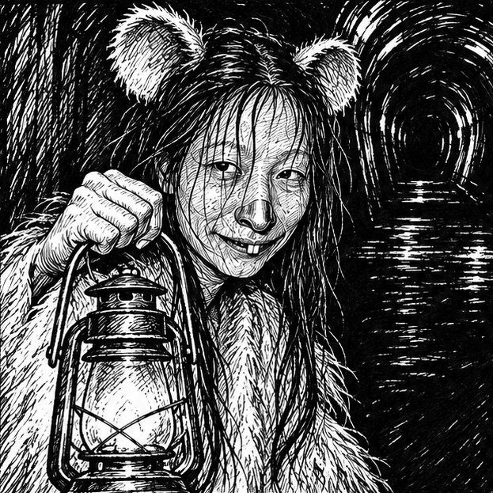
  - 【原典外貌】初於黑松林扮作遭強盜五花大綁在樹幹上、淚眼汪汪的柔弱美少女博取唐僧收留；入鎮海禪林寺深夜化妖冶女子誘食六名和尚，連頭帶骨嚼碎；鬥法時使兩口雪亮寶劍，脫身則甩下繡花鞋化作替身金蟬脫殼；現形時為通體白毛、鼻泛金光之巨鼠。
  - 【本作克蘇魯／昆蟲寄生／偽人重構】**極致反差恐怖的「綁樹柔弱女子鼠疫偽人 × 地下隧道啃骨怪」**：表面是一位提著微弱生鏽油燈、站在淹水發黑廢棄地下排水隧道口微微歪頭哀求救援的纖弱白衣少女，散發楚楚可憐的無助感；但手電筒白光一照上她的臉，恐怖谷畸變瞬間擊穿心理防線——**她的鼻頭毫無皮膚肌理，是一塊冰冷泛著金屬黃銅暗光的畸形骨質「金鼻」**；披在肩上的白色毛大衣其實與她的背脊血肉長在一起，層層濕黏粗硬的白鼠毛縫隙與蒼白臉皮底下，**正密密麻麻爬動著數以千計腫脹吸飽黑血的巨大寄鼠蚤、硬蜱與鼠疫跳蚤，讓她的皮膚表面像沸水般不停微微鼓動**！當她對著落單救命恩人揚起甜美微笑的剎那，上下薄唇向牙齦劇烈翻捲，**探出一對如鑿骨鋼鑿般粗長泛黃、邊緣沾滿乾黑人血與碎頭骨渣的巨型齧齒門牙口器**，發出如數百隻飢餓溝鼠磨牙般的尖銳「咯吱」聲；一旦被識破逼急，她腳下遺落的那只沾泥女鞋便當場膨脹裂開成一具塞滿白鼠毛與爆湧寄鼠蚤的活體空殼替身，而她真身已率領無底洞內數十名同樣皮下爬滿鼠蚤的「地穴女怪侍從」鑽入千百條積水暗管徹底消失！
- **特性**：
  - 【原典記載】全書心計最深、演技最逼真、逃生手段最狡猾的女妖——精準抓準唐僧慈悲軟肋演活綁樹孤女戲碼；入寺當夜即殘忍生啃六名和尚；靠招牌「遺鞋計（金蟬脫殼）」戲耍孫悟空，並把陷空山無底洞經營成縱深三百餘里、暗設香火神壇供奉上位義親牌位（李天王與哪吒）作為政治保護傘的龐大地下王國。
  - 【本作衍生】在擁有錯綜複雜地下捷運連通道、老舊廢棄防空洞與百年雨水下水道的現代台灣都會中，她是比序章醫院蜘蛛精恐怖百倍的**「社會心理誘殺 × 鼠疫生化巢穴女王」**！白天假扮遭綁架家暴或迷路的柔弱女子騙取好心路人與心軟除妖師同情，深夜便放出皮下寄生鼠蚤群令整棟宿舍爆發突發高燒黑斑鼠疫癱瘓，再逐一咬碎受害者顱骨拖進深達地底數百公尺的地下迷宮逼婚採陽。
- **弱點**：
  - 【原典記載】1. **腹腔內部脆弱且貪食香甜果品**（遭變作紅桃的孫悟空鑽入肚內亂踢翻攪，還差點被棗核釘撐破咽喉）；2. **極度畏懼其暗中供奉的上位因果名分壓制**（洞底牌位遭搜出告發後，在絕對上位因果壓迫下喪失鬥志束手就擒）。
  - 【本作衍生】對付這位地底鼠疫女王，硬拚雙劍與鑽洞追擊必遭替身反殺，實戰破局三大鐵律為：**第一「識破遺鞋肉殼替身」**——戰鬥中見她故意丟落高跟鞋、外套或任何隨身物件絕不可分神回砍，必須死開「開天眼」鎖定地底深處湧動濃烈鼠疫黑氣的真身脈絡；**第二「絕對封堵所有排水孔與地縫＋防蚤結界」**——只要有拳頭大的落水口她就能縮骨遁逃，須先以封土符／水泥速乾陣封死孔洞並提前點燃艾草硫磺烈火燒殺她皮下彈射出的鼠疫毒蚤；**第三「以高品質香燭酥油為餌誘敵出洞」**，趁其探出金鼻貪嗅燭火之際重雷破腦！
- **習性**：
  - 【原典記載】盤踞陷空山無底洞（縱深三百餘里、另闢地宮花亭並蓄養大批女怪侍妖），常外出黑松林與荒寺假扮孤女誘騙高僧俊男，平時於洞底密室虔誠供奉義父義兄牌位。
  - 【本作衍生】巢穴必設於**大型廢棄戰備防空隧道、爛尾深層地下商場或貫通整個行政區的老舊汙水主幹管網深處**；最弔詭的是在堆滿啃剩白骨與鼠蚤窩的地下主廳角落，竟永遠擺著一座擦拭得一塵不染、日夜點著高檔酥油香燭的精緻神明牌位壇，呈現極度瘋狂撕裂的矛盾習性。
- **喜好**：
  - 【原典記載】三百年前即成癮於偷食靈山香花寶燭（佛前燈油與香燭靈氣），成精後執迷奪取純陽元陽以修成太乙金仙，平時極愛啃食精壯男子頭骨腦髓、收集精緻繡花女鞋與生吃熟紅桃。
  - 【本作衍生】對古廟頂級酥油燈、純天然沉香蠟燭散發的焦油香氣有近乎成癮的生理渴望——只要在暗渠通風口點燃上等寺廟香燭，便極易引誘她壓抑不住本能探出金屬閃光的金鼻深嗅，是除妖師設下埋伏圈最致命的誘餌！
- **擅長的招式／異能**：
  - 【原典記載】1. `雙股寶劍`（高速凌厲劍法正面激戰孫悟空數十合不潰）；2. `遺鞋計（金蟬脫殼）`（脫鞋吹氣化作完全逼真之替身拖住對手，真身捲陰風擄人遁逃）；3. `地底百孔掘洞遁行`。
  - 【本作衍生】`繡鞋寄蚤替身殼`（甩出女鞋瞬間膨脹為與真身一致的血肉假體，遭斬破時還會當場爆散數千隻鼠疫跳蚤吞沒法師）、`鼠疫毒蚤潮爆發`（抖動白鼠毛皮與皮下膿包彈射攜帶烈性黑死瘟毒的巨蚤癱瘓目標）、`鑿骨門牙碎顱咬`、`雙劍隧道陰風突刺`、`無底管網縮骨遁逃`。

---

> **📌 卷四純妖怪與怪獸圖鑑總結與下卷銜接**：  
> 本冊嚴格恪守「**零神明・純妖怪怪獸 × 黑暗地牢昆蟲寄生 × 恐怖谷偽人**」編纂鐵律，完整重構《西遊記》**卷四（第 61～80 回，完整收束第 80～83 回陷空山無底洞全案）**共計 **25 則純妖怪與怪獸公式書條目**（編號 `XY4-01` 至 `XY4-25`），嵌入既有真實插圖 **25 張**（含 `XY4-16` 盤絲洞七蜘蛛精與 `XY4-18` 百眼魔君兩大**五大標竿核心條目**雙圖定案，另 2 條附圖位預留）。下一冊將自**第 84 回隱霧山折岳連環洞南山豹精與瞌睡蟲**起，貫穿玉華州九靈元聖七獅、金平府三犀牛精至天竺國玉兔精全數純妖魔檔案。
>
> **返回與續讀**：[👹 妖怪篇總綱](../00-妖怪篇總綱與圖鑑分級.md) ｜ [📖 西遊記總錄](./00-西遊記妖怪怪獸總錄.md) ｜ [⬅️ 卷三](./03-卷三_第41至60回.md) ｜ [➡️ 卷五](./05-卷五_第81至100回.md)
