# 🐒 《西遊記》純妖怪與怪獸圖鑑・卷五（第 81～100 回）

> **導覽返回**：[👹 妖怪篇總綱](../00-妖怪篇總綱與圖鑑分級.md) ｜ [📖 西遊記總錄](./00-西遊記妖怪怪獸總錄.md) ｜ [⬅️ 卷四](./04-卷四_第61至80回.md)

> **本卷定位與淨化說明（2026-11-21 純妖怪改版定案）**：  
> 本冊為《西遊記》純妖怪與怪獸圖鑑最終卷，依原書第 81 回至第 100 回最後一頁之出場順序，**嚴格徹底剔除全部神明、佛菩薩、天兵天將、星官（四木禽星、二十八宿、十二元辰、九曜、太陰星君、嫦娥）、幽冥神祇（地藏王、十殿閻羅）、靈山諸佛菩薩與五聖神格，一尊不收**，僅忠實收錄第 81～100 回真正現身之 **20 則純妖怪、妖蟲與怪獸**（含 15 幅既有黑白墨線圖檔、5 處待補繪圖位）。所有條目皆依「**黑暗地牢昆蟲／節肢／寄生／環節生物恐怖 × 恐怖谷偽人**」設計鐵律徹底重構。

---

## 🔗 跨卷銜接與無妖回目備忘（第 81～100 回零漏頁索引）

- **第 81～83 回（鎮海禪林寺～陷空山無底洞）**：本單元核心大妖 **金鼻白毛老鼠精（半截觀音／地湧夫人）** 與 **陷空山無底洞女妖精群** 已隨第 80 回主線完整歸檔於 [卷四（第 61～80 回）](./04-卷四_第61至80回.md)，此處不重複立卡；卷五正文自第 81～86 回復現之神經寄生微蟲 **瞌睡蟲** 展開。
- **無妖回目說明（本純妖圖鑑不收錄神佛與凡人）**：
  - **第 84 回（滅法國）**：殺僧劫數出於凡人國王執念，無妖怪登場（僅收錄本回大舉施放之 **瞌睡蟲**）。
  - **第 87 回（鳳仙郡）**：三年大旱純屬凡人冒瀆所招天旱案，全回無妖怪登場。
  - **第 96～97 回（銅臺府地靈縣）**：寇洪劫財命案為凡人強盜所為，全回無妖怪登場。
  - **第 98 回（靈山凌雲渡）與第 100 回（五聖歸位）**：全回為佛道聖境儀式，無妖怪與怪獸登場；第 99 回末難所涉之 **通天河老黿** 與 **奪經陰魔群** 全數壓軸收錄於本卷末章。

---

## 📋 本卷純妖怪與怪獸速查表（第 81～100 回・全 20 則）

| 編號 | 名稱（別稱／本體重構） | 出處回目 | 造型路線 | 物種／唯一性 | 稀有度｜本作階位 | 插圖狀態 |
| :---: | :--- | :---: | :---: | :---: | :--- | :---: |
| `XY5-01` | **瞌睡蟲**（神經寄生吸腦微蟲） | 第 81・84・86 回 | `非人生物恐怖型` | `物種（群體）` | `★★ 稀級（R）`｜二流 | **已嵌圖** |
| `XY5-02` | **南山大王**（艾葉花皮豹子精・分體甲殼豹怪） | 第 85～86 回 | `類人偽人型` | `物種特異個體` | `★★★ 珍級（SR）`｜二流頂～一流 | **已嵌圖** |
| `XY5-03` | **鐵背蒼狼怪**（鐵甲幾丁質倒刺先鋒怪） | 第 85～86 回 | `非人生物恐怖型` | `物種（群體）` | `★★ 稀級（R）`｜二流 | **已嵌圖** |
| `XY5-04` | **折岳連環洞先鋒小妖群**（三假南山蛻殼替身妖） | 第 85～86 回 | `類人偽人型` | `物種（群體）` | `★ 凡級（N）`｜未入流～三流 | 圖位預留 |
| `XY5-05` | **黃獅精**（玉華州虎口洞・擬態腐食獅甲怪） | 第 88～90 回 | `非人生物恐怖型` | `物種特異個體` | `★★★ 珍級（SR）`｜一流 | **已嵌圖** |
| `XY5-06` | **刁鑽古怪與古怪刁鑽**（虎口洞偽人商販小妖） | 第 89 回 | `類人偽人型` | `物種（群體）` | `★ 凡級（N）`｜未入流～三流 | 圖位預留 |
| `XY5-07` | **九靈元聖**（九曲盤桓洞・九首環節水蛭巨獸） | 第 89～90 回 | `非人生物恐怖型` | `獨一無二` | `★★★★★ 神級災厄（UR）`｜巔峰～規格外 | **已嵌圖** |
| `XY5-08` | **猱獅**（六獅孫之一・鐵線蟲長肢毛蜘怪） | 第 90 回 | `非人生物恐怖型` | `物種特異個體` | `★★★ 珍級（SR）`｜二流頂～一流 | **已嵌圖** |
| `XY5-09` | **雪獅**（六獅孫之二・白殭菌白化冰殼甲蟲怪） | 第 90 回 | `非人生物恐怖型` | `物種特異個體` | `★★★ 珍級（SR）`｜二流頂～一流 | **已嵌圖** |
| `XY5-10` | **狻猊獅**（六獅孫之三・炮步甲毒煙蜂巢怪） | 第 90 回 | `非人生物恐怖型` | `物種特異個體` | `★★★ 珍級（SR）`｜二流頂～一流 | **已嵌圖** |
| `XY5-11` | **白澤獅**（六獅孫之四・多目寄生扁虱複眼怪） | 第 90 回 | `非人生物恐怖型` | `物種特異個體` | `★★★ 珍級（SR）`｜二流頂～一流 | **已嵌圖** |
| `XY5-12` | **伏狸獅**（六獅孫之五・扁平盲蠍蜈蚣鐮肢怪） | 第 90 回 | `非人生物恐怖型` | `物種特異個體` | `★★★ 珍級（SR）`｜二流頂～一流 | **已嵌圖** |
| `XY5-13` | **摶象獅**（六獅孫之六・重裝獨角仙骨槍巨甲怪） | 第 90 回 | `非人生物恐怖型` | `物種特異個體` | `★★★ 珍級（SR）`｜二流頂～一流 | **已嵌圖** |
| `XY5-14` | **辟寒大王**（玄英洞長兄・冰寒偽佛犀金龜巨獸） | 第 91～92 回 | `非人生物恐怖型` | `物種特異個體` | `★★★★ 絕級（SSR）`｜一流頂 | **已嵌圖** |
| `XY5-15` | **辟暑大王**（玄英洞次兄・嗜脂腐熱巨型甲蟲獸） | 第 91～92 回 | `非人生物恐怖型` | `物種特異個體` | `★★★★ 絕級（SSR）`｜一流頂 | **已嵌圖** |
| `XY5-16` | **辟塵大王**（玄英洞三弟・塵蟎孢子獨角犀甲蟲） | 第 91～92 回 | `非人生物恐怖型` | `物種特異個體` | `★★★★ 絕級（SSR）`｜一流頂 | **已嵌圖** |
| `XY5-17` | **青龍山玄英洞油垢小妖群**（嗜油腐食幼蟲雜妖） | 第 91～92 回 | `非人生物恐怖型` | `物種（群體）` | `★ 凡級（N）`｜未入流～三流 | 圖位預留 |
| `XY5-18` | **天竺國・玉兔精**（宮廷偽人嚙骨複眼口器怪） | 第 93～95 回 | `類人偽人型` | `獨一無二` | `★★★★ 絕級（SSR）`｜一流頂 | 圖位預留 |
| `XY5-19` | **通天河老黿**（深淵藤壺水蛭寄生巨黿） | 第 99 回（互參 49 回） | `非人生物恐怖型` | `物種特異個體` | `★★★ 珍級（SR）`｜一流 | **已嵌圖** |
| `XY5-20` | **通天河奪經陰魔群**（暴雨夜襲濕霧寄生集群） | 第 99 回 | `非人生物恐怖型` | `物種（群體）` | `★★ 稀級（R）`｜二流 | 圖位預留 |

---

## 🪲 壹、第 81～86 回：神經寄生微蟲與隱霧山折岳連環洞

### [XY5-01] 瞌睡蟲（神經寄生吸腦微蟲／假死催眠微蟲群）
- **出處順序**：第 81 回《鎮海寺心猿知怪 黑松林三眾尋師》卷五開篇補錄；第 84 回《難滅伽持圓大覺 法王成正體天然》與第 86 回《木母助威征怪物 金公施法滅妖邪》大舉現身（源流初出卷二第 25 回）
- **類別與造型路線**：`【非人生物恐怖型】`｜神經寄生微蟲（無目盲蝨 × 吸血蚊口針 × 環節微蛭）
- **物種／唯一性**：`物種（群體）`（可自然於陰濕暗處孳生繁殖，亦能被高階妖術與邪修以活體母蟲大量複製之寄生微蟲群）
- **稀有度與道行對照**：`★★ 稀級（R）`｜模糊道行：數十年靈性妖蟲群（單體毫無正面攻防，但成群寄生具備近乎無解的假死神經麻痺效應）｜本作階位：二流（高危功能型寄生蟲害）
- **外貌與黑暗地牢／恐怖谷視覺改寫**：
  - 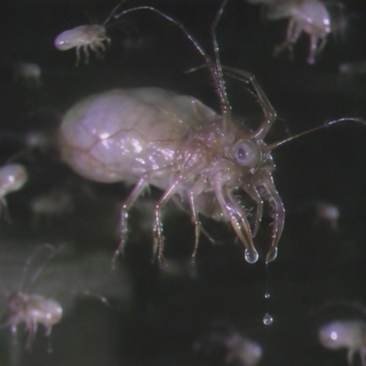
  - 【原典外貌】體型微若芝麻米粒的細小奇蟲，飛撲人臉鑽入鼻孔或伏於眼皮，令中者立時鼾聲如雷、死睡不醒，任人落髮斬殺皆毫無知覺。
  - 【本作克蘇魯／昆蟲寄生／偽人重構】絕非可愛小飛蟲，而是黑暗地牢顯微級的**真實神經寄生微蟲**：體長僅約兩至三公釐，呈半透明屍蠟乳白色，完全沒有眼睛，背甲卻拱起一圈圈酷似人腦溝回與發白肉摺的濕滑幾丁質紋路；腹側生有八條帶倒鉤的微細節肢鉤足，口器則特化為**六根極細的空心蚊類口針與一圈肉質微吸盤**。牠們爬入宿主鼻腔、耳孔與淚腺縫隙後，會將口針無聲刺穿篩骨黏膜與微血管，緩慢吸食微量腦脊髓液與神經電訊號；黑白漫畫放大格中，可見昏迷者鼻翼與眼瞼邊緣密密麻麻釘滿半截暴露在外、隨脈搏一脹一縮的半透明飽脹蟲腹，令人瞬間頭皮發麻。
- **特性**：
  - 【原典記載】於滅法國一夜放倒滿朝文武與宮女太監，令眾人任憑千把剃刀落髮而沉睡不醒；於隱霧山折岳連環洞更一口氣放倒南山大王與洞中百餘群妖，不費一兵一卒便救出遭擒之人。
  - 【本作衍生】專攻中樞神經與痛覺迴路的寄生蟲蠱。口針刺入鼻腔耳孔的同時會分泌含神經毒素的冰冷唾液，令宿主心跳降至每分鐘三十下以下、陷入幾近**「假死昏迷」**的僵直狀態；受害者在完全喪失反抗能力的假死夢境中，連身體被其他大妖拖走或肢解都只以為自己在鬼壓床。
- **弱點**：
  - 【原典記載】單隻蟲體極度脆弱、無物理護甲與攻擊力，全憑出其不意近身貼面；對神識高度戒備或以真氣閉鎖七竅者難以奏效。
  - 【本作衍生】極度畏懼乾燥高熱與微弱電流——法師只要及時貼上**「淨氣符／避穢符」**或捏死**「閉氣訣」**封住口鼻耳竅即可阻斷鑽入；若已察覺臉部有微細冰涼爬行感，立即以**「掌心雷」**在體表放出低壓靜電火花，或近距離點燃乾燥艾草、烈火符熱浪，即可將整群寄生微蟲瞬間爆焦成灰；密閉室內的工業除濕熱風機與高濃度薄荷腦樟腦煙霧亦會令其吸盤鬆脫抽搐。
- **習性**：
  - 【原典記載】極喜依附活人鼻息、耳畔與眉心，聞微溫氣息即悄無聲息成群撲面。
  - 【本作衍生】在台灣現代都市多棲息於潮濕發黴的頂樓加蓋分租雅房冷氣濾網、長途夜車座椅縫隙、地下停車場通風管或醫院陪病折疊床夾層，常在凌晨三點至五點人體體溫最低、呼氣二氧化碳最穩定的時段集體爬出覓食，釀成「整屋住戶睡死四十八小時不醒、醒來卻劇烈偏頭痛且鼻孔滲血」的離奇詭案。
- **喜好**：
  - 【原典記載】原典未載特殊嗜好，唯嗜貼附活人面門與鼻竅。
  - 【本作衍生】特別偏愛長期過勞、連續熬夜、大腦發炎且神經極度疲憊的都市社畜（例如連跑三天夜單又趕早會的疲憊上班族，其鼻腔微血管充血與腦壓氣味對牠們而言宛如現煮高湯）。
- **擅長的招式／異能**：
  - 【原典記載】`鑽竅沉眠`（撲面入鼻，令凡人與中低階群妖瞬間死睡失能）。
  - 【本作衍生】`吸腦假死麻痺`（刺穿鼻腔與耳道微血管吸食腦液，切斷痛覺與運動神經傳導長達數小時）、`群體靜默昏睡場`（上百隻同時釋放揮發性神經費洛蒙，令狹小室內的三流法師手腳沉重、連掐指點符的力氣都瞬間抽乾）。

---

### [XY5-02] 南山大王（隱霧山折岳連環洞・艾葉花皮豹子精）
- **出處順序**：第 85 回《心猿妒木母 魔主計吞禪》、第 86 回《木母助威征怪物 金公施法滅妖邪》
- **類別與造型路線**：`【類人偽人型】`｜多足甲殼斑紋豹怪（偽人皮囊內藏節肢擬態殼體與分體蛻殼結構）
- **物種／唯一性**：`物種特異個體`（隱霧山脈異變節肢豹怪中修成數百年狡詐心智、僭稱「南山大王」的地方巢主個體）
- **稀有度與道行對照**：`★★★ 珍級（SR）`｜模糊道行：數百年氣候地方妖王（正面硬戰遜於絕頂大妖，但極擅詭計誘敵與心理摧殘）｜本作階位：二流頂～一流初階
- **外貌與黑暗地牢／恐怖谷視覺改寫**：
  - 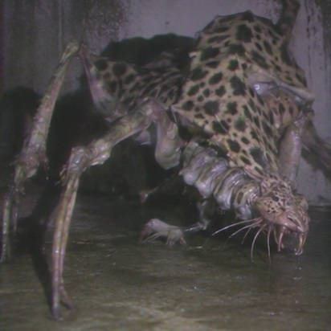
  - 【原典外貌】頭戴艾葉花斑豹皮帽、身穿羊絨織錦叵羅衣、腰束獅蠻帶，環眼圓睛如弔客、圈鬚亂擾似河奎，腰佩毒藥弓矢、初執點鋼大叉，實戰使一根鐵杵；敗死現出本相乃一隻艾葉花皮豹子。
  - 【本作克蘇魯／昆蟲寄生／偽人重構】徹底剝除傳統毛茸茸花豹形象，改以極致恐怖谷的**「偽人皮囊 × 多足甲殼斑紋怪」**重構：平素偽裝成一名身長超過兩公尺、四肢與鎖骨如螳螂般過度細長反折的陰冷男子，身穿一件總是濕漉漉的迷彩雨衣；細看之下，他臉頰與頸側根本不是人類胎記或豹毛，而是大片呈現焦黑艾葉形狀、微微隆起並分泌腐臭黏液的**濕亮幾丁質甲殼斑塊**。雙眼沒有眼白，唯餘兩顆如吊死鬼般腫脹外凸、暗藏六角微網反光的暗黃複眼；每當他發笑時，下顎沿中線裂開露出三排細密如蜈蚣毒顎的黑色口針與鋼絲狀感覺剛毛。更駭人的是他發動「分瓣梅花計」時，會像大型蟬蛻或蜘蛛蛻皮般從背部裂開人皮，爬出數具空心潮濕、步履僵硬卻掛著同一張呆滯微笑人臉的**「蛻殼偽人分體」**，而在漆黑地牢積水中暴露本體時，肋骨兩側會撐開八對沾滿腐葉與碎人骨的銳利多足甲殼鐮肢。
- **特性**：
  - 【原典記載】正面戰力遠非取經高階大妖之林，卻是全書極擅心理戰與謀略的陰狠妖主——採納先鋒獻計施展「分瓣梅花計」調虎離山生擒唐僧，隨後更兩度拋出柳木假人頭與先年吃剩的血淋淋死人頭，試圖擊潰三徒鬥志、差點逼得對手散夥。
  - 【本作衍生】典型「低正面硬扛、極高精神汙染與詐欺獵殺」的都市地牢巢主。牠極度擅長製造視覺與心理盲區：先以大量充滿恐怖谷違和感的「蛻殼偽人分體」從不同巷口輪番挑釁消耗除妖師符紙，再趁目標疲於奔命時將沾滿寄生蟲卵的仿製受害者頭顱滾到腳邊，趁法師心神崩潰失神的一秒鐘從背後用多足鐮肢絞斷頸椎。
- **弱點**：
  - 【原典記載】本體近戰強度與抗異常能力偏弱，連兩名主力夾攻便支撐不住；一旦巢穴遭瞌睡蟲滲透並縱火焚洞，頓時驚惶失措，終被九齒釘鈀一擊築死現原形。
  - 【本作衍生】1. **蛻殼分體存在明顯靈壓斷層**：分體內部僅由寄生幼蟲驅動、並無核心內丹，法師只要點開**「開天眼符水」**或甩出**「破障符」**，立刻能看出分體胸腔裡一片空洞黑氣，切忌浪費昂貴的「五雷鎮煞符」在假體上。2. **極懼密閉巢穴烈火與神經燻煙**：其幾丁質斑紋甲殼在乾燥高溫下極易脆裂，先用**「陷地符」**封死連環通道出口，再投入**「烈火符」**或濃煙逼出真身，趁其節肢失衡時以重雷符轟碎胸腹甲殼接縫即可斃命。
- **習性**：
  - 【原典記載】盤踞隱霧山折岳連環洞，專捕過路樵夫旅人為食，並有保留被害者頭顱充當戰術道具的變態習慣。
  - 【本作衍生】偏好棲息於多出入口相連、終年滲水發黴的「連環洞」式現代地下結構——如連通數棟老舊大樓的地下防空避難室、荒廢地下商店街、或山區貫通式舊礦坑與大型排水箱涵，在各個轉角布設濕滑黏液絲線監控獵物腳步。
- **喜好**：
  - 【原典記載】嗜食人肉，極度虛榮好大喜功（妄稱「南山大王」反被取笑）。
  - 【本作衍生】病態沉迷於剝製人臉皮膜與收集塑膠模特兒頭顱，並把被害者遺留的識別證、眼鏡與碎骨嵌在自己的蛻殼分體上，在潮濕暗處欣賞獵物被假屍體嚇得情緒崩潰的模樣。
- **擅長的招式／異能**：
  - 【原典記載】`分瓣梅花計`（連環替身誘敵調虎離山、真身直取核心目標）、`假頭詐死心理戰`、`滾風生霧逃遁`；兵器為`鐵杵`、並佩`毒藥弓矢`與`點鋼大叉`。
  - 【本作衍生】`梅花蛻殼分體`（蛻出三具至五具由寄生蟲操縱、表情僵硬的偽人空殼分頭誘敵）、`腐霧艾毒瘴`（從甲殼斑塊噴出帶有爛草與屍臭味的濃白毒霧遮蔽視線）、`偽顱噬心驚嚇`（擲出會微幅眨眼滲血的蟲寄假頭顱干擾除妖師結印）、`多足鐵杵絞殺`。

---

### [XY5-03] 鐵背蒼狼怪（折岳連環洞先鋒・鐵甲幾丁質倒刺怪）
- **出處順序**：第 85 回《心猿妒木母 魔主計吞禪》、第 86 回《木母助威征怪物 金公施法滅妖邪》
- **類別與造型路線**：`【非人生物恐怖型】`｜重甲節肢寄生狼怪（鐵甲步行蟲甲板 × 寄生倒刺 × 腐食巨顎）
- **物種／唯一性**：`物種（群體）`（山澤重甲寄生獸族群中具備較高智計、充任折岳連環洞先鋒謀士的個體）
- **稀有度與道行對照**：`★★ 稀級（R）`｜模糊道行：百年成精妖將（擅出陰險戰術，但道行偏淺、不會高階變化遁術）｜本作階位：二流
- **外貌與黑暗地牢／恐怖谷視覺改寫**：
  - 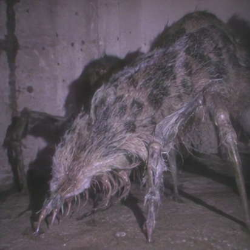
  - 【原典外貌】折岳連環洞班部先鋒，本相為一隻背毛灰黑雜駁如鐵的蒼狼；不擅變化，臨戰遭金箍棒一擊打死現出原形，遭八戒嘲笑其花駁背皮「不知從小兒偷了人家多少衣服」。
  - 【本作克蘇魯／昆蟲寄生／偽人重構】徹底揚棄普通野狼外觀，重塑為黑暗地牢式的**「鐵甲幾丁質寄生倒刺怪」**：身形宛如一頭以畸形反折四肢爬行的無毛灰黑長吻節肢獸，從後腦一路覆蓋至尾椎的脊背並非毛皮，而是數十塊如生鏽鋼片與巨型海蟑螂背甲般層層咬合的**鐵硬幾丁質甲板**！甲板接縫處叢生密密麻麻的**空心寄生倒刺與逆鉤剛毛**，倒刺上密密纏掛著歷代受害者被撕碎的發黴衣布、尼龍外套碎片與乾癟皮屑（將原典「偷人衣服」化作極端噁心的戰利品倒刺擬態）。其拉長顱骨中線可像鍬形蟲般左右縱裂，露出內側不斷分泌鐵鏽色強酸涎水的齒狀吸盤咽喉，四肢關節縫隙間清晰可見未消化完全的慘白人指骨卡在黑亮殼槽裡。
- **特性**：
  - 【原典記載】整個折岳連環洞真正出謀劃策的大腦——深知強敵底細，獻出「千中選百、百中選十、十中選三」的分瓣梅花計，讓武力平平的南山大王成功智擒目標。
  - 【本作衍生】極罕見的**「戰術型低階重甲寄生先鋒」**。雖不擅變化偽裝，卻具備高度觀察力與冷血計算能力，會躲在暗處記錄除妖師出符的手勢、符袋厚度與體力耗損速度，再以低頻甲殼摩擦聲指揮底層蟲妖群發動消耗戰，專門把單打獨鬥的三流法師活活耗乾。
- **弱點**：
  - 【原典記載】完全不會高階變化與遁法，一旦陣勢被衝散、被迫與高階戰力正面硬拚，即一擊斃命、毫無招架之力。
  - 【本作衍生】1. **重鐵幾丁質背甲其實是致命導體**：背部硬甲雖能彈開低階飛刃與普通火焰，但其金屬化甲板含高濃度鐵質沉積，一記貼背**「五雷鎮煞符」**或高壓**「掌心雷」**會瞬間讓電流沿甲縫灌入中樞神經將內臟電熟。2. **腹部軟膜與口器開合間隙毫無防禦**：缺乏空間遁術，用**「指地成鋼符／陷地符」**鎖死其四足後，從低位仰刺其乳白色無甲軟腹即可徹底破防。
- **習性**：
  - 【原典記載】依附比自己強大的山中妖王充當先鋒謀士，善打聽外界強者動向與設伏調度。
  - 【本作衍生】常匿蹤於潮濕生鏽的廢棄貨櫃報廢場、山區鐵皮回收站或老舊地下管線維修廊道，縮起身體貼在廢鐵堆中時幾乎與生鏽鋼板融為一體，靜候目標走過再發動伏擊或傳訊呼叫巢主。
- **喜好**：
  - 【原典記載】原典未載明確嗜好，唯八戒笑其斑駁背皮似竊衣成癖。
  - 【本作衍生】嗜吞食含鐵量高的動物鮮血與生鏽金屬碎屑以修補背甲，並執著於用背部倒刺勾扯、蒐集各種受害者的破爛衣物與工作制服，讓自己在黑暗地牢中越長越像一團會蠕動的發臭舊衣堆。
- **擅長的招式／異能**：
  - 【原典記載】`分瓣梅花計獻策`（多點誘敵戰術調度）、`先鋒撲咬`。
  - 【本作衍生】`鐵甲倒刺翻滾衝撞`（蜷縮成佈滿生鏽鐵棘與碎布的滾球高速撞擊，倒刺一旦鉤入皮肉即釋放麻痺寄生幼蟲）、`甲殼高頻嘯令`（摩擦鐵質背甲發出次聲波指揮全洞雜妖進退）、`鐵鏽腐液噴吐`。

---

### [XY5-04] 折岳連環洞先鋒小妖群（三假南山蛻殼替身與洞窟寄生雜妖）
- **出處順序**：第 85 回《心猿妒木母 魔主計吞禪》、第 86 回《木母助威征怪物 金公施法滅妖邪》
- **類別與造型路線**：`【類人偽人型】`｜蛻殼偽人替身與地下多足雜妖群（球鼠婦／馬陸 × 寄生幼蟲空殼體）
- **物種／唯一性**：`物種（群體）`（百餘隻聚嘯於隱霧山連環洞窟之低階群居寄生雜妖，其中精挑三隻擔綱假南山大王替身）
- **稀有度與道行對照**：`★ 凡級（N）`｜模糊道行：數年至數十年微末妖氣（僅三名替身精銳能勉強套上蛻殼皮囊誘敵）｜本作階位：未入流～三流（精銳替身約三流頂）
- **外貌與黑暗地牢／恐怖谷視覺改寫**：
  - <!-- 圖位預留：待補繪 -->
  - 【原典外貌】洞中百餘名披甲執矛之山野小妖；其中三名精銳奉命「頂大王之盔、貫大王之甲、執大王之杵」化為假南山大王分頭誘敵，餘眾皆於洞內遭瞌睡蟲迷倒後連洞焚滅。
  - 【本作克蘇魯／昆蟲寄生／偽人重構】三名核心替身妖是套在南山大王廢棄潮濕人皮蛻殼裡的**低等節肢寄生雜妖**——牠們頭上頂著一張過分僵硬、邊緣正在融化捲曲且與南山大王一模一樣的蒼白蠟像假臉，嘴角固定在詭異的僵笑弧度，每走一步眼角與耳縫便滲出乳白蟲液；破損褲管與寬大盔甲下擺裡，不時有數十條細黑的馬陸步足瘋狂打滑蠕動。至於其餘上百隻洞窟雜兵，則是尚未完全撐開人形皮囊的潮濕甲殼爬行怪，背部弓起如發黴球鼠婦，舉著生鏽鋼筋、碎磚與鐵叉，在積水石洞裡發出成片令人牙酸的甲殼咔嗒撞擊聲。
- **特性**：
  - 【原典記載】單隻戰力微不足道，卻靠著精準的「十中選三」替身調度成功拖住三名頂級強者，替洞主爭取到生擒核心目標的關鍵空檔。
  - 【本作衍生】現代都市基層除妖委託中最燒錢也最噁心的「偽人雜兵海」。單隻連初出茅廬的三流散修都能憑短刀與低配陽火符解決，但一旦同時出現三具長相完全相同、面無表情在暗巷轉角輪番招手的偽人誘餌，極易騙光法師身上每一張高價符咒。
- **弱點**：
  - 【原典記載】毫無抗毒、抗催眠與防火能力，遇瞌睡蟲即整洞倒地昏死，一把烈火便徹底化為焦炭。
  - 【本作衍生】假人皮殼毫無體溫與心跳，一張**「破障符」**即可令整張假臉瞬間顯出底下蠕動的黑灰蟲團；且群體極度畏懼**「陽火符／烈火符」**與強光手電筒直射，只要先行斬殺發號施令的鐵背蒼狼怪，整群雜妖會立刻陷入無頭蒼蠅般的自相踐踏潰逃。
- **習性**：
  - 【原典記載】群居連環山洞，白晝埋伏霧中放哨、夜裡生火看守獵物，極度服從大王與先鋒指令。
  - 【本作衍生】成群窩藏在停工爛尾樓積水地下室、山邊荒廢鐵皮倉庫或地下排水涵洞支管內，平素啃食陰溝腐屍與遺棄廚餘，一旦巢主吹響號令便套上撿來的同款雨衣與安全帽在監視器死角製造「分身目擊假象」。
- **喜好**：
  - 【原典記載】嗜食腐肉血食、喜歡跟著大王起鬨喧鬧。
  - 【本作衍生】酷愛擠在陰暗潮濕的狹窄牆縫中堆疊取暖，並對模仿人類重複單一詞句（例如不斷低語「過來……過來……」誘騙路人）展現出機械化的執念。
- **擅長的招式／異能**：
  - 【原典記載】`低階偽裝替身`（扮成南山大王模樣輪番撩撥即逃）、`洞窟群毆圍堵`。
  - 【本作衍生】`三偽人誘耗陣`（同時從三個暗巷方向現出同一張恐怖谷面孔引誘法師浪費符材）、`空殼爆蟲逃脫`（遭擊中時直接拋下偽人皮囊，體內上百隻寄生幼蟲四散鑽入排水溝逃命）。

---

## 🦁 貳、第 88～90 回：玉華州虎口洞與竹節山九曲盤桓洞

### [XY5-05] 黃獅精（玉華州豹頭山虎口洞主・擬態腐食獅甲怪）
- **出處順序**：第 88 回《禪到玉華施法會 心猿木母授門人》、第 89 回《黃獅精虛設釘鈀宴 金木土計鬧豹頭山》、第 90 回《師獅授受同歸一 盜道纏禪靜九靈》
- **類別與造型路線**：`【非人生物恐怖型】`｜擬態腐食獅甲怪（重甲埋葬蟲 × 捕食螳螂鐮肢 × 囤寶腐食甲蟲巨獸）
- **物種／唯一性**：`物種特異個體`（豹頭山虎口洞自修成氣候之黃褐重甲獅蟲妖王，並攀附九靈元聖為「祖翁」）
- **稀有度與道行對照**：`★★★ 珍級（SR）`｜模糊道行：數百年氣候妖王（能以一敵三周旋數十合，卻終難敵絕頂圍攻）｜本作階位：一流
- **外貌與黑暗地牢／恐怖谷視覺改寫**：
  - 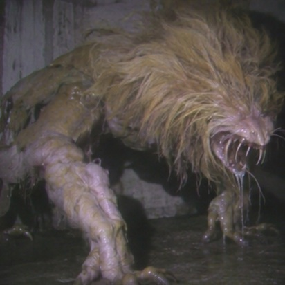
  - 【原典外貌】金毛披散、豹頭環眼、身軀雄健，使一柄亮銀「四明鏟」；在全書眾妖中罕見講究市井買賣規矩，辦「釘鈀會」還肯出二十兩白銀派小妖向百姓買豬羊。
  - 【本作克蘇魯／昆蟲寄生／偽人重構】捨棄威武雄獅毛髮，徹底改寫為**「擬態腐食重甲獅甲怪」**：身軀高達兩公尺半，全身覆蓋蠟黃與生鏽黃銅色交錯的厚重埋葬蟲甲殼；原典中張揚的「黃色獅鬃」，實為環繞頸胸放射狀展開的數十片**鋸齒狀濕亮幾丁質硬鱗與震動感應鬃針**，受驚時會像巨型蟬翼與金龜鞘翅般摩擦出刺耳金屬刮擦聲！其面部並無溫熱哺乳鼻吻，而是一張擬態出猙獰獅頭輪廓的厚殼面甲，下方裂開四片沾滿陳年豬油、腐肉渣與鐵鏽的**巨型咀嚼式大顎**，不斷分泌高腐蝕性黃色消化液來「擦拭保養」牠囤積的兵器；粗大前肢宛如螳螂捕食鐮與重型挖掘足的複合體，倒提一柄掛滿碎骨與黑油的四尖鋼鏟（四明鏟），張開背側鞘翅裂縫時，裡頭竟是一座不斷蠕動滲液的活體「兵器與生肉囤積肉囊」。
- **特性**：
  - 【原典記載】少數完全不覬覦食人長生、單純對極品神兵產生病態收藏癖的妖怪——深夜捲風偷走三件仿製／真品神兵，甚至高興得大辦「釘鈀會」；更奇特的是堅持花錢買豬羊、不無端搶掠平民，直到寶庫被燒、兵器被奪才徹底發狂搬出祖翁血戰。
  - 【本作衍生】現代都市裡極具黑色幽默卻又恐怖萬分的**「病態兵器囤積腐食大妖」**。平素為了不驚動警方與高階除妖師，會透過偽人雜役乖乖付現金收購批發市場的溫體豬羊內臟與廢棄五金，表現得宛如守法的地下倉庫業主；但牠對「蘊含靈氣的古董兵器、開光法器與金屬靈材」有超越理智的病態佔有慾，一旦鎖定目標便會於深夜無聲破牆盜走，誰敢動牠倉庫裡的藏品，牠就會徹底掀開鞘翅進入不死不休的狂暴狩獵。
- **弱點**：
  - 【原典記載】單打獨鬥雖具一流硬功，仍不敵三名高階戰力夾擊；且過於信賴外派跑腿小妖，讓臥底輕易混入老巢放火焚山，最終在復仇戰中遭聯手斬殺。
  - 【本作衍生】1. **情報鏈與供應商破口極大**：平素仰賴底層偽人採買妖往返市集，除妖師只要先攔截雜役並貼上**「障眼法」**偽裝送貨員潛入倉庫，就能趁牠專注於用酸液舔拭藏品時偷襲背甲鞘翅縫隙。2. **背殼囤物肉囊極怕貫穿雷火**：正面厚甲與四明鏟極難硬撼，須以**「陷地符」**限制其笨重下盤移動，再繞背將**「五雷鎮煞符」**或**「烈火符」**直接塞入其張開的鞘翅軟囊引爆。
- **習性**：
  - 【原典記載】盤踞豹頭山虎口洞，作息規律、愛擺宴請客炫耀藏品。
  - 【本作衍生】多匿藏於郊區廢棄肉品冷鏈倉儲、老舊五金鑄造廠地下室或山坡地違建鐵皮廠房，倉庫牆壁整齊釘滿偷來的古董刀劍、宮廟法器、生鏽鋼筋與風乾生肉，空氣中瀰漫濃烈的腐脂味與金屬機油酸氣。
- **喜好**：
  - 【原典記載】對「九齒釘鈀」等名貴兵器癡迷到專程舉辦「釘鈀會」，嗜食新鮮豬羊肉與美酒。
  - 【本作衍生】病態迷戀金屬冷光、高品質除妖法器與新鮮豬羊內臟，對欠帳不還或破壞藏品的「小偷」懷有極端憤怒。
- **擅長的招式／異能**：
  - 【原典記載】`四明鏟`（大開大闔、可與頂級神兵硬拚數十回合）、`深夜捲風竊寶`。
  - 【本作衍生】`四明鋸齒裂甲鏟`（配合重甲衝力一鏟劈斷鋼骨與防爆鐵門）、`靈器嗅覺追蹤`（隔數公里即能憑觸角鬚針偵測高階法器與金屬靈氣波動）、`腐脂酸霧噴射`（自大顎噴出滾燙惡臭的油脂腐酸溶蝕護身符紙）。

---

### [XY5-06] 刁鑽古怪與古怪刁鑽（虎口洞採買雜役小妖・偽人商販二人組）
- **出處順序**：第 89 回《黃獅精虛設釘鈀宴 金木土計鬧豹頭山》
- **類別與造型路線**：`【類人偽人型】`｜偽人商販節肢雜妖（擬態蜚蠊／竹節蟲採買雜役二人組）
- **物種／唯一性**：`物種（群體）`（豹頭山虎口洞雜役族群中最精於市井採買、一唱一和的兩名知名個體）
- **稀有度與道行對照**：`★ 凡級（N）`｜模糊道行：數年至數十年微末妖氣（毫無正面戰力，僅通低階人形擬態與市井周旋）｜本作階位：未入流～三流
- **外貌與黑暗地牢／恐怖谷視覺改寫**：
  - <!-- 圖位預留：待補繪 -->
  - 【原典外貌】虎口洞兩名奉命帶二十兩銀子下山向李家、張家買豬羊的跑腿小妖；沿途抱怨大王吝嗇、私算昧下幾兩碎銀做棉襖，轉眼遭定身術制伏並被奪去身分混上山。
  - 【本作克蘇魯／昆蟲寄生／偽人重構】極具台灣清晨批發市場陰森現實感的**「偽人商販恐怖谷二人組」**：兩人皆穿著不合身的退色舊雨衣與壓得極低的髒汙鴨舌帽，提著滲血塑膠袋在肉攤暗巷間低聲扯皮。**刁鑽古怪**脖頸異常細長且分出三道非人橫摺，皮膚底下隱約可見暗褐色蜚蠊背甲隨吞嚥上下滑動，雙眼太過貼近鼻樑、在市場日光燈管下偶爾閃出微細的漆黑複眼網格；**古怪刁鑽**則下顎過寬、說話時嘴角兩側會不自覺裂出兩根像大顎觸鬚般顫動的灰白皮刺，每當用十指多出一節關節、末端帶有潮濕吸盤墊的長手數著油膩千元大鈔時，總會發出像蟲翅摩擦般的輕微咔嗒笑聲——讓忙碌的市場攤販只覺得「這兩個大清早來掃貨的客人怪得讓人背脊發涼，但給現金給得挺爽快」。
- **特性**：
  - 【原典記載】全書最具市井小人物煙火氣的雜役小妖——從頭到尾不見噬人兇殘，只滿腦子計較豬羊行情、大王摳門與偷賺回扣，也正因這份貪小便宜而成為取經隊伍臥底反攻的最大突破口。
  - 【本作衍生】現代地下妖魔生態圈裡最底層的**「妖界外送採購兼線人」**。牠們比多數大妖更懂人類物價、早市路線與現金交易，為了賺點差價甚至敢偷偷和熟悉規矩的基層除妖師交換情報——前提是對方不掀牠們的偽人皮囊。
- **弱點**：
  - 【原典記載】全無格鬥實力與抗咒防禦，一記定身法便僵在原地任人搜身問話，終在虎口洞大戰中淪為炮灰。
  - 【本作衍生】膽小貪財、生命力與甲殼都極為薄弱；三流法師一記低配**「鎮妖定身符」**或微弱**「掌心雷」**電得牠們幾丁質關節抽筋，再遞上一疊現金或威脅引燃**「陽火符」**，兩隻偽人商販便會搶著把整座虎口洞的暗門密碼與大王作息招個精光。
- **習性**：
  - 【原典記載】頻繁往返妖洞與人間城鎮畜牧市集採買肉品酒水，對各家貨源價格瞭若指掌。
  - 【本作衍生】固定於凌晨兩點至四點出沒在台北環南市場、新北果菜批發場、傳統電宰禽肉巷弄或五金大賣場後門，壓低帽簷用沾滿陰溝泥水的現鈔大宗掃貨，再把生肉塞進破舊小貨車載回偏郊巢穴。
- **喜好**：
  - 【原典記載】愛趁採購時中飽私囊攢錢做冬衣買酒，最怕大王查帳責罰。
  - 【本作衍生】極度迷戀人類超商即期品打折、五金行廉價贈品與偷偷從採買費裡抽成的幾百塊小費，一提起「大王又扣預算」便會忍不住用沙啞蟲聲碎唸抱怨。
- **擅長的招式／異能**：
  - 【原典記載】無像樣法寶或攻擊術法，僅擅粗糙偽裝混跡市集與討價還價。
  - 【本作衍生】`市場擬態障眼`（分泌微弱資訊干擾氣味，讓攤販忽略牠們多出的指節與複眼反光，僅留下一閃而逝的不安感）、`油溝極速竄遁`（遇險時立刻拋掉貨袋、像巨型蜚蠊般四肢著地鑽進窄小排水暗溝逃之夭夭）。

---

### [XY5-07] 九靈元聖（竹節山九曲盤桓洞祖翁・九首環節水蛭巨獸）
- **出處順序**：第 89 回《黃獅精虛設釘鈀宴 金木土計鬧豹頭山》、第 90 回《師獅授受同歸一 盜道纏禪靜九靈》
- **類別與造型路線**：`【非人生物恐怖型】`｜終極不可名狀寄生環節巨獸（九首巨型環節蠕蟲／深淵吸血水蛭 × 骨甲巢軀古獸）
- **物種／唯一性**：`獨一無二`（全書唯一現世之太古九首妖聖，不假外物法寶、單憑肉身吸攝神通即凌駕群魔之不可複製災厄級個體）
- **稀有度與道行對照**：`★★★★★ 神級災厄（UR）`｜模糊道行：萬年太古妖聖・一吼上通三聖下徹九泉，正面空手一招擒盡取經全隊｜本作階位：巔峰～規格外
- **外貌與黑暗地牢／恐怖谷視覺改寫**：
  - 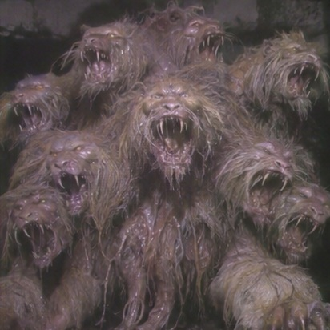
  - 【原典外貌】平素化作長鬚飄拂之威嚴老者坐鎮九曲盤桓洞，受眾獅尊為「祖翁」；怒顯真身則「毛髮如雲、錦毛飄動」，單一巨軀生出九顆雄獅頭顱，不執兵器法寶，九口齊張即可凌空銜人。
  - 【本作克蘇魯／昆蟲寄生／偽人重構】本卷最高規格的**終極非人生物恐怖巨獸（Darkest Dungeon × 克蘇魯規格外夢魘）**！徹底碾碎傳統金色雄獅神獸形象：一具盤踞整座地下深淵溶洞、龐大如崩塌高架橋墩的漆黑濕滑肉甲巨軀，體表覆蓋著如層疊腐蝕岩甲與陳年骨刺般的外骨骼縫隙，黏稠黑水沿著每一道軀體摺皺不斷滴落。最令目擊者當場理智崩裂的，是牠肩頸上叢生的九顆頭顱——那根本不是哺乳類獅頭，而是**九條粗如地下汙水幹線、通體濕滑反光、密佈肉質環節橫紋與滲液氣孔的巨型環節蠕蟲／深淵吸血水蛭巨頸**！每一條巨頸頂端微微膨脹成殘碎白骨獅顎與幾丁質骨瓣交錯的無目猙獰輪廓，中心裂開一圈向喉嚨深處螺旋層疊的**環形齒狀大吸盤口器**，口沿垂掛無數半透明水螅捕食觸絲與搏動吸管。當九條濕亮水蛭巨頸如失控黑潮般同時昂首張口，九重漆黑吸盤齊齊收縮抽氣，周遭雨水、碎石、光線甚至數十公尺外的除妖師連同護體結界，都會在震耳欲聾的濕潤吮吸巨響中被硬生生凌空吸攝銜走，拖入無盡潮濕黑暗的九重咽喉深處！
- **特性**：
  - 【原典記載】《西遊記》全書純粹肉身與天賦神通壓迫力最恐怖的絕頂妖聖之一！完全不靠任何收人法寶或外掛神兵，一個照面便憑「九首齊銜」將取經師徒與玉華王父子全數一口銜入洞府；更罕見的是牠對食人長生毫無興趣，現身純粹只為替義孫黃獅精討回血債，甚至在生擒絕頂敵手後僅用柳條鞭笞懲戒而不嗜血屠城，展現出冷酷而古老的霸主秩序感。
  - 【本作衍生】在本作現代都市奇幻體系中屬於**「絕對不可正面交鋒的活體天災（規格外）」**。九條環節巨頸各自擁有獨立神經節與空間捕獲力場，能同時鎖定九個不同空間象限——凡人除妖師甚至一流宗師在牠面前連掏符點火的空檔都沒有，任何「替身紙人」「輕身符」「五行小遁」都會被九重負壓吸盤連同空間褶皺一起吞噬；光是聽見九條巨頸同步共振發出的次聲波咆哮，三流以下法師便會耳鼻狂噴鮮血、當場昏厥。
- **弱點**：
  - 【原典記載】全書實戰近乎零破綻，絕頂戰力偷襲亦僅能趁隙劫走人質，正面毫無勝算；原典唯一絕對制衡為其原主「太乙救苦天尊」親臨敕令，一聲喝斥即令其伏首現形歸縛。
  - 【本作衍生】1. **常規物理火力、烈火與雷符近乎無效**：厚重骨甲與九重高再生環節肉頸能迅速脫落癒合，企圖強攻只會全滅。2. **唯一實戰生路在於「非衝突談判＋切斷復仇因果＋高階敕令」**：此怪極重「眷屬因果與古老尊嚴」，若未主動虐殺其直系眷屬或踏入其核心巢穴挑釁，牠往往不屑碾殺微末凡人；一旦真的爆發復仇追殺，唯有一流以上大宗門連夜設壇上表，引動對應之東極最高道統鎮獸法敕方有一線壓制可能。
- **習性**：
  - 【原典記載】因看守疏忽咬斷鎖鏈逃入凡間，蟄居竹節山九曲盤桓洞潛修，收編周邊六獅與黃獅為孫。
  - 【本作衍生】絕不流連於喧鬧市中心小巷，唯獨在深山百公尺以下的廢棄抽蓄水力發電地下廠房、連通多層地下暗河的天然巨型鐘乳石洞穴（九曲盤桓結構）或封閉半世紀的防空巨型坑道深處靜默盤踞；巢穴方圓十公里內所有流浪動物、蛇鼠與低階陰魂皆會因本能生物恐懼徹底絕跡。
- **喜好**：
  - 【原典記載】不嗜唐僧肉、不好聲色財貨，唯極度重視祖孫眷屬名分與不容踐踏的尊嚴（因黃獅精遭剝皮分食而勃然大怒出山）。
  - 【本作衍生】嗜靜臥於終年滴水的冰冷漆黑地底深淵吐納濕氣與地脈濁流；對卑劣毀約、虐殺其族裔或無禮闖入者展現絕對冷酷的清場意志。
- **擅長的招式／異能**：
  - 【原典記載】`九首齊銜`（顯九頭巨軀，九口同時凌空銜捕多名強敵，無視格擋閃避）、`震徹九泉神吼`（吼聲震裂空間、直開九幽門戶）、`柳枝鞭刑`（以懲戒羞辱方式折磨俘虜）。
  - 【本作衍生】`九維水蛭吸攝`（九條環節巨頸同步展開齒狀吸盤製造九向負壓空間渦流，隔空吸攝宿主並撕碎一切二流以下護身符罩）、`九泉次聲波震吼`（九重咽喉同時共振，直接震碎方圓數公里玻璃帷幕並令範圍內法師內臟出血、靈識強制脫殼）、`斷頸再生反咬`（即便強行斬斷其中一條巨頸，斷口亦會瞬間噴出大量寄生幼蛭並於數息內重新膨脹再生）。

---
### [XY5-08] 猱獅（九曲盤桓洞六獅孫之一・鐵線蟲長肢毛蜘怪）
- **出處順序**：第 90 回《師獅授受同歸一 盜道纏禪靜九靈》
- **類別與造型路線**：`【非人生物恐怖型】`｜寄生鐵線蟲 × 盲蛛長肢腐食怪
- **物種／唯一性**：`物種特異個體`（竹節山六獅孫中以高機動纏殺見長、由鐵線蟲與長肢節肢怪深度共生之變異妖王）
- **稀有度與道行對照**：`★★★ 珍級（SR）`｜模糊道行：數百年山中獅妖王道行｜本作階位：二流頂～一流
- **外貌與黑暗地牢／恐怖谷視覺改寫**：
  - 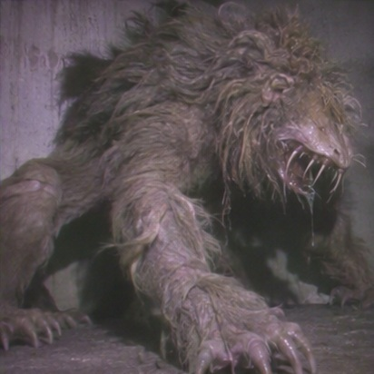
  - 【原典外貌】雜毛猱獅成精，形兼長毛猿猱與雄獅之悍猛，身手矯捷異常，手持一根佈滿尖刺的**鐵蒺藜**隨九靈元聖迎戰三徒。
  - 【本作克蘇魯／昆蟲寄生／偽人重構】將原典「長毛捲曲如猱」徹底降維為令人作嘔的**「鐵線蟲寄生 × 盲蛛長肢節肢怪」**：牠那畸形瘦長的暗褐幾丁質軀殼上根本沒有一根獸毛，從每道破損甲殼接縫與關節孔洞中垂掛而下的「黑色捲曲長毛」，竟是數以千計仍在濕潤蠕動打結的**活體黑色鐵線蟲與帶倒刺捕鳥蛛剛毛**！四對如盲蛛般過度拉長、多出一倍關節的細黑骨節肢末梢，與生鏽多刺的重型「鐵蒺藜」鎖鏈直接血肉癒合，長肢節點還鑲嵌著早已鈣化發白的被害者指節與鎖骨碎片；牠倒掛於漆黑潮濕洞頂或鋼骨鷹架時，口器裂成四瓣蒼白吸吮肉褶，黑油般的鐵線蟲團隨重力向下滴垂，彷彿一片隨時墜落包裹獵物的活體黑絲網。
- **特性**：
  - 【原典記載】竹節山六獅孫中機動性與立體撲殺能力最棘手的一員，甩動鐵蒺藜配合五位兄弟列陣合擊；然在九靈元聖遭收伏失去靠山後，終遭取經三徒聯手剿殺。
  - 【本作衍生】高空立體機動與「寄生纏械」特化的噩夢型中堅妖王。牠身上密佈的活體鐵線蟲不但能吸收鈍擊衝擊波，更能在兵器交鋒瞬間自動順著法器柄身逆爬上除妖師手腕，鑽進袖口與毛孔控制肌腱痙攣。
- **弱點**：
  - 【原典記載】正面絕頂戰力遠不及祖翁，一旦孤立無援遭多人圍殺即迅速覆滅。
  - 【本作衍生】滿身滲油且高度依賴水分維生的鐵線蟲團正是最大死穴——極懼**「烈火符／陽火符」**引燃，只要點燃一縷剛毛與蟲絲，高溫會令寄生鐵線蟲瞬間抽搐脫水爆裂、徹底剝奪牠的緩衝裝甲與視線；另可趁牠於鋼樑間盪躍無處借力時，以**「五雷鎮煞符」**精準引雷轟擊與雙臂癒合的金屬鐵蒺藜鎖鏈，令高壓電流直貫胸腹神經節。
- **習性**：
  - 【原典記載】蟄居竹節山九曲盤桓洞，聽從九靈元聖號令集體出征報仇。
  - 【本作衍生】在現代都市極喜盤踞於雨夜無人看管的多層鋼構建築鷹架、廢棄遊樂園鏽蝕雲霄飛車軌道或高架橋墩底部的潮濕陰影裡，垂放數條細黑鐵線蟲絲作為高空震動警戒網，獵物一觸即從正上方無聲垂降絞殺。
- **喜好**：
  - 【原典記載】原典未載明確個人嗜好，唯好隨群獅列陣嗜血惡鬥。
  - 【本作衍生】極度迷戀高濕度積水與居高臨下懸吊獵物的快感，習慣把失血昏迷的受害者用鐵線蟲團繭縛在高空鋼樑上慢慢滲入幼蟲吸乾體液。
- **擅長的招式／異能**：
  - 【原典記載】`鐵蒺藜`（多刺重錘高速揮砸）、`六獅聯軍合陣`。
  - 【本作衍生】`鐵線寄生網垂降`（自高處拋灑數百條活體鐵線蟲纏住法師持符手腕與腳踝並試圖鑽入皮下）、`鐵蒺藜鋼架墜擊`（借高空下墜重力掄碎水泥樓板與護身法器）。

---

### [XY5-09] 雪獅（九曲盤桓洞六獅孫之二・白殭菌白化冰殼甲蟲怪）
- **出處順序**：第 90 回《師獅授受同歸一 盜道纏禪靜九靈》
- **類別與造型路線**：`【非人生物恐怖型】`｜白殭菌冬蟲夏草寄生 × 白化洞穴甲蟲重甲怪
- **物種／唯一性**：`物種特異個體`（竹節山六獅孫中受極寒洞穴白殭菌徹底寄生異化之白化重甲妖王）
- **稀有度與道行對照**：`★★★ 珍級（SR）`｜模糊道行：數百年山中獅王道行｜本作階位：二流頂～一流
- **外貌與黑暗地牢／恐怖谷視覺改寫**：
  - 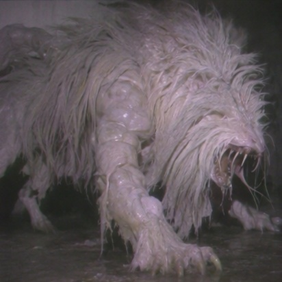
  - 【原典外貌】通體雪白之雄獅精，威猛雄壯，手執一柄沉重**三楞簡（三棱鐧）**迎戰取經三徒。
  - 【本作克蘇魯／昆蟲寄生／偽人重構】摒棄潔白威風雪獅，徹底改寫為**「白殭菌寄生 × 白化洞穴重甲金龜怪」**：龐大沉重的身軀宛如從終年零度地下冰窖爬出的盲目白化甲蟲巨獸，通體披覆半透明屍蠟白與病態淡青色交錯的硬質幾丁質甲殼，薄殼底下清晰可見深紫凍凝般的血淋巴脈管緩緩搏動；更令人本能反胃的是，牠每一道甲殼裂縫、背棘與口器周圍，皆長滿一層厚厚如霜雪與死屍發黴般的**活體白殭菌菌絲與柱狀孢子囊**（遠看如披覆雪白毛皮，近看全是隨呼吸一開一合噴灑冰冷白粉的寄生菌叢）！雙眼因洞穴白化退化為兩顆佈滿血絲的猩紅單眼腫泡，三對粗厚重甲步足間抓著一根表層覆滿骨質鈣化霜柱與凍硬血塊的沉重**三楞簡**，每走一步皆在潮濕地面留下迅速蔓延結霜的慘白菌絲腳印。
- **特性**：
  - 【原典記載】六獅孫中以重擊破甲見長，三楞簡沉重兇猛，協同兄弟圍攻一度給予對手極大壓力；於九靈元聖歸天後遭三徒殲滅。
  - 【本作衍生】兼具「超高鈍擊破盾力」與「低溫寄生孢子汙染」的重裝甲蟲殺手。三楞簡的沉重鈍震專破道門護體金光罩，而隨著揮擊漫天飛散的冰冷白殭菌孢子一旦被法師吸入肺部，便會在氣管內迅速生根結霜、令喉嚨僵硬發不出唸咒之聲。
- **弱點**：
  - 【原典記載】高度仰賴祖翁壓陣與群獅陣勢，落單後難敵絕頂強敵合圍。
  - 【本作衍生】1. **極度畏懼乾燥烈焰與高亮度強光**：白殭菌菌絲與洞穴白化血肉遇高溫會劇烈收縮碳化，且猩紅白化單眼對強光極為敏感——法師須先貼妥**「淨氣符」**防吸入孢子，再以**「烈火符」**連發爆閃兼高溫烘烤，即可同時致盲並燒爛其體表菌甲。2. **三楞簡揮擊收勢緩慢**：配合**「輕身符」**避開正面重擊，貼近其無菌絲覆蓋的腹部冷白軟膜以「掌心雷」重擊即可破局。
- **習性**：
  - 【原典記載】盤踞竹節山九曲盤桓洞，奉九靈元聖為尊集體行動。
  - 【本作衍生】在現代台灣常匿藏於停電荒廢的大型冷鏈肉品冷凍庫、深層地下冰水主機房、高山終年濃霧的廢棄隧道或濕冷老舊殯儀館冰櫃室，將整片密閉空間改造成佈滿白霜菌絲的恆溫寄生培養皿。
- **喜好**：
  - 【原典記載】原典未載明確喜好，唯重族義隨眾死戰。
  - 【本作衍生】酷愛零度上下的陰濕無光密閉環境，並嗜好在獵物尚未斷氣前將其冰凍活埋在菌絲堆裡，靜待白殭菌絲從受害者眼耳口鼻鑽出開花。
- **擅長的招式／異能**：
  - 【原典記載】`三楞簡（三棱鐧）`（重兵器猛擊硬撼神兵）、`群獅合擊`。
  - 【本作衍生】`三棱破盾重擊`（無視常規二流金光護身符的沉重破甲震擊）、`白殭寒霜孢子霧`（劇烈震動背甲噴出致冷真菌毒霧，令未貼淨氣符的法師氣管結霜窒息、逐漸僵化為活體菌柱）。

---

### [XY5-10] 狻猊獅（九曲盤桓洞六獅孫之三・炮步甲毒煙蜂巢怪）
- **出處順序**：第 90 回《師獅授受同歸一 盜道纏禪靜九靈》
- **類別與造型路線**：`【非人生物恐怖型】`｜炮步甲（放屁蟲）化學高熱毒煙甲蟲 × 焦黑蜂巢腹腔怪
- **物種／唯一性**：`物種特異個體`（借古獸「狻猊」喜煙好火之特性異化而成的耐火毒煙重甲蟲妖）
- **稀有度與道行對照**：`★★★ 珍級（SR）`｜模糊道行：數百年獅妖道行｜本作階位：二流頂～一流
- **外貌與黑暗地牢／恐怖谷視覺改寫**：
  - 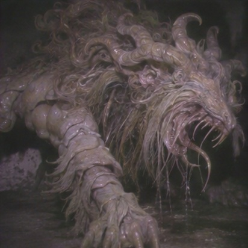
  - 【原典外貌】具異獸狻猊之名號的獅精，威猛兇悍，手使一條沉重**悶棍**隨群獅力戰三徒。
  - 【本作克蘇魯／昆蟲寄生／偽人重構】將「狻猊喜煙好坐」轉譯為最令人密集恐懼與窒息的**「巨型炮步甲（氣步甲）× 焦黑蜂巢化學毒煙怪」**：通體覆蓋猶如經歷火災焦化龜裂、表面佈滿密密麻麻炭黑氣孔的厚重耐高溫幾丁質重甲；其寬大拱起的胸腹結構根本是一座活體**焦黑紙質蜂巢與雙腔化學反應腺**！每個六角蜂巢孔洞深處皆隱約跳動著滾燙猩紅的過氧化氫黏液微光，口器與胸側氣門無時無刻不在「嘶嘶」噴湧帶著濃烈檀香焦炭、硫磺與腐臭毒酸的滾燙黑煙；前肢節肢關節粗糙如燒焦枯骨，緊握一根被化學毒煙與焦油反覆浸烤、表面長滿硬殼肉瘤的漆黑**重型悶棍**，蜷縮靜止於廢墟角落時宛如一尊正在冒煙的焦黑青銅香爐屍塊。
- **特性**：
  - 【原典記載】竹節山六獅孫核心骨幹之一，使悶棍狠辣沉猛，終因九靈元聖被收、大陣瓦解而遭斬殺。
  - 【本作衍生】所有仰賴烈火與煙燻作戰之基層除妖師的**絕對天敵**！其焦化幾丁質甲殼內襯絕熱灰層，普通「陽火符」「烈火符」砸在牠身上不但毫髮無傷，反而會替牠腹腔內的炮步甲化學毒囊升溫增壓，讓牠爆噴出更致命的高溫酸霧煙障。
- **弱點**：
  - 【原典記載】道行不及取經三徒聯手，缺乏高階保命法寶。
  - 【本作衍生】**嚴禁使用常規火攻與濃煙！** 真正致命破口在**「高壓水柱窒息氣門」與「雷電引爆內壓」**——只要觸發老舊建築的自動消防灑水頭、破開地下水管或潑灑大量冷水，就能堵塞其胸腹蜂巢氣門並令內部高溫化學腔驟冷龜裂；緊接著以**「掌心雷」**或**「五雷鎮煞符」**直擊其積滿易燃氣體的焦黑蜂巢腹腔，便能瞬間引爆其體內化學腺反噬炸裂。
- **習性**：
  - 【原典記載】盤踞竹節山九曲盤桓洞，聽候祖翁差遣迎敵。
  - 【本作衍生】極偏愛蹲踞在曾發生嚴重火災的焦黑廢棄廠房、老舊金紙香鋪地下庫房、大型焚化爐周邊排水溝或夜市炭烤油煙管井深處，能像死物香爐般紋絲不動潛伏整日，等待目標走入煙霧籠罩範圍便一記悶棍襲殺。
- **喜好**：
  - 【原典記載】原典未載細節（神話傳說中狻猊好煙火靜坐）。
  - 【本作衍生】病態嗜吸劣質線香黑煙、燒焦塑膠味與木炭餘燼，對高度潔淨、通風強勁的無塵環境表現出強烈的煩躁與攻擊性。
- **擅長的招式／異能**：
  - 【原典記載】`悶棍`（無聲陰狠重擊要害）、`群獅圍攻`。
  - 【本作衍生】`炮步甲沸酸黑煙噴射`（自蜂巢胸腹噴出逾攝氏百度的滾燙酸煙霧幕，同時致盲、燙傷裸露皮膚並腐蝕紙符）、`焦煙無聲悶棍`（藉高熱煙霧干擾視線與開天眼感知，貼身無聲敲碎目標顱骨）。

---

### [XY5-11] 白澤獅（九曲盤桓洞六獅孫之四・多目寄生扁虱複眼怪）
- **出處順序**：第 90 回《師獅授受同歸一 盜道纏禪靜九靈》
- **類別與造型路線**：`【非人生物恐怖型】`｜複眼腐蠅 × 多目寄生蜱蟲（扁虱）重甲怪
- **物種／唯一性**：`物種特異個體`（竹節山六獅孫中僭稱古獸「白澤」之名號、以高度特化視覺與反偵察見長之變異妖王）
- **稀有度與道行對照**：`★★★ 珍級（SR）`｜模糊道行：數百年獅王道行｜本作階位：二流頂～一流
- **外貌與黑暗地牢／恐怖谷視覺改寫**：
  - 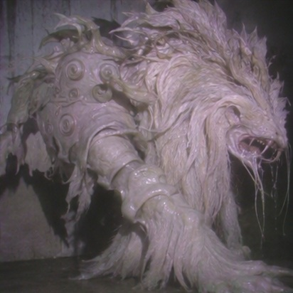
  - 【原典外貌】九曲盤桓洞六獅孫之一，名喚「白澤獅」，手持重型**銅鎚**隨祖翁大戰取經三徒。
  - 【本作克蘇魯／昆蟲寄生／偽人重構】徹底剝除傳統瑞獸白澤光環，將其重構為令人胃部劇烈抽搐的**「多目寄生扁虱（蜱蟲）× 巨大腐蠅複眼情報怪」**：牠有著宛如吸飽血般腫脹發灰、覆滿硬質革皮與細微倒刺的扁虱狀背囊，慘白拉長的畸形骨甲頭顱額頂頂出兩根枯萎分叉的幾丁質感受觸角；最讓人起雞皮疙瘩的，是牠頭臉、頸側、雙肩乃至厚重胸腹上，密密麻麻鑲嵌著數十顆大小不一、油亮漆黑且不斷滲出透明淚液的**凸出巨大腐蠅複眼肉瘤**！數十顆複眼各自朝不同方向高速跳動掃描，宛如活體監視器陣列，同時胸側氣孔會像蒼蠅振翅般震動發出清晰冰冷的擬態人聲，精準唸出除妖師暗藏的符咒張數與心跳頻率；一對細長如腐屍筋索卻肌肉扭結的節肢前臂，拎著兩柄長滿綠鏽與乾涸腦漿渣的沉重**青銅雙鎚**。
- **特性**：
  - 【原典記載】六獅孫中擔任重擊與洞府核心骨幹的猛將，揮舞銅鎚強壓敵手，最終隨群獅敗亡於悟空三徒之手。
  - 【本作衍生】扭曲繼承「白澤通曉萬鬼名姓與破綻」特質的**反偵察情報霸主**。數十顆複眼能同步接收紅外體溫、靈氣流向與符墨微光——任何三流至二流等級的「障眼法」「替身紙人」與牆後埋伏在牠面前形同透明，甚至能用冷酷的擬音嘲諷直接說破法師內心恐懼與法力底牌，徹底摧毀戰術節奏。
- **弱點**：
  - 【原典記載】正面絕頂戰力遠遜取經三徒聯手，並無保命法寶。
  - 【本作衍生】1. **極度過載的多重視覺神經正是絕命死穴**：數十顆缺乏眼瞼保護的裸露複眼極怕高強度閃光與靈視噪點——除妖師可猛然甩出**「破障符」**疊加高流明強光爆閃手電筒或**「烈火符」**近距強光，瞬間讓牠數十顆複眼同步充血爆裂、陷入劇痛失明狀態。2. **青銅重鎚極易引雷導電**：趁牠舉鎚盲揮之際以**「五雷鎮煞符」**隔空引電打在銅鎚上，電流會順著濕潤節肢直接燒毀牠高度敏感的神經中樞。
- **習性**：
  - 【原典記載】居九曲盤桓洞聽命於九靈元聖，隨眾出陣護洞。
  - 【本作衍生】常匿蹤於陰暗發黴的廢棄大學生物標本室、地下舊書倉庫或廢棄電信機房，宛如病態寄生學者般蒐集失蹤法師的筆記本、殘缺符籙手冊與監視器硬碟，靠吸食被害者脊髓液讀取其殘存記憶。
- **喜好**：
  - 【原典記載】原典未載個人嗜好。
  - 【本作衍生】病態痴迷於窺視、記錄並當面唸出敵人的隱私秘密、軟肋與法力枯竭的倒數秒數，享受獵物被完全看穿後的無力絕望。
- **擅長的招式／異能**：
  - 【原典記載】`銅鎚`（大開大闔重型鈍器猛擊）、`群獅車輪圍攻`。
  - 【本作衍生】`百眼破妄掃描`（無視二流以下障眼法與替身紙人，一眼鎖定真身、藏符口袋與傷口舊疾）、`神經讀音嘲諷`（以振翅聲波精準干擾法師唸咒節奏）、`青銅碎腕重鎚`（精準砸碎法師慣用掐訣手腕與膝蓋骨）。

---

### [XY5-12] 伏狸獅（九曲盤桓洞六獅孫之五・扁平盲蠍蜈蚣鐮肢怪）
- **出處順序**：第 90 回《師獅授受同歸一 盜道纏禪靜九靈》
- **類別與造型路線**：`【非人生物恐怖型】`｜擬態扁平巨蠍 × 盲蜈蚣貼地伏擊鐮肢怪
- **物種／唯一性**：`物種特異個體`（竹節山六獅孫中冠以伏擊猛獸之名「伏狸」、專精貼地暗殺之節肢妖王）
- **稀有度與道行對照**：`★★★ 珍級（SR）`｜模糊道行：數百年獅王道行｜本作階位：二流頂～一流
- **外貌與黑暗地牢／恐怖谷視覺改寫**：
  - 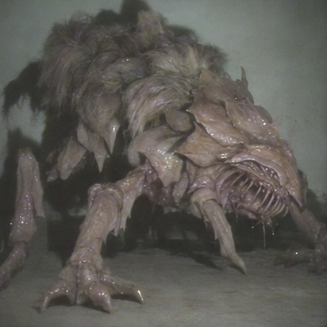
  - 【原典外貌】九曲盤桓洞六獅孫之一，手執寒光銳利之**鉞斧**，兇狠迅猛，隨祖翁圍戰三徒。
  - 【本作克蘇魯／昆蟲寄生／偽人重構】將「伏狸」的壓低潛伏特性推向極致生理恐懼，重構為**「扁平洞穴盲蠍 × 地底蜈蚣貼地伏擊怪」**：整副身軀並非立體巨獸，而是像巨型鞭蠍與百足盲蜈蚣般極度扁平延展、由十二道漆黑油亮反光的可折疊幾丁質體節構成，能像一層濕滑黑影般緊緊貼死在寬度僅十公分的地下室天花板管線夾層、貨櫃底盤或陰溝壁縫上！其頭胸部僅存扭曲的獅顎骨甲輪廓，沒有眼睛，改以一對長逾兩公尺、細如黑鞭的**鞭蠍感震觸肢**無聲探知地面震動；前肢卻異化為肌肉瞬間可充血暴脹三倍的鋸齒螳螂重鐮，與一柄斧刃開滿放血鋸齒槽的暗黑**古銅鉞斧**牢牢扣死，尾端拖著一條末端裂開三根毒針產卵細絲的漆黑節肢尾鞭，專在腳踝高度從陰影盲區無聲橫斬。
- **特性**：
  - 【原典記載】竹節山六獅孫中出手最陰狠毒辣的近身砍殺戰將，憑鉞斧與群獅配合作戰，最終在祖翁歸天後遭三徒斬殺。
  - 【本作衍生】都市地下空間裡最令人神經緊繃的**「靜音貼地斷肢暗殺者」**。牠能徹底收斂體溫與呼吸氣流，連踩過積水都不激起水花，專挑除妖師全神貫注應付前方威脅的瞬間，自腳底陰影或頭頂冷氣風管暴起一斧斬斷腳筋，徹底封死撤退可能。
- **弱點**：
  - 【原典記載】欠缺高階防禦法寶與遁逃神通，正面遭遇絕頂戰力聯手便難逃伏誅。
  - 【本作衍生】極端依賴狹窄陰影、天花板夾層與視覺死角——一旦被迫離開陰暗狹縫、在開闊明亮場地正面交鋒，扁平化甲殼的正面抗衝擊力明顯低於其餘五獅；法師進入高危地下停車場前務必先釋放**「尋蹤紙鶴」**掃描上方風管與車底，並於腳邊三步處預貼**「陷地符」**，趁牠貼地高速竄撲的瞬間使其扁平腹節深陷泥沼卡死，再以**「五雷鎮煞符」**垂直貫穿背節即可斃命。
- **習性**：
  - 【原典記載】潛居竹節山九曲盤桓洞，隨群獅出動護洞復仇。
  - 【本作衍生】深夜慣常縮身貼伏在老舊地下停車場低矮消防管線上方、巷口廢棄休旅車底盤下或地下室樓梯轉角陰影，靜待目標跨入兩公尺斬擊半徑便於零點三秒內暴起揮斧。
- **喜好**：
  - 【原典記載】原典未載明確喜好。
  - 【本作衍生】極度迷戀狹窄逼仄的擠壓夾縫與重斧刮過潮濕水泥地面的尖銳摩擦聲，有先切斷獵物雙腳跟腱、欣賞對方在積水裡徒勞爬行再從尾針注入麻痺蟲卵的殘虐習性。
- **擅長的招式／異能**：
  - 【原典記載】`鉞斧`（近身狠辣劈斬要害）、`六獅聯軍衝殺`。
  - 【本作衍生】`扁平影縫潛行`（將軀體壓扁貼合牆縫、車底與天花板盲區靜音高速爬行）、`低位斷筋重鉞`（自腳踝死角瞬間斜上揮斬撕裂防身法器與跟腱）、`尾針麻痺注卵`。

---

### [XY5-13] 摶象獅（九曲盤桓洞六獅孫之六・重裝獨角仙骨槍巨甲怪）
- **出處順序**：第 90 回《師獅授受同歸一 盜道纏禪靜九靈》
- **類別與造型路線**：`【非人生物恐怖型】`｜重裝巨型獨角仙／步行甲蟲 × 人骨共生鋼槍突擊怪
- **物種／唯一性**：`物種特異個體`（取「獅子摶象亦用全力」之威名、竹節山六獅孫中體重與裝甲衝擊力居首之重型巨甲妖王）
- **稀有度與道行對照**：`★★★ 珍級（SR）`｜模糊道行：數百年獅王道行｜本作階位：二流頂～一流
- **外貌與黑暗地牢／恐怖谷視覺改寫**：
  - 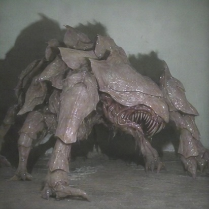
  - 【原典外貌】竹節山六獅孫之一，體壯力雄，手執一桿寒光森冷的**鋼槍**隨九靈元聖出洞迎戰三徒。
  - 【本作克蘇魯／昆蟲寄生／偽人重構】捨棄猛男雄獅肌肉，重塑為宛如失控裝甲衝城車的**「重裝巨型獨角仙甲蟲 × 骨肉融合長槍怪」**：身高逼近三公尺半，全身披覆如厚重鉚釘黑鋼板般層疊的黑亮幾丁質重甲，甲殼背脊與寬闊肩胛上硬生生嵌融著大量過去吞噬巨獸與人類留下的**慘白肋骨與股骨殘片**（作為外骨骼加強筋！）；其厚重無毛頭甲頂端拱出如重型鍬形蟲與獨角仙般的粗短攻城角脊，下顎大螯不斷磨擦出像碎石機般的低沉咯吱聲；最駭人的是牠過度粗壯的右前節肢已與那桿三公尺長的重型實心**鋼槍**徹底血肉甲殼共生——黑褐甲膜與鼓脹肉管直接包覆住槍桿後段，空心槍尖不斷滲出滑潤強腐蝕消化液，衝鋒時宛如一頭全身掛滿白骨的活體重甲鑽掘機。
- **特性**：
  - 【原典記載】名號「摶象」寓意絕不留手、獅子搏兔亦用全力，持長鋼槍在中距離強勢壓制敵陣，最終因九靈元聖遭收伏而大勢已去、遭取經三徒斬殺。
  - 【本作衍生】容錯率幾乎歸零的**「零試探全力直線衝鋒破陣手」**。哪怕面對區區三流基層散修，牠也不會像南山大王那樣戲耍炫耀，而是在視線鎖定的第一秒便啟動全部足肢爆發，發動足以貫穿三面鋼筋水泥承重牆的鋼槍貫刺，硬接者連盾帶人瞬間化為肉泥。
- **弱點**：
  - 【原典記載】缺乏抗衡絕頂神通之保命法寶，脫離祖翁後不敵取經三徒合擊。
  - 【本作衍生】極度龐大的體重與衝鋒慣性正是唯一生門——一旦進入全力直線突刺軌道，其笨重甲軀在五公尺內幾乎無法急停變向；法師須預留**「替身紙人符」**配合**「輕身符」**在最後半秒貼牆側閃，誘導牠將整根共生鋼槍深刺卡死進粗大地下室承重水泥柱或鋼樑內，趁其拔槍抽搐僵直的三秒空檔，直接把**「五雷鎮煞符」**拍貼在裸露金屬槍桿上，令高壓雷勁透過血肉共生通道直爆其胸腔核心。
- **習性**：
  - 【原典記載】盤踞竹節山九曲盤桓洞，為六獅孫正面破陣主力。
  - 【本作衍生】偏愛佔據筆直貫通、毫無遮蔽物的現代廢棄鐵路貨運隧道、大型地下公路引道或長條型停產重工車間，以利發揮最恐怖的直線加速衝鋒動能。
- **喜好**：
  - 【原典記載】原典未載明確喜好。
  - 【本作衍生】沉迷於純粹動能撞碎鋼筋水泥的巨響與堅硬大型骨骼的咀嚼感，極度輕蔑躲藏在暗巷放毒的孱弱小妖。
- **擅長的招式／異能**：
  - 【原典記載】`鋼槍`（長距直刺貫穿與重掃）、`六獅聯軍衝陣`。
  - 【本作衍生】`摶象重甲突刺`（凝聚全身數噸體重與妖氣於共生鋼槍一點的直線絕殺，可貫穿二流金光符罩與貨車鋼板）、`骨甲蠻撞震波`（衝擊波連帶震飛周遭三公尺內所有輕型法器與站立不穩之除妖師）。

---
## 🪲 參、第 91～92 回：金平府青龍山玄英洞

### [XY5-14] 辟寒大王（青龍山玄英洞長兄・冰寒偽佛犀金龜甲蟲巨獸）
- **出處順序**：第 91 回《金平府元夜觀燈 玄英洞唐僧供狀》、第 92 回《三僧大戰青龍山 四星挾捉犀牛怪》
- **類別與造型路線**：`【非人生物恐怖型】`｜巨型冰寒犀金龜甲蟲巨獸（偽裝成酥油燈前金佛塑像時呈現神像恐怖谷擬態）
- **物種／唯一性**：`物種特異個體`（修煉逾千年、生具極寒溫差調節巨角與偽佛幻象能力之玄英洞三巨甲長兄）
- **稀有度與道行對照**：`★★★★ 絕級（SSR）`｜模糊道行：千年成精大妖・合三兄弟之力足以生擒八戒沙僧並與大聖周旋｜本作階位：一流頂
- **外貌與黑暗地牢／恐怖谷視覺改寫**：
  - 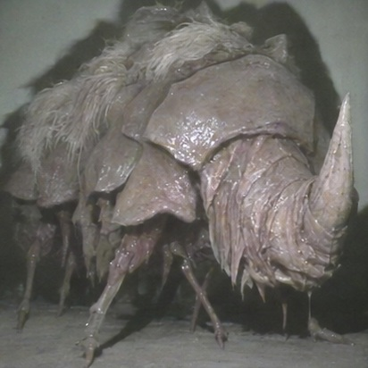
  - 【原典外貌】頭頂狐裘花帽暖、一臉昂毛熱氣騰，手使一柄沉重**大鉞斧**，原形乃生有「辟寒犀角」的千年巨犀；每年元宵節於金平府慈雲寺金燈橋現出假佛金身，張口吸乾天價酥合香油。
  - 【本作克蘇魯／昆蟲寄生／偽人重構】徹底揚棄草原犀牛外貌，化為黑暗地牢中最令人毛骨悚然的**「偽裝成酥油燈前佛像的巨型冰寒犀金龜甲蟲巨獸」**！在金燈煙霧搖曳與信徒磕頭膜拜之際，牠刻意將覆滿偽金箔粉塵與凝固蠟油的漆黑厚重鞘翅拱折盤坐，搭配頭胸高聳彎曲的巨型胸角與垂落如袈裟般的腐敗蟲膜，在昏暗燈火下拼湊出一尊過於腫脹僵硬、嘴角垂滴滾燙油蠟的「慈悲金佛剪影」；一旦油燈熄滅或被人識破，整尊「佛像」會發出令人牙酸的幾丁質爆裂聲驟然掀開，露出長逾四公尺、通體如凍裂黑鐵般佈滿冰霜凝露的**巨型深淵犀金龜甲蟲真身**！鼻端那根螺旋彎曲的「辟寒巨角」內裡密佈蒼白微血管般的吸熱中空導管，會瞬間抽乾周遭數公尺空氣中的熱量（對外呈現刺骨冰寒凝霜、對內維持高熱沸騰），巨顎下方垂出一條如巨蚊口針與吸血水蛭吻管混合的粗長**抽油吸管**，直接插進巨缸吸乾整缸酥油；六條覆滿凍霜倒刺的重甲步足中，前對緊扣一柄結滿發臭冷油塊的巨型**大鉞斧**。
- **特性**：
  - 【原典記載】擁有修煉千年的辟寒靈角，不畏嚴寒、更能分水潛海遁逃；長年策畫宗教詐騙，每逢元宵便聯手二弟三弟假扮三尊真佛吞食金平府官民耗資數萬兩銀子購辦的酥合香油，正面近戰更兇悍得連齊天大聖單挑都吃緊。
  - 【本作衍生】現代都市裡最狡詐也最厚重的**「邪教神壇裝甲詐騙大妖」**。牠擅長利用地下神壇、非法點燈法會與酥油長明燈的煙霧，在密閉空間展開「偽佛視覺擬態」與「奪溫寒流場」——既能靠信眾奉獻的高價香油與香客精氣維持龐大甲軀代謝，又能直接凍結一般基層除妖師的血液循環與符火。
- **弱點**：
  - 【原典記載】五行相剋下天生極懼「木德星宿」（原典中四木禽星一現身即心驚膽寒、戰意崩盤），逃入深海仍遭鎖喉咬斷脖頸伏誅。
  - 【本作衍生】1. **極度畏懼「木行穿甲法器與青木生發靈力」**：普通鋼刃與低階寒冰、凡火皆難破其冰寒厚重鞘翅，但以百年雷擊桃木釘、含強效東方木行毒素的**「青木破甲樁」**或高階木行鎮煞符陣，能令其幾丁質甲殼像被白蟻蛀空般迅速脆裂失去溫控機能。2. **頭胸甲連接頸膜與抽油口管為絕命軟肋**：當牠垂下吸管大口吞油或揮起大鉞斧蓄力時，頸部後側會暴露出無甲覆蓋的濕滑白肉關節，以木行雷符集中貫穿即可斃命。
- **習性**：
  - 【原典記載】與辟暑、辟塵結義盤踞青龍山玄英洞，每年正月十五固定現身金燈橋「顯聖」吞油；戰局不利便直接破海潛入深水逃竄。
  - 【本作衍生】盤踞於沿海廢棄重油槽區、停用煉油廠地下管溝或臨海潮濕廢棄防空洞；每逢元宵燈會、宮廟大型點燈消災法會或夜市高檔油炸廢油回收場深夜，便會悄悄將偽佛幻影投射進陰暗神龕裡瘋狂抽吸油脂與供香。
- **喜好**：
  - 【原典記載】極度嗜食昂貴提煉之頂級「酥合香油」，並沉迷於冒充神佛接受萬民跪拜的虛榮感。
  - 【本作衍生】挑剔得只肯吸飲高純度冷壓香油、祭祀酥油燈油與混入微量人脂的供奉膏油，對廉價工業機油充滿鄙視。
- **擅長的招式／異能**：
  - 【原典記載】`大鉞斧`（力大招沉、硬撼頂級神兵）、`辟寒靈角`（抗寒分水、深海遁逃）、`偽佛吞油幻象`。
  - 【本作衍生】`偽佛燈煙擬態`（在燈火濃煙中展開巨型佛像錯覺掩蔽甲蟲真身，令凡人與未開天眼者本能跪拜失神）、`奪溫冰霜界`（巨角瞬間抽乾周遭熱量，令空氣結冰並熄滅三流陽火符）、`長吻抽油吸噬`、`分水深潛脫逃`。

---

### [XY5-15] 辟暑大王（青龍山玄英洞次兄・嗜飲人脂酥油腐熱巨型甲蟲怪獸）
- **出處順序**：第 91 回《金平府元夜觀燈 玄英洞唐僧供狀》、第 92 回《三僧大戰青龍山 四星挾捉犀牛怪》
- **類別與造型路線**：`【非人生物恐怖型】`｜嗜脂腐熱巨型甲蟲怪獸（膨脹腐食葬甲／金龜巨獸 × 內燃油脂發酵囊）
- **物種／唯一性**：`物種特異個體`（修煉逾千年、生具吸熱降溫巨角並嗜飲滾燙油脂之玄英洞三巨甲次兄）
- **稀有度與道行對照**：`★★★★ 絕級（SSR）`｜模糊道行：千年成精大妖｜本作階位：一流頂
- **外貌與黑暗地牢／恐怖谷視覺改寫**：
  - 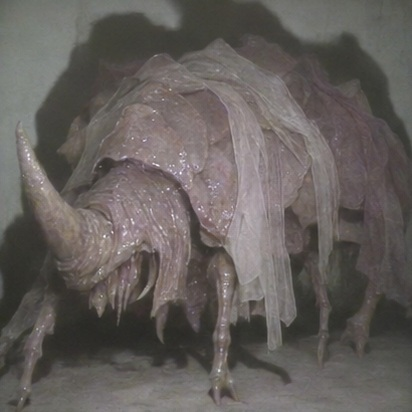
  - 【原典外貌】身掛輕紗飛烈焰、四蹄花瑩玉玲玲，手使一口沉重**鋼大刀**，原形為生有「辟暑犀角」的千年妖犀；元宵夜與大哥三弟合扮假佛大啖酥合香油。
  - 【本作克蘇魯／昆蟲寄生／偽人重構】重構為散發令人作嘔焦油與屍蠟臭味的**「嗜飲人脂酥油的腐熱巨型甲蟲怪獸」**：牠的胸背鞘翅並不像長兄那般漆黑堅硬，反而異化為層層半透明、泛著病態黃白色並不斷劇烈震顫的**薄脆皮紙狀油膜翼**（原典「輕紗飛烈焰」之生物恐怖轉譯）！透過這層半透明腐油薄翼，肉眼清晰可見牠過度肥碩膨脹的黃白軟腹內，正像沸騰煉油鍋般翻湧著數百公升**發酵腐熱的人脂與陳年酥油**，無數細小白色食脂蛆蟲在其氣門邊緣鑽進鑽出。鼻端那根如半透明骨蠟雕琢的「辟暑巨角」其實是一根反向熱交換吸熱管，能貪婪吞噬外界一切酷熱與烈火並轉化為腹內腐油發酵的溫床，因此體表卻滲出詭異冰涼滑膩的半凝固白油膏；四條泛著慘白骨光（「四蹄花瑩玉玲玲」）的節肢巨足踩踏處皆是一灘灘難洗的黏稠屍油，前鐮雙爪緊拖一把刃口滴滿黃油與黑血的厚背**鋼大刀**。
- **特性**：
  - 【原典記載】頭上「辟暑犀角」能消暑抗熱、分水入海；使一口鋼大刀力敵九齒釘鈀，並協同兄弟擒住八戒與沙僧；終在遇見五行木星天敵後戰意瓦解，敗逃西海遭活捉斬首鋸角。
  - 【本作衍生】全作最令火系除妖師絕望的**「吸熱吞火腐油重甲巨獸」**！凡是「烈火符」「陽火符」乃至高階真火砸向牠時，其辟暑巨角與油膜薄翼會瞬間將熱能吸乾轉為自身發酵腐熱與體力再生，火越旺牠的鋼大刀砍得越瘋狂。
- **弱點**：
  - 【原典記載】與兄長三弟同受「木德星宿」絕對壓制，一見天敵即肝膽俱裂，落入水域圍剿後遭生擒處決。
  - 【本作衍生】**嚴禁投擲烈火符與任何純高溫術法！** 1. **改採純雷擊與木行穿刺破角**：高壓雷電（「五雷鎮煞符」）靠瞬間生物電脈衝擊穿神經而非單靠高熱殺傷，搭配雷擊桃木槍直接劈斷其鼻端半透明吸熱巨角，將使其體內高壓發酵的數百公升腐熱人脂徹底失控沸騰倒灌自爆！2. **半透明油膜翼下方的膨脹軟腹防禦遠遜於硬甲**：繞過正面鋼刀，以**「青木毒針／桃木樁」**刺破薄翼劃開其發酵脂囊即可造成致命失壓。
- **習性**：
  - 【原典記載】與辟寒、辟塵共踞青龍山玄英洞，元宵夜偽佛吞油、遇險則集體遁海逃生。
  - 【本作衍生】台灣盛夏最酷熱難耐的七、八月深夜，極喜潛伏於大型飯店地下室油水分離槽、廢棄食用油提煉廠、夜市下水道硬化油脂堵塞箱涵或冷氣中央散熱井，一方面吸乾整棟建築的悶熱高溫，一方面大口吞嚥混雜腐肉與廢油的黏稠膏塊。
- **喜好**：
  - 【原典記載】嗜食金平府頂級「酥合香油」，酷愛三兄弟聯手擺出假佛排場。
  - 【本作衍生】病態沉迷於滾燙熬煉出油的油脂香氣——無論是酥油燈蠟、豬油渣還是失蹤流浪漢在悶熱地下室發酵出的屍脂，皆令牠口器發顫亢奮。
- **擅長的招式／異能**：
  - 【原典記載】`鋼大刀`（厚重闊刃狂劈）、`辟暑靈角`（抗炎熱烈火、入海分水）、`三犀聯陣`。
  - 【本作衍生】`吸熱腐油反哺`（吸收方圓五公尺內一切火符熱能並瞬間修復甲殼裂縫）、`腐熱沸油噴濺`（自薄翼腹囊噴出滾燙惡臭且極難撲滅的黏稠發酵油脂糊住對手視線與符袋）、`冷脂鋼刀狂斬`。

---

### [XY5-16] 辟塵大王（青龍山玄英洞三弟・塵蟎孢子獨角犀甲蟲）
- **出處順序**：第 91 回《金平府元夜觀燈 玄英洞唐僧供狀》、第 92 回《三僧大戰青龍山 四星挾捉犀牛怪》
- **類別與造型路線**：`【非人生物恐怖型】`｜塵蟎孢子寄生犀甲蟲巨獸（黑亮犀甲蟲 × 億萬共生塵蟎與孢子斥力場）
- **物種／唯一性**：`物種特異個體`（修煉逾千年、生具辟塵斥力獨角與共生蟎群之玄英洞三巨甲三弟）
- **稀有度與道行對照**：`★★★★ 絕級（SSR）`｜模糊道行：千年成精大妖｜本作階位：一流頂
- **外貌與黑暗地牢／恐怖谷視覺改寫**：
  - 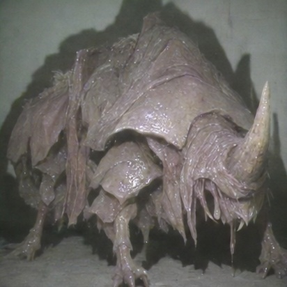
  - 【原典外貌】威雄聲吼如雷振、獠牙尖利賽銀針，肩擔粗重**扢撻藤棍**，原形為生有「辟塵犀角」的千年妖犀；元宵夜與二兄合扮假佛吸油。
  - 【本作克蘇魯／昆蟲寄生／偽人重構】將「辟塵（灰塵不沾身）」與「銀針獠牙」顛覆為極度令人全身發癢作嘔的**「周身附滿塵蟎孢子與硬質獨角口器的巨型犀甲蟲」**！乍看之下，牠漆黑如拋光黑曜石般的重型犀甲蟲外殼光潔得異常詭異——任何汙水、泥點、香灰與鮮血靠近牠體表三公分就會詭異地滑開彈落；但只要鏡頭拉近黑白顯微細節，便會驚駭發現每一道黑甲接縫、胸腹氣門與關節凹槽裡，都密密麻麻爬滿了數以億計灰白色的**活體巨化寄生塵蟎與高頻顫動真菌孢子囊**！正是這層永不停歇高速震盪的微蟲與孢子靜電層，把一切外來粉塵與飛射紙符彈開，同時不斷向四周播撒引發劇烈過敏窒息與皮膚潰爛的灰白蟎塵霧。牠那根如黑玉般堅硬的**硬質獨角口器**中線可猛然上下咬裂，內壁排滿細長如銀針的鋸齒狀吸血刺顎（「獠牙尖利賽銀針」），前肢緊扛一根纏滿活體枯藤神經索與蟎囊凸瘤的巨型**扢撻藤棍**。
- **特性**：
  - 【原典記載】「辟塵犀角」能令煙塵毒霧絲毫不侵、入海分水分波；揮舞扢撻藤棍力敵降妖寶杖不落下風，與二兄配合天衣無縫；終在木星天敵降臨後心神崩潰，逃入西海被生擒處斬，所留犀角分獻諸方。
  - 【本作衍生】專剋遠程消耗與粉塵系法術的**「靜電蟎霧偏折重甲怪」**。舉凡遠距甩出的紙符、香灰、糯米、毒煙霧彈乃至輕型飛針，一旦進入牠體表半公尺的高頻震盪斥力層便會自動打滑偏折；同時周遭瀰漫的無形活體塵蟎孢子會瞬間鑽入法師鼻腔與眼角，引發劇烈咳嗽、淚流不止與紅腫蕁麻疹，讓法師根本無法開口完整唸出咒訣。
- **弱點**：
  - 【原典記載】與二兄同樣天生極畏「木德星宿」相剋壓制，失魂落魄敗逃入海後遭圍捕斬首。
  - 【本作衍生】1. **近身貼肉施放木行／雷行重法破斥力層**：遠距輕量拋射物會被靜電蟎霧彈開，但具備足夠質量與靈壓穿透力的**「桃木長槍」**、**「木行鎮煞釘」**，或冒險切入內圈直接將**「鎮妖定身符」**硬拍在獨角根部縫隙，即可直接瓦解其斥力場。2. **必先配戴「淨氣符／避穢符」封鎖口鼻眼耳**：一旦防住塵蟎孢子吸入，並以高壓水柱或濃鹽水噴霧打濕黏死牠甲縫裡的活體塵蟎群，其辟塵偏折效應便會驟降七成以上。
- **習性**：
  - 【原典記載】盤踞玄英洞，與長兄次兄分工迎敵、共分元宵酥合香油。
  - 【本作衍生】極偏愛長年無人清掃卻又完全封閉的廢棄科技無塵室舊廠、積滿百年灰塵的老舊地毯戲院地下室或停業醫療影像機房——牠一方面靠靜電蟎層讓自己一塵不染，一方面又以滿室塵埃皮屑餵養身上億萬共生塵蟎。
- **喜好**：
  - 【原典記載】嗜食頂級酥合香油，熱衷冒充金佛享受叩拜。
  - 【本作衍生】對體表沾染濕泥與異物有病態潔癖，一旦甲殼遭汙染便會震怒狂吼，同時嗜好收集吸滿香油的古老棉布燈芯。
- **擅長的招式／異能**：
  - 【原典記載】`扢撻藤棍`（剛柔並濟的巨型藤棍重掃）、`辟塵靈角`（驅塵辟煙、分水潛海）、`雷震巨吼`。
  - 【本作衍生】`億萬塵蟎斥力障`（高速震動體表蟎群與孢子，彈開二流以下飛符、粉末與濃煙，並向周圍散播令人氣管腫脹的致敏毒塵）、`獨角銀針咬合`（硬質獨角中裂成針牙巨顎一口咬碎法器與鎖骨）、`扢撻寄生藤鞭擊`。

---

### [XY5-17] 青龍山玄英洞油垢小妖群（嗜油腐食幼蟲雜妖群）
- **出處順序**：第 91 回《金平府元夜觀燈 玄英洞唐僧供狀》、第 92 回《三僧大戰青龍山 四星挾捉犀牛怪》
- **類別與造型路線**：`【非人生物恐怖型】`｜嗜油腐食甲蟲幼蟲／肥白蛆形雜妖群（外出時披破爛僧衣偽裝邪壇雜役）
- **物種／唯一性**：`物種（群體）`（盤踞青龍山玄英洞、依附三犀甲蟲大王殘餘香油維生之百餘隻底層幼蟲雜妖群）
- **稀有度與道行對照**：`★ 凡級（N）`｜模糊道行：數年至數十年微末氣候｜本作階位：未入流～三流
- **外貌與黑暗地牢／恐怖谷視覺改寫**：
  - <!-- 圖位預留：待補繪 -->
  - 【原典外貌】三犀牛精麾下看洞、看押俘虜、點燈放哨之群妖，隨三大王出洞辦事，終遭取經隊伍直搗玄英洞殺散焚滅。
  - 【本作克蘇魯／昆蟲寄生／偽人重構】徹底剝除原舊版併入的龍宮水族天兵，純粹呈現玄英洞本土的**「嗜油腐食甲蟲幼蟲雜妖群」**：體型如半截矮胖孩童般彎曲肥腫、皮膚呈半透明滲油黃白色、生有十二對微弱爬行短足與漆黑圓硬口顎的巨型蠐螬（金龜幼蟲）異變體！牠們全身浸滿散發哈喇臭味的陳年香油與黑蠟垢，背部勉強頂著一塊生鏽鐵皮或披著一件油漬斑斑的破爛灰僧袍，在漆黑地下假廟與礦道裡舉著熄滅的鐵燈籠成群蠕動巡邏；每逢三巨甲進食完畢，這群幼蟲雜妖便會像白蟻群般瘋狂湧上石槽，用喀喀作響的黑顎啃舔地面凝固油垢。
- **特性**：
  - 【原典記載】平素在洞中負責綁押獵物、點燈助威與搖旗吶喊，毫無頂尖戰力，主心骨三大王一敗便全線崩潰遭清剿。
  - 【本作衍生】地下偽廟與邪教法會中最常見的「成群低階護衛雜魚」——單隻速度遲緩、力量薄弱，但成群結隊滾撲上來用滲油黏液糊住除妖師雙腳與法衣時極為噁心難纏。
- **弱點**：
  - 【原典記載】失去三大王庇護後一觸即潰，遭搗毀老巢全數焚殺。
  - 【本作衍生】**全身浸滿高度易燃香油正是牠們最致命的搞笑破綻！** 只要避開辟暑大王的吸熱場，對這群單獨巡邏的油垢幼蟲甩出一張最廉價的三流**「陽火符」**或打火機點燃的引火油布，整條礦道裡的幾十隻雜妖就會瞬間串燒成一片劇烈爆燃的活體油燈。
- **習性**：
  - 【原典記載】長居青龍山玄英洞陰暗洞窟，每年元宵隨三大王暗中運油守夜。
  - 【本作衍生】窩藏於無照地下神壇後殿倉庫、老舊宮廟堆滿酥油桶的陰暗地下室或廢油回收槽溝內，白天縮在空油桶裡裝死，深夜才集體爬出搬運祭品與看守暗門。
- **喜好**：
  - 【原典記載】愛舔食三大王吸食殘留之香油與燈燭油渣。
  - 【本作衍生】瘋狂嗜舔任何含動植物油脂的廢渣、炸物回鍋油與燒剩的拜拜紅蠟燭油。
- **擅長的招式／異能**：
  - 【原典記載】`洞窟油燈圍堵`、`亂兵持械衝撞`。
  - 【本作衍生】`滑油屍堆阻路`（在狹窄通道大量分泌滑膩油液使除妖師重心打滑跌倒）、`燃脂自殺撲咬`（被點燃後因劇痛發狂朝獵物懷裡滾撞試圖同歸於盡）。

---

## 🐇 肆、第 93～95 回：天竺國與毛穎山三窟

### [XY5-18] 天竺國・玉兔精（假天竺公主／宮廷偽人嚙骨昆蟲口器怪）
- **出處順序**：第 93 回《給孤園問古談因 天竺國朝王遇偶》、第 94 回《四僧宴樂御花園 一怪空懷情慾喜》、第 95 回《假合真形擒玉兔 真陰歸正會靈元》
- **類別與造型路線**：`【類人偽人型】`｜極致宮廷偽人 × 嚙骨昆蟲切咬口器寄生變體
- **物種／唯一性**：`獨一無二`（月宮搗藥靈兔因十八年前宿怨私逃下凡、奪舍頂替一國公主身分之唯一高階偽人妖體）
- **稀有度與道行對照**：`★★★★ 絕級（SSR）`｜模糊道行：千年天界仙獸成妖・手執搗藥短杵力戰齊天大聖半日不落下風｜本作階位：一流頂
- **外貌與黑暗地牢／恐怖谷視覺改寫**：
  - <!-- 圖位預留：待補繪 -->
  - 【原典外貌】於天竺國十字街頭高樓拋繡球招親的絕色公主；原形乃「缺唇尖齒、長耳稀鬚、團身一塊毛如玉、雙睛紅映猶欺雪上點胭脂」之白兔，自耳中抽出一根可長可短的仙家兵器「搗藥杵／短棍」力戰半日。
  - 【本作克蘇魯／昆蟲寄生／偽人重構】本卷最具窒息壓迫感的**極致「宮廷偽人（Mimic）」恐怖谷代表作**！徹底抹去毛茸茸可愛白兔或嬌豔古典美女氛圍——呈現在黑白高對比畫面中央的，是一名端坐於慘白繡樓紅幔下、肌膚細膩無暇得彷彿上釉冰冷屍瓷的蒼白瘦削美人，身穿繁複僵硬的古式宮廷嫁衣，手托一顆彷彿用濕潤人髮與暗紅筋膜編結而成的「繡球」。第一眼看去無懈可擊，然而只要細察便會墜入恐怖谷深淵：她整整一分鐘從不眨眼、頸部毫無動脈跳動，鎖骨與蒼白手背薄皮之下隱約透出雪白半透明的**幾丁質硬殼接縫與微細蟲節隆起**。**最令目擊者魂飛魄散的一瞬，是當她朝中選的獵物優雅微笑之際——她的上唇正中猛然向上撕裂成三瓣滲血口縫，原本整齊的人類兩顆門牙如彈簧鋼針般驟然伸長、側翼彈開密布倒鉤鋸齒的慘白「嚙骨昆蟲切咬口器」，伴隨一陣細微冰冷的骨粉喀嗒摩擦聲；與此同時，那雙原本溫柔含情的瞳孔深處，猛然浮現出毫無人類情感、切割成數百道菱形血紅微光的「血紅複眼反光」！** 披散漆黑長髮底下緊貼著一對長逾半公尺、長滿細密感覺剛毛與微細寄生吸孔的蒼白肉觸假耳；她反手從自己滴落白色寒霜漿液的耳道深處緩緩拔出一根「搗藥短杵」，杵身密密黏附著未磨碎的人類指骨渣與冰冷玄霜神經毒粉。
- **特性**：
  - 【原典記載】動機極度扭曲偏執——因十八年前挨了素娥一巴掌而懷恨在心，私逃下凡整整一年，先將真公主（素娥轉世）攝拋至布金禪寺荒野逼至裝瘋，自己完美頂替公主身分坐享尊榮，又趁唐僧途經精準拋繡球強行逼婚欲採元陽成仙；正面武藝更驚人得能憑短杵與齊天大聖半空激戰半日直到日落才漸露敗象。
  - 【本作衍生】現代都會最難被表世界察覺的高智商**「身分奪舍頂替型頂級宮廷偽人」**！她不像低階野妖那樣直接在暗巷啃屍惹警察，而是冷血精準地將某位富家千金、名媛或豪門繼承人綁架關入廢棄精神病院或偏郊老寺逼瘋，自己穿上對方的華服、完美復刻筆跡、語調與社交圈，在一片光鮮亮麗的婚宴與豪宅裡暗中篩選純陽修行者或高階除妖師，拋出「血紅因果繡球」將獵物軟禁進婚房，用嚙骨口器一點一點啃噬脊髓與陽氣。
- **弱點**：
  - 【原典記載】久戰氣力終究遜於絕頂戰力（大戰半日至天色將晚已顯力怯敗象）；且受原主月宮太陰威勢絕對壓制，一見正主喝令即刻打滾現形伏誅。
  - 【本作衍生】1. **極度依賴「狡兔三窟」式多出口老宅地形遁逃**：切忌單兵直接殺進她精心布置的婚房或毛穎山式多通道地下巢穴！實戰必須先以**「尋蹤紙鶴」**徹底查清該建物聯通下水道、廢棄電梯井與相鄰暗巷的全部隱藏逃生洞口，提前貼死**「指地成鋼符／陷地符」**封堵「三窟」退路。2. **純陰玄霜體質畏懼烈日正陽與持久車輪戰**：她的爆發力與玄霜寒毒在滿月深夜最為恐怖，但耐力不及頂尖陽剛重甲戰士——只要撐過初期狂攻、將戰線拖延至黎明旭日東昇，輔以高熱**「烈火符」**蒸散她的玄霜骨粉並以**「五雷鎮煞符」**連擊其裂開的嚙骨口器內腔，即可重創其偽人核心。
- **習性**：
  - 【原典記載】下凡後一邊冒充公主享盡宮廷榮華，一邊於毛穎山經營極為隱密的「狡兔三窟」作為最終藏身巢穴。
  - 【本作衍生】白晝能完美偽裝成氣質冷豔、極具禮教修養的豪門待嫁千金、古風婚紗館主理人或百年中藥鋪女東家，私下卻把老屋地下室改造成四通八達、連接市區排水幹線與廢棄捷運機坑的潮濕白骨三窟，每逢農曆十五滿月夜在無窗密室中研磨骨粉與藥霜。
- **喜好**：
  - 【原典記載】睚眥必報（十八年前一巴掌記仇至今）、痴迷富貴招親排場（高樓拋繡球、御花園設宴）與玄霜藥杵、純陽精氣。
  - 【本作衍生】極度偏執於純白無瑕的蕾絲婚紗、冰冷玉石搗藥缽、精細研磨骨骼發出的沙沙聲響，以及看著昔日輕視過自己的正主在泥淖中發瘋求饒的病態快感。
- **擅長的招式／異能**：
  - 【原典記載】`搗藥杵（短棍）`（可隨心伸縮、重逾千鈞，硬撼如意金箍棒半日不折）、`移形奪舍頂替`（假冒公主整整一年連生身父母亦毫無察覺）、`攝風拋人`（一陣陰風將正主擄拋百里外）、`狡兔三窟地遁`。
  - 【本作衍生】`紅繡球因果鎖婚`（凡被她擲出的血絲繡球擊中頭頂者，雙眼立刻蒙上複眼幻光、心智呆滯並主動走向婚房任其採噬）、`嚙骨口器碎咬`（微笑間突發近距突襲，鋸齒門牙口器一咬即能切斷頸動脈與二流護身玉珮）、`玄霜骨粉搗杵`（揮動短杵震出零下數十度的致命骨粉毒霜，吸入口鼻便會凍結肺泡與經脈）、`三窟無聲地裂閃遁`。

---

## 🐢 伍、第 99 回：第八十一難・通天河末難怪獸與奪經陰魔

### [XY5-19] 通天河老黿（千年白黿・第八十一難末難復現補記）
- **出處順序**：第 99 回《九九數完魔滅盡 三三行滿道歸根》（初登場互參卷三第 49 回《三藏有災沉水宅 觀音救難現魚籃》）
- **類別與造型路線**：`【非人生物恐怖型】`｜深淵甲殼寄生水獸（千年白黿巨殼 × 環節屍皺水蛭頸 × 藤壺水螅共生體）
- **物種／唯一性**：`物種特異個體`（於八百里通天河底獨自苦修一千三百餘年、通曉人言且執念化形未果之極罕見長壽巨黿）
- **稀有度與道行對照**：`★★★ 珍級（SR）`｜模糊道行：一千三百餘年水獸道行（深諳江河暗流與負重沉溺，卻未能脫殼化人，正面鬥法亦非頂級妖王對手）｜本作階位：一流（深水江河絕對主場）
- **外貌與黑暗地牢／恐怖谷視覺改寫**：
  - 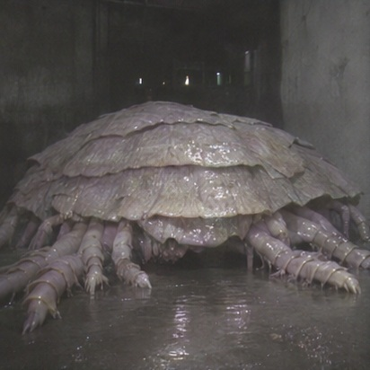
  - 【原典外貌】體型廣闊如山丘渡船的千年蒼老白黿，昔年水府遭奪蒙救後感恩馱渡取經師徒，僅託唐僧代問自己「何時得脫本殼，可得一個人身」；第 99 回再次滿懷盼望主動浮水免費馱運，行至河心驚覺唐僧早已將承諾忘得一乾二淨，遂大怒縮身沉水掀翻眾人與真經，造就第八十一難「遇黿濕經」。
  - 【本作克蘇魯／昆蟲寄生／偽人重構】徹底洗去溫馨童話神龜色彩，以黑暗地牢深淵水怪美學重構：一具直徑超過十五公尺、宛如半座沉沒多年且佈滿白色石灰礦痂與腐爛藻泥的廢棄水泥橋墩般緩緩浮出黑水的**巨型白化老黿甲殼**！其佈滿裂縫的慘白軟革甲殼表面，密密麻麻寄生著大片尖銳慘白的**淡水巨藤壺、隨水流搖曳的半透明水螅觸絲群與數百條吸滿黑血的粗胖淡水吸血水蛭**，彷彿一座活著的浮動水底腐殖礁岩。從腐敗甲縫緩緩探出的老黿頸部異常細長、佈滿一圈圈如溺斃浮屍又似巨型環節蠕蟲般的慘白鬆垮皮膚橫褶，頸側開滿不斷吐出腐泥氣泡的濕滑感壓孔洞；一雙覆蓋白濁障膜的巨大魚死眼卻透出令人脊背發涼的死死凝視，寬闊無牙卻邊緣如碎石鋸齒的骨質巨喙微微開合，殼腹底下則隱藏著能瞬間製造強烈負壓漩渦的肉質吸盤褶皺——當牠聽見背上人類食言的剎那，滿殼寄生水蛭同時鼓脹昂起，整座巨島般的背殼驟然垂直下沉，把背信者連同最珍貴的器物死死拖進漆黑無光的河底淤泥。
- **特性**：
  - 【原典記載】全書最具因果反諷與人情冷暖的千年水獸——既不吃人肉也不奪寶，苦修一千三百年只為討一個「脫殼化人」的卑微答案；就因對方一句隨口應承卻徹底遺忘的空頭支票，老黿在對方功德即將圓滿的最後一道關卡沉背翻船，直接補齊第八十一難並讓真經沾石撕損。
  - 【本作衍生】在本作都市奇幻世界觀中，是最令契約違約者毛骨悚然的**「深淵追債違約巨獸」**！牠平素安分守己，甚至會在颱風暴雨或江河決堤時主動浮出水面救起落難旅人並提出一個微小請求；但牠對人類的口頭承諾記得比白紙黑字還死，哪怕相隔十年、二十年，只要發現你把當年的託付拋諸腦後，牠就會在你最接近人生終點、以為已經上岸的前一秒悄然浮出水面，連本帶利掀翻你的一切。
- **弱點**：
  - 【原典記載】不擅陸地硬戰與高階法寶對決（昔年水府遭靈感大王強佔時毫無還手之力）；且本性敦厚守信，**只要切實履約給出交代，便絕不主動傷人**。
  - 【本作衍生】在深水江河、淹水箱涵與大型水庫內如同無法正面擊沉的生物裝甲潛艇，絕不可在涉水時刻激怒牠；最高明且零成本的破解之道永遠是**「記死每一句對異類許下的承諾、絕不敷衍畫大餅」**。萬一陷入水下絕境，必須立刻捏緊**「避水訣」**並以防水油布死護隨身符紙（符紙與秘籍一旦泡水便全數報廢！），同時以**「掌心雷」**刺激其殼縫最怕電的寄生水蛭與軟頸脫身游向岸邊，切勿與牠在深水角力。
- **習性**：
  - 【原典記載】蟄居八百里通天河底水府（黿鼉第），苦修千三百年，日夜期盼化去硬殼得成人形。
  - 【本作衍生】在台灣現代環境多沉眠於大型水庫最深處遭淹沒的舊聚落遺址、寬闊大河河口淤泥深潭或長年積水的巨大地下蓄洪槽底，數十年不動如灰白沉石，唯有聽見熟悉聲音或舊日違約者靠近水域時才會緩緩浮起。
- **喜好**：
  - 【原典記載】畢生執念唯有「脫去黿殼、修成人身」；極重視恩義與信諾，痛恨過河拆橋、敷衍食言之輩。
  - 【本作衍生】極度厭惡油嘴滑舌、隨口答應卻轉頭就忘的政客式敷衍話術，唯對說到做到、肯把微末承諾放心上的誠實凡人心懷敬重。
- **擅長的招式／異能**：
  - 【原典記載】`巨殼渡江`（廣背負載萬斤橫跨八百里險波）、`呼喇沉背翻船`（於江心深水驟然縮頭潛底，瞬間將背上生靈與典籍全數捲落深淵）。
  - 【本作衍生】`深淵違約大漩渦`（垂直下沉同時收縮腹底肉褶吸盤，於寬闊水面製造直徑數十公尺的漆黑負壓暗流，專沖毀背信者隨身最珍貴的契約、憑證與符籍）、`寄生蛭霧脫落`（受攻擊時震落滿殼吸血水蛭與水螅毒絲纏住落水者四肢）。

---

### [XY5-20] 通天河奪經陰魔群（第八十一難夜襲搶經・無定形濕霧寄生集群）
- **出處順序**：第 99 回《九九數完魔滅盡 三三行滿道歸根》
- **類別與造型路線**：`【非人生物恐怖型】`｜無定形濕霧昆蟲寄生集群（嗜墨水蠅群 × 半透明水蛭黏液絲 × 變形蟲狀陰煞群體）
- **物種／唯一性**：`物種（群體）`（每逢天地靈物、高階經卷或強大符籍浸水外洩靈氣時，自漆黑暴雨與江澤腐泥中成千上萬匯聚而生之無定形搶奪陰魔集群）
- **稀有度與道行對照**：`★★ 稀級（R）`｜模糊道行：數十年至百年水澤陰煞集群（單體如微蟲泥絲般微弱，但暴雨黑夜成片聚合後極度棘手，需連戰通宵至天明方散）｜本作階位：二流（群體環境災厄型）
- **外貌與黑暗地牢／恐怖谷視覺改寫**：
  - <!-- 圖位預留：待補繪 -->
  - 【原典外貌】第 99 回師徒落水濕經爬上通天河岸之際，忽見天昏地暗、狂風驟雨、電閃雷鳴，漫天陰霾中湧出無數「陰魔」暗中搶奪泡水外洩靈氣之真經；取經眾人整夜揮兵死守惡戰，直待黎明天明陽升，這夥陰魔方才潰散無蹤。
  - 【本作克蘇魯／昆蟲寄生／偽人重構】以純粹克蘇魯「不可名狀無定形集群」手法，填補西遊最後一場壓軸夜戰妖魔：牠們沒有固定骨骼或單一頭顱，而是由數百萬隻漆黑盲眼**嗜墨水蠅、細如髮絲的半透明吸血水蛭幼絲與灰黑變形蟲狀腐水黏液**在狂風暴雨中強行凝結而成的「活體陰雨黑霧」！在雷電照亮河岸的零點一秒黑白閃光裡，可見這團翻滾的濕冷黑霧不斷分裂、拼湊出數十條節肢長短不一、由無數顫動蒼白幼蟲與殘破溺屍指骨胡亂堆疊成的**抓握觸手**，伴隨著如億萬隻飛蟻拍打濕紙的尖銳嘶鳴，瘋狂撲向浸水後靈氣外洩的經卷、符袋與精疲力竭的除妖師眼耳，企圖將每一張泡濕的護身符紙連同文字一起吞噬溶解。
- **特性**：
  - 【原典記載】壓軸構成第 99 回第八十一難的後半段真實惡戰——並非只有老黿翻船，經卷一旦浸水，蘊含的天地靈氣外洩便會立即引來滿天陰魔趁暴雨黑夜蜂擁搶奪，逼得眾人徹夜死戰直到黎明旭日升起才真正化險為夷。
  - 【本作衍生】現代台灣颱風夜、梅雨暴洪夜裡最令人防不勝防的**「泡水靈物誘發型無定形群魔」**！只要除妖師的符囊、祖傳手抄符本或鎮宅古經在暴雨淹水中浸濕破損、靈氣失封外洩，附近排水箱涵與河濱陰溝裡的無定形濕霧蟲群就會在十秒內感應聚攏，瞬間把周遭百公尺化為伸手不見五指的暴風雨圍城，不死不休地搶咬浸水符籍直到太陽出來。
- **弱點**：
  - 【原典記載】極度畏懼**黎明陽光與純陽剛猛兵器護持**——雖能趁黑夜雷雨瘋狂消耗，但只要死守撐到天明陽氣升騰，便自動崩解消散。
  - 【本作衍生】1. **無固定核心，切忌用單體精準斬擊白費體力**：揮刀砍進蟲霧只會暫時劈開缺口隨即癒合，必須採取**「大面積陽氣震盪＋高溫烘烤」**策略——以**「烈火符」**或**「陽火符」**在身周畫出持續燃燒的乾燥火圈，配合**「掌心雷／五雷鎮煞符」**的高壓閃光與臭氧脈衝瞬間蒸發周遭水氣與蟲霧。2. **立即密封泡水符籍切斷靈氣外洩源**：只要將濕損符紙迅速裝入乾燥密封鐵盒並貼上封靈鎮符，失去氣味牽引的陰魔集群就會在數分鐘內自行瓦解回退成一灘發臭黑水。
- **習性**：
  - 【原典記載】平素隱伏於大江大澤陰霾深處，專俟雷雨暗夜、珍貴靈經落水失防之際傾巢搶奪。
  - 【本作衍生】潛伏在台灣夏季颱風夜的河濱高灘地、滿溢的地下排水箱涵與停電浸水的老舊地下室，對「潮濕紙張墨汁味」「開光古籍靈氣」與「法師失溫發抖的恐懼汗味」具備數公里級嗅覺。
- **喜好**：
  - 【原典記載】瘋狂貪婪地搶奪浸水外洩靈氣的佛經與天地靈文字。
  - 【本作衍生】嗜啃吸滿硃砂墨汁、靈氣符灰的濕爛紙纖維，並愛在雷電交加的深夜裡趁人最疲憊絕望時一擁而上。
- **擅長的招式／異能**：
  - 【原典記載】`陰風驟雨蔽空`（瞬間招來狂風暴雨遮蔽月光星輝）、`徹夜群魔搶經`（源源不絕消耗目標氣力直至黎明）。
  - 【本作衍生】`濕霧無形吞符`（化作上百條由水蠅與水蛭絲構成的濕冷黑觸手，專扯除妖師腰間符袋並以腐酸唾液瞬間融毀濕紙符）、`暴雨窒息合圍`（將百公尺內的氣溫與能見度驟降至極限，令未帶照明與火種者陷入失溫與迷向恐慌）。

---

## 🏁 本卷終章檢核與導覽

- **卷五收錄總計**：**20 則**純妖怪與怪獸條目（編號 `XY5-01` ～ `XY5-20`；涵蓋第 81～100 回全部真實登場妖蟲、山妖、獅蟲巨怪、犀甲巨獸、宮廷偽人、深淵水獸與奪經陰魔；**神佛天兵與凡人收錄數為 0**）。
- **插圖狀態統計**：已嵌入既有黑白墨線圖檔 **15 幅**，待補繪預留圖位 **5 處**（`XY5-04`、`XY5-06`、`XY5-17`、`XY5-18`、`XY5-20`）。
- **返回導覽**：[👹 妖怪篇總綱](../00-妖怪篇總綱與圖鑑分級.md) ｜ [📖 西遊記總錄](./00-西遊記妖怪怪獸總錄.md) ｜ [⬅️ 卷四：第 61～80 回](./04-卷四_第61至80回.md)
